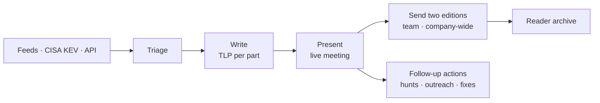
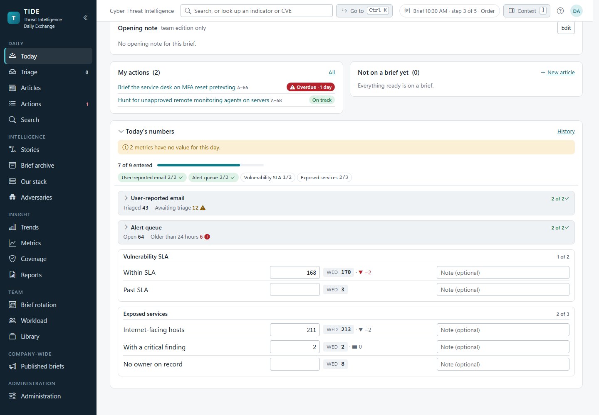
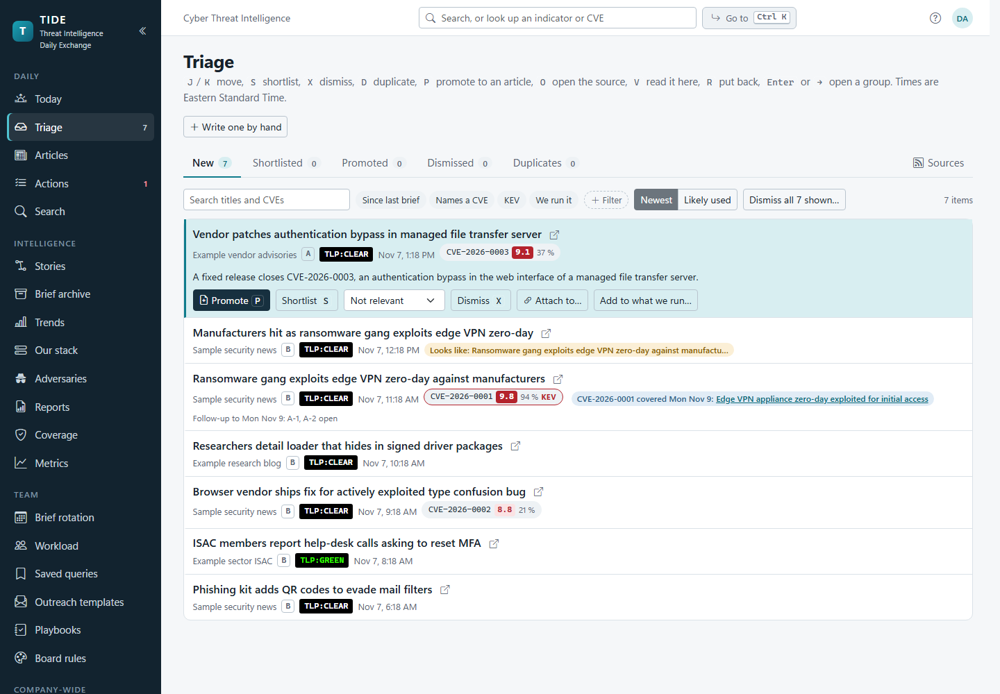
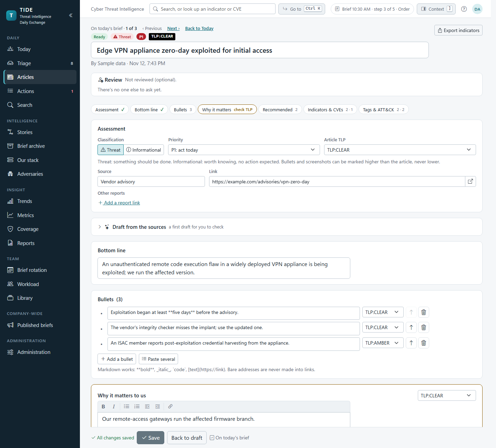
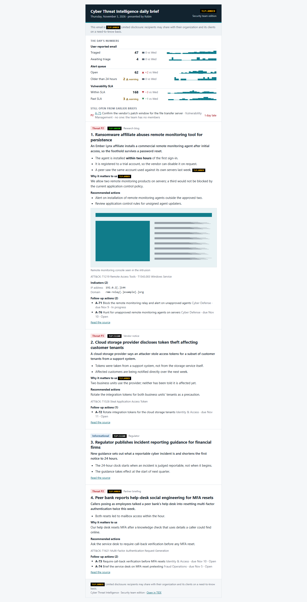
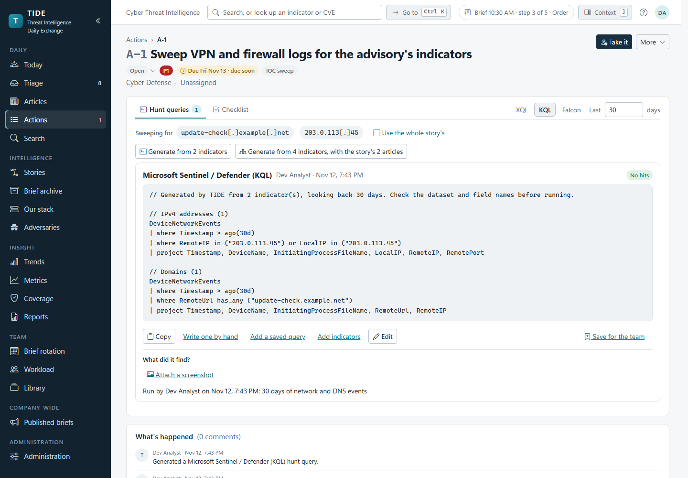

# TIDE: Threat Intelligence Daily Exchange

> The threat-intelligence team's daily brief, from the morning's feeds to the last follow-up action.

An open-source, on-prem web app for a threat-intelligence team's **daily brief**. The analyst whose turn it is
triages the day's security news and private-source intel and writes it up. The team presents it at a morning
meeting. The brief then goes by email to the security teams and, cut down by **TLP 2.0**, to the whole company. The
**follow-up actions** are tracked to the end, whether a five-minute IOC sweep or a month-long remediation.

It runs on Windows Server with IIS and signs people in with their Windows (Active Directory) account. Its data is in
SQL Server, and it's built to share a server and a SQL instance with other line-of-business apps.

## Documentation

Everything is in **[docs/](docs/README.md)**, indexed by the question you have.

| If you want to… | Start with |
|---|---|
| See every screen and what it does | [docs/product/screens.md](docs/product/screens.md) |
| Understand how it's built | [docs/architecture/overview.md](docs/architecture/overview.md) |
| Understand the schema | [docs/architecture/data-model.md](docs/architecture/data-model.md) |
| Understand how TLP decides what each audience gets | [docs/architecture/editions-and-tlp.md](docs/architecture/editions-and-tlp.md) |
| Call the API or receive webhooks | [docs/API.md](docs/API.md) |
| Develop it | [docs/development/getting-started.md](docs/development/getting-started.md) |
| Install, configure and run it | [docs/INSTALL.md](docs/INSTALL.md), [docs/operations/configuration.md](docs/operations/configuration.md) |
| Upgrade it | [docs/UPGRADE.md](docs/UPGRADE.md) |
| Know why it was built this way | [docs/decisions/](docs/decisions/README.md) |

## What it does



- **Triage:** a keyboard-driven inbox of RSS/Atom and KEV items, with CVE enrichment (CVSS, EPSS, KEV), duplicate
  and "looks like one event" grouping, a reading pane, and past coverage.
- **Write:** articles with a bottom line, bullets, "why it matters to us", screenshots, ATT&CK techniques, threat
  actors, indicators and CVEs, each part with its own TLP marking. Optional AI drafting is capped by TLP and
  accepted suggestion by suggestion.
- **Present:** a full-screen slide deck that the team joins live, with notes, raised hands and one-click actions.
- **Send:** the team edition and a TLP-cut company-wide edition by email, each frozen as sent, with corrections, a
  SharePoint copy and a Reader archive.
- **Act:** actions owned by teams, with SLA dates, hunt queries for XQL, KQL and CrowdStrike, outreach emails,
  files, reminders and digests.
- **See the program:** search and indicator lookup, threat stories, adversary profiles, detection coverage, STIX
  exports, opening metrics, trends and the board scorecard, the brief rotation, and an API with signed webhooks.

The full tour, screen by screen, is in **[docs/product/screens.md](docs/product/screens.md)**.

## Screenshots

### Today


### Triage


### The article editor


### The two editions


### Actions and hunting


> Screenshots use local dev sign-in and the seeded sample data.

## Stack

- **.NET 10**, ASP.NET Core, **Blazor Server** (interactive)
- **EF Core**: SQLite for local development (zero-install), SQL Server in production
- **Windows Integrated Authentication** (AD group → role mapping), with a dev sign-in for local use
- **Bootstrap 5**, retinted through TIDE's own design tokens, under a strict CSP (`script-src 'self'`)

```
src/
  Tide.Domain                 Entities, enums, the indicator normalizer (no dependencies)
  Tide.Application            Use-case services, pure rules (TLP cut, SLA, metrics, hunt queries), permissions
  Tide.Infrastructure         EF Core, the audit interceptor, SQLite migrations, file store, email, AD lookups
  Tide.Migrations.SqlServer   The production SQL Server migrations
  Tide.Web                    Blazor Server UI, authentication, endpoints, the API, background services
tests/
  Tide.UnitTests              Edition cutting and TLP leak tests, renderers, SLA and metric rules, hunt dialects
  Tide.IntegrationTests       Services against SQLite with the real migrations, and the whole app over HTTP
```

## Run locally

```bash
dotnet run --project src/Tide.Web --launch-profile http
```

Then browse to <http://localhost:5110>. On first run the SQLite database is created, migrated, and seeded with sample
articles and today's brief. You're signed in as a "Dev Analyst" holding the Analyst and Admin roles. Add `?as=Someone`
to the address to try a second person, and `?roles=Viewer` (or `Visitor`, or a comma list; `?roles=default` to go
back) to try other roles. Email is written as `.eml` files under `src/Tide.Web/App_Data/mail` instead of being sent.
See [docs/development/getting-started.md](docs/development/getting-started.md).

```bash
dotnet test
```

## Going to production

The step-by-step for a Windows Server host with IIS and SQL Server is in **[docs/INSTALL.md](docs/INSTALL.md)**,
with the tooling in [`deploy/`](deploy/). In brief:

1. `deploy/Install-Database.ps1` creates the database and the app-pool login on your SQL instance.
2. `deploy/Install-Tide.ps1` installs the app with its own IIS site and pool, on its own host name.
3. `deploy/Verify-Install.ps1` checks it.

Each version tag on `main` publishes a **release bundle** on the [Releases](https://github.com/jashley92/Tide/releases)
page, so a server needs no .NET SDK. `deploy/Upgrade-Tide.ps1 -Version latest` upgrades in place, with a backup and
automatic rollback ([docs/UPGRADE.md](docs/UPGRADE.md)). Every setting is in
[docs/operations/configuration.md](docs/operations/configuration.md).

## Roles

| Role | What it does |
|---|---|
| `Analyst` | Writes articles, builds and presents the brief, and sends it |
| `ActionOwner` | Works their teams' actions and reads the team edition |
| `Reader` | Reads the published company-wide editions |
| `Admin` | Administers TIDE |
| `Viewer` | Reads everything the team does, every action included, and changes nothing; joins meetings, raises a hand and adds notes |
| `Visitor` | A colleague from elsewhere: reads the published archive, and sees a live meeting only while they're in it |

Each role is granted by AD groups and is a bundle of code-defined permissions, enforced on the page and again in the
service layer. See [docs/architecture/security.md](docs/architecture/security.md) and
[what each role can do](docs/INSTALL.md#what-each-role-can-do).

## Roadmap

| Milestone | What it adds |
|---|---|
| Metric connectors | Pull the opening metrics instead of typing them: a generic HTTP JSON source, then optional product-specific ones, with the analyst able to override |
| M5: Intelligence | Drafting help is in (Azure OpenAI, or copy a prompt and paste the answer back). Next: one-line summaries in triage, and more providers |

## License

Copyright © 2026 James Ashley

TIDE is free software, licensed under the **GNU Affero General Public License v3.0** (AGPL-3.0). You may use, study,
share, and modify it under those terms; there is **no warranty**. Because the AGPL covers network use, anyone who runs
a modified version as a hosted service must make their modified source available to its users. See
[LICENSE](LICENSE) for the full text.
