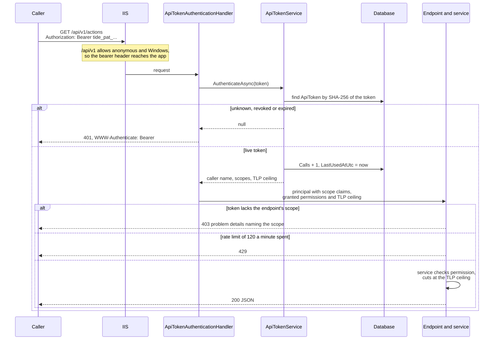
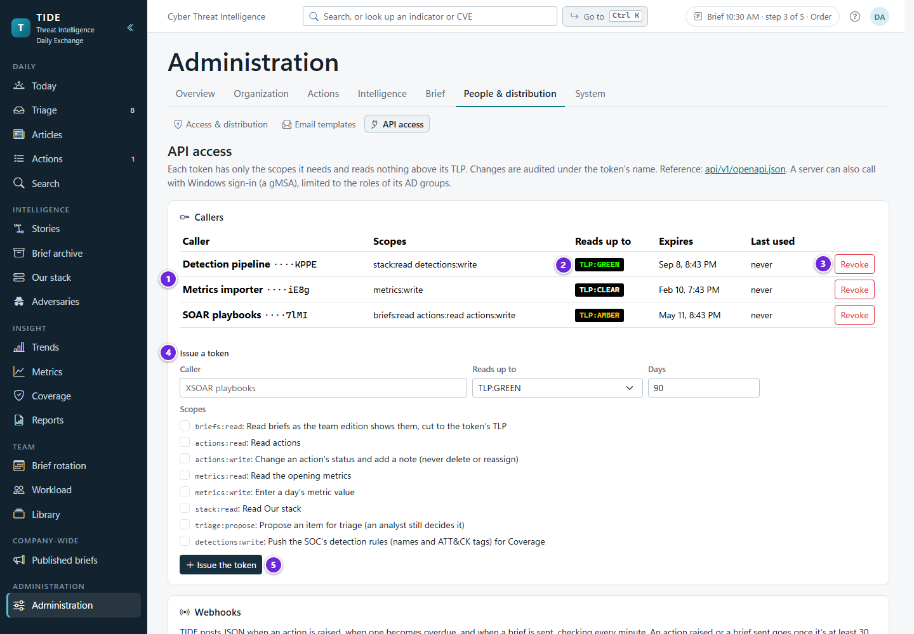
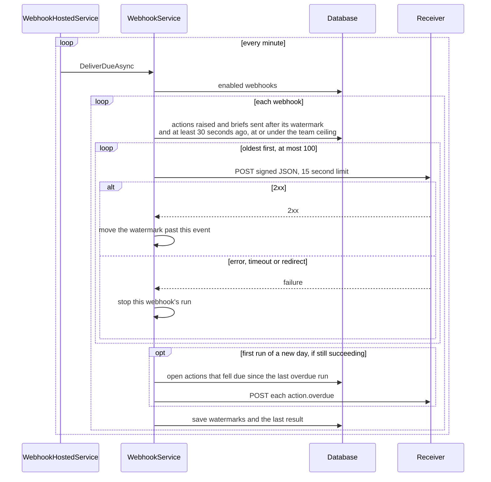

# TIDE REST API, version 1

This is the reference for TIDE's REST API under `/api/v1` and for its outbound webhooks. It's for anyone wiring another
system to TIDE: a SOAR playbook that closes actions, Power BI reading the opening metrics, a SIEM proposing triage
items, or a detection pipeline pushing its rules. Everything here is checked against the code; the design is in
[ADR 0016](decisions/0016-api-tokens-scopes-and-signed-webhooks.md) and, for detection rules,
[ADR 0017](decisions/0017-detection-rules-are-referenced-and-tagged.md).

**Contents**

- [Overview](#overview)
- [Authentication](#authentication)
- [Scopes](#scopes)
- [Conventions](#conventions)
- [Errors, rate limits and pagination](#errors-rate-limits-and-pagination)
- [Endpoints](#endpoints)
- [Webhooks](#webhooks)
- [Worked examples](#worked-examples)
- [Where it lives in code](#where-it-lives-in-code)

## Overview

- **One versioned API.** Every endpoint is under `/api/v1` on TIDE's own address, for example
  `https://tide.example.org/api/v1`. Installed as an IIS application under another site (`/tide`), it's
  `https://intranet.example.org/tide/api/v1`.
- **Small on purpose.** Reads: a brief as the team edition shows it, actions (with their files), Our stack, and the
  opening metrics. Writes, each narrow: an action's status and a note, a day's metric value, a proposed triage item
  (an analyst still decides it), and a push of detection rules.
- **The pages' own services.** Each endpoint calls the same Application service the pages call, so the same
  permission checks, TLP cuts, validation and audit apply. There is no second set of rules for the API.
- **v1 is a promise.** A field or an endpoint can be added within v1. None is changed or removed without a v2
  (ADR 0016). Write clients that ignore fields they don't know.
- **OpenAPI.** `GET /api/v1/openapi.json` returns a hand-kept OpenAPI 3.1 document (`src/Tide.Web/Api/OpenApi.cs`).
  Its `servers` entry is rewritten to the API's real address under the app's path base, so a client generated from
  it calls the right place. Fetching it needs a signed-in caller (any token, any scope, or Windows sign-in), like
  every other path under `/api/v1`.

## Authentication

A call signs in one of two ways. The API's authentication scheme (`ApiOrUser`, in `src/Tide.Web/Program.cs`) picks
by the `Authorization` header: a `Bearer` header goes to the API-token handler; anything else goes to the app's own
sign-in (Windows/Negotiate in production).



### API tokens



1. The callers: each token's name and last four characters, its scopes, expiry and last use.
2. Each token's own TLP ceiling (*Reads up to*).
3. *Revoke* stops a token at once.
4. *Issue a token*: name the caller, choose the ceiling, the days it lasts, and only the scopes it needs.
5. The token is shown once, when issued. Only its hash is kept.

An administrator issues tokens in **Administration › API access** (`/admin/api`, page
`src/Tide.Web/Components/Pages/Admin/ApiAdmin.razor`, service `ApiTokenService` in
`src/Tide.Application/Api/ApiTokens.cs`).

| Property | What it is |
|---|---|
| Header | `Authorization: Bearer tide_pat_<43 characters>` |
| Format | `tide_pat_` followed by 32 random bytes in URL-safe Base64 without padding (43 characters), 52 characters in all. A presented value that doesn't start with `tide_pat_` or isn't 20 to 100 characters long is refused without a database lookup. |
| Shown | Once, when it's issued. The page shows a Copy button; TIDE can't show it again. |
| Stored | Only its SHA-256 (lower-case hex) in `ApiToken.Hash`, and its last four characters as a hint (`····AbCd` on the page). |
| Caller | A name of 1 to 100 characters, such as "XSOAR playbooks". It's the name the audit log, triage sources and detection sets show. |
| Scopes | At least one, from [the scopes table](#scopes). Unknown names are dropped. |
| TLP ceiling | "Reads up to": the highest TLP the token reads. **GREEN by default.** |
| Expiry | 1 to 366 days from issue; the page proposes 90. There's no renewal: issue a new token under the same name and revoke the old one. |
| Revocation | **Revoke** on the page. It takes effect on the token's next call. |
| Use counts | Each successful sign-in adds one to `Calls` and sets `LastUsedAtUtc`, without touching the audit columns. The page shows both. |

A token never has a role. The AD-group claims transformer never runs for it. The handler gives the principal:

- `NameIdentifier` = `api:<token id>` (32 hex digits, no dashes) and `Name` = the caller name. Every write is audited
  under these, so the audit log shows "XSOAR playbooks" and the id `api:…`.
- One `tide:scope` claim per scope, checked by each endpoint.
- The permissions its scopes grant (see [Scopes](#scopes)), checked by the services as they would be for a person.
- A `tide:tlp` claim with the ceiling.

A token reaches nothing outside `/api/v1`. The pages, file downloads and CSV exports use the app's own sign-in
scheme, which ignores bearer headers.

### TLP ceiling

A token reads at the **lower of its own ceiling and the team edition's ceiling** (the team edition's is set in
Administration › Distribution, `DistributionSettings`). The cut is the same one the team edition uses
(`BriefEditions.Build`), so nothing above the ceiling leaves through the API:

| Endpoint | What the ceiling does |
|---|---|
| `GET /briefs/{day}` | Articles above it are left out whole (counted in `withheldArticles`). Bullets and "why it matters" above it are left out of the articles shown (counted in `withheldParts`). The intro is null when it's above it. |
| `GET /actions`, `GET /actions/{number}`, file downloads, `PATCH /actions/{number}` | An action raised from an article above it doesn't exist for the token: left out of lists, 404 on its own. Actions with no article are always visible. |
| `GET /stack` | Products' `notes` (internal, AMBER) are null unless the token's own ceiling is AMBER or higher. |
| `GET /metrics`, `POST` endpoints | No effect: metrics carry no TLP, and writes don't read marked content. |

### Windows and gMSA callers

A server can call as itself with Windows sign-in: run the job as a group managed service account (gMSA), map an AD
group holding that account to a TIDE role in Administration › Role mappings, and call with Negotiate. In PowerShell
that's `Invoke-RestMethod -UseDefaultCredentials`; with curl, `curl --negotiate -u :`.

Such a caller is a person to TIDE:

- **No scopes apply.** The scope check is for tokens only. The services' permission checks apply, from the roles
  the account's AD groups hold. A Viewer can read briefs and actions but gets 403 on `PATCH /actions/{number}`.
- **No token ceiling.** Briefs are cut at the team edition's ceiling. Actions are those the Actions page shows the
  account, at every marking. Stack notes are included.
- **Audited under the account's name**, as any person's change is.

IIS must let both through. The installer sets `/api/v1` to allow anonymous requests while leaving Windows
authentication on, so IIS passes a bearer token to the app and still negotiates for a Windows caller (see
[INSTALL.md](INSTALL.md) and `deploy/lib/TideIis.ps1`, `Get-TideCarveOutSettings`). The app still requires one or the
other on every call.

## Scopes

Each scope opens its endpoints and grants the permissions their services check. `actions:write`, for example, works
an action as an analyst would (it grants `WriteArticles` as well as `WorkActions`), but only through
`PATCH /actions/{number}`, which changes nothing but the status, outcome and note. The catalog is
`ApiScopes.All` in `src/Tide.Application/Api/ApiTokens.cs`.

| Scope | Endpoints | What the admin page says it allows | Permissions granted |
|---|---|---|---|
| `briefs:read` | `GET /briefs/{day}` | Read briefs as the team edition shows them, cut to the token's TLP | ReadTeamEdition |
| `actions:read` | `GET /actions`, `GET /actions/{number}`, `GET /actions/{number}/files/{fileId}` | Read actions | ReadTeamEdition |
| `actions:write` | `PATCH /actions/{number}` | Change an action's status and add a note (never delete or reassign) | ReadTeamEdition, WorkActions, WriteArticles |
| `metrics:read` | `GET /metrics` | Read the opening metrics | ReadTeamEdition |
| `metrics:write` | `POST /metrics` | Enter a day's metric value | ReadTeamEdition, EnterMetrics |
| `stack:read` | `GET /stack` | Read Our stack | ReadTeamEdition |
| `triage:propose` | `POST /triage` | Propose an item for triage (an analyst still decides it) | WriteArticles |
| `detections:write` | `POST /detections` | Push the SOC's detection rules (names and ATT&CK tags) for Coverage | WriteArticles |

`GET /openapi.json` needs no scope. Give each token only what its job needs: a Power BI refresh needs `metrics:read`
alone.

## Conventions

| Topic | Rule |
|---|---|
| Format | JSON, UTF-8, `Content-Type: application/json` on requests with a body. |
| Field names | camelCase (ASP.NET Core's web defaults; nothing in TIDE overrides them). Request field names are matched ignoring case. |
| Enumerations | Strings with the C# enum name: `"InProgress"`, `"NotApplicable"`, `"IpAddress"`, `"P2"`. Values in requests (`status`, `outcome`, `view`) are matched ignoring case. |
| TLP | The standard label: `"TLP:CLEAR"`, `"TLP:GREEN"`, `"TLP:AMBER"`, `"TLP:AMBER+STRICT"`, `"TLP:RED"` (`Tlp.Label`). |
| Dates | `yyyy-MM-dd` for a day (`"2026-11-05"`). In a path or query, `today` also works where a day is asked for; it means the current brief date: today, or the next business day on a weekend or holiday (`OrgClock.CurrentBriefDate`). |
| Times | ISO 8601 with an offset, in UTC: `"2026-11-05T08:14:09.123+00:00"`. |
| Nulls | Written out, not omitted: `"assignee": null`. |
| Action numbers | The number without its prefix: A-21 is `21`. |
| Ids | GUIDs as strings: `"5b0c5c86-3a0a-4f3e-9a54-0c1d2e3f4a5b"`. |
| Caching | Every endpoint's response, errors included, carries `Cache-Control: private, no-store`. |

## Errors, rate limits and pagination

### Errors

Refusals are RFC 9457 problem details (`application/problem+json`). The endpoint filter `ApiEndpoints.Errors` turns
the services' exceptions into them:

| Status | When | Comes from |
|---|---|---|
| 400 Bad Request | A bad day, view, status, outcome, key, value or note; a day whose numbers are fixed; a retired metric | `ArgumentException`, `InvalidOperationException`, the endpoints' own checks |
| 401 Unauthorized | No credentials, or a token that's unknown, revoked or expired. No body. `WWW-Authenticate: Bearer` for a bad token, `Negotiate` when no token was sent | The authentication handlers |
| 403 Forbidden | The token lacks the endpoint's scope, or the caller lacks a permission the service checks | The scope filter, `ForbiddenException` |
| 404 Not Found | No such brief, action, file or metric key, or an action above the token's ceiling | The endpoints, `KeyNotFoundException` |
| 409 Conflict | Someone changed the action at the same moment; read it again and retry | `StaleEditException` |
| 415, 400 | A body that isn't JSON, or can't be read as the endpoint's type. These come from ASP.NET Core's binding, without a problem body | The framework |
| 429 Too Many Requests | The caller's rate limit is spent. No body and no `Retry-After` | The rate limiter |

```json
{
  "type": "https://tools.ietf.org/html/rfc9110#section-15.5.4",
  "title": "Forbidden",
  "status": 403,
  "detail": "This token doesn't have the actions:write scope."
}
```

Read `status` and `detail`. `detail` is written for a person and can be shown or logged as it is. Treat any other
member as optional.

### Rate limits

Calls are limited **per caller to 120 a minute**: a token bucket of 120 that refills each minute, with no queue
(`Program.cs`, the `api` rate-limit policy). The caller is the token (by its id) or the Windows account. A call over
the limit gets 429 at once; wait for the next minute. The limit is meant for a playbook's steady use, not a scrape.

### Pagination

There is none. Each list is bounded instead:

| Endpoint | Bound |
|---|---|
| `GET /actions?view=open` and `overdue` | The actions open now (Open, InProgress, Blocked, Tracking) |
| `GET /actions?view=closed` | Closed in the last 90 days |
| `GET /metrics` | At most three years (`MetricsService.MaxRangeDays`, 1,098 days) between `from` and `to` |
| `GET /stack` | The products that aren't retired |

## Endpoints

Paths below are relative to `/api/v1`. All are in `src/Tide.Web/Api/ApiEndpoints.cs` (`MapTideApi`) and call
`ApiService` (`src/Tide.Application/Api/ApiService.cs`) unless noted.

| Method | Path | Scope | Summary |
|---|---|---|---|
| GET | `/briefs/{day}` | `briefs:read` | A brief as the team edition shows it |
| GET | `/actions` | `actions:read` | Open, overdue or recently closed actions |
| GET | `/actions/{number}` | `actions:read` | One action with its live files |
| GET | `/actions/{number}/files/{fileId}` | `actions:read` | Download a file on the action |
| PATCH | `/actions/{number}` | `actions:write` | Change an action's status, with an outcome and a note |
| GET | `/stack` | `stack:read` | Our stack's products |
| GET | `/metrics` | `metrics:read` | The opening metrics and their values over a range |
| POST | `/metrics` | `metrics:write` | Enter a day's value for one metric |
| POST | `/triage` | `triage:propose` | Propose an item for the triage inbox |
| POST | `/detections` | `detections:write` | Replace the caller's detection rules |
| GET | `/openapi.json` | none | The OpenAPI 3.1 description |

### GET /briefs/{day}

A brief as the team edition shows it, cut at the lower of the team edition's ceiling and the token's
(`ApiService.BriefAsync`, through `BriefEditions.Build`).

**Path parameter:** `day`, as `yyyy-MM-dd` or `today`.

**Response 200:**

```json
{
  "day": "2026-11-05",
  "status": "Sent",
  "ceiling": "TLP:GREEN",
  "marking": "TLP:GREEN",
  "intro": "Two items this morning; one needs a sweep.",
  "articles": [
    {
      "id": "5b0c5c86-3a0a-4f3e-9a54-0c1d2e3f4a5b",
      "title": "Loader campaign abuses a fake browser update",
      "tlp": "TLP:GREEN",
      "marking": "TLP:GREEN",
      "classification": "Threat",
      "priority": "P2",
      "bottomLine": "A loader spreads through a fake update page; sweep for its domains.",
      "bullets": [
        { "text": "Delivered through compromised news sites.", "tlp": "TLP:GREEN" }
      ],
      "whyItMatters": null,
      "recommendedActions": "Block the domains at the proxy and sweep 30 days of DNS logs.",
      "cves": [],
      "indicators": [
        { "type": "Domain", "value": "update-check.example.net" },
        { "type": "FileHash", "value": "9f86d081884c7d659a2feaa0c55ad015a3bf4f1b2b0b822cd15d6c15b0f00a08" }
      ],
      "actions": [
        { "number": 21, "title": "Sweep DNS logs for the loader's domains", "team": "Cyber Defense", "dueDate": "2026-11-07", "status": "Open" }
      ],
      "sourceUrl": "https://news.example.org/loader-campaign",
      "withheldParts": 1
    }
  ],
  "withheldArticles": 1,
  "finishedAs": "emailed"
}
```

| Field | Meaning |
|---|---|
| `status` | `Draft`, `Ready`, `Presented` or `Sent`. |
| `ceiling` | The ceiling this response was cut at. |
| `marking` | The highest marking of what the cut carries (the team edition's marking). |
| `intro` | The brief's intro, or null when it's blank or above the ceiling. The team's opening note is never included. |
| `articles` | In the brief's running order. Screenshots aren't included. |
| `articles[].tlp`, `marking` | The article's own TLP, and the highest marking of what's shown of it. |
| `articles[].classification`, `priority` | `Informational` or `Threat`; `P1` to `P4`, or null. |
| `articles[].bullets[].tlp` | The bullet's effective TLP: its own or the article's, whichever is higher. |
| `articles[].whyItMatters` | Null when it's blank or above the ceiling. |
| `articles[].indicators[].type` | `Account`, `Host`, `IpAddress`, `Domain`, `Url`, `FileHash`, `FileName`, `EmailAddress`, `Process`, `RegistryKey`, `Other`, `CommandLine` or `CryptoWallet`. |
| `articles[].actions` | The actions raised from the article, cancelled ones left out. |
| `articles[].withheldParts` | Bullets, screenshots and "why it matters" left out for the ceiling. |
| `withheldArticles` | Articles left out whole. |
| `finishedAs` | For a Sent brief: `emailed`, `distributed` (marked distributed with email off) or `notSent` (finished as not sent). One emailed after either reads `emailed`. Null until it's Sent. |

**Status codes:** 200; 400 for a day that isn't `yyyy-MM-dd` or `today`; 403 without the scope or `ReadTeamEdition`;
404 when there's no brief that day.

### GET /actions

The actions in one view, through `ActionService.ListAsync`.

**Query parameter:** `view` (optional): `open` (default), `overdue` or `closed`. `open` is every open action;
`overdue` is open and past due; `closed` is closed in the last 90 days. Other views (`mine`, `myTeams`) are refused
with 400.

**Order:** open and overdue by due date (none last), then priority, then number; closed newest closed first.

**Response 200:** an array of actions. `files` is always null in a list.

```json
[
  {
    "number": 21,
    "title": "Sweep DNS logs for the loader's domains",
    "kind": "IocSweep",
    "priority": "P2",
    "status": "Open",
    "outcome": null,
    "team": "Cyber Defense",
    "assignee": "Dana Whitfield",
    "dueDate": "2026-11-07",
    "closedDate": null,
    "articleId": "5b0c5c86-3a0a-4f3e-9a54-0c1d2e3f4a5b",
    "files": null
  }
]
```

| Field | Values |
|---|---|
| `kind` | `IocSweep`, `ThreatHunt`, `Block`, `PatchRemediate`, `ConfigChange`, `Awareness`, `Outreach`, `Other` |
| `priority` | `P1` to `P4` |
| `status` | `Open`, `InProgress`, `Blocked`, `Tracking` (handed to others and followed: still open), `Done`, `Cancelled`, `NotApplicable` |
| `outcome` | Null while open or closed without one; otherwise `NoHits`, `HitsEscalated`, `Remediated`, `Blocked`, `RiskAccepted`, `NotAffected`, `Answered`, `Other` |
| `assignee` | The assignee's display name, or null |
| `articleId` | The article it was raised from, or null |

**TLP:** for a token, an action raised from an article above the ceiling is left out.

**Status codes:** 200; 400 for an unknown view; 403.

### GET /actions/{number}

One action by its number, with its live files: those added to the action and those attached to its comments
(`ApiService.ActionAsync`).

**Response 200:** an action as above, with `files` filled:

```json
{
  "number": 21,
  "title": "Sweep DNS logs for the loader's domains",
  "kind": "IocSweep",
  "priority": "P2",
  "status": "InProgress",
  "outcome": null,
  "team": "Cyber Defense",
  "assignee": "Dana Whitfield",
  "dueDate": "2026-11-07",
  "closedDate": null,
  "articleId": "5b0c5c86-3a0a-4f3e-9a54-0c1d2e3f4a5b",
  "files": [
    {
      "id": "0e7a9a52-61f1-4c3b-8f0e-2b9c1d4e5f60",
      "name": "sentinel-results.csv",
      "size": 18342,
      "sha256": "3a7bd3e2360a3d29eea436fcfb7e44c735d117c42d1c1835420b6b9942dd4f1b",
      "contentType": "application/octet-stream",
      "declaredType": "text/csv",
      "addedBy": "Dana Whitfield",
      "addedAt": "2026-11-05T13:02:44.512+00:00",
      "description": "Query output, 30 days",
      "source": "action",
      "commentId": null,
      "risky": false,
      "riskReason": null,
      "downloadUrl": "/api/v1/actions/21/files/0e7a9a52-61f1-4c3b-8f0e-2b9c1d4e5f60"
    }
  ]
}
```

| File field | Meaning |
|---|---|
| `size` | Bytes. |
| `sha256` | Lower-case hex SHA-256 of the bytes as they arrived, or null when none was recorded. |
| `contentType` | What the bytes are: an image's type (`image/png`, `image/jpeg`, `image/gif`, `image/webp`) when they're a real raster image, else `application/octet-stream`. |
| `declaredType` | What the uploader's browser said, when recorded. Never trusted. |
| `source`, `commentId` | `action` (added to the action) or `comment` (attached to the comment `commentId`). |
| `risky`, `riskReason` | Whether the file can run or carry something that runs, judged by its name, declared type and first bytes, and why. |
| `downloadUrl` | Under the API, with the app's path base. Held to the same scope and ceiling. |

**Status codes:** 200; 403; 404 when there's no such action, or (for a token) it was raised from an article above the
ceiling.

### GET /actions/{number}/files/{fileId}

Downloads one live file on the action or one of its comments (`ApiService.OpenFileAsync`, then
`ActionFileService.OpenAsync`).

**Query parameter:** `zip` (optional, boolean). `true` returns the file inside a zip with the password `infected`, in
classic ZipCrypto so any zip tool opens it. Use it for a `risky` file: the zip stops it running on arrival and keeps
antivirus from deleting it. When the server's `Files:ZipDownloads` is `Always`, every file comes zipped, whatever `zip`
says.

**Response 200:** the bytes as an attachment, `application/octet-stream` (or `application/zip` with `zip=true`, or
under `Files:ZipDownloads=Always`),
under the name it was added with (`<name>.zip` zipped). Headers: `Cache-Control: private, no-store`,
`X-Content-Type-Options: nosniff`, `Content-Security-Policy: sandbox; default-src 'none'`.

**Status codes:** 200; 403; 404 when the action isn't there for the caller or the file isn't a live file on it.

### PATCH /actions/{number}

Changes an action's status, with an outcome when closing it and a note. Nothing else about the action changes: not
its title, team, assignee or due date (`ApiService.UpdateActionAsync`, then `ActionService.SetStatusAsync`).

**Request body:**

```json
{
  "status": "Done",
  "outcome": "NoHits",
  "note": "Swept 30 days of DNS logs in Sentinel: no hits. XSOAR incident 4411."
}
```

| Field | Required | Rules |
|---|---|---|
| `status` | Yes | `Open`, `InProgress`, `Blocked`, `Tracking`, `Done`, `Cancelled` or `NotApplicable`. Moving to `Open`, `InProgress` or `Blocked` when that takes the team over an active limit set to refuse is answered 400; a team that warns takes the `note` as the reason. |
| `outcome` | To close it `Done` | One of the outcomes for the action's kind (below). Optional for `Cancelled` and `NotApplicable`; ignored for an open status. |
| `note` | No | At most 2,000 characters. Kept with the closure, and in the action's history. |

| Kind | Outcomes it may close `Done` with |
|---|---|
| `IocSweep`, `ThreatHunt` | `NoHits`, `HitsEscalated`, `Other` |
| `PatchRemediate`, `ConfigChange` | `Remediated`, `NotAffected`, `RiskAccepted`, `Other` |
| `Block` | `Blocked`, `NotAffected`, `RiskAccepted`, `Other` |
| `Awareness` | `Remediated`, `NotAffected`, `Other` |
| `Outreach` | `Answered`, `NotAffected`, `Other` |
| `Other` | Any |

(`ActionService.KindOutcomes`. An action already closed with an outcome outside its kind's list may keep it.)

Closing an open action sets its closed date to today. Moving a closed action to an open status reopens it and clears
the outcome. The change is a line in the action's history and an audit entry under the caller's name; colleagues'
open pages update at once.

**Response 200:** the action after the change, with its files, as in `GET /actions/{number}`.

**Status codes:** 200; 400 for a missing or unknown status, an outcome the kind doesn't take, `Done` without an
outcome, or a note over 2,000 characters; 403 without the scope (or, for a person, without the right to work the
action); 404; 409 when someone changed it at the same moment.

### GET /stack

Our stack: the products the organization runs, through `StackService.ListAsync`.

**Response 200:**

```json
[
  {
    "id": "a4f0e1d2-7c3b-4b5a-9e8f-1a2b3c4d5e6f",
    "name": "Ivanti Connect Secure",
    "otherNames": "Pulse Secure",
    "versions": "22.7R2",
    "notes": null,
    "team": "Network",
    "articles": 4,
    "openActions": 1
  }
]
```

`notes` is internal (AMBER): null unless the token's own ceiling is AMBER or higher (a person gets it). `articles` and
`openActions` count everything about the product, at every marking; they name nothing.

**Status codes:** 200; 403.

### GET /metrics

The opening metrics and their values between two days (`MetricsService.HistoryAsync`).

**Query parameters:** `from` and `to`, each `yyyy-MM-dd` or `today`. The defaults are 30 days ago and today. Given
the wrong way round they're swapped. At most three years apart.

**Response 200:**

```json
{
  "from": "2026-10-06",
  "to": "2026-11-05",
  "metrics": [
    { "id": "c1d2e3f4-a5b6-4c7d-8e9f-0a1b2c3d4e5f", "key": "phish-reported", "name": "Phishing emails reported", "format": "Count" },
    { "id": "d2e3f4a5-b6c7-4d8e-9f0a-1b2c3d4e5f60", "key": "edr-coverage", "name": "EDR coverage", "format": "Percent" }
  ],
  "values": [
    { "key": "phish-reported", "day": "2026-11-05", "value": 42, "note": null },
    { "key": "edr-coverage", "day": "2026-11-05", "value": 97.5, "note": "Two servers rebuilding" }
  ]
}
```

`metrics` lists every metric, retired ones too, in the Metrics page's order. `format` is `Count`, `Percent`, `Hours`
or `Number`; a `Percent` value is the number shown before the % sign (97.5 means 97.5%). `values` has one entry per
metric per business day that has a value, oldest first.

**Status codes:** 200; 400 for a day that won't parse or a range over three years; 403.

### POST /metrics

Enters one metric's value for one day, as typing it on the Metrics page would (`ApiService.SetMetricAsync`, then
`MetricsService.SaveValueAsync`).

**Request body:**

```json
{ "key": "phish-reported", "day": "2026-11-05", "value": 42, "note": "From the SIEM's daily count" }
```

| Field | Required | Rules |
|---|---|---|
| `key` | Yes | The metric's key, matched ignoring case. The keys are on the Metrics administration page and in `GET /metrics`. |
| `day` | Yes | `yyyy-MM-dd`. A business day: a weekend is refused. (`today` isn't accepted in a body.) |
| `value` | Yes | A number, rounded to four decimal places. |
| `note` | No | At most 300 characters, on one line. |

The value is marked as entered by hand, so a later CSV import leaves it alone. Once that day's brief has been sent its
numbers are fixed: a token gets 400, and only an administrator can correct them.

**Response:** 204 No Content.

**Status codes:** 204; 400 when a field is missing, the day is a weekend, the number is too large, the note is too
long, the metric is retired, or the day's brief has been sent; 403; 404 when no metric has that key.

### POST /triage

Proposes an item for the triage inbox (`IntakeService.ProposeAsync`). An analyst still decides it, as with any feed
item.

**Request body:**

```json
{
  "title": "Sentinel: rare outbound connections to a newly registered domain",
  "url": "https://siem.example.org/alerts/77",
  "summary": "12 hosts contacted update-check.example.net in the last hour."
}
```

| Field | Required | Rules |
|---|---|---|
| `title` | Yes | 1 to 500 characters. |
| `url` | Yes | An http or https address. Items are kept once per canonical address. |
| `summary` | No | Cut to 2,000 characters. CVE ids in the title or summary are picked up as for a feed item. |

The item comes in under a source named after the caller ("Sentinel automation (API)"; the name is cut to 90
characters before " (API)"). The source is made on the first proposal, of kind `Api`, and is never polled.

**Response 201 Created:** the item is new. `Location` is the item's place in the triage inbox
(`<path base>/triage?at=<id>`), a page for a person, not an API address.

```json
{ "id": "6f1e2d3c-4b5a-4968-8776-5a4b3c2d1e0f" }
```

**Response 200 OK:** an item with that address is already in the inbox (a retry is safe):

```json
{ "id": null, "already": true }
```

**Status codes:** 201; 200; 400 for a missing or long title or a missing or non-http address; 403.

### POST /detections

Pushes the **full set** of detection rules the caller manages, for Reports › Coverage
(`DetectionService.PushAsync`, ADR 0017). Only names, ATT&CK technique tags, platform and whether a rule is enabled
are kept. Rules are internal and never reach an edition.

**Request body:**

```json
{
  "rules": [
    { "id": "8c1f3a2e-sentinel-001", "name": "Suspicious PowerShell download cradle", "techniques": ["T1059.001", "T1105"], "platform": "Sentinel", "enabled": true },
    { "id": "8c1f3a2e-sentinel-002", "name": "LSASS memory read by an unsigned process", "techniques": ["T1003.001"], "platform": "Sentinel", "enabled": false }
  ]
}
```

| Field | Required | Rules |
|---|---|---|
| `rules` | Yes | At least one rule with a name. |
| `rules[].id` | No | The rule's id in your system. Without one, its name is its id. Ids are matched ignoring case; a repeated id keeps the last. |
| `rules[].name` | Yes | A rule without a name is skipped. |
| `rules[].techniques` | No | ATT&CK technique ids such as `T1059` or `T1059.001`. One that isn't a technique id is dropped and reported in `problems`. |
| `rules[].platform` | No | Free text. |
| `rules[].enabled` | No | Defaults to `true`. |

**Replace semantics.** A push replaces the caller's last push and no one else's. Rules in it are added or refreshed;
the caller's rules missing from it are kept but no longer count. A token's set is keyed by the token's **name**, so a
token issued again under the same name (as each expiry needs) carries on the same set. A push stands until the next
one, however long that is. The set stops counting only when its token is revoked or expires and no active token has
the same name. A push is one audit entry with its counts.

**Response 200:**

```json
{ "added": 1, "changed": 0, "unchanged": 1, "notInImport": 3, "problems": ["LSASS memory read by an unsigned process: “T1003-1” isn't a technique id."] }
```

**Status codes:** 200; 400 when no rule has a name; 403.

### GET /openapi.json

The OpenAPI 3.1 description, as `application/json`. Any signed-in caller may fetch it.

## Webhooks

TIDE posts signed JSON to an administrator's https address when an action is raised, when one becomes overdue, and
when a brief is sent. Webhooks are **polled from the database**, not raised by the services: once a minute a
background job (`WebhookHostedService`) asks `WebhookService.DeliverDueAsync` to post what happened since each
webhook's last successful run. Nothing in the services changed for them, and a failed post loses nothing.

### Configure a webhook

In **Administration › API access › Webhooks** (administrators only):

1. **Add a webhook.** Give an `https` address (at most 2,000 characters) and choose one or more events. TIDE shows the
   **signing secret once**: 64 hex characters. Copy it into the receiver; TIDE keeps it encrypted with the server's
   data protection keys (`DataProtection:KeyPath`) and can't show it again.
2. **Send a test.** Posts a `ping` event now and shows the status the address answered.
3. **Turn off / Turn on.** A webhook turned back on starts from that moment: what happened while it was off isn't sent
   in a burst.
4. **Remove** deletes it.

The table shows each webhook's last post: its HTTP status and time, or the error. If the server's data protection
keys are lost or replaced, the secret can't be read: every post fails with "The signing secret can't be read", and
the webhook must be added again.

A new webhook starts from the moment it's added. Its first run also posts the actions that fell due yesterday and are
still open, if it takes `action.overdue`.

### Events

| Event | When | `id` (also `X-Tide-Event-Id`) | `data` |
|---|---|---|---|
| `action.raised` | An action is created | `action.raised:<action id>` | An action |
| `action.overdue` | An open action's due date has passed: once per due date, at the first run of the next day | `action.overdue:<action id>:<due date>` | An action |
| `brief.sent` | One edition of a brief has gone to the relay (one event per edition sent; test sends never) | `brief.sent:<send id>` | A send |
| `ping` | Send a test, only | `ping:<random guid>` | `{ "message": "A test from TIDE." }` |

**TLP.** A webhook is held to the team edition's ceiling: its receiver (a SOAR, a ticket queue) is at least as wide as
that edition's list. An action raised from an article above the ceiling is never posted, raised or overdue. Each
action posted carries `marking`, its article's TLP, or null when it has no article. A brief's `marking` is the send's
own marking.

### Payloads

Every body has the same envelope. `sentAtUtc` is when this post was made; a repeat has a later one.

```json
{
  "id": "action.raised:0b1c2d3e-4f50-4617-8293-a4b5c6d7e8f9",
  "event": "action.raised",
  "sentAtUtc": "2026-11-05T09:41:30.2219876+00:00",
  "data": {
    "number": 21,
    "label": "A-21",
    "title": "Sweep DNS logs for the loader's domains",
    "priority": "P2",
    "status": "Open",
    "team": "Cyber Defense",
    "dueDate": "2026-11-07",
    "url": "https://tide.example.org/actions/21",
    "marking": "TLP:GREEN"
  }
}
```

`action.overdue` has the same `data`. `url` is built from `App:BaseUrl`; with that setting blank it's a bare path
(`/actions/21`). `team` and `dueDate` can be null.

```json
{
  "id": "brief.sent:9a8b7c6d-5e4f-4a3b-2c1d-0e9f8a7b6c5d",
  "event": "brief.sent",
  "sentAtUtc": "2026-11-05T11:05:12.0084512+00:00",
  "data": {
    "briefDate": "2026-11-05",
    "edition": "Team",
    "subject": "TIDE brief, Thursday 5 November 2026",
    "marking": "TLP:AMBER",
    "sentAtUtc": "2026-11-05T11:04:31.5531004+00:00"
  }
}
```

`edition` is `Team` or `Public` (the company-wide edition). `data.sentAtUtc` is when the send began.

### Headers and signing

| Header | Value |
|---|---|
| `Content-Type` | `application/json; charset=utf-8` |
| `X-Tide-Event` | The event name |
| `X-Tide-Event-Id` | The event's id, the same as the body's `id` |
| `X-Tide-Timestamp` | Unix time in seconds when this post was made |
| `X-Tide-Signature` | `sha256=` and the lower-case hex HMAC-SHA256 of `<X-Tide-Timestamp>.<body>` |

The HMAC key is the **UTF-8 bytes of the secret as shown** (the 64-character hex string itself, not the 32 bytes it
spells). The message is the timestamp header's value, a full stop, and the raw body bytes exactly as received
(`WebhookService.Sign`). To verify:

1. Read the raw body before any JSON parsing; re-serialised JSON won't match.
2. Refuse a timestamp more than a few minutes from your clock (five is a sensible window). Each post, retries
   included, is signed afresh with its own time, so a window doesn't reject retries.
3. Compute the signature and compare it with `X-Tide-Signature` in constant time.
4. Drop an `id` you've already handled: delivery is at least once.
5. Answer 2xx within 15 seconds, and do slow work afterwards.

**PowerShell** (Windows PowerShell 5.1 and PowerShell 7):

```powershell
function Test-TideSignature {
    param(
        [Parameter(Mandatory)] [string] $Secret,      # the 64-character secret as TIDE showed it
        [Parameter(Mandatory)] [string] $Timestamp,   # X-Tide-Timestamp
        [Parameter(Mandatory)] [byte[]] $Body,        # the raw request body
        [Parameter(Mandatory)] [string] $Signature,   # X-Tide-Signature
        [int] $ToleranceSeconds = 300
    )
    $now = [DateTimeOffset]::UtcNow.ToUnixTimeSeconds()
    if ([math]::Abs($now - [long]$Timestamp) -gt $ToleranceSeconds) { return $false }

    [byte[]] $message = [Text.Encoding]::UTF8.GetBytes("$Timestamp.") + $Body
    $hmac = [System.Security.Cryptography.HMACSHA256]::new([Text.Encoding]::UTF8.GetBytes($Secret))
    try { $hash = $hmac.ComputeHash($message) } finally { $hmac.Dispose() }
    $expected = [Text.Encoding]::ASCII.GetBytes('sha256=' + (-join ($hash | ForEach-Object { $_.ToString('x2') })))
    $actual = [Text.Encoding]::ASCII.GetBytes($Signature)

    # Constant-time comparison.
    if ($expected.Length -ne $actual.Length) { return $false }
    $diff = 0
    for ($i = 0; $i -lt $expected.Length; $i++) { $diff = $diff -bor ($expected[$i] -bxor $actual[$i]) }
    return $diff -eq 0
}
```

**Python** (3.8 or later):

```python
import hashlib
import hmac
import time


def verify_tide_signature(secret: str, timestamp: str, body: bytes, signature: str, tolerance: int = 300) -> bool:
    """secret: the 64-character secret as TIDE showed it. body: the raw request body bytes."""
    try:
        if abs(time.time() - int(timestamp)) > tolerance:
            return False
    except ValueError:
        return False
    digest = hmac.new(secret.encode("utf-8"), timestamp.encode("ascii") + b"." + body, hashlib.sha256).hexdigest()
    return hmac.compare_digest("sha256=" + digest, signature)


# Flask, for example:
# @app.post("/hooks/tide")
# def tide_hook():
#     if not verify_tide_signature(SECRET, request.headers["X-Tide-Timestamp"], request.get_data(),
#                                  request.headers["X-Tide-Signature"]):
#         abort(401)
#     event = request.get_json()
#     ...
#     return "", 204
```

**C#** (.NET 6 or later):

```csharp
using System.Security.Cryptography;
using System.Text;

public static class TideWebhook
{
    /// <summary>secret: the 64-character secret as TIDE showed it. body: the raw request body bytes.</summary>
    public static bool Verify(string secret, string timestamp, byte[] body, string signature, TimeSpan? tolerance = null)
    {
        if (!long.TryParse(timestamp, out var seconds)) return false;
        var age = DateTimeOffset.UtcNow - DateTimeOffset.FromUnixTimeSeconds(seconds);
        if (age.Duration() > (tolerance ?? TimeSpan.FromMinutes(5))) return false;

        var prefix = Encoding.UTF8.GetBytes(timestamp + ".");
        var message = new byte[prefix.Length + body.Length];
        prefix.CopyTo(message, 0);
        body.CopyTo(message, prefix.Length);
        var hash = HMACSHA256.HashData(Encoding.UTF8.GetBytes(secret), message);
        var expected = Encoding.ASCII.GetBytes("sha256=" + Convert.ToHexString(hash).ToLowerInvariant());
        return CryptographicOperations.FixedTimeEquals(expected, Encoding.ASCII.GetBytes(signature));
    }
}

// ASP.NET Core minimal API, for example:
// app.MapPost("/hooks/tide", async (HttpRequest request) =>
// {
//     using var buffer = new MemoryStream();
//     await request.Body.CopyToAsync(buffer);
//     if (!TideWebhook.Verify(secret, request.Headers["X-Tide-Timestamp"]!, buffer.ToArray(), request.Headers["X-Tide-Signature"]!))
//         return Results.Unauthorized();
//     // parse buffer as JSON, drop a repeated "id", queue the work
//     return Results.NoContent();
// });
```

### Delivery, timing and retries



- **Cadence.** The job runs at start-up, then every minute (`WebhookHostedService.PollInterval`). It's listed in
  Administration › System › Diagnostics as "Webhooks".
- **Settle delay.** An action raised or a brief sent is posted only once it's at least **30 seconds** old
  (`WebhookService.SettleDelay`), so a save stamped just before a run but not yet committed is never passed by the
  watermark. A brief send still going to the relay holds the watermark until it's marked sent (up to 15 minutes,
  `SendOutcome.InFlight`, after which a stuck send no longer holds it). Expect an event 30 to 90 seconds after it
  happens; `action.overdue` comes at the first run after midnight in the organization's time zone.
- **Order.** Oldest first, per webhook. Each webhook has its own watermark, so one failing receiver doesn't hold up
  the others.
- **Batching.** At most 100 events a run per webhook (more only to finish events stamped at the same moment), and the
  overdue posts a due date at a time, so a backlog drains over several runs.
- **Failure.** A post fails on any status outside 200 to 299, a timeout (15 seconds), a connection error, or a
  redirect (redirects aren't followed; a 3xx is reported). The webhook's run stops at its first failure; the next run,
  a minute later, tries again from the same event with the **same `id`**. There's no back-off and no limit: it retries
  every minute until it succeeds, the webhook is turned off, or it's removed. The last error is on the page.
- **At least once.** A run that stopped between posting and saving its watermark posts the event again. Deduplicate
  on `id`.
- **What isn't posted.** Test sends of a brief; corrections; actions above the team edition's ceiling; anything that
  happened while the webhook was off.
- **Network.** Posts use their own HTTP client (`HttpWebhookPoster`, the `webhooks` named client) with redirects off.
  They don't go through the outbound client's address rules or `Intake:Proxy`; the address must be https.

Deliveries aren't in the audit log (a row a minute would bury the real ones); adding, changing and removing a webhook
is.

## Worked examples

The examples use `https://tide.example.org` and a token in an environment variable `TIDE_TOKEN`. Under an IIS
sub-path, add it (`https://intranet.example.org/tide/api/v1/...`).

### A SOAR closes an action

The playbook finished a sweep for A-21 and found nothing. Token scopes: `actions:read actions:write`.

```bash
# See where it stands
curl -sS https://tide.example.org/api/v1/actions/21 \
  -H "Authorization: Bearer $TIDE_TOKEN"

# Close it Done with what the sweep found
curl -sS -X PATCH https://tide.example.org/api/v1/actions/21 \
  -H "Authorization: Bearer $TIDE_TOKEN" \
  -H "Content-Type: application/json" \
  -d '{"status":"Done","outcome":"NoHits","note":"Swept 30 days of DNS logs in Sentinel: no hits. XSOAR incident 4411."}'
```

```powershell
$headers = @{ Authorization = "Bearer $env:TIDE_TOKEN" }
$body = @{ status = 'Done'; outcome = 'NoHits'; note = 'Swept 30 days of DNS logs in Sentinel: no hits. XSOAR incident 4411.' } |
    ConvertTo-Json
try {
    $action = Invoke-RestMethod -Method Patch -Uri 'https://tide.example.org/api/v1/actions/21' `
        -Headers $headers -ContentType 'application/json' -Body $body
    "A-$($action.number) is $($action.status) ($($action.outcome))"
}
catch {
    # A 400 or 409 carries problem details: show TIDE's own explanation.
    $_.ErrorDetails.Message
}
```

A 409 means someone changed the action at the same moment: read it again and decide whether to retry. To drive the
playbook from TIDE, add a webhook for `action.raised` and start the playbook from each post.

### Power BI reads the metrics

Token scope: `metrics:read`. In Power BI Desktop, **Get data › Blank query**, then the Advanced Editor:

```text
let
    Token = "tide_pat_...",
    Response = Json.Document(Web.Contents("https://tide.example.org/api/v1/metrics",
        [Query = [from = "2026-01-01", to = "2026-11-05"], Headers = [Authorization = "Bearer " & Token]])),
    Metrics = Table.FromRecords(Response[metrics]),
    Values = Table.FromRecords(Response[values]),
    Joined = Table.NestedJoin(Values, {"key"}, Metrics, {"key"}, "metric", JoinKind.LeftOuter),
    Expanded = Table.ExpandTableColumn(Joined, "metric", {"name", "format"}),
    Typed = Table.TransformColumnTypes(Expanded, {{"day", type date}, {"value", type number}})
in
    Typed
```

Keep the token in a Power BI parameter, not in the query text. For a scheduled refresh in the Power BI service, the
on-premises data gateway must reach TIDE's address. The same call from a script:

```bash
curl -sS "https://tide.example.org/api/v1/metrics?from=2026-10-01&to=2026-10-31" \
  -H "Authorization: Bearer $TIDE_TOKEN"
```

```powershell
$m = Invoke-RestMethod -Uri 'https://tide.example.org/api/v1/metrics?from=2026-10-01&to=2026-10-31' `
    -Headers @{ Authorization = "Bearer $env:TIDE_TOKEN" }
$m.values | Export-Csv -NoTypeInformation -Path .\tide-metrics-october.csv
```

A metric can also be written. Token scope `metrics:write`:

```powershell
$body = @{ key = 'phish-reported'; day = '2026-11-05'; value = 42 } | ConvertTo-Json
Invoke-RestMethod -Method Post -Uri 'https://tide.example.org/api/v1/metrics' `
    -Headers @{ Authorization = "Bearer $env:TIDE_TOKEN" } -ContentType 'application/json' -Body $body
```

### A SIEM proposes a triage item

Token scope: `triage:propose`. The token's name ("Sentinel automation") names the triage source.

```bash
curl -sS -i -X POST https://tide.example.org/api/v1/triage \
  -H "Authorization: Bearer $TIDE_TOKEN" \
  -H "Content-Type: application/json" \
  -d '{"title":"Sentinel: rare outbound connections to a newly registered domain","url":"https://siem.example.org/alerts/77","summary":"12 hosts contacted update-check.example.net in the last hour."}'
```

```powershell
$proposal = @{
    title   = 'Sentinel: rare outbound connections to a newly registered domain'
    url     = 'https://siem.example.org/alerts/77'
    summary = '12 hosts contacted update-check.example.net in the last hour.'
} | ConvertTo-Json
$result = Invoke-RestMethod -Method Post -Uri 'https://tide.example.org/api/v1/triage' `
    -Headers @{ Authorization = "Bearer $env:TIDE_TOKEN" } -ContentType 'application/json' -Body $proposal
if ($result.already) { 'Already in triage' } else { "Proposed as $($result.id)" }
```

A retry of the same `url` answers 200 with `already: true`, so a playbook can retry after a timeout.

### A detection pipeline pushes its rules

Token scope: `detections:write`. Push the whole set each time it changes: rules left out stop counting.

```bash
curl -sS -X POST https://tide.example.org/api/v1/detections \
  -H "Authorization: Bearer $TIDE_TOKEN" \
  -H "Content-Type: application/json" \
  --data-binary @rules.json
```

```powershell
# From Sigma files in a repository: id, title, and the attack.tXXXX tags
$rules = Get-ChildItem .\rules -Recurse -Include *.yml | ForEach-Object {
    $text = Get-Content $_.FullName -Raw
    [pscustomobject]@{
        id         = ([regex]::Match($text, '(?m)^id:\s*(\S+)')).Groups[1].Value
        name       = ([regex]::Match($text, '(?m)^title:\s*(.+)$')).Groups[1].Value.Trim()
        techniques = @([regex]::Matches($text, 'attack\.(t\d{4}(?:\.\d{3})?)') | ForEach-Object { $_.Groups[1].Value.ToUpper() })
        platform   = 'Sigma'
        enabled    = $true
    }
}
$body = @{ rules = @($rules) } | ConvertTo-Json -Depth 4
$result = Invoke-RestMethod -Method Post -Uri 'https://tide.example.org/api/v1/detections' `
    -Headers @{ Authorization = "Bearer $env:TIDE_TOKEN" } -ContentType 'application/json' -Body $body
"Added $($result.added), changed $($result.changed), unchanged $($result.unchanged), no longer pushed $($result.notInImport)"
$result.problems
```

### A Windows service account instead of a token

```powershell
# Run as the gMSA whose AD group is mapped to the Analyst role
Invoke-RestMethod -Uri 'https://tide.example.org/api/v1/actions?view=overdue' -UseDefaultCredentials
```

```bash
curl -sS --negotiate -u : "https://tide.example.org/api/v1/actions?view=overdue"
```

## Where it lives in code

| Concern | Where |
|---|---|
| Endpoints, scope filter, error mapping, rate-limit name | `src/Tide.Web/Api/ApiEndpoints.cs` (`MapTideApi`, `Scope`, `Errors`) |
| The OpenAPI document | `src/Tide.Web/Api/OpenApi.cs` (`OpenApi.Document`, `OpenApi.For`) |
| Token sign-in, claims, ceiling | `src/Tide.Web/Security/ApiTokenAuthentication.cs` (`ApiTokenAuthenticationHandler`) |
| Scheme selection, rate limits, the webhook HTTP client | `src/Tide.Web/Program.cs` |
| Reads and writes, TLP cuts, DTOs | `src/Tide.Application/Api/ApiService.cs` (`ApiService`, `ApiBrief`, `ApiAction`, `ApiFile`, …) |
| Scopes and tokens | `src/Tide.Application/Api/ApiTokens.cs` (`ApiScopes`, `ApiTokenService`) |
| Webhooks: events, signing, delivery | `src/Tide.Application/Api/Webhooks.cs` (`WebhookService`) |
| Webhook poster, secret protection, the job | `src/Tide.Web/Api/WebhookServices.cs` (`HttpWebhookPoster`, `DataProtectionSecrets`, `WebhookHostedService`) |
| Administration page | `src/Tide.Web/Components/Pages/Admin/ApiAdmin.razor` |
| Entities | `src/Tide.Domain/Entities/Api.cs` (`ApiToken`, `Webhook`); see [data-model.md](architecture/data-model.md) |
| IIS carve-out for `/api/v1` | `deploy/lib/TideIis.ps1` (`Get-TideAnonymousPaths`, `Get-TideCarveOutSettings`) |
| Tests | `tests/Tide.IntegrationTests/ApiTests.cs`, `DetectionTests.cs` |

Related: [security.md](architecture/security.md) for authentication and TLP enforcement as a whole,
[editions-and-tlp.md](architecture/editions-and-tlp.md) for the edition cut,
[integrations.md](operations/integrations.md) for setting up callers, and [backend.md](architecture/backend.md) for the
other HTTP endpoints and the background jobs.
