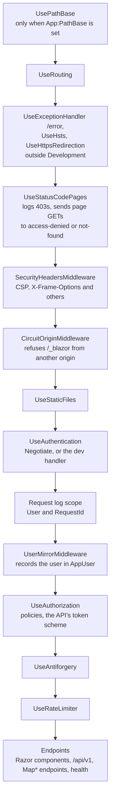
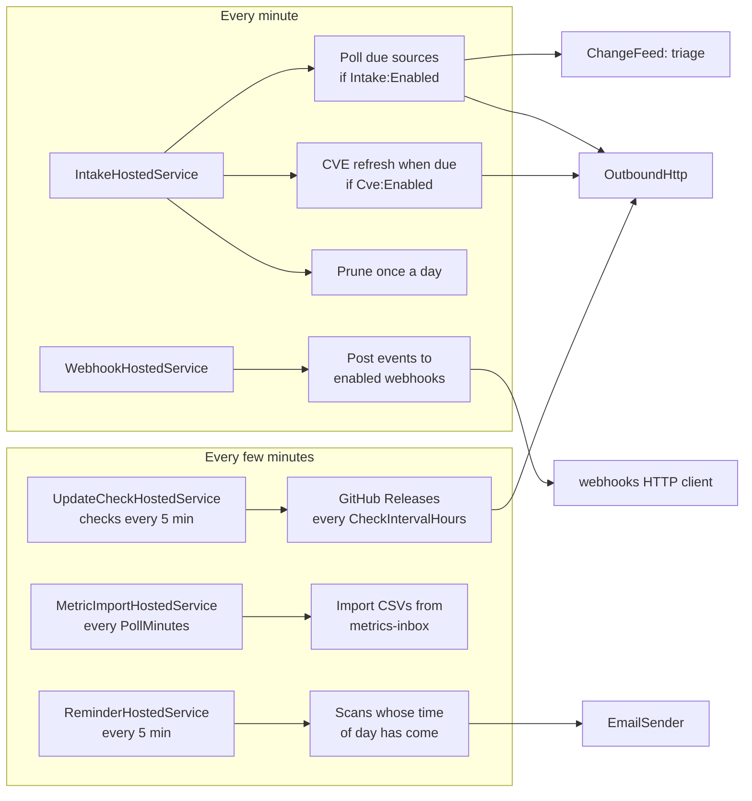

# Backend: services, endpoints and jobs

How TIDE's server side is organized: the write path every change follows, the Application services and what each
owns, the HTTP endpoints outside Blazor, the request pipeline, the background jobs, and the outbound HTTP, email and
change-feed plumbing they share. It's for a developer about to change server code, and for a reviewer who needs to
know where a rule is enforced. The REST API has its own reference, [API.md](../API.md); the security model is in
[security.md](security.md); how the projects fit together is in [overview.md](overview.md) and
[codebase-map.md](codebase-map.md).

**Contents**

- [The write path](#the-write-path)
- [Service catalog](#service-catalog)
- [HTTP endpoints](#http-endpoints)
- [Request pipeline](#request-pipeline)
- [Background jobs](#background-jobs)
- [Outbound HTTP](#outbound-http)
- [Email sending](#email-sending)
- [The change feed](#the-change-feed)
- [Errors](#errors)
- [Where it lives in code](#where-it-lives-in-code)

## The write path

Pages, endpoints, the API and background jobs never touch the database themselves. They call a scoped service in
`Tide.Application`, which checks the caller's permission, validates, and saves through a short-lived context. A real
example, `ActionService.SetStatusAsync` in `src/Tide.Application/Actions/ActionService.cs`:

```csharp
public async Task SetStatusAsync(Guid id, ActionStatus status, ActionOutcome outcome, string? note, CancellationToken ct = default)
{
    if (!Enum.IsDefined(status) || !Enum.IsDefined(outcome)) throw new ArgumentException("Choose a status and an outcome.");
    await using var db = await dbs.CreateAsync(ct);   // a context for this operation only
    var a = await WorkableAsync(db, id, ct);          // loads it, and refuses (ForbiddenException) if the user can't work it
    ApplyStatus(db, a, status, outcome, note);        // the rules: an outcome to close Done, one its kind allows; a history line
    await SaveEditAsync(db, ct);                      // concurrency turns into StaleEditException
}
```

1. **Permission.** The service asks `ICurrentUser.Has(Permission.X)` and throws `ForbiddenException`. Authorization
   runs on permissions, never role names (ADR [0002](../decisions/0002-permissions-as-code.md)). Page and endpoint
   policies are a first gate; the service check is the one that counts, because the API, the jobs and every page
   reach the same method.
2. **Validation** in the service: lengths, allowed values, dates. A bad value throws `ArgumentException` or
   `InvalidOperationException` with a sentence a person can read.
3. **A fresh context.** `IAppDbContextFactory.CreateAsync` gives a new `DbContext` per operation. A Blazor circuit
   is one DI scope that lives as long as the tab, so a held context would be shared by overlapping event handlers
   (`src/Tide.Infrastructure/DependencyInjection.cs`).
4. **Optimistic concurrency.** Long-lived editors carry an `EditVersion`; a save from an older copy throws
   `StaleEditException`.
5. **Save.** `SaveChangesAsync` runs two interceptors in the same transaction: `AuditInterceptor` stamps who and when
   and writes an `AuditLogEntry` with the before and after values, and `ChangeInterceptor` collects the change-feed
   topics and publishes them once the save commits ([below](#the-change-feed)).

Background jobs run in their own DI scope with no signed-in person. The scans they call (`ReminderService.RunDueAsync`,
`IntakeService.PollDueAsync`, `WebhookService.DeliverDueAsync`) don't check a permission; the methods a person
triggers by hand ("Run now", "Poll now") do.

## Service catalog

Every service below is registered as scoped in `src/Tide.Application/DependencyInjection.cs` (`AddApplication`)
unless marked singleton. "Checks" lists the permissions the service itself tests; the roles that hold them are in
[security.md](security.md).

### Articles, briefs and distribution

| Service | File | Owns | Main methods | Checks |
|---|---|---|---|---|
| `ArticleService` | `Articles/ArticleService.cs` | Articles: the write-ups briefs are built from, their links, tags and status | `ListAsync`, `PageAsync`, `GetAsync`, `CreateAsync`, `SaveAsync`, `SetStatusAsync`, `DeleteAsync`, `SaveTagsAsync`, `AddLinkAsync`, `RemoveLinkAsync`, `BriefDatesAsync` | ReadTeamEdition to read; WriteArticles to change |
| `ScreenshotService` | `Files/ScreenshotService.cs` | Article screenshots and hunt evidence on disk: checked to be real raster images, served inline | `AddAsync`, `RemoveAsync`, `OpenAsync`, `OpenAttachmentAsync`, `StoreEvidenceAsync`, `DiscardEvidenceAsync`, `WriteAttachmentsAsync` | WriteArticles to add or remove; WorkActions or WriteArticles for evidence; `OpenAsync` decides per file (ReadTeamEdition, WorkActions, or ReadPublished for an image in a sent company-wide edition) |
| `ReviewService` | `Reviews/ReviewService.cs` | Optional peer review of an article before it's sent, and the rule that requires it | `AskAsync`, `DecideAsync`, `CommentAsync`, `ResolveAsync`, `WithdrawAsync`, `ForArticleAsync`, `AskedOfMeAsync`, `ReviewersAsync`, `GapsAsync`, `RuleAsync`, `SaveRuleAsync` | ReadTeamEdition to see; WriteArticles to review; Administer for the rule |
| `AssistService` | `Assist/AssistService.cs` | Opt-in AI drafting, held to `Ai:MaxTlp` (ADR [0004](../decisions/0004-opt-in-ai-with-tlp-ceiling.md)) | `DraftAsync`, `FetchAsync`, `FromPastedAsync`, `KeptTextAsync`, `OtherSourcesAsync`, `PromptAsync`, `RecordAsync`, `StatusAsync`, `TestFetchAsync` | WriteArticles to draft; Administer for its source settings |
| `BriefService` | `Briefs/BriefService.cs` | The daily brief: which articles, their order, presenter, readiness and the meeting's progress | `GetOrStartAsync`, `GetAsync`, `ListAsync`, `AddArticleAsync`, `RemoveItemAsync`, `MoveItemAsync`, `ReorderAsync`, `SetDetailsAsync`, `SetTeamNoteAsync`, `MarkReadyAsync`, `MarkPresentedAsync`, `ReopenAsync`, `RunningOrderAsync`, `CandidatesAsync`, `EditionActionsAsync`, `SetDiscussedAsync` | ReadTeamEdition; WriteArticles to build; PresentBriefs to run the meeting |
| `MeetingService` | `Briefs/MeetingService.cs` | The meeting's record: attendance and each person's notes | `GetAsync`, `JoinedAsync`, `LeftAsync`, `AddAttendeeAsync`, `RemoveAttendeeAsync`, `AddNoteAsync`, `EditNoteAsync`, `DeleteNoteAsync` | JoinMeetings, MeetingNotes, PresentBriefs, ReadTeamEdition |
| `DistributionService` | `Distribution/DistributionService.cs` | Sending editions by email, freezing what went, the SharePoint copy, the published archive | `PlanAsync`, `SendAsync`, `SendTestAsync`, `SettleAsync`, `PreviewEmailAsync`, `EditionToSendAsync`, `MarkDistributedAsync`, `FinishNotSentAsync`, `SharePointAsync`, `SharePointImagesZipAsync`, `MarkSharePointPostedAsync`, `GetSendAsync`, `SendsAsync`, `PublishedAsync`, `GetPublishedAsync`, `PublishedBriefsAsync` | ReadTeamEdition to preview; PresentBriefs to send; ReadPublished for the archive |
| `CorrectionService` | `Distribution/CorrectionService.cs` | Corrections to a sent edition (ADR [0015](../decisions/0015-corrections-after-send.md)) | `StartAsync`, `PlanAsync`, `SendAsync`, `SettleAsync`, `GetAsync`, `CorrectionsAsync` | ReadTeamEdition; PresentBriefs to send |
| `DistributionSettings` | `Settings/DistributionSettings.cs` | The edition ceilings and recipient lists in force | `GetAsync`, `SaveAsync`, `GetRecipientsAsync`, `SaveRecipientsAsync` | Administer to save |
| `EmailTemplateService` | `Distribution/EmailTemplateService.cs` | The wording of notification emails | `GetAllAsync`, `SaveAsync`, `ResetAsync`, `SendTestAsync` | Administer |
| `BriefRenderer` (singleton) | `Distribution/BriefRenderer.cs` | Turning an edition into email HTML and text | rendering only | none |

### Intake, stories and context

| Service | File | Owns | Main methods | Checks |
|---|---|---|---|---|
| `IntakeService` | `Intake/IntakeService.cs` | Sources and the triage inbox: polling, dedupe, shortlist, dismiss, promote, split, prune, API proposals | `PollDueAsync`, `PollNowAsync`, `PullNowAsync`, `InboxPageAsync`, `InboxAsync`, `ShortlistAsync`, `DismissAsync`, `MarkDuplicateAsync`, `PromoteAsync`, `PromoteManyAsync`, `SplitAsync`, `ProposeAsync`, `PruneAsync`, `SourcesAsync`, `SaveSourceAsync`, `SourceHealthAsync` | WriteArticles to triage; Administer for sources |
| `ReadingService` | `Intake/ReadingService.cs` | Fetching one item's article text for the reader, kept `Intake:ReadingDays` | `ReadAsync`, `KeptAsync`, `PruneAsync` | WriteArticles |
| `CveService` | `Intake/CveService.cs` | CVE context from CISA KEV, FIRST EPSS and NVD | `GetAsync`, `EnrichDueAsync`, `EnrichNowAsync` | ReadTeamEdition (or a seat in a live meeting) to read; Administer to refresh now |
| `StoryService` | `Intake/StoryService.cs` | Threat stories that follow a campaign across days | `ListAsync`, `GetAsync`, `CreateAsync`, `UpdateAsync`, `LinkAsync`, `DeleteAsync`, `FindAsync` | ReadTeamEdition; WriteArticles to change |
| `AdversaryService` | `Adversaries/AdversaryService.cs` | Adversary profiles, their aliases, MITRE imports, the Navigator layer | `ListAsync`, `GetAsync`, `SaveAsync`, `MergeAsync`, `TagArticleAsync`, `UntagArticleAsync`, `ImportMitreAsync`, `NavigatorLayerAsync`, `SetWatchedAsync`, `SetRetiredAsync` | ReadTeamEdition; WriteArticles to change |
| `StackService` | `Stack/StackService.cs` | Our stack: the products the organization runs, matched to articles | `ListAsync`, `GetAsync`, `SaveAsync`, `SetRetiredAsync`, `TagArticleAsync`, `UntagArticleAsync`, `ForArticleAsync`, `DetailsAsync`, `CardAsync` | ReadTeamEdition; WriteArticles to change |
| `DetectionService` | `Detections/DetectionService.cs` | The SOC's detection rules, by reference, and Coverage (ADR [0017](../decisions/0017-detection-rules-are-referenced-and-tagged.md)) | `ImportAsync`, `PushAsync`, `ListAsync`, `CoverageAsync`, `ForTechniquesAsync`, `RaiseAsync`, `CallersAsync`, `RemoveCallerAsync` | WriteArticles to push and read; Administer to import and manage callers |
| `ScorecardService` | `Scorecard/ScorecardService.cs` | The board-scorecard taxonomy | `ListAsync`, `AddCategoryAsync`, `AddTagAsync`, `UpdateCategoryAsync`, `MoveTagAsync`, `SetTagRetiredAsync`, `SeedStarterSetAsync` | ReadTeamEdition; Administer to change |

### Actions

| Service | File | Owns | Main methods | Checks |
|---|---|---|---|---|
| `ActionService` | `Actions/ActionService.cs` | Follow-up actions: create, assign, status, comments, checklist, hunts, board and workload; a split action's lineage, and a team's update recorded in one step | `CreateAsync`, `QuickAddAsync`, `SaveAsync`, `SetStatusAsync`, `MoveAsync`, `ChangeOutcomeAsync`, `RecordUpdateAsync`, `AssignAsync`, `TakeAsync`, `SetDueAsync`, `AddCommentAsync`, `GenerateHuntAsync`, `RecordHuntResultAsync`, `CloseWithNoHitsAsync`, `PageAsync`, `RuleCountsAsync`, `ListAsync`, `BoardAsync`, `GetAsync`, `WorkloadAsync`, `OutstandingAsync`, `TeamActiveAsync`, `SetNoRemindersAsync`. Creating, moving into an active status and changing the team are held to the team's active limit (`ActiveLimits`) | ReadTeamEdition or WorkActions to read; WriteArticles to create; to work one, WriteArticles, or WorkActions and membership of its team |
| `ActionFileService` | `Actions/ActionFiles.cs` | Files on actions and their comments: hashes, risk, remove and restore | `AddAsync`, `DescribeAsync`, `RemoveAsync`, `RestoreAsync`, `ListAsync`, `OpenAsync` | Working the action to add; the adder, an analyst or an administrator to remove; Administer to restore; reading actions to download |
| `HuntQueryBuilder` | `Actions/HuntQueries.cs` | Turning indicators into SIEM queries from per-dialect templates (ADR [0006](../decisions/0006-query-dialects-are-templates.md)) | building; template settings | Administer to change templates |
| `SavedQueryService` | `Actions/SavedQueries.cs` | The team's saved hunt queries | `ListAsync`, `GetAsync`, `SaveAsync`, `SaveFromHuntAsync`, `SetRetiredAsync`, `DeleteAsync`, `OfferedAsync` | ReadActions; WorkActions to change; Administer to delete any |
| `OutreachTemplateService` | `Actions/OutreachTemplates.cs` | Outreach email templates | `ListAsync`, `GetAsync`, `SaveAsync`, `SetRetiredAsync`, `DeleteAsync`, `OfferedAsync` | as `SavedQueryService` |
| `OutreachService` | `Actions/Outreach.cs` | Writing an Outreach action's email, marking it sent, recording the reply (ADR [0019](../decisions/0019-outreach-emails-are-written-never-sent.md)) | `WriteAsync`, `MarkSentAsync`, `RecordReplyAsync`, `WithdrawAsync`, `ForActionAsync` | reading actions; working the action |
| `PlaybookService` | `Actions/Playbooks.cs` | The team's checklist playbooks per action kind, kept as the saved queries are (`TeamLibrary` in `TeamLibrary.cs` holds the rules the three libraries share) | `ListAsync`, `RowsAsync`, `ForKindAsync`, `SaveAsync`, `MoveAsync`, `SetRetiredAsync`, `DeleteAsync` | ReadTeamEdition or WorkActions to read; WorkActions to change; the maker or Administer to delete |
| `CardRuleService` | `Actions/Playbooks.cs` | Which actions stand out on the board, and the rules offered as filters | `ListAsync`, `SaveAsync`, `MoveAsync`, `DeleteAsync` | ReadActions, ReadTeamEdition or WorkActions to read; Administer to change |
| `TeamService` | `Actions/TeamService.cs` | Teams that own actions, and their members; external teams (ADR 0020), active limits and escalation contacts | `ListAsync`, `AddAsync`, `UpdateAsync`, `AddMemberAsync`, `RemoveMemberAsync`, `SetRetiredAsync`, `TeamsOfAsync`, `AddExternalAsync`, `UpdateExternalAsync`, `SetLimitAsync`, `SetEscalationContactAsync` (a team's form saves through `UpdateAsync(id, TeamForm)` or `UpdateExternalAsync`, in one save) | ReadTeamEdition or WorkActions to read; WorkActions for an external team; Administer for an internal one, members and limits |
| `HandoffService` | `Actions/Handoffs.cs` | Hand-offs to another team (with a reason, emailing the receiving team unless it's external), the same hand-off for a team changed in the editor (`HandOverAsync`, which `ActionService.SaveAsync` calls; `HandoffNotices` sends the email), and splits to several teams at once | `HandOffAsync`, `SplitAsync` | whoever can work the action to hand it off; WriteArticles to split |
| `SlaSettings` | `Actions/ActionSla.cs` | SLA targets per priority and kind | `GetAsync`, `SaveAsync` | Administer to save |
| `ReminderService` | `Actions/Reminders.cs` | Reminder and digest emails, and the brief-not-ready nudge; external teams' reminders, at their cadence, with no TIDE links (`ExternalReminders.cs`); the escalation ladder's steps: remind, copy the escalation contact, raise priority, flag (`EscalationScan.cs`, rules in `EscalationLadder`, ADR [0021](../decisions/0021-escalation-is-an-administered-ladder.md)) | `RunDueAsync`, `RunAsync`, `RunNowAsync` | none for the scans; Administer for Run now |

Long lists are read a page at a time, with the count of every match. The triage inbox (`IntakeService.InboxPageAsync`,
50 rows) counts and cuts the page in the database wherever it can; New, *Likely used*, *Names what we run* and the KEV
filter depend on what only the app knows (ageing into Older, the Our stack matcher, the CVE records' KEV flag, the learned
counts), so those read every matching item light and page that. Its suggested groups are worked out over the page shown.
The actions list (`ActionService.PageAsync`, 50 rows) sorts, groups and pages in SQL; the board loads every open card and
caps each column on screen. Saved queries, outreach templates and playbooks, libraries of tens, page in memory (20 cards).

### Rotation, metrics, trends and search

| Service | File | Owns | Main methods | Checks |
|---|---|---|---|---|
| `RotationService` | `Rotation/RotationService.cs` | Who presents when; swaps and cover approved by the colleague (ADR [0010](../decisions/0010-rotation-changes-approved-by-the-colleague.md)); the .ics feed | `CalendarAsync`, `UpcomingAsync`, `RequestAsync`, `ApproveAsync`, `DeclineAsync`, `CancelAsync`, `RecordPastCoverAsync`, `GenerateAsync`, `SetWeekAsync`, `MembersAsync`, `MyCalendarAsync`, `PresenterAsync` | ReadTeamEdition; WriteArticles to ask; Administer for the roster and to undo |
| `HolidayService` | `Org/HolidayService.cs` | The organization's holidays (ADR [0018](../decisions/0018-holidays-are-days-off-like-weekends.md)) | `ListAsync`, `AddAsync`, `RemoveAsync`, `ImportAsync`, `CopyYearAsync`, `LoadAsync` | Administer to change |
| `MetricsService` | `Metrics/MetricsService.cs` | The opening metrics: groups, definitions, a day's values, history | `ListAsync`, `GetDayAsync`, `SaveValueAsync`, `HistoryAsync`, `AddGroupAsync`, `SaveMetricAsync`, `SetMetricRetiredAsync`, `IsLockedAsync` | ReadTeamEdition; EnterMetrics for values; Administer for definitions and fixed days |
| `MetricImportService` | `Metrics/MetricImportService.cs` | Metric values from CSV (ADR [0014](../decisions/0014-metric-values-from-csv.md)) | `ImportDroppedAsync`, `UploadAsync`, `RecentAsync` | Administer to upload; none for the drop folder |
| `TrendsService` | `Trends/TrendsService.cs` | Counts over periods, by first brief (ADR [0013](../decisions/0013-trends-count-articles-by-first-brief.md)) | `ReportAsync`, `ArticlesAsync` | ReadTeamEdition |
| `ReportService` | `Trends/ReportService.cs` | The period report on Reports | `BuildAsync` | through `TrendsService` |
| `TeamScorecardService` | `Trends/TeamScorecardService.cs` | The team commitments scorecard: each team's actions due in a window, on time, late, days late, open and overdue now, counted by team in the database with `ActionQueries.WhereMet`, `WhereLate` and `WhereOverdue` (the database's twin of `ActionSla.StateOf`) | `BuildAsync`, `ToCsv` | ReadActions |
| `SearchService` | `Search/SearchService.cs` | Search and indicator lookup (ADR [0011](../decisions/0011-search-with-portable-like-queries.md)) | `SearchAsync` | ReadTeamEdition |
| `RelatedService` | `Search/RelatedService.cs` | An article's related articles | `ForArticleAsync` | ReadTeamEdition |
| `ExportService` | `Exports/ExportService.cs` | Gathering indicators for STIX or CSV, cut at a TLP (ADR [0012](../decisions/0012-exports-carry-tlp-and-stable-ids.md)) | `GatherAsync` | ReadTeamEdition |
| `HistoryService` | `History/HistoryService.cs` | An article's or brief's change history, from the audit log | `ArticleAsync`, `BriefAsync` | WriteArticles |

### Administration, API and operations

| Service | File | Owns | Main methods | Checks |
|---|---|---|---|---|
| `RoleMappingService` | `Admin/RoleMappingService.cs` | Which AD groups hold which role | `ListAsync`, `AddAsync`, `RemoveAsync` | Administer |
| `AuditLogService` | `History/AuditLogService.cs` | Administration › System › Audit log, and its CSV | `PageAsync`, `ExportAsync`, `PeopleAsync`, `NameAsync` | Administer |
| `OperationalSettingsService` | `Settings/SavedSettings.cs` | Settings saved in Administration that override the server's | `SaveAsync` | Administer |
| `SavedSettings` (singleton) | `Settings/SavedSettings.cs` | The saved settings in memory, laid over the options | `RefreshAsync` | none |
| `ConfigBundleService` | `Operations/ConfigBundleService.cs` | Exporting and importing the administered settings | `ExportAsync`, `PreviewAsync`, `ImportAsync` | Administer |
| `UpdateSettings` | `Operations/UpdateSettings.cs` | Whether the update check is on | `GetEnabledAsync`, save | Administer to save |
| `UpdateCheckService` (singleton) | `Operations/UpdateCheckService.cs` | Asking GitHub Releases for a newer version | `CheckAsync` | none; its page needs Administer |
| `UserPreferenceService` | `Preferences/UserPreferenceService.cs` | A person's own display preferences | `GetAsync`, `SetAsync` | signed in |
| `NotificationPreferenceService` | `Preferences/NotificationPreferenceService.cs` | A person's choices in My notifications | `GetMineAsync`, `SetMineAsync`, `CountsAsync`, `PeopleAsync` | own choices; Administer for counts |
| `ApiTokenService` | `Api/ApiTokens.cs` | API tokens: issue, revoke, sign in | `ListAsync`, `IssueAsync`, `RevokeAsync`, `AuthenticateAsync` | Administer (not for sign-in) |
| `WebhookService` | `Api/Webhooks.cs` | Webhooks and their delivery | `ListAsync`, `AddAsync`, `SetEnabledAsync`, `RemoveAsync`, `TestAsync`, `DeliverDueAsync` | Administer (not for delivery) |
| `ApiService` | `Api/ApiService.cs` | The API's reads and writes, each through the service above | `BriefAsync`, `ActionsAsync`, `ActionAsync`, `OpenFileAsync`, `UpdateActionAsync`, `StackAsync`, `MetricsAsync`, `SetMetricAsync`, `ProposeAsync` | ReadTeamEdition for a brief; the rest in the services it calls |
| `JobMonitor` (singleton) | `Operations/JobMonitor.cs` | Each background job's last run, for Diagnostics and `/health/jobs`; logs each failure under the job's event id | `RunAsync`, `Scheduled`, `Succeeded`, `Failed`, `TakeFinished`, `Restore` | none |
| `BackgroundJobLease` (singleton, also `IJobLease`) | `Operations/BackgroundJobLease.cs` | Whether this process runs the background jobs (the `JobLeases` row) | `HoldAsync`, `ReleaseAsync`, `Status` | none |
| `JobRunLog` (singleton) | `Operations/JobRunLog.cs` | The job history (`JobRuns`): writes, prunes after 30 days, restores at start-up, reads for Diagnostics | `FlushAsync`, `PruneAsync`, `RestoreAsync`, `HistoryAsync` | none |
| `JobHealth` (static) | `Operations/JobHealth.cs` | Whether each job is failing, overdue or hung | `Evaluate` | none |
| `OrgClock` (singleton) | `Org/OrgClock.cs` | The organization's time zone, today, business days and holidays | `Today`, `CurrentBriefDate`, `Days` | none |

The Web project adds circuit-level services for live collaboration (`Presence`, `LiveMeetings`, `BoardDrags`, in
`src/Tide.Web/Services`), covered in [collaboration.md](collaboration.md), and `SystemSettings` and
`SystemDiagnostics` for Administration › System.

## HTTP endpoints

Besides the Blazor UI (`MapRazorComponents`, with the `/_blazor` circuit hub), every endpoint is a minimal API mapped
in `src/Tide.Web/Program.cs`, plus the REST API group in `src/Tide.Web/Api/ApiEndpoints.cs`. Unless a row says
otherwise, each response also carries the [global security headers](#request-pipeline), including the app's CSP.

`AsExport()` (`src/Tide.Web/Api/ExportEndpoints.cs`) means: the policy given (ReadTeamEdition by default), the
`exports` rate limit, and `Cache-Control: private, no-store`. CSVs are UTF-8 with a byte-order mark so Excel reads them
correctly (`ExportEndpoints.CsvFile`).

| Method and path | Handler | Auth | Rate limit | Cache and other headers | Notes |
|---|---|---|---|---|---|
| `/api/v1/*` | `ApiEndpoints.MapTideApi` | API token or Windows (`ApiOrUser` scheme), plus a scope per endpoint for a token | `api`, 120 a minute per caller | `private, no-store` | See [API.md](../API.md). Antiforgery off. |
| GET `/files/{id}/inline` | `ScreenshotService.OpenAsync` | Signed in; the service decides per image | `files`, 300 | `private, max-age=300, must-revalidate`, or `no-store` for a Visitor's slide image; `ETag` (the file's hash), `nosniff` | Only sniffed raster images, never a download. 304 while the bytes match and the viewer may still see it. |
| GET `/files/{id}/download` | `ActionFileService.OpenAsync`, else `ScreenshotService.OpenAttachmentAsync` | Signed in; the service decides per file | `files` | `private, no-store`, `nosniff`, CSP `sandbox; default-src 'none'` | Always `application/octet-stream` as an attachment (`FileDownloads.Plain`). |
| GET `/files/{id}/zip` | `ActionFileService.OpenAsync` | Signed in; the service decides | `files` | as download | The file in a zip with the password `infected`, ZipCrypto (`FileDownloads.Zipped`). Actions' and comments' files only. |
| GET `/adversaries/{id}/navigator.json` | `AdversaryService.NavigatorLayerAsync` | `AsExport` | `exports`, 60 | `private, no-store` | ATT&CK Navigator layer. |
| GET `/briefs/{day}/email/{edition}` | `DistributionService.PreviewEmailAsync` | `AsExport` | `exports` | `no-store`; CSP `default-src 'none'; img-src 'self' data:; style-src 'unsafe-inline'; frame-ancestors 'self'; base-uri 'none'; form-action 'none'; sandbox allow-same-origin allow-popups`; `X-Frame-Options: SAMEORIGIN` | The email as it would go now, for the brief page's preview frame (`EmailPage`). |
| GET `/sends/{id}/email` | `DistributionService.GetSendAsync` | `AsExport` | `exports` | as the preview | A frozen send's email as it went (ADR [0007](../decisions/0007-frozen-sends-and-cid-email.md)). |
| GET `/corrections/{id}/email` | `CorrectionService.GetAsync` | `AsExport` | `exports` | as the preview | A frozen correction's email. |
| GET `/briefs/{day}/sharepoint-images.zip` | `DistributionService.SharePointImagesZipAsync` | `AsExport` | `exports` | `private, no-store` | 409 with a plain-text reason while the edition waits for review. |
| GET `/rotation/my.ics` | `RotationService.MyCalendarAsync` | `AsExport` | `exports` | `private, no-store` | The signed-in person's brief days, `text/calendar`. |
| GET `/metrics/export.csv?from=&to=` | `MetricsService.HistoryAsync`, `ToCsv` | `AsExport` | `exports` | `private, no-store` | Defaults to the 30 days to the current brief date. |
| GET `/trends/export.csv?p=&subs=&n=` | `TrendsService.ReportAsync`, `ToCsv` | `AsExport` | `exports` | `private, no-store` | The trend table ending at period `p` (`2026-09`, `2026-Q3`). |
| GET `/trends/articles.csv?p=&line=&subs=` | `TrendsService.ArticlesAsync` | `AsExport` | `exports` | `private, no-store` | The articles one trend line counted. |
| GET `/reports/export.csv?p=` | `ReportService.BuildAsync` | `AsExport` | `exports` | `private, no-store` | The period report. |
| GET `/reports/teams/export.csv?days=&parts=&external=` | `TeamScorecardService.BuildAsync`, `ToCsv` | `AsExport(ReadActions)` | `exports` | `private, no-store` | The team commitments scorecard, a row per team. |
| GET `/exports/{scope}/{key}?format=&tlp=` | `ExportService.GatherAsync`, `Stix.Write`, `IndicatorCsv.Write` | `AsExport` | `exports` | `private, no-store` | `scope` is `article`, `brief`, `story` or `lookup`; STIX 2.1 (`application/stix+json;version=2.1`, no `format` or `format=stix`) or `format=csv`, any other 400; `tlp` is the ceiling, required (400 without it). |
| GET `/admin/system/tide.config.psd1` | `InstallAnswers.Write` | Administer | none | `no-store` | The install answers file for this server. No secrets. |
| GET `/admin/system/config-bundle.json` | `ConfigBundleService.ExportAsync` | Administer | none | `no-store` | The administered settings. No secrets. |
| GET `/admin/system/audit.csv` | `AuditLogService.ExportAsync` | `AsExport(Administer)` | `exports` | `private, no-store` | The audit rows the page's filters match, secrets masked. |
| GET `/health/live` | health checks, none run | Anonymous | `health`, 120 per address | | `Healthy` while the process answers. |
| GET `/health` | `DatabaseHealthCheck` (5-second limit) | Anonymous | `health` | | `Healthy` or `Unhealthy` as plain text, no detail. A failure is logged as one warning a minute. |

The pages `/error`, `/not-found` and `/access-denied` are Razor components the pipeline sends people to.

## Request pipeline

The order `Program.cs` builds, top to bottom:



| Step | What it does |
|---|---|
| `UsePathBase` | For a reverse proxy that forwards a sub-path (`App:PathBase`). Under IIS as an application (`/tide`), IIS sets the path base itself and the setting stays blank. |
| Start-up, before the pipeline runs | `DatabaseInitializer.InitializeAsync` migrates and seeds; `SavedSettings.RefreshAsync` and `EmailTemplateStore.RefreshAsync` load what administrators saved. |
| Exception handler, HSTS, HTTPS redirect | Outside Development only. An unhandled error renders `/error`. |
| `UseStatusCodePages` | Logs every 403 outside `/_blazor` to the access log with who and where. For a GET of a page (a Razor component, or an unmatched address the browser asked HTML for), a 403 redirects to `/access-denied?from=` and a 404 to `/not-found`. Files, exports, the API and health keep their real status codes. |
| `SecurityHeadersMiddleware` | On every response: `X-Content-Type-Options: nosniff`, `X-Frame-Options: DENY`, `Referrer-Policy: no-referrer`, `Cross-Origin-Opener-Policy: same-origin`, a `Permissions-Policy` that turns off camera, microphone, geolocation, payment and USB, and the CSP `default-src 'self'; img-src 'self' data:; style-src 'self' 'unsafe-inline'; script-src 'self'; object-src 'none'; connect-src 'self'; frame-ancestors 'none'; base-uri 'self'; form-action 'self'`. It removes `Server`. Endpoints that need another CSP (emails, downloads) replace it. |
| `CircuitOriginMiddleware` | Refuses a `/_blazor` request whose `Origin` is neither the request's host nor `App:BaseUrl`'s, with 403, against cross-site WebSocket hijacking. No `Origin` passes. |
| `UseAuthentication` | The default scheme: Negotiate in production, `DevAuthenticationHandler` in Development (`AuthModeGuard`). The AD-group transformer (`RoleClaimsTransformer`) turns groups into permission claims. |
| Request log scope | Every log line in the request carries `User` and `RequestId`. |
| `UserMirrorMiddleware` | Records the signed-in user in the `AppUser` mirror (throttled), so ids resolve to names; makes the user ambient for logging. |
| `UseAuthorization` | Policies are one per permission (`Policies.Required`); the fallback policy needs a signed-in user. The API group authenticates with `ApiOrUser` here, so a bearer token becomes the request's user. |
| `UseAntiforgery` | Blazor forms. The API group opts out. |
| `UseRateLimiter` | Token buckets per minute, no queue, 429 on refusal: `files` 300 and `exports` 60 per signed-in user (or address), `api` 120 per caller, `health` 120 per address. |

## Background jobs

Five hosted services run the jobs in the web process (registered with `AddHostedService` in `Program.cs`), and a
sixth keeps their bookkeeping. Each loops with `Task.Delay`, makes a fresh DI scope per pass, re-reads its on/off
settings on every pass so a change takes effect without a restart, and tries again at the next pass after a failure.
None of them can stop the app.

- **One process runs them.** Before each pass a job asks `IJobLease.HoldAsync` and skips the pass unless this process
  holds the lease: one row in `JobLeases`, taken and renewed with one conditional `UPDATE` (set this holder and a new
  expiry where the row is this holder's or has lapsed), atomic on SQLite and SQL Server alike, so a web garden, an
  overlapping recycle or a second server on the database doesn't send a reminder twice. It lapses 3 minutes after its
  last renewal; a pass within 30 seconds of the last check (a renewal, or a standby's look) doesn't ask again. While the database doesn't answer, a
  holder keeps going until 30 seconds before the expiry it wrote, then stops. A job run by hand asks for the lease too
  (`IJobLease.RequireHeldAsync`): a reminder scan's or the escalation ladder's **Run now**, a source's **Poll now** or
  Triage's **Pull now**, the CVE refresh and the update check's **Check now**. On a standby each is refused with
  `StandingByException` ("This server is standing by: … runs the background jobs. Run it there."), shown as the
  page's error toast. Within the holder, the in-process locks (the reminder scans' `SemaphoreSlim`) still keep a
  **Run now** and the poller apart.
- **Reporting.** Each run is reported to `JobMonitor` (Administration › System › Diagnostics, `/health/jobs`), which
  logs a failure as a Warning under the job's event id (7101 to 7107) and queues the run for the job history.
- **Upkeep.** `JobUpkeepHostedService` (`src/Tide.Web/Services/JobUpkeepHostedService.cs`), registered first so it
  stops last, renews the lease every 30 seconds whatever the jobs are doing, writes the queued runs to `JobRuns`, and
  prunes runs older than 30 days daily while it holds the lease. At shutdown it writes what's left and lets the lease
  go, so a standby takes over within 30 seconds. At start-up `JobRunLog.RestoreAsync` reads each job's latest run back into
  the monitor.



| Job | Cadence | Reads | Writes | Switches | On failure |
|---|---|---|---|---|---|
| `IntakeHostedService` (`src/Tide.Web/Services/IntakeHostedService.cs`) | A pass every minute. Each source on its own interval (at least `Intake:MinPollMinutes`, 15). CVE refresh every `Cve:RefreshHours` (24). Prune once a day. | Sources due; feeds over `OutboundHttp`; the CVEs on articles and recent items; KEV, EPSS and NVD | Feed items and source poll state (`IntakeService.PollDueAsync`); CVE records (`CveService.EnrichDueAsync`); deletes items older than `Intake:RetentionDays` (90) nobody kept, and kept texts past `Intake:ReadingDays` (7) | `Intake:Enabled`, `Cve:Enabled` (each saved on Sources, else the server's). Prune always runs. | Each part on its own: logged, the others still run, tried at the next pass. A failed prune is tried a minute later, not a day. A source that keeps failing is backed off by `OutboundCircuit`. |
| `ReminderHostedService` (`src/Tide.Web/Services/ReminderHostedService.cs`) | Every 5 minutes. Each scan runs when its time of day has come. | Open actions, teams, external teams' cadence, escalation contacts, rotation, briefs, people's notification choices | Emails through `EmailSender`; a `NotificationMark` per email so nothing is sent twice. The escalation ladder also writes the actions it climbs: priority, `EscalatedForDue` and `EscalatedAtUtc`, a history line and a mark per step run, all in one save on one fresh read | `Notifications:DueSoon`, `Overdue`, `Digest`, `Presenting`, `BriefNotReady`, `PersonalDigest` (on by default), `OutreachFollowUp`, `ExternalReminders`, `Escalation`, each with `Enabled`; `ReminderTime` (08:00), `Digest:Day` and `Time`, `BriefNotReady:Time` (10:00) and `Recipients`, `OutreachFollowUp:Days` (5), `Escalation:Scope` and `Steps`. All off by default but the personal digest's offer; saved on Teams & SLA. | Each scan's failure is its own; marks stop repeats when a scan stops partway. A pass in which any scan failed is a failed run on Diagnostics, naming each scan and its error (the other scans still ran). One scan at a time in the process. A ladder step whose every email failed changes nothing and is tried at the next poll. A ladder save lost to a colleague's save at that moment is redone action by action, each read again (and tried once more). Ladder steps that don't read climb nothing: the run's note says why, and it's logged. |
| `MetricImportHostedService` (`src/Tide.Web/Services/MetricImportHostedService.cs`) | Every `Metrics:Import:PollMinutes` (5, held to 1 to 60) while on; checks every minute while off | CSV files in `metrics-inbox` under `Files:RootPath`, once unchanged for 30 seconds | Metric values and an import record (`MetricImportService.ImportDroppedAsync`); moves each file to `processed`, `rejected` or `failed`, deleted after 90 days (`MetricDropFolder`) | `Metrics:Import:DropFolderEnabled` (off by default) | Logged; a file the database couldn't take waits for the next pass. A setting that won't bind is logged and treated as off. |
| `UpdateCheckHostedService` (`src/Tide.Web/Services/UpdateCheckHostedService.cs`) | First check 2 minutes after start, then every `Updates:CheckIntervalHours` (24, held to 6 to 168); re-reads the switch every 5 minutes | GitHub Releases for `Updates:Repository`, over `OutboundHttp` | Nothing in the database; the result in memory for the Updates page | `Updates:CheckEnabled` (off by default; saved on the Updates page) | Recorded as "couldn't check" with the reason; tried at the next interval. |
| `WebhookHostedService` (`src/Tide.Web/Api/WebhookServices.cs`) | Every minute, at start-up first | Enabled webhooks; actions raised and brief sends since each watermark, at least 30 seconds old; open actions newly overdue | POSTs to each webhook; its watermarks and last result (outside the audit log) | Each webhook's on/off in Administration › API access | A webhook stops at its first failed post and retries from there next minute with the same event id. See [API.md](../API.md#webhooks). |
| `JobUpkeepHostedService` (`src/Tide.Web/Services/JobUpkeepHostedService.cs`) | Every 30 seconds; at shutdown | The `JobLeases` row; the runs `JobMonitor` queued | The lease (renewed, or let go at shutdown); `JobRuns`, and deletes runs older than 30 days once a day | Always on; prunes only while it holds the lease | Logged as a Warning; runs it couldn't write are kept (up to 2,000) and written at the next pass. |

Every job but the upkeep runs only in the process holding the job lease. A run past its job's limit (30 minutes for
most, 2 hours for the CVE refresh, 10 minutes for the update check, 15 for webhooks, 1 hour for the prune) is hung,
and a job with no good run in three intervals (at least 15 minutes) is overdue: see `JobHealth` and
[backup-and-recovery.md](../operations/backup-and-recovery.md#endpoints).

Other timers that aren't hosted services:

- **Session permission refresh.** Each open circuit re-derives its user's permissions from the current role mappings
  every 2 minutes (`PermissionRevalidatingAuthStateProvider.Interval`), so removing an AD mapping reaches people
  without a reconnect.
- **Role directory retry.** When loading the role mappings fails, `RoleDirectory` retries every 30 seconds.
- **Brief sends in flight.** A send left "sending" for 15 minutes (`SendOutcome.InFlight`) is treated as possibly gone
  in the log and the next confirmation.

Everything runs in the one web process (ADR [0001](../decisions/0001-blazor-server-on-prem.md)). The installer sets the
app pool to `AlwaysRunning` with no idle time-out (`deploy/Install-Tide.ps1`), so the jobs keep running when no one is
using the app.

## Outbound HTTP

`OutboundHttp` (`src/Tide.Infrastructure/Notifications/OutboundHttp.cs`, behind `IOutboundHttp`, singleton) is the
one client TIDE uses to fetch from other hosts: feeds (`IntakeService`), article text (`ReadingService`,
`AssistService`), CVE data (`CveService`), MITRE data (`AdversaryService`) and GitHub Releases
(`UpdateCheckService`). It only does GET.

| Behavior | Detail |
|---|---|
| Connections | One long-lived `SocketsHttpHandler`, connections recycled every 5 minutes (so DNS changes are seen), 10-second connect time-out, automatic decompression. User agent `TIDE/1.0 (+https://github.com/jashley92/Tide)`. |
| Time limit | `Intake:TimeoutSeconds` (20, held to 5 to 120) per request, the whole body included. |
| Size limit | `Intake:MaxResponseKB` (8,192, at least 64), by `Content-Length` and while reading. |
| Redirects | Followed by the client itself, at most 5, never from https to http, each hop's host checked first. A caller's own headers (an API key) go only to the address it asked for. |
| Conditional GET | `If-None-Match` and `If-Modified-Since` from the last fetch; a 304 is "not modified". |
| Proxy | `Intake:Proxy` (read at start-up, with the app pool's credentials), else the system proxy. |
| Address rules | `AddressPolicy.Refusal` refuses loopback, link-local (cloud metadata at 169.254.169.254 among them), unspecified, multicast, broadcast and reserved addresses always, and private ranges (RFC 1918, 100.64/10, IPv6 unique-local and site-local) unless `Intake:AllowPrivateNetworks`. IPv4-mapped and IPv4-embedding IPv6 addresses (6to4, NAT64, SIIT, ISATAP, IPv4-compatible) are judged as the IPv4 address they carry. |
| Rebinding | Going direct, the connect callback checks the address it actually connects to, so DNS that changes between the check and the connection can't slip through. Through a proxy, the per-hop host check is the guard; a name this machine can't resolve within 3 seconds is left to the proxy. |
| Back-off | `OutboundCircuit` per host (`http:<host>`): a timeout, connection failure, 5xx or 429 counts as a failure. A refused address is a rule, not a failure, and isn't counted. |
| Result | Never throws for a failure: `HttpFetch` with `Ok`, `NotModified` or `Failed` and a sentence saying why, which the Sources and Diagnostics pages show. |

Two other clients exist, each for one purpose. Webhooks post through the `webhooks` named client
(`HttpWebhookPoster`: 15-second time-out, redirects off), which doesn't apply `AddressPolicy` or `Intake:Proxy`. The
Azure OpenAI client (`src/Tide.Infrastructure/Assist/AzureOpenAiAssistant.cs`) has its own `HttpClient`.

## Email sending

`EmailSender` (`src/Tide.Infrastructure/Notifications/EmailSender.cs`, behind `IEmailSender`, singleton) is the one
email path: brief sends, corrections, test copies, reminders, digests and rotation notices all go through it.

- **Options** come from the `Email` section on every send (`EmailOptions`), so a corrected relay setting applies at
  once. Off by default (`Email:Enabled`): the send buttons say so and nothing goes. `SmtpHost`, `SmtpPort` (25),
  `EnableSsl` (STARTTLS, on), `SmtpUsername` and `SmtpPassword` together, or `SmtpUseDefaultCredentials` for the app
  pool's account, `SmtpTimeoutSeconds` (30, held to 5 to 300), `From`, `FromName`, and `PickupDirectory` for
  development (.eml files instead of the relay). Details are in [configuration.md](../operations/configuration.md).
- **Message.** `multipart/alternative`, plain text then HTML, with screenshots as linked `cid:` resources so Outlook
  shows them without fetching anything (ADR [0007](../decisions/0007-frozen-sends-and-cid-email.md)).
  `X-Auto-Response-Suppress: OOF, AutoReply` and `Auto-Submitted: auto-generated` keep out-of-office replies away.
  Invalid addresses are skipped and counted; with none valid it fails.
- **No silent retry.** A send is watched by the analyst who made it, so a failure is returned for them to see, not
  queued. A relay that refused some recipients but took the rest is a partial `Sent`, since sending again would
  repeat it to everyone.
- **Back-off.** `OutboundCircuit` per relay (`smtp:<host>:<port>`, or `pickup`). A relay that couldn't be reached or
  dropped the session counts as a failure; a relay that answered with a refusal doesn't, nor does a pickup folder that
  can't be made or written to (it fails with "The email pickup folder (Email:PickupDirectory) can't be created or
  written to.", never "couldn't be reached").
- **Logging.** Counts and SMTP status codes only, never addresses, subjects or the relay's own reply, which can echo
  addresses. The analyst is told the kind of failure ("refused the sign-in (SMTP 535)").

`OutboundCircuit` (`src/Tide.Infrastructure/Notifications/OutboundCircuit.cs`, singleton) is shared by both: after 3
failures in a row within 2 minutes, a target is backed off for 1 minute, doubling on each further failure up to 10.
While it's backed off a call fails at once with "try again in N minutes". When the back-off ends one call goes through
as a probe; a success clears it.

## The change feed

`ChangeFeed` (`src/Tide.Application/Abstractions/ChangeFeed.cs`, singleton) tells open pages that something they show
changed elsewhere, so a shared page stays current without a reload. `ChangeInterceptor`
(`src/Tide.Infrastructure/Persistence/ChangeInterceptor.cs`) publishes from every save once it has succeeded (inside a
caller's transaction, once that commits; nothing on a rollback), with who made the change and the circuit it came from (`ChangeOrigin`, one per DI scope), so a page ignores its own
saves. Handlers run on the publisher's thread with its user cleared; one that throws doesn't stop the others. Pages
pause briefly so a burst is one reload. How pages subscribe is in [collaboration.md](collaboration.md).

| Topic | Published when this is saved |
|---|---|
| `article:{id}` | The article, its bullets, screenshots, tags, techniques, indicators, links or CVEs |
| `article-summary:{id}` | An article's techniques, CVEs or adversary tags (its story's page listens) |
| `articles` | Any article (the lists, and the brief's Add article picker) |
| `article-tags:{id}` | An article's adversary or product tags (only the editor's pickers listen) |
| `brief:{id}` | The brief, its items, sends or corrections |
| `brief-day:{yyyy-MM-dd}` | A brief, for a page showing a day whose brief may not exist yet |
| `meeting:{briefId}` | A meeting's attendance or notes |
| `action:{id}` | An action, its comments, hunts, indicators, outreach, checklist, history or files |
| `actions` | Any action, or an action's own file (the lists and the board) |
| `metrics` | A metric definition or group |
| `metrics-day:{yyyy-MM-dd}` | A day's metric value |
| `rotation` | A rotation week, member, override or change request |
| `stories` | Any story |
| `story:{id}` | The story, or an article on it, linked to it or taken off it |
| `stack` | A product in Our stack |
| `saved-queries` | A saved hunt query |
| `outreach-templates` | An outreach template |
| `playbooks` | A playbook or its steps |
| `triage` | A triage split or its undo (saved), or new items from a poll (`IntakeHostedService` publishes it) |

## Errors

Services throw four kinds of exception, each meaning one thing:

| Exception | Meaning | In the API |
|---|---|---|
| `ForbiddenException` | The user lacks the permission | 403 |
| `ArgumentException`, `InvalidOperationException` | A value or a state the rules refuse | 400 |
| `KeyNotFoundException` | It no longer exists | 404 |
| `StaleEditException` | Someone changed it meanwhile ("Reload to see their changes") | 409 |

Each carries a sentence written for the person. A page turns an exception into what it shows with
`UserFacingError.For` (`src/Tide.Web/Services/Services.cs`): the exception's own message for the kinds raised on
purpose; for a refusal, the message plus a warning in the access log with who and which operation; for anything else,
"Something went wrong" with a short reference, and the exception logged as an error under that reference so an
administrator can find it. On an endpoint an unexpected exception reaches the exception handler. Background jobs catch
everything, log it, and record it on Diagnostics.

## Where it lives in code

| Concern | Where |
|---|---|
| Service registration | `src/Tide.Application/DependencyInjection.cs` (`AddApplication`), `src/Tide.Infrastructure/DependencyInjection.cs` (`AddInfrastructure`) |
| Endpoints, pipeline, rate limits, auth schemes, hosted services | `src/Tide.Web/Program.cs` |
| Export helpers | `src/Tide.Web/Api/ExportEndpoints.cs` (`AsExport`, `CsvFile`) |
| Download headers | `src/Tide.Web/Security/FileDownloads.cs` |
| Security headers, circuit origin, user mirror | `src/Tide.Web/Security/SecurityHeadersMiddleware.cs`, `CircuitOriginMiddleware.cs`, `UserMirrorMiddleware.cs` |
| Hosted services | `src/Tide.Web/Services/*HostedService.cs`, `src/Tide.Web/Api/WebhookServices.cs` |
| Job reporting, lease and history | `src/Tide.Application/Operations/JobMonitor.cs`, `BackgroundJobLease.cs`, `JobRunLog.cs`, `JobHealth.cs` |
| Outbound HTTP | `src/Tide.Infrastructure/Notifications/OutboundHttp.cs`, `AddressPolicy.cs`, `OutboundCircuit.cs` |
| Email | `src/Tide.Infrastructure/Notifications/EmailSender.cs`, `EmailOptions.cs`, `SmtpClientFactory.cs` |
| Change feed | `src/Tide.Application/Abstractions/ChangeFeed.cs`, `src/Tide.Infrastructure/Persistence/ChangeInterceptor.cs` |
| Audit | `src/Tide.Infrastructure/Persistence/AuditInterceptor.cs` |
| Health | `src/Tide.Web/Services/Services.cs` (`DatabaseHealthCheck`) |
