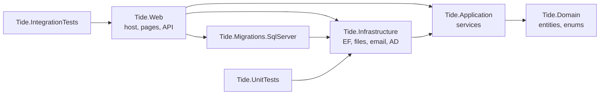
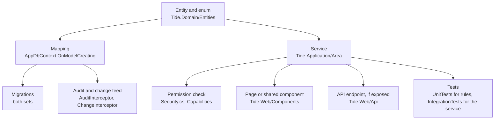

# Codebase map

This page says where things are in the repository, what belongs where, and where to start reading. It's for developers
who are new to TIDE or about to change an area they haven't worked in. Paths are relative to the repository root.
[overview.md](overview.md) covers layering and how a request flows. [data-model.md](data-model.md) covers the tables.

## Contents

- [Repository layout](#repository-layout)
- [How the projects depend on each other](#how-the-projects-depend-on-each-other)
- [`src/Tide.Domain`](#srctidedomain)
- [`src/Tide.Application`](#srctideapplication)
- [`src/Tide.Infrastructure`](#srctideinfrastructure)
- [`src/Tide.Migrations.SqlServer`](#srctidemigrationssqlserver)
- [`src/Tide.Web`](#srctideweb)
- [`tests`](#tests)
- [`deploy`](#deploy)
- [`tools` and CI](#tools-and-ci)
- [If you need to change X, start in Y](#if-you-need-to-change-x-start-in-y)
- [Where a feature's code usually lives](#where-a-features-code-usually-lives)

## Repository layout

```
Tide.sln
Directory.Build.props        .NET 10, nullable on, latest-recommended analyzers, InvariantGlobalization=false
.github/workflows/           ci.yml (build, test, migration guards, SQL Server job, upgrade test) and release.yml (bundle)
deploy/                      PowerShell install, upgrade, backup and restore-drill scripts, SQL, production config template
docs/                        This documentation set, ADRs (docs/decisions) and screenshots
src/
  Tide.Domain/               Entities, enums, the indicator normalizer. No dependencies.
  Tide.Application/          Services (use cases), permissions, rendering, parsing, ports (interfaces)
  Tide.Infrastructure/       EF Core context and interceptors, SQLite migrations, file store, email, outbound HTTP, AD
  Tide.Migrations.SqlServer/ The SQL Server migrations, in their own assembly
  Tide.Web/                  Blazor Server host: sign-in, pages, endpoints, the REST API, background jobs
tests/
  Tide.UnitTests/            Pure logic: editions, renderers, parsers, rules, golden files
  Tide.IntegrationTests/     Services on SQLite (and SQL Server when configured), the whole app over HTTP, components
  Shared/                    Test clocks and options helpers, linked into both test projects
tools/
  ci/                        Migration immutability check, Sonar gate, release notes
  upgrade-test/              Installs old releases on SQL Server and upgrades them to this tree
  release/                   The release signing key script
```

## How the projects depend on each other



`Tide.Application` defines the ports it needs, such as `IAppDbContext`, `IAppDbContextFactory`, `ICurrentUser`,
`IFileStore`, `IEmailSender`, `IOutboundHttp` and `IThreatIntelAssistant`
(`src/Tide.Application/Abstractions/Abstractions.cs` and the folders that use them). `Tide.Infrastructure` implements
them. Application code refers to EF Core types (`DbSet`, `Include`, `ExecuteUpdateAsync`) through `IAppDbContext`. It
never refers to SQL Server or SQLite directly.

## `src/Tide.Domain`

| Path | Holds | Start reading |
|---|---|---|
| `Common/` | `Entity` (a Guid `Id` generated in C#), `AuditableEntity` (created and modified stamps), and `EnumNames`, which parses an enum by declared name only and never as a number or comma list. | `Entity.cs` |
| `Entities/` | One file per area, with one class per table: `Intake.cs` (sources, feed items, stories, CVEs), `Article.cs`, `Brief.cs`, `Distribution.cs` (sends, corrections), `Actions.cs` (teams, actions and everything on them, hunts, saved queries, outreach), `Metrics.cs`, `Rotation.cs`, `Scorecard.cs`, `Stack.cs`, `Adversary.cs`, `Review.cs`, `Detection.cs`, `Assist.cs` (AI drafts), `Api.cs` (tokens, webhooks), `Users.cs` (users, preferences, role mappings, audit log, settings, stored files). | `Article.cs`: `Article.HighestTlp`, `Article.Effective` and the "why it matters" TLP defaults. |
| `Enums/` | `AppEnums.cs` (roles, permissions and every workflow enum), `TlpLevel.cs` (`TlpLevel` and the `Tlp` helpers: `Label`, `Key`, `Parse`, `Checked`), `MitreEnums.cs` (`MitreTactic`). | `TlpLevel.cs` |
| `Observables/` | `IocObservable` (refang, defang, detect a type, canonical form) and `IpText`. | `IocObservable.Normalize` |

**Belongs here:** state and rules that hold wherever an entity is used, such as a part's effective TLP or which statuses
count as open. Stored enum values are append-only (see [data-model.md](data-model.md#enums)). The domain has no
package references.

## `src/Tide.Application`

Every page and endpoint calls a service here. Services take `IAppDbContextFactory` and open a short-lived context per
operation, because a Blazor circuit shares one DI scope. Every write checks its permission in the service itself,
through `ICurrentUser.Has(Permission.…)`, whether or not the page already hides the control.
`DependencyInjection.cs` registers them all.

| Folder | Holds | Key types |
|---|---|---|
| `Abstractions/` | The ports (`IAppDbContext`, `IAppDbContextFactory`, `ICurrentUser`, `IFileStore`, `IRoleDirectory`, `IUserDirectory`…), the change feed that refreshes colleagues' open pages, the shared validation for admin lists, and when articles were first briefed. | `Abstractions.cs`, `ChangeFeed`, `AdminLists`, `ArticleDates` |
| `Actions/` | Follow-up actions and everything on them. Covers create, update, status, comments, checklist, hunts, indicators and children (`ActionService`, the largest service), files on actions (`ActionFileService` in `ActionFiles.cs`), the SLA rules (`ActionSla`), hunt query dialects and templates (`HuntQueryBuilder`, `QueryDialects` in `HuntQueries.cs`), saved queries, outreach (`OutreachService` in `Outreach.cs`, `OutreachTemplateService` in `OutreachTemplates.cs`, `OutreachFill`), playbooks and card rules (`PlaybookService`, `CardRuleService` in `Playbooks.cs`), teams and external teams (`TeamService`), hand-offs and splits (`HandoffService` in `Handoffs.cs`), active limits (`ActiveLimits`), a parent's rollup (`ActionRollup`), the reminder and digest scans (`ReminderService` in `Reminders.cs`, with the external teams' in `ExternalReminders.cs` and their cadence in `ExternalCadence`), the escalation ladder (its rules in `Escalation.cs`, `EscalationLadder`; its run in `EscalationScan.cs`), and list and board queries (`ActionQueries`). | `ActionService`, `ActionSla`, `HuntQueryBuilder`, `ReminderService` |
| `Admin/` | AD group to role mappings. | `RoleMappingService` |
| `Adversaries/` | Threat actor and campaign profiles, article tags, merges, the ATT&CK group import and the Navigator layer. | `AdversaryService` |
| `Api/` | What the REST API does, behind its endpoints: `ApiService` reads briefs, actions, metrics and detections and calls the other services to write. Also tokens (`ApiTokenService` in `ApiTokens.cs`, scopes in `ApiScopes`) and webhooks (`WebhookService` in `Webhooks.cs`, signing and delivery). | `ApiService`, `ApiScopes` |
| `Articles/` | Writing articles: save, status, delete, links, indicator suggestions, filters and sorting. `ArticleChecks` (in `ArticleForm.cs`) decides what blocks Ready. | `ArticleService`, `ArticleForm`, `ArticleChecks` |
| `Assist/` | Opt-in AI drafting ([ADR 0004](../decisions/0004-opt-in-ai-with-tlp-ceiling.md)): prompt building, answer checks, and extracting article text from a page (`ArticleText`, `ArticleCleanup`). | `AssistService`, `DraftPrompt`, `DraftChecks` |
| `Briefs/` | The day's brief, its running order, team note and title-slide line, presented and reopen (`BriefService`). Also the meeting record (`MeetingService`), the edition cut (`BriefEditions` in `BriefEdition.cs`), the five-step progress and edition checks (`BriefProgress.cs`), and which meetings are live (`MeetingsInProgress`, `MeetingAccess`). | `BriefEditions`, `BriefService` |
| `Content/` | Markdown to safe HTML (`MarkdownService`), CSV cells (`Csv`), name ordering that matches SQL Server's collation (`NameOrder`), and wording helpers. | `MarkdownService` |
| `Detections/` | Detection-rule imports (Sentinel, Sigma, CSV, API), coverage of briefed techniques, and gap actions. | `DetectionService`, `DetectionParsers` |
| `Distribution/` | Sending editions. Covers freezing a send and sending it, not sent, distributed without email, SharePoint, and the published archive query (`DistributionService`). Also corrections (`CorrectionService`, `CorrectionRenderer`), the email and web renderings (`BriefRenderer`, `EmailComposer`), the customizable email templates (`EmailTemplates.cs`, `EmailTemplateService`) and reading a frozen send back (`PublishedContent`, `SentSections`). | `DistributionService`, `BriefRenderer` |
| `Exports/` | Indicator exports as CSV and STIX 2.1. | `ExportService`, `IndicatorCsv`, `Stix` |
| `Files/` | Screenshots and evidence: upload checks, sniffing, storage, inline access rules, deletes. Also file risk and zip-by-default rules, and display sizes. | `ScreenshotService`, `ImageSniffer`, `FileRisk` |
| `History/` | The History disclosure on articles and briefs (`HistoryService`, `HistoryFormatter`), and the administrator's audit log page and CSV (`AuditLogService`, `AuditRecords`). | `HistoryService`, `AuditLogService` |
| `Indicators/` | Finding indicators and CVEs in pasted text, and indicator labels and defanged display. | `IocExtractor`, `IndicatorLabels` |
| `Intake/` | Sources, polling, the triage inbox, grouping and splits, promote and attach, and retention (`IntakeService`). Also feed parsing and URL canonicalization (`FeedParser`, `UrlCanonicalizer`, `TitleMatch` in `FeedParsing.cs`), feed filters, sponsored-content detection, the reading pane (`ReadingService`), CVE enrichment (`CveService`), stories (`StoryService`), triage ordering (`TriageLearning`, `TriageGroups`), the starter source list, and `IOutboundHttp` with `IntakeOptions`. | `IntakeService`, `FeedParser`, `CveService` |
| `Metrics/` | Metric definitions and values (`MetricsService`), CSV import (`MetricImportService`, `MetricCsv`), the rules for change and thresholds (`MetricMath`), charts and present-mode slides, and entry progress. | `MetricsService`, `MetricMath` |
| `Mitre/` | The embedded ATT&CK Enterprise catalog (`attack-techniques.json`, `attack-retired.json`, embedded resources) and the matrix views. | `AttackCatalog`, `AttackMatrix` |
| `Operations/` | Running the server: the settings catalog and secret masking (`SettingsCatalog`, `SecretMask`), the configuration bundle export and import (`ConfigBundleService`), install answers (`tide.config.psd1`), background job status (`JobMonitor`), the release feed and update check, and the upgrade command shown on the Updates page. | `SettingsCatalog`, `ConfigBundleService`, `JobMonitor` |
| `Org/` | The organization clock (time zone, today, the current brief date), working days, and holidays. | `OrgClock`, `WorkingDays`, `HolidayService` |
| `Preferences/` | Per-person preferences (`UserPreferences`, `UserPreferenceService`), notification choices, and recipient resolution. | `UserPreferenceService`, `NotificationPreferenceService` |
| `Reviews/` | Article reviews, the review checklist, and the content fingerprint that dates an approval. | `ReviewService` |
| `Rotation/` | Who presents each week, covers and swaps, overrides, and the `.ics` feed. | `RotationService` |
| `Scorecard/` | Scorecard categories and tags, the starter set, and tag search. | `ScorecardService` |
| `Search/` | Full search and indicator lookup ([ADR 0011](../decisions/0011-search-with-portable-like-queries.md)), related articles and actions, and picker ranking. | `SearchService`, `RelatedService`, `SearchText` |
| `Security/` | Roles, permissions and policies (`RoleDefinitions`, `Policies` in `Security.cs`), the list of every activity and what it needs (`Capabilities`), claim types, and stored roles. | `Security.cs`, `Capabilities` |
| `Settings/` | Settings administrators change in the app: distribution ceilings (`DistributionSettings`) and operational settings (`OperationalSettings`, kept in memory by `SavedSettings`/`OperationalSettingsService`). | `OperationalSettings` |
| `Stack/` | Our stack products, "We run" tags, and triage matching. | `StackService` |
| `Trends/` | Threat trends ([ADR 0013](../decisions/0013-trends-count-articles-by-first-brief.md)), periods, trend charts, the reports page, and the team commitments scorecard. | `TrendsService`, `ReportService`, `TeamScorecardService`, `Period` |

**Belongs here:** anything a page or endpoint does that touches data or decides a rule, including permission checks.
A page that writes to the database without a service is a bug. Pure, static logic (renderers, parsers, rule tables)
also lives here, so unit tests can reach it without a database.

## `src/Tide.Infrastructure`

| Path | Holds | Start reading |
|---|---|---|
| `DependencyInjection.cs` | `AddInfrastructure`: picks the provider (`Database:Provider`) and its migrations assembly, registers the context factory with both interceptors, and registers the file store, email, outbound HTTP, AD directories and AI client. | `AddInfrastructure` |
| `Persistence/AppDbContext.cs` | The EF model: every table's lengths, keys, indexes and delete rules, `ValueGenerated.Never` on Guid keys, and SQLite's `DateTimeOffset`-as-ticks converter. | `OnModelCreating` |
| `Persistence/AuditInterceptor.cs` | Stamps and the audit log, written in the same save. `NotAudited`, `SkippedProperties` and `MaskFor` are the knobs. | `Record`, `Changes` |
| `Persistence/ChangeInterceptor.cs` | Publishes change-feed topics after a save commits (`TopicsOf` maps entities to topics). | `TopicsOf` |
| `Persistence/DatabaseInitializer.cs` | Startup: migrate (or refuse if `Database:ApplyMigrations` is false and migrations are pending), load holidays, seed role mappings and the scorecard, run the one-time indicator canonicalization, and add Development sample data. | `InitializeAsync`, `SeedSamplesAsync` |
| `Persistence/AppDbContextFactory.cs` | The design-time factory for `dotnet ef`. It reads `TIDE_MIGRATIONS_PROVIDER`, and its XML comment has the migration commands. | |
| `Persistence/Migrations/` | The **SQLite** migrations and snapshot. | |
| `Storage/DiskFileStore.cs` | File bytes on disk under `Files:RootPath`. | `WriteAsync`, `PathFor` |
| `Storage/MetricDropFolder.cs` | The metrics drop folder ([ADR 0014](../decisions/0014-metric-values-from-csv.md)): settle time, move to `processed`, `rejected` or `failed`, and delete after 90 days. | |
| `Notifications/` | SMTP sending (`EmailSender`, `SmtpClientFactory`, `EmailOptions`), the outbound circuit breaker (`OutboundCircuit`), recipient address rules (`AddressPolicy`), and the one guarded outbound HTTP client for feeds, CVE services, article pages and release checks (`OutboundHttp`). | `EmailSender`, `OutboundHttp` |
| `Security/` | `RoleDirectory` (a cached snapshot of role mappings) and `UserDirectory` (the `Users` mirror and display names). | |
| `Assist/AzureOpenAiAssistant.cs` | The Azure OpenAI implementation of `IThreatIntelAssistant`. | |

**Belongs here:** anything that talks to something outside the process (database, disk, SMTP relay, HTTP, AD, the AI
provider) behind an interface from `Tide.Application`.

## `src/Tide.Migrations.SqlServer`

This project holds the production (SQL Server) migrations and their snapshot, `Migrations/AppDbContextModelSnapshot.cs`.
That snapshot is the authority for the production schema. The project exists only because one assembly can hold just
one migrations set for a model (see the comment in `Tide.Migrations.SqlServer.csproj`). Each migration here has a
SQLite twin with the same name in `src/Tide.Infrastructure/Persistence/Migrations`. The release bundle lists these
migrations in `migrations-sqlserver.txt`, which `Upgrade-Tide.ps1` compares against the database.

## `src/Tide.Web`

The Blazor Server host. `Program.cs` wires authentication, authorization, middleware, the Blazor components, minimal
API endpoints and hosted services.

| Path | Holds | Start reading |
|---|---|---|
| `Program.cs` | Service registration, the middleware order, and the non-page endpoints: `/files/{id}/inline`, `/download` and `/zip`, email previews (`/briefs/{day}/email/{edition}`, `/sends/{id}/email`, `/corrections/{id}/email`), the SharePoint image zip, `/rotation/my.ics`, the CSV exports (metrics, trends, reports), `/exports/{scope}/{key}`, the admin downloads (`tide.config.psd1`, `config-bundle.json`, `audit.csv`), and the Navigator layer. Also health checks. | the `app.Map…` calls |
| `Api/` | The REST API under `/api/v1` (`ApiEndpoints`), its hand-kept OpenAPI 3.1 document (`OpenApi`, served at `/api/v1/openapi.json`), shared download behaviour (`ExportEndpoints`), and webhook delivery (`WebhookHostedService`, `DataProtectionSecrets` in `WebhookServices.cs`). See [../API.md](../API.md). | `ApiEndpoints` |
| `Security/` | Sign-in and request security. `AuthModeGuard` (Windows in Production, the dev sign-in otherwise) and `DevAuthenticationHandler`. `ApiTokenAuthentication` (`Authorization: Bearer tide_pat_…`). `RoleClaimsTransformer`, `SidNames`, `BoundedDirectoryCalls` and `WindowsNames` turn AD groups into role and permission claims under a time limit. `PermissionRevalidatingAuthStateProvider` and `SessionPermissionRefresher` re-check open circuits. `CurrentUser` implements `ICurrentUser`. `UserMirrorMiddleware` writes `Users`. `CircuitOriginMiddleware` and `SecurityHeadersMiddleware` (CSP and headers). `FileDownloads` covers attachment downloads and the `infected` zip. | `RoleClaimsTransformer`, `CurrentUser` |
| `Services/` | Web-only services and background jobs. The hosted services: `IntakeHostedService` (polls, CVE refresh, daily prune), `ReminderHostedService`, `MetricImportHostedService` and `UpdateCheckHostedService`. Collaboration: `LiveMeetings` (present mode's in-memory meetings), `Together` (who else is here), `LiveRows`, `TriageNews` and `BoardDrags`. Also `PrerenderHandoff`, `BriefChipSource` (what the top bar's brief chip says, kept per circuit), `PathBaseSetting`, `ConnectionTransport`, `SystemDiagnostics` (the Diagnostics page's checks), `ConfigSource`, and `ToastService` in `Services.cs`. | `IntakeHostedService`, `LiveMeetings` |
| `Components/App.razor`, `Routes.razor` | The document shell (`<base href>`, CSS and script tags with their `?v=` versions) and the router. | |
| `Components/Layout/` | `MainLayout`, `AdminLayout`, `BlankLayout` (present mode), `NavMenu` with `NavPages` (sidebar entries and the permissions each needs), the command palette (`CommandPalette`, `PaletteEntries`), keyboard shortcuts (`Shortcuts`, `ShortcutsOverlay`), top search, and `PageBoundary` (error boundary). | `NavPages.cs` |
| `Components/Pages/` | One component per page, routed by `@page`. The table after this one maps routes to files. | `Present.razor`, `Triage.razor`, `BriefPage.razor` |
| `Components/Pages/Admin/` | Administration pages under `/admin/…`, all requiring `Administer`. | `AdminOverview.razor` |
| `Components/Shared/` | Reusable components, about 90 of them. The article editor panel, action editor, table and kanban, hunt and outreach panels, edition views and checks, the send confirmation and distribute panel, metric entry and charts, present-mode cards, pickers (story, scorecard tag, ATT&CK matrix, products, adversaries), `DataTable`, `FilterBar`, `ConfirmDialog`, `LeaveDialog`, `TlpSelect`, `HistoryPanel` and `ToastHost`. | `ArticleEditorPanel.razor`, `EditionView.razor`, `DataTable.razor` |
| `wwwroot/` | `app.css` (the `--tide-*` design tokens for both themes), `palette.css`, Bootstrap, and `js/`: one external script per behaviour (`board.js`, `present.js`, `triage.js`, `editor.js`, `chart.js`…), because the CSP allows only `script-src 'self'`. `samples/detection-rules.csv` is the downloadable CSV template. | `app.css`, `js/present.js` |
| `appsettings.json`, `appsettings.Development.json`, `web.config` | Configuration, where every key has a `"//"` comment line, the dev overrides, and IIS hosting. See [../operations/configuration.md](../operations/configuration.md). | |

### Pages by route

| Route | File | What it is |
|---|---|---|
| `/` | `Home.razor` | Today: the current brief, drawn by `BriefPage`. Readers get the published archive instead. |
| `/triage` | `Triage.razor` | The intake inbox. |
| `/articles`, `/articles/{id}` | `Articles.razor`, `ArticleEdit.razor` | The article list and editor. |
| `/articles/{id}/review` | `ReviewPage.razor` | Reviewing an article. |
| `/briefs`, `/briefs/{day}` | `BriefsArchive.razor`, `BriefPage.razor` | The brief list, and one day's brief with its five steps. |
| `/present/{day}` | `Present.razor` | Present mode and the live meeting. |
| `/briefs/{day}/sharepoint` | `SharePointPage.razor` | The company-wide copy for SharePoint. |
| `/published`, `/published/{day}` | `Published.razor` | The published archive that Readers see. |
| `/actions`, `/actions/new`, `/actions/{number}` | `ActionsBoard.razor`, `ActionPage.razor` | The board and list, and one action. |
| `/workload` | `Workload.razor` | Load by team and person. |
| `/library`, `/library/{tab}` | `Library.razor` (tabs: `SavedQueriesPage.razor`, `OutreachTemplatesPage.razor`, `PlaybooksPage.razor`, `BoardRulesPage.razor`) | The team's library: saved hunt queries, outreach email templates, playbooks and the board rules. The old addresses redirect (`LibraryMoved.razor`). |
| `/stories`, `/stories/{id}` | `Stories.razor` | Threat stories. |
| `/adversaries`, `/adversaries/{id}` | `AdversariesPage.razor` | Actor and campaign profiles. |
| `/stack`, `/stack/{id}` | `StackPage.razor` | Our stack. |
| `/coverage` | `CoveragePage.razor` | Detection coverage of briefed techniques. |
| `/metrics` | `MetricsHistory.razor` | Metric history. |
| `/trends`, `/reports` | `Trends.razor`, `Reports.razor` | Threat trends and period reports. |
| `/search` | `Search.razor` | Search and indicator lookup. |
| `/rotation` | `RotationPage.razor` | The presenter rotation. |
| `/notifications` | `MyNotifications.razor` | A person's notification choices. |
| `/admin/…` | `Pages/Admin/*.razor` | Sources, source health, teams, metrics, metric imports, scorecard, card rules, query templates, detections, rotation, organization, email templates, access, API, and System (diagnostics, server config, setting sources, updates, config bundle, audit log). |
| `/error`, `/not-found`, `/access-denied` | `ErrorPage.razor`, `NotFoundPage.razor`, `SystemPages.razor` | |

[../product/screens.md](../product/screens.md) describes each screen.

## `tests`

| Path | Holds |
|---|---|
| `tests/Tide.UnitTests/` | Pure logic with no database: edition cutting (`BriefEditionTests`), the email and web renderings, which include the TLP leak tests (`BriefRendererTests`, `CorrectionRendererTests`), metric rules and CSV, SLA and working days, hunt query dialects, feed and CVE parsing, indicator extraction, triage grouping, Markdown safety, style tokens, Razor attributes, and the deploy scripts' pure functions run in PowerShell (`DeployScriptTests`). |
| `tests/Tide.UnitTests/Golden/` | Golden files for the hunt dialects (`xql.txt`, `kql.txt`, `fql.txt`), editions and exports. Run with `TIDE_UPDATE_GOLDEN=1` to accept a deliberate change, then review the diff. |
| `tests/Tide.UnitTests/Audit/`, `tests/Tide.IntegrationTests/Audit/` | Tests written from review findings: adversarial, backend, frontend, infrastructure, scale and security. |
| `tests/Tide.IntegrationTests/` | Services against in-memory SQLite with the real migrations (`TestDb.cs`, which also holds `FakeUser`, `FakeEmailSender` and the other doubles), and the whole app over HTTP (`TideApp`, `ReaderApp`, `SqlServerTideApp` in `WebAppTests.cs`). Also Blazor component tests (`ComponentHarness`, `PresentHarness`). Most files are named after an area (`ActionTests`, `IntakeTests`, `DistributionTests`…) or a bug-fix round (`ActionsRound4BugTests`…). |
| `tests/Tide.IntegrationTests/SqlServerFactAttribute.cs` | `[SqlServerFact]`, and the providers theory that runs a test on both databases when `TIDE_TEST_SQL` is set. |
| `tests/Shared/` | `TestClocks` and `StaticOptionsMonitor`, compiled into both test projects as linked files. |

Test doubles are hand-written; there's no mocking library. [../development/testing.md](../development/testing.md)
covers running and writing tests.

## `deploy`

Windows PowerShell 5.1 scripts, ASCII only. [`deploy/README.md`](../../deploy/README.md) lists every script, and
[../INSTALL.md](../INSTALL.md) and [../UPGRADE.md](../UPGRADE.md) walk through them.

| Path | Holds |
|---|---|
| `New-TideConfig.ps1`, `tide.config.template.psd1` | The install answers file and the script that writes it. |
| `Install-Database.ps1`, `sql/01-Create-Database.sql`, `sql/02-Grant-Backup.sql` | Creating the database and the app pool's login, in AppMigrates or DbaApplies mode, and the backup grant. |
| `Install-Tide.ps1`, `Verify-Install.ps1` | Publishing or copying the app, IIS site and pool, data root, `appsettings.Production.json`, and the checks afterwards. |
| `Upgrade-Tide.ps1` | The in-place upgrade: the bundle's signature and SHA-256 checked first, then migration checks against `migrations-sqlserver.txt`, a backup, a file swap, warm-up and rollback. |
| `Test-TideBundle.ps1`, `lib/TideReleaseKeys.ps1` | The upgrade's bundle checks on their own, and the release keys they trust. |
| `Backup-Tide.ps1`, `Test-TideRestore.ps1` | A backup set (database, files, key ring, settings) and the restore drill. |
| `appsettings.Production.template.json` | What the installer fills in. |
| `lib/*.ps1` | Shared helpers for IIS, AD group names, SQL, settings, upgrade, backup, dates, JSON, paths and WebSockets. |

There's no DBA schema script yet (`deploy/README.md`, "Not yet here").

## `tools` and CI

| Path | Holds |
|---|---|
| `tools/ci/check-migrations-immutable.sh` | Fails CI when a migration that shipped in a release tag was changed or removed. |
| `tools/ci/check-sonar-quality-gate.sh` | Reads the SonarQube Cloud quality gate. |
| `tools/ci/extract-release-notes.sh` | Release notes for the release workflow. |
| `tools/signing/New-ReleaseSigningKey.ps1` | Makes the release signing key: sets the `RELEASE_SIGNING_KEY` secret and pins the public key ([releasing.md](../development/releasing.md)). |
| `tools/upgrade-test/upgrade-path.sh` | Installs older releases into SQL Server, starts this tree against the same database, and checks it comes up healthy with data intact. |
| `.github/workflows/ci.yml` | `build-test` (restore, build, test, Sonar, migration immutability, pending model changes for both providers, vulnerable packages) and `sql-server` (apply migrations twice, SQL Server tests, the upgrade path). |
| `.github/workflows/release.yml` | Builds the bundle from `main`: the published app, the deploy scripts, `migrations-sqlserver.txt`, the `.sha256`, and the `.sig` signed with the release key. |

## If you need to change X, start in Y

| To change… | Start in | Then check |
|---|---|---|
| A table or column | The entity in `src/Tide.Domain/Entities`, then `AppDbContext.OnModelCreating` | Add migrations to both sets ([../development/recipes.md](../development/recipes.md)). Update [data-model.md](data-model.md). |
| Whether something is audited or masked in the log | `AuditInterceptor.NotAudited` and `MaskFor` | `HistoryService` and `AuditLogService` for display |
| Which open pages refresh after a change | `ChangeInterceptor.TopicsOf`, `ChangeFeed` | The page's subscription. [collaboration.md](collaboration.md) |
| A role or what it may do | `RoleDefinitions` and `Policies` in `src/Tide.Application/Security/Security.cs` | `Capabilities` (the activity table), the service's own `Has(Permission.…)` checks, `NavPages`. [security.md](security.md) |
| How AD groups become roles | `src/Tide.Web/Security/RoleClaimsTransformer.cs`, `SidNames` | `RoleDirectory`, `RoleMappingService` |
| What an edition includes at a TLP | `BriefEditions` (`src/Tide.Application/Briefs/BriefEdition.cs`) | `BriefRenderer`, `EmailComposer`, the TLP leak tests in `BriefRendererTests`. [editions-and-tlp.md](editions-and-tlp.md) |
| The email's look | `EmailComposer` (its `Palette` mirrors the light tokens), `EmailTemplates.cs` | `app.css` tokens, preview at `/briefs/{day}/email/{edition}` |
| Sending, not sent, SharePoint, the archive | `DistributionService` | `SendOutcome`, `PublishedContent`. [../workflows/distribution.md](../workflows/distribution.md) |
| Corrections after a send | `CorrectionService`, `CorrectionRenderer` | [ADR 0015](../decisions/0015-corrections-after-send.md) |
| Brief steps, ordering, reopen | `BriefService`, `BriefProgress.cs` | `BriefPage.razor`, `BriefStepper.razor` |
| Present mode and the live meeting | `src/Tide.Web/Components/Pages/Present.razor`, `Services/LiveMeetings.cs` | `MeetingService`, `MeetingsInProgress`, `wwwroot/js/present.js` |
| Article editor fields or Ready checks | `ArticleForm`, `ArticleChecks`, `ArticleService` | `Components/Shared/ArticleEditorPanel.razor` |
| Screenshot or file upload rules | `ScreenshotService`, `ImageSniffer`, `FileRisk` | `ActionFileService`, `Security/FileDownloads.cs` |
| Feed polling, filters, triage | `IntakeService`, `FeedParser`, `FeedFilter` | `IntakeHostedService`, `Triage.razor`, `OutboundHttp` |
| CVE enrichment | `CveService` (`CveParsers`) | `IntakeHostedService` |
| An action's SLA or due date | `ActionSla` | `SlaSettings`, `WorkingDays`, `ReminderService` |
| Reminders and digests | `ReminderService` (`Actions/Reminders.cs`) | `NotificationKinds`, `ReminderHostedService`, `NotificationMarks` |
| Hand-offs, splits and external teams | `HandoffService` (`Actions/Handoffs.cs`), `TeamService` | `HandoffNotices`, `ActionEmails`, `ActiveLimits`, `ActionRollup`, `ExternalCadence`, `ExternalTeams.razor`, `SplitDialog.razor`, `OverLimitDialog.razor` |
| Lineage, timeline and recorded updates | `ActionService` (`GetAsync`, `RecordUpdateAsync`) | `ActionLineage`, `LineageRules`, `RemediationTimeline` (`Actions/ActionLineage.cs`), `TeamUpdates`, `ActionLineageFlow.razor`, `RemediationTimelineCard.razor`, `RecordUpdateDialog.razor` |
| A hunt query dialect | `QueryDialects` / `HuntQueryBuilder` (`Actions/HuntQueries.cs`) | Golden files in `tests/Tide.UnitTests/Golden`. [ADR 0006](../decisions/0006-query-dialects-are-templates.md) |
| Outreach emails | `OutreachFill`, `OutreachService`, `OutreachTemplateService` | `OutreachPanel.razor` |
| Metrics and their import | `MetricsService`, `MetricMath`, `MetricImportService`, `MetricCsv` | `MetricDropFolder`, `MetricImportHostedService` |
| Trends or reports | `TrendsService`, `ReportService`, `TeamScorecardService`, `Period` | `Trends.razor`, `Reports.razor`, `TeamCommitments.razor` |
| Search or indicator lookup | `SearchService`, `SearchText`, `Lookups` | [ADR 0011](../decisions/0011-search-with-portable-like-queries.md) |
| Exports (CSV, STIX) | `ExportService`, `Stix` | Golden `export.csv`, `export.stix.json` |
| The REST API | `src/Tide.Web/Api/ApiEndpoints.cs`, `ApiService` | `OpenApi.cs` (kept by hand), `ApiScopes`, [../API.md](../API.md) |
| Webhooks | `WebhookService` | `WebhookHostedService`, `DataProtectionSecrets` |
| A setting administrators change in the app | `OperationalSettings`, `SettingsCatalog` | `SavedSettings`, the admin page that edits it. [../operations/configuration.md](../operations/configuration.md) |
| Today, the time zone, holidays | `OrgClock`, `WorkingDays`, `HolidayService` | |
| The rotation | `RotationService` | `RotationPage.razor`, `Admin/RotationAdmin.razor` |
| AI drafting | `AssistService`, `DraftPrompt`, `DraftChecks` | `AzureOpenAiAssistant`, [ADR 0004](../decisions/0004-opt-in-ai-with-tlp-ceiling.md) |
| Startup, seeding, sample data | `DatabaseInitializer` | `Program.cs` |
| The sidebar, palette or shortcuts | `Components/Layout/NavPages.cs`, `PaletteEntries.cs`, `Shortcuts.cs` | |
| Colours or theme | `wwwroot/app.css` `--tide-*` tokens | `EmailComposer.Palette` for email. Never hard-code a hex value in a page. |
| A script | `wwwroot/js/<name>.js` | Bump its `?v=` in `App.razor`. |
| Install or upgrade | `deploy/Install-Tide.ps1`, `deploy/Upgrade-Tide.ps1`, `deploy/lib` | `DeployScriptTests`, `tools/upgrade-test/upgrade-path.sh` |

## Where a feature's code usually lives

Most features have the same shape, so a new one usually touches these places:



The service is the centre: pages, API endpoints and background jobs all call it, and it checks permissions and writes
through `IAppDbContext`. Keep pages thin. A rule that a page enforces but the service doesn't is a bug, because the API
and other pages reach the same service.
