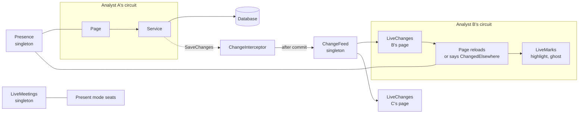
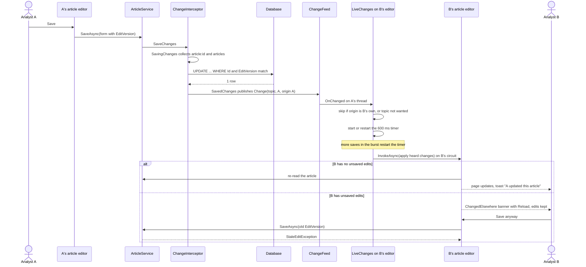

# Working together

How TIDE keeps several analysts on the same pages without stepping on each other: the change feed that tells open
pages a colleague saved, how a page reloads (or doesn't) when it hears one, how lists show what changed, who's here,
live meetings, the two concurrency rules (claim in one statement, and the edit version), and the single-process
constraint all of this rests on. It's for developers touching any page that shows shared data, and for operators
deciding how to host TIDE.

**Contents**
- [The pieces](#the-pieces)
- [ChangeFeed and its topics](#changefeed-and-its-topics)
- [How a save reaches another analyst's page](#how-a-save-reaches-another-analysts-page)
- [LiveChanges: what a page does when it hears](#livechanges-what-a-page-does-when-it-hears)
- [LiveDiff and LiveMarks: showing what changed in a list](#livediff-and-livemarks-showing-what-changed-in-a-list)
- [Presence](#presence)
- [LiveMeetings](#livemeetings)
- [Concurrency: claim in one statement](#concurrency-claim-in-one-statement)
- [Concurrency: the edit version](#concurrency-the-edit-version)
- [The single-process constraint](#the-single-process-constraint)
- [Adding a live page](#adding-a-live-page)
- [Where it lives in code](#where-it-lives-in-code)

## The pieces

All of it is in memory in the one web process. Nothing is pushed from the database: the feed hears saves made through
EF Core in this process.

## ChangeFeed and its topics

`ChangeFeed` (`src/Tide.Application/Abstractions/ChangeFeed.cs`) is a singleton event: `Publish(Change)` calls every
subscriber in turn on the publisher's thread. A `Change` carries the topic, who made it (`ActorId`, `ActorName`) and the
`Origin`: the `ChangeOrigin` id of the DI scope that saved, which is one per Blazor circuit (and per background job).
A subscriber that throws is skipped so the others still hear and the publisher's own action doesn't fail. `Version`
counts every publish; `PrerenderHandoff` uses it to tell whether a prerendered page's state is still current.

Topics are published by `ChangeInterceptor.TopicsOf` for each added, modified or deleted row:

| Row | Topics |
|---|---|
| `Article` | `article:{id}`, `articles` |
| `ArticleBullet`, `ArticleScreenshot`, `ArticleTag`, `ArticleTechnique`, `ArticleIndicator`, `ArticleLink`, `ArticleCve` | `article:{id}` |
| `ArticleAdversary`, `ArticleProduct` | `article-tags:{id}` (not the article's topic: a tag doesn't move its edit version) |
| `Brief` | `brief:{id}`, `brief-day:{yyyy-MM-dd}` |
| `BriefItem`, `BriefSend`, `BriefCorrection` | `brief:{id}` |
| `MeetingAttendee`, `MeetingNote` | `meeting:{briefId}` (not the brief's topic: a join or a note isn't an edit) |
| `ActionItem`, `ActionFile` | `action:{id}`, `actions` |
| `ActionComment`, `HuntQuery`, `ActionIndicator`, `OutreachMessage`, `ActionChecklistItem`, `ActionEvent` | `action:{id}` |
| `RotationChange`, `RotationOverride`, `RotationWeek`, `RotationMember` | `rotation` |
| `Story` | `stories` |
| `MetricValue` | `metrics-day:{yyyy-MM-dd}` |
| `MetricDefinition`, `MetricGroup` | `metrics` |
| `StackProduct` | `stack` |
| `SavedQuery` | `saved-queries` |
| `OutreachTemplate` | `outreach-templates` |
| `Playbook`, `PlaybookStep` | `playbooks` |
| `TriageSplit` | `triage` |

Two topics are also published by hand:

- **`triage`.** Triage decisions are written with `ExecuteUpdateAsync` (below), which the interceptor doesn't see, so
  the triage page announces its own decisions (`Triage.razor`, `Announce`), and `IntakeHostedService` publishes it when
  a poll brings items.
- **System changes.** `ChangeFeed.Publish(topic)` with no actor, for a poll or a page's own announcement.

**Writes the feed never hears.** Bulk `ExecuteUpdateAsync` and `ExecuteDeleteAsync` bypass `SaveChanges`, so they skip
both the audit interceptor and `ChangeInterceptor` and publish nothing. They're used deliberately for bookkeeping that
no open page edits: poll results on a source, feed items' triage status (announced by hand, as above), an article's
`ScreenshotsChangedAtUtc`, API token call counts, webhook delivery state, and the feed prune. A new write that an open
page must hear has to go through `SaveChanges`, or publish its topic itself.

## How a save reaches another analyst's page

`ChangeInterceptor` (`src/Tide.Infrastructure/Persistence/ChangeInterceptor.cs`) is a `SaveChangesInterceptor` and a
`DbTransactionInterceptor`. It collects topics in `SavingChanges` (before the save, because a deleted row is gone from
the tracker after it), publishes them in `SavedChanges` only if the save succeeded, and forgets them in
`SaveChangesFailed`. A save made inside a transaction the caller opened is held until `TransactionCommitted` and dropped
on `TransactionRolledBack`, so a page never hears of a change that didn't stick. (The class's comment says no service
opens a transaction; several now do, among them intake's attach and promote, `StoryService` and `RoleMappingService`,
and the hold is what keeps them correct.)

## LiveChanges: what a page does when it hears

`LiveChanges` (`src/Tide.Web/Services/Together.cs`) is one page's ear on the feed. The page gives it a filter
(`wanted`: which topics it shows), a dispatcher (the component's `InvokeAsync`) and an apply callback. It skips its own
circuit's changes (the page's own save already shows them), collects the rest, and 600 ms after the last one
(`LiveChanges.Pause`) hands the page everything heard, on the page's circuit, so a burst is one reload.
`LiveChanges.Who` turns the actors into "Robin", "Robin and Sam", or "Someone". Dispose it with the page. The pause
runs on the `time` it's given (`TimeProvider.System` by default). Present mode passes the app's `TimeProvider`, so a
test can hold its reloads (see [testing.md](../development/testing.md#the-integration-harness)).

What pages do with it:

| Page | Follows | On a change |
|---|---|---|
| Article editor (`ArticleEditorPanel`) | `article:{id}` | re-reads with nothing unsaved; otherwise keeps the edits and shows `ChangedElsewhere` with Reload |
| Brief page and Today (`BriefPage`) | `brief:{id}`, `brief-day:`, `meeting:{id}`, `metrics-day:`, `actions`, `articles`, `rotation` | the brief's details and team note keep what's typed and say who changed them; numbers and actions re-read in place; Coming up for you follows the rotation |
| Today's numbers (`MetricEntry`) | `metrics-day:{date}`, `metrics` | re-reads in place, keeping a box being typed in or holding a non-number, and names who changed that row |
| Present mode | the brief, meeting and article topics | follows the deck; a follower's slide is kept |
| Actions board and list, Workload | `actions`, `action:` | re-read the rows, with LiveMarks |
| Action page | `action:{id}` | re-reads the action and its cards |
| Triage | `triage` | re-reads, with LiveMarks, ghosts, tab counts and one toast (`TriageNews`); under an open promote form or attach picker it holds the changes behind an "Updates waiting" pill |
| Articles list | `articles` | re-reads the rows it shows, with its filters |
| Rotation | `rotation` | re-reads, saying when a request now waits for you or yours was answered |
| Stories, Our stack, Saved queries, Outreach templates, Playbooks | `stories`, `stack`, `saved-queries`, `outreach-templates`, `playbooks` | re-read; a product's edit form keeps what's typed and shows `ChangedElsewhere` when a colleague saved that product; a library's edit follows its card to the page it moved to, or keeps its form above the list when the card left it (`LibraryPage.OnChangedElsewhere`, `EditingOffPage`) |
| We run and Threat actors cards (`TagCard`) | `article-tags:{id}` | re-read the tags |

The rule across all of them: TIDE never reloads over a draft. A page with nothing unsaved re-reads in place and names
the colleague in a toast; a page with unsaved edits keeps them and says so (`ChangedElsewhere.razor`), and the stale
save is refused by the edit version below if the person saves anyway.

## LiveDiff and LiveMarks: showing what changed in a list

`LiveDiff.Of(before, after, key, signature)` (`src/Tide.Web/Services/LiveRows.cs`) compares a list's rows by key: the
rows that arrived, the ones that left (with the row each stood before, for placing its ghost), and those whose
signature (what the row shows) changed.

`LiveMarks<TKey>` wears the result for a moment, on the page's circuit:

| Mark | Class | Lasts |
|---|---|---|
| Arrived | `tide-live-arrived`: slides in under a fading highlight, and keeps a "New" marker until the row is selected (`Seen`) | `LiveMarks.Glow`, 2.4 s |
| Changed | `tide-live-changed`: the highlight alone | 2.4 s |
| Left | `tide-live-ghost`: a line saying what happened ("Sam dismissed …") that fades and collapses | `LiveMarks.Ghost`, 1.6 s |

Triage uses all of it. The actions list, Today's My actions and team queue, and Workload use the highlight, and the
board's card for a new action glows in as a moved one does. With reduced motion the highlight only fades. Nothing moves
under the user: the selected row stays selected (if a colleague took it, the next one is, and the page says so) and the
scroll stays put.

## Presence

`Presence` (a singleton in `Together.cs`) knows who has a place open: `brief:{yyyy-MM-dd}`, `article:{id}`,
`action:{number}`, present mode, and `triage:{item id}`. A page joins a place and gets an `IPresenceVisit`; disposing it
leaves. `SetEditing(true)` while the page has unsaved changes turns "viewing" into "editing".

- `PresenceNote.razor` shows each other person once (however many tabs) as initials in their own hue, "viewing", or
  "editing" with a pencil.
- A list row can show who has the item open without joining it.
- `PresenceCircuit` (a `CircuitHandler`) clears every place a circuit joined when its tab closes or drops without the
  page saying so, and tells `LiveMeetings` when a circuit's connection goes down and comes back.

## LiveMeetings

A meeting is live while the presenter runs it in present mode. `LiveMeetings` (`src/Tide.Web/Services/LiveMeetings.cs`,
a singleton, one meeting per brief day) holds who presents, their slide (by number and by key, such as `note`,
`metrics:{group key}`, `article:{id}`, `wrap`, so followers whose decks differ land on the same thing), who's in it and on
which slide, raised hands, whether followers are locked to the presenter's slide, and the action or product card the
presenter has open.

| Rule | Value |
|---|---|
| A presenter gone (dropped, reloading) can be taken over by another analyst after | `LiveMeetings.Grace`, 30 seconds |
| A meeting nobody is in is dropped after | `LiveMeetings.Abandoned`, 15 minutes |
| The sweeper that applies both runs every | 10 seconds |

It raises `Changed` (started, moved, joined, left, ended) and `Scrolled` for pages to follow. It also implements
`IMeetingsInProgress`, which the application layer asks: `BriefService.ReopenAsync` is refused while the brief's
meeting runs, and `MeetingAccess` lets a Visitor read only the brief of a meeting they're seated in
([security.md](security.md)). What's kept is the database's (`MeetingService`): attendees as they join and notes, each
publishing `meeting:{briefId}`. The meeting workflow is in [brief-and-meeting.md](../workflows/brief-and-meeting.md).

## Concurrency: claim in one statement

When two analysts act on the same feed item at once, reading first and saving after would let both win. Triage claims
instead, in one statement whose condition is checked as it writes:

- **Promote** (`IntakeService`, promote path): inside a transaction run by the execution strategy, one
  `ExecuteUpdateAsync` sets every wanted item to Promoted where it isn't promoted already (or is a claim left unfinished
  for a few minutes). If fewer rows changed than were wanted, the transaction rolls back and nothing is claimed: a group
  is claimed whole or not at all. The loser is sent to the article the winner made, or told who is promoting it.
- **Attach** claims the item for the article in one statement that checks it isn't someone else's article now, in the
  same transaction as the report it adds, so neither is kept without the other.
- **Dismiss, shortlist, duplicate** are one `ExecuteUpdateAsync` each (`StampAsync`), so a dismissal landing just after a
  colleague's promotion can't mark the promoted item Dismissed.

Because these writes bypass the interceptor, the triage page publishes `triage` itself.

Other single-writer rules use the same idea: the next action number is `max + 1` with up to three retries on the unique
index; the day's first metric value retries once as an update when a colleague's insert won; a board move names the
column the card was in and is refused if it moved.

## Concurrency: the edit version

These entities carry `EditVersion`, a `Guid` configured as an EF Core concurrency token in `AppDbContext`: `Article`,
`Brief`, `ActionItem`, `ActionComment`, `SavedQuery`, `OutreachTemplate`, `Playbook`, `OutreachMessage`, `StackProduct`
and `Adversary`.

- The form carries the version it was opened on. The service compares it with the row's and refuses a mismatch with
  `StaleEditException` (`src/Tide.Application/Articles/ArticleService.cs`), naming who changed it where it can.
- Every write moves the version (`EditVersion = Guid.NewGuid()`), so EF's `UPDATE ... WHERE EditVersion = @old` also
  refuses a save that lost a race the read didn't see; `DbUpdateConcurrencyException` is turned into the same
  `StaleEditException` (`ActionService.SaveEditAsync`).
- Some writes move another record's version on purpose so an editor open on it can't save over them: adding indicators
  from an action's Hunt queries card, attaching a triage item's CVEs, the rotation moving a started brief's presenter.
- Recording a hunt's result, closing with no hits and removing a hunt move the action's version, so of two at once the
  second is refused rather than overwriting what the action was closed on.
- Recording an outreach email's reply moves the email's version, so of two people recording it at once the second is
  refused ("Sam recorded the reply to this email at the same moment"), and taking the email back as its reply is
  recorded is refused too.
- A product's form on Our stack and an adversary profile's form carry the version they opened on. A merge into a
  profile, watching it and a MITRE import that adds its names move the profile's version, so a form opened before can't
  save them away.
- Tags (`ArticleAdversary`, `ArticleProduct`) and meeting notes deliberately don't move the version, so they never make an
  open editor's save stale. Tagging, linking and merging profiles run in one serializable transaction each
  (`AdversaryService.Serialized`), so a tag added to a profile as it's merged waits for the merge and lands on the
  profile it was merged into.

Email templates use a stamp of the saved parts instead of a column, with the same effect
([administration.md](../workflows/administration.md#email-templates)).

## The single-process constraint

TIDE runs as one ASP.NET Core process under IIS ([ADR 0001](../decisions/0001-blazor-server-on-prem.md); the ADR
records the Blazor Server, in-process hosting choice, and the code cites it for the consequence below). Everything on
this page that's in memory is per process:

| In memory | What breaks with two servers |
|---|---|
| `ChangeFeed` | a save on server 1 isn't heard by pages on server 2 |
| `Presence` | each server sees only its own visitors |
| `LiveMeetings` | a meeting exists on one server; followers on the other can't join it, and Back to ready isn't held for it |
| `SourcePollGuard` | two servers can poll the same source at once |
| `ReminderService` scan semaphore | both servers can run a scan; marks still stop most repeats, but not two sends racing |
| `RotationService.Deciding` | two decisions on the same days can both write |
| `MetricImportService` gate | two imports can interleave |
| `HolidayService` load lock, `OrgClock`, `SavedSettings`, `EmailTemplateStore` | a save on one server isn't loaded by the other until it restarts |
| `ReminderLog`, `SponsoredLog`, update check status, `PrerenderHandoff` | each server shows its own |

So TIDE is hosted as one site on one server. An app-pool recycle drops open circuits, which is why the installer turns
scheduled recycling off ([INSTALL.md](../INSTALL.md)). Scaling out would need a shared backplane for the feed,
presence and meetings, and distributed locks for the semaphores; none exists today.

## Adding a live page

1. Make sure every write it should hear goes through `SaveChanges` and that `ChangeInterceptor.TopicsOf` maps the row
   to a topic (add one to `ChangeFeed` if none fits).
2. In the page, create `LiveChanges(Feed, Origin, wanted, InvokeAsync, apply)` when it initializes and dispose it with the
   page.
3. In `apply`, re-read. If the page holds unsaved edits, keep them and show `ChangedElsewhere` instead.
4. For a list, diff before and after with `LiveDiff.Of` and apply `LiveMarks`.
5. If it edits a record, carry its `EditVersion` and catch `StaleEditException`.
6. Join `Presence` for the place, and set editing while there are unsaved changes.

A worked recipe is in [recipes.md](../development/recipes.md).

## Where it lives in code

| Concern | Code |
|---|---|
| Feed and topics | `src/Tide.Application/Abstractions/ChangeFeed.cs` (`ChangeFeed`, `Change`, `ChangeOrigin`) |
| Publishing on save | `src/Tide.Infrastructure/Persistence/ChangeInterceptor.cs` (`TopicsOf`) |
| A page's ear, Presence | `src/Tide.Web/Services/Together.cs` (`LiveChanges`, `Presence`, `PresenceCircuit`) |
| List marks | `src/Tide.Web/Services/LiveRows.cs` (`LiveDiff`, `LiveMarks`, `LiveGhost`) |
| Live meetings | `src/Tide.Web/Services/LiveMeetings.cs` (`IMeetingsInProgress` in `src/Tide.Application/Briefs/`) |
| Triage's news | `src/Tide.Web/Services/TriageNews.cs` |
| Prerender state | `src/Tide.Web/Services/PrerenderHandoff.cs` |
| Banners and notes | `src/Tide.Web/Components/Shared/ChangedElsewhere.razor`, `PresenceNote.razor` |
| Claims | `src/Tide.Application/Intake/IntakeService.cs` (promote, attach, `StampAsync`) |
| Edit versions | `src/Tide.Infrastructure/Persistence/AppDbContext.cs` (`IsConcurrencyToken`), `StaleEditException` in `src/Tide.Application/Articles/ArticleService.cs` |
