# Data model

This page covers what TIDE stores, what each table means, which service writes it and the rules that keep it
consistent. It's for developers changing the schema or the services, DBAs and support staff reading the database, and
security reviewers. Types are the SQL Server production types. Development and tests use SQLite (see
[Conventions](#conventions-that-apply-everywhere)).

**Sources of truth.** The entity classes are in `src/Tide.Domain/Entities` and the enums are in
`src/Tide.Domain/Enums`. The EF mapping is `AppDbContext.OnModelCreating` in
`src/Tide.Infrastructure/Persistence/AppDbContext.cs`. TIDE has no separate `IEntityTypeConfiguration` classes, so
every mapping is in that one method. Tables, columns, lengths, indexes and delete rules come from the model snapshot,
`src/Tide.Migrations.SqlServer/Migrations/AppDbContextModelSnapshot.cs`. If this page and the snapshot disagree, the
snapshot is right.

## Contents

- [Conventions that apply everywhere](#conventions-that-apply-everywhere)
- [Entity-relationship diagrams](#entity-relationship-diagrams)
- [Intake](#intake)
- [Articles](#articles)
- [Reviews and AI drafts](#reviews-and-ai-drafts)
- [Briefs and meetings](#briefs-and-meetings)
- [Distribution and sends](#distribution-and-sends)
- [Actions](#actions)
- [Hunting, outreach and playbooks](#hunting-outreach-and-playbooks)
- [Detections](#detections)
- [Metrics](#metrics)
- [Rotation and the calendar](#rotation-and-the-calendar)
- [Reference data: scorecard, stack, adversaries](#reference-data-scorecard-stack-adversaries)
- [Users, settings, security and the API](#users-settings-security-and-the-api)
- [Files: on disk and in the database](#files-on-disk-and-in-the-database)
- [The audit log](#the-audit-log)
- [Enums](#enums)
- [Delete rules at a glance](#delete-rules-at-a-glance)
- [Changing the schema](#changing-the-schema)

**Markers used in the table headings:**

| Marker | Means |
|---|---|
| **S** | Stamped. The class derives from `AuditableEntity`, so it has `CreatedAtUtc`, `CreatedBy`, `ModifiedAtUtc` and `ModifiedBy`, which `AuditInterceptor` fills. |
| **A** | Audited. Every insert, update and delete writes an `AuditLog` row in the same save. Only the eight types in `AuditInterceptor.NotAudited` aren't audited. |
| **V** | Has an `EditVersion` concurrency token. |

## Conventions that apply everywhere

| Convention | Detail |
|---|---|
| **Keys** | Most tables have a `uniqueidentifier Id` from `Entity` (`src/Tide.Domain/Common/Entity.cs`). C# generates it with `Guid.NewGuid()`; the database never does. `AppDbContext.OnModelCreating` sets `ValueGenerated.Never` on every Guid key property. Without that, EF would treat a new child added through a tracked parent (whose key is already set) as an existing row and update it. Link tables (`ArticleTags`, `ArticleCves`, `TeamMembers`…) have composite keys. A few tables are keyed by a natural value: `Settings.Key`, `CveRecords.CveId`, `DetectionGaps.TechniqueId`, `Holidays.Date`, `RotationWeeks.WeekStart`, `RotationOverrides.Date`, `RotationMembers.UserId`, `FeedItemTexts.FeedItemId`, and the composite keys of `UserPreferences`, `QueryTemplates` and `NotificationMarks`. |
| **Human numbers** | Actions also carry `Number` (`A-42`), which is unique and never reused. `ActionService` assigns it as the highest number plus one. When two creates take the same number, the unique index refuses one of them and the service retries, up to three attempts. |
| **People are strings** | A row stores a person as their stable user id plus the display name they had at the time, as a pair of columns: `AuthorId`/`AuthorName`, `AssigneeId`/`AssigneeName`, `SentById`/`SentByName` and so on. `AppDbContext.Person` maps each pair as `nvarchar(256)`. The id is whatever `CurrentUser.IdOf` returns for the principal: the `NameIdentifier` claim (the dev sign-in's id, or `api:<token id>` for an API token), otherwise the UPN, otherwise the account name. `CreatedBy` and `ModifiedBy` hold that id, or `system` for unattended work. There are **no foreign keys to `Users`**. That table is a mirror for display names and pickers. **Needs verification:** which claim a production Windows (Negotiate) sign-in supplies first. `CurrentUser.IdOf`'s comment says the SID, but nothing in `src/Tide.Web/Security` adds a `NameIdentifier` claim for Windows principals. Signing in on IIS and reading `Users.Sid` would confirm it. |
| **Enums are integers** | EF has no value conversions for enums, so every enum column is `int`. Each enum's comment says "Stored; append, never renumber." Add new members at the end, and never renumber or remove one. Two things are stored **by name** instead: `AppRole` names in `RoleMappings.RoleName` and `Users.RolesCsv`. Never rename an `AppRole` member. |
| **TLP** | `TlpLevel` is stored as `int`: 0 CLEAR, 1 GREEN, 2 AMBER, 3 AMBER+STRICT, 4 RED. The order matters because editions compare markings numerically (`part > ceiling`). `Tlp.Checked` (`src/Tide.Domain/Enums/TlpLevel.cs`) refuses an undefined value before it's stored, because one would compare below every ceiling. TLP columns: `Articles.Tlp` and `WhyItMattersTlp`, `ArticleBullets.Tlp`, `ArticleScreenshots.Tlp`, `Briefs.IntroTlp`, `Sources.DefaultTlp`, `BriefSends.Ceiling`/`Marking`, `BriefCorrections.Ceiling`/`Marking`, `AiDrafts.InputTlp`, `ApiTokens.MaxTlp`, `OutreachTemplates.Ceiling` and `OutreachMessages.Tlp`. [editions-and-tlp.md](editions-and-tlp.md) explains how editions are cut. |
| **Times are UTC** | Every moment is a `DateTimeOffset` named `…AtUtc`. It's `datetimeoffset` on SQL Server. SQLite can't order or compare `DateTimeOffset`, so on SQLite `OnModelCreating` stores UTC ticks (`long`) and the offset is lost. Code writes UTC from `TimeProvider` or `DateTimeOffset.UtcNow`. |
| **Org dates are `date`** | Business days are `DateOnly` (`date`) in the organization's time zone, never UTC: `Briefs.BriefDate`, `MetricValues.BriefDate`, `Actions.DueDate`/`RaisedOn`/`ClosedDate`, `Holidays.Date`, `RotationWeeks.WeekStart`, `RotationOverrides.Date`, `RotationChanges.GiveFrom`/`GiveTo`/`TakeFrom`/`TakeTo`, `StackProducts.CheckedOn`, `Webhooks.OverdueSentFor`, and the KEV dates on `CveRecords`. `OrgClock` (`src/Tide.Application/Org/OrgClock.cs`) works out "today" from `Org:TimeZone`, so the brief for "today" doesn't change at UTC midnight. |
| **Stamps** | `AuditInterceptor` stamps **S** tables on every save. An insert sets `CreatedAtUtc` and `CreatedBy`; an update sets `ModifiedAtUtc` and `ModifiedBy`. Services don't set these columns. Tables that aren't **S** keep their own "who and when" columns, set by the service (`UpdatedAtUtc`/`UpdatedBy`, `AddedAtUtc`/`AddedByName`, `SentAtUtc`…). Some **S** tables also keep the person's display name (`SavedQueries.CreatedByName`), because `CreatedBy` holds only the id. |
| **Concurrency** | These tables carry `EditVersion uniqueidentifier`, mapped with `IsConcurrencyToken()`: `Articles`, `Briefs`, `Actions`, `ActionComments`, `SavedQueries`, `OutreachTemplates`, `Playbooks`, `OutreachMessages`, `StackProducts`, `Adversaries` and `Sources`. The service gives it a new Guid on each save, and EF adds `WHERE EditVersion = @original` to the update. A save from an older copy fails with `DbUpdateConcurrencyException`, and the service rethrows it as `StaleEditException` (`src/Tide.Application/Articles/ArticleService.cs`), which the page shows. Nothing uses `rowversion`. |
| **Retire, don't delete** | No table has an `IsDeleted` column, and there are no global query filters. Admin-managed lists use one rule: **delete a record nothing uses yet, otherwise retire it**. Retired records are marked with `IsRetired` (`Sources`, `Teams`, `ScorecardCategories`, `ScorecardTags`, `MetricGroups`, `MetricDefinitions`, `Adversaries`, `StackProducts`, `SavedQueries`, `OutreachTemplates`, `Playbooks`) or `IsActive = false` (`ActionCardRules`, `RotationMembers`). Examples: `TeamService.SetRetiredAsync`, `PlaybookService.DeleteAsync` (refused for one an action was started from) and `IntakeService` for sources. Retired records are hidden from pickers but stay readable in history. |
| **Kept for the record** | An article that was briefed or had an action raised from it can't be deleted (`ArticleService.DeleteAsync`). Only a draft on no brief can. A story with articles is closed, not deleted (`StoryService.DeleteAsync`). Files on actions and comments are "removed": the record is hidden but its bytes, hash and row stay (`IRemovableFile` in `src/Tide.Domain/Entities/Actions.cs`). Sends, corrections, audit rows and action events are never deleted. |
| **Pruned** | Two kinds of rows are deleted on a schedule by `IntakeHostedService`'s daily prune. `FeedItems` older than `Intake:RetentionDays` (minimum 7) are deleted if they're still New, Dismissed or Duplicate (`IntakeService.PruneAsync`). `FeedItemTexts` older than `Intake:ReadingDays` (1 to 30) are deleted by `ReadingService.PruneAsync`. Their `TriageSplits` rows and kept text go with them by cascade. |
| **String lengths** | `HasMaxLength` sets every bounded string. On SQL Server a length over 4,000 becomes `nvarchar(max)`, so for those columns the bound exists only in code: `ActionItem.Description` 8,000, `MeetingNote.Text` 8,000, `HuntQuery.MaxText` 200,000 (of which a person writes at most `HuntQuery.MaxWritten`, 20,000), `SavedQuery.MaxText` 19,500, `OutreachMessage.MaxBody` 40,000, `AiDraft.MaxSuggestions` 60,000, `ArticleText.MaxChars` 40,000. Columns with no configured length are also `nvarchar(max)`: `Articles.WhyItMatters`, `Articles.RecommendedActions`, `Briefs.MeetingNotes`, the `EmailHtml`/`WebHtml` columns and `AuditLog.ChangesJson`. Most entities declare their bounds as `const int Max…` (for example `StackProduct.MaxNotes`), and both the services and `OnModelCreating` use those constants. |
| **Lists in one column** | Some multi-valued fields are delimited text, not child tables. Comma-separated: `FeedItems.Cves`, `DetectionRules.Techniques`, `Users.RolesCsv`, `Articles.Sectors` and the legacy `Articles.Actors`. Semicolon-separated: `Adversaries.Aliases`, `StackProducts.OtherNames`, `BriefSends.Recipients`, `BriefCorrections.Recipients`/`ArticleIds` and `OutreachMessages.To`. Space-separated: `ApiTokens.Scopes` and `Webhooks.Events`. One per line: the `Sources` filter columns and `MetricImports.Problems`. Exact matching on these is done in code. |
| **Decimals** | `MetricValues.Value` and the metric thresholds are `decimal(18,4)`. `CveRecords.CvssScore` is `decimal(4,1)`. The EPSS score and percentile are `decimal(8,5)`. |
| **Bulk updates skip the interceptors** | A few services write with `ExecuteUpdateAsync` or `ExecuteDeleteAsync`, which bypass `SaveChanges`. Those writes are neither stamped, audited nor published to the change feed. They are: source poll results (`IntakeService`), triage status changes on feed items (not audited anyway), `Articles.ScreenshotsChangedAtUtc` (`ScreenshotService`), `ApiTokens.Calls`/`LastUsedAtUtc` (`ApiTokenService`), webhook delivery state (`WebhookService`) and the feed-item prune. |
| **Two migration sets** | The model is the same for both providers, but each provider has its own migrations. SQLite's are in `src/Tide.Infrastructure/Persistence/Migrations`. SQL Server's are in their own assembly, `src/Tide.Migrations.SqlServer/Migrations`, because one assembly can hold only one `ModelSnapshot`. `AddInfrastructure` (`src/Tide.Infrastructure/DependencyInjection.cs`) picks the set from `Database:Provider`. At design time, `AppDbContextFactory` picks it from `TIDE_MIGRATIONS_PROVIDER`. The two sets hold the same migrations in step (46 each at the time of writing). Their timestamps differ by seconds. |
| **Who applies them** | `DatabaseInitializer.InitializeAsync` runs `MigrateAsync` at startup unless `Database:ApplyMigrations` is `false` (a DBA applies the schema). In that case it refuses to start while migrations are pending. It then loads holidays, seeds the role mappings from `RoleMapping:Groups` on first run, adds the scorecard starter set, adds the starter saved queries, outreach templates and playbooks (each once, and only into an empty library; marked by the settings `Data:StarterSavedQueries`, `Data:StarterOutreachTemplates` and `Data:StarterPlaybooks`, so a team that removes them doesn't see them come back), makes stored indicators canonical once (marked by the setting `Data:IndicatorsCanonical`), and in Development seeds sample data into an empty database. |

## Entity-relationship diagrams

Each diagram covers one area and shows key columns only. Solid lines are foreign keys. Dotted lines are references
by id with **no** foreign key. The per-table sections below list every column.

### Intake

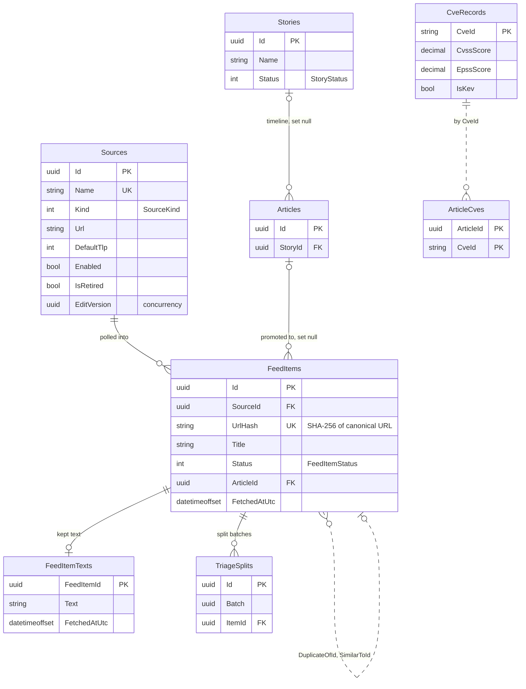

### Articles

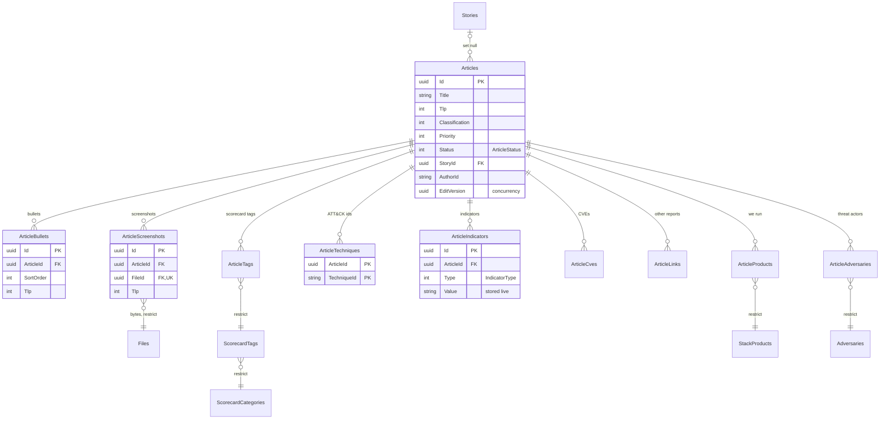

### Reviews and AI drafts

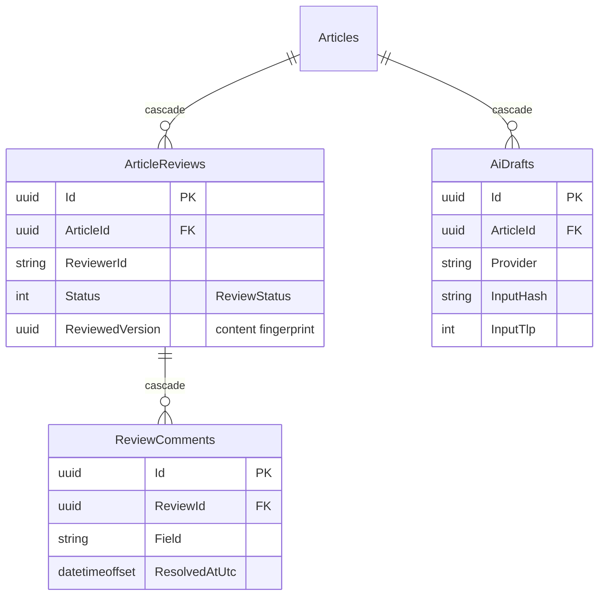

### Briefs and meetings

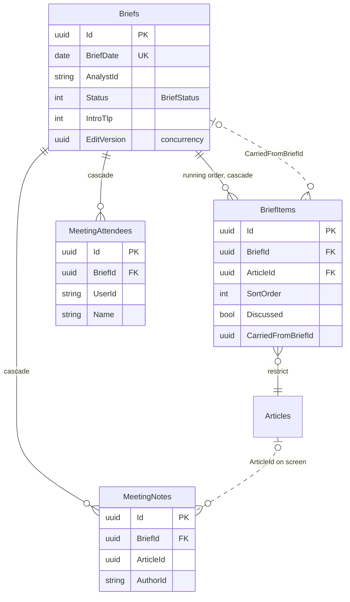

### Distribution and sends

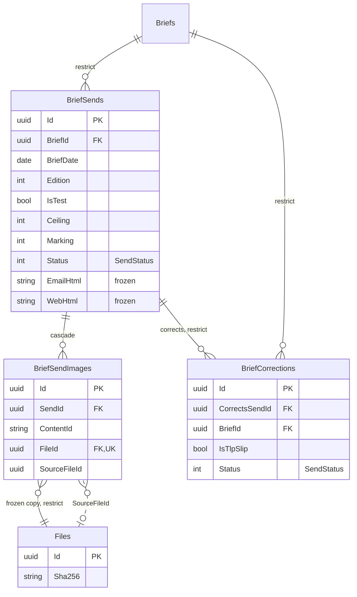

### Actions

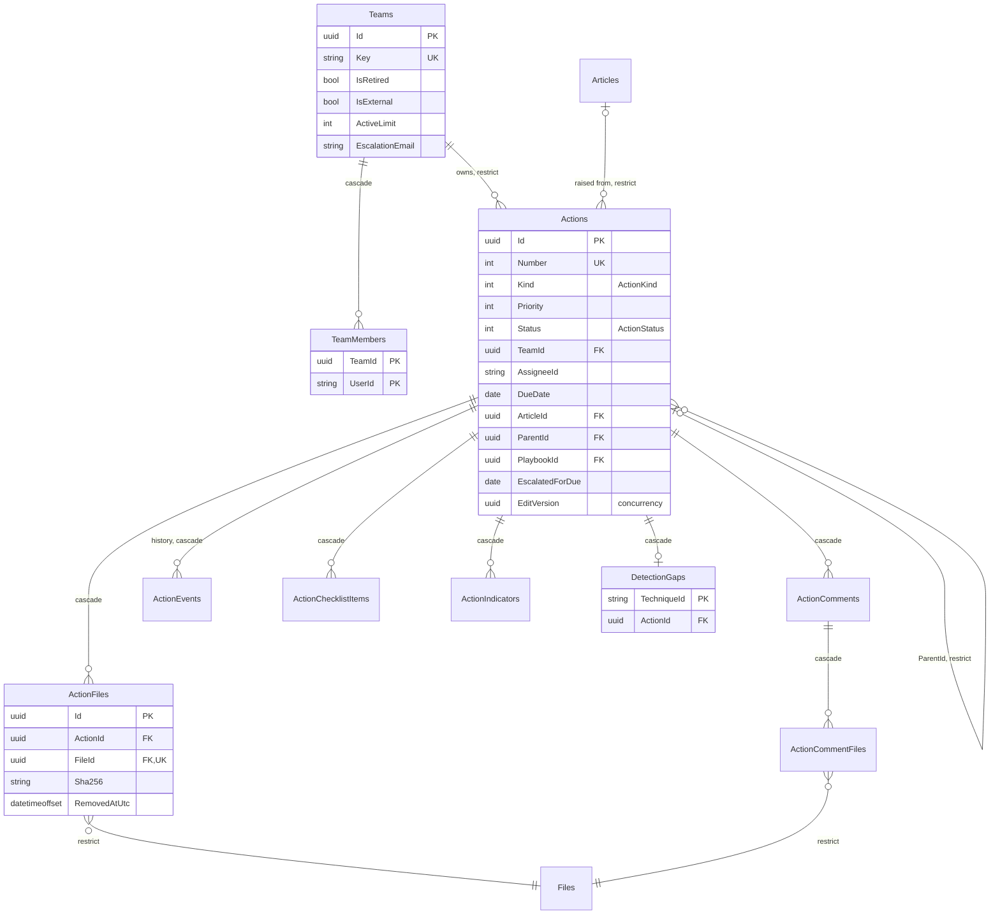

### Hunting, outreach and playbooks

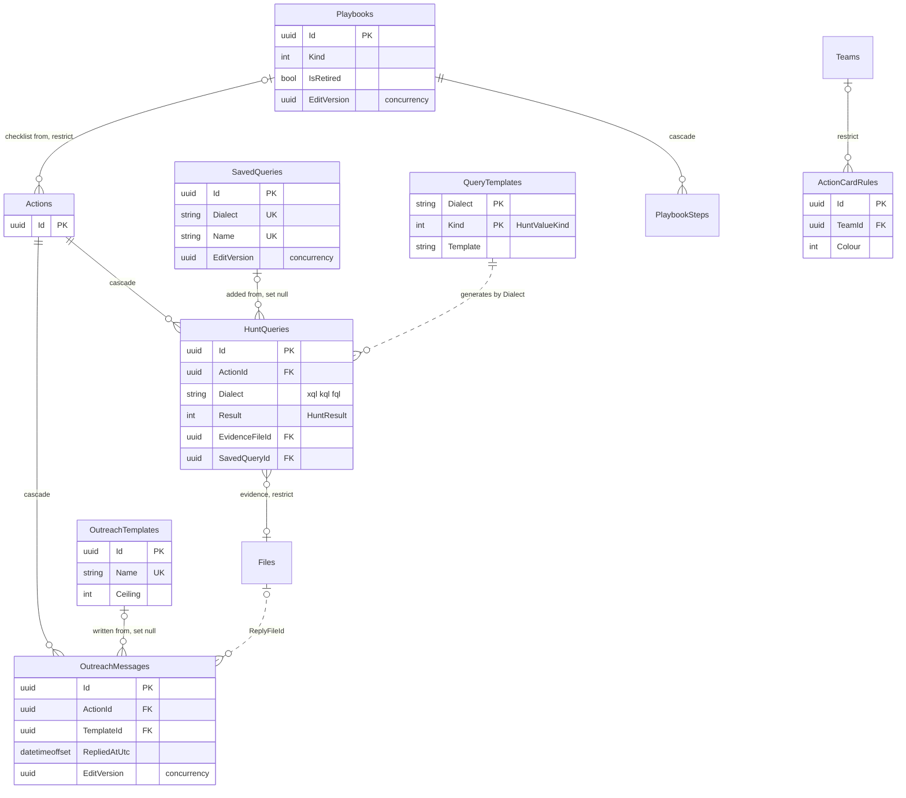

### Metrics

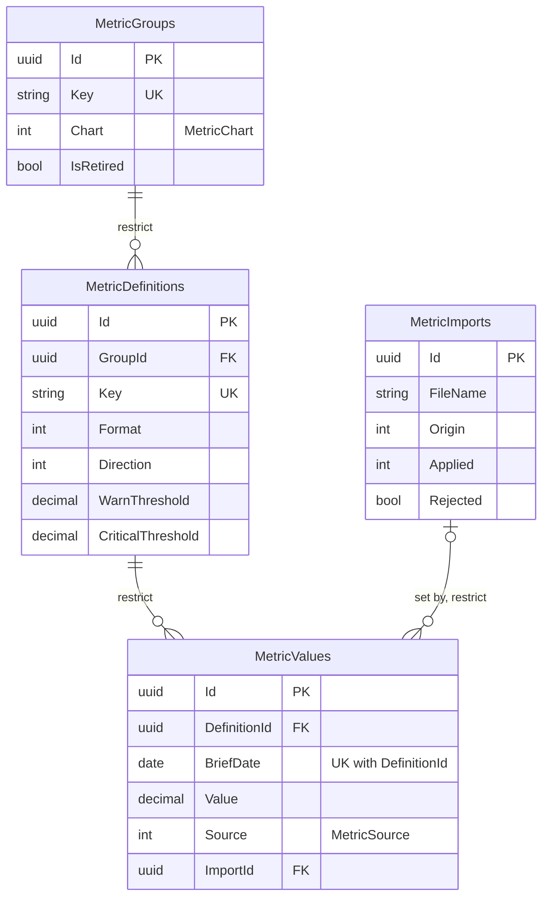

### Rotation

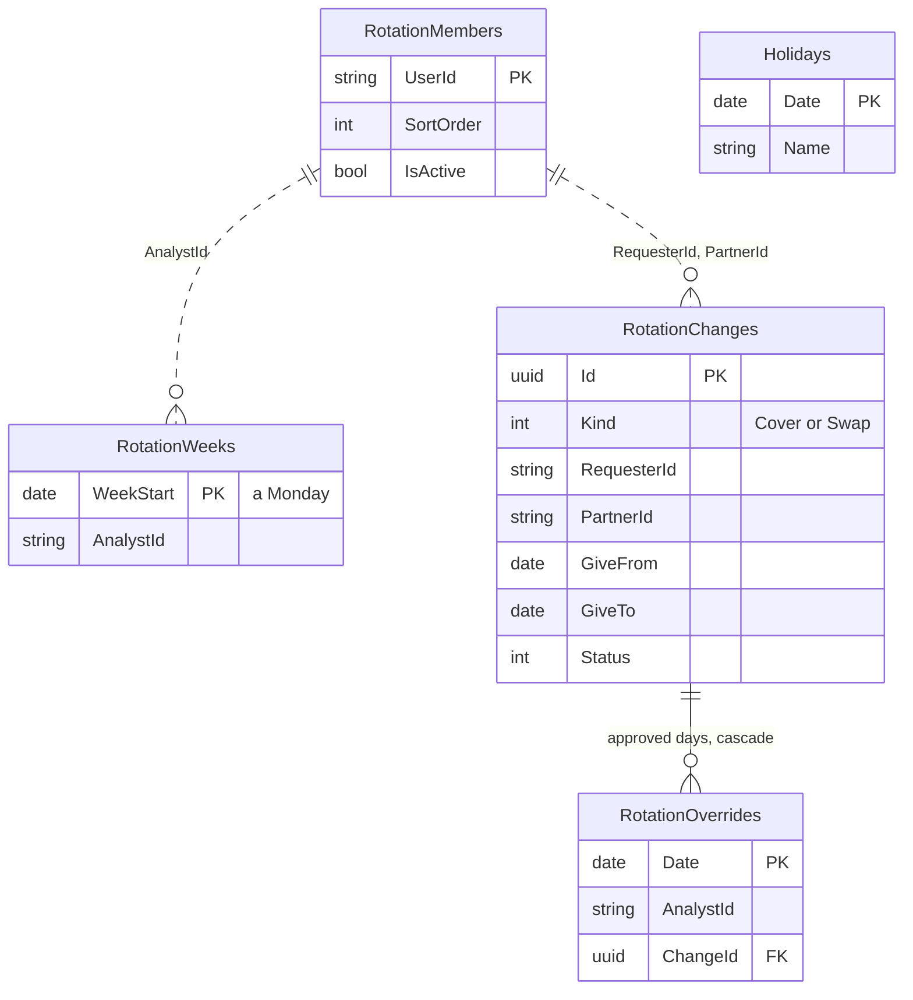

### Administration, settings, security and the API

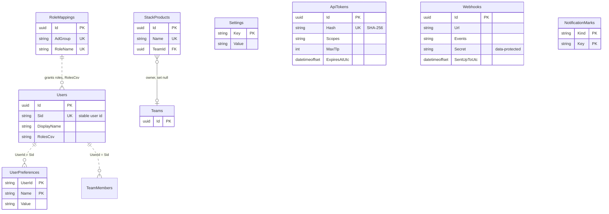

### Audit

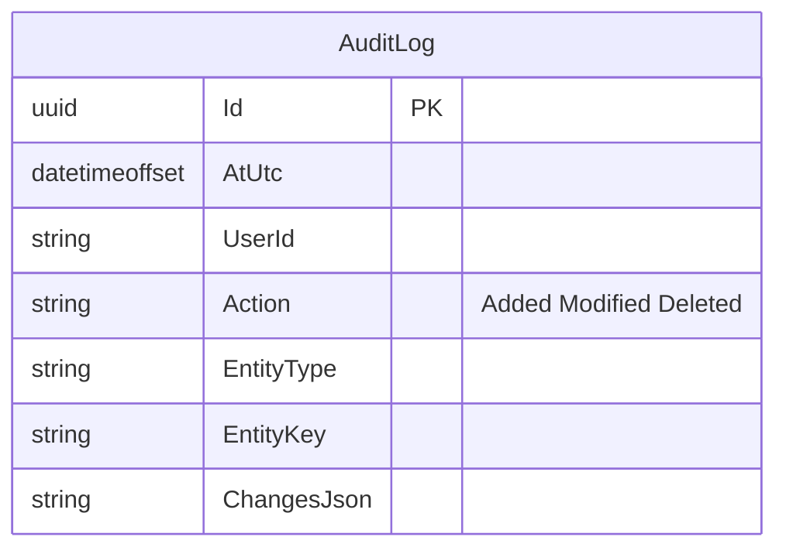

`AuditLog` has no foreign keys. It names each changed row by `EntityType` and `EntityKey`, so its entries outlive the
rows they describe. See [The audit log](#the-audit-log).

## Intake

[../workflows/intake-and-triage.md](../workflows/intake-and-triage.md) describes the triage flow.

### `Sources` (S, A, V)

Somewhere items come from: an RSS or Atom feed, the CISA KEV catalog, or the API. Administrators manage sources. A
source is polled on its own interval while it's enabled. Once it has items it's retired, never deleted
(`IntakeService` deletes a retired source only if it has no items). Written by `IntakeService`; also by
`ConfigBundleService` when a configuration bundle is imported.

| Column | Type | Null | Meaning |
|---|---|---|---|
| `Id` | uniqueidentifier | no | |
| `Name` | nvarchar(100) | no | **Unique.** |
| `Kind` | int | no | `SourceKind`: 0 Feed, 1 CISA KEV, 2 API (never polled). |
| `Url` | nvarchar(2000) | no | The feed address. It may carry a key or a sign-in, so the audit log masks it (`SecretMask.Url`). |
| `DefaultTlp` | int | no | The TLP an article promoted from this source starts with. |
| `Reliability` | int | no | `SourceReliability`, the Admiralty A–F scale. |
| `LicenseNote` | nvarchar(500) | yes | What the source's terms allow. |
| `PollMinutes` | int | no | Poll interval. Default 60. |
| `Enabled`, `IsRetired` | bit | no | |
| `EditVersion` | uniqueidentifier | no | Concurrency token, moved by a save of the source's form, pausing it, retiring or bringing it back, and a configuration bundle that changes it (not by a poll); a form opened before any of those is refused. Rows from before the column have the empty Guid. |
| `ArticleFetch` | int | no | `ArticleFetch`: whether the article's own page may be fetched for drafting. |
| `ArticleBodySelector` | nvarchar(200) | yes | CSS selector for the article body when the automatic finder gets it wrong. |
| `ArticleRemoveSelector` | nvarchar(500) | yes | CSS selector for extra clutter to strip from the source's pages. |
| `OnlyCategories`, `SkipCategories` | nvarchar(2000) | yes | The feed's tag filter, one tag per line, case-insensitive. |
| `OnlyTitleWords`, `SkipTitleWords` | nvarchar(2000) | yes | The title filter, one word or phrase per line, matched as whole words. |
| `SeenCategories` | nvarchar(2000) | yes | Tags the last read carried, most used first, so an administrator can choose a filter. |
| `LastFilteredOut` | int | no | Items the filter left out on the last read. |
| `LastPolledAtUtc`, `LastSuccessAtUtc` | datetimeoffset | yes | Poll bookkeeping. |
| `LastError` | nvarchar(500) | yes | The last failure. The audit log scrubs it before showing it. |
| `ConsecutiveFailures`, `LastNewItems` | int | no | |
| `ETag`, `LastModified` | nvarchar(200), nvarchar(100) | yes | Validators for the next conditional GET. |
| stamps | | | **S** columns. |

The poll columns are written with `ExecuteUpdateAsync`, so a poll doesn't create audit rows.

### `FeedItems` (not audited)

One item from a source, waiting in the triage inbox. Its unique key is the canonical address, so the same story
polled twice or found in two feeds is one row. Written by `IntakeService` (poll, triage, promote, prune).
`FeedItem` is in `AuditInterceptor.NotAudited`.

| Column | Type | Null | Meaning |
|---|---|---|---|
| `Id` | uniqueidentifier | no | |
| `SourceId` | uniqueidentifier | no | FK → `Sources`, **restrict**. Indexed. |
| `Url` | nvarchar(2000) | no | The address with tracking parameters removed (`UrlCanonicalizer`). |
| `UrlHash` | nvarchar(64) | no | SHA-256 of `Url`. **Unique.** |
| `Title` | nvarchar(500) | no | |
| `TitleKey` | nvarchar(500) | no | The title reduced to its words (`TitleMatch.Key`), used to spot the same story at another address. |
| `PublishedAtUtc` | datetimeoffset | yes | As the feed says. |
| `FetchedAtUtc` | datetimeoffset | no | Indexed, and indexed with `Status`. Retention counts from here. |
| `Excerpt` | nvarchar(2000) | yes | The summary as plain text. Feed HTML is never rendered. |
| `Cves` | nvarchar(1000) | yes | CVE ids found in the title and summary, comma-separated. |
| `Status` | int | no | `FeedItemStatus`. |
| `DismissReason` | nvarchar(200) | yes | |
| `DuplicateOfId` | uniqueidentifier | yes | The item an analyst marked this one as repeating. **No FK**; cleared when the other item is pruned. |
| `SimilarToId` | uniqueidentifier | yes | An item that looked like this one when it was fetched. **No FK**; cleared on prune. |
| `ArticleId` | uniqueidentifier | yes | FK → `Articles`, **set null**. The article it was promoted to (or attached to). Indexed. |
| `StatusByName`, `StatusAtUtc` | nvarchar(256), datetimeoffset | yes | Who last changed the status, and when. |

### `FeedItemTexts` (not audited)

An item's article text, fetched when an analyst opens the reading pane. It's kept for `Intake:ReadingDays` so a
colleague, or the editor after promoting, doesn't fetch it again. It's for reading inside TIDE only: it's never sent,
exported or shown to readers. Written by `ReadingService`.

| Column | Type | Null | Meaning |
|---|---|---|---|
| `FeedItemId` | uniqueidentifier | no | PK, and a one-to-one FK → `FeedItems`, **cascade**. |
| `Text` | nvarchar(max) | no | At most `ArticleText.MaxChars` (40,000). |
| `How` | nvarchar(100) | no | How the body was found ("the page's article markup"). |
| `FetchedAtUtc` | datetimeoffset | no | Indexed. Used by the prune. |

### `TriageSplits` (A)

One row per report in a group that an analyst said isn't one event ("Not the same: split"). All the reports of one
split share a `Batch`. Two items in the same batch never group together again, for anyone. Undo deletes the batch.
Written by `IntakeService`.

| Column | Type | Null | Meaning |
|---|---|---|---|
| `Id` | uniqueidentifier | no | |
| `Batch` | uniqueidentifier | no | Unique with `ItemId`. |
| `ItemId` | uniqueidentifier | no | FK → `FeedItems`, **cascade**. Indexed. |
| `SplitAtUtc` | datetimeoffset | no | |
| `SplitBy`, `SplitByName` | nvarchar(256) | no | The person's id, and their name at the time. |

### `Stories` (S, A)

A threat story followed across days: a campaign, a vulnerability, an actor's run of activity. Its timeline is the
articles linked to it. Written by `StoryService`. A story with no articles can be deleted; one with articles is
closed instead.

| Column | Type | Null | Meaning |
|---|---|---|---|
| `Id` | uniqueidentifier | no | |
| `Name` | nvarchar(200) | no | |
| `Summary` | nvarchar(4000) | yes | |
| `Status` | int | no | `StoryStatus`. Indexed. |
| stamps | | | **S** columns. |

### `CveRecords` (not audited)

What public sources say about a CVE: CVSS from NVD, the EPSS score from FIRST, and whether CISA lists it as known
exploited. The enrichment job refreshes it (`CveService`, run by `IntakeHostedService`). It isn't linked to articles
by FK: `ArticleCves.CveId` and `FeedItems.Cves` find it by id.

| Column | Type | Null | Meaning |
|---|---|---|---|
| `CveId` | nvarchar(24) | no | PK, for example `CVE-2026-12345`. |
| `Description` | nvarchar(2000) | yes | |
| `CvssScore` | decimal(4,1) | yes | |
| `CvssSeverity`, `CvssVector` | nvarchar(16), nvarchar(200) | yes | |
| `NvdPublishedAtUtc` | datetimeoffset | yes | |
| `EpssScore`, `EpssPercentile` | decimal(8,5) | yes | |
| `IsKev` | bit | no | Indexed. |
| `KevAddedDate`, `KevDueDate` | date | yes | |
| `KevRansomware` | bit | no | |
| `Vendor`, `Product` | nvarchar(200) | yes | |
| `NvdCheckedAtUtc`, `EpssCheckedAtUtc`, `KevCheckedAtUtc` | datetimeoffset | yes | When each source was last asked. |

## Articles

An article is an analyst's write-up of one news item or report, and briefs are built from articles.
[../workflows/writing-articles.md](../workflows/writing-articles.md) describes writing one.

### `Articles` (S, A, V)

Written by `ArticleService` (editor saves, status, delete). `ArticleForm` applies the form's fields.
`IntakeService` creates a draft on promote. `ScreenshotService` sets `ScreenshotsChangedAtUtc`.

| Column | Type | Null | Meaning |
|---|---|---|---|
| `Id` | uniqueidentifier | no | |
| `Title` | nvarchar(300) | no | |
| `SourceName` | nvarchar(200) | yes | The source as the analyst names it ("FS-ISAC"). |
| `SourceUrl` | nvarchar(2000) | yes | The citation, kept live. An indicator never goes here. |
| `PublishedAtUtc` | datetimeoffset | yes | |
| `Tlp` | int | no | The article's TLP. No part of the article counts lower than this. |
| `Classification` | int | no | `Classification`: 0 Informational, 1 Threat. |
| `Priority` | int | yes | `Priority` 1–4. Set for a Threat, null for an Informational article. |
| `Bluf` | nvarchar(600) | no | The bottom line up front. |
| `WhyItMatters` | nvarchar(max) | yes | Markdown. No length in the model. **Needs verification:** whether the service bounds it; the editor sets no `maxlength`. |
| `WhyItMattersTlp` | int | no | Can be raised above `Tlp`. On a Threat it starts at AMBER at least (`Article.DefaultWhyItMattersTlp`). |
| `RecommendedActions` | nvarchar(max) | yes | Markdown. Unbounded in the model, like `WhyItMatters`. |
| `Actors` | nvarchar(500) | yes | **Legacy.** Free-text threat actors from before the adversary picker (1.4.0). Nothing writes it now. `AdversaryService` offers its names as tags. |
| `Sectors` | nvarchar(500) | yes | Comma-separated, as typed. |
| `Status` | int | no | `ArticleStatus`. Indexed. |
| `StoryId` | uniqueidentifier | yes | FK → `Stories`, **set null**. Indexed. |
| `AuthorId`, `AuthorName` | nvarchar(256) | no | |
| `EditVersion` | uniqueidentifier | no | Concurrency token. Changes on every save, including a status change. |
| `ScreenshotsChangedAtUtc` | datetimeoffset | yes | Set when a screenshot is added or removed, which leaves `EditVersion` unchanged. A review recorded before this time is out of date. |
| stamps | | | **S** columns. `CreatedAtUtc` is indexed. |

`Article.HighestTlp` and `Article.Effective` (in `src/Tide.Domain/Entities/Article.cs`) compute markings. A part's
effective TLP is the higher of its own and the article's.

### Article child tables

All of these are deleted with their article (**cascade**), and all are audited (**A**). None are stamped. Except
where noted, they're written by `ArticleService` and `ArticleForm`.

| Table | Key | Columns | Notes |
|---|---|---|---|
| `ArticleBullets` | `Id` | `ArticleId`, `SortOrder` int, `Text` nvarchar(2000), `Tlp` int | Index `(ArticleId, SortOrder)`. At most `Article.MaxBullets` (30). |
| `ArticleScreenshots` | `Id` | `ArticleId`, `FileId` (FK → `Files`, **restrict**, **unique**), `SortOrder`, `Caption` nvarchar(500) null, `Tlp` int | At most `Article.MaxScreenshots` (10). Written by `ScreenshotService`, which deletes the `Files` row and the bytes when a screenshot is removed. |
| `ArticleTags` | `(ArticleId, TagId)` | | `TagId` FK → `ScorecardTags`, **restrict**. Indexed. |
| `ArticleTechniques` | `(ArticleId, TechniqueId)` | `TechniqueId` nvarchar(16) | An ATT&CK id ("T1566.001") from the embedded catalog, so there's no FK. Indexed. No tactic is stored; `MitreTactic` isn't persisted anywhere. |
| `ArticleIndicators` | `Id` | `ArticleId` (indexed), `Type` int, `Value` nvarchar(2000), `Note` nvarchar(300) null | Stored in live, canonical form (`IocObservable.Normalize`) and shown defanged. `ActionService` adds to it when an indicator is added on an action raised from the article. |
| `ArticleCves` | `(ArticleId, CveId)` | `CveId` nvarchar(24) | Indexed by `CveId`. `IntakeService` adds the item's CVEs on promote. |
| `ArticleLinks` | `Id` | `ArticleId` (indexed), `Url` nvarchar(2000), `Title` nvarchar(500), `SourceName` nvarchar(200) null, `PublishedAtUtc` null, `AddedAtUtc`, `AddedByName` nvarchar(256) | Other reports of the same story, added from triage. Written by `ArticleService` and `IntakeService`. |
| `ArticleProducts` | `(ArticleId, ProductId)` | | `ProductId` FK → `StackProducts`, **restrict**. "We run" tags. Written by `StackService`. |
| `ArticleAdversaries` | `(ArticleId, AdversaryId)` | | `AdversaryId` FK → `Adversaries`, **restrict**. Written by `AdversaryService`, which also moves tags when profiles are merged. |

## Reviews and AI drafts

### `ArticleReviews` (A)

A colleague's review of an article before it's sent. It's optional unless `Review:Required` is on. Written by
`ReviewService`. See [../workflows/writing-articles.md](../workflows/writing-articles.md).

| Column | Type | Null | Meaning |
|---|---|---|---|
| `Id` | uniqueidentifier | no | |
| `ArticleId` | uniqueidentifier | no | FK → `Articles`, **cascade**. Indexed. |
| `RequestedById`, `RequestedByName` | nvarchar(256), nvarchar(200) | no | |
| `RequestedAtUtc` | datetimeoffset | no | |
| `Note` | nvarchar(500) | yes | What the author asked the reviewer to look at. |
| `ReviewerId`, `ReviewerName` | nvarchar(256), nvarchar(200) | no | Indexed with `Status`, for the "reviews for you" list. |
| `Status` | int | no | `ReviewStatus`. |
| `DecidedAtUtc` | datetimeoffset | yes | |
| `ReviewedVersion` | uniqueidentifier | yes | `ReviewService.ContentVersion`: a fingerprint of the words, markings, bullets and screenshots the reviewer read. It isn't `Articles.EditVersion`. |
| `Checks` | nvarchar(200) | yes | The checklist as the reviewer left it, for example `tlp:1;sources:0`. |

### `ReviewComments` (A)

A comment on one part of an article under review. The author resolves it. Cascade-deleted with its review. Written by
`ReviewService`.

| Column | Type | Null | Meaning |
|---|---|---|---|
| `Id`, `ReviewId` | uniqueidentifier | no | `ReviewId` FK → `ArticleReviews`, **cascade**. |
| `Field` | nvarchar(40) | no | `title`, `bluf`, `bullet:2`, `why`, `actions` or `general`. |
| `Quote` | nvarchar(300) | yes | The words selected. |
| `Text` | nvarchar(2000) | no | |
| `AuthorId`, `AuthorName` | nvarchar(256), nvarchar(200) | no | |
| `CreatedAtUtc`, `ResolvedAtUtc` | datetimeoffset | no / yes | |
| `ResolvedByName` | nvarchar(200) | yes | |

### `AiDrafts` (S, A)

One AI draft of an article ([ADR 0004](../decisions/0004-opt-in-ai-with-tlp-ceiling.md)). It records who asked,
which provider and model answered, a hash of the prompt and its TLP, and the suggestions that passed the checks. The
source text itself is never kept. Written by `AssistService`.

| Column | Type | Null | Meaning |
|---|---|---|---|
| `Id`, `ArticleId` | uniqueidentifier | no | `ArticleId` FK → `Articles`, **cascade**. Indexed. |
| `Provider` | nvarchar(40) | no | `AzureOpenAI`, or `Pasted` for an answer from an approved tool pasted back. |
| `Model` | nvarchar(100) | no | Empty for a pasted answer. |
| `PromptVersion` | int | no | |
| `InputHash` | nvarchar(64) | no | SHA-256 of the prompt as sent. |
| `InputTlp` | int | no | The highest TLP of what was sent. |
| `BasedOn` | nvarchar(1000) | no | What the draft was based on, as the editor showed it. |
| `Suggestions` | nvarchar(max) | no | JSON, at most 60,000 characters. |
| `Offered`, `Accepted`, `Rejected` | int | no | Counted as the analyst decides. |
| stamps | | | **S** columns. |

## Briefs and meetings

[../workflows/brief-and-meeting.md](../workflows/brief-and-meeting.md) describes the flow.

### `Briefs` (S, A, V)

One business day's brief. There's at most one per `BriefDate`. Written by `BriefService` (create, order, intro, team
note, presented, reopen) and `DistributionService` (sent, not sent, distributed without email, SharePoint posted).

| Column | Type | Null | Meaning |
|---|---|---|---|
| `Id` | uniqueidentifier | no | |
| `BriefDate` | date | no | **Unique.** The day the brief is for, in org time. |
| `AnalystId`, `AnalystName` | nvarchar(256) | no | The presenter. |
| `Status` | int | no | `BriefStatus`. |
| `Intro`, `IntroTlp` | nvarchar(2000), int | yes / no | The title-slide line and its TLP. An edition whose ceiling is below `IntroTlp` leaves the line out. |
| `TeamNote` | nvarchar(4000) | yes | The team's opening note (Markdown). Appears in the team edition only. A new brief copies the previous brief's note. |
| `MeetingNotes` | nvarchar(max) | yes | **Legacy.** The single meeting-notes field from before notes were kept per person. The upgrade moved it into `MeetingNotes` rows. Nothing writes it now. |
| `MeetingHeldAtUtc` | datetimeoffset | yes | When the meeting was held. For a brief written up after the fact, it's the day the brief was for. |
| `PresentedAtUtc` | datetimeoffset | yes | When someone chose "End the meeting". |
| `DistributedAtUtc`, `DistributedById`, `DistributedByName` | | yes | Marked distributed without email, because email is off on the server. |
| `NotSentAtUtc`, `NotSentById`, `NotSentByName`, `NotSentReason` | …, nvarchar(500) | yes | Finished without sending while email was on ("Not sent"). |
| `SharePointPostedAtUtc`, `SharePointPostedById`, `SharePointPostedByName` | | yes | Someone confirmed the company-wide copy was posted to SharePoint. |
| `SharePointRequired` | bit | no | Whether the SharePoint copy was required when the brief went out (`Distribution:RequireSharePoint`). |
| `EditVersion` | uniqueidentifier | no | Concurrency token. |
| stamps | | | **S** columns. |

### `BriefItems` (A)

An article's place on a brief. An article can be carried onto a later brief. Written by `BriefService`.

| Column | Type | Null | Meaning |
|---|---|---|---|
| `Id` | uniqueidentifier | no | |
| `BriefId` | uniqueidentifier | no | FK → `Briefs`, **cascade**. Unique with `ArticleId`, so an article appears on a brief only once. |
| `ArticleId` | uniqueidentifier | no | FK → `Articles`, **restrict**. Indexed. This is what stops a briefed article from being deleted. |
| `SortOrder` | int | no | |
| `Discussed` | bit | no | Ticked off during the meeting. |
| `CarriedFromBriefId` | uniqueidentifier | yes | The brief whose meeting carried this article here because it wasn't discussed there. **No FK**. Indexed. Reopening that meeting takes back only these. |
| `StatusBeforeMeeting` | int | yes | The article's `ArticleStatus` before this meeting marked it Presented. Reopening the meeting puts it back. |

### `MeetingAttendees` (A)

Someone at a brief's meeting. The row is made when they join in TIDE, or when the presenter adds someone in the room
by name (no `UserId`, no times). Written by `MeetingService`.

| Column | Type | Null | Meaning |
|---|---|---|---|
| `Id`, `BriefId` | uniqueidentifier | no | `BriefId` FK → `Briefs`, **cascade**. |
| `UserId`, `Name` | nvarchar(256) | no | `UserId` is empty for someone added by name. `(BriefId, UserId, Name)` is **unique**. |
| `JoinedAtUtc`, `LeftAtUtc` | datetimeoffset | yes | First join and last leave. |

### `MeetingNotes` (A)

One person's note at a meeting, made against the article on screen as its author began it. Written by `MeetingService`.

| Column | Type | Null | Meaning |
|---|---|---|---|
| `Id`, `BriefId` | uniqueidentifier | no | `BriefId` FK → `Briefs`, **cascade**. Indexed with `AtUtc`. |
| `AuthorId`, `AuthorName` | nvarchar(256) | no | |
| `ArticleId` | uniqueidentifier | yes | The article on screen. **No FK**. Null for a note on the whole meeting. |
| `AtUtc`, `EditedAtUtc` | datetimeoffset | no / yes | |
| `Text` | nvarchar(max) | no | A new note is at most 2,000 characters. One carried over from the legacy `Briefs.MeetingNotes` can be up to 8,000. |

## Distribution and sends

[ADR 0007](../decisions/0007-frozen-sends-and-cid-email.md) covers frozen sends and
[ADR 0015](../decisions/0015-corrections-after-send.md) covers corrections.
[../workflows/distribution.md](../workflows/distribution.md) describes the flow.

### `BriefSends` (A)

One email send of an edition of a brief, with a frozen copy of exactly what went. The published archive shows this
copy, never a fresh rendering. A test send to oneself is logged without the copy. Written by `DistributionService`.
Rows are never deleted. The FK to `Briefs` is **restrict**, so a brief with sends can't be deleted.

| Column | Type | Null | Meaning |
|---|---|---|---|
| `Id`, `BriefId` | uniqueidentifier | no | `BriefId` FK → `Briefs`, **restrict**. Indexed with `SentAtUtc`. |
| `BriefDate` | date | no | Copied from the brief, for the archive's index. |
| `Edition` | int | no | `Edition`: 0 Team, 1 Public. |
| `IsTest` | bit | no | A test copy to the sender only. It isn't archived and doesn't mark the brief sent. |
| `Ceiling`, `Marking` | int | no | The ceiling the edition was cut at, and the highest marking it carried. |
| `Subject` | nvarchar(300) | no | |
| `Recipients` | nvarchar(max) | no | Addresses separated by `;`. At most 8,000 characters. |
| `RecipientCount` | int | no | |
| `SentAtUtc`, `SentById`, `SentByName` | | no | |
| `Status` | int | no | `SendStatus`. |
| `OutcomeAtUtc` | datetimeoffset | yes | When the outcome was recorded after the relay answered, or settled by someone. |
| `Error` | nvarchar(1000) | yes | Why the relay refused it. |
| `EmailHtml`, `WebHtml` | nvarchar(max) | yes | The email as sent and a plain web rendering, with images as `cid:` references. Null for a test send. |

Index `(Edition, IsTest, Status, BriefDate)` serves the published archive (`DistributionService.Published`).

### `BriefSendImages` (A)

An image in a frozen send. It's a **copy** of the screenshot's bytes with its own `Files` row, so removing the
screenshot from the article later doesn't break the archive. Written by `DistributionService`.

| Column | Type | Null | Meaning |
|---|---|---|---|
| `Id`, `SendId` | uniqueidentifier | no | `SendId` FK → `BriefSends`, **cascade**. Indexed. |
| `ContentId` | nvarchar(100) | no | The `cid:` the HTML refers to. |
| `FileId` | uniqueidentifier | no | FK → `Files`, **restrict**, **unique**. The frozen copy. |
| `SourceFileId` | uniqueidentifier | no | The screenshot it was copied from. **No FK**, because that screenshot may since have been removed. |
| `Caption` | nvarchar(500) | yes | |
| `SortOrder` | int | no | |

### `BriefCorrections` (A)

A correction of one real send that the relay accepted. It's a short email to the original send's recipients, frozen
like a send and carrying no images. A TLP slip (`IsTlpSlip`) is the kind for content that reached an audience it
shouldn't have. Once a slip is confirmed, the corrected company-wide send is withdrawn from the published briefs; the
row itself is kept. Written by `CorrectionService`; `DistributionService` reads it.

| Column | Type | Null | Meaning |
|---|---|---|---|
| `Id` | uniqueidentifier | no | |
| `CorrectsSendId` | uniqueidentifier | no | FK → `BriefSends`, **restrict**. Indexed with `Status`. |
| `BriefId` | uniqueidentifier | no | FK → `Briefs`, **restrict**. |
| `BriefDate`, `Edition` | date, int | no | Indexed together. |
| `IsTlpSlip` | bit | no | |
| `Note` | nvarchar(4000) | yes | What changed. Required for a correction, optional for a slip. |
| `ArticleIds` | nvarchar(2000) | no | The articles it's about, separated by `;`. **No FK**. |
| `Ceiling`, `Marking` | int | no | |
| `Subject` | nvarchar(320) | no | |
| `Recipients`, `RecipientCount` | nvarchar(max), int | no | The original send's recipients. |
| `SentAtUtc`, `SentById`, `SentByName` | | no | |
| `Status` | int | no | `SendStatus`. |
| `Error` | nvarchar(1000) | yes | |
| `EmailHtml`, `WebHtml` | nvarchar(max) | no | Frozen before the relay is asked. |

## Actions

[ADR 0008](../decisions/0008-teams-own-actions.md) covers team ownership.
[../workflows/actions-and-hunting.md](../workflows/actions-and-hunting.md) describes the flow.

### `Teams` (S, A) and `TeamMembers` (A)

A team owns follow-up actions. `Key` is stable and **unique**. A team that has never owned an action and isn't named by
a card rule is deleted; otherwise it's retired (`TeamService.SetRetiredAsync`). `Email` is the team's shared mailbox,
used for its digest and for reminders about unassigned actions. Columns: `Name` nvarchar(100), `Description`
nvarchar(500), `Email` nvarchar(256), `SortOrder`, `IsRetired`, and the stamps. A team that handed an action on
(`Actions.HandedFromTeamId`) counts as having owned one, so it's retired too.

The active limit and the external team's profile (EP-86):

| Column | Type | Null | Meaning |
|---|---|---|---|
| `ActiveLimit` | int | yes | The most actions it may have active (Open, InProgress or Blocked) at once; null for none. Set by an administrator (`TeamService.SetLimitAsync`), 1 to 999. |
| `LimitMode` | int | no | `ActiveLimitMode`: what happens when a change would take it over. Default 0 (Show). |
| `IsExternal` | bit | no | Tracked here, working outside TIDE: no members, no assignees, reminded at `ContactEmail`. Kept by anyone with `WorkActions`. |
| `ContactName` | nvarchar(200) | yes | An external team's contact. |
| `ContactEmail` | nvarchar(256) | yes | Where an external team's reminders go. `Email` stays null for an external team, so no internal email reaches it. |
| `Engage` | nvarchar(2000) | yes | How to engage an external team (its ticket queue, say). |
| `RemindersOn` | bit | no | Whether an external team gets its reminder emails. Default 1. |
| `RemindBeforeDays` | int | no | Business days before the due date its first reminder goes, 0 to 10 (0: the due day). Default 2. |
| `RemindOverdueEveryDays` | int | yes | Business days between reminders while overdue, 1 to 20; null reminds once. The migration set existing rows to 3. |

The escalation contact (EP-88 part C), on any team, internal or external:

| Column | Type | Null | Meaning |
|---|---|---|---|
| `EscalationName` | nvarchar(200) | yes | Who the escalation ladder copies when the team's actions slip: a manager, a duty lead. |
| `EscalationEmail` | nvarchar(256) | yes | Where a step that copies the escalation contact emails; null copies no one. An internal team's is set by an administrator, an external team's by anyone with `WorkActions` (`TeamService.SetEscalationContactAsync`). The migration left existing rows null. |

`TeamMembers` has key `(TeamId, UserId)` and is cascade-deleted with its team. Columns: `UserId`/`DisplayName`
nvarchar(256) and `AddedAtUtc`. `UserId` is indexed. Members are the people who may work the team's actions, with
`WorkActions`. Both tables are written by `TeamService`.

### `Actions` (S, A, V)

The C# class is `ActionItem`. An action is a follow-up from the brief: an IOC sweep, a hunt, a block, a patch, a
config change. A team owns it, it's due by a date the SLA targets suggest, and it's tracked to an outcome. Written by
`ActionService`; the API's `ApiService` creates and updates actions through `ActionService`.

| Column | Type | Null | Meaning |
|---|---|---|---|
| `Id` | uniqueidentifier | no | |
| `Number` | int | no | **Unique.** Shown as `A-42`, never reused. |
| `Title` | nvarchar(300) | no | |
| `Description` | nvarchar(max) | yes | Markdown, at most 8,000 characters. |
| `Kind` | int | no | `ActionKind`. |
| `Priority` | int | no | `Priority` 1–4. |
| `TeamId` | uniqueidentifier | no | FK → `Teams`, **restrict**. Indexed. |
| `AssigneeId`, `AssigneeName` | nvarchar(256) | yes | The person working it. When null, the action is the team's. `AssigneeId` is indexed. |
| `DueDate` | date | yes | A business day in org time. Defaults from `ActionSla.DueDate`. Indexed with `Status`. |
| `RaisedOn` | date | yes | The business day the action belongs to, when it was raised after the fact. Null means the day it was created. |
| `Status` | int | no | `ActionStatus`. |
| `Outcome` | int | no | `ActionOutcome`. |
| `OutcomeNote` | nvarchar(2000) | yes | |
| `ClosedAtUtc`, `ClosedDate` | datetimeoffset, date | yes | When it was closed (Done, Cancelled or Not applicable), and that day in org time. |
| `TicketRef`, `TicketUrl` | nvarchar(100), nvarchar(2000) | yes | A ticket in an ITSM tool that tracks the same work. |
| `ArticleId` | uniqueidentifier | yes | FK → `Articles`, **restrict**. Indexed. This is why an article with actions can't be deleted. |
| `ParentId` | uniqueidentifier | yes | FK → `Actions`, **restrict**. The parent action of a remediation split across teams. Indexed. |
| `PlaybookId`, `PlaybookName` | uniqueidentifier, nvarchar(100) | yes | FK → `Playbooks`, **restrict**. The playbook the checklist was copied from, and its name at the time. |
| `NoReminders` | bit | no | Left out of its external team's reminder emails. Matters only while its team is external. A hand-off keeps it only when whoever hands it off leaves *Keep reminders off* ticked. |
| `HandedFromTeamId` | uniqueidentifier | yes | The team it was last handed from. No foreign key: the name is looked up, and "another team" stands in if it's gone. |
| `HandedById`, `HandedByName` | nvarchar(256) | yes | Who handed it on last. |
| `HandedAtUtc` | datetimeoffset | yes | When. |
| `HandoffReason` | nvarchar(500) | yes | Why, as they wrote it: shown on the action. Its history keeps every hand-off. |
| `EscalatedForDue` | date | yes | The due date a step of the escalation ladder flagged it escalated for. It's escalated while it's open and `EscalatedForDue` equals `DueDate` (`ActionItem.EscalatedFor`, `ActionQueries.WhereEscalated`), so closing it or moving its date ends it with no write. A filtered index (`IS NOT NULL`) holds only flagged rows. The migration left existing rows null. |
| `EscalatedAtUtc` | datetimeoffset | yes | When it was flagged, for the badge's title. Read only while it's escalated (`EscalatedSince`). |
| `EditVersion` | uniqueidentifier | no | Concurrency token. |
| stamps | | | **S** columns. |

### Action child tables

All of these are cascade-deleted with the action and all are audited. Each is written by `ActionService`, except
where noted. In practice actions aren't deleted.

| Table | Key | Columns | Notes |
|---|---|---|---|
| `ActionComments` (V) | `Id` | `ActionId`, `Text` nvarchar(max) (8,000 in code), `AuthorId`/`AuthorName`, `AtUtc`, `EditedAtUtc` null, `EditedByName` null, `EditVersion` | Index `(ActionId, AtUtc)`. A comment can be deleted. Its files are then kept as removed `ActionFiles` with `RemovedReason` "Its comment was deleted". |
| `ActionCommentFiles` | `Id` | `CommentId` (FK, cascade), `FileId` (FK → `Files`, restrict, indexed), `FileName` nvarchar(200), `SizeBytes` bigint, `IsImage`, `SortOrder`, `Description` nvarchar(500), `RiskReason` nvarchar(200), `RemovedAtUtc`/`RemovedById`/`RemovedByName`/`RemovedReason` | At most 10 per comment. `IRemovableFile`. |
| `ActionFiles` | `Id` | `ActionId` (indexed), `FileId` (FK → `Files`, restrict, **unique**), `FileName` nvarchar(200), `SizeBytes`, `Sha256` nvarchar(64), `DeclaredType` nvarchar(100), `IsImage`, `TypeNote` nvarchar(200), `RiskReason` nvarchar(200), `Description` nvarchar(500), `AddedById`/`AddedByName`/`AddedAtUtc`, the removed columns, `FromCommentBy` nvarchar(256), `FromCommentAtUtc` | Written by `ActionFileService` (`Actions/ActionFiles.cs`). At most 100 per action and 10 per upload. `ActionFile.ShowsInlineFor` decides inline display: a real raster image with no `TypeNote` and no `RiskReason`. |
| `ActionEvents` | `Id` | `ActionId`, `AtUtc`, `ByName` nvarchar(256), `Text` nvarchar(1000) | The readable timeline ("Status: Open → In progress"). Index `(ActionId, AtUtc)`. Also written by `ActionFileService`, `OutreachService` and `TeamService`. |
| `ActionChecklistItems` | `Id` | `ActionId`, `SortOrder`, `Text` nvarchar(300), `IsDone`, `DoneByName` null, `DoneAtUtc` null | Index `(ActionId, SortOrder)`. At most 50. Copied from a playbook or added by hand. |
| `ActionIndicators` | `Id` | `ActionId` (indexed), `Type` int, `Value` nvarchar(2000), `Note` nvarchar(300), `AddedAtUtc`, `AddedByName` | Only for an action with no article. On an action raised from an article, indicators go to `ArticleIndicators`. |
| `DetectionGaps` | `TechniqueId` nvarchar(16) | `ActionId` (FK, cascade, indexed), `RaisedAtUtc` | A briefed technique with no enabled rule, raised as an action. The key means one gap per technique. Written by `DetectionService`. |

### `NotificationMarks` (not audited)

Records that a reminder or digest was sent, so each scan sends it once. Key `(Kind, Key)`, for example `due-soon` and
`{action}:{due}`. An external team's reminder is `external-reminder` and `{action}:{due}:{step}`, the step `before` or
`late-0`, `late-1`… (`ExternalCadence.Step`). A step of the escalation ladder is `escalation` and
`{action}:{due}:{step}`, the step its offset and what it does (`+7.12`: seven business days after, raise and flag), so
reordering the steps doesn't run one again. Only a step that ran is marked: one passed over can't be the latest again.
That an external team's contact was reminded about an action today, by either, is `contact-reminded` and
`{action}:{day}:{contact}` (the address as a short hash), so the other is skipped that day. `Kind` is nvarchar(32), `Key`
nvarchar(200), and `SentAtUtc` is indexed. Written by `ReminderService` (`Actions/Reminders.cs`, `EscalationScan.cs`).

## Hunting, outreach and playbooks

[ADR 0006](../decisions/0006-query-dialects-are-templates.md) covers hunt queries and
[ADR 0019](../decisions/0019-outreach-emails-are-written-never-sent.md) covers outreach.

### `HuntQueries` (A)

A hunt query on an action. TIDE generates it from the indicators in one dialect. The analyst edits it, runs it in
their SIEM (TIDE never signs in to one) and records the result here. Written by `ActionService`. The text is
generated by `HuntQueryBuilder` (`Actions/HuntQueries.cs`).

| Column | Type | Null | Meaning |
|---|---|---|---|
| `Id`, `ActionId` | uniqueidentifier | no | `ActionId` FK → `Actions`, **cascade**. Indexed. |
| `Dialect` | nvarchar(16) | no | `xql`, `kql` or `fql`. |
| `GeneratedText`, `Text` | nvarchar(max) | no | The query as generated, and as edited (what was run). At most 200,000 characters (`HuntQuery.MaxText`): a query TIDE fills grows with the indicators. A person writes at most 20,000 (`MaxWritten`): all of a hand-written query, or added to what TIDE wrote. |
| `CreatedAtUtc`, `CreatedByName` | | no | |
| `Result` | int | no | `HuntResult`. |
| `ResultCount` | int | yes | |
| `Notes` | nvarchar(2000) | yes | |
| `RunById`, `RunByName`, `RunAtUtc` | | yes | Who recorded the result, and when. |
| `EditedAfterResultAtUtc` | datetimeoffset | yes | Set when the text changes after a result was recorded. |
| `EvidenceFileId` | uniqueidentifier | yes | FK → `Files`, **restrict**. Indexed. A screenshot of the result. |
| `SavedQueryId`, `SavedQueryName` | uniqueidentifier, nvarchar(100) | yes | FK → `SavedQueries`, **set null**. The name stays if the saved query is deleted. |

### `SavedQueries` (S, A, V)

A hunt query kept for the team to reuse. `{{days}}` and `{{values}}` are filled in when it's added to an action.
`(Dialect, Name)` is **unique**. Columns: `Name` nvarchar(100), `Dialect` nvarchar(16), `Text` nvarchar(max) (19,500
in code), `Description` nvarchar(300), `CreatedByName`/`ModifiedByName` nvarchar(256), `IsRetired`, `EditVersion` and
the stamps. Written by `SavedQueryService` (`Actions/SavedQueries.cs`).

### `QueryTemplates` (A)

An administrator's override of a dialect's built-in query for one kind of value. Key `(Dialect, Kind)`, where `Kind` is
`HuntValueKind`. `Template` is nvarchar(4000); an empty template leaves that kind out of generated hunts. Also
`UpdatedAtUtc` and `UpdatedBy`. Deleting a row restores the built-in default. Written by `HuntQueryBuilder` and
`ConfigBundleService`.

### `OutreachTemplates` (S, A, V)

An email the team keeps for asking someone for information on an Outreach action. `Name` is **unique**.
`{{article.title}}`, `{{indicators}}` and similar are filled from the action. `Ceiling` is the highest TLP the filled
email may carry. Columns: `Name` nvarchar(100), `Description` nvarchar(300), `Subject` nvarchar(300), `Body`
nvarchar(max) (8,000 in code), `To` nvarchar(254) null, `Ceiling` int, `CreatedByName`/`ModifiedByName`,
`IsRetired`, `EditVersion` and the stamps. Written by `OutreachTemplateService` (`Actions/OutreachTemplates.cs`).

### `OutreachMessages` (A, V)

An email an analyst sent from their own mail about an Outreach action, recorded when they mark it sent. TIDE never
sends it. While a reply is outstanding, the action is waiting. Written by `OutreachService` (`Actions/Outreach.cs`).

| Column | Type | Null | Meaning |
|---|---|---|---|
| `Id`, `ActionId` | uniqueidentifier | no | `ActionId` FK → `Actions`, **cascade**. Indexed. |
| `TemplateId`, `TemplateName` | uniqueidentifier, nvarchar(100) | yes | FK → `OutreachTemplates`, **set null**. Indexed. |
| `To` | nvarchar(1000) | no | A few addresses, separated by semicolons. |
| `Subject` | nvarchar(300) | no | |
| `Body` | nvarchar(max) | no | At most 40,000 characters. |
| `Tlp` | int | no | The marking of what was filled in. |
| `SentAtUtc`, `SentById`, `SentByName` | | no | The follow-up reminder counts from `SentAtUtc`. |
| `RepliedAtUtc` | datetimeoffset | yes | Indexed. The follow-up scan reads the rows where it's null. |
| `ReplyRecordedByName`, `ReplyNotes` | nvarchar(256), nvarchar(4000) | yes | |
| `ReplyFileId` | uniqueidentifier | yes | The `Files` id of an `ActionFile` on the same action. **No FK**: a second cascade path to `Actions` would be refused by SQL Server, and `ActionFiles` rows aren't deleted while the action exists. |
| `EditVersion` | uniqueidentifier | no | Concurrency token, moved when the reply is recorded: of two people recording it at once, the second is refused, and taking the email back as its reply is recorded is refused too. Rows from before the column have the empty Guid. |

### `Playbooks` (S, A, V) and `PlaybookSteps` (A)

The team's named, ordered steps for a kind of action (`Kind` null means any kind). Starting a checklist copies the
steps, so a later edit to the playbook doesn't change existing checklists. Only a playbook no action was started from
can be deleted; otherwise it's retired with `IsRetired`. Columns: `Name` nvarchar(100), `Description` nvarchar(1000),
`Kind`, `IsRetired`, `SortOrder`, `CreatedByName`/`ModifiedByName` nvarchar(256), `EditVersion` and the stamps.
`IsRetired` replaced `IsActive` in `PlaybooksTeamLibrary`, which turned the values over and filled the names from the
audit trail (the starters, made by the system, as "TIDE"). `PlaybookSteps` has `PlaybookId` (cascade), `Order`
(indexed with `PlaybookId`) and `Text` nvarchar(300). At most 40 steps. Written by `PlaybookService`
(`Actions/Playbooks.cs`).

### `ActionCardRules` (S, A)

An administrator's rule for colouring action cards. A card that matches every condition set gets the rule's colour
(the first matching rule, in `SortOrder`) and label. A rule shown as a filter is offered under + Filter on the Actions page, with its count. Columns:
`Name` nvarchar(60), `Colour` (`CardColour`), `IsActive`, `ShowAsFilter`, `SortOrder`, `Kind` null, `PriorityAtLeast`
null, `TeamId` (FK → `Teams`, **restrict**, null), `Status` null, `Sla` (`CardRuleSla`), `Unassigned`,
`HasChecklist`, `IsPart` and the stamps. A null or false condition matches everything. Written by `CardRuleService`
(`Actions/Playbooks.cs`).

## Detections

### `DetectionRules` (not audited)

One of the SOC's detection rules, as last imported ([ADR 0017](../decisions/0017-detection-rules-are-referenced-and-tagged.md)).
TIDE only references rules: it never edits or runs them. A rule that's missing from the latest import keeps its last
state, marked by `LastSeenAtUtc`. Rule names never reach an edition. Written by `DetectionService`, which writes a
single `AuditLog` entry itself when an administrator removes a pushed set.

| Column | Type | Null | Meaning |
|---|---|---|---|
| `Id` | uniqueidentifier | no | |
| `Source` | int | no | `DetectionSource`. **Unique** with `ExternalId`. |
| `ExternalId` | nvarchar(300) | no | The rule's own id in its source, or its name when it has none. |
| `Name` | nvarchar(300) | no | |
| `Techniques` | nvarchar(1000) | no | ATT&CK ids, comma-separated, upper case. |
| `Platform` | nvarchar(100) | yes | |
| `Enabled` | bit | no | |
| `LastSeenAtUtc` | datetimeoffset | no | Set on every import, which is why rules aren't audited. |

`DetectionGaps` is under [Action child tables](#action-child-tables).

## Metrics

[ADR 0014](../decisions/0014-metric-values-from-csv.md) covers metric imports.
[../workflows/metrics-and-trends.md](../workflows/metrics-and-trends.md) describes the flow.

### `MetricGroups` (S, A)

A group of opening metrics with its own slide in present mode. `Key` is **unique**. Columns: `Name` nvarchar(100),
`SortOrder`, `IsRetired`, `Chart` (`MetricChart`) and the stamps. A group whose metrics have no values is deleted with
them; otherwise it's retired. Written by `MetricsService`.

### `MetricDefinitions` (S, A)

One number read out at the start of the brief. Everything about it is set by an administrator. Renaming keeps the
history, because values hang off `Id` and `Key` never changes. Written by `MetricsService`.

| Column | Type | Null | Meaning |
|---|---|---|---|
| `Id`, `GroupId` | uniqueidentifier | no | `GroupId` FK → `MetricGroups`, **restrict**. |
| `Key` | nvarchar(64) | no | **Unique**, never changes. It's also the column name in a metrics CSV. |
| `Name` | nvarchar(100) | no | |
| `Format` | int | no | `MetricFormat`. |
| `SortOrder` | int | no | |
| `IsRetired` | bit | no | Deleted instead if it has no values. |
| `Direction` | int | no | `MetricDirection`. |
| `WarnThreshold`, `CriticalThreshold` | decimal(18,4) | yes | Applied in the metric's direction. |
| `FlagMissing` | bit | no | Whether a day without a value is called out on the brief page. |
| `Source` | int | no | `MetricSource`. |
| stamps | | | **S** columns. |

### `MetricValues` (S, A)

A metric's value on one brief date. There's one per metric per date: `(DefinitionId, BriefDate)` is **unique**.
Written by `MetricsService` (typed values) and `MetricImportService` (imported values).

| Column | Type | Null | Meaning |
|---|---|---|---|
| `Id`, `DefinitionId` | uniqueidentifier | no | `DefinitionId` FK → `MetricDefinitions`, **restrict**. |
| `BriefDate` | date | no | Indexed. |
| `Value` | decimal(18,4) | no | |
| `Note` | nvarchar(300) | yes | |
| `EnteredById`, `EnteredByName` | nvarchar(256) | no | For an imported value, `import` and `Import: <file name>`. |
| `IsOverride` | bit | no | An analyst replaced an imported value. Later imports leave it alone. |
| `Source` | int | no | `MetricSource`. An import only ever replaces an imported value. |
| `ImportId` | uniqueidentifier | yes | FK → `MetricImports`, **restrict**. Indexed. |
| stamps | | | **S** columns. |

### `MetricImports` (S, A)

One metrics CSV that was read, kept as the provenance of the values it set. Written by `MetricImportService`, either
from an administrator's upload or from the drop folder (`MetricDropFolder`).

| Column | Type | Null | Meaning |
|---|---|---|---|
| `Id` | uniqueidentifier | no | |
| `FileName` | nvarchar(260) | no | |
| `Origin` | int | no | `MetricImportOrigin`. |
| `ReadAtUtc` | datetimeoffset | no | Indexed. |
| `ImportedByName` | nvarchar(256) | no | `Drop folder` for a file picked up from the folder. |
| `Rows`, `Applied`, `Unchanged`, `Skipped` | int | no | |
| `Rejected` | bit | no | The whole file was refused and nothing was applied. |
| `Problems` | nvarchar(4000) | yes | Why rows were skipped, one per line, up to the first 50. |
| stamps | | | **S** columns. |

## Rotation and the calendar

[ADR 0010](../decisions/0010-rotation-changes-approved-by-the-colleague.md) and
[ADR 0018](../decisions/0018-holidays-are-days-off-like-weekends.md) cover rotation and holidays.
[../workflows/rotation.md](../workflows/rotation.md) describes the flow. `RotationService` writes the four rotation
tables, and every change to them is published on the `rotation` change-feed topic.

| Table | Key | Columns | Meaning |
|---|---|---|---|
| `RotationMembers` (A) | `UserId` nvarchar(256) | `DisplayName`, `SortOrder`, `IsActive` | The analysts in the rotation, in the order weeks are handed out. |
| `RotationWeeks` (A) | `WeekStart` date | `AnalystId`/`AnalystName` (indexed), `UpdatedAtUtc`, `UpdatedBy` | Who presents Monday to Friday of the week starting `WeekStart` (a Monday). |
| `RotationChanges` (A) | `Id` | `Kind` (`RotationChangeKind`), `RequesterId`/`Name` (indexed), `PartnerId`/`Name`, `GiveFrom`/`GiveTo` date, `TakeFrom`/`TakeTo` date null, `Note` nvarchar(500), `Status` (`RotationChangeStatus`, indexed with `PartnerId`), `CreatedById`/`Name`/`AtUtc`, `DecidedAtUtc`, `DecidedByName`, `DecisionNote` nvarchar(500) | A cover or swap request. Only the partner approves it. |
| `RotationOverrides` (A) | `Date` date | `AnalystId`/`AnalystName` (indexed), `ChangeId` (FK → `RotationChanges`, **cascade**, indexed) | One business day's presenter when it differs from the week's, created by an approved change. |
| `Holidays` (A) | `Date` date | `Name` nvarchar(100) | A non-working day besides weekends. No brief is held, nothing is sent, and the day doesn't count towards deadlines. Written by `HolidayService` and `ConfigBundleService`, and loaded into `OrgClock` at startup and on save. |

## Reference data: scorecard, stack, adversaries

### `ScorecardCategories` and `ScorecardTags` (S, A)

Board-scorecard categories, and the tags under them that analysts put on articles. Both have a stable `Key` that's
**unique** per table. A tag rolls up to its category (`CategoryId` FK, **restrict**). Columns: `Key` nvarchar(64),
`Name` nvarchar(100), `Description` nvarchar(500), `SortOrder`, `IsRetired` and the stamps. A tag no article uses is
deleted; otherwise it's retired. Written by `ScorecardService`, which seeds the starter set into an empty install, and
`ConfigBundleService`.

### `StackProducts` (S, A, V)

A product the organization runs, listed on Our stack. Triage lifts items that name it, and articles can be tagged with
it. Retired, never deleted. Written by `StackService`.

| Column | Type | Null | Meaning |
|---|---|---|---|
| `Id` | uniqueidentifier | no | |
| `Name` | nvarchar(100) | no | **Unique.** |
| `OtherNames` | nvarchar(500) | yes | Other names it's reported under, separated by semicolons. |
| `Versions` | nvarchar(200) | yes | |
| `Notes` | nvarchar(4000) | yes | Markdown. |
| `TeamId` | uniqueidentifier | yes | FK → `Teams`, **set null**. The owning team. |
| `ContactName`, `ContactEmail` | nvarchar(100), nvarchar(254) | yes | Who to ask at the vendor. Outreach emails about the product are addressed to them. |
| `CheckedOn` | date | yes | When the versions and notes were last confirmed. |
| `IsRetired` | bit | no | |
| `EditVersion` | uniqueidentifier | no | Concurrency token, moved by each save of the product's form; a form opened before a colleague's save is refused. |
| stamps | | | **S** columns. |

### `Adversaries` (S, A, V)

A threat actor or campaign profile, with every name it goes by in one place. Aliases come from MITRE ATT&CK when its
groups are imported, and analysts add their own. Notes are internal (AMBER). Retired, never deleted. A profile merged
into another points at it. Written by `AdversaryService`.

| Column | Type | Null | Meaning |
|---|---|---|---|
| `Id` | uniqueidentifier | no | |
| `Name` | nvarchar(100) | no | Indexed, not unique. |
| `Kind` | int | no | `AdversaryKind`: 0 Actor, 1 Campaign. |
| `Aliases` | nvarchar(1000) | yes | Separated by semicolons. |
| `MitreId` | nvarchar(16) | yes | `G1015`, or `C0027` for a campaign. Indexed. |
| `Motivation` | nvarchar(100) | yes | |
| `Sectors` | nvarchar(300) | yes | |
| `Notes` | nvarchar(4000) | yes | Markdown, internal. |
| `Watched` | bit | no | Triage marks new items that name a watched adversary. |
| `IsRetired` | bit | no | |
| `MergedIntoId` | uniqueidentifier | yes | The profile this one was merged into. **No FK**. |
| `EditVersion` | uniqueidentifier | no | Concurrency token, moved by a save, watching or not, a merge into it (or of it) and a MITRE import that adds names; a form opened before any of those is refused. |
| stamps | | | **S** columns. |

## Users, settings, security and the API

[security.md](security.md) explains how these are used.

### `Users` (not audited)

The C# class is `AppUser`. A mirror of each person who signs in, so stable ids resolve to names in pickers and
history. `UserMirrorMiddleware` records the signed-in user after authentication through `UserDirectory`
(`src/Tide.Infrastructure/Security/UserDirectory.cs`). No passwords are ever stored.

| Column | Type | Null | Meaning |
|---|---|---|---|
| `Id` | uniqueidentifier | no | Not used as a reference anywhere. |
| `Sid` | nvarchar(256) | no | **Unique.** The stable user id that other tables hold as `…Id` (see [Conventions](#conventions-that-apply-everywhere)). |
| `UserPrincipalName` | nvarchar(256) | no | |
| `DisplayName` | nvarchar(256) | no | |
| `Email` | nvarchar(256) | yes | The AD `mail` attribute. |
| `LastSeenUtc` | datetimeoffset | no | |
| `RolesCsv` | nvarchar(500) | no | `AppRole` names resolved from AD groups at the last sign-in. For display only: authorization uses the live claims. |

### `UserPreferences` (not audited)

A person's own choice of how something is shown to them, such as the Actions page as a list or a board, and their
notification choices. Key `(UserId, Name)`: `UserId` nvarchar(256), `Name` nvarchar(64), `Value` nvarchar(200),
`UpdatedAtUtc`. The valid names and values are defined in `UserPreferences` (`src/Tide.Application/Preferences`).
Written by `UserPreferenceService`.

### `RoleMappings` (A)

The C# class is `AdGroupRoleMapping`. Each row grants a built-in role to everyone in an AD group. `(AdGroup,
RoleName)` is **unique**. `AdGroup` nvarchar(256) holds `DOMAIN\Group`, `Group` or a SID. `RoleName` nvarchar(64)
holds an `AppRole` name. Also `UpdatedAtUtc` and `UpdatedBy`. Seeded from `RoleMapping:Groups` on first run, then
written by `RoleMappingService` and `ConfigBundleService`. `RoleDirectory` caches a snapshot.

### `Settings` (A)

The C# class is `AppSetting`. A setting an administrator saved in the app, overriding the configured default for that
key. Key `Key` nvarchar(200), for example `Distribution:PublicMaxTlp`. `Value` is nvarchar(4000). Also `UpdatedAtUtc`
and `UpdatedBy`. Many services write their own keys: `SavedSettings` (`OperationalSettingsService`),
`DistributionSettings`, `ActionSla`, `ReviewService`, `RotationService`, `EmailTemplateService`, `CveService`,
`UpdateSettings` and `ConfigBundleService`. `SettingsCatalog` (`src/Tide.Application/Operations/SettingsCatalog.cs`)
lists the known keys. The table also holds markers, such as `Data:IndicatorsCanonical`. A value whose key the catalog
marks as secret is never written to the audit log in clear. [../operations/configuration.md](../operations/configuration.md)
describes the keys.

### `ApiTokens` (S, A)

A token another system calls TIDE's API with ([ADR 0016](../decisions/0016-api-tokens-scopes-and-signed-webhooks.md)).
Only a hash is kept. Written by `ApiTokenService` (`Api/ApiTokens.cs`). See [../API.md](../API.md).

| Column | Type | Null | Meaning |
|---|---|---|---|
| `Id` | uniqueidentifier | no | The caller's user id is `api:<Id as N>`. |
| `Name` | nvarchar(100) | no | Who calls with it. Shown in the audit log and on what it changes. |
| `Hash` | nvarchar(64) | no | SHA-256 of the token, in hex. **Unique.** |
| `Hint` | nvarchar(8) | no | The token's last four characters. |
| `Scopes` | nvarchar(400) | no | Space-separated, for example `actions:read actions:write`. |
| `MaxTlp` | int | no | The highest TLP the token can read. |
| `ExpiresAtUtc` | datetimeoffset | no | |
| `RevokedAtUtc`, `LastUsedAtUtc` | datetimeoffset | yes | |
| `Calls` | bigint | no | Incremented with `ExecuteUpdateAsync`, so not audited. |
| stamps | | | **S** columns. |

### `Webhooks` (S, A)

An address TIDE posts to when something happens, signed with HMAC-SHA256. Written by `WebhookService`
(`Api/Webhooks.cs`). `WebhookHostedService` delivers every minute.

| Column | Type | Null | Meaning |
|---|---|---|---|
| `Id` | uniqueidentifier | no | |
| `Url` | nvarchar(2000) | no | |
| `Events` | nvarchar(200) | no | Space-separated, for example `action.raised brief.sent`. |
| `Secret` | nvarchar(1000) | no | The signing secret, encrypted with ASP.NET Core data protection (`DataProtectionSecrets`). The audit log records it only as set. |
| `Enabled` | bit | no | |
| `SentUpToUtc` | datetimeoffset | no | Everything up to this moment has been sent or tried. |
| `OverdueSentFor` | date | yes | The last day whose newly overdue actions were sent. |
| `LastAtUtc`, `LastStatus`, `LastError` | datetimeoffset, int, nvarchar(500) | yes | The last delivery, updated with `ExecuteUpdateAsync`. |
| stamps | | | **S** columns. |

## Files: on disk and in the database

[ADR 0003](../decisions/0003-files-on-disk.md) explains why bytes live on disk. The database holds what a file is;
the disk holds its bytes.

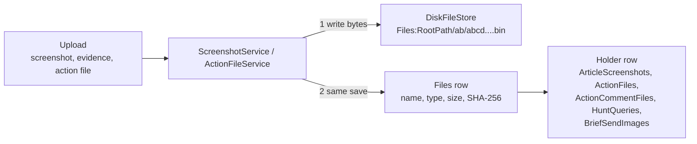

| What | Where | Notes |
|---|---|---|
| File metadata | `Files` table (class `StoredFile`, **S**, **A**) | `FileName` nvarchar(260), `ContentType` nvarchar(100) (sniffed from the bytes, never the browser's claim), `SizeBytes` bigint, `Sha256` nvarchar(64). |
| File bytes | Disk, under `Files:RootPath`, outside the web root | `DiskFileStore` (`src/Tide.Infrastructure/Storage/DiskFileStore.cs`) names each file `<id as N>.bin` in a folder named after the id's first two characters. It writes to `.partial` and then moves into place, so a reader never sees half a file. A relative root is under the content root, which is for development only. |
| Who holds a file | `ArticleScreenshots.FileId`, `BriefSendImages.FileId`, `ActionFiles.FileId` (all unique), `ActionCommentFiles.FileId`, `HuntQueries.EvidenceFileId`, and `OutreachMessages.ReplyFileId` (no FK) | Every FK to `Files` is **restrict**, so a `Files` row can't be deleted while something holds it. |
| Frozen send images | Separate `Files` rows | `DistributionService` copies each screenshot's bytes when it freezes a send, so the archive survives the screenshot's removal. |
| Metrics drop folder | `Files:RootPath/metrics-inbox`, with `processed`, `rejected` and `failed` subfolders | `MetricDropFolder` reads CSVs from it and deletes moved files after 90 days (`MetricDropFolder.KeepFor`). Only the `MetricImports` row and the values go into the database. |
| Things never stored | | AI source text, passwords, the API token itself, and a webhook secret in clear. |

**Writes are ordered so a failure leaves no dangling row.** The bytes are written first. The `Files` row is added in
the same save as the row that holds it. If that save fails, the service deletes the bytes it wrote
(`ScreenshotService.WriteAsync` and the `catch` blocks in `ScreenshotService`, `ActionFileService` and
`DistributionService`). On delete, the row goes first and then `DiskFileStore.Delete`. That method swallows I/O
errors, because an orphaned file is harmless but a failed request isn't.

**What deletes bytes:** removing an article screenshot (`ScreenshotService.RemoveAsync`), discarding unused evidence
(`ScreenshotService.DiscardEvidenceAsync`, which first checks nothing holds it), and `ScreenshotService.DeleteFilesAsync`
when a draft article is deleted. Removing a file from an action or a comment **keeps** its bytes.

**Backups** need both the database and the files folder. `Test-TideRestore.ps1` checks that every file the database
lists is in the backup set. See [../operations/backup-and-recovery.md](../operations/backup-and-recovery.md).

## The audit log

`AuditInterceptor` (`src/Tide.Infrastructure/Persistence/AuditInterceptor.cs`) is a `SaveChangesInterceptor`. On
every `SaveChanges` it:

1. Stamps **S** rows. `Added` gets `CreatedAtUtc` and `CreatedBy`; `Modified` gets `ModifiedAtUtc` and `ModifiedBy`.
   The time comes from `TimeProvider`.
2. Writes one `AuditLog` row for each added, modified or deleted entity whose type isn't in `NotAudited`. The rows go
   into the **same save**, so a change and its record commit or fail together. A modification that changed nothing
   recordable is skipped.

### `AuditLog` (append-only)

The C# class is `AuditLogEntry`. The app never updates or deletes these rows.

| Column | Type | Null | Meaning |
|---|---|---|---|
| `Id` | uniqueidentifier | no | |
| `AtUtc` | datetimeoffset | no | Indexed. |
| `UserId`, `UserName` | nvarchar(256) | no | `CurrentUser.UserId`, and the display name, or `system` when nobody is signed in. Indexed `(UserId, AtUtc)`. |
| `Action` | nvarchar(16) | no | `Added`, `Modified` or `Deleted` (the EF entity state). |
| `EntityType` | nvarchar(64) | no | The CLR type name, for example `Article` or `ActionItem`, not the table name. |
| `EntityKey` | nvarchar(100) | no | The primary key as text. A composite key is joined with `/`, for example `<articleId>/T1566`. Cut at 100 characters. Indexed with `EntityType`. |
| `ChangesJson` | nvarchar(max) | yes | `{"Name": ["old", "new"]}`. Added rows have `null` as the old value; deleted rows have `null` as the new value. Each value is cut at 1,000 characters (`AuditInterceptor.MaxValueLength`) with a trailing `…`. Times are written in ISO 8601 UTC and numbers in the invariant culture. |

**Not recorded in `ChangesJson`:** primary keys, `ModifiedAtUtc`, `ModifiedBy` and `EditVersion`, which change on
every save.

**Masked:** `Sources.Url` is recorded without any key or sign-in it carries (`SecretMask.Url`). A `Settings.Value`
whose key `SettingsCatalog.IsSecret` matches, and `Webhooks.Secret`, are recorded only as set. Anything that reads the
log masks again when it shows a row.

**Not audited** (`AuditInterceptor.NotAudited`):

| Type | Table | Why |
|---|---|---|
| `AuditLogEntry` | `AuditLog` | The log itself. |
| `AppUser` | `Users` | The sign-in mirror changes on every sign-in. |
| `UserPreference` | `UserPreferences` | A person's own view choices change nothing anyone else sees. |
| `NotificationMark` | `NotificationMarks` | Machine bookkeeping for reminders. |
| `FeedItem` | `FeedItems` | Machine intake. Polls and prunes would flood the log. |
| `CveRecord` | `CveRecords` | Refreshed from public sources. |
| `DetectionRule` | `DetectionRules` | Every import touches every rule's `LastSeenAtUtc`. |
| `FeedItemText` | `FeedItemTexts` | Kept publisher text. Copying it into the log would retain it past its prune. |

Writes made with `ExecuteUpdateAsync` or `ExecuteDeleteAsync` don't pass through the interceptor either (see
[Conventions](#conventions-that-apply-everywhere)).

**Who reads it.** `HistoryService` (`src/Tide.Application/History/HistoryService.cs`) shows the History disclosure on
an article (its own row, plus its tag, technique and CVE link rows by key prefix) and on a brief. `AuditLogService`
backs Administration › System › Audit log (`/admin/system/audit`) and its CSV export. Both use the
`(EntityType, EntityKey)` and `(UserId, AtUtc)` indexes. Without a person filter, a search on the action or the values
is limited to 92 days. [security.md](security.md) covers who may read it.

**The change feed is separate.** `ChangeInterceptor` (in the same folder) publishes topics after a save commits, so
colleagues' open pages refresh. It writes nothing to the database. [collaboration.md](collaboration.md) covers it.

## Enums

Every enum below is stored as `int` unless marked otherwise. Append new members and never renumber. The numbers are
the stored values.

### Workflow states

| Enum | Values |
|---|---|
| `ArticleStatus` | 0 **Draft**: being written. 1 **Ready**: written and checked, can go on a brief. 2 **Presented**: shown at a brief's meeting. |
| `BriefStatus` | 0 **Draft**. 1 **Ready**. 2 **Presented**: the meeting was ended. 3 **Sent**: emailed, distributed without email, or finished as not sent. |
| `FeedItemStatus` | 0 **New**. 1 **Shortlisted**. 2 **Dismissed**. 3 **Duplicate**. 4 **Promoted**: became, or was attached to, an article. New, Dismissed and Duplicate items are pruned. |
| `StoryStatus` | 0 **Active**. 1 **Monitoring**. 2 **Closed**. |
| `ActionStatus` | 0 **Open**. 1 **InProgress**. 2 **Blocked**. 3 **Done**. 4 **Cancelled**. 5 **NotApplicable**. 6 **Tracking**: handed to others and followed. Open, InProgress, Blocked and Tracking are open (`ActionItem.IsOpen`); Done, Cancelled and NotApplicable closed (`ActionItem.IsClosedStatus`). Only the first three are active (`ActionItem.IsActiveStatus`), counted against a team's limit. People read them in `ActionItem.StatusOrder`, Tracking between Blocked and Done. |
| `ActiveLimitMode` | 0 **Show**: the count only. 1 **Warn**: going over asks for a reason, kept in the action's history. 2 **Refuse**. |
| `EscalationScope` | 0 **All**. 1 **PartsOnly**: actions with a parent. 2 **ExternalOnly**: external teams' actions. **Not stored in any table**: the setting `Notifications:Escalation:Scope` holds its name. |
| `EscalationDoes` | Flags: 1 **Remind**, 2 **CopyContact**, 4 **RaisePriority**, 8 **Flag**. **Not stored as a column**: a step's flags appear in its `NotificationMarks` key; the setting `Notifications:Escalation:Steps` holds them as words. |
| `ActionOutcome` | 0 **None**. 1 **NoHits**. 2 **HitsEscalated**: hits found and handed on (an incident case, the SOC). 3 **Remediated**. 4 **Blocked**. 5 **RiskAccepted**. 6 **NotAffected**. 7 **Answered**. 8 **Other**. |
| `HuntResult` | 0 **NotRun**. 1 **NoHits**. 2 **Hits**. |
| `ReviewStatus` (in `Entities/Review.cs`) | 0 **Asked**: waiting for the reviewer. 1 **Approved**. 2 **ChangesAsked**. 3 **Withdrawn**: replaced by a later request or taken back by the author. |
| `SendStatus` | 0 **Sending**: frozen and handed to the relay, outcome not yet known (or the app stopped meanwhile). 1 **Sent**: the relay accepted it. 2 **Failed**: the relay refused it, and `Error` says why. 3 **Unknown**: the relay may have taken it: it didn't answer in time, the connection dropped once the session began, or the send threw. The send isn't published and doesn't mark the brief sent, but the next confirmation warns that it may have gone. |
| `RotationChangeStatus` | 0 **Pending**: waiting for the partner. 1 **Approved**. 2 **Declined**. 3 **Cancelled**. |

### Classification and marking

| Enum | Values |
|---|---|
| `TlpLevel` | 0 **Clear**: disclosure isn't limited. 1 **Green**: the community, not publicly. 2 **Amber**: the recipient's organization and its clients, need to know. 3 **AmberStrict**: the recipient's organization only. 4 **Red**: named recipients only. Helpers are in `Tlp` (`Label`, `Key`, `Parse`, `Checked`). |
| `Classification` | 0 **Informational**: no action expected. 1 **Threat**: something should be done. |
| `Priority` | 1 **P1** (most urgent), 2 **P2**, 3 **P3**, 4 **P4**. There is no 0. |
| `Edition` | 0 **Team**: the security teams, up to the team ceiling. 1 **Public**: the whole company (company-wide email and SharePoint copy), at or under the public ceiling. |
| `SourceReliability` | Admiralty scale. 0 **A** completely reliable, 1 **B** usually, 2 **C** fairly, 3 **D** not usually, 4 **E** unreliable, 5 **F** can't be judged (the default). |

### Intake and content

| Enum | Values |
|---|---|
| `SourceKind` | 0 **Feed**: RSS 2.0, RSS 1.0 or Atom. 1 **CisaKev**: the CISA KEV JSON catalog, where each newly listed CVE is an item. 2 **Api**: items proposed through the API, never polled. |
| `ArticleFetch` | 0 **TideOnly**: TIDE may fetch the page through intake's guarded client (the default). 1 **Open**: as TideOnly, and when that fails the AI provider may look it up (TLP:CLEAR only, with web grounding on). 2 **Never**: never fetched, so the analyst pastes the text. |
| `IndicatorType` | 0 Account, 1 Host, 2 IpAddress, 3 Domain, 4 Url, 5 FileHash, 6 FileName, 7 EmailAddress, 8 Process, 9 RegistryKey, 10 Other, 11 CommandLine, 12 CryptoWallet. |
| `AdversaryKind` (in `Entities/Adversary.cs`) | 0 **Actor**: a group. 1 **Campaign**: a run of activity. |
| `DetectionSource` (in `Entities/Detection.cs`) | 0 **Sentinel**: an analytics-rules ARM export. 1 **Sigma**: YAML rules or a zip of them. 2 **Csv**. 3 **Api**: pushed through the API. |
| `MitreTactic` | 0 Unspecified, 1 Reconnaissance, 2 ResourceDevelopment, 3 InitialAccess, 4 Execution, 5 Persistence, 6 PrivilegeEscalation, 7 Stealth (formerly Defense Evasion), 8 CredentialAccess, 9 Discovery, 10 LateralMovement, 11 Collection, 12 CommandAndControl, 13 Exfiltration, 14 Impact, 15 DefenseImpairment. **Not stored in any table today.** It groups techniques in the ATT&CK catalog and views. Its comment still says "persisted", so keep the numbers stable. |

### Actions and hunting

| Enum | Values |
|---|---|
| `ActionKind` | 0 **IocSweep**: search logs for indicators. 1 **ThreatHunt**: a hypothesis-led search. 2 **Block**: block indicators at a control. 3 **PatchRemediate**. 4 **ConfigChange**: a configuration or detection. 5 **Awareness**: tell people. 6 **Outreach**: ask someone for information, called "Vendor inquiry" before [ADR 0019](../decisions/0019-outreach-emails-are-written-never-sent.md). 7 **Other**. |
| `HuntValueKind` | 0 Ipv4, 1 Ipv6, 2 Domain, 3 Url, 4 Md5, 5 Sha1, 6 Sha256, 7 Sha512, 8 OtherHash, 9 FileName, 10 EmailAddress, 11 Host, 12 Account, 13 Process, 14 RegistryKey, 15 CommandLine, 16 Other. Each has its own query template per dialect. |
| `CardColour` | 0 Red, 1 Amber, 2 Green, 3 Blue, 4 Purple, 5 Teal, 6 Grey. |
| `CardRuleSla` | 0 **Any**. 1 **Overdue**. 2 **DueSoon**. 3 **OverdueOrDueSoon**. |

### Metrics

| Enum | Values |
|---|---|
| `MetricFormat` | 0 **Count**: a whole number. 1 **Percent**. 2 **Hours**. 3 **Number**: up to two decimal places. |
| `MetricDirection` | 0 **HigherIsBetter**. 1 **LowerIsBetter**. 2 **Neutral**: a grey arrow, with thresholds applied as for LowerIsBetter. |
| `MetricChart` | 0 **Trend**: a line per metric over 30 days. 1 **Share**: a donut. 2 **Bars**. 3 **None**. 4 **SmallMultiples**. 5 **Stacked**: a column per day. 6 **Bullet**: today's value over its bands. |
| `MetricSource` | 0 **Manual**: typed. 1 **Imported**: read from a CSV. |
| `MetricImportOrigin` | 0 **DropFolder**. 1 **Upload**. |

### Rotation

| Enum | Values |
|---|---|
| `RotationChangeKind` | 0 **Cover**: the partner takes the requester's days. 1 **Swap**: the requester also takes the partner's days. |

### Security (code, not columns)

| Enum | Values |
|---|---|
| `AppRole` | 0 **Analyst**, 1 **ActionOwner**, 2 **Reader**, 3 **Admin**, 4 **Viewer**, 5 **Visitor**. Stored **by name** in `RoleMappings.RoleName` and `Users.RolesCsv`. [security.md](security.md) describes them. |
| `Permission` | 0 ReadPublished, 1 ReadTeamEdition, 2 WriteArticles, 3 PresentBriefs, 4 WorkActions, 5 Administer, 6 EnterMetrics, 7 ReadActions, 8 MeetingNotes, 9 JoinMeetings. Not stored: roles map to permissions in code (`RoleDefinitions`). |

## Delete rules at a glance

| Rule | Relationships |
|---|---|
| **Cascade** (a child goes with its parent) | Article → bullets, screenshots, tags, techniques, indicators, CVEs, links, products, adversaries, reviews, AI drafts. Review → comments. Brief → items, attendees, notes. Send → images. Team → members. Action → comments, events, hunts, checklist, indicators, outreach messages, files, detection gap. Comment → comment files. Playbook → steps. Rotation change → overrides. Feed item → kept text, splits. |
| **Set null** (the reference is dropped) | Article → story. Feed item → article. Hunt → saved query. Outreach message → template. Stack product → team. |
| **Restrict** (the parent can't be deleted while referenced) | Everything → `Files`. Brief item → article. Action → team, article, parent action, playbook. Send and correction → brief. Correction → send. Feed item → source. Tag → category. Article tag → tag. Article product → product. Article adversary → adversary. Metric definition → group. Metric value → definition, import. Card rule → team. |
| **No FK** (an id only) | `FeedItems.DuplicateOfId`/`SimilarToId`, `BriefItems.CarriedFromBriefId`, `MeetingNotes.ArticleId`, `BriefSendImages.SourceFileId`, `BriefCorrections.ArticleIds`, `OutreachMessages.ReplyFileId`, `Adversaries.MergedIntoId`, every user id, and every ATT&CK and CVE id. |

On SQL Server, EF's `Restrict` is created as `ON DELETE NO ACTION`.

## Changing the schema

[../development/recipes.md](../development/recipes.md) has the step-by-step recipe. In short:

- Change the entity in `src/Tide.Domain/Entities` and its mapping in `AppDbContext.OnModelCreating`. Give every new
  string a `HasMaxLength`.
- Add the migration to **both** sets, with the same name: SQLite in `src/Tide.Infrastructure/Persistence/Migrations`
  and SQL Server in `src/Tide.Migrations.SqlServer/Migrations` (`TIDE_MIGRATIONS_PROVIDER=SqlServer`). The commands
  are in the comment on `AppDbContextFactory`.
- Never edit, remove or regenerate a migration that has shipped in a release tag. CI enforces this
  (`tools/ci/check-migrations-immutable.sh`). CI also fails if the model has changes no migration covers (`dotnet ef
  migrations has-pending-model-changes`, for both providers).
- Append enum members and never renumber them. Don't rename an `AppRole` member.
- Decide whether the new type is audited. Add it to `AuditInterceptor.NotAudited` only if it's machine bookkeeping. If
  open pages should refresh when it changes, add it to `ChangeInterceptor.TopicsOf`.
- If a column may carry a secret, add it to `AuditInterceptor.MaskFor`.
- Update this page in the same commit.
