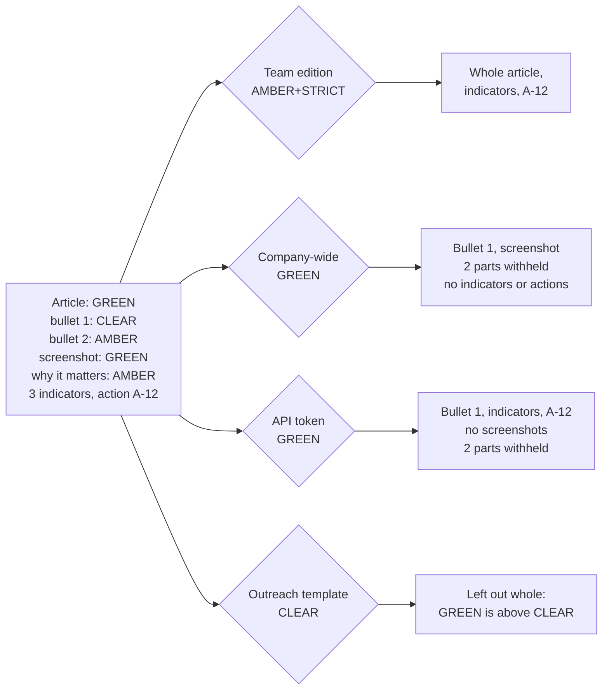

# Editions and TLP

TIDE's core invariant: nothing leaves the app above the ceiling of the audience it goes to. This page explains how
content is marked, how one function cuts a brief for each audience, which ceilings govern which ways out, and the
tests that pin it. It's for anyone changing a rendering, an export, the API, an email or a new way for content to
leave TIDE. Read it before you add one.

- [TLP 2.0 levels](#tlp-20-levels)
- [What carries a marking](#what-carries-a-marking)
- [The cut: `BriefEditions.Build`](#the-cut-briefeditionsbuild)
- [A worked example](#a-worked-example)
- [Ceilings](#ceilings)
- [A ceiling governs what leaves the app](#a-ceiling-governs-what-leaves-the-app)
- [Readiness checks](#readiness-checks)
- [The leak tests](#the-leak-tests)
- [Adding a new way out](#adding-a-new-way-out)
- [Where it lives in code](#where-it-lives-in-code)

Decisions: ADR [0005](../decisions/0005-editions-from-one-model.md) (editions from one model),
[0007](../decisions/0007-frozen-sends-and-cid-email.md) (frozen sends; Readers see only what was published),
[0012](../decisions/0012-exports-carry-tlp-and-stable-ids.md) (exports carry TLP).

## TLP 2.0 levels

`TlpLevel` (`src/Tide.Domain/Enums/TlpLevel.cs`) is ordered, so "above the ceiling" is a plain comparison.

| Value | Level | Label (`Tlp.Label`) | Meaning (`Tlp.Meaning`) |
|---|---|---|---|
| 0 | `Clear` | TLP:CLEAR | Disclosure is not limited. |
| 1 | `Green` | TLP:GREEN | May be shared within the community, not publicly. |
| 2 | `Amber` | TLP:AMBER | Recipients may share with their organization and its clients, need-to-know. |
| 3 | `AmberStrict` | TLP:AMBER+STRICT | Recipients may share only within their own organization, need-to-know. |
| 4 | `Red` | TLP:RED | For the eyes and ears of individual recipients only. |

- **`Tlp.Checked`** refuses a value that isn't defined. An undefined number from a crafted form post would compare
  below every ceiling, so it's never stored. Every service that saves a marking or a ceiling calls it.
- **`Tlp.Parse`** reads `AMBER`, `tlp:amber+strict`, `AmberStrict`, `amber-strict`, and `WHITE` (TLP 1.0's CLEAR);
  `Tlp.Key` writes the address form (`amber-strict`).
- **`Tlp.Color`** gives the standard colour on black, used by the badges and email markings.

## What carries a marking

| What | Field | Default |
|---|---|---|
| An article | `Article.Tlp` | The source's `DefaultTlp` when promoted from triage; CLEAR otherwise |
| A bullet (key point) | `ArticleBullet.Tlp` | The article's |
| A screenshot (and its caption) | `ArticleScreenshot.Tlp` | The article's, when added |
| "Why it matters to us" | `Article.WhyItMattersTlp` | See below |
| The brief's title slide line | `Brief.IntroTlp` | CLEAR for briefs written before it existed |
| A feed source | `Source.DefaultTlp` | Set by an administrator; what promoted items start at |

Not marked of their own: an article's indicators, CVEs and techniques (they count at the article's TLP), and an
action (it counts at the article it was raised from). The team's opening note (`Brief.TeamNote`) has no marking
because it never leaves the team edition (below).

### Effective marking

A part counts at its own marking or its article's, whichever is higher:

- `Article.Effective(partTlp)` returns `max(partTlp, Article.Tlp)`. Marking a whole article AMBER can't be undone by
  leaving a bullet at CLEAR.
- `Article.HighestTlp` is the highest of the article, its non-empty "why it matters", and every bullet and screenshot,
  each taken at its effective marking.
- In the editor, raising the article's TLP pulls every part below it up to match (`ArticleForm.SetTlp`); lowering it
  leaves the parts where they are. A part stored below its article from before that rule loads at the article's TLP
  (`ArticleForm.From`).
- A part marked above its article shows in the running order and on its slide ("holds TLP:AMBER"), so an article that
  looks CLEAR can't hide an AMBER part from the presenter.

### The "why it matters" default

"Why it matters to us" often names our own systems and exposure, so a threat's starts at AMBER, or at the article's TLP
when that's higher (`Article.DefaultWhyItMattersTlp`, floor `Article.ThreatWhyItMattersFloor`). It's applied:

- when an item is promoted from triage as a threat (`IntakeService.PromoteAsync` with a form);
- when an article turns from informational to threat while "why it matters" is still empty (`Article.Classify`,
  `ArticleForm.SetClassification`, through `Article.WhyItMattersTlpOnClassify`).

It only ever raises, never touches one already written, and isn't a column default, so saved articles keep what they
have. An informational article's starts at CLEAR. The editor shows a "starts at AMBER" hint while the value sits at the
default untouched (`ArticleForm.WhyItMattersAtThreatDefault`).

## The cut: `BriefEditions.Build`

There are two editions (`Edition`): **Team** (the security teams, the meeting) and **Public** (the company-wide
edition, the published archive, the SharePoint copy). Both are cut from one model by one function
(`src/Tide.Application/Briefs/BriefEdition.cs`):

- **`BriefEditions.BuildArticle(article, edition, ceiling, actions)`** returns `null` when `article.Tlp` is above the
  ceiling: the article is left out whole, its title, bullets, screenshots, captions, indicators and actions with it.
  Otherwise it keeps the bullets and screenshots whose effective marking is at or below the ceiling, shows "why it
  matters" only if it's non-empty and its effective marking is within the ceiling (`ShowWhy`), and counts what it left
  out (`WithheldParts`). The team edition also carries the article's indicators and the actions raised from it; the
  company-wide edition never does.
- **`BriefEditions.Build(brief, edition, ceiling, actions)`** runs `BuildArticle` over the brief's items in running
  order, counts the articles left out (`WithheldArticles`), and shows the title slide line only if it's non-empty and
  `Brief.IntroTlp` is within the ceiling (`ShowIntro`).
- **`EditionArticle.Marking`** and **`BriefEdition.Marking`** are the highest marking of what the edition actually
  shows, including the title slide line and the overdue actions it lists. That's what an email, its subject and the
  API say the edition is.
- Restricted parts are left out of the result, not hidden by the view. Nothing downstream can render what isn't there.

### The team note

`Brief.TeamNote` (Markdown, no marking) belongs to the team edition alone. `BriefEdition.ShowTeamNote` is true only for
`Edition.Team` with a non-blank note, whatever the company-wide ceiling, and `BriefEdition.TeamNote` returns null
otherwise. Every rendering (the slide, the team email, the preview) asks the edition for it, so nothing reads the note
past an edition that leaves it out. The API's brief and the SharePoint copy never carry it.

### Every consumer

| Consumer | Edition | Ceiling | Code |
|---|---|---|---|
| Real send, test send, email preview, send plan | Team or Public | That edition's | `DistributionService.EditionAsync` (also cuts the overdue list: `ActionService.Outstanding` at the team ceiling) |
| SharePoint copy and its image zip | Public | Company-wide | `DistributionService.SharePointAsync`, `SharePointImagesZipAsync` |
| The published archive (`/published`) | Public | Fixed at send | Reads the frozen `BriefSend.WebHtml` only (`PublishedContent`), never the articles |
| Present mode (slides) | Team (default) or Public, chosen | That edition's | `Present.razor` (`BriefEditions.Build`) |
| The brief page's reader proofs | Both | Each edition's | `BriefPage.razor` (`Proof`) |
| The edition check (running order, Today) | Both | Each edition's | `EditionChecks.Rows` (`BuildArticle`) |
| The editor's reader preview, review page | Both | Each edition's | `ArticlePreview.Build` on the unsaved form (`ArticleForm.ToPreview`) |
| Corrections after a send | The send's | Lower of the send's and the current | `CorrectionService` |
| API `GET /briefs/{day}` | Team | Lower of the token's and the team's | `ApiService.BriefAsync` |
| Outreach emails | Team (for indicators) | The template's | `OutreachFill.Cut` (`BuildArticle`) |

Three ways out apply the same rule without calling `Build`, because they carry whole articles, not editions:
`ExportService.GatherAsync` (articles above the chosen ceiling left out whole), `ApiService.WithheldArticlesAsync` and
`WebhookService.DeliverDueAsync` (actions from an article above the ceiling left out).

### One article, cut for each audience

## A worked example

A brief with two articles, under the default ceilings (company-wide GREEN, team AMBER+STRICT), a token issued at
GREEN and an outreach template at CLEAR:

- **Article 1** "Contoso VPN zero-day", TLP:GREEN. Bullet 1 CLEAR (counts as GREEN), bullet 2 AMBER, one screenshot
  GREEN, "why it matters" AMBER (the threat default), three indicators, action A-12 raised from it.
- **Article 2** "Partner breach", TLP:RED, with action A-13 raised from it.
- The title slide line is CLEAR; the team note says "Patch window tonight".

| Audience | Ceiling | Article 1 | Article 2 | Title line | Team note | Marking |
|---|---|---|---|---|---|---|
| Analyst, Action owner or Viewer in the app | None | Everything | Everything | Yes | Yes | n/a |
| Team edition (email, slides, preview) | AMBER+STRICT | Both bullets, screenshot, why, indicators, A-12 | Left out (1 withheld) | Yes | Yes | AMBER |
| Visitor seated in the meeting | AMBER+STRICT (team) | As the team edition | Left out | Yes | Yes | AMBER |
| Company-wide edition, SharePoint, `/published` | GREEN | Bullet 1, screenshot; 2 parts withheld; no indicators, no actions | Left out | Yes | No | GREEN |
| API token `briefs:read` | GREEN (lower of GREEN and AMBER+STRICT) | Bullet 1, indicators, A-12 (the API brief carries no screenshots); 2 parts withheld | Left out | Yes | No | GREEN |
| API token `actions:read` | GREEN | A-12 listed | A-13 withheld | n/a | n/a | n/a |
| Webhook `action.raised` | AMBER+STRICT (team) | A-12 posted, marked GREEN | A-13 never posted | n/a | n/a | n/a |
| Outreach email from A-12 | CLEAR (template) | Left out whole, its indicators with it, and said so | n/a | n/a | n/a | n/a |
| Export `?tlp=green` | GREEN (chosen) | Its indicators, marked GREEN | Left out | n/a | n/a | n/a |
| Export with no `tlp` | none: refused (400) | Nothing | Nothing | n/a | n/a | n/a |

## Ceilings

| Way out | Ceiling | Set by | Default | Code |
|---|---|---|---|---|
| Company-wide edition | `Distribution:PublicMaxTlp` | Administrator, in the app | GREEN | `DistributionSettings` |
| Team edition, the meeting, a Visitor's slides | `Distribution:TeamMaxTlp` | Administrator, in the app | AMBER+STRICT | `DistributionSettings` |
| An API token | `ApiToken.MaxTlp`, capped by the team ceiling | Administrator, per token | Chosen at issue | `ApiTokenService`, `ApiService` |
| Webhooks | The team ceiling | (follows it) | AMBER+STRICT | `WebhookService` |
| An outreach email | `OutreachTemplate.Ceiling` | Whoever works actions, per template | Chosen | `OutreachFill.Cut` |
| An indicator export | `?tlp=` (required) | The person exporting | CLEAR in the Export panel; none on the address (refused) | `ExportService.GatherAsync` |
| AI drafting | `Ai:MaxTlp` | Server configuration | GREEN | `AssistService` ([security.md](security.md#ai-data-handling)) |

### The edition ceilings

`DistributionSettings` reads the saved values (`Settings` rows `Distribution:PublicMaxTlp`, `Distribution:TeamMaxTlp`)
or falls back to the `Distribution` configuration section. Rules:

- The company-wide ceiling can never exceed the team's: `SaveAsync` refuses it, and `ReadAsync` clamps it on read in
  case configuration says otherwise.
- RED is for named recipients, so the team edition doesn't default to it.
- `GetAsync` needs `ReadTeamEdition`, or a Visitor seated in a live meeting (whose slides are cut by them). Saving
  needs `Administer`. Webhooks read them without a user (`ReadAsync`).

### API tokens

A token's ceiling is the lower of its own `MaxTlp` and the team edition's ceiling: a RED token is still held to the team
edition, as its brief is. `ApiService.BriefAsync` cuts with `Build(brief, Edition.Team, ceiling)`;
`ApiService.ActionsAsync`, `ActionAsync`, `OpenFileAsync` and `UpdateActionAsync` treat an action raised from an
article above the ceiling as not there (404). Our stack's notes are internal (AMBER) and go only to a caller whose
ceiling allows it. A person calling the API (Windows sign-in, no token ceiling) reads what the pages show them.

### Webhooks

`WebhookService.DeliverDueAsync` posts `action.raised` and `action.overdue` only for actions with no article or whose
article is at or below the team edition's ceiling, and marks each posted action with its article's TLP.

### Outreach templates

An Outreach action's email (ADR [0019](../decisions/0019-outreach-emails-are-written-never-sent.md)) leaves the app in
the analyst's own mail, so `OutreachFill.Cut` holds it to the template's ceiling through `BuildArticle`: an article
above it is left out whole with its indicators; a key point or "why it matters" above it alone. The action's own
indicators carry no marking, so they count as AMBER (`OutreachFill.UnmarkedTlp`). The email is marked with the highest
TLP of what it filled in, and each thing left out is named for the analyst.

### Exports

`GET /exports/{article|brief|story|lookup}/{key}?format=stix|csv&tlp=` (team edition and above) leaves out every article
marked above the chosen TLP, whole, as the editions do. The ceiling is required: with no `tlp`, or a format other than
stix or csv, the request is refused (400), and the Export panel starts at TLP:CLEAR, so a wider ceiling is always chosen. Every STIX object
carries its article's OASIS TLP 2.0 marking-definition (an object shared by several articles takes the highest), each
CSV row its article's TLP, and the file name carries the ceiling (`tide-brief-2026-11-06-green.csv`)
(ADR [0012](../decisions/0012-exports-carry-tlp-and-stable-ids.md)). The person exporting decides who it's for.

## A ceiling governs what leaves the app

A ceiling governs what leaves the app, not what people see in it. Signed in, an Analyst, an Action owner or a Viewer
(all `ReadTeamEdition`) sees articles, and the actions raised from them, at every marking: the article pages, search,
the actions pages, History (analysts only) and reports don't filter by TLP. The team edition's ceiling applies to the
edition as it's sent, previewed and presented, to API tokens and to webhooks.

That's deliberate (an owner decision on 2026-11-03): anyone mapped to the Action owner role is trusted with RED inside
TIDE, so map only the teams that should be.

Two internal emails go to named people and are marked rather than cut: the reminder scans (due soon, overdue, the
digests) list action titles with each article's TLP beside it and the highest in the subject
(`ReminderService.MarkingOf`).

### The Our stack exception

Our stack is the exception inside the app. A product's page (`StackService.GetAsync`) and present mode's product card
(`StackService.CardAsync`) name only the articles at or below the team edition's ceiling, and the actions raised from
them, and count the rest ("2 articles above TLP:AMBER+STRICT"), even for an analyst. The list's counts name no titles, so they count every article.
The list's "Right now" column (`StackService.OverviewAsync`, `RightNow`) names a CVE only when an article at or below
the ceiling carries it; one seen only above it is counted ("1 CVE above TLP:AMBER+STRICT") and its id, scores and KEV
listing are not kept.

## Readiness checks

`ArticleChecks.For(article, companyCeiling)` (`src/Tide.Application/Articles/ArticleForm.cs`) is pure. Besides the
blocking gaps (bottom line, a bullet, a threat's priority) and warnings, it calls `ArticleChecks.WhyReachesCompany`:
a threat whose "why it matters" has text and an effective marking at or below the company-wide ceiling is warned
about, because it will reach everyone. The warning carries a one-click fix (`ArticleFix.WhyItMattersAmber`, offered
only when AMBER is above the ceiling, so marking it does leave it out). The editor applies it to its form, saved with
the rest; the running order saves it at once (`ArticleService.MarkWhyItMattersAmberAsync`), which only ever raises that
one marking, refuses a stale edit version and a sent brief, and is audited as the article's own save. The warning
shows in the editor's preview, the running order, and the company-wide column of the edition check
(`EditionChecks.Rows`).

The edition check itself is the edition's own cut (`BuildArticle`), so what it says goes in can't disagree with what's
sent: each article is In, Part ("2 parts above TLP:GREEN left out") or Left out ("The article is TLP:RED"). Today
lists only the rows that aren't whole or carry a warning (`EditionChecks.Exceptions`); the counts are of every row.

## The leak tests

`BriefEditions.Build` is the one function that decides what an audience sees, so its tests are the leak tests
(ADR 0005). If you touch the cut or a rendering, these must stay green:

| What it pins | Test |
|---|---|
| Articles above the ceiling are left out whole | `tests/Tide.UnitTests/BriefEditionTests.cs` `Build_Public_LeavesOutArticlesAboveTheCeiling` |
| Restricted bullets and screenshots, captions included, are left out | `BriefEditionTests.Build_Public_LeavesOutRestrictedBulletsAndScreenshots_IncludingCaptions` |
| A part counts at its article's TLP when higher | `BriefEditionTests.Build_APartCountsAtItsArticlesTlp_WhenThatsHigher`; `tests/Tide.UnitTests/Audit/BackendAuditTests.cs` `Editions_FilterAndMarkParts_AtTheEffectiveTlp_NeverTheStoredOne` |
| "Why it matters" has its own TLP and is withheld above the ceiling | `BriefEditionTests.Build_WhyItMatters_HasItsOwnTlp_AndIsWithheldAboveTheCeiling`; `BackendAuditTests.ARestrictedWhyItMatters_IsLeftOutOfThePublicEdition` |
| Indicators and actions are on the team edition only | `BriefEditionTests.Build_IndicatorsAndActions_AreOnTheTeamEditionOnly`; `BackendAuditTests.TheTeamEmail_ListsIndicatorsDefanged_AndFollowUpActions_ThePublicOneNeither` |
| The title slide line is cut and marks the edition | `BriefEditionTests.Build_TheOpeningNote_IsLeftOutAboveTheCeiling_AndMarksTheEditionsThatCarryIt` |
| The editor's unsaved preview cuts as `Build` does | `BriefEditionTests.BuildArticle_OnTheEditorsUnsavedCopy_CutsAsBuildDoes` |
| A golden file of every edition | `BriefEditionTests.Build_MatchesTheGoldenEditions` (`tests/Tide.UnitTests/Golden/editions.txt`) |
| The company-wide email carries nothing above the ceiling, in HTML, text or images | `tests/Tide.UnitTests/BriefRendererTests.cs` `Email_Public_CarriesNothingAboveTheCeiling`; `BackendAuditTests.Renderer_PublicEdition_CarriesNoScreenshotOfAnArticleAboveTheCeiling_InImagesHtmlOrText` |
| Metrics never in the company-wide email | `BriefRendererTests.Email_Public_NeverShowsMetrics_TeamShowsThemFirst` |
| The team note never leaves the team edition | `tests/Tide.UnitTests/TeamNoteRenderTests.cs` `ThePublicEdition_NeverCarriesTheNote`; `tests/Tide.IntegrationTests/TeamNoteTests.cs` `ThePublicApiAndTheSharePointCopy_NeverCarryTheNote` |
| A real send emails only what the ceiling allows | `tests/Tide.IntegrationTests/DistributionTests.cs` `Send_Public_EmailsOnlyWhatTheCeilingAllows_AsCidImages` |
| The overdue list stops at the team ceiling | `DistributionTests.TheTeamEdition_ListsOverdueActionsOnlyUpToItsCeiling_AndIsMarkedAtTheHighestItLists` |
| End to end, and public above team is refused | `tests/Tide.IntegrationTests/Audit/AdversarialTests.cs` `TheCompanyWideEdition_NeverCarriesAnArticleAboveTheCeiling` |
| Readers see only sent company-wide editions and their images | `DistributionTests.Readers_SeeOnlySentPublicEditions_AndOnlyTheirImages`; `PublishedTests.TheList_ShowsEachSentEditionsHeadlines_ButNeverAnAmberOrUnpublishedArticle` |
| Corrections never repeat a line now above the ceiling | `CorrectionTests.CompanyWideCorrection_NeverRepeatsAPartRaisedToAmberSinceTheSend_OnEitherSide`, `AfterTheCeilingIsLowered_ACorrection_RepeatsNoLineThatWentAboveIt_EvenOnceDeletedOrLowered` |
| The API cuts at the lower ceiling and withholds actions | `ApiTests.ABrief_IsCutAsTheTeamEditionIs_AtTheLowerCeiling`, `ActionsFromAnArticleAboveTheTokensCeiling_AreWithheld` |
| Webhooks hold to the team ceiling | `ApiTests.Webhooks_LeaveOutActionsAboveTheTeamCeiling_AndMarkEachWithItsArticlesTlp` |
| Outreach holds to the template's ceiling | `tests/Tide.UnitTests/OutreachFillTests.cs` `AnArticleAboveTheCeiling_IsLeftOutWhole_IndicatorsWithIt_AndSaidSo`, `APartAboveTheCeiling_IsLeftOutAlone_ByItsOwnTlp_AsTheEditionsCutIt` |
| Exports leave out articles above the ceiling | `tests/Tide.IntegrationTests/ExportTests.cs` `Brief_InRunningOrder_LeavesOutArticlesAboveTheCeiling` |
| Our stack names only articles within the team ceiling | `CommentsAndStackDecisionTests.AProductsPage_NamesOnlyArticlesAtOrBelowTheTeamCeiling_AndCountsTheRest`; `StackTests.APresentModeCard_LeavesOutArticlesAboveTheTeamEditionsCeiling`; `StackTests.RightNow_NeverNamesACve_ThatComesOnlyFromAnArticleAboveTheTeamEditionsCeiling`; `StackAttentionTests.RightNow_CountsButNeverNamesACve_ThatComesOnlyFromAnArticleAboveTheCeiling` |
| An undefined TLP is never stored | `ArticleAndBriefTests.Save_AnUndefinedTlp_IsRefused_NotStoredBelowEveryCeiling`; `DistributionTests.Ceilings_AnUndefinedTlp_IsRefused` |
| The "why it matters" default | `tests/Tide.UnitTests/WhyItMattersDefaultTests.cs`; `IntakeTests.Promote_AsAThreat_StartsWhyItMattersAtAmber_OrTheArticlesTlp_AndInformationalKeepsClear` |

**Needs verification:** the older architecture doc says tests pin the Action-owner-sees-RED decision. No test names
it outright; `AdversarialTests.AnActionOwner_ReadsTheTeamEdition_AsTheRoleGrants` covers the team-edition reads, and
`ArticleService.RequireRead` checks only `ReadTeamEdition`. A test reading a RED article as an Action owner would
confirm it.

## Adding a new way out

Anything that sends, posts, exports, copies or shows TIDE content to someone outside the signed-in team is a new way
out. Before merging one:

1. Decide its audience and which ceiling governs it (an existing one, or a new administered or per-item one).
2. Cut through `BriefEditions.Build` or `BuildArticle`. If it carries whole articles or actions, compare
   `Article.Tlp` to the ceiling and leave the article out whole; never filter parts yourself.
3. Mark what goes with the highest marking it carries (`BriefEdition.Marking`, `EditionArticle.Marking`).
4. Never carry the team note, indicators or actions outside `Edition.Team`.
5. Run `Tlp.Checked` on any ceiling it stores.
6. Add a leak test with a RED article and an AMBER part that asserts their text is absent from every output form
   (HTML, plain text, images, file names).

## Where it lives in code

| Concern | Code |
|---|---|
| Levels, labels, parsing | `src/Tide.Domain/Enums/TlpLevel.cs` (`TlpLevel`, `Tlp`) |
| Effective marking, defaults | `src/Tide.Domain/Entities/Article.cs` (`Effective`, `HighestTlp`, `DefaultWhyItMattersTlp`, `Classify`) |
| Editor rules | `src/Tide.Application/Articles/ArticleForm.cs` (`SetTlp`, `SetClassification`, `ToPreview`, `ArticleChecks`) |
| The cut | `src/Tide.Application/Briefs/BriefEdition.cs` (`BriefEditions`, `BriefEdition`, `EditionArticle`) |
| Edition check | `src/Tide.Application/Briefs/BriefProgress.cs` (`EditionChecks`) |
| Ceilings | `src/Tide.Application/Settings/DistributionSettings.cs` |
| Sends, SharePoint, archive | `src/Tide.Application/Distribution/DistributionService.cs`, `BriefRenderer.cs`, `PublishedContent.cs`, `CorrectionService.cs` |
| API and webhooks | `src/Tide.Application/Api/ApiService.cs`, `Webhooks.cs`, `src/Tide.Web/Security/ApiTokenAuthentication.cs` (`Ceiling`) |
| Outreach | `src/Tide.Application/Actions/OutreachFill.cs` (`Cut`) |
| Exports | `src/Tide.Application/Exports/ExportService.cs`, `Stix.cs`, `IndicatorCsv.cs` |
| Our stack | `src/Tide.Application/Stack/StackService.cs` (`GetAsync`, `CardAsync`, `OverviewAsync`) |

Related: [security.md](security.md), [distribution.md](../workflows/distribution.md),
[writing-articles.md](../workflows/writing-articles.md), [business-rules.md](../reference/business-rules.md).
