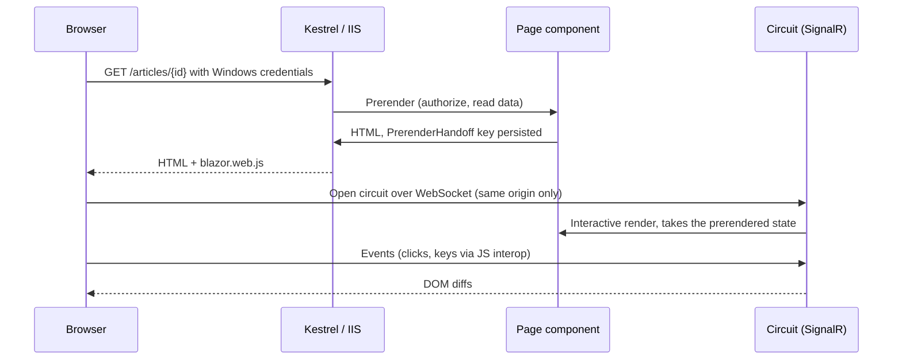
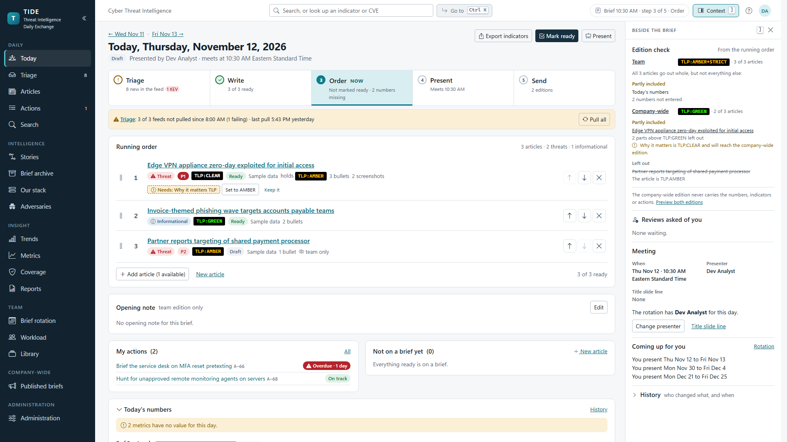
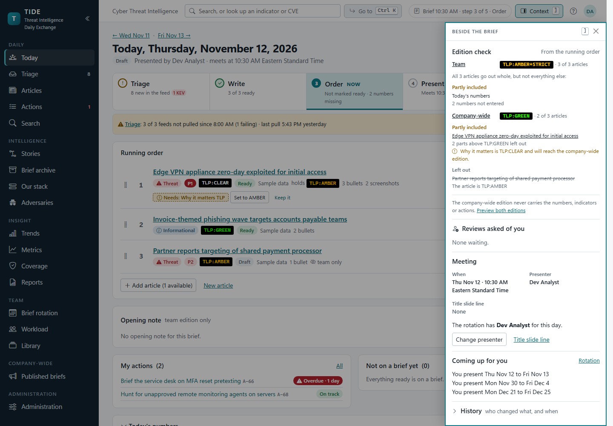
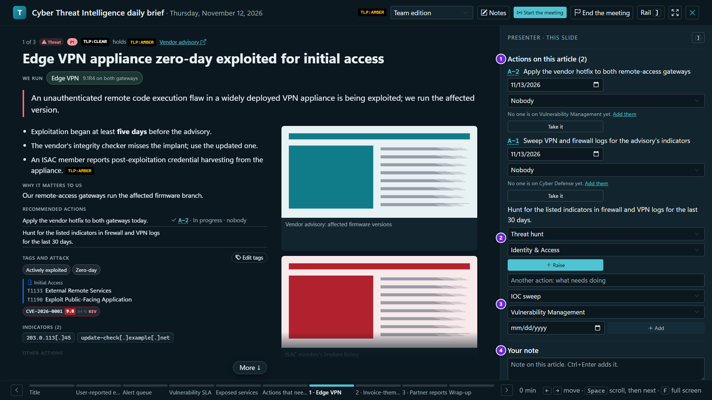
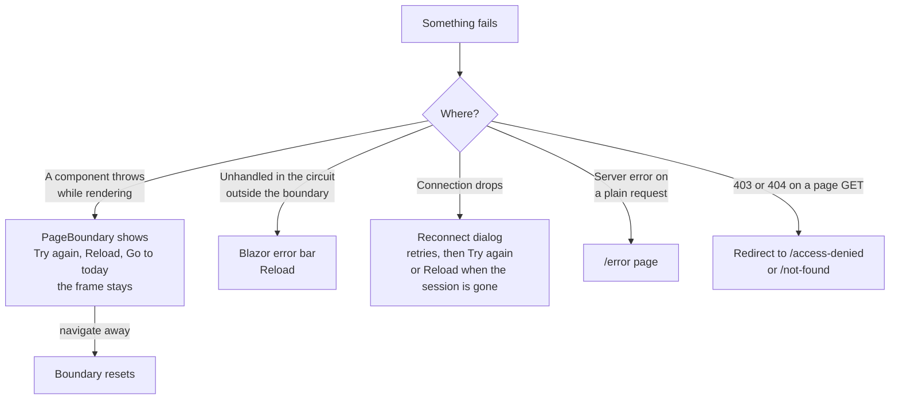

# Frontend architecture

How TIDE's user interface is built: the Blazor Server rendering model, the layouts and navigation, every route, the
shared components, the design tokens, the scripts and the Content Security Policy they live under, keyboard
shortcuts, accessibility, the phone layout, Markdown rendering, and what happens when something fails. It's for
developers changing a page, and for reviewers checking how the browser side is locked down.

For what each screen does from a user's point of view, see [a tour of the screens](../product/screens.md).

**Contents**

- [Rendering model](#rendering-model)
- [Layout and navigation](#layout-and-navigation)
- [Routes](#routes)
- [Shared components](#shared-components)
- [Working together on screen](#working-together-on-screen)
- [Design tokens](#design-tokens)
- [Scripts and the CSP](#scripts-and-the-csp)
- [Keyboard shortcuts](#keyboard-shortcuts)
- [Accessibility](#accessibility)
- [Phone layout](#phone-layout)
- [Markdown rendering](#markdown-rendering)
- [Errors and reconnecting](#errors-and-reconnecting)
- [Where it lives in code](#where-it-lives-in-code)

## Rendering model

TIDE is a Blazor Web App with **interactive server rendering throughout**
([ADR 0001](../decisions/0001-blazor-server-on-prem.md)). There is no WebAssembly, no SPA build and no client-side
state beyond what's on screen.

- **One render mode, set at the root.** `src/Tide.Web/Components/App.razor` renders `<Routes @rendermode="InteractiveServer" />`
  and `<HeadOutlet @rendermode="InteractiveServer" />`. No page sets its own render mode, so every page is interactive.
- **Prerender, then the circuit.** Each page is prerendered on the server (the default for `InteractiveServer`), sent
  as HTML, and then made interactive over a SignalR circuit. `PrerenderHandoff` (`src/Tide.Web/Services/PrerenderHandoff.cs`)
  hands what a page read during the prerender to the same page's interactive render, for the same user only, so a
  reload doesn't flash a loading state over the prerendered page. A key that's gone just means the page reads again.
- **The host.** `Program.cs` registers `AddRazorComponents().AddInteractiveServerComponents(...)` and maps
  `MapRazorComponents<App>().AddInteractiveServerRenderMode(...)`. Two settings matter:
  - `DisconnectedCircuitRetentionPeriod` is **20 minutes** (the default is 3), so a laptop that slept comes back to an
    article being edited, unsaved changes and all.
  - `MaximumReceiveMessageSize` is **256 KB** (SignalR's default is 32 KB), so a long article field read back from the
    Markdown editor doesn't drop the circuit. Screenshots stream through `InputFile` and don't count.
  - `ContentSecurityFrameAncestorsPolicy = null`, because `SecurityHeadersMiddleware` sets the one CSP.
- **Short-lived database contexts.** A circuit shares one DI scope, so services open a context per operation through
  `IAppDbContextFactory`. See [backend](backend.md).
- **The base address.** `App.razor` writes `<base href>` from the request's path base, so TIDE works at the root of
  its own host name or under a path such as `/tide`. Links, scripts and the circuit are all relative to it.
- **Only this site's pages get a circuit.** `CircuitOriginMiddleware` refuses a circuit to a page on another origin
  (the browser sends Windows credentials with any site's request). See [security](security.md).
- **Routing and focus.** `Routes.razor` uses `AuthorizeRouteView` with `MainLayout` as the default layout,
  `AccessDenied` for `NotAuthorized`, `NotFoundPage` as the not-found page, and `FocusOnNavigate` with selector `h1`,
  so focus lands on each page's heading after navigation.
- **A text box that updates as you type binds with `@bind:get`/`@bind:set` and `@bind:event="oninput"`, never
  `value="@x"` with `@oninput`.** Only `@bind` tells Blazor to copy the browser's value into its own copy of the box as
  each keystroke arrives. Without it, Blazor's copy is the last value it drew, so a later render sends the server's
  text, older than what's typed by then under any latency, over the newest keystrokes. Bound, a render carrying the
  typed text sends nothing, and a clear or a value set from outside still reaches the box.
- **Every multi-line text box (`<textarea>`) carries `tide-autogrow`**, so it grows with its text, up to `min(60vh, 32rem)` (30vh in present mode's notes panel), then scrolls. `tide-grow-2` / `tide-grow-3` keep its starting height at two or three rows; boxes with their own starting height (`tide-query`, `tide-email-body`, `tide-etpl-body`) keep it. The browser sizes them where it supports CSS `field-sizing: content`; `autogrow.js` does elsewhere: it fits a box as it's typed in, when Blazor draws or changes it (only a box whose text or width changed, keeping the page's scroll), and when it comes into view (a `<details>` opening, a hidden tab shown: a `ResizeObserver`).
- **A form with one main action marks its container `data-submit-scope` and the button `data-submit`**, so Ctrl+Enter
  (`⌘ Enter`) in one of its text boxes presses it (`submitkeys.js`, EP-90): `<div data-submit-scope>`, then
  `<button … data-submit @onclick="Save">`. One `data-submit` to a scope, and scopes don't nest. A dialog with one
  `btn-primary` button (a `ConfirmDialog` with `Form`) and a real `<form>` need nothing. A box with no single action
  (a filter, the article editor) gets no scope, and the keys do nothing there. A single-line box takes part only inside
  a scope. `SubmitKeysTests` checks every scope has its one button.
- **Every script is an external file**, versioned with `?v=` in `App.razor` because browsers cache by URL. Bump the
  version when a file changes.



## Layout and navigation

Three layouts, in `src/Tide.Web/Components/Layout`:

| Layout | Used by | What it draws |
|---|---|---|
| `MainLayout` | Every page by default | A skip link to `#main-content`; the sidebar (`NavMenu`); the top bar with the team name, `TopSearch` (team edition only), `CommandPalette`, the brief chip (`BriefChip`, for those who make the brief), `ShortcutsOverlay` and `ProfileMenu`; the live meeting banner (`LiveMeetingJoin`); the page inside `PageBoundary`; the page's context rail and its Context button, when it has one; `ToastHost`; Blazor's `#blazor-error-ui`. |
| `AdminLayout` | Every page under `/admin` (`@layout AdminLayout`) | Nested in `MainLayout`. An "Administration" title (drawn as large as an `h1` but not a heading, so the page's own title is the `h1`), the groups as page-level tabs, a group's pages as sub-tabs (`TabBar`), then the page. "new" shows beside Updates when the update check found a release. |
| `BlankLayout` | Present mode (`/present/{day}`) | No sidebar or top bar. `PageBoundary` (contained), `ToastHost`, and the `CommandPalette` and `ShortcutsOverlay` with keys only, no buttons. |

**The sidebar.** `NavMenu` draws `NavPages.GroupsFor(user)`: every page the person may open, under small group labels
(Daily, Intelligence, Insight, Team, Company-wide, Administration), the daily ones first. `NavPages.All()` is the single list
of sidebar pages, with each page's icon, address, group, the permissions it needs (all of them) and extra keywords;
the command palette reads the same list, so the two never disagree. A group with no page for the person isn't drawn.
The sidebar's visibility rule is only a hint: each page's own `[Authorize]` policy decides.

- **Counts.** Triage shows the number of new items (`IntakeService.NewCountAsync`, for `WriteArticles`) and Actions the
  person's overdue actions (`ActionService.MyOverdueCountAsync`, for `WorkActions`, in red). They're read when the
  menu starts and on each navigation, never on a re-render. A failed read keeps the last value and logs once per run
  of failures, because the menu sits outside the page's error boundary. The count is in each link's accessible name
  ("Triage, 4 new").
- **Collapse.** The button at the top collapses the sidebar to icons. `theme.js` (`tideNav.toggle`) sets
  `data-nav="collapsed"` on `<html>` and remembers it in `localStorage`; `theme-init.js` applies it before paint.
- **A short window.** Under about 1050px tall (not on a phone) the links and group labels tighten with the window's
  height (`clamp()` on `vh`), so the whole menu fits a laptop screen. Where it still can't, the menu scrolls with a thin
  scrollbar, and `tideNav.reveal` scrolls the current page's link into view on load and after each navigation. It
  moves only the menu, never the page.
- **Phone menu.** See [phone layout](#phone-layout).

**The context rail.** A region on the right of a page for what belongs beside its content: what TIDE already knows
about the thing selected, and the tools for it, so the analyst doesn't leave the page to find out. A page fills it by
placing one `ContextRail` anywhere in its markup:

```razor
<ContextRail Title="About this item">
    <p>What TIDE knows about the selected item.</p>
</ContextRail>
```

These pages have one:

| Page | The rail's title | What it holds |
|---|---|---|
| Today and a day's brief (`BriefPage`) | Beside the brief | The edition check, your teams' queue, Escalated, reviews asked of you, the meeting, coming up and the brief's history (`Components/Today/`). |
| Triage (inbox tabs only) | What TIDE knows | For the selected item: its CVE's CVSS, EPSS, KEV and the priority a promote would suggest; the article that already covers it and that article's open actions; the other reports of the same event, with Attach all and Not the same; the story; what it names (We run, a watched adversary) with *Add to what we run…* (`Components/TriageRail/`). It reads only what's stored: nothing is fetched from a source site. |
| The article editor | Context · what readers get | The reader preview (`ReaderPreview`) with its Preview, Actions and Details tabs and the Team / Company-wide switch, then the threat story and similar articles. |
| Actions, list and board | About A-n | The selected action (`ActionRowRail`): its Next line, Take it, Assign… (list) or Move to (board), Open, its facts, its hunt query with Copy, the source article, the last activity and, on the list, About this page. A closed action on the list has Reopen. |
| An action's page | About this action | The facts, the source article, *Also raised from it* (the other actions from the same article, `ActionService.RaisedWithAsync`), an external team's contact, and Files (`Components/ActionRail/`). |
| Search, for a looked-up value | Do something with it | The hunt query (XQL, KQL or Falcon, with *Include what it travels with*), who is sweeping for it with Open and Take it, and Export as STIX 2.1 or CSV. A word search has no rail. |
| Our stack | About *product* | The selected product's facts, Edit, Start an outreach and Mark checked (for `WriteArticles`), what's in triage for it now, its articles (held to the team edition's ceiling), its open actions and its notes. |
| The Library | About this query (template, playbook) | The selected saved query, template or playbook: its facts, the placeholders it fills, *Try it on an open action* and *Used on* (`Components/LibraryRail/`). Board rules has none. |
| Adversaries, the list and a profile | About *profile* | On the list, the selected profile; on a profile's page, its facts, Do, To link, We run and Hunting. |

The rail reads only once the selection has rested for a moment (150ms on the lists), so holding `J` doesn't read
every row it passes. What it shows is what the page's own reads would show to the same person: no rail widens who sees
anything.

- **How it reaches the layout.** `ContextRail` draws nothing where it's placed. It holds two `SectionContent`s, and
  `MainLayout` has the two matching `SectionOutlet`s: one in the top bar for the Context button, one after `.content`
  for the region (`<aside id="tide-rail" aria-label="…">`, with the title as its heading and a Close button). A page
  that places no `ContextRail` leaves both outlets empty, so its markup and widths are what they were before the rail
  existed. `BlankLayout` has no outlets, so present mode never draws one, and no page under `/admin` places one.
- **Docked.** In a window 1500px or wider the rail is open beside the content: 380px (`--tide-width-rail`), fixed under
  the top bar, scrolling in itself. The content gives up that width and is still held to 1400px. The Context button,
  the rail's Close or `]` closes it, and the content takes the width back. Closed or open is remembered per browser
  (`localStorage` key `tide-rail`); `theme-init.js` applies a remembered close as `data-rail="closed"` on `<html>`
  before paint. The actions board, which otherwise takes the whole window, docks the rail too
  (`main:has(.tide-board) > .tide-rail`), and `]` gives the board its full width back. Between 1500px and about
  1760px some pages lay out more simply beside the docked rail: the Actions list's rows stack, and an adversary's
  profile drops to one column.
- **An overlay.** Below 1500px the rail starts closed and opens over the content from the right, which keeps its
  width. It isn't remembered: `theme.js` (`tideRail`) sets `data-rail-over` on `<html>` while it's open, and a new
  page starts with it closed. Opening it moves focus into the rail; Escape, Close or a click on the backdrop closes it
  and focus returns to the Context button. On a phone it takes the whole window, over the top bar. While a popout or
  a menu inside the rail is open, Escape closes that first.
- **Modal while open.** The open overlay is a modal dialog (`role="dialog"`, `aria-modal="true"`, still named by its
  `aria-label`); docked, it's the aside's own complementary landmark. Opening it focuses the aside itself, so its name
  and role are announced and the first Tab reaches Close. At any width it makes the page under it `inert` until it closes: the skip
  link, the sidebar, the top bar and the content are out of the tab order and hidden from assistive technology, and
  Tab stays in the rail. A backdrop (`--tide-overlay`, drawn by the rail's `::before`) dims the rest of the window so
  it reads as a layer. Toasts, the error bar and the reconnect dialog stay live. While it holds the page, `tideRail`
  watches the markup: if the rail goes (a link in it opened a page with none) nothing stays inert, and a dialog opened
  in the page under it (the palette, from Ctrl+K) closes the rail so the dialog can be used. The backdrop dims the top
  bar and the sidebar too, and Tab and Shift+Tab wrap inside the rail through `dialog.js`'s trap. The list keys
  (`rows.js`) leave alone a key meant for the rail, so `J`, `K`, the arrows and Escape never reach the list under it.


*Docked, at 1920px: the rail beside Today's brief, and the Context button (`]`) in the top bar.*



*An overlay, at 1440px: the rail over the page, with the backdrop dimming the rest.*

- **Which of the two** is decided in `app.css` alone (the "Context rail" section), which sets `--tide-rail-docks` on the
  rail where it docks; `tideRail` reads that, so the breakpoint and the list of whole-window pages aren't repeated in
  script. Blazor draws the Context button as closed (`aria-expanded="false"`), and `tideRail` keeps it right, as
  `tideNav` does for the sidebar's button.

**The brief chip.** `BriefChip`, in the top bar, is a link to Today that says when the brief meets and which of its five
steps it's on: "Brief 10:30 AM · step 3 of 5 · Order". It's drawn for those who read the team edition and write the
brief (`ReadTeamEdition` and `WriteArticles`, as Today's step strip is) and for nobody else; present mode's layout has
no top bar, so none there.

- **What it says.** The brief is the one Today shows (`OrgClock.CurrentBriefDate`), so on a weekend or a holiday it
  names the day ("Mon 10:30 AM"). The step is `BriefSteps.On` over the same `BriefSteps.For` steps as Today's strip: the
  current one, or what Send says once nothing is left ("Sent"). Once one of the day's two editions has gone and the
  other is still to go (`BriefSteps.PartlySent`) it says "Brief · 1 of 2 sent", as Today's header and strip do; "Sent"
  only once both have. With no brief started it says "not started". While the
  brief's meeting is live it says "Brief is live" and nothing else: joining is the banner's (`LiveMeetingJoin`).
- **What it costs.** `BriefChipSource` (`src/Tide.Web/Services/BriefChipSource.cs`, one per circuit) reads the brief,
  its sends and the edition ceilings once and keeps the answer, so drawing the top bar on a navigation reads nothing.
  It leaves out the feed's count and the day's numbers, which never move the current step. The reading is dropped
  when the change feed publishes one of the topics Today's page re-reads on (`BriefPage.Follow`: the day's brief, the
  brief, each article on it; a send publishes as its brief), from any circuit including its own, or when the day
  turns. The chip then reads again after `LiveChanges`' pause, and checks on each navigation (free unless something
  changed). A failed read shows no chip and is tried again on the next page; it never ends the session.
- **Width.** In full from 1200px; "10:30 AM · 3/5" below that; under 1000px the team's name gives way to it; under
  740px the chip is gone, so the search box and the Go to button keep their room (`app.css`, "Brief chip").

**The account menu.** `ProfileMenu` (the initials avatar, top right) shows who you are and your roles, the theme and
letter-shortcut switches as segmented toggles (through `tideTheme` and `tideShortcuts`), My notifications, your brief
days as a calendar file (`/rotation/my.ics`), Help and what's new (`/help`), and About. These settings are per browser
except My notifications, which is stored per user.

**What's new.** `WhatsNewDialog`, drawn by `MainLayout` for anyone signed in, shows a release's highlights once per
person, the first time they open TIDE on a release with highlights for them.

- **Where the content lives.** Each release with user-facing changes has a highlights file, `docs/whats-new/vX.Y.Z.md`:
  a short introduction, then a `## Analysts`, `## Presenters`, `## Administrators` and `## Viewers and action owners`
  section of short bullets. A patch or an operator-only release has none, and shows nothing. The full notes are the release's
  `### vX.Y.Z` section of `docs/UPGRADE.md`, read as `tools/ci/extract-release-notes.sh` reads it. Both are built into
  `Tide.Application` as resources, and `ReleaseNotesCatalog` (`Operations/WhatsNew.cs`) reads them at start-up.
- **Who reads what.** `RoleGroups.For` maps roles to groups: Analysts read the analysts' and the presenters'
  sections, Administrators those and the administrators', Viewers and Action owners theirs; Readers and Visitors read
  none, so nothing is ever shown to them.
- **When.** The release running is `AppVersionInfo.Current` (a development build counts as the newest release with
  notes). `ReleaseNotesCatalog.Due` lists the releases after the one the person last saw, up to the one running, that
  have highlights for their groups; someone who has seen none is shown only the newest. The release last seen is the
  person's `whatsnew.seen` preference (`UserPreferenceService`, which checks the permission and a second tab's save),
  set as the dialog closes (Got it, Escape, a click outside, See all changes), so a reload while it's up shows it again.
- **Where never.** `BlankLayout` doesn't draw it, so present mode never shows it, to the presenter or a follower, and
  `OnboardingGate.AllowedAt` refuses a `/present` address besides. `OnboardingGate` keeps it from opening by itself
  when `Onboarding:Enabled` is `false`, and on the screenshot tools' demo (`Demo:Seed`), where a browser asks for it
  with the dev sign-in's `?onboarding=on`. The tests turn it off.
- **The dialog.** A `.tide-modal`: focus moves to Got it as it opens and back as it closes (`tideDialog`), Tab stays in
  it, and Escape closes it. **See all changes** opens Help at that release: an administrator's with its full
  notes open.

**Page tips.** `OnboardingHost`, which `MainLayout` draws (and which draws `WhatsNewDialog`), offers one thing at a time:
What's new first; once that's closed, or on a page without it, the page's tip. A tip says what changed on a page, on the
person's first visit to it after the release it belongs to.

- **Which pages.** `PageTips` (`Tide.Application/Operations/PageTips.cs`) holds one tip per changed page (Today, Triage,
  the article editor, Actions, an action, Search, the Library, Our stack), each with the release it's about, the
  permission its page needs and the control it points at. `PageTips.For` maps an address to its page's tip; present
  mode has none.
- **Once.** "Got it" keeps the tip's release in the person's `tip.<page>` preference (`UserPreferenceService`, which
  needs the page's permission), so it isn't shown again; a later release's tip for the page would be. Help's **Show tips
  again** clears them, for the pages the person can use. A tip is shown only to someone who can use its page.
- **Not modal.** The card (`.tide-tip`) has no scrim and leaves the page live: it never takes focus or a key, so `]` and
  every shortcut still work. `tips.js` (`tideTips`) sets it next to the control it's about (below it, else above, else
  beside it), with a small arrow on the side facing it that flips with the placement, and rings the control
  (`.tide-tip-ring`, just outside it: two soft pulses that settle to a steady ring, steady from the start under reduced
  motion) as tour and guide steps are. The ring and arrow follow the control as the page scrolls, resizes or redraws,
  and go with the card. Every tip, tour step and guide step names a control (a test holds this); the card goes to the
  bottom corner only when that control isn't on the page at all. It never sits over the context rail, docked or
  open over the page: it moves left of it, and moves again when the rail opens or closes. It keeps within the page's
  width, left of the scrollbar. A tip that needs its control (Triage's, beside the reading pane) isn't shown where the
  control isn't, nor announced. A polite live region announces a tip once it's shown. **Got it** from the keyboard
  leaves focus on the page's heading. A new page drops the tip and checks that page's.

**The tour.** On a person's first-ever sign-in, `OnboardingHost` steps them through the pages and controls their role
uses, before anything else.

- **Who gets it.** When the user mirror (`UserDirectory.TouchAsync`) records someone for the first time, it also sets
  their `tour.state` preference to `due`. Everyone recorded before the tour existed has none, so they get What's new
  instead. It stays `due` until the tour ends (Done, Skip tour, Escape, or leaving the page another way), so a reload
  mid-tour starts it again. Then it's `done`, and What's new and the what-changed tips up to the release running are
  marked seen (`TourService.FinishedAsync`): someone shown round doesn't need them. A second tab of the same person's
  doesn't start another first tour while one shows it (`TourClaims`, in memory); a tour or guide that's asked for starts
  whatever another tab shows.
- **The steps.** `Tours` (`Tide.Application/Operations/Tours.cs`) lists each step's page, the permission it needs, the
  control it points at and what it says, and which steps each role group's tour has. A step the person can't use is
  left out; a Reader or a Visitor has no tour. No step is in present mode.
- **A dialog.** Each step is a `.tide-modal` (`role="dialog"`, `aria-modal`) over a light scrim
  (`.tide-tour-scrim`) that takes every click on the page and does nothing with it, so the tour can't fall out of
  step with the page: Next, Back, Skip tour and Escape are the ways on. Focus goes to Next and stays in the step
  (`tideDialog`, and `tideTips` when a new page focuses its heading); the step and its text are announced. `tideTips`
  places it beside the control it points at and rings it, as for a tip. Next opens the next step's page; a page opened
  any other way ends the tour, as Skip tour would. When it ends, focus goes to the page's heading.
- **Again.** Help's **Take the tour** asks `TourRequests` (one per circuit), which the layout's host listens to. Asked
  from Help, the first step shows on Help until Next, and ending it there puts focus back on Take the tour.
- **On the demo.** `?onboarding=on` offers everything, the tour included for a new name; `?onboarding=returning` signs
  in as someone who used TIDE before, so What's new and the tips show rather than the tour.
- **From What's new.** Its footer says "Want a walkthrough? Take the tour, or pick a guide in Help." and **Take the
  tour** sits beside **Got it**, which stays the main button and takes focus. Take the tour closes What's new, marks it
  seen as closing does, and starts the tour; the page's tip, which Got it would bring, waits. Readers and Visitors get
  neither, and present mode never shows it.

**Guides.** A guide is a walk through one page's controls (Today, Triage, the article editor, Actions and an action's
page in full, in the page's order; the reference pages in three to five steps), drawn with the tour's step dialog
(`GuideStepDialog`: the scrim, focus kept in it, Escape ends it, and focus back on the control that had it as the first
step opened, when that's still on the page, else on the heading) and placed by
`tideTips`. `Guides` (`Tide.Application/Operations/Guides.cs`) lists each guide's page, the permission that page needs,
and its steps, each with the permission its control needs: a person sees only the guides for pages they can use, and no
step for a control they can't.

- **Only when asked.** Help's **Guides** lists them, each with **Start**, which opens the page and starts it there; a
  page with a guide has **Show me around** in its header (`GuideLink`), which starts it in place and gets focus back as
  it ends. Both ask `TourRequests.AskGuide`; nothing starts a guide by itself, and a guide stores nothing.
- **Only pointing.** A guide never presses a control for you. A step whose control is in a shut tab, section, menu or
  picker opens it first (its `Opens`: the rail's Actions tab, Draft from the sources, Browse all tags, the ATT&CK picker,
  Triage's promote form, Actions' Filter and a card's Move, an action's status and More) and points inside it; what the
  guide opened it closes again when a step leaves it or the guide ends (by the step's `Closes`, such as the picker's
  Close, else by its opener), choosing nothing, so the article stays exactly as it was. Escape closes it with the guide.
  Nothing that fetches, drafts, pulls or sends is ever pressed. Walking a guide to Done, or leaving it with
  Escape, writes nothing and makes no outgoing call (`GuideWalkTests`).
- **Where it starts.** From Help, `GuideStarts` opens its page: the newest article for the editor's, the open action due
  first for an action's. Search's looks something up itself, the normal way (`search?q=`): the first CVE, else the first
  indicator, on the newest article the person can read within the team edition's TLP ceiling, through the article
  service's own checks; none, and it opens Search empty. A lookup reads TIDE's own data only (no NVD, EPSS, feed or
  enrichment call) and writes nothing.
- **Finding the control.** A step names its control by a CSS selector, with fallbacks (`a || b`: the first shown).
  `tideTips` looks for it again as the page draws (a guide started from Help opens a page still loading) and scrolls it
  into view once found. It keeps off the context rail, docked or over the page, as a tip does.
- **Never in a corner.** Once the page has settled, `tideTips.present` says which steps have their control (shown, in
  the shut rail with the rail's button as a fallback, or in a tab the step opens); the others are left out, so "Step 2
  of 7" counts what's shown and every step points at something. A step whose control is still being drawn waits in the
  middle, with no arrow.
- **Across pages.** **An analyst's day** (`WriteArticles`) walks the workflow in the order it's worked: Today, Triage,
  the editor on the newest article, Today's running order, edition check and Mark ready, Present, Send, Actions and an
  action, and Search on a sample lookup. **Following the brief** is the shorter one for whoever can't write (Today, the
  meeting, their actions, Search). A cross-page guide (`Guide.Travels`) opens each step's page as it's reached
  (`GuideStarts.RoutesAsync`); a step whose control a page may not draw falls back to one that's always there, such as
  the page's heading. Help, What's
  new's **See the whole day** and the tour's last step start it; no page's Show me around does.
- **Learn to present** is the one guide that isn't a page's. For whoever can present (`PresentBriefs`), Help links to
  present mode in rehearsal (`/present/{day}?rehearse=1`, today's brief). See [rehearsal](#rehearsal).

**The Administration frame.** `AdminLayout.Groups` lists every admin page with its group, icon, address and a one-line
description; the Overview page (`/admin`) reads the same list for its index. The current group is the one holding the
current address. The page list is in [screens: administration](../product/screens.md#administration).

## Routes

Every `@page` in `src/Tide.Web/Components/Pages`. "Policy" is the page's `[Authorize(Policy = ...)]`; each policy
requires the permission of the same name (`Policies.Required`). "Sidebar" says when the page differs in what the
sidebar requires. The services check permissions again, so a page that forgets can't write
([ADR 0002](../decisions/0002-permissions-as-code.md)).

### Daily work

| Route | Component | Policy | Purpose |
|---|---|---|---|
| `/` | `Home` | `ReadPublished` | Today: renders `BriefPage` for the current brief day with `AsToday`. Someone without `ReadTeamEdition` is sent to `/published`. |
| `/briefs/{Day}` | `BriefPage` | `ReadTeamEdition` | A day's brief: step strip, running order, numbers, edition check, meeting record, send log. Today's address redirects to `/`. `?tab=preview` shows both editions; `?tab=team` and `?tab=company` pick one; `?tab=distribute` opens the Send dialog. |
| `/briefs` | `BriefsArchive` | `ReadTeamEdition` | Brief archive: every day's brief and its status. `?q=` filters, `?page=` pages. |
| `/triage` | `Triage` | `WriteArticles` | The triage inbox, keyboard-driven, 50 items a page. Keeps its place in the address: `tab`, `source`, `q`, `since`, `cve` (`any` or `kev`), `named`, `older`, `page`, `at`, `row`. The reading pane and its decision bar are in the page; the context rail shows what TIDE knows about the selected item. The Sources tab has Pull now and Pull all. Sidebar also needs `ReadTeamEdition`. |
| `/articles` | `Articles` | `ReadTeamEdition` | The article list and New article. Filters in the address: `q`, `status`, `from`, `to`, `assess`, `tag`, `category`, `tactic`, `technique`, `withsubs`, `page`; `new` opens the form. |
| `/articles/{Id:guid}` | `ArticleEdit` | `ReadTeamEdition` | The article editor (`ArticleEditorPanel`) and its reader preview (`ReaderPreview`). Read-only for someone without `WriteArticles`. `?edition=company` opens the preview on the company-wide edition; `?side=actions` or `?side=details` opens that tab beside the editor (Preview, Actions, Details). |
| `/articles/{Id:guid}/review` | `ReviewPage` | `WriteArticles` | Reviewing an article: the editions, comments on parts, the checklist, Approve or Ask for changes. |
| `/actions` | `ActionsBoard` | `ReadActions` | The Actions board or list (the list 50 a page). `?layout=board|list` (the person's saved choice otherwise). Filters in the address: `view`, `q`, `team` (with "4 of 5 active" for a team with a limit), `kind`, `priority` (one or more, comma-separated: `priority=p1,p2`, the P1–P2 pill), `due` (`overdue`, `week`, `none`), `status` (Tracking among the open ones), `parent` (`parent=12`: the parts of A-12, "Part of A-12"), `assignee`, `rule`, `group`, `page`; on Recently closed also `closed` (`7` or `30` days) and `on=myteams`, which the board's closed chips link with. The selected row is `?row=` on the list and the selected card `?card=<number>` on the board; the context rail shows it. |
| `/actions/new` | `ActionPage` | `ReadActions` | Raising a new action. Without `WriteArticles` the page says "Only analysts create actions." `?article=` and `?parent=` pre-fill it; no team is chosen until the person chooses one. |
| `/actions/{Number:int}` | `ActionPage` | `ReadActions` | One action, in one column: the header (badges, among them the kind and one for the due date and its state; the status badge that opens the status row; who has it; one primary button by `ActionGuide.Primary` and *More* by `ActionGuide.More`, a `MenuButton`; each an `ActionFlow`), the Next line (`ActionNextStrip`, `ActionGuide.Next`), details, the tool drawer (`ActionToolDrawer`: checklist, timeline, hunt queries, outreach), lineage and *What's happened* (comments and history in one feed, `ActionFeed`, with the comment box at its foot). The facts, the source article, *Also raised from it*, an external team's contact and Files are in the context rail ("About this action", `Components/ActionRail/`). On a sweep or hunt (`ActionGuide.IsHunt`) the drawer opens on its hunt queries, and its hunt panel previews the query without saving it (`ActionService.PreviewHuntAsync`). A file dropped anywhere on the page, or pasted with nothing focused, goes to the rail's Files box (and opens the rail if it's shut), for someone who may add files. `?tool=checklist`, `timeline`, `hunt` or `outreach` says which tool shows: the drawer reads it alone (`ActionGuide.Opening`; one it hasn't got falls back to the kind's own), and a tab only asks the page to put its key there. `?do=` names a flow by its key (`ActionGuide.Key`: `recordupdate`, `handoff`, `writeemail`…); once the page is live it runs through the page's one dispatcher (`ActionPage.Run`), only if the page offers it to whoever is looking, and takes itself off the address. The Next line's *Record their reply* is a late part's page with `?do=recordupdate` (`Ui.ActionUrl(number, query)`). Also the Hand off dialog, the Split to teams dialog (`SplitDialog`), the Record an update dialog (`RecordUpdateDialog`), a split action's lineage (`ActionLineageFlow`, on the parent and each part; on the parent it is the Parts card, with its rollup, the board link and the split buttons) and the parent's remediation timeline (`RemediationTimelineCard`, the drawer's Timeline tab), and an external team's contact. |
| `/search` | `Search` | `ReadTeamEdition` | Search and indicator or CVE lookup. `?q=`. A lookup keeps the answer in the page (its first line, the articles, the actions raised, Seen with) and puts the hunt query, the sweeps and the export in the context rail. |
| `/present/{Day}` | `Present` | `JoinMeetings` | Present mode (`BlankLayout`). Starting, running and ending a meeting need `PresentBriefs`; a Visitor sees it only from a seat in the live meeting. The presenter's controls are in the presenter's rail, drawn only on the presenting page (see [present mode](#present-mode)). |

### Intelligence and team

| Route | Component | Policy | Purpose |
|---|---|---|---|
| `/stories`, `/stories/{Id:guid}` | `Stories` | `ReadTeamEdition` | Threat stories and one story's timeline. |
| `/stack`, `/stack/{Id:guid}` | `StackPage` | `ReadTeamEdition` | Our stack: products we run, those that need a look first, with filters, the selected one (`?row=`) in the context rail; and one product's history. |
| `/adversaries`, `/adversaries/{Id:guid}` | `AdversariesPage` | `ReadTeamEdition` | Adversary profiles, the selected one (`?row=`) in the context rail; and one profile's timeline and techniques, with its facts and buttons in the rail. |
| `/coverage` | `CoveragePage` | `WriteArticles` | Detection coverage: briefed techniques against the SOC's rules. |
| `/trends` | `Trends` | `ReadTeamEdition` | Threat trends and the board scorecard. State in the address: `p`, `view`, `line`, `at`, `subs`. |
| `/reports` | `Reports` | `ReadTeamEdition` | The weekly, monthly or quarterly report. `?p=` (`2026-10`, `2026-Q4`, `2026-W44`). Sidebar also needs `WriteArticles`. |
| `/reports/teams` | `TeamCommitments` | `ReadActions` | The team commitments scorecard: each team against its due dates. `?days=` (30, 90, 180, 365; 90 by default), `?parts=true`, `?external=true`. Not in the sidebar; linked from Reports and Workload. |
| `/metrics` | `MetricsHistory` | `ReadTeamEdition` | Metric history: the metrics picked (`?chart=`), on one chart or a chart each (`?view=grid`), and the table. Takes the whole window, as Trends and the actions board do (`.content:has(...)` in `app.css`). Sidebar also needs `WriteArticles` (listed for those who make the brief). |
| `/rotation` | `RotationPage` | `ReadTeamEdition` | The brief rotation calendar, swaps and cover. Sidebar also needs `WriteArticles`. |
| `/workload` | `Workload` | `ReadActions` | Each team's open, late and held actions. |
| `/library`, `/library/{Tab}` | `Library` | `ReadActions` | The team's library, four tabs (`LibraryTabs`), each with its count and its own address: `queries` (`SavedQueriesPage`), `templates` (`OutreachTemplatesPage`), `playbooks` (`PlaybooksPage`) and `board-rules` (`BoardRulesPage`, the card rules read-only, linked from the Actions page). A library tab lists 20 entries a page (`?page=`) and shows the selected one in full (`?row=`, the entry's id), with its facts, Try it and Used on in the context rail. `?q=` searches the whole library, each tab showing its matches. No tab, or one that isn't one, shows the first. |
| `/hunts/saved`, `/outreach/templates`, `/playbooks`, `/board-rules`, `/admin/playbooks` | `LibraryMoved` | `ReadActions` | The addresses the Library's tabs had as pages: each redirects to its tab, keeping its query string. |
| `/teams/external` | `ExternalTeams` | `ReadActions` | The teams that work outside TIDE: their contact, reminder cadence and escalation contact. Kept by `WorkActions`; an administrator also sets their limits. |
| `/notifications` | `MyNotifications` | `ReadActions` | The person's own email choices (from the account menu). |
| `/help` | `HelpPage` | `ReadTeamEdition` | Help (the account menu, the `?` overlay): each release with highlights for the person's role groups, newest first. An administrator gets every release, with its full notes (the operators': upgrade steps, migrations, settings) folded under it. `?release=1.13.0` opens that release's notes, as *What's new*'s **See all changes** links to it. |
| `/published`, `/published/{Day}` | `Published` | `ReadPublished` | The Reader archive of sent company-wide editions. `?q=`. |
| `/briefs/{Day}/sharepoint` | `SharePointPage` | `ReadTeamEdition` | The company-wide edition as clean HTML to copy, and its images as a zip. |

### Administration

All use `AdminLayout` and the `Administer` policy.

| Route | Component | Purpose |
|---|---|---|
| `/admin` | `AdminOverview` | Getting-started checklist from the live configuration, and an index of every setting page. |
| `/admin/organization` | `OrganizationAdmin` | Team name, time zone, meeting time, holidays. |
| `/admin/teams` | `TeamsAdmin` | Teams, members, escalation contacts, SLA targets, reminders, the escalation ladder (`EscalationForm` in `EscalationForm.cs`: switch, scope, steps added, removed and reordered), file zip rule, opt-out counts. |
| `/admin/rotation` | `RotationAdmin` | Roster, weekly rota, manager addresses. |
| `/admin/card-rules` | `CardRulesAdmin` | Card colours and labels, and the rules offered as filters. |
| `/admin/sources` | `SourcesAdmin` | Sources, intake switches, sponsored filter, grouping words, CVE enrichment. |
| `/admin/source-health` | `SourceHealthAdmin` | Each source's yield, with feeds worth pausing. |
| `/admin/scorecard` | `ScorecardAdmin` | Scorecard categories and tags. |
| `/admin/detections` | `DetectionsAdmin` | Detection rule imports for Coverage. |
| `/admin/queries` | `QueryTemplatesAdmin` | Hunt query templates per dialect and indicator kind. |
| `/admin/metrics` | `MetricsAdmin` | Metric groups, definitions, thresholds and charts. |
| `/admin/metric-imports` | `MetricImportsAdmin` | CSV uploads, the drop folder, import history. |
| `/admin/access` | `AccessAdmin` | AD group-to-role mappings, edition ceilings, recipient lists, review and SharePoint rules. |
| `/admin/email-templates` | `EmailTemplatesAdmin` | Notification email wording, preview and test send. |
| `/admin/api` | `ApiAdmin` | API tokens and webhooks. |
| `/admin/system` | `DiagnosticsAdmin` | Health checks and the detail behind them. |
| `/admin/system/server` | `ServerConfigAdmin` | Server configuration, read-only, secrets masked. |
| `/admin/system/sources` | `SettingSourcesAdmin` | Where each setting's value comes from. |
| `/admin/system/bundle` | `ConfigBundleAdmin` | The install answers file and the app's configuration bundle. |
| `/admin/system/audit` | `AuditLogAdmin` | The whole audit log, filtered by the address. |
| `/admin/system/updates` | `UpdatesAdmin` | Newer releases and how to upgrade. |

### System pages

| Route | Component | Policy | Purpose |
|---|---|---|---|
| `/access-denied` | `SystemPages` | anonymous | Friendly 403: who you are, your roles (as people read them, `RoleDefinitions.Label`: "Action owner"), where roles come from, and the page refused (`?from=`). |
| `/not-found` | `NotFoundPage` | anonymous | Friendly 404. Also the router's `NotFoundPage`. |
| `/error` | `ErrorPage` | anonymous | The exception handler's page outside Development. |

The non-page endpoints (`/files/...`, `/exports/...`, the email previews, CSV exports, `/rotation/my.ics`, the API
under `/api/v1`) are mapped in `Program.cs` and `MapTideApi`; see [backend](backend.md) and [API.md](../API.md).

## Shared components

In `src/Tide.Web/Components/Shared`. Use these rather than drawing a new version of the same thing.

| Component | What it's for |
|---|---|
| `ConfirmDialog` | "Are you sure?" before anything that can't be taken back. A modal that says what will happen, with Cancel and a button named for the action ("Delete draft"), not the browser's OK box. Optional body content and a way to hold the button until a required field is filled. Focus moves in, Tab stays inside (`dialog.js`), Escape or a click outside cancels, and focus returns to the button that asked. Usage: `if (!await _confirm.Ask("Delete draft?", "…", "Delete draft")) return;` |
| `ActionRef` | An action in a list or on a card: its title first (the link to it, or on a slide the button that opens it over the slide, the whole row its target), then its number, small and muted, to quote. Where the number is what's quoted (the action's page and card headers, "Part of", "Raised as", toasts, emails and the edition previews, which mirror the email) it leads, with `Ui.ActionLabel` alone. |
| `UnsavedGuard` | Guards something typed and not saved: a `NavigationLock` whose `OnBeforeInternalNavigation` asks `LeaveDialog`, and whose `ConfirmExternalNavigation` gets the browser's own prompt for closing the tab or leaving the site. `Dirty`, `Message`, `Save` (a `Func<Task<bool>>`: Save and leave goes only if it worked; leave it out for a draft with no one save, and there's no Save and leave) and `Discard`. Put it in the component that holds the state, so `Dirty` follows each render. Several guards on one page ask one at a time, and a Stay for one stands for the rest of that navigation. Used by the article editor, Email templates (a template's wording, drafts kept for others, its copies, the archive address), an action's comment box and comment edits, `RecordUpdateDialog` while open and filled in, `OutreachPanel`'s email once changed from its fill, the brief page's opening note and meeting details, and present mode's meeting note. Usage: `<UnsavedGuard Dirty="NoteDirty" Message="Your note isn't saved." Save="SaveNote" Discard="DropNote" />`. |
| `LeaveDialog` | The question `UnsavedGuard` asks: Save and leave, Discard and leave, or Stay (`Ask(message, canSave: false)` leaves out Save and leave). Focus starts on Stay. |
| `NotEmailedNote` | Under a choice of team: says when an external team won't be emailed its reminders, and why, with the fix for whoever may make it (turn them on here; or the team's contact email, in a new tab with "(opens in a new tab)" for screen readers, so a half-filled dialog isn't left). Nothing while external team reminders are off for everyone. Used in the action editor, hand-off, split, an external action's card and Coverage's Raise action; not on the meeting's slides. |
| `SegmentedButtons<T>` | A row of buttons of which one is chosen (`btn-group`, the chosen one `btn-primary` and `aria-pressed`): Reports' and Trends' period kinds, Trends' range, the Team commitments window. `Items`, `Selected`, `Text` and `OnPick`; the page puts the choice in its address. |
| `Breadcrumbs` | "You are here" and the way back on a detail page ("Actions › A-12"). On a phone only the way back stays ("‹ Actions"). |
| `TabBar` | Page-level (underlined) or sub-level (segmented) tabs. It's one of three things by what its items do: links to other pages (a `<nav>`, `aria-current="page"`); tabs that switch one panel in place (a `tablist`, arrow keys through `tabs.js`); or toggle buttons that choose what a list shows (`aria-pressed`). Items can carry a count. |
| `EmptyState` | Nothing to show: an icon, what's not here, why or what to do next, and the way forward. Says which kind of empty it is ("nothing matches these filters" against "nothing yet"). `Compact` for a panel inside a card. |
| `LoadingBlock` | The one loading state: a `role="status"` line for screen readers and placeholder rows that shimmer unless reduced motion is asked for. |
| `DataTable` | The one list table: a filter that narrows as you type, a count ("Showing 8 of 12 articles"), sortable headings (real buttons with `aria-sort`), optional group headings, an empty state that names the filter, and numbered pages (`Pager`) rather than a silent cut-off. `PageInAddress` keeps `?page=`; `ServerSide` reads one page at a time. A client-side table with a selected row (`Selected`, `OnSelect`) gives the page the rows it shows in its order (`ViewOf`), and tells it when its own filter, sort or page changes them (`OnViewChanged`), so the page's `RowKeys` and rail follow what's drawn (Adversaries). Logic in `TableView`. |
| `FilterBar` | Every filtered list's one filter bar (EP-87): the page's search box (`Search`), quick **pills**, a **chip** per filter in force (choose it to change it; its ✕ has `aria-label="Remove filter Team: Network Engineering"`), **+ Filter** (a menu of the filters with `InMenu`, listed under their `Section` headings in the order the first of each comes: `Single`, `Multi` with Apply, or `Text`, with options, groups, suggestions and a hint; a filter with more than `FilterDef.FindAbove` options gets a find box above them, `tide-filter-find`, focused as they open, narrowing them by name as you type, the one in force kept; Down goes to the first match and Enter picks it), the count (`role="status"`, so a change is announced) and **Clear**. Each `FilterDef` carries what it's set to (`Values`) and how to set it (`Apply`); the bar applies a choice and then calls the page's one refilter step (`OnChanged`: back to page 1, read again, the address). A `FilterPill` is a preset of a filter (`FilterKey` and its `Values`): it's on while that filter holds exactly those values (`aria-pressed`, the `tide-chip-pick` selected tint), pressing it sets them or clears the filter, so pills of one filter take turns, and while it's on that filter's chip isn't shown. The page keeps its own state and address; a page whose filters are links (Articles, the audit log) passes its own `Chips` with `RemoveHref` and a `ClearHref`, and its filters' `Apply` goes to the new address. Several values go in one parameter, comma-separated (`FilterValues.Split`, `Join`); enum options come from `FilterOption.ForEnum`. The menu is a `tide-popover`, as the account menu is. From the keyboard: Enter, Space or the down arrow on + Filter opens it with focus on its first choice, the arrows and Home/End move (`filters.js`), Esc closes it and focus returns to + Filter, Tab leaves it closed (a typed filter's form, its box, Remove and Apply, is moved through with Tab and closes only once focus is past either end, so Tab and Shift+Tab still step through a date box's month, day and year). On a phone the pills scroll sideways and the menu rises from the bottom. Used by Actions, Triage, Articles, the audit log, Saved queries, Outreach templates and Metric history. Model in `FilterBarModel.cs`. |
| `Pager` | Previous, numbered pages (with … gaps) and Next, `aria-current` on the current page. Given `Href`, the pages are links to their own addresses (`?page=`), so a reload, Back, a copied link or a middle-click keeps the page; without it they're buttons that call `OnPage`. Used by `DataTable` (with `Href` when `PageInAddress`), Triage, Saved queries and Outreach templates. `pager.js` brings the list's top back into view. |
| `RowKeys`, `RowSelection` | A list page's selected row: the keys that move it, and how it's read from the address, moved and drawn. See [a list with a selected row](#a-list-with-a-selected-row). `RowKeys` is used by the Actions list and board, Our stack, Adversaries and the Library's `LibraryBrowser`; Triage starts `rows.js` from `triage.js` with keys of its own. |
| `LibraryPage<TRow>` | The base of the team libraries (Saved queries, Outreach templates, Playbooks, each a tab of the `Library` page; `@inherits LibraryPage<…>`): the rows read with or without the retired ones, the words typed, 20 entries a page with the page in the address, the selected entry (`Selected`, `Pick`; `?row=` in the address, and a link to an entry opens the page of the list it's on), Clear, Show retired, a colleague's change re-read in place (its `ChangeFeed` topic), one step at a time (then `OnChanged`, so the Library counts the tab again), Retire and Restore with their toasts, "Used on …" and "Saved by …, changed by …", and `EditingAway` (the entry being edited isn't the one shown, so the library draws its form above the list; when a colleague's change moved the shown entry to another page, the page goes there instead). A library supplies how it reads its rows, the filter that leaves some, what it calls them, a row's id, how the list names it (`LibraryEntry`) and the one being edited, and its own form and the selected entry's card. Focus follows the work, set after the render as elsewhere (`FocusForm`, `FocusList`): a form that opens takes it in its first box; Save, Cancel, a confirmed Delete and a Retire that takes the entry off the list put it on the selected row, or on the empty state when the list has none. After each render the address is made to name the entry shown, or none (`tideRows.remember`). |
| `LibraryBrowser` | A library's list beside the entry chosen from it (one column below 1000px): the page's entries as rows (name, what it's for, kind, use), the selected one `aria-current="true"` and the list's one tab stop, a click or focus choosing a row, the pager under the list, and the selected entry (`ChildContent`) in a column that stays in view. A long grouped list folds after the selected entry's group ("3 more KQL, then Falcon · 3"). `RowKeys` moves between rows, `J` and `K` turning the page at the ends; `FocusSelectedAsync` puts focus back on the selected row. |
| `CardRuleCells` | A card rule's label in its colour (marked when off) and what it matches in words, as two table cells: Board rules and Administration › Card rules. |
| `SearchCombobox` | The search picker for adversaries, We run, stories and scorecard tags: an ARIA combobox over a listbox with `aria-activedescendant`. Focus stays in the box; arrows, Home, End, Enter and Esc work; an optional last option makes a new entry from the words typed. `combo.js` keeps the highlighted option in view. |
| `PresenceNote` | Who else has this brief, article, action or triage item open: initials in each person's own hue, "viewing", or "editing" with a pencil (so it isn't told by colour alone). With `Join` off it only watches, for a list row. |
| `ChangedElsewhere` | Someone else saved what this page is editing. The unsaved changes stay on screen; Reload shows the other version. Announced through a status region. |
| `ToastHost` | Toasts from `ToastService` (one queue per circuit). Confirmations are polite (`role="status"`); errors interrupt (`role="alert"`). A toast can carry Undo. Confirmations go after 4 seconds (10 with an Undo), but not while the pointer or focus is on the toasts (`ToastService.Hold`): let go, each gets its full time again (WCAG 2.2.1). The dismiss button is at least 24×24 px (WCAG 2.5.8). The newest Undo is also `Alt+Z` (`toasts.js`), marked `data-toast-undo="newest"` and `aria-keyshortcuts`, and its toast says "Press Alt+Z to undo." to a screen reader. |
| `Lightbox`, `ScreenshotDialog` | A screenshot full size: a modal with Download and Close, Previous and Next (and the arrow keys) through several. Focus returns to the thumbnail that opened it. |
| `TlpSelect` | A TLP picker that leaves out levels below a floor (the article's own marking), since a part never counts lower. |
| `LevelMark` | A metric past a threshold, said with an icon and words for screen readers, not colour alone. |
| `MarkdownToolbar` | Bold, italic, lists, indent, outdent and link over a Markdown box (`markdown-toolbar.js`). |
| `StepStrip` | Today's five steps (Triage · Write · Order · Present · Send), the current one `aria-current="step"`. |
| `BriefStepper` | On an article that's on today's brief: "4 of 5 ‹ Previous Next › Back to Today". |
| `LiveMeetingJoin` | The live-meeting banner on every page, or a Join button in place of the brief's Present button. |
| `BriefChip` (in `Layout/`) | The top bar's link to Today: when the brief meets and the step it's on, or that it's live. |
| `ProfileMenu` | The account menu. |
| `TimeBox` | A time input bound to a `TimeOnly` that can actually be typed into in Chromium browsers. |
| `HistoryPanel` | Who changed what and when on an article or a brief, from the audit log (`HistoryService`). |
| `EscalationContactFields` | A team's escalation contact, name and email, on Teams & SLA and External teams. |
| `Badge`, `TlpBadge`, `StatusBadge` | Badges, the TLP 2.0 label (black ground, as FIRST specifies), and status chips (`Badges.cs`). |
| `EscalatedBadge` | "Escalated", filled red, given when it was escalated while it still is (`ActionItem.EscalatedSince`, `ActionRow.EscalatedSince`); nothing otherwise. On the list row (`ActionTable`), the board card (`ActionKanban`), the action's page, the meeting's open-actions slide and the edition's list (`Badges.cs`). |
| `EditionView`, `EditionArticleView`, `ReaderPreview` | A brief or an article as one edition carries it, built from the same cut as the email, so the preview is what readers get. |
| `FilePicker` | Files waiting to be added to an action: picked, dropped or pasted (`paste-drop.js`). |
| `AccessDenied` | The no-access card, drawn for `NotAuthorized` and on `/access-denied`. |
| `ActionLineageFlow` | A split action's lineage (EP-88): article → parent → parts, left to right, each a link, each part tinted by its state (`LineageNode.State`, worked out once by `LineageRules.StateOf` when the lineage is read) in the SLA badge's tones (`LineageTones.Of` → `BadgeTone`; the node takes `Badge.ToneClass` for its colours and shows the state on a `Badge`), with a legend of the same badges. Its `ChildContent` goes under the legend: the parent page's controls for its parts. HTML and CSS, no chart library. The picture is a nested list (`ol.tide-lin-flow` › `ul.tide-lin-parts`) with short visually hidden lead-ins ("Raised from the article:", "Split into 3 parts:"), so a screen reader hears the same steps in order and each state in words; the arrows are CSS borders, not text. On a part's page that part is `aria-current="page"` and says "(this action)". Stacks under 640px. |
| `RemediationTimelineCard` | A parent's parts on one date scale (`RemediationTimeline.Build`): a bar per part from creation to due date, the run past due hatched in the danger colour, a mark on the close day, today's dashed line, drawn by each bar's track (`.tide-remtl-track::after`, at `--at` set on the grid) so it never crosses the words (the card's `data-today-at` is its position, in percent) and the scale's dates. Bars are `aria-hidden`; each row writes its dates under its bar ("Started Nov 2 · due Nov 20 · 3 days late"). Bars take the part's tone; Tracking bars are striped. Not drawn when no part has a due date. Positions go into inline `style` (allowed by `style-src`), written with the invariant culture. |
| `MetricChartPicker` | Which metrics the metric history charts: a button naming them (*Chart: Alert queue*, *Chart: 5 metrics*) that opens every metric under its group as `menuitemcheckbox`es, a box per group (`aria-checked="mixed"` when some of it is charted), a find box (`tide-filter-find`) and *Show retired metrics*. It stays open while boxes are ticked. In the filter bar's popover, so the keyboard is `filters.js`'s; Esc closes it with focus back on the button. Rules in `MetricChartPicks`. |
| `MenuButton` | A button that opens a short menu of commands (`role="menu"`, each a `menuitem` that runs something, an `EventCallback` so the page that made it draws again after, or is a link) in the `tide-popover` the filter bar uses. From the keyboard as + Filter is (`filters.js`): the down arrow opens it, focus goes to the first item, the arrows and Home/End move, Tab leaves it closed, Esc closes it with focus back on the button. The action page's *More*. |
| `ActionStatusControl` | An action's status as a row of toggle buttons, a click moving it there; closing asks for the outcome in place (`ActionCloseFields`), a parent with open parts asks first, and a team over its limit goes through `OverLimitDialog`. With `AsBadge` (the action page's header) it's drawn as its status badge, a button (`aria-expanded`) that shows the row and prompt under the badges; a one-click move, Esc or Cancel folds them away and focus returns to the badge. |
| `ActionToolDrawer` | The action page's tools in one card of tabs (`TabBar` with a panel): `ActionChecklist`, `RemediationTimelineCard`, `HuntPanel` and `OutreachPanel`, each where `ActionGuide.Tools` says it belongs. The tool shown comes from the address alone (`Asked`, `?tool=`, through `ActionGuide.Opening`); `Select` asks the page to put a tool there. A panel is drawn the first time its tab shows and kept, hidden, after, so a half-written query or email survives a look at another tab; the panels' own card and heading fold into it by CSS (`.tide-drawer`). `WithOutreach` shows Outreach and hands the page its panel once it's drawn (Write the email, Record the reply). |
| `HuntPanel` | An action's hunt queries: generate, write, add a saved one, copy, record the result, *No hits, close*. On an open sweep or hunt with indicators and no query it shows the generated query as a preview (`PreviewHuntAsync`, read-only); *Copy* (`clipboard.js`, with which says "Copied. The query is now on the action." beside the query, the one confirmation of that click) or *Keep this query* saves it through `GenerateHuntAsync`, and the result buttons beside them are disabled, with the reason as their `aria-describedby`, until then. A query's long lines wrap on screen (`.tide-hunt pre.tide-query`); the copied text is the query as generated. |
| `ActionNextStrip` | The action page's Next line: `ActionGuide.Next`'s words and links. A link on another action (a late part) goes to its page with `?do=` for its flow; the rest are the page's own flows (`Do`). |
| `RecordUpdateDialog` | Record an update on an action: the team's pasted reply, the status (closing shows `ActionCloseFields`), a new due date and why, and a note, saved by `ActionService.RecordUpdateAsync`. A team over its limit goes through `OverLimitDialog`; closing a parent with open parts asks first (`ActionPrompts.ConfirmCloseParent`); a refusal stays in the dialog. Its text boxes bind with `@bind:get`/`@bind:set` and `@bind:event="oninput"`. |

Two helpers keep interop from ending a circuit: `Focus` (moving focus where that can't happen isn't an error) and
`JsTeardown` (telling a script a component has gone, where a disposal that throws would end the whole circuit).

### A list with a selected row

A list page can keep one row selected: highlighted, moved with `J` and `K` or the arrows, opened with `Enter`, and named
in the address (`?row=`), so the page can show more about it beside the list. This is the pattern for every list
whose selected row the context rail shows:

| Page | What `?row=` names | Extra keys |
|---|---|---|
| Triage | The item's place on the page | Triage's own (`triage.js`) |
| Actions list | The action's place on the page | `T` takes the selected action, where it's the person's to take |
| Actions board | `?card=<number>`, the action's number | `←` `→` to the card beside it in the next lane with cards; `T` |
| Our stack | The product's place in the list | |
| Adversaries | The profile's place in the table as drawn (`DataTable.OnView`) | |
| Library tabs | The entry's id, so old links keep working | |

The pieces are shared so that each list behaves the same: `RowSelection` (`RowSelection.cs`: how the place is read,
moved and drawn), `RowKeys` (`RowKeys.razor`: wires the keys) and `rows.js` (`tideRows`: the keys and focus in the
browser). A page then draws its context rail from the selected row; the rail never moves focus or the selection.

A page adopts it with a number, three attributes on its rows and one component:

```razor
@foreach (var (item, i) in _items.Select((item, i) => (item, i)))
{
    var selected = i == _selected;
    <li class="tide-thing-row @RowSelection.Css(selected)" aria-current="@RowSelection.Current(selected)"
        tabindex="@RowSelection.TabIndex(selected)" @key="item.Id"
        @onclick="() => _selected = i" @onfocus="() => _selected = i">…</li>
}
<RowKeys RowClass="tide-thing-row" Count="_items.Count" @bind-Selected="_selected" OnOpen="Open" />

@code {
    [SupplyParameterFromQuery(Name = RowSelection.Param)] public string? RowParam { get; set; }
    private int _selected;

    // Once the rows are read:
    //     _selected = RowSelection.Clamp(RowSelection.From(RowParam), _items.Count);
}
```

The page styles `.tide-thing-row.selected` itself, and lists the keys for its address in `Shortcuts.For`.

- **The selection is .NET's.** It's the row's place on the page, from 0, kept by the page. The script never decides
  which row is selected: it sends "next", "prev" or "open", and .NET draws the answer.
- **`?row=` in.** `RowSelection.From` reads the parameter as a whole number and nothing else. No value, or one that
  isn't a place (`-3`, `abc`, markup), is the first row; one past the end is the last, once `Clamp` has the count. The
  value is never written into markup or a selector. The parameter is text (`string?`), as every address parameter is,
  so a bad value can't fail the page.
- **`?row=` out.** `RowSelection.Query(row)` is the parameter for an address the page builds (`row=3`; nothing for the
  first row). Given `Address` (the page's address at a row), `RowKeys` keeps this history entry's address in step with
  the selection through `tideRows.remember` (`history.replaceState`: no navigation, no new entry), however the
  selection moved. Triage instead writes its address as it leaves for the editor, so Back returns to the row.
- **Keys.** `J` or `↓` is next, `K` or `↑` previous, and `Enter` with focus on a row opens it (`OnOpen`). None of them
  fires while typing in a field, with focus in a menu or dialog, under an open confirmation (`.tide-modal`), or with
  `Ctrl`, `Alt` or `⌘` held. `J` and `K` obey the letter-shortcut switch; the arrows and `Enter` don't. Letters match
  in either case.
- **The ends of a page.** On a list of one page the selection stops at the first and last rows. A paged list gives
  `Page`, `Pages` and `OnPage`: `J` on the last row asks for `RowMove.NextPage` and `K` on the first for
  `RowMove.PreviousPage`. The page reads that page and selects its first row, or after `PreviousPage` its last
  (`RowSelection.Last`), so the list reads on as one. On the last page's last row `J` stops.
- **Something that follows the selection** (a reading pane, the context rail) is drawn from `_selected`. A page that
  has to read something first does it in `@bind-Selected:after`.
- **One list has the keys at a time.** `tideRows.start` hands back a token, and `stop` lets go only for the list that
  holds it, so going from one list page to another never leaves the new one without keys.

The accessibility contract, which a page keeps by using the attributes as above:

- **The rows are one tab stop.** The selected row has `tabindex="0"` and every other row `-1` (a roving tabindex), so
  Tab reaches the rows once, then goes on through the controls in the selected row and past the list.
- **The selected row says so.** It has `aria-current="true"`; the others have no `aria-current`. The `selected` class
  is the highlight, and never the only sign.
- **Focus stays where the user put it.** Opening the page doesn't move focus into the list. A key that moves the
  selection moves focus with it, so the focus ring and the highlight are the same row, scrolled into view
  (`block: "nearest"`). Focusing or clicking a row selects it. After an action that takes the selected row away, focus
  goes to the row now selected only if it was lost with the row; a control that took focus keeps it.
  `tideRows.focusSelected` is for arriving at a row from a link: it focuses the row and centres it.

A page whose rows have more keys than these starts `rows.js` from a script of its own in place of `RowKeys`, as
`triage.js` does: `tideRows.start(ref, options)` with its extra `keys`, the actions after which focus follows the
selection (`follow`), and functions for a form that holds the keys (`held`), for keys that depend on what has focus
(`key`) and for a row that opens in the browser (`open`). The actions go to the page's own `[JSInvokable]` method
(`method`), which moves the selection with `RowSelection.Step`.

## Working together on screen

Pages update live when a colleague saves. The mechanics (`ChangeFeed`, `ChangeInterceptor`, `Presence`) are in
[collaboration](collaboration.md). On the page side:

- `LiveChanges` (`src/Tide.Web/Services/Together.cs`) listens for a page's topics, skips its own circuit's saves, and
  waits for a burst to settle before one reload. A page with nothing unsaved re-reads in place and names the
  colleague in a toast; one with unsaved edits shows `ChangedElsewhere`.
- `LiveDiff` and `LiveMarks<TKey>` (`src/Tide.Web/Services/LiveRows.cs`) work out which rows arrived, left or
  changed, and mark them with `tide-live-arrived` (slides in, fading highlight, "New" until selected),
  `tide-live-changed` (highlight) and `tide-live-ghost` (a line saying what happened, which fades and folds). Under
  reduced motion the highlight only fades.
- `PresenceNote` joins a place while it's shown; `PresenceCircuit` clears a tab that closed without saying so.

## Present mode

`Present.razor` (`/present/{day}`, in `BlankLayout`) draws the same slides for the presenter and for everyone
following. What the meeting needs is on the slide for everyone: the article, its indicators (defanged chips; a chip
opens the larger card), its CVEs, each recommended line with the action it became, the other actions, who is here and
whose hand is up (in the top bar). What only the presenter does is in the presenter's rail. The meeting's rules
(joining, hands, locking, ending) are in [the brief and the meeting](../workflows/brief-and-meeting.md#present-mode).

**Presenter-only content.** The presenter's rail (`<aside id="present-rail">`, "Presenter's controls") holds the
controls for the slide on screen: Ready to present? on the title slide, Still current and Edit for an opening note
carried over, a box for each number not entered yet, an article's actions with Take it, its recommended lines to raise,
the quick add, Your note and Mark discussed, the wrap-up's Before you end, and in a meeting the hands and Everyone's
view (Bring everyone here, Lock to me, Hand off).

- **Who gets it.** It's drawn only `@if (Rail)`, and `Rail` is `InCharge`: the page presenting the live meeting, or
  with no meeting someone who could present. `InCharge` reads the live meeting (`LiveMeetings`), not the page's own
  copy, so it holds the moment the meeting starts or changes hands. A follower's page never has any of the rail's
  markup, an analyst who could present included; a test asserts this on every slide.
- **Checked where it's handled.** Each of the presenter's steps checks `InCharge` again when it runs, and the services
  check permissions behind that, so a follower's key or a forged event changes nothing.
- **The slide has no controls of the presenter's.** Nothing the presenter alone uses is on the slide; the rail sits
  outside the fitted slide body (`.tide-slide-body`) at its own size. The one button on an article's slide, **Edit
  tags** (or **Add tags**), is anyone's who may write articles, presenting or following, in the team edition: its
  editor opens over the slide on their own screen only. Viewers, Visitors and action owners don't get it, nor does the
  company-wide edition.
- **Docked or over the slide.** `present.js` tells the page whether the window is 1500px or wider. There the rail is
  open, docked as the page's last grid column, and the slide's column narrows and fits what's left. Below that it's
  shut, and **Rail** in the top bar or `]` opens it over the slide as a modal dialog (`role="dialog"`,
  `aria-modal`, the page under it inert, a scrim); Escape, Rail, `]` or a click on the scrim shuts it, and focus goes
  back to Rail. `]` or Rail also shuts a docked rail, giving the slide the width.



*The presenter's rail docked beside an article's slide at 1920px; the slide narrows to fit what's left.*

**Followers mirror the presenter.** `LiveMeetings` holds the presenter's slide by key (`note`, `metrics:{group}`,
`open`, `article:{id}`, `wrap`), so a follower whose deck differs lands on the same thing; the scroll is shared as a
fraction of the slide's height (`tidePresent`). The action, product, indicators, CVEs or tags card the presenter has
open is held in the live meeting too, and each follower's page opens the same one (`SyncAction`), read as that follower
(a Visitor gets only the action the presenter has open for the room, without its links or files). A follower can browse
off and come back, and closing the presenter's card for themselves keeps it closed until the presenter opens another.
Locked to the presenter (Lock to me), a follower's page follows and can't open its own.

**An action beside the slide.** `Org:ActionBesideSlide` (Organization settings, *In a meeting, an action opens beside
the slide*; off by default, to be turned on after a rehearsal in the meeting room) decides where an opened action
shows. `ActionBeside` is the setting, the team edition, and an action open; every page in the meeting works it out the
same way, so the room's screen matches the presenter's.

- **From 1200px wide**, with the setting on, the action is a column of the page between the slide and the presenter's
  rail, `clamp(22em, 30vw, 30em)` wide. The slide narrows and fits in what's left (about 772px at 1920 with the rail
  docked, 642px at 1600), and a follower's slide, its fit and its shared scroll match the presenter's with the rail
  shut. The rail is placed by its end (`grid-column: -2` docked), so a column beside the slide only changes the grid's
  template.
- **Below 1200px**, or with the setting off, the action opens over the slide as the other cards do. The other four cards
  (a product's, the indicators, the CVEs, the tags) always open over the slide.
- **Keys.** `Space` and `Page Down` page the slide while the action is beside it, since the room shares that scroll;
  they page a card that's over the slide.
- **A change counts at once.** A saved change to the setting moves an open action beside the slide, or back over it,
  on every page in the meeting (`OrgClock.Changed`).
- **What it shows** is the same component and the same read as the card over the slide. An action raised from an
  article above the meeting's ceiling is named and nothing more (`ActionService.MeetingViewAsync` returns
  `ActionDetail.Withheld`), beside or over.

### Rehearsal

Present mode can be opened with no meeting by anyone who can present, but that page is the real one: its rail saves
(Raise, Mark discussed, End the meeting), it joins the brief's presence, and Start the meeting is a click away. Help's
**Learn to present** opens it in rehearsal instead (`?rehearse=1`), and nothing else links there. Any `rehearse` in the
address, whatever its value, is a rehearsal, so a mistyped one fails safe. A rehearsal is never seated in, counted in
or recorded as attending a meeting, even one that starts while it's open, and leaving it never asks to discard
anything: nothing there can be saved.

- **Nothing shared or saved.** The top bar says "Rehearsal: nothing here is shared or saved". There's no Start the
  meeting, End the meeting, Copy link or Notes, no presence, and the tag editor isn't offered. The presenter's rail is
  drawn, its controls disabled (a `fieldset`), so the guide can point at them. Behind that, `InCharge` is false and
  `Run` runs nothing in a rehearsal, so every step that saves is a no-op wherever it's sent from; the page never takes a
  seat, starts, joins or ends a meeting, and publishes no change. Moving between slides and opening a card are this
  screen's alone, as there's no meeting to show them to.
- **Read only all the way down.** In a rehearsal present mode cascades `ReadOnlyCascade` to everything it draws. Each
  component that saves takes it and saves nothing under it: an action's card over or beside a slide (from its number,
  or Actions that need review) shows no status control and no checklist to tick, and the status control, the
  checklist, the tag editor and presence refuse where they save. Products', indicators' and CVEs' cards save nothing
  anyway. A test walks every component present mode can draw and fails on one that injects a saving service without
  taking the cascade.
- **Only today's brief, never during the meeting.** A rehearsal is only of today's brief: another day's says "Only
  today's brief can be rehearsed.", so none runs beside some other day's live meeting. With today's meeting live, the
  page says "The meeting is live, so it can't be rehearsed now." and draws no slides, rail or guide; a meeting that
  starts meanwhile ends the rehearsal the same way. Help says so too, instead of offering Start.
- **Never a follower's.** Someone who can't present (a Viewer, an action owner, a Visitor) asking for it is told
  "Rehearsal is for whoever presents the brief.", and nothing is read or joined. A live page, the presenter's included,
  never draws the guide, so nothing of it reaches the room's screen.
- **The guide's steps** are on their slides (`Guide` step routes: `title`, `metrics`, `open`, `article`, and
  `article:indicators`, `article:raised` or `article:card` for the first article that has one, then `wrap`): the title
  slide and moving between slides; who's here; the presenter's rail and `]`; the numbers; Actions that need review; an
  article's slide, its indicators and the action a line became; raising (pointed at, not done), quick add, your note and
  Mark discussed; an action's card; the wrap-up's three lists, attendance and ending the meeting. A step about a slide
  the brief hasn't is left out (`Present.GuideSlide`). At a width that shuts the rail, its steps point at **Rail**.

## Design tokens

Every colour, space, radius and type size comes from a `--tide-*` custom property in `src/Tide.Web/wwwroot/app.css`.
Bootstrap 5.3.3 (self-hosted under `wwwroot/bootstrap`) supplies the components, and the tokens retint them (for
example `.btn-primary` maps Bootstrap's `--bs-btn-*` variables to `--tide-action-*`). `palette.css` styles the command
palette and the shortcuts overlay with the same tokens only.

**Light and dark.** `:root` defines the light theme; `[data-bs-theme="dark"]` overrides the colour tokens. Bootstrap
5.3 reads the same attribute. Nothing is light-only: a colour that isn't a token is a bug.

| Token family | Examples | Notes |
|---|---|---|
| Type | `--tide-font-ui` (Segoe UI Variable), `--tide-font-data` (Cascadia Mono), `--tide-text-xs` … `--tide-text-xl`, `--tide-weight-*` | Data (indicators, hashes, ids) uses the mono font through `.tide-data`. |
| Space and shape | `--tide-space-1` … `--tide-space-8` (4px steps), `--tide-radius-xs` … `--tide-radius-xl`, `--tide-radius-pill` | Radii run from TLP labels (xs) to cards and dialogs (xl). |
| Widths | `--tide-width-xs` … `--tide-width-form`, `--tide-width-rail` | For fields and panels that shouldn't stretch the whole row, and the context rail. |
| Heights | `--tide-height-top` | The top bar, and where what sticks or sits under it starts (section pills, the numbers bar, the context rail). |
| Surfaces and text | `--tide-bg`, `--tide-surface`, `--tide-surface-2`, `--tide-border`, `--tide-text`, `--tide-text-muted` | Redefined for dark. |
| Accent and action | `--tide-accent` (teal: where you are, links, focus), `--tide-action-bg` (navy primary button), `--tide-focus-ring` | The focus ring is 4.9:1 on the light surface, 7.8:1 on the dark one. |
| Meaning | `--tide-threat`, `--tide-info`, `--tide-ok`, `--tide-warn`, `--tide-purple`, each with a `-soft` fill | Redefined for dark. |
| TLP | `--tide-tlp-bg` (black), `--tide-tlp-clear`, `--tide-tlp-green`, `--tide-tlp-amber`, `--tide-tlp-red` | TLP 2.0 colours on black, the same in both themes. |
| Sidebar | `--tide-side-*` | The sidebar is dark in both themes. |
| Slides | `--tide-slide-*`, `--tide-slide-chart-1` … `12` | Present mode is always dark: it's on a shared screen. |
| Charts | `--tide-chart-1` … `--tide-chart-12` | Distinct in hue and lightness, each at least 3:1 on the surface. From the thirteenth line `LineChart` dashes them. |
| Avatars | `--tide-avatar-1` … `8`, `--tide-on-avatar` | Presence initials; white text at 4.5:1 or better, the same in both themes. |
| Overlays | `--tide-overlay`, `--tide-shadow`, `--tide-on-threat` | Dimming behind dialogs, shadows, text on a threat fill. |

**Choosing the theme.** `theme-init.js` runs in `<head>` before first paint: it applies the theme saved in
`localStorage` (`tide-theme`), or the operating system's `prefers-color-scheme` when none is saved, so there's no
flash of the wrong theme. The account menu flips it through `tideTheme`.

Emails don't use the tokens: they're tables and inline styles, coloured from `EmailComposer.Palette`, which mirrors
the light tokens, and are always light.

## Scripts and the CSP

### The Content Security Policy

`SecurityHeadersMiddleware` (`src/Tide.Web/Security/SecurityHeadersMiddleware.cs`) sets the CSP on every response:

```
default-src 'self'; img-src 'self' data:; style-src 'self' 'unsafe-inline'; script-src 'self';
object-src 'none'; connect-src 'self'; frame-ancestors 'none'; base-uri 'self'; form-action 'self'
```

- **`script-src 'self'`.** No inline script, no inline event handlers, no `eval`. Every script is a file under
  `wwwroot/js`, and every handler is attached from it, usually by event delegation on `document`.
- **`style-src 'unsafe-inline'`** is an accepted trade-off: inline `style` attributes (tactic colours, chart
  geometry) and Blazor's injected styles need it. Injected markup can restyle a page but can't run code.
- **`connect-src 'self'`** covers the circuit's same-origin WebSocket.
- **`frame-ancestors 'none'`** with `X-Frame-Options: DENY`. Blazor's own frame-ancestors policy is turned off so
  there's only one.

Some responses set their own, stricter CSP: an email shown in the browser (`EmailPage` in `Program.cs`: no script,
`sandbox`, framable only by TIDE, `no-store`) and a file download (`FileDownloads`: `sandbox; default-src 'none'`).
The other security headers are in [security](security.md).

**Needs verification:** the comment in `SecurityHeadersMiddleware` says `'unsafe-inline'` styles are also for
"docx-preview", but no such library is in `wwwroot`. Confirm whether that reason is stale.

### The script files

All are loaded by `App.razor` at the end of `<body>`, after `_framework/blazor.web.js`, except `theme-init.js`, which
loads in `<head>`. Each exposes at most one `window.tide*` object for .NET to call through `IJSRuntime`.

| File | Global | What it does |
|---|---|---|
| `theme-init.js` | (none) | Before first paint: applies the saved theme (or the OS preference), the collapsed sidebar, a closed context rail, and letter shortcuts off, as attributes on `<html>`. |
| `theme.js` | `tideTheme`, `tideNav`, `tideShortcuts`, `tideRoving`, `tidePrefs`, `tideRail`, `tideCopy` | `tideRail`: the context rail's Context button, Close, `]` and Escape (`toggle`, `start`, and `has`, which the `?` list asks before naming `]`); `tideShortcuts.inRail`: a key the rail has, which the row keys leave alone, and the page made inert under a rail that covers the window. `tideRoving`: the arrow keys, Home and End over a menu, tablist or toolbar, shared by `filters.js`, `board.js`, `tabs.js` and `markdown-toolbar.js`. Theme toggle; sidebar collapse and the phone menu (`tideNav.toggle`, `setOpen`, `start`, which keeps `aria-expanded` and the tooltip right); the letter-shortcut switch (WCAG 2.1.4) with the shared `isLetter`, `typing` and `inMenu` checks; small per-browser choices (the hunt panel's last query language); copying text to the clipboard. Also wires the reconnect dialog's Try again and Reload buttons. |
| `palette.js` | `tidePalette` | `Ctrl+K` / `⌘K` opens the command palette and `?` the shortcuts overlay. Keeps what was typed between `Ctrl+K` and the box appearing. Combobox keys go to .NET, which owns the list. |
| `dialog.js` | `tideDialog` | Remembers what had focus when a dialog opened (confirmation, lightbox, ATT&CK picker, palette) and gives it back when it closes. Keeps Tab inside a confirmation or the ATT&CK picker, cycling between the first and last controls that can take focus (a control inside an `inert` part, such as a folded ATT&CK column, is left out). Each modal that hears keys has `tabindex="-1"`, so a click on its text keeps focus in it (Escape still closes it) and Tab from there goes to its first control. In the lightbox only its own keys lose their default, so the browser's zoom and find still work. |
| `rows.js` | `tideRows` | A list's selected row from the keyboard ([a list with a selected row](#a-list-with-a-selected-row)): J, K and the arrows go to .NET as "next" and "prev", Enter on a row as "open"; then focus goes to the row .NET selected (a roving tabindex: the selected row is the one tab stop), scrolled into view. `remember` rewrites the current history entry's address without a navigation. Loaded before `triage.js`. |
| `triage.js` | `tideTriage` | The triage inbox's own keys (S, X, D, P, O, V, R, Esc, and Enter and the side arrows on a group) on top of `rows.js`, which it starts with them. Focus into and out of the promote form. The inbox order kept per browser. "Promote and write" rewrites the current history entry (`tideRows.remember`) so Back returns to the same row. |
| `present.js` | `tidePresent` | Present mode's keys and full screen; fits a tall slide by shrinking it (to no less than 80%), then scrolls its body with fades at the edges; shares the presenter's scroll with the room (at most ten times a second), as a fraction, so a follower's slide lands in the same place. Tells .NET whether the window is 1500px or wider (where the presenter's rail docks), and sends `]` to it; Escape shuts the rail while it's over the slide. Gives focus back to the chip or button that opened a card. |
| `editor.js` | `tideEditor` | The article editor's section pills (scroll to a heading below the sticky bars, then focus it); `BriefStepper`'s J and K; the reader preview's 1 and 2, kept in the address (`?edition=company`) without a navigation. |
| `markdown-toolbar.js` | (`tideMarkdown.transforms`, for tests) | The Markdown toolbar and its keys: `Ctrl+B`, `Ctrl+I`, Tab and Shift+Tab on a list line, Enter to continue or end a list. Edits go through `execCommand('insertText')` so `Ctrl+Z` undoes them, and fire input events so Blazor's binding sees them. |
| `paste-drop.js` | `tidePasteDrop` | Pasted or dropped images and files are handed to a hidden `InputFile` by setting its `FileList` and firing `change`, so bytes go through the normal upload path with its type check and size cap. A paste goes to the zone holding focus (an action's Files box), otherwise the page's main zone. On an action's page the whole page takes a drop for the Files box in the context rail, and opens the rail if it's shut. |
| `clipboard.js` | (none; delegated on `[data-copy-target]`) | Copies a text box's value (an outreach email) or a block's text (a hunt query, a command, an indicator) as plain text with LF line breaks (a block goes through the copy command, with the copy event setting the exact text: on Windows the clipboard API writes every line break as CRLF whatever it's given; the API is the fallback), saying "Copied." or the button's `data-copy-done`. A button with `data-copy-rich` (the SharePoint view only) copies its block as rich HTML with a plain-text alternative. There is a fallback when the clipboard API is refused. |
| `board.js` | `tideBoard` | Drag a card to another column on the Actions board; tells .NET where a held card is so others see who's moving it; the keyboard Move menu and focus after a move; slides in a colleague's move. |
| `brief-order.js` | `tideOrder` | Drag a row in the running order; keeps focus on a moved row's Move up or Move down button, and moves it to the row's title after a warning's one-click fix. |
| `tabs.js` | (none; delegated) | Arrow keys, Home and End between tabs of a `TabBar` tablist, as the ARIA tabs pattern has it. |
| `popout.js` | `tidePopout` | While a popout is open (Triage's Attach to… picker, the account menu, a brief's Export indicators): Escape anywhere closes the newest and gives focus back to its opener; a pointer press or focus outside it closes it and leaves focus where it went. Its Escape is its own, so it doesn't also close Triage's reading pane or the context rail. `Components/Shared/Popout.cs` holds its .NET side. |
| `chart.js` | (none; delegated on `[data-chart]`) | A `LineChart`'s tooltip at the point nearest the pointer, or the one the arrow keys stepped to. Blazor draws the SVG; this only marks the active point and writes the tooltip. |
| `combo.js` | `tideCombo` | Scrolls a `SearchCombobox`'s highlighted option into view (`block: "nearest"`), smoothly unless reduced motion is asked for. |
| `filters.js` | `tideFilters` | The filter bar's + Filter menu, and every `MenuButton`'s menu, from the keyboard: focuses its first choice when it opens (`focusIn`), and (delegated, one listener for every bar) moves between choices with the arrows and Home/End (`tideRoving`), opens it with the down arrow, and closes it on Tab. |
| `pager.js` | (none; delegated) | After a page change, scrolls the list's top back into view once the new rows arrive. |
| `submitkeys.js` | (none; delegated) | `Ctrl+Enter` / `⌘ Enter` in a text box presses the main button: its `[data-submit-scope]`'s `[data-submit]` button, else a `<form>`'s submit, else an open dialog's one `btn-primary` button; otherwise nothing. Never a disabled button; skips an IME composition and a held key. A box bound on change (`@bind`) is sent a `change` first, as a mouse click's blur would; if that's what held the button back, it's pressed once .NET enables it (within 1.5 s, focus still in the box). |
| `toasts.js` | (none; delegated) | `Alt+Z` presses the newest toast's Undo (`[data-toast-undo="newest"]`) while one shows, from wherever focus is; matched by `e.code`, so a Mac's Option+Z counts. Not a single-character shortcut, so the letter switch doesn't turn it off. Otherwise the key is left alone. |
| `autogrow.js` | (none) | Text boxes (`textarea.tide-autogrow`, every multi-line box) grow with their text, to the CSS cap, where the browser lacks CSS `field-sizing: content`. |

## Keyboard shortcuts

`Shortcuts.For(path)` (`src/Tide.Web/Components/Layout/Shortcuts.cs`) lists the shortcuts for the page you're on, then
those that work everywhere. `ShortcutsOverlay` shows them when `?` is pressed. The list describes the handlers in
`wwwroot/js`, so a change to a handler changes `Shortcuts` too. A key marked "letter" is a single-character shortcut
that the letter-shortcut switch turns off.

| Where | Keys |
|---|---|
| Everywhere | `Ctrl K` or `⌘ K`: Go to a page, article or action. `?` (letter): this list. `]` (letter): show or hide the context rail (listed only on a page that has one). `Ctrl Enter` or `⌘ Enter`: post or save the text box you're in (where its form or dialog has one main action). `Esc`: close a dialog or menu. `Alt Z` or `⌥ Z`: undo, while a toast offers Undo (the newest). |
| The Go to box | `↓` `↑`: next and previous result. `Enter`: open it. `Esc`: close, back where you were. |
| Triage | `↓` `↑`, or `J` `K`: next and previous item; `J` on a page's last row goes on to the next page, and `K` on its first back to the previous page's last row. `S` shortlist, `X` dismiss, `D` mark a duplicate of the similar article, `P` promote, `O` open the source in a new tab, `V` read it here, `R` put back in New (all letters). `Esc`: close the promote form or reading pane. On a group, `Enter` or `→` opens it and `←` closes it. |
| Library | `↓` `↑`, or `J` `K` (letters): the next and previous entry; `J` at the end of a page goes on to the next, `K` at the start back. `Enter`: go into the selected entry. |
| Actions list | `↓` `↑`, or `J` `K` (letters): next and previous action, across pages. `T` (letter): take the selected action, when it's yours to take. `Enter`: open it. `Tab` to a row's status, `Enter` to open the statuses it can move to. |
| Our stack | `↓` `↑`, or `J` `K` (letters): next and previous product. `Enter`: open it. |
| Present mode | `→` or `Enter`: next slide. `←` or `Backspace`: previous. `Space` / `Page Down` and `Shift Space` / `Page Up`: scroll a long slide, then change slide at its end (with an action open beside the slide they page the slide, since the room shares that scroll). `Home` `End`: first and last slide. `D` (letter): mark discussed. `F` (letter): full screen. `Esc`: shut the presenter's rail when it's over the slide, leave full screen, then close a zoomed screenshot. |
| An article | `1` and `2` (letters): preview the Team or Company-wide edition. `J` and `K` (letters): next and previous article on today's brief. `Enter` in the new-indicator box adds it. `Esc` closes the ATT&CK picker. |
| Actions board | `↓` `↑`, or `J` `K` (letters): next and previous card, lane after lane. `←` `→`: the card beside it, in the next lane with cards. `T` (letter): take the selected card's action. `Enter`: open it. `Tab` to a card's Move button, `Enter` to open its columns, `Enter` on one to move it. `Esc` closes the menu. |
| A screenshot full size | `←` `→`: previous and next. `Esc`: close. |
| Charts (Trends, Metrics) | With a chart focused: `←` `↓` previous point, `→` `↑` next, `Home` `End` first and last, `Esc` hide the reading. |
| A Markdown box | `Ctrl B`, `Ctrl I`; on a list line `Tab` and `Shift Tab` indent and outdent, `Enter` starts the next item. |

Two pages have keys the `?` list doesn't name yet: present mode's `]`, which shows or hides the presenter's rail on
the presenting page, and the Adversaries list's `J`, `K`, the arrows and `Enter`, which work as on Our stack.

Letter keys never fire while typing in a field, or while focus is in a menu or dialog (`tideShortcuts.typing`,
`inMenu`). They match in either case, so Caps Lock doesn't stop them.

## Accessibility

| Choice | How |
|---|---|
| **Single-letter shortcuts can be turned off** (WCAG 2.1.4) | The switch in the account menu or the `?` overlay sets `data-shortcuts="off"` on `<html>` (saved per browser). Every letter handler checks `tideShortcuts.on()`. Arrows, Enter and `Ctrl` shortcuts keep working. Turned off, the overlay marks those rows "(off)". |
| **Reduced motion** | Animations and smooth scrolls have a `prefers-reduced-motion: reduce` rule in `app.css` (toasts, skeleton shimmer, presence and live dots, live-row highlights, kanban arrivals, disclosure chevrons, the ATT&CK picker), and the scripts check the same query before scrolling smoothly (`editor.js`, `combo.js`, `board.js`, `present.js`). Under it, live highlights fade without sliding or folding. |
| **Focus return** | Every dialog gives focus back to whatever opened it (`dialog.js`): confirmations, the leave dialog, the lightbox and screenshot dialog, the palette, the shortcuts overlay. After a board move focus goes to the card's Move button in its new column; after a running-order move it stays on the moved row's button, and after a warning's one-click fix there (the button goes with the warning) it moves to the row's title; after a comment's edit it returns to that comment's Edit button. |
| **Focus after navigation** | `FocusOnNavigate` puts focus on the page's `h1`. A skip link goes to `#main-content`. |
| **Focus inside dialogs** | Tab stays inside a modal; focus outside an open dialog goes into it, not behind it. |
| **The context rail is a landmark** | An `<aside>` named by its title (a `complementary` region), after the content in reading order, so the skip link and the content come first. Its button says whether it's open (`aria-expanded`, `aria-controls`). Docked it's never a focus trap. Open over the page (below 1500px) it's a modal dialog: the page under it is `inert`, so Tab and a screen reader stay in the rail until it closes. Closing it with focus inside puts focus on the button. The presenter's rail in present mode follows the same rules. |
| **Not by colour alone** | Presence shows a pencil for "editing"; a metric past a threshold has an icon and words (`LevelMark`); action status shows a tick on the current option; a part in the lineage and the timeline says its state in words, and Tracking is dashed or striped as well as purple. |
| **Forced colours** | Under Windows high contrast, badges and TLP chips get an outline, and the current sidebar link a `Highlight` outline. |
| **Live regions** | Toasts are `role="status"` (polite) or `role="alert"` (errors). `LoadingBlock`, `ChangedElsewhere`, `PresenceNote` and triage's change line announce through status regions. |
| **Contrast** | Token values carry their contrast ratio in comments; the focus ring is at least 4.6:1 on every background, chart series at least 3:1. |
| **ARIA patterns** | Combobox with `aria-activedescendant` (`SearchCombobox`, the palette); tabs (`TabBar` + `tabs.js`); a menu button (`MenuButton`, the action page's More: `aria-haspopup`, `aria-expanded`, a `menu` of `menuitem`s with the arrow keys); `aria-sort` on table headings; `aria-current` on the current page, step and pager page; a roving tabindex and `aria-current="true"` on a list's selected row (Triage, Actions, the board, Our stack, Adversaries, the Library; see [a list with a selected row](#a-list-with-a-selected-row)); counts in the sidebar links' accessible names. |

## Phone layout

At 640px or narrower (`@media (max-width: 640.98px)` in `app.css`):

- The sidebar becomes a bar across the top with the brand and a menu button. The button (`tideNav.setOpen`) opens the
  links under it; it isn't remembered, so it starts closed on every page load, closes when a link is followed, and
  closes on Escape. The desktop collapse-to-icons state doesn't apply.
- The search box in the top bar is hidden; the Go to button shrinks to an icon in its place, and so does the Context
  button. The brief chip is gone (from 740px down). The context rail opens over the whole window, with the page under
  it inert.
- Wide tables scroll inside their card rather than pushing the page sideways, with a shadow at the edge that has more.
- Breadcrumbs keep only the way back ("‹ Actions").
- The audit log draws each change as a card instead of a row.
- An action's status buttons wrap to a grid of three; its facts run two to a row (in present mode too). The action
  page is one column at every width; its facts, article and files are in the context rail, which opens over the
  whole window.
- A split action's lineage stacks top to bottom, its arrows pointing down; the remediation timeline puts each part's name above its bar.

Wider breakpoints (700px, 900px, 1000px, 1100px, 1200px) fold multi-column layouts (Our stack's and Adversaries'
grids, a Library list beside its entry, Trends, slide columns) to one column. The article editor is one column at
every width; on a phone it keeps an Edit / Preview switch for the reader preview. Printing (`@media print`) drops the sidebar, top bar and buttons,
for Reports and Trends.

## Markdown rendering

Analysts write bullets, "why it matters", recommended actions, the team note and comments in Markdown. Storage stays
Markdown; it's rendered at the edges by `MarkdownService` (`src/Tide.Application/Content/MarkdownService.cs`, Markdig):

- **Raw HTML is off** (`DisableHtml`): typed HTML is shown as text.
- **Link schemes are allowed only if safe**: `http://`, `https://` and `mailto:`. Anything else (`javascript:`,
  `data:`, `vbscript:`, `file:`) becomes an inert anchor, including an angle-bracket autolink.
- **No autolinks.** Bare addresses are never turned into links, because bullets quote malicious URLs and domains.
  Only a link the analyst wrote as `[text](url)` is one.
- **Links open in a new tab** with `rel="noopener noreferrer"`, an angle-bracket `<https://…>` too.
- **Links from the server's root follow the sub-path.** A link or image written from the root (`[x](/actions/12)`) is
  given the app's base path when it's shown, so under `/tide` it goes to `/tide/actions/12`. The `Md` component reads
  the base path from `NavigationManager.BaseUri` (`LinkRoot.FromBaseUri`). One that already starts with the base path
  (`/tide/actions/12`) is left alone, and with no sub-path nothing changes. A protocol-relative `//host` isn't
  root-relative: it's refused as before. In email and the SharePoint copy, which have no page to be relative to, such a
  link is made absolute with `App:BaseUrl` (`LinkRoot.Email`); with no `App:BaseUrl` its text is kept without the link,
  as the CSV exports leave the address out.
- **Long words wrap.** `.tide-md` sets `overflow-wrap: anywhere`, so a pasted URL or hash breaks inside its card
  rather than scrolling the page sideways; a code block scrolls in itself.
- **No inline images.** An image in Markdown is drawn as a placeholder ("Images aren't shown inline. Add it as a
  screenshot.") and its URL is never loaded.
- **One-line fields** (`ToInlineHtml`) parse inline syntax only, so "- x" or "# x" stays literal.
- **Deeply nested input** that Markdig refuses (a few hundred `[` or `> ` in a row) is shown as typed, escaped, rather than failing every render of the brief it's on.

The strict CSP is the second line of defence. Indicators are shown defanged wherever they're displayed; see
[security](security.md).

## Errors and reconnecting



- **The error boundary.** `PageBoundary` (`src/Tide.Web/Components/Layout/PageBoundary.razor`) wraps the page in both
  `MainLayout` and `BlankLayout`. A component that throws shows "Something went wrong on this page" in place, with
  *Try again* (`ErrorBoundary.Recover`), *Reload the page* and *Go to today*, and "Anything you already saved is
  safe." The sidebar and top bar stay. It resets itself on navigation. In present mode it says "The slides hit an
  error" inside a padded container, so the meeting can recover without losing the circuit.
- **Outside the boundary.** Blazor's `#blazor-error-ui` bar ("Something went wrong. Reload the page to continue.")
  shows for an error that ends the circuit. Disposal is the usual cause, which is why `JsTeardown` swallows calls
  that can't happen.
- **Reconnecting.** `App.razor` holds `#components-reconnect-modal` as static markup, so it stays styled while the
  circuit is frozen. The framework toggles its show, failed and rejected states; `theme.js` wires *Try again*
  (`Blazor.reconnect()`) and *Reload the page*. Because a dropped circuit is kept 20 minutes, coming back within that
  picks up where it was.
- **Status codes.** Outside Development, `UseExceptionHandler("/error")` handles server errors. `UseStatusCodePages`
  turns a page GET's 403 into a redirect to `/access-denied?from=…` and a 404 into `/not-found`, and logs every 403
  with who and where. Files, exports, emails, the circuit and health probes keep their real status codes.
- **Refusals inside the circuit** (a service refusing a write) show as an error toast and are logged where they're
  shown.

## Where it lives in code

| What | Where |
|---|---|
| Root document, scripts, reconnect dialog | `src/Tide.Web/Components/App.razor` |
| Router, authorization, focus on navigate | `src/Tide.Web/Components/Routes.razor` |
| Layouts, sidebar, context rail, palette, shortcuts, boundary | `src/Tide.Web/Components/Layout/` (`MainLayout`, `AdminLayout`, `BlankLayout`, `ContextRail`, `BriefChip`, `NavMenu`, `NavPages`, `CommandPalette`, `PaletteEntries`, `ShortcutsOverlay`, `Shortcuts`, `TopSearch`, `PageBoundary`) |
| Pages | `src/Tide.Web/Components/Pages/`, admin pages under `Pages/Admin/` |
| Shared components | `src/Tide.Web/Components/Shared/` |
| What pages put in the context rail | `src/Tide.Web/Components/Today/`, `TriageRail/`, `ActionRail/` (the action page's sections, and `ActionRowRail` for the list and board), `SearchRail/`, `StackRail/`, `LibraryRail/` and `AdversaryRail/` |
| Live updates, presence, toasts, prerender hand-off | `src/Tide.Web/Services/` (`Together.cs`, `LiveRows.cs`, `Services.cs`, `PrerenderHandoff.cs`, `LiveMeetings.cs`, `TriageNews.cs`, `TypingPause.cs`, `BriefChipSource.cs`) |
| Tokens and styles | `src/Tide.Web/wwwroot/app.css`, `palette.css` |
| Scripts | `src/Tide.Web/wwwroot/js/` |
| CSP and headers | `src/Tide.Web/Security/SecurityHeadersMiddleware.cs`, `CircuitOriginMiddleware.cs`, `FileDownloads.cs` |
| Circuit settings, status-code pages | `src/Tide.Web/Program.cs` |
| Markdown | `src/Tide.Application/Content/MarkdownService.cs` |
