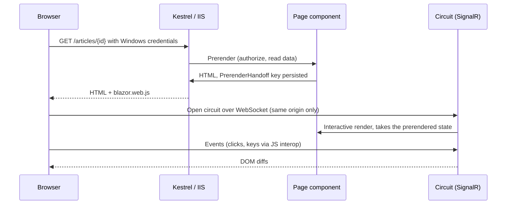
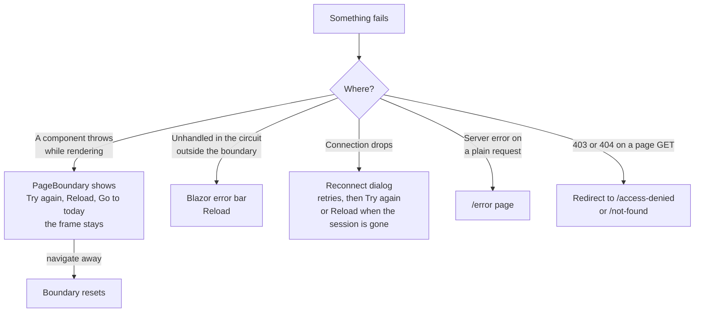

# Frontend architecture

How TIDE's user interface is built: the Blazor Server rendering model, the layouts and navigation, every route, the
shared components, the design tokens, the scripts and the Content Security Policy they live under, keyboard
shortcuts, accessibility, the phone layout, Markdown rendering, and what happens when something fails. It's for
developers changing a page, and for reviewers checking how the browser side is locked down.

For what each screen does from a user's point of view, see [a tour of the screens](../product/screens.md).

**Contents**

- [Rendering model](#rendering-model)
- [Layout and navigation](#layout-and-navigation)
- [Routes](#routes)
- [Shared components](#shared-components)
- [Working together on screen](#working-together-on-screen)
- [Design tokens](#design-tokens)
- [Scripts and the CSP](#scripts-and-the-csp)
- [Keyboard shortcuts](#keyboard-shortcuts)
- [Accessibility](#accessibility)
- [Phone layout](#phone-layout)
- [Markdown rendering](#markdown-rendering)
- [Errors and reconnecting](#errors-and-reconnecting)
- [Where it lives in code](#where-it-lives-in-code)

## Rendering model

TIDE is a Blazor Web App with **interactive server rendering throughout**
([ADR 0001](../decisions/0001-blazor-server-on-prem.md)). There is no WebAssembly, no SPA build and no client-side
state beyond what's on screen.

- **One render mode, set at the root.** `src/Tide.Web/Components/App.razor` renders `<Routes @rendermode="InteractiveServer" />`
  and `<HeadOutlet @rendermode="InteractiveServer" />`. No page sets its own render mode, so every page is interactive.
- **Prerender, then the circuit.** Each page is prerendered on the server (the default for `InteractiveServer`), sent
  as HTML, and then made interactive over a SignalR circuit. `PrerenderHandoff` (`src/Tide.Web/Services/PrerenderHandoff.cs`)
  hands what a page read during the prerender to the same page's interactive render, for the same user only, so a
  reload doesn't flash a loading state over the prerendered page. A key that's gone just means the page reads again.
- **The host.** `Program.cs` registers `AddRazorComponents().AddInteractiveServerComponents(...)` and maps
  `MapRazorComponents<App>().AddInteractiveServerRenderMode(...)`. Two settings matter:
  - `DisconnectedCircuitRetentionPeriod` is **20 minutes** (the default is 3), so a laptop that slept comes back to an
    article being edited, unsaved changes and all.
  - `MaximumReceiveMessageSize` is **256 KB** (SignalR's default is 32 KB), so a long article field read back from the
    Markdown editor doesn't drop the circuit. Screenshots stream through `InputFile` and don't count.
  - `ContentSecurityFrameAncestorsPolicy = null`, because `SecurityHeadersMiddleware` sets the one CSP.
- **Short-lived database contexts.** A circuit shares one DI scope, so services open a context per operation through
  `IAppDbContextFactory`. See [backend](backend.md).
- **The base address.** `App.razor` writes `<base href>` from the request's path base, so TIDE works at the root of
  its own host name or under a path such as `/tide`. Links, scripts and the circuit are all relative to it.
- **Only this site's pages get a circuit.** `CircuitOriginMiddleware` refuses a circuit to a page on another origin
  (the browser sends Windows credentials with any site's request). See [security](security.md).
- **Routing and focus.** `Routes.razor` uses `AuthorizeRouteView` with `MainLayout` as the default layout,
  `AccessDenied` for `NotAuthorized`, `NotFoundPage` as the not-found page, and `FocusOnNavigate` with selector `h1`,
  so focus lands on each page's heading after navigation.
- **A text box that updates as you type binds with `@bind:get`/`@bind:set` and `@bind:event="oninput"`, never
  `value="@x"` with `@oninput`.** Only `@bind` tells Blazor to copy the browser's value into its own copy of the box as
  each keystroke arrives. Without it, Blazor's copy is the last value it drew, so a later render sends the server's
  text, older than what's typed by then under any latency, over the newest keystrokes. Bound, a render carrying the
  typed text sends nothing, and a clear or a value set from outside still reaches the box.
- **Every multi-line text box (`<textarea>`) carries `tide-autogrow`**, so it grows with its text, up to `min(60vh, 32rem)` (30vh in present mode's notes panel), then scrolls. `tide-grow-2` / `tide-grow-3` keep its starting height at two or three rows; boxes with their own starting height (`tide-query`, `tide-email-body`, `tide-etpl-body`) keep it. The browser sizes them where it supports CSS `field-sizing: content`; `autogrow.js` does elsewhere.
- **A form with one main action marks its container `data-submit-scope` and the button `data-submit`**, so Ctrl+Enter
  (`⌘ Enter`) in one of its text boxes presses it (`submitkeys.js`, EP-90): `<div data-submit-scope>`, then
  `<button … data-submit @onclick="Save">`. One `data-submit` to a scope, and scopes don't nest. A dialog with one
  `btn-primary` button (a `ConfirmDialog` with `Form`) and a real `<form>` need nothing. A box with no single action
  (a filter, the article editor) gets no scope, and the keys do nothing there. A single-line box takes part only inside
  a scope. `SubmitKeysTests` checks every scope has its one button.
- **Every script is an external file**, versioned with `?v=` in `App.razor` because browsers cache by URL. Bump the
  version when a file changes.



## Layout and navigation

Three layouts, in `src/Tide.Web/Components/Layout`:

| Layout | Used by | What it draws |
|---|---|---|
| `MainLayout` | Every page by default | A skip link to `#main-content`; the sidebar (`NavMenu`); the top bar with the team name, `TopSearch` (team edition only), `CommandPalette`, `ShortcutsOverlay` and `ProfileMenu`; the live meeting banner (`LiveMeetingJoin`); the page inside `PageBoundary`; `ToastHost`; Blazor's `#blazor-error-ui`. |
| `AdminLayout` | Every page under `/admin` (`@layout AdminLayout`) | Nested in `MainLayout`. An "Administration" title (drawn as large as an `h1` but not a heading, so the page's own title is the `h1`), the groups as page-level tabs, a group's pages as sub-tabs (`TabBar`), then the page. "new" shows beside Updates when the update check found a release. |
| `BlankLayout` | Present mode (`/present/{day}`) | No sidebar or top bar. `PageBoundary` (contained), `ToastHost`, and the `CommandPalette` and `ShortcutsOverlay` with keys only, no buttons. |

**The sidebar.** `NavMenu` draws `NavPages.GroupsFor(user)`: every page the person may open, under small group labels
(Daily, Intelligence, Team, Company-wide, Administration), the daily ones first. `NavPages.All()` is the single list
of sidebar pages, with each page's icon, address, group, the permissions it needs (all of them) and extra keywords;
the command palette reads the same list, so the two never disagree. A group with no page for the person isn't drawn.
The sidebar's visibility rule is only a hint: each page's own `[Authorize]` policy decides.

- **Counts.** Triage shows the number of new items (`IntakeService.NewCountAsync`, for `WriteArticles`) and Actions the
  person's overdue actions (`ActionService.MyOverdueCountAsync`, for `WorkActions`, in red). They're read when the
  menu starts and on each navigation, never on a re-render. A failed read keeps the last value and logs once per run
  of failures, because the menu sits outside the page's error boundary. The count is in each link's accessible name
  ("Triage, 4 new").
- **Collapse.** The button at the top collapses the sidebar to icons. `theme.js` (`tideNav.toggle`) sets
  `data-nav="collapsed"` on `<html>` and remembers it in `localStorage`; `theme-init.js` applies it before paint.
- **Phone menu.** See [phone layout](#phone-layout).

**The account menu.** `ProfileMenu` (the initials avatar, top right) shows who you are and your roles, the theme and
letter-shortcut switches as segmented toggles (through `tideTheme` and `tideShortcuts`), My notifications, your brief
days as a calendar file (`/rotation/my.ics`), and About. These settings are per browser except My notifications, which
is stored per user.

**The Administration frame.** `AdminLayout.Groups` lists every admin page with its group, icon, address and a one-line
description; the Overview page (`/admin`) reads the same list for its index. The current group is the one holding the
current address. The page list is in [screens: administration](../product/screens.md#administration).

## Routes

Every `@page` in `src/Tide.Web/Components/Pages`. "Policy" is the page's `[Authorize(Policy = ...)]`; each policy
requires the permission of the same name (`Policies.Required`). "Sidebar" says when the page differs in what the
sidebar requires. The services check permissions again, so a page that forgets can't write
([ADR 0002](../decisions/0002-permissions-as-code.md)).

### Daily work

| Route | Component | Policy | Purpose |
|---|---|---|---|
| `/` | `Home` | `ReadPublished` | Today: renders `BriefPage` for the current brief day with `AsToday`. Someone without `ReadTeamEdition` is sent to `/published`. |
| `/briefs/{Day}` | `BriefPage` | `ReadTeamEdition` | A day's brief: step strip, running order, numbers, edition check, meeting record, send log. Today's address redirects to `/`. `?tab=preview` shows both editions; `?tab=team` and `?tab=company` pick one; `?tab=distribute` opens the Send dialog. |
| `/briefs` | `BriefsArchive` | `ReadTeamEdition` | Brief archive: every day's brief and its status. `?q=` filters, `?page=` pages. |
| `/triage` | `Triage` | `WriteArticles` | The triage inbox, keyboard-driven, 50 items a page. Keeps its place in the address: `tab`, `source`, `q`, `since`, `cve` (`any` or `kev`), `named`, `older`, `page`, `at`. Sidebar also needs `ReadTeamEdition`. |
| `/articles` | `Articles` | `ReadTeamEdition` | The article list and New article. Filters in the address: `q`, `status`, `from`, `to`, `assess`, `tag`, `category`, `tactic`, `technique`, `withsubs`, `page`; `new` opens the form. |
| `/articles/{Id:guid}` | `ArticleEdit` | `ReadTeamEdition` | The article editor (`ArticleEditorPanel`) and its reader preview (`ReaderPreview`). Read-only for someone without `WriteArticles`. `?edition=company` opens the preview on the company-wide edition. |
| `/articles/{Id:guid}/review` | `ReviewPage` | `WriteArticles` | Reviewing an article: the editions, comments on parts, the checklist, Approve or Ask for changes. |
| `/actions` | `ActionsBoard` | `ReadActions` | The Actions board or list (the list 50 a page). `?layout=board|list` (the person's saved choice otherwise). Filters in the address: `view`, `q`, `team` (with "4 of 5 active" for a team with a limit), `kind`, `priority` (one or more, comma-separated: `priority=p1,p2`, the P1–P2 pill), `due` (`overdue`, `week`, `none`), `status` (Tracking among the open ones), `parent` (`parent=12`: the parts of A-12, "Part of A-12"), `assignee`, `rule`, `group`, `page`. |
| `/actions/new` | `ActionPage` | `ReadActions` | Raising a new action. Without `WriteArticles` the page says "Only analysts create actions." `?article=` and `?parent=` pre-fill it; no team is chosen until the person chooses one. |
| `/actions/{Number:int}` | `ActionPage` | `ReadActions` | One action, in two columns (layout D): the header (badges, the status badge that opens the status row, who has it, one primary button by `ActionGuide.Primary` and *More*, a `MenuButton`), the Next line (`ActionNextStrip`, `ActionGuide.Next`), details, lineage and *What's happened* (comments and history in one feed, `ActionFeed`, with the comment box at its foot); beside them the facts, the tool drawer (`ActionToolDrawer`: checklist, timeline, hunt queries, outreach), the article, an external team's contact and files. `?tool=checklist`, `timeline`, `hunt` or `outreach` opens that tool (`ActionGuide.Opening`; one it hasn't got falls back to the kind's own), and choosing a tab writes it there; `?do=update` opens Record an update once the page is live and takes itself off the address. Also the Hand off dialog, the Split to teams dialog (`SplitDialog`), the Record an update dialog (`RecordUpdateDialog`), a split action's lineage (`ActionLineageFlow`, on the parent and each part; on the parent it is the Parts card, with its rollup, the board link and the split buttons) and the parent's remediation timeline (`RemediationTimelineCard`, the drawer's Timeline tab), and an external team's contact. |
| `/search` | `Search` | `ReadTeamEdition` | Search and indicator or CVE lookup. `?q=`. |
| `/present/{Day}` | `Present` | `JoinMeetings` | Present mode (`BlankLayout`). Starting, running and ending a meeting need `PresentBriefs`; a Visitor sees it only from a seat in the live meeting. |

### Intelligence and team

| Route | Component | Policy | Purpose |
|---|---|---|---|
| `/stories`, `/stories/{Id:guid}` | `Stories` | `ReadTeamEdition` | Threat stories and one story's timeline. |
| `/stack`, `/stack/{Id:guid}` | `StackPage` | `ReadTeamEdition` | Our stack: products we run, and one product's history. |
| `/adversaries`, `/adversaries/{Id:guid}` | `AdversariesPage` | `ReadTeamEdition` | Adversary profiles and one profile's timeline and techniques. |
| `/coverage` | `CoveragePage` | `WriteArticles` | Detection coverage: briefed techniques against the SOC's rules. |
| `/trends` | `Trends` | `ReadTeamEdition` | Threat trends and the board scorecard. State in the address: `p`, `view`, `line`, `at`, `subs`. |
| `/reports` | `Reports` | `ReadTeamEdition` | The weekly, monthly or quarterly report. `?p=` (`2026-10`, `2026-Q4`, `2026-W44`). Sidebar also needs `WriteArticles`. |
| `/reports/teams` | `TeamCommitments` | `ReadActions` | The team commitments scorecard: each team against its due dates. `?days=` (30, 90, 180, 365; 90 by default), `?parts=true`, `?external=true`. Not in the sidebar; linked from Reports and Workload. |
| `/metrics` | `MetricsHistory` | `ReadTeamEdition` | Metric history: chart and table. Sidebar also needs `WriteArticles` (listed for those who make the brief). |
| `/rotation` | `RotationPage` | `ReadTeamEdition` | The brief rotation calendar, swaps and cover. Sidebar also needs `WriteArticles`. |
| `/workload` | `Workload` | `ReadActions` | Each team's open, late and held actions. |
| `/hunts/saved` | `SavedQueriesPage` | `ReadActions` | The team's saved hunt queries, 20 a page (`?page=`). |
| `/outreach/templates` | `OutreachTemplatesPage` | `ReadActions` | The team's outreach email templates, 20 a page (`?page=`). |
| `/playbooks` | `PlaybooksPage` | `ReadActions` | The team's playbooks, 20 a page (`?page=`). `/admin/playbooks` (`PlaybooksMoved`) redirects here. |
| `/board-rules` | `BoardRulesPage` | `ReadActions` | The card rules, read-only. Linked from the Actions page. |
| `/teams/external` | `ExternalTeams` | `ReadActions` | The teams that work outside TIDE: their contact, reminder cadence and escalation contact. Kept by `WorkActions`; an administrator also sets their limits. |
| `/notifications` | `MyNotifications` | `ReadActions` | The person's own email choices (from the account menu). |
| `/published`, `/published/{Day}` | `Published` | `ReadPublished` | The Reader archive of sent company-wide editions. `?q=`. |
| `/briefs/{Day}/sharepoint` | `SharePointPage` | `ReadTeamEdition` | The company-wide edition as clean HTML to copy, and its images as a zip. |

### Administration

All use `AdminLayout` and the `Administer` policy.

| Route | Component | Purpose |
|---|---|---|
| `/admin` | `AdminOverview` | Getting-started checklist from the live configuration, and an index of every setting page. |
| `/admin/organization` | `OrganizationAdmin` | Team name, time zone, meeting time, holidays. |
| `/admin/teams` | `TeamsAdmin` | Teams, members, escalation contacts, SLA targets, reminders, the escalation ladder (`EscalationForm` in `EscalationForm.cs`: switch, scope, steps added, removed and reordered), file zip rule, opt-out counts. |
| `/admin/rotation` | `RotationAdmin` | Roster, weekly rota, manager addresses. |
| `/admin/card-rules` | `CardRulesAdmin` | Card colours and labels, and the rules offered as filters. |
| `/admin/sources` | `SourcesAdmin` | Sources, intake switches, sponsored filter, grouping words, CVE enrichment. |
| `/admin/source-health` | `SourceHealthAdmin` | Each source's yield, with feeds worth pausing. |
| `/admin/scorecard` | `ScorecardAdmin` | Scorecard categories and tags. |
| `/admin/detections` | `DetectionsAdmin` | Detection rule imports for Coverage. |
| `/admin/queries` | `QueryTemplatesAdmin` | Hunt query templates per dialect and indicator kind. |
| `/admin/metrics` | `MetricsAdmin` | Metric groups, definitions, thresholds and charts. |
| `/admin/metric-imports` | `MetricImportsAdmin` | CSV uploads, the drop folder, import history. |
| `/admin/access` | `AccessAdmin` | AD group-to-role mappings, edition ceilings, recipient lists, review and SharePoint rules. |
| `/admin/email-templates` | `EmailTemplatesAdmin` | Notification email wording, preview and test send. |
| `/admin/api` | `ApiAdmin` | API tokens and webhooks. |
| `/admin/system` | `DiagnosticsAdmin` | Health checks and the detail behind them. |
| `/admin/system/server` | `ServerConfigAdmin` | Server configuration, read-only, secrets masked. |
| `/admin/system/sources` | `SettingSourcesAdmin` | Where each setting's value comes from. |
| `/admin/system/bundle` | `ConfigBundleAdmin` | The install answers file and the app's configuration bundle. |
| `/admin/system/audit` | `AuditLogAdmin` | The whole audit log, filtered by the address. |
| `/admin/system/updates` | `UpdatesAdmin` | Newer releases and how to upgrade. |

### System pages

| Route | Component | Policy | Purpose |
|---|---|---|---|
| `/access-denied` | `SystemPages` | anonymous | Friendly 403: who you are, your roles, where roles come from, and the page refused (`?from=`). |
| `/not-found` | `NotFoundPage` | anonymous | Friendly 404. Also the router's `NotFoundPage`. |
| `/error` | `ErrorPage` | anonymous | The exception handler's page outside Development. |

The non-page endpoints (`/files/...`, `/exports/...`, the email previews, CSV exports, `/rotation/my.ics`, the API
under `/api/v1`) are mapped in `Program.cs` and `MapTideApi`; see [backend](backend.md) and [API.md](../API.md).

## Shared components

In `src/Tide.Web/Components/Shared`. Use these rather than drawing a new version of the same thing.

| Component | What it's for |
|---|---|
| `ConfirmDialog` | "Are you sure?" before anything that can't be taken back. A modal that says what will happen, with Cancel and a button named for the action ("Delete draft"), not the browser's OK box. Optional body content and a way to hold the button until a required field is filled. Focus moves in, Tab stays inside (`dialog.js`), Escape or a click outside cancels, and focus returns to the button that asked. Usage: `if (!await _confirm.Ask("Delete draft?", "…", "Delete draft")) return;` |
| `LeaveDialog` | Leaving a page with unsaved changes: Save and leave, Discard and leave, or Stay. Used from a `NavigationLock`'s `OnBeforeInternalNavigation` (the article editor). Focus starts on Stay. Leaving the site altogether (closing the tab, reloading) still gets the browser's own prompt, through `ConfirmExternalNavigation`. |
| `SegmentedButtons<T>` | A row of buttons of which one is chosen (`btn-group`, the chosen one `btn-primary` and `aria-pressed`): Reports' and Trends' period kinds, Trends' range, the Team commitments window. `Items`, `Selected`, `Text` and `OnPick`; the page puts the choice in its address. |
| `Breadcrumbs` | "You are here" and the way back on a detail page ("Actions › A-12"). On a phone only the way back stays ("‹ Actions"). |
| `TabBar` | Page-level (underlined) or sub-level (segmented) tabs. It's one of three things by what its items do: links to other pages (a `<nav>`, `aria-current="page"`); tabs that switch one panel in place (a `tablist`, arrow keys through `tabs.js`); or toggle buttons that choose what a list shows (`aria-pressed`). Items can carry a count. |
| `EmptyState` | Nothing to show: an icon, what's not here, why or what to do next, and the way forward. Says which kind of empty it is ("nothing matches these filters" against "nothing yet"). `Compact` for a panel inside a card. |
| `LoadingBlock` | The one loading state: a `role="status"` line for screen readers and placeholder rows that shimmer unless reduced motion is asked for. |
| `DataTable` | The one list table: a filter that narrows as you type, a count ("Showing 8 of 12 articles"), sortable headings (real buttons with `aria-sort`), optional group headings, an empty state that names the filter, and numbered pages (`Pager`) rather than a silent cut-off. `PageInAddress` keeps `?page=`; `ServerSide` reads one page at a time. Logic in `TableView`. |
| `FilterBar` | Every filtered list's one filter bar (EP-87): the page's search box (`Search`), quick **pills**, a **chip** per filter in force (choose it to change it; its ✕ has `aria-label="Remove filter Team: Network Engineering"`), **+ Filter** (a menu of the filters with `InMenu`: `Single`, `Multi` with Apply, or `Text`, with options, groups, suggestions and a hint), the count (`role="status"`, so a change is announced) and **Clear**. Each `FilterDef` carries what it's set to (`Values`) and how to set it (`Apply`); the bar applies a choice and then calls the page's one refilter step (`OnChanged`: back to page 1, read again, the address). A `FilterPill` is a preset of a filter (`FilterKey` and its `Values`): it's on while that filter holds exactly those values (`aria-pressed`, the `tide-chip-pick` selected tint), pressing it sets them or clears the filter, so pills of one filter take turns, and while it's on that filter's chip isn't shown. The page keeps its own state and address; a page whose filters are links (Articles, the audit log) passes its own `Chips` with `RemoveHref` and a `ClearHref`, and its filters' `Apply` goes to the new address. Several values go in one parameter, comma-separated (`FilterValues.Split`, `Join`); enum options come from `FilterOption.ForEnum`. The menu is a `tide-popover`, as the account menu is. From the keyboard: Enter, Space or the down arrow on + Filter opens it with focus on its first choice, the arrows and Home/End move (`filters.js`), Esc closes it and focus returns to + Filter, Tab leaves it closed. On a phone the pills scroll sideways and the menu rises from the bottom. Used by Actions, Triage, Articles, the audit log, Saved queries, Outreach templates and Metric history. Model in `FilterBarModel.cs`. |
| `Pager` | Previous, numbered pages (with … gaps) and Next, `aria-current` on the current page. Given `Href`, the pages are links to their own addresses (`?page=`), so a reload, Back, a copied link or a middle-click keeps the page; without it they're buttons that call `OnPage`. Used by `DataTable` (with `Href` when `PageInAddress`), Triage, Saved queries and Outreach templates. `pager.js` brings the list's top back into view. |
| `LibraryPage<TRow>` | The base of the team library pages (Saved queries, Outreach templates, Playbooks; `@inherits LibraryPage<…>`): the rows read with or without the retired ones, the words typed, 20 cards a page with the page in the address, Clear, Show retired, a colleague's change re-read in place (its `ChangeFeed` topic), one step at a time, Retire and Restore with their toasts, "Used on …" and "Saved by …, changed by …". A page supplies how it reads its rows, the filter that leaves some, what it calls them, and its own form and cards. |
| `CardRuleCells` | A card rule's label in its colour (marked when off) and what it matches in words, as two table cells: Board rules and Administration › Card rules. |
| `SearchCombobox` | The search picker for adversaries, We run, stories and scorecard tags: an ARIA combobox over a listbox with `aria-activedescendant`. Focus stays in the box; arrows, Home, End, Enter and Esc work; an optional last option makes a new entry from the words typed. `combo.js` keeps the highlighted option in view. |
| `PresenceNote` | Who else has this brief, article, action or triage item open: initials in each person's own hue, "viewing", or "editing" with a pencil (so it isn't told by colour alone). With `Join` off it only watches, for a list row. |
| `ChangedElsewhere` | Someone else saved what this page is editing. The unsaved changes stay on screen; Reload shows the other version. Announced through a status region. |
| `ToastHost` | Toasts from `ToastService` (one queue per circuit). Confirmations are polite (`role="status"`); errors interrupt (`role="alert"`). A toast can carry Undo. |
| `Lightbox`, `ScreenshotDialog` | A screenshot full size: a modal with Download and Close, Previous and Next (and the arrow keys) through several. Focus returns to the thumbnail that opened it. |
| `TlpSelect` | A TLP picker that leaves out levels below a floor (the article's own marking), since a part never counts lower. |
| `LevelMark` | A metric past a threshold, said with an icon and words for screen readers, not colour alone. |
| `MarkdownToolbar` | Bold, italic, lists, indent, outdent and link over a Markdown box (`markdown-toolbar.js`). |
| `StepStrip` | Today's five steps (Triage · Write · Order · Present · Send), the current one `aria-current="step"`. |
| `BriefStepper` | On an article that's on today's brief: "4 of 5 ‹ Previous Next › Back to Today". |
| `LiveMeetingJoin` | The live-meeting banner on every page, or a Join button in place of the brief's Present button. |
| `ProfileMenu` | The account menu. |
| `TimeBox` | A time input bound to a `TimeOnly` that can actually be typed into in Chromium browsers. |
| `HistoryPanel` | Who changed what and when on an article or a brief, from the audit log (`HistoryService`). |
| `EscalationContactFields` | A team's escalation contact, name and email, on Teams & SLA and External teams. |
| `Badge`, `TlpBadge`, `StatusBadge` | Badges, the TLP 2.0 label (black ground, as FIRST specifies), and status chips (`Badges.cs`). |
| `EscalatedBadge` | "Escalated", filled red, given when it was escalated while it still is (`ActionItem.EscalatedSince`, `ActionRow.EscalatedSince`); nothing otherwise. On the list row (`ActionTable`), the board card (`ActionKanban`), the action's page, the meeting's open-actions slide and the edition's list (`Badges.cs`). |
| `EditionView`, `EditionArticleView`, `ReaderPreview` | A brief or an article as one edition carries it, built from the same cut as the email, so the preview is what readers get. |
| `FilePicker` | Files waiting to be added to an action: picked, dropped or pasted (`paste-drop.js`). |
| `AccessDenied` | The no-access card, drawn for `NotAuthorized` and on `/access-denied`. |
| `ActionLineageFlow` | A split action's lineage (EP-88): article → parent → parts, left to right, each a link, each part tinted by its state (`LineageNode.State`, worked out once by `LineageRules.StateOf` when the lineage is read) in the SLA badge's tones (`LineageTones.Of` → `BadgeTone`; the node takes `Badge.ToneClass` for its colours and shows the state on a `Badge`), with a legend of the same badges. Its `ChildContent` goes under the legend: the parent page's controls for its parts. HTML and CSS, no chart library. The picture is a nested list (`ol.tide-lin-flow` › `ul.tide-lin-parts`) with short visually hidden lead-ins ("Raised from the article:", "Split into 3 parts:"), so a screen reader hears the same steps in order and each state in words; the arrows are CSS borders, not text. On a part's page that part is `aria-current="page"` and says "(this action)". Stacks under 640px. |
| `RemediationTimelineCard` | A parent's parts on one date scale (`RemediationTimeline.Build`): a bar per part from creation to due date, the run past due hatched in the danger colour, a mark on the close day, today's dashed line, drawn by each bar's track (`.tide-remtl-track::after`, at `--at` set on the grid) so it never crosses the words (the card's `data-today-at` is its position, in percent) and the scale's dates. Bars are `aria-hidden`; each row writes its dates under its bar ("Started Nov 2 · due Nov 20 · 3 days late"). Bars take the part's tone; Tracking bars are striped. Not drawn when no part has a due date. Positions go into inline `style` (allowed by `style-src`), written with the invariant culture. |
| `MenuButton` | A button that opens a short menu of commands (`role="menu"`, each a `menuitem` that runs something or is a link) in the `tide-popover` the filter bar uses. From the keyboard as + Filter is (`filters.js`): the down arrow opens it, focus goes to the first item, the arrows and Home/End move, Tab leaves it closed, Esc closes it with focus back on the button. The action page's *More*. |
| `ActionStatusControl` | An action's status as a row of toggle buttons, a click moving it there; closing asks for the outcome in place (`ActionCloseFields`), a parent with open parts asks first, and a team over its limit goes through `OverLimitDialog`. With `AsBadge` (the action page's header) it's drawn as its status badge, a button (`aria-expanded`) that shows the row and prompt under the badges; a one-click move, Esc or Cancel folds them away and focus returns to the badge. |
| `ActionToolDrawer` | The action page's tools in one card of tabs (`TabBar` with a panel): `ActionChecklist`, `RemediationTimelineCard`, `HuntPanel` and `OutreachPanel`, each where `ActionGuide.Tools` says it belongs. Every panel stays drawn (the others `hidden`), so a half-written query or email survives a look at another tab; the panels' own card and heading fold into it by CSS (`.tide-drawer`). Opens on `ActionGuide.Opening`; `Select` shows a tool (the page's primary button uses it for Write the email and Record the reply). |
| `ActionNextStrip` | The action page's Next line: `ActionGuide.Next`'s words and links, a late part's as links to the part, the rest calling back into the page. |
| `RecordUpdateDialog` | Record an update on an action: the team's pasted reply, the status (closing shows `ActionCloseFields`), a new due date and why, and a note, saved by `ActionService.RecordUpdateAsync`. A team over its limit goes through `OverLimitDialog`; closing a parent with open parts asks first (`ActionPrompts.ConfirmCloseParent`); a refusal stays in the dialog. Its text boxes bind with `@bind:get`/`@bind:set` and `@bind:event="oninput"`. |

Two helpers keep interop from ending a circuit: `Focus` (moving focus where that can't happen isn't an error) and
`JsTeardown` (telling a script a component has gone, where a disposal that throws would end the whole circuit).

## Working together on screen

Pages update live when a colleague saves. The mechanics (`ChangeFeed`, `ChangeInterceptor`, `Presence`) are in
[collaboration](collaboration.md). On the page side:

- `LiveChanges` (`src/Tide.Web/Services/Together.cs`) listens for a page's topics, skips its own circuit's saves, and
  waits for a burst to settle before one reload. A page with nothing unsaved re-reads in place and names the
  colleague in a toast; one with unsaved edits shows `ChangedElsewhere`.
- `LiveDiff` and `LiveMarks<TKey>` (`src/Tide.Web/Services/LiveRows.cs`) work out which rows arrived, left or
  changed, and mark them with `tide-live-arrived` (slides in, fading highlight, "New" until selected),
  `tide-live-changed` (highlight) and `tide-live-ghost` (a line saying what happened, which fades and folds). Under
  reduced motion the highlight only fades.
- `PresenceNote` joins a place while it's shown; `PresenceCircuit` clears a tab that closed without saying so.

## Design tokens

Every colour, space, radius and type size comes from a `--tide-*` custom property in `src/Tide.Web/wwwroot/app.css`.
Bootstrap 5.3.3 (self-hosted under `wwwroot/bootstrap`) supplies the components, and the tokens retint them (for
example `.btn-primary` maps Bootstrap's `--bs-btn-*` variables to `--tide-action-*`). `palette.css` styles the command
palette and the shortcuts overlay with the same tokens only.

**Light and dark.** `:root` defines the light theme; `[data-bs-theme="dark"]` overrides the colour tokens. Bootstrap
5.3 reads the same attribute. Nothing is light-only: a colour that isn't a token is a bug.

| Token family | Examples | Notes |
|---|---|---|
| Type | `--tide-font-ui` (Segoe UI Variable), `--tide-font-data` (Cascadia Mono), `--tide-text-xs` … `--tide-text-xl`, `--tide-weight-*` | Data (indicators, hashes, ids) uses the mono font through `.tide-data`. |
| Space and shape | `--tide-space-1` … `--tide-space-8` (4px steps), `--tide-radius-xs` … `--tide-radius-xl`, `--tide-radius-pill` | Radii run from TLP labels (xs) to cards and dialogs (xl). |
| Widths | `--tide-width-xs` … `--tide-width-form` | For fields and panels that shouldn't stretch the whole row. |
| Surfaces and text | `--tide-bg`, `--tide-surface`, `--tide-surface-2`, `--tide-border`, `--tide-text`, `--tide-text-muted` | Redefined for dark. |
| Accent and action | `--tide-accent` (teal: where you are, links, focus), `--tide-action-bg` (navy primary button), `--tide-focus-ring` | The focus ring is 4.9:1 on the light surface, 7.8:1 on the dark one. |
| Meaning | `--tide-threat`, `--tide-info`, `--tide-ok`, `--tide-warn`, `--tide-purple`, each with a `-soft` fill | Redefined for dark. |
| TLP | `--tide-tlp-bg` (black), `--tide-tlp-clear`, `--tide-tlp-green`, `--tide-tlp-amber`, `--tide-tlp-red` | TLP 2.0 colours on black, the same in both themes. |
| Sidebar | `--tide-side-*` | The sidebar is dark in both themes. |
| Slides | `--tide-slide-*`, `--tide-slide-chart-1` … `12` | Present mode is always dark: it's on a shared screen. |
| Charts | `--tide-chart-1` … `--tide-chart-12` | Distinct in hue and lightness, each at least 3:1 on the surface. From the thirteenth line `LineChart` dashes them. |
| Avatars | `--tide-avatar-1` … `8`, `--tide-on-avatar` | Presence initials; white text at 4.5:1 or better, the same in both themes. |
| Overlays | `--tide-overlay`, `--tide-shadow`, `--tide-on-threat` | Dimming behind dialogs, shadows, text on a threat fill. |

**Choosing the theme.** `theme-init.js` runs in `<head>` before first paint: it applies the theme saved in
`localStorage` (`tide-theme`), or the operating system's `prefers-color-scheme` when none is saved, so there's no
flash of the wrong theme. The account menu flips it through `tideTheme`.

Emails don't use the tokens: they're tables and inline styles, coloured from `EmailComposer.Palette`, which mirrors
the light tokens, and are always light.

## Scripts and the CSP

### The Content Security Policy

`SecurityHeadersMiddleware` (`src/Tide.Web/Security/SecurityHeadersMiddleware.cs`) sets the CSP on every response:

```
default-src 'self'; img-src 'self' data:; style-src 'self' 'unsafe-inline'; script-src 'self';
object-src 'none'; connect-src 'self'; frame-ancestors 'none'; base-uri 'self'; form-action 'self'
```

- **`script-src 'self'`.** No inline script, no inline event handlers, no `eval`. Every script is a file under
  `wwwroot/js`, and every handler is attached from it, usually by event delegation on `document`.
- **`style-src 'unsafe-inline'`** is an accepted trade-off: inline `style` attributes (tactic colours, chart
  geometry) and Blazor's injected styles need it. Injected markup can restyle a page but can't run code.
- **`connect-src 'self'`** covers the circuit's same-origin WebSocket.
- **`frame-ancestors 'none'`** with `X-Frame-Options: DENY`. Blazor's own frame-ancestors policy is turned off so
  there's only one.

Some responses set their own, stricter CSP: an email shown in the browser (`EmailPage` in `Program.cs`: no script,
`sandbox`, framable only by TIDE, `no-store`) and a file download (`FileDownloads`: `sandbox; default-src 'none'`).
The other security headers are in [security](security.md).

**Needs verification:** the comment in `SecurityHeadersMiddleware` says `'unsafe-inline'` styles are also for
"docx-preview", but no such library is in `wwwroot`. Confirm whether that reason is stale.

### The script files

All are loaded by `App.razor` at the end of `<body>`, after `_framework/blazor.web.js`, except `theme-init.js`, which
loads in `<head>`. Each exposes at most one `window.tide*` object for .NET to call through `IJSRuntime`.

| File | Global | What it does |
|---|---|---|
| `theme-init.js` | (none) | Before first paint: applies the saved theme (or the OS preference), the collapsed sidebar, and letter shortcuts off, as attributes on `<html>`. |
| `theme.js` | `tideTheme`, `tideNav`, `tideShortcuts`, `tideRoving`, `tidePrefs`, `tideCopy` | `tideRoving`: the arrow keys, Home and End over a menu, tablist or toolbar, shared by `filters.js`, `board.js`, `tabs.js` and `markdown-toolbar.js`. Theme toggle; sidebar collapse and the phone menu (`tideNav.toggle`, `setOpen`, `start`, which keeps `aria-expanded` and the tooltip right); the letter-shortcut switch (WCAG 2.1.4) with the shared `isLetter`, `typing` and `inMenu` checks; small per-browser choices (the hunt panel's last query language); copying text to the clipboard. Also wires the reconnect dialog's Try again and Reload buttons. |
| `palette.js` | `tidePalette` | `Ctrl+K` / `⌘K` opens the command palette and `?` the shortcuts overlay. Keeps what was typed between `Ctrl+K` and the box appearing. Combobox keys go to .NET, which owns the list. |
| `dialog.js` | `tideDialog` | Remembers what had focus when a dialog opened (confirmation, lightbox, ATT&CK picker, palette) and gives it back when it closes. Keeps Tab inside a confirmation or the ATT&CK picker. In the lightbox only its own keys lose their default, so the browser's zoom and find still work. |
| `triage.js` | `tideTriage` | The triage inbox's keys (J, K, S, X, D, P, O, V, R, arrows, Enter, Esc). A roving tabindex: the selected row is the one tab stop and focus moves with the selection. "Promote and write" rewrites the current history entry so Back returns to the same row. |
| `present.js` | `tidePresent` | Present mode's keys and full screen; fits a tall slide by shrinking it (to no less than 80%), then scrolls its body with fades at the edges; shares the presenter's scroll with the room (at most ten times a second). |
| `editor.js` | `tideEditor` | The article editor's section pills (scroll to a heading below the sticky bars, then focus it); `BriefStepper`'s J and K; the reader preview's 1 and 2, kept in the address (`?edition=company`) without a navigation. |
| `markdown-toolbar.js` | (`tideMarkdown.transforms`, for tests) | The Markdown toolbar and its keys: `Ctrl+B`, `Ctrl+I`, Tab and Shift+Tab on a list line, Enter to continue or end a list. Edits go through `execCommand('insertText')` so `Ctrl+Z` undoes them, and fire input events so Blazor's binding sees them. |
| `paste-drop.js` | `tidePasteDrop` | Pasted or dropped images and files are handed to a hidden `InputFile` by setting its `FileList` and firing `change`, so bytes go through the normal upload path with its type check and size cap. A paste goes to the zone holding focus (an action's Files box), otherwise the page's main zone. |
| `clipboard.js` | (none; delegated on `[data-copy-target]`) | Copies the SharePoint view as rich HTML with a plain-text alternative, or a text box's value (an outreach email) as plain text, with a fallback when the clipboard API is refused. |
| `board.js` | `tideBoard` | Drag a card to another column on the Actions board; tells .NET where a held card is so others see who's moving it; the keyboard Move menu and focus after a move; slides in a colleague's move. |
| `brief-order.js` | `tideOrder` | Drag a row in the running order; keeps focus on a moved row's Move up or Move down button. |
| `tabs.js` | (none; delegated) | Arrow keys, Home and End between tabs of a `TabBar` tablist, as the ARIA tabs pattern has it. |
| `chart.js` | (none; delegated on `[data-chart]`) | A `LineChart`'s tooltip at the point nearest the pointer, or the one the arrow keys stepped to. Blazor draws the SVG; this only marks the active point and writes the tooltip. |
| `combo.js` | `tideCombo` | Scrolls a `SearchCombobox`'s highlighted option into view (`block: "nearest"`), smoothly unless reduced motion is asked for. |
| `filters.js` | `tideFilters` | The filter bar's + Filter menu, and every `MenuButton`'s menu, from the keyboard: focuses its first choice when it opens (`focusIn`), and (delegated, one listener for every bar) moves between choices with the arrows and Home/End (`tideRoving`), opens it with the down arrow, and closes it on Tab. |
| `pager.js` | (none; delegated) | After a page change, scrolls the list's top back into view once the new rows arrive. |
| `submitkeys.js` | (none; delegated) | `Ctrl+Enter` / `⌘ Enter` in a text box presses the main button: its `[data-submit-scope]`'s `[data-submit]` button, else a `<form>`'s submit, else an open dialog's one `btn-primary` button; otherwise nothing. Never a disabled button; skips an IME composition and a held key. A box bound on change (`@bind`) is sent a `change` first, as a mouse click's blur would; if that's what held the button back, it's pressed once .NET enables it (within 1.5 s, focus still in the box). |
| `autogrow.js` | (none) | Text boxes (`textarea.tide-autogrow`, every multi-line box) grow with their text, to the CSS cap, where the browser lacks CSS `field-sizing: content`. |

## Keyboard shortcuts

`Shortcuts.For(path)` (`src/Tide.Web/Components/Layout/Shortcuts.cs`) lists the shortcuts for the page you're on, then
those that work everywhere. `ShortcutsOverlay` shows them when `?` is pressed. The list describes the handlers in
`wwwroot/js`, so a change to a handler changes `Shortcuts` too. A key marked "letter" is a single-character shortcut
that the letter-shortcut switch turns off.

| Where | Keys |
|---|---|
| Everywhere | `Ctrl K` or `⌘ K`: Go to a page, article or action. `?` (letter): this list. `Ctrl Enter` or `⌘ Enter`: post or save the text box you're in (where its form or dialog has one main action). `Esc`: close a dialog or menu. |
| The Go to box | `↓` `↑`: next and previous result. `Enter`: open it. `Esc`: close, back where you were. |
| Triage | `↓` `↑`, or `J` `K`: next and previous item; `J` on a page's last row goes on to the next page, and `K` on its first back to the previous page's last row. `S` shortlist, `X` dismiss, `D` mark a duplicate of the similar article, `P` promote, `O` open the source in a new tab, `V` read it here, `R` put back in New (all letters). `Esc`: close the promote form or reading pane. On a group, `Enter` or `→` opens it and `←` closes it. |
| Present mode | `→` or `Enter`: next slide. `←` or `Backspace`: previous. `Space` / `Page Down` and `Shift Space` / `Page Up`: scroll a long slide, then change slide at its end. `Home` `End`: first and last slide. `D` (letter): mark discussed. `F` (letter): full screen. `Esc`: leave full screen, then close a zoomed screenshot. |
| An article | `1` and `2` (letters): preview the Team or Company-wide edition. `J` and `K` (letters): next and previous article on today's brief. `Enter` in the new-indicator box adds it. `Esc` closes the ATT&CK picker. |
| Actions board | `Tab` to a card's Move button, `Enter` to open its columns, `Enter` on one to move it. `Esc` closes the menu. |
| A screenshot full size | `←` `→`: previous and next. `Esc`: close. |
| Charts (Trends, Metrics) | With a chart focused: `←` `↓` previous point, `→` `↑` next, `Home` `End` first and last, `Esc` hide the reading. |
| A Markdown box | `Ctrl B`, `Ctrl I`; on a list line `Tab` and `Shift Tab` indent and outdent, `Enter` starts the next item. |

Letter keys never fire while typing in a field, or while focus is in a menu or dialog (`tideShortcuts.typing`,
`inMenu`). They match in either case, so Caps Lock doesn't stop them.

## Accessibility

| Choice | How |
|---|---|
| **Single-letter shortcuts can be turned off** (WCAG 2.1.4) | The switch in the account menu or the `?` overlay sets `data-shortcuts="off"` on `<html>` (saved per browser). Every letter handler checks `tideShortcuts.on()`. Arrows, Enter and `Ctrl` shortcuts keep working. Turned off, the overlay marks those rows "(off)". |
| **Reduced motion** | Animations and smooth scrolls have a `prefers-reduced-motion: reduce` rule in `app.css` (toasts, skeleton shimmer, presence and live dots, live-row highlights, kanban arrivals, disclosure chevrons, the ATT&CK picker), and the scripts check the same query before scrolling smoothly (`editor.js`, `combo.js`, `board.js`, `present.js`). Under it, live highlights fade without sliding or folding. |
| **Focus return** | Every dialog gives focus back to whatever opened it (`dialog.js`): confirmations, the leave dialog, the lightbox and screenshot dialog, the palette, the shortcuts overlay. After a board move focus goes to the card's Move button in its new column; after a running-order move it stays on the moved row's button; after a comment's edit it returns to that comment's Edit button. |
| **Focus after navigation** | `FocusOnNavigate` puts focus on the page's `h1`. A skip link goes to `#main-content`. |
| **Focus inside dialogs** | Tab stays inside a modal; focus outside an open dialog goes into it, not behind it. |
| **Not by colour alone** | Presence shows a pencil for "editing"; a metric past a threshold has an icon and words (`LevelMark`); action status shows a tick on the current option; a part in the lineage and the timeline says its state in words, and Tracking is dashed or striped as well as purple. |
| **Forced colours** | Under Windows high contrast, badges and TLP chips get an outline, and the current sidebar link a `Highlight` outline. |
| **Live regions** | Toasts are `role="status"` (polite) or `role="alert"` (errors). `LoadingBlock`, `ChangedElsewhere`, `PresenceNote` and triage's change line announce through status regions. |
| **Contrast** | Token values carry their contrast ratio in comments; the focus ring is at least 4.6:1 on every background, chart series at least 3:1. |
| **ARIA patterns** | Combobox with `aria-activedescendant` (`SearchCombobox`, the palette); tabs (`TabBar` + `tabs.js`); a menu button (`MenuButton`, the action page's More: `aria-haspopup`, `aria-expanded`, a `menu` of `menuitem`s with the arrow keys); `aria-sort` on table headings; `aria-current` on the current page, step and pager page; a roving tabindex in triage; counts in the sidebar links' accessible names. |

## Phone layout

At 640px or narrower (`@media (max-width: 640.98px)` in `app.css`):

- The sidebar becomes a bar across the top with the brand and a menu button. The button (`tideNav.setOpen`) opens the
  links under it; it isn't remembered, so it starts closed on every page load, closes when a link is followed, and
  closes on Escape. The desktop collapse-to-icons state doesn't apply.
- The search box in the top bar is hidden; the Go to button shrinks to an icon in its place.
- Wide tables scroll inside their card rather than pushing the page sideways, with a shadow at the edge that has more.
- Breadcrumbs keep only the way back ("‹ Actions").
- The audit log draws each change as a card instead of a row.
- An action's status buttons wrap to a grid of three; its facts run two to a row (in present mode too). Under 992px
  (Bootstrap's lg) the action page's two columns open into one (`display: contents` on each, `tide-ord-N` setting
  the order): header, Next, details, the tool drawer, lineage, what's happened, facts, the article, files.
- A split action's lineage stacks top to bottom, its arrows pointing down; the remediation timeline puts each part's name above its bar.

Wider breakpoints (700px, 900px, 1000px, 1100px, 1200px) fold multi-column layouts (the editor and its preview,
Today's grid, Trends, slide columns) to one column. Printing (`@media print`) drops the sidebar, top bar and buttons,
for Reports and Trends.

## Markdown rendering

Analysts write bullets, "why it matters", recommended actions, the team note and comments in Markdown. Storage stays
Markdown; it's rendered at the edges by `MarkdownService` (`src/Tide.Application/Content/MarkdownService.cs`, Markdig):

- **Raw HTML is off** (`DisableHtml`): typed HTML is shown as text.
- **Link schemes are allowed only if safe**: `http://`, `https://` and `mailto:`. Anything else (`javascript:`,
  `data:`, `vbscript:`, `file:`) becomes an inert anchor, including an angle-bracket autolink.
- **No autolinks.** Bare addresses are never turned into links, because bullets quote malicious URLs and domains.
  Only a link the analyst wrote as `[text](url)` is one.
- **Links open in a new tab** with `rel="noopener noreferrer"`.
- **No inline images.** An image in Markdown is drawn as a placeholder ("Images aren't shown inline. Add it as a
  screenshot.") and its URL is never loaded.
- **One-line fields** (`ToInlineHtml`) parse inline syntax only, so "- x" or "# x" stays literal.
- **Deeply nested input** that Markdig refuses (a few hundred `[` or `> ` in a row) is shown as typed, escaped, rather than failing every render of the brief it's on.

The strict CSP is the second line of defence. Indicators are shown defanged wherever they're displayed; see
[security](security.md).

## Errors and reconnecting



- **The error boundary.** `PageBoundary` (`src/Tide.Web/Components/Layout/PageBoundary.razor`) wraps the page in both
  `MainLayout` and `BlankLayout`. A component that throws shows "Something went wrong on this page" in place, with
  *Try again* (`ErrorBoundary.Recover`), *Reload the page* and *Go to today*, and "Anything you already saved is
  safe." The sidebar and top bar stay. It resets itself on navigation. In present mode it says "The slides hit an
  error" inside a padded container, so the meeting can recover without losing the circuit.
- **Outside the boundary.** Blazor's `#blazor-error-ui` bar ("Something went wrong. Reload the page to continue.")
  shows for an error that ends the circuit. Disposal is the usual cause, which is why `JsTeardown` swallows calls
  that can't happen.
- **Reconnecting.** `App.razor` holds `#components-reconnect-modal` as static markup, so it stays styled while the
  circuit is frozen. The framework toggles its show, failed and rejected states; `theme.js` wires *Try again*
  (`Blazor.reconnect()`) and *Reload the page*. Because a dropped circuit is kept 20 minutes, coming back within that
  picks up where it was.
- **Status codes.** Outside Development, `UseExceptionHandler("/error")` handles server errors. `UseStatusCodePages`
  turns a page GET's 403 into a redirect to `/access-denied?from=…` and a 404 into `/not-found`, and logs every 403
  with who and where. Files, exports, emails, the circuit and health probes keep their real status codes.
- **Refusals inside the circuit** (a service refusing a write) show as an error toast and are logged where they're
  shown.

## Where it lives in code

| What | Where |
|---|---|
| Root document, scripts, reconnect dialog | `src/Tide.Web/Components/App.razor` |
| Router, authorization, focus on navigate | `src/Tide.Web/Components/Routes.razor` |
| Layouts, sidebar, palette, shortcuts, boundary | `src/Tide.Web/Components/Layout/` (`MainLayout`, `AdminLayout`, `BlankLayout`, `NavMenu`, `NavPages`, `CommandPalette`, `PaletteEntries`, `ShortcutsOverlay`, `Shortcuts`, `TopSearch`, `PageBoundary`) |
| Pages | `src/Tide.Web/Components/Pages/`, admin pages under `Pages/Admin/` |
| Shared components | `src/Tide.Web/Components/Shared/` |
| Live updates, presence, toasts, prerender hand-off | `src/Tide.Web/Services/` (`Together.cs`, `LiveRows.cs`, `Services.cs`, `PrerenderHandoff.cs`, `LiveMeetings.cs`, `TriageNews.cs`, `TypingPause.cs`) |
| Tokens and styles | `src/Tide.Web/wwwroot/app.css`, `palette.css` |
| Scripts | `src/Tide.Web/wwwroot/js/` |
| CSP and headers | `src/Tide.Web/Security/SecurityHeadersMiddleware.cs`, `CircuitOriginMiddleware.cs`, `FileDownloads.cs` |
| Circuit settings, status-code pages | `src/Tide.Web/Program.cs` |
| Markdown | `src/Tide.Application/Content/MarkdownService.cs` |
