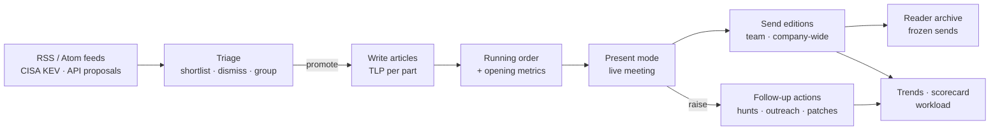
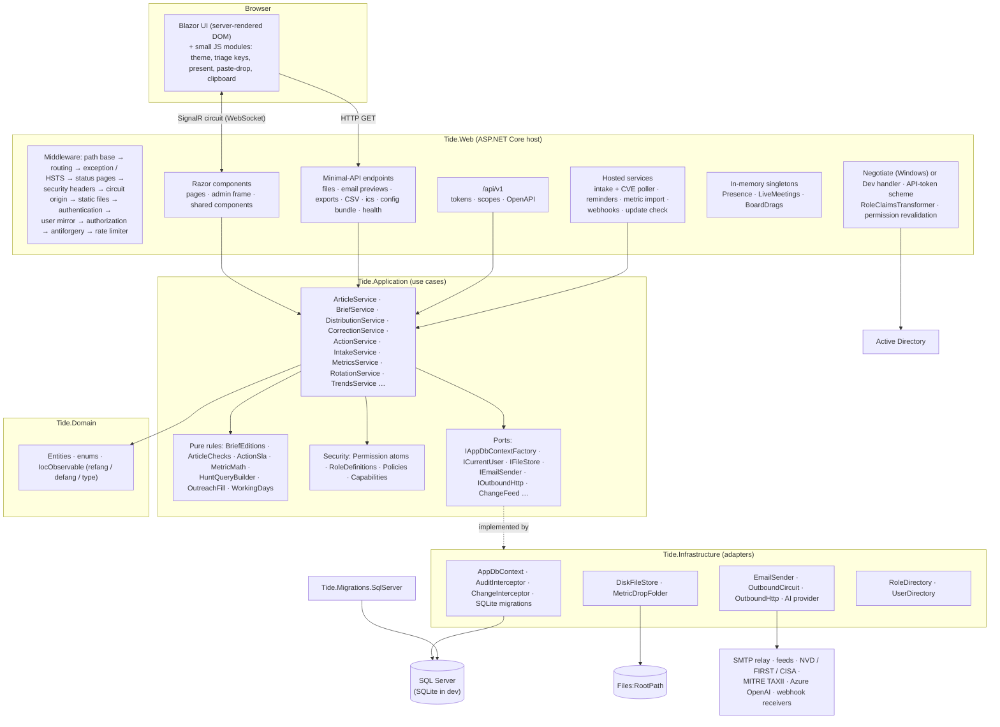
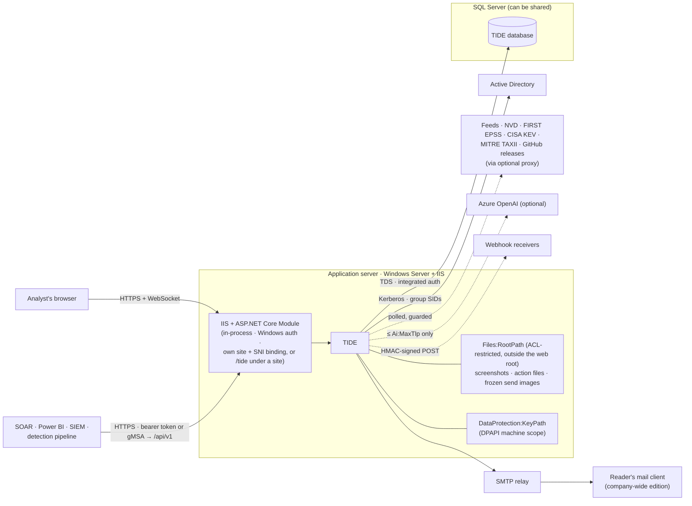
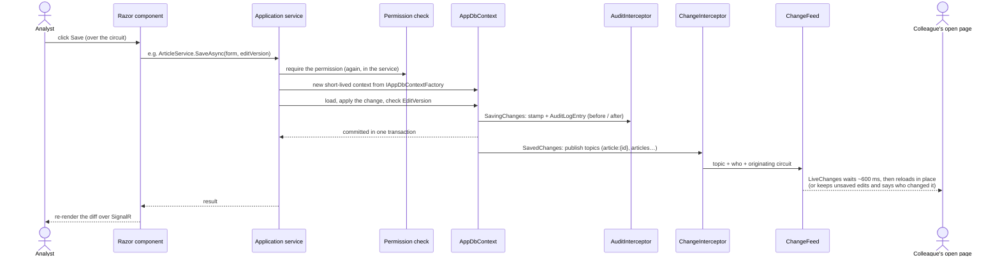
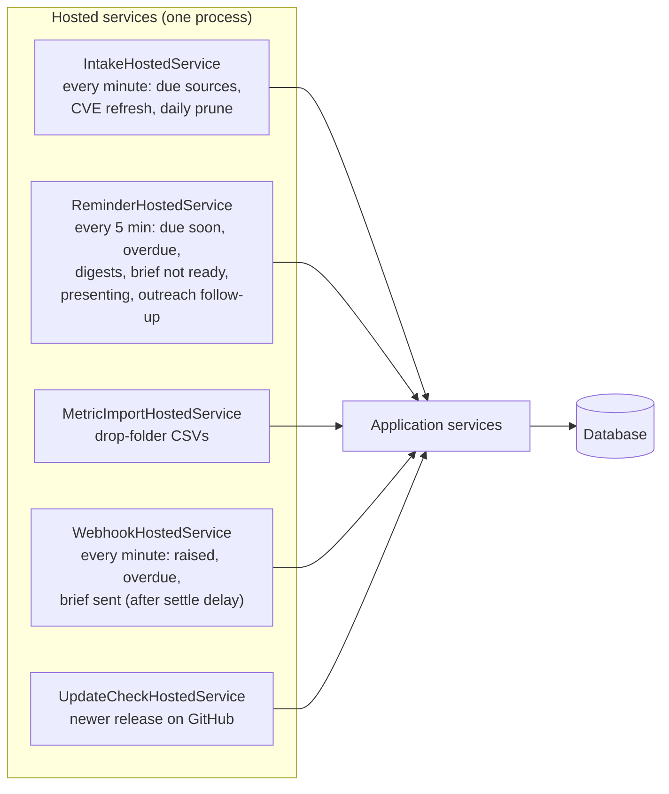

# Architecture overview

How TIDE is put together, at the level you need before you change any part of it. It's written for developers,
operators and security reviewers. Each section links to the page that goes deeper:
[codebase map](codebase-map.md), [data model](data-model.md), [security](security.md),
[editions and TLP](editions-and-tlp.md), [collaboration](collaboration.md), [frontend](frontend.md),
[backend](backend.md) and [the API](../API.md).

- [In one paragraph](#in-one-paragraph)
- [The daily cycle the design serves](#the-daily-cycle-the-design-serves)
- [Components](#components)
- [Runtime topology (production)](#runtime-topology-production)
- [How a request flows](#how-a-request-flows)
- [Cross-cutting design choices](#cross-cutting-design-choices)
- [Where state lives](#where-state-lives)
- [Constraints that shape everything](#constraints-that-shape-everything)

## In one paragraph

TIDE is a single ASP.NET Core (.NET 10) process that renders its UI with **Blazor Server**. The browser holds a
SignalR connection (a *circuit*), and every click runs C# on the server. There is no client-side business logic,
and the only JSON API is the versioned integration API under `/api/v1`. Business rules live in use-case services in
`Tide.Application` and in small pure rule classes beside them (`BriefEditions`, `ActionSla`, `MetricMath`,
`ArticleChecks`…). `Tide.Domain` holds the entities and enums. Data goes through EF Core to **SQL Server** in
production and **SQLite** in development. An EF interceptor stamps every change and writes an audit row in the same
transaction, and a second interceptor tells open pages what changed. Screenshots and files live on disk outside the
web root, with their hashes in the database. People sign in with **Windows Integrated Authentication**: AD groups
map to roles, and roles are fixed bundles of permissions defined in code. Background services poll feeds, enrich
CVEs, import metrics, send reminders, post webhooks and check for updates. **What leaves the app is always cut by
TLP 2.0 in one place, `BriefEditions.Build`.**

## The daily cycle the design serves

Every structural choice below exists to make this loop fast for the analyst presenting today, and safe for what
reaches each audience. The step-by-step of each stage is in [workflows](../workflows/README.md).

## Components

Dependencies point inward: Web → Application and Infrastructure; Infrastructure → Application → Domain. The Domain
project references nothing. Application declares the interfaces it needs, and Infrastructure (or Web, for things
that need the host, such as `ICurrentUser`) implements them. `src/Tide.Web/Program.cs`,
`src/Tide.Application/DependencyInjection.cs` and `src/Tide.Infrastructure/DependencyInjection.cs` wire them up.

| Project | Holds | Depends on |
|---|---|---|
| `Tide.Domain` | Entities, enums, the indicator normalizer (`Observables/IocObservable`) | nothing |
| `Tide.Application` | Use-case services by feature folder, pure rule classes, the permission model, rendering of emails and editions, ports | Domain; EF Core abstractions, Markdig |
| `Tide.Infrastructure` | `AppDbContext`, the interceptors, SQLite migrations, file store, email, outbound HTTP, directories, the AI provider | Application, Domain |
| `Tide.Migrations.SqlServer` | Production migrations, chosen when `Database:Provider=SqlServer` | Infrastructure |
| `Tide.Web` | Host and composition root, Razor UI, authentication, middleware, endpoints, the API, hosted services, in-memory collaboration state | everything above |

For a folder-by-folder guide, see the [codebase map](codebase-map.md).

## Runtime topology (production)

What matters operationally:

- **One instance.** Presence, live meetings, the change feed, the per-source poll guard and the board's drag state
  are all held in process memory ([ADR 0001](../decisions/0001-blazor-server-on-prem.md)). A second, load-balanced
  instance would split them. See [known issues](../reference/known-issues.md) and [collaboration](collaboration.md).
- **Memory per open tab.** Each tab holds a circuit in server memory. A dropped connection's circuit is kept for
  20 minutes (`DisconnectedCircuitRetentionPeriod` in `Program.cs`), so a laptop that wakes up resumes with its
  unsaved edits intact.
- **Shares a server and SQL instance.** TIDE installs as its own IIS site and pool with its own host name, and as
  its own database and login. It's built to sit beside other line-of-business apps ([INSTALL.md](../INSTALL.md)).
- **No passwords in configuration for SQL.** The app pool's identity signs in to SQL with integrated
  authentication. The SMTP and AI secrets go in environment variables or the server's configuration, never in
  the app's database ([configuration](../operations/configuration.md)).
- **Back up the database and `Files:RootPath` together**, or file rows point at missing bytes
  ([backup and recovery](../operations/backup-and-recovery.md)).

## How a request flows

### An interactive change (most of the app)

Every service opens its own short-lived `DbContext` per operation through `IAppDbContextFactory`. A circuit shares
one DI scope across overlapping event handlers, so a long-lived context would be used concurrently and fail. A stale
save (the `EditVersion` concurrency token moved) is refused with `StaleEditException`, which the page shows as
"changed by someone else" with a reload option.

### A download or export (plain HTTP)

Files, email previews, exports and CSVs are minimal-API `MapGet` endpoints in `Program.cs` and
`src/Tide.Web/Api/ExportEndpoints.cs`. They run the normal authentication and authorization pipeline, call the same
services (which check the permission again), and are rate-limited per person (`files`: 300 a minute; exports and
CSVs: 60 a minute). Downloads are sent as attachments with `nosniff`, `no-store` where they hold team content, and a
CSP that allows nothing. See [backend](backend.md#http-endpoints).

### An API call

`/api/v1` uses a policy scheme: a request carrying `Authorization: Bearer …` is signed in by
`ApiTokenAuthenticationHandler`, and anything else falls through to Windows (for a gMSA caller) or the dev handler.
Endpoints call the pages' own services, so the API can do nothing the UI can't, and briefs come cut at the token's
own TLP ceiling. See [API.md](../API.md).

### Background work

Each pass reads its settings through `IOptionsMonitor<T>`, so a change made in Administration applies on the next
pass without a restart. A scan that fails is logged and doesn't stop the others. Reminders and webhooks write a mark
as each email or post goes out (`NotificationMark`), so a pass that stops partway never sends twice. Cadences,
switches and failure handling are in [backend](backend.md#background-jobs).

## Cross-cutting design choices

| Choice | Why | Where |
|---|---|---|
| **One cut for every audience.** `BriefEditions.Build(brief, edition, ceiling, …)` decides what each edition, preview, slide, email, SharePoint copy, API response and webhook carries | One place to get TLP right, pinned by leak tests | [editions and TLP](editions-and-tlp.md), [ADR 0005](../decisions/0005-editions-from-one-model.md) |
| **A send freezes what went.** The email HTML, a semantic web copy and image copies are stored before the relay is asked | Readers see only what was actually published; corrections diff against it | [distribution](../workflows/distribution.md), [ADR 0007](../decisions/0007-frozen-sends-and-cid-email.md) |
| **Permissions are code, roles are bundles, AD grants roles** | No permission editor to misconfigure; reviewable in a diff | [security](security.md), [ADR 0002](../decisions/0002-permissions-as-code.md) |
| **Checked twice.** The page policy and the service both check the permission | A page that forgets can't write | [security](security.md#defense-in-depth-a-permission-check) |
| **Operational settings in the app, infrastructure settings on the server** | Admins tune the team's day without RDP; sign-in, DB, email and network stay with the server owner | [configuration](../operations/configuration.md) |
| **Audit in the same transaction** via `AuditInterceptor` | No change without its before/after row, whatever the save path | [security](security.md#the-audit-trail-and-secrets), [data model](data-model.md) |
| **Generated text, never a sign-in.** Hunt queries are templates. Outreach emails are written for the analyst to send | TIDE holds no SIEM or mailbox credentials | [ADR 0006](../decisions/0006-query-dialects-are-templates.md), [ADR 0019](../decisions/0019-outreach-emails-are-written-never-sent.md) |
| **Intake only when asked**, one item per canonical URL, feed HTML never rendered | Predictable outbound traffic; no stored XSS from feeds | [intake](../workflows/intake-and-triage.md), [ADR 0009](../decisions/0009-intake-reaches-out-only-when-asked.md) |
| **AI is opt-in, capped by TLP, accepted per suggestion** | Nothing above `Ai:MaxTlp` leaves; a person owns every word | [writing articles](../workflows/writing-articles.md), [ADR 0004](../decisions/0004-opt-in-ai-with-tlp-ceiling.md) |
| **Portable `LIKE` search** | Same behavior on SQLite and SQL Server; no full-text index to install | [ADR 0011](../decisions/0011-search-with-portable-like-queries.md) |
| **Two migration assemblies, one model** | SQLite for zero-install development; SQL Server for production | [recipes](../development/recipes.md) |
| **Holidays count as weekends** in every day-counting rule (`WorkingDays`, `OrgClock.Days`) | SLA dates, reminders and carry-over agree | [ADR 0018](../decisions/0018-holidays-are-days-off-like-weekends.md) |

## Where state lives

| State | Lives in | Survives restart? | Notes |
|---|---|---|---|
| Articles, briefs, actions, sends, settings, audit… | SQL Server | Yes | See the [data model](data-model.md) |
| Screenshots, action and comment files, frozen send images | Disk under `Files:RootPath`; metadata and SHA-256 in `StoredFile` | Yes | Back up with the database |
| Data-protection key ring (antiforgery, circuit state, protected secrets such as webhook keys) | `DataProtection:KeyPath`, protected with machine-scope DPAPI | Yes | Lose it, or restore it onto another server, and people sign in again and webhook secrets must be re-entered ([backup and recovery](../operations/backup-and-recovery.md)) |
| Saved operational settings | `Settings` rows, cached in `SavedSettings` | Yes | Reloaded on every save and bundle import |
| Who is viewing or editing what | `Presence` (memory) | No | Rebuilt as people reconnect |
| A live meeting (presenter, slide, raised hands) | `LiveMeetings` (memory) | No | Attendance and notes are in the database |
| Change notifications | `ChangeFeed` (memory) | No | Pages reload on their next action |
| Per-source "polling now" guard | `SourcePollGuard` (memory) | No | |
| Sponsored-filter match log | `SponsoredLog` (memory) | No | Diagnostic only |
| Reader archive parse cache | `PublishedContentCache` (memory) | No | Rebuilt from frozen HTML |

## Constraints that shape everything

1. **Nothing above a ceiling leaves the app.** If you add a new way out (an export, an email, an endpoint, a
   webhook field), it goes through `BriefEditions` or an equivalent ceiling check, and gets a leak test. See
   [editions and TLP](editions-and-tlp.md) and [business rules](../reference/business-rules.md).
2. **Inside the app, the team sees every marking.** Ceilings govern what leaves, not what signed-in team members
   read. Map the Action owner role only to teams trusted with RED.
3. **Every write is a service call with a permission check and an audit row.** Don't write through a `DbContext`
   from a page.
4. **Day counting goes through `WorkingDays`.** Never count days with `DateTime` arithmetic alone.
5. **One process.** Anything that coordinates people (locks, live state) is in memory and assumes one instance.
6. **Migrations are immutable once released**, and every schema change ships for both providers.
