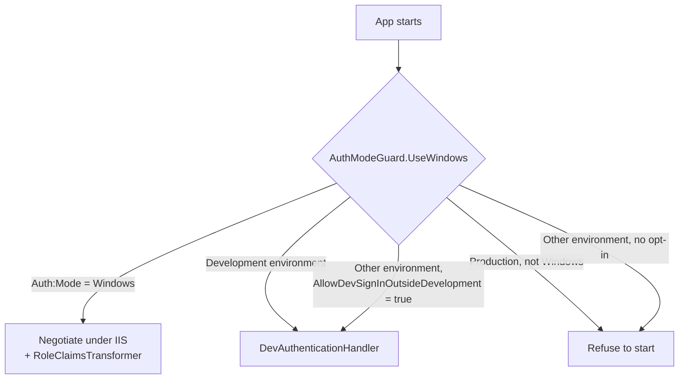
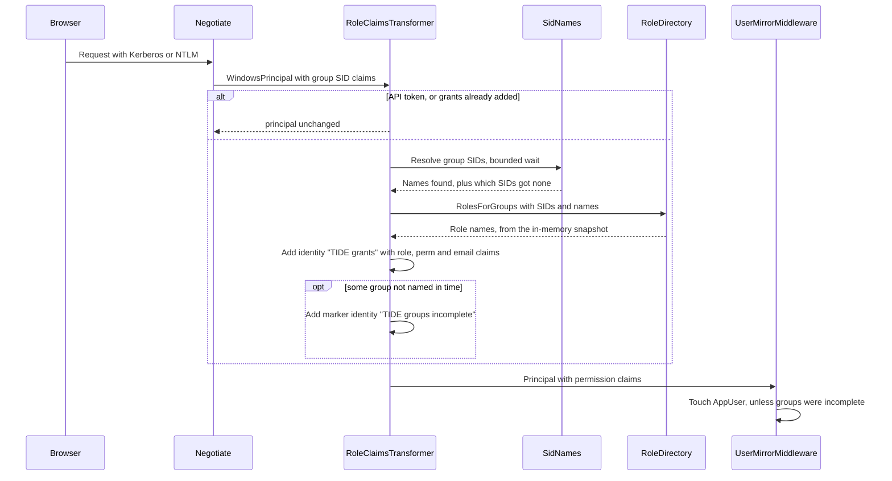
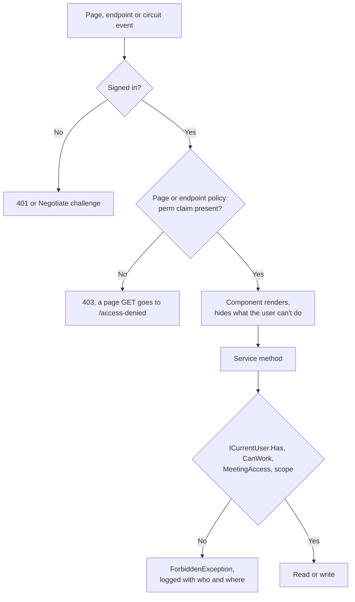
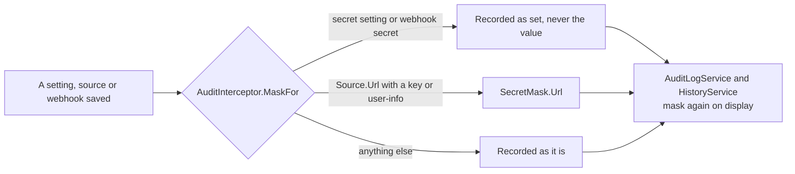

# Security

How TIDE decides who someone is, what they may do, and what may leave the app, and the protections around requests,
files, outbound calls, email and the audit trail. It's for security reviewers, and for developers changing anything
that touches sign-in, permissions, TLP, files or outbound traffic. TLP and the edition cut have a page of their own:
[editions-and-tlp.md](editions-and-tlp.md).

- [Threat model in brief](#threat-model-in-brief)
- [Sign-in](#sign-in)
- [Roles from AD groups](#roles-from-ad-groups)
- [Permissions as code](#permissions-as-code)
- [Viewer and Visitor](#viewer-and-visitor)
- [API tokens and webhooks](#api-tokens-and-webhooks)
- [HTTP protections](#http-protections)
- [Markdown and email HTML](#markdown-and-email-html)
- [Files](#files)
- [Outbound requests](#outbound-requests)
- [AI data handling](#ai-data-handling)
- [The audit trail and secrets](#the-audit-trail-and-secrets)
- [Where it lives in code](#where-it-lives-in-code)

## Threat model in brief

TIDE runs on-premises (ADR [0001](../decisions/0001-blazor-server-on-prem.md)) for one organization's threat-intel
team. What it protects, from whom, and the main control for each:

| Asset or risk | Who or what threatens it | Main control |
|---|---|---|
| Intelligence marked above an audience's ceiling (AMBER, AMBER+STRICT, RED parts) | An email or SharePoint copy reaching the wrong audience; an API caller; a webhook receiver | One edition cut, `BriefEditions.Build`, used by every rendering and ceiling ([editions-and-tlp.md](editions-and-tlp.md)) |
| "Our stack" notes and "why it matters" (our own exposure) | The company-wide audience; an AI provider | AMBER defaults and readiness warnings; AI notes only when `Ai:MaxTlp` allows AMBER |
| Team content in general | A Reader or Visitor reading past their role | Permission claims, checked by page policy and again in each service |
| Access that was revoked | Someone with an open Blazor session for days | Permissions re-derived every two minutes (`PermissionRevalidatingAuthStateProvider`) |
| The signed-in user's Windows credentials | A hostile page riding them (CSRF, cross-site WebSocket hijacking) | No cookie-auth writes outside the circuit; the circuit refuses foreign `Origin`s; no CORS policy |
| The browser session | Script injected through stored text (bullets, notes, feed items) | Markdown with raw HTML off, link schemes filtered, strict CSP with `script-src 'self'` |
| Analysts' machines | Malware samples and evidence files added to actions | Files are always attachments, sniffed, sandboxed, risky ones zipped with the password `infected` |
| The server's own network | A feed or its redirect pointing at loopback, metadata or internal addresses (SSRF) | `AddressPolicy`, checked on each redirect hop and each connection |
| Secrets (SMTP password, API keys, webhook secrets, tokens) | Anyone reading the audit log, the settings pages, logs or a config export | Hashes for tokens, Data Protection for webhook secrets, masking in the audit trail and on display |
| The app itself | A misconfigured server signing everyone in as an administrator | `AuthModeGuard` refuses to start Production without Windows sign-in |

Out of scope by design: TIDE doesn't defend against a Windows or SQL Server administrator on its own host, and it
trusts its AD group mappings. Anyone mapped to the Action owner role reads every marking inside the app (see
[editions-and-tlp.md](editions-and-tlp.md#a-ceiling-governs-what-leaves-the-app)).

## Sign-in

### Modes

- **Production: Windows (Negotiate) under IIS.** `Program.cs` registers `AddNegotiate()` and the
  `RoleClaimsTransformer` as the `IClaimsTransformation`. The browser signs in with Kerberos or NTLM; no password is
  ever typed into TIDE.
- **Development: `DevAuthenticationHandler`.** It signs every request in as a fixed user (`DevAuth:UserId`,
  `DisplayName`, `Upn`, `Email`) with the roles in `DevAuth:Roles` (appsettings.Development.json grants Analyst and
  Admin) and adds those roles' permission claims directly. Two dev-only conveniences, each pinned to the browser by an
  `HttpOnly`, `Secure`, `SameSite=Lax` cookie scoped to the path base:
  - `?as=<name>` signs in as a throwaway identity (`dev:<name>`). The name is cleaned to letters, digits, spaces and
    `- _ . '`, and cut to `MaxAsNameLength` (64).
  - `?roles=Viewer` (or a comma list) replaces the roles for this browser. Only TIDE's role names are taken
    (`DevAuthenticationHandler.ParseRoles`); `?roles=default` goes back.
- **`AuthModeGuard.UseWindows`** decides at startup. `Auth:Mode=Windows` (any case) always wins. Otherwise dev sign-in
  is allowed only in the Development environment, or in another non-Production environment that sets
  `Auth:AllowDevSignInOutsideDevelopment=true` (a demo box). Production with anything else, including a missing
  `Auth:Mode`, throws and the app doesn't start.

The API adds a third scheme, the bearer token (see [API tokens and webhooks](#api-tokens-and-webhooks)). The
`ApiOrUser` policy scheme forwards a request with `Authorization: Bearer …` to the token handler and anything else to
the app's own scheme.

### Where it's served (path base)

TIDE is served at the root of its own host name by default. It can also sit under a path of another site (`/tide`):

- Installed as an IIS application inside another site, IIS sets the request's path base itself.
- Behind another reverse proxy that forwards a sub-path, `App:PathBase` names it. `PathBaseSetting.Normalize` accepts
  `/segment[/segment]`, blank or `/`, and throws on anything else, so a typo stops startup. `Program.cs` calls
  `UsePathBase` before routing.

`App.razor` writes the path base into `<base href>`, so links, scripts and the circuit stay relative. Code that builds
an address prefixes `Request.PathBase`: the access-denied and not-found redirects, the email preview's image URLs,
the dev sign-in cookies' `Path`, and the API's `Location` header for a proposed triage item.

### The request pipeline

The order in `Program.cs` matters for security:

| Order | Middleware | Why here |
|---|---|---|
| 1 | `UsePathBase` (when configured), `UseRouting` | Everything after sees the path below the base. |
| 2 | Outside Development: `UseExceptionHandler("/error")`, `UseHsts`, `UseHttpsRedirection` | No stack traces to users; HTTPS only. |
| 3 | `UseStatusCodePages` | A page GET's 403 becomes `/access-denied`, a 404 `/not-found`. Every 403 outside the circuit is logged with who and where. |
| 4 | `SecurityHeadersMiddleware` | Headers on every response, static files included. |
| 5 | `CircuitOriginMiddleware` | Refuses `/_blazor` requests from a foreign `Origin` before sign-in runs. |
| 6 | `UseStaticFiles`, `UseAuthentication` | Static files are public; the rest needs a user. |
| 7 | A logging scope with the user and request id | Every log line can be tied to a person and request. |
| 8 | `UserMirrorMiddleware` | Records the signed-in person in `AppUser` (name, email, roles), throttled. |
| 9 | `UseAuthorization`, `UseAntiforgery`, `UseRateLimiter` | Policies, form tokens, per-user limits. |

The fallback authorization policy requires an authenticated user, so every endpoint needs sign-in unless it says
otherwise. Only the health probes (`/health` and `/health/live`) are `AllowAnonymous`.

## Roles from AD groups

### Sign-in to claims

- **Groups to candidates.** A Windows sign-in carries its groups as SID claims, but administrators map groups by
  name. `RoleClaimsTransformer.GroupCandidates` offers each SID, its resolved `DOMAIN\Group` name and, for a group of
  the server's own domain (or a local or built-in group), the bare `Group` name. A same-named group in a trusted
  domain matches only a mapping that names its domain (`RoleClaimsTransformer.IsLocalToServer`). Only the
  authenticated identity's claims are read as groups, so a TIDE role named like an AD group can't pick up that group's
  mappings.
- **Bounded directory calls.** `SidNames` translates the unknown SIDs together in one call through
  `BoundedDirectoryCalls`, waiting at most `SidNames.Timeout` (5 seconds). At most 16 translations run at once and none
  starts while two are still hung. A name found is kept for the process; a SID with no name is retried after five
  minutes, a failed lookup after one. The server's own domain SID is looked up the same bounded way and retried every
  minute until found.
- **Fail closed.** A group not named in time gives that request only the roles mapped to its SID. While the server's
  domain is unknown, only mappings that name the domain match. The request carries a marker identity
  (`RoleClaimsTransformer.GroupsIncomplete`), and `UserMirrorMiddleware` then doesn't store its short role list as the
  person's roles.
- **The user id.** `CurrentUser.IdOf` takes the `NameIdentifier` claim, else the UPN, else the account name. A dev
  sign-in sets `NameIdentifier`; an API token's is `api:{token id}`. **Needs verification:** nothing appears to add
  `NameIdentifier` to a Windows principal, so a production user id may be the UPN or `DOMAINsam` rather than the SID.
  Reading `AppUser` rows on a domain-joined install would confirm it.
- **The grants identity.** Roles, permission claims (`AppClaimTypes.Permission`, `perm`) and the AD `mail` address
  ride on an unauthenticated identity labelled `TIDE grants`, added once per principal.
- **Mappings.** `RoleDirectory` (Infrastructure, a singleton) caches the `RoleMappings` table as group to role names.
  It's empty until `DatabaseInitializer` calls `Invalidate` once the schema exists, and every change through
  `RoleMappingService` calls it again. A failed reload is logged Critical and retried every 30 seconds; a slow reload
  can't put back a mapping a newer one removed (each load is numbered). Rows naming something that isn't a role are
  ignored. The `RoleMapping:Groups` configuration section only seeds the table on first run.
- **The last Admin.** `RoleMappingService.RemoveAsync` refuses to remove the only mapping granting Admin, counting and
  removing in one serializable transaction, so two administrators can't remove the last two at once.

### Open sessions

A Blazor circuit keeps the principal it started with, possibly for days. `PermissionRevalidatingAuthStateProvider`
(the circuit's `AuthenticationStateProvider`) does two things:

- **Re-derives access every two minutes** (`Interval`) through `SessionPermissionRefresher.RefreshAsync`. For a
  Windows session it resolves the groups again against the current mappings; for a dev session it keeps the roles and
  re-reads their permissions. If anything changed it publishes a new principal, so page authorization,
  `AuthorizeView`s and service checks follow without a reconnect. On a partial answer from AD it only removes what it
  can rule out: a held role stays while a named group or any by-name mapping could still grant it, and no role is ever
  added on a partial answer. A failed re-check is logged and retried on the next tick.
- **Detaches the principal from the Windows token.** The host hands the circuit the connection's `WindowsPrincipal`,
  whose claims read a logon token IIS closes when the connection ends. `Detached` copies every identity into plain
  `ClaimsIdentity` objects, so a reconnect or a laptop waking doesn't break every permission check.

AD group membership itself changes only with a new Windows logon; that's the OS token, not something TIDE refreshes.

## Permissions as code

Roles are fixed bundles of permission atoms, and authorization always runs on the atoms, never on a role name
(ADR [0002](../decisions/0002-permissions-as-code.md)). Everything is in `src/Tide.Application/Security` plus the
enums in `src/Tide.Domain/Enums/AppEnums.cs`.

### The permission atoms

`Permission` values are stored by number in claims and nowhere else, but treat the enum as append-only.

| # | Permission | Allows (`Policies.Describe`) |
|---|---|---|
| 0 | `ReadPublished` | Read the published brief archive. |
| 1 | `ReadTeamEdition` | Read the full (team) edition: briefs, articles, stories, search, reports, Our stack, metrics history. |
| 2 | `WriteArticles` | Write articles and build briefs; triage; raise and edit any action. |
| 3 | `PresentBriefs` | Present and send briefs; corrections. |
| 4 | `WorkActions` | Work action items (for an Action owner, only their own team's). |
| 5 | `Administer` | Administer TIDE. |
| 6 | `EnterMetrics` | Enter the day's opening metrics. |
| 7 | `ReadActions` | Read every action (its page, the board, Workload, the lists, Team commitments) without working any. |
| 8 | `MeetingNotes` | Add notes to a meeting, and change or delete one's own. |
| 9 | `JoinMeetings` | Join and follow a live meeting in present mode, and raise a hand. |

### Roles and their bundles

`RoleDefinitions.SystemRoles` is the whole mapping. Admin holds `Enum.GetValues<Permission>()`, so it gets any
permission added later.

| Permission | Administrator | Analyst | Action owner | Viewer | Visitor | Reader |
|---|---|---|---|---|---|---|
| `ReadPublished` | Yes | Yes | Yes | Yes | Yes | Yes |
| `ReadTeamEdition` | Yes | Yes | Yes | Yes | No | No |
| `WriteArticles` | Yes | Yes | No | No | No | No |
| `PresentBriefs` | Yes | Yes | No | No | No | No |
| `WorkActions` | Yes | Yes | Yes | No | No | No |
| `Administer` | Yes | No | No | No | No | No |
| `EnterMetrics` | Yes | Yes | No | No | No | No |
| `ReadActions` | Yes | Yes | Yes | Yes | No | No |
| `MeetingNotes` | Yes | Yes | Yes | Yes | No | No |
| `JoinMeetings` | Yes | Yes | Yes | Yes | Yes | No |

What each role is (`RoleDefinitions.Describe`): an **Analyst** is the CTI team; an **Action owner** is another team's
member who reads the team edition and works their team's actions; a **Reader** is anyone else in the company; a
**Viewer** reads everything the team does and changes nothing but their own meeting notes; a **Visitor** reads the
published archive and sees a live meeting only while seated in it. A person holding several roles gets the union
(`RoleDefinitions.PermissionsFor`).

### Policies

`Policies` holds one policy name per permission, and `Policies.Required` maps each to its permission. `Program.cs`
registers each as `RequireClaim("perm", permission)`. Pages use `[Authorize(Policy = Policies.X)]`; endpoints use
`RequireAuthorization(Policies.X)` (exports default to `Policies.ReadTeamEdition` through
`ExportEndpoints.AsExport`).

### Capabilities

`Capabilities.All` lists every activity a person does in TIDE, grouped (Briefs and meetings, Articles and intake,
Actions, Numbers, Our stack and adversaries, Reports, Administration), with the policy or service check that decides
it and the grants that allow it. A grant can carry a qualifier ("own team's", "only in a live meeting"). The Role
mappings page and the "What each role can do" table in [INSTALL.md](../INSTALL.md) are both generated from it
(`Capabilities.Markdown`), and `tests/Tide.IntegrationTests/CapabilitiesTests.cs` holds each row to its named check
(`EachRow_MatchesTheServiceCheck_ForEachRole`) and the install guide's table to the code's
(`TheInstallGuidesTable_IsTheCodesTable`). Read the activity-level table there rather than repeating it here.

`StoredRoles.Has` answers the same question for a stored user (`AppUser.RolesCsv`, as last seen at sign-in), for code
that acts on someone else's behalf, such as choosing reminder recipients.

### Defense in depth: a permission check

Every service checks the permission itself (`ArticleService.RequireRead`, `BriefService.RequirePresent`,
`DistributionService.RequireSend`, `AuditLogService.RequireAdministrator`, and so on), so a page that forgets its
policy, or a crafted circuit event that calls a handler the UI hid, still can't read or write. Some checks need data
as well as a claim:

- **Working an action** (`ActionService.CanWork`): `WriteArticles`, or `WorkActions` and membership of the action's
  team (`TeamMembers`), per ADR [0008](../decisions/0008-teams-own-actions.md).
- **Commenting on an action** (`ActionService.CanComment`): `ReadTeamEdition` plus `WriteArticles` or `WorkActions`.
- **Keeping the teams** (`TeamService`): an external team (one that works outside TIDE, ADR
  [0020](../decisions/0020-external-teams-are-emailed-without-tide.md)) with `WorkActions`; an internal team, its
  members and every team's active limit with `Administer`. A team's escalation contact follows the same rule
  (`TeamService.SetEscalationContactAsync`): an external team's with `WorkActions`, an internal team's with
  `Administer`. An external team can't have members, so adding one grants nobody access.
- **Handing an action off** (`HandoffService.HandOffAsync`): whoever can work it. **Splitting** one: `WriteArticles`.
- **The team libraries** (saved queries, outreach templates, playbooks; `TeamLibrary`): `WorkActions` adds, edits,
  retires and restores; deleting is for whoever made an entry (`CreatedBy`) or `Administer`. A playbook an action was
  started from is never deleted. Card rules stay `Administer`'s to change; `ReadActions` reads them on Board rules.
- **A Visitor's reads**: `MeetingAccess`, below.
- **An API token**: its scope claim, and its TLP ceiling, below.

`ForbiddenException` turns into a toast in the app and a 403 problem detail in the API. `UserFacingError` logs a
refusal inside the circuit with the user; the status-code handler logs one outside it.

## Viewer and Visitor

**A Viewer** holds `ReadPublished`, `ReadTeamEdition`, `ReadActions`, `MeetingNotes` and `JoinMeetings`, and neither
`WorkActions` nor `WriteArticles`. Every write the team edition opens also asks for one of those two (as
`ActionService.CanComment` does), so a Viewer opens every read page and every action and writes nothing but their own
meeting notes and raised hand. A file a person added stays theirs to remove only while they can still work the action,
so moving someone to Viewer takes that away too.

**A Visitor** holds `ReadPublished` and `JoinMeetings` only. They read the published archive and, from a seat in a
live meeting, only that meeting:

- `MeetingAccess.MeetingOnly` is true for anyone with `JoinMeetings` and without `ReadTeamEdition`.
- Present mode takes their seat (`LiveMeetings.Join`, the web app's `IMeetingsInProgress`) before it reads anything.
  `IMeetingsInProgress.SeatedIn(userId)` lists the live meetings a user has a connected present-mode page in, with the
  action number or card (`MeetingCard`: a product, or an article's indicators) the presenter has open.
- The services ask `MeetingAccess.SeatedFor`, `SeatedOn` or `SeatedAnywhere` on every read: `BriefService` (the
  brief, cut as the team edition), `ActionService` (the edition's actions, the day's open actions, the one action shown),
  `MetricsService` (the day's numbers), `MeetingService` (the meeting record, without notes), `CveService` (the CVE
  chips), `StackService` (the We run chips and the product card shown), `DistributionSettings.GetAsync` (the ceilings,
  to cut the slides) and `ScreenshotService` (that brief's articles' screenshots).
- The window closes the moment the meeting ends or they leave it, whatever a page still shows: the next read is
  refused. Their slide images are served `Cache-Control: no-store` (`ScreenshotService.NoStore`), so nothing outlives
  the seat in the browser cache.
- The slides draw no links out for them. Their joins count as attendance like anyone's. They can't take notes or
  present.

Tests: `tests/Tide.IntegrationTests/ViewerVisitorRoleTests.cs` and `ViewerVisitorAppTests.cs`.

## API tokens and webhooks

The REST API's endpoints and payloads are in [API.md](../API.md); this section covers its security.
ADR [0016](../decisions/0016-api-tokens-scopes-and-signed-webhooks.md) records the design.

### Tokens

- **Issue.** An administrator issues a token on Administration (`ApiTokenService.IssueAsync`): a name, at least one
  scope, a TLP ceiling (`MaxTlp`, checked with `Tlp.Checked`) and a life of 1 to 366 days. The token is `tide_pat_`
  followed by 43 URL-safe characters from 32 random bytes. It's shown once (`IssuedToken`); TIDE stores only its
  SHA-256 (`ApiToken.Hash`) and its last four characters as a hint.
- **Sign in.** `ApiTokenAuthenticationHandler` reads `Authorization: Bearer`, refuses anything without the prefix or
  outside 20 to 100 characters, and looks the hash up. A revoked or expired token fails. A successful call increments
  `Calls` and `LastUsedAtUtc` with `ExecuteUpdateAsync`, outside the audit interceptor (a call isn't a change).
- **Claims.** The caller's identity is `api:{token id}`, its name, one `tide:scope` claim per scope, the permission
  claims those scopes grant (`ApiScopes.Permissions`) and its ceiling (`tide:tlp`). It never has a role, and
  `RoleClaimsTransformer` and the session re-check leave it alone (`ApiTokenAuthenticationHandler.IsToken`).
- **Scope check.** Each endpoint's `.Scope(...)` filter refuses a token without that scope (403). A person signed in
  through Windows isn't held to scopes, only to their permissions.
- **Ceiling.** `ApiTokenAuthenticationHandler.Ceiling` gives the token's TLP; the services cut at the lower of it and
  the team edition's ceiling (`ApiService.BriefAsync`, `WithheldArticlesAsync`). See
  [editions-and-tlp.md](editions-and-tlp.md#api-tokens).
- **Only `/api/v1`.** The bearer scheme is wired only into the API group's `ApiOrUser` policy scheme; every other
  endpoint and page authenticates with the app's own scheme, so a token reaches nothing outside `/api/v1`.
- **Every write goes through the pages' own services**, so the same checks apply and the audit trail names the
  token. `PATCH /actions/{n}` changes status and adds a note only, never deletes or reassigns.
- **Limits and caching.** 120 requests a minute per caller (the `api` rate limit); every answer is
  `Cache-Control: private, no-store`.

| Scope | Grants |
|---|---|
| `briefs:read` | `ReadTeamEdition` |
| `actions:read` | `ReadTeamEdition` |
| `actions:write` | `ReadTeamEdition`, `WorkActions`, `WriteArticles` |
| `metrics:read` | `ReadTeamEdition` |
| `metrics:write` | `ReadTeamEdition`, `EnterMetrics` |
| `stack:read` | `ReadTeamEdition` |
| `triage:propose` | `WriteArticles` |
| `detections:write` | `WriteArticles` |

### Webhooks

- An administrator adds a webhook with an `https` address only (`WebhookService.AddAsync`) and its events
  (`action.raised`, `action.overdue`, `brief.sent`). A 32-byte signing secret is generated, shown once, and stored
  encrypted with ASP.NET Core Data Protection (`DataProtectionSecrets`, purpose `Tide.Webhooks.Secret.v1`). If the
  keys change and it can't be read, the post is reported and not sent.
- Each post carries `X-Tide-Timestamp` and `X-Tide-Signature: sha256=` the HMAC-SHA256 of `timestamp.body`
  (`WebhookService.Sign`).
- `HttpWebhookPoster` uses its own `HttpClient`: 15-second timeout, redirects not followed (a redirect is reported).
  Webhook addresses are not passed through `AddressPolicy`, and the client uses no proxy: only https is required, so
  an administrator can point one at an internal address.
- Actions raised from an article above the team edition's ceiling are never posted.

## HTTP protections

### Security headers

`SecurityHeadersMiddleware` sets these on every response and removes `Server`:

| Header | Value |
|---|---|
| `Content-Security-Policy` | `default-src 'self'; img-src 'self' data:; style-src 'self' 'unsafe-inline'; script-src 'self'; object-src 'none'; connect-src 'self'; frame-ancestors 'none'; base-uri 'self'; form-action 'self'` |
| `X-Content-Type-Options` | `nosniff` |
| `X-Frame-Options` | `DENY` |
| `Referrer-Policy` | `no-referrer` |
| `Cross-Origin-Opener-Policy` | `same-origin` |
| `Permissions-Policy` | `camera=(), microphone=(), geolocation=(), payment=(), usb=()` |

`'unsafe-inline'` is allowed for style only (inline style attributes, Blazor's injected styles, and the Word-template
preview); script has no such allowance, so every script is an external file under `wwwroot/js`. Blazor's own
`frame-ancestors` header is turned off (`ContentSecurityFrameAncestorsPolicy = null`) so there's one CSP.

Endpoints that serve content of their own override it:

| Endpoint | CSP and headers |
|---|---|
| Email previews and frozen emails (`/briefs/{day}/email/{edition}`, `/sends/{id}/email`, `/corrections/{id}/email`, through `EmailPage`) | `default-src 'none'; img-src 'self' data:; style-src 'unsafe-inline'; frame-ancestors 'self'; base-uri 'none'; form-action 'none'; sandbox allow-same-origin allow-popups`, `X-Frame-Options: SAMEORIGIN`, `no-store` |
| File downloads (`FileDownloads.Plain`, `Zipped`) | `sandbox; default-src 'none'`, `nosniff`, `private, no-store` |
| Inline screenshots (`/files/{id}/inline`) | `nosniff`, an `ETag` of the file's hash, `private, max-age=300, must-revalidate` (a Visitor: `no-store`) |
| Exports (`AsExport`) and API answers | `private, no-store` |

### Cross-site requests and antiforgery

- **The circuit.** Every write in the app goes through the Blazor Server circuit. `CircuitOriginMiddleware` refuses
  any `/_blazor` request (negotiate, WebSocket upgrade, long polling) whose `Origin` is neither the request's host nor
  `App:BaseUrl`'s authority (scheme not compared, default ports equal). Starting a circuit also needs data-protected
  component markers from a page the other site can't read. The hub's largest message is 256 KB.
- **Antiforgery.** `UseAntiforgery` validates form tokens for Razor component forms. The API group calls
  `DisableAntiforgery`: it takes JSON bodies, and TIDE registers no CORS policy, so a browser won't send a cross-site
  JSON `PATCH` or `POST`.
- **Every other endpoint is a GET** that changes nothing.
- **Data Protection keys** protect the antiforgery tokens, circuit state and webhook secrets. With
  `DataProtection:KeyPath` set (it must be absolute) the ring is kept there, encrypted with machine-scope DPAPI on
  Windows, under the fixed application name `TIDE`, so a recycle doesn't sign everyone out. **Needs verification:** because the
  keys are DPAPI-protected to the machine, a key folder restored onto another server likely can't be read there, so
  webhook secrets would need re-adding and sessions would sign in again.

### Rate limits

Token buckets per minute, keyed by the signed-in user (or the address when there's none):

| Policy | Limit | Applies to |
|---|---|---|
| `files` | 300 | `/files/{id}/inline`, `/download`, `/zip` |
| exports | 60 | CSVs, STIX, email previews, the SharePoint zip, the calendar file, the audit CSV |
| `api` | 120 per caller | `/api/v1/*` |
| `health` | 120 per address | `/health`, `/health/live` (no sign-in) |

## Markdown and email HTML

### Markdown

Analysts write Markdown (bullets, "why it matters", notes, comments, the team note, email templates). Storage stays
Markdown; `MarkdownService` (`src/Tide.Application/Content/MarkdownService.cs`) renders it at the edges:

- **Raw HTML is disabled** (`DisableHtml`), so `<script>` and every other tag is escaped text.
- **Links:** only `http://`, `https://` and `mailto:` schemes (or a relative anchor) survive; anything else
  (`javascript:`, `data:`, `vbscript:`, `file:`) becomes an inert anchor. A protocol-relative address (`//host`) and any
  address with a backslash are refused too, checked on the destination as it was typed. An angle-bracket autolink
  with an unsafe scheme stays text. Links, an angle-bracket `<https://…>` among them, open in a new tab with no
  referrer or opener.
- **Root-relative links** (`[x](/actions/12)`, and images) are pointed at TIDE after those checks (`LinkRoot`): on a
  page the base path goes in front unless the link already starts with it; in email and the SharePoint copy the
  `App:BaseUrl` address does, and with none set the link is left as its text. Only a single leading `/` counts, so
  `//host` and `/\host` are still refused, never given a prefix. The scheme check, `rel` and `target` are unchanged.
- **No autolinks:** a bare URL or domain is never made clickable, because bullets quote malicious addresses.
- **AI suggestions carry no links:** `DraftChecks` reduces every link in a suggestion to its text with
  `MarkdownService.WithoutLinks`, in each form Markdown writes one (`[text](url)`, `[text][1]` with its `[1]: url`
  line, `<https://…>`, an image), so a web page the AI read can't plant a link in the brief.
- **Indicators are shown defanged** (`IocObservable.Defang`): an address, domain, URL or email address fully, and any
  other kind (a command line, a registry value) has a web address inside it defanged (`hxxps://`), so a mail client
  can't make it a live link.
- **No inline images:** an image is rendered as a link, so no reader's browser fetches a tracking pixel or a hostile
  host's file.
- **Deep nesting:** text nested deeper than Markdig allows is shown escaped instead of failing every render of the brief.
- One-line fields render through an inline-only pipeline (`ToInlineHtml`).

The strict CSP is the second line of defence. Feed content is never rendered as HTML at all (ADR
[0009](../decisions/0009-intake-reaches-out-only-when-asked.md)).

### Email HTML

- **The brief's email** (`BriefRenderer`) encodes every analyst-typed value with `EmailComposer.Esc` and styles
  rendered (already safe) Markdown with `EmailComposer.InlineStyles`. Subjects collapse line breaks and control
  characters to one space (`EmailComposer.SingleLine`), so a title can't inject a header.
- **Notification emails** (reminders, digests, rotation, presenting next) come from administrator-edited templates.
  `EmailTemplateRenderer` renders the body's Markdown with raw HTML escaped, then fills in values: plain values are
  HTML-encoded, so an action's title can't add markup; only TIDE's own markup (the actions table, links) goes in
  as is. `EmailTemplateCatalog.Problem` refuses an unknown placeholder, an HTML value outside the body, or a body missing
  its key value. A test send goes only to the administrator's own address.
- **In the browser**, a rendered email is only ever shown through `EmailPage`'s sandboxed, script-free CSP (above).
- **Outreach emails** are written, never sent, by TIDE: the analyst copies them into their own mail (ADR
  [0019](../decisions/0019-outreach-emails-are-written-never-sent.md)).

## Files

Bytes live on disk under `Files:RootPath`, outside the web root, with a `StoredFile` row each (ADR
[0003](../decisions/0003-files-on-disk.md)). There are two kinds.

**Screenshots** (on articles, and as hunt evidence):

- An upload is accepted only if its bytes are PNG, JPEG, GIF or WebP (`ImageSniffer`, by magic number; SVG and
  anything else is refused). The inline endpoint sniffs again before serving and uses the sniffed type, never the
  stored one.
- `ScreenshotService.OpenAsync` decides who sees which image: the team (`ReadTeamEdition`) any article screenshot; a
  Visitor only a screenshot of the brief they're seated in; a Reader only a frozen copy in a sent company-wide edition
  (ADR [0007](../decisions/0007-frozen-sends-and-cid-email.md)), so an image above the public ceiling, or never sent,
  can't be fetched by guessing its id.
- The browser keeps a copy five minutes, then revalidates with the `ETag` (the hash): a 304 while the bytes match and
  the viewer may still see it, a 404 once either has changed.

**Files on actions and comments** (logs, pcaps, emails, samples):

- Every file's SHA-256 is recorded on arrival (`StoredFile.Sha256`) and named in the action's history and audit row.
- `FileRisk.Inspect` judges each upload from its name, the type the browser declared, and its first 16 bytes. An image
  is shown inline only when its bytes are a raster image and its name and declared type agree; otherwise `TypeNote`
  says how they differ and it's a download only. A file that can run, or carry something that runs (programs,
  scripts, installers, shortcuts, disk images, macro-enabled Office files, pages), gets a `RiskReason`; the bytes are
  judged first, since they can't be renamed.
- **Downloads** (`/files/{id}/download`, `/files/{id}/zip`, and the API's
  `/actions/{n}/files/{id}?zip=true`) always go through `FileDownloads`: an attachment of type
  `application/octet-stream` (or `application/zip`), `nosniff`, `private, no-store`, and
  `Content-Security-Policy: sandbox; default-src 'none'`.
- **The zip with the password `infected`** (`FileRisk.ZipPassword`) is the main download for a risky file under
  `Files:ZipDownloads=RiskyOnly` (the default; `Always` and `Never` also exist). It's classic ZipCrypto, stored not
  compressed, written as it streams with no plain copy on the server's disk, and its entry name has no folder or
  reserved character (`FileRisk.EntryName`). It's deliberately weak: it stops a double-click and antivirus deleting the
  file on arrival, not a reader.
- `ActionFileService.OpenAsync` checks access per file. Removing keeps the bytes, hash and row with who, when and why;
  only an administrator restores.

## Outbound requests

All of intake, CVE enrichment, article fetching for drafting, ATT&CK group refreshes and the update check go through
one client, `IOutboundHttp` (`src/Tide.Infrastructure/Notifications/OutboundHttp.cs`):

- **`AddressPolicy.Refusal`** always refuses loopback, link-local (cloud metadata at 169.254.169.254 among them),
  unspecified, multicast, broadcast and reserved addresses. Private ranges (RFC 1918, carrier-grade NAT, IPv6
  unique-local and site-local) are refused unless `Intake:AllowPrivateNetworks` is set. IPv4-mapped IPv6 and IPv6
  forms that carry an IPv4 address (6to4, NAT64, SIIT, IPv4-compatible, ISATAP) are judged as that IPv4 address too.
- **Redirects are followed by TIDE, not the handler** (`AllowAutoRedirect = false`): at most five, only to http or
  https, never from https to http, each hop's host resolved and checked first.
- **Every connection is checked again** on the address it actually connects to (`ConnectCallback`), so DNS that
  changes between check and connect (rebinding) can't slip through. Through a proxy (`Intake:Proxy`, or the system's),
  which resolves names itself, the per-hop check is the guard; an address, or a name that resolves locally, is still
  checked.
- **Limits:** a time limit per request (`Intake:TimeoutSeconds`, clamped 5 to 120), a size limit
  (`Intake:MaxResponseKB`, at least 64 KB), a 10-second connect timeout, and a per-host back-off
  (`OutboundCircuit`) for a host that keeps failing.

Email goes to the configured SMTP relay only (`SmtpClientFactory`, backed off by `OutboundCircuit`). Webhooks use their
own client (above). The Azure OpenAI assistant posts to the configured `Ai:Endpoint` with its own client, through
`Intake:Proxy` when set, but not through `AddressPolicy`.

## AI data handling

AI drafting help is opt-in and capped by TLP (ADR [0004](../decisions/0004-opt-in-ai-with-tlp-ceiling.md)).

- **Off by default.** With `Ai:Provider` blank nothing is ever sent. The one provider today is Azure OpenAI
  (`AzureOpenAiAssistant`): one request with a strict JSON schema, no tools, `store: false`.
- **The TLP ceiling.** `Ai:MaxTlp` (GREEN by default) caps what goes. `AssistService.Status` takes the highest of the
  article's TLP, its source's `DefaultTlp`, and every cited source's feed TLP; above the ceiling nothing is sent and the
  editor says why (`AssistStatus.Blocked`), and `PrepareAsync` throws if asked anyway.
- **Our notes are AMBER.** Our stack's notes go with a draft only when the ceiling allows AMBER, and the draft then
  counts as AMBER.
- **Web lookup** by the provider happens only when TIDE's own fetch failed, the source is marked Open, the input is
  TLP:CLEAR and `Ai:WebGrounding` is on, and only the address and title are sent.
- **Checked, then accepted by a person.** `DraftChecks` keeps only techniques in the ATT&CK catalog and configured tags,
  cross-checks indicators against the deterministic extractor, reduces Markdown links to text, and verifies cited
  quotes. The analyst accepts or rejects each suggestion.
- **Recorded.** Each draft is an `AiDraft` row with provider, model, prompt version, input hash and `InputTlp`; the
  source text isn't kept. Drafting is analysts only (`WriteArticles`).

## The audit trail and secrets

### What's recorded

- **Same save.** `AuditInterceptor` (a `SaveChangesInterceptor`) stamps created and modified fields on every
  `AuditableEntity` and writes an `AuditLogEntry` per change (who, what, before and after, as JSON) in the same
  `SaveChanges`, so a change and its record commit or fail together. Values longer than 1,000 characters are cut and
  marked.
- **What is audited:** every entity except the types below: bullets, screenshots, indicators and brief items included.
  An article's History shows only some of those rows; the audit log shows them all.
- **Set-based writes skip it.** `ExecuteUpdateAsync` and `ExecuteDeleteAsync` bypass the interceptor (no audit row, no
  stamps). They're used only for bookkeeping: poll results, feed-item triage status and claims, the feed prune, API token
  call counts, webhook delivery state and the article's screenshot-change stamp.
- **Not audited:** the audit log itself, the user mirror (`AppUser`), `UserPreference`, `NotificationMark`, and machine
  bookkeeping (`FeedItem`, `CveRecord`, `DetectionRule`, `FeedItemText`). `ModifiedAtUtc`, `ModifiedBy` and
  `EditVersion` changes are skipped as noise.
- **Edits are versioned.** Articles, briefs and other edited records carry an `EditVersion` concurrency token; a save
  from a stale copy is refused with `StaleEditException`.

### Reading it

- **History** on an article or brief (`HistoryService`, 50 rows at a time by the `(EntityType, EntityKey)` index) is
  `WriteArticles` only, because the log holds every field at every marking. `HistoryFormatter` drops noise and every
  `*ById` user id.
- **The audit log** (Administration › System › Audit log, `/admin/system/audit`, through `AuditLogService`) is
  `Administer` only, by the page's policy and in the service. It pages 50 at a time, filters by person, kind, record,
  dates, action and words, and exports at most 10,000 rows as CSV (`/admin/system/audit.csv`). Filters without an
  index (action, words) and no person are held to 92 days.
- **CSV cells** are written through `Csv.Cell`, which neutralises a leading formula character.

### Secret masking

- **What's a secret.** `SettingsCatalog.IsSecret(key)` is true when the catalog lists the key as `SettingKind.Secret`,
  or when `SecretMask.LooksSecret` says its name does (`password`, `pwd`, `secret`, `token`, `apikey`, `signature`, or
  ending in `Key`), a guard against a secret listed as plain by mistake.
- **In the trail.** The interceptor writes a secret setting's value, and a webhook's `Secret`, only as `SecretMask.SetSecret`
  ("•••• (set)"), and a source's `Url` through `SecretMask.Url` when it carries user-info or a key-like query value.
- **On display.** The audit log and History mask again whatever a row holds: a secret as "(set)" or "(changed)", a
  URL-kind setting and a source address through `SecretMask.Url`, and a source's last error through
  `SecretMask.Scrub` (which hides `password=…`, `apikey: …` and `user:pw@`). The words filter matches a secret setting's
  row by its key only, so a search can't confirm a value.
- **Elsewhere.** Setting sources and Diagnostics show a secret only as set, a connection string with only its
  allow-listed parts (`SecretMask.ConnectionString`), and an address without its key. The readiness probe's log line
  scrubs exception text. The configuration bundle and install answers file carry no secret.
- **Where secrets live.** Security-sensitive and infrastructure settings (sign-in, hosting, the database, files, all
  of email, intake's proxy and limits, the CVE addresses and NVD key, the update repository) stay in server
  configuration and are never saved in the app. `SavedSettings` reads back only the operational keys
  (`OperationalSettings.Keys`), each checked again, and a configuration bundle import refuses any key that isn't in
  `SettingsCatalog.InApp` (`ConfigBundleService`). API tokens are stored as hashes; webhook secrets encrypted.
  No in-app setting is a secret today, so masking a setting is a guard for a row named like one. A source's address is
  stored as typed, any key in it included; only the trail and the screens mask it.

## Where it lives in code

| Concern | Code | Tests |
|---|---|---|
| Sign-in mode | `src/Tide.Web/Security/AuthModeGuard.cs` (`UseWindows`), `DevAuthenticationHandler.cs` | `tests/Tide.IntegrationTests/Audit/SecurityAuditTests.cs` (`DevSignIn_NeverStartsWhereItIsNotAllowed`, `Production_RefusesTheDemoOptIn`) |
| Groups to roles | `src/Tide.Web/Security/RoleClaimsTransformer.cs`, `SidNames.cs`, `BoundedDirectoryCalls.cs`, `src/Tide.Infrastructure/Security/RoleDirectory.cs` | `Audit/SecurityAuditTests.cs` (`AGroupNotNamedInTime_GrantsNothingByName_AndTheRequestSaysSo`, `AWindowsSignIn_InAnUnmappedGroup_GetsNothing`) |
| Open sessions | `src/Tide.Web/Security/PermissionRevalidatingAuthStateProvider.cs`, `SessionPermissionRefresher.cs` | `Audit/SecurityAuditTests.cs` (`AnOpenSession_LosesARevokedRole_AndKeepsOneAPartialAnswerCannotRuleOut`, `ACircuitsSignIn_IsCopiedOffItsConnection_SoAClosedTokenCantBreakItsChecks`) |
| Permissions and roles | `src/Tide.Application/Security/Security.cs` (`RoleDefinitions`, `Policies`), `Capabilities.cs`, `AppClaimTypes.cs`, `StoredRoles.cs` | `CapabilitiesTests.cs`, `ViewerVisitorRoleTests.cs` |
| Visitor window | `src/Tide.Application/Briefs/MeetingsInProgress.cs` (`MeetingAccess`), `src/Tide.Web/Services/LiveMeetings.cs` | `ViewerVisitorRoleTests.cs`, `ViewerVisitorAppTests.cs` |
| API tokens | `src/Tide.Application/Api/ApiTokens.cs`, `src/Tide.Web/Security/ApiTokenAuthentication.cs`, `src/Tide.Web/Api/ApiEndpoints.cs` | `ApiTests.cs` (`AToken_IsStoredOnlyAsAHash_AndStopsWhenRevokedOrExpired`, `AScopeNotHeld_IsRefused_AndABadTokenIsntSignedIn`) |
| Webhooks | `src/Tide.Application/Api/Webhooks.cs`, `src/Tide.Web/Api/WebhookServices.cs` | `ApiTests.cs` (`Webhooks_PostWhatHappened_Signed_AndTryAgainAfterAFailure`, `ASecretThatCantBeRead_IsReported_NotSent`) |
| Headers and origin | `src/Tide.Web/Security/SecurityHeadersMiddleware.cs`, `CircuitOriginMiddleware.cs`, `Program.cs` (`EmailPage`) | `Audit/SecurityAuditTests.cs` (`AForeignOrigin_GetsNoConnection`, `TheOriginRule`) |
| Markdown | `src/Tide.Application/Content/MarkdownService.cs` | `tests/Tide.UnitTests/Audit/SecurityAuditTests.cs` (`AnUnsafeLinkScheme_HoweverItIsSpelled_IsNeutralised`, `AProtocolRelativeLink_IsNotALinkToAnotherHost`) |
| Email | `src/Tide.Application/Distribution/EmailComposer.cs`, `BriefRenderer.cs`, `EmailTemplates.cs` | `tests/Tide.UnitTests/BriefRendererTests.cs` (`Email_EscapesWhatAnalystsTyped`), `EmailTemplateTests.cs` |
| Files | `src/Tide.Application/Files/FileRisk.cs`, `ImageSniffer.cs`, `ScreenshotService.cs`, `src/Tide.Web/Security/FileDownloads.cs` | `ActionFilesTests.cs` (`ThePlainFile_IsAnAttachment_NeverSniffed_AndSandboxed`, `ARiskyFile_DownloadsInAZip_ThatOpensWithThePasswordInfected`), `Audit/SecurityAuditTests.cs` (`AReader_SeesNoScreenshotThatWasNeverPublished_ByAnyRoute`) |
| Outbound | `src/Tide.Infrastructure/Notifications/AddressPolicy.cs`, `OutboundHttp.cs`, `OutboundCircuit.cs` | `OutboundHttpTests.cs` (`Get_ALoopbackAddress_IsRefusedByDefault_BeforeAnyRequest`, `Get_ARedirectToARefusedAddress_IsNotFollowed`) |
| AI | `src/Tide.Application/Assist/AssistService.cs`, `DraftChecks.cs`, `src/Tide.Infrastructure/Assist/AzureOpenAiAssistant.cs` | `AssistTests.cs` (`AboveTheLimit_NothingIsSent_NorCopied`, `OurNotes_GoOnlyWhenTheLimitAllowsAmber_AndThenTheInputCountsAsAmber`) |
| Audit and secrets | `src/Tide.Infrastructure/Persistence/AuditInterceptor.cs`, `src/Tide.Application/Operations/SecretMask.cs`, `SettingsCatalog.cs` (`IsSecret`), `src/Tide.Application/History/AuditLogService.cs` | `AuditLogTests.cs` (`ASecret_ShowsOnlyAsSetOrChanged_OnThePageAndInTheCsv_AndIsntSearchable`), `Audit/SecurityAuditTests.cs` (`TheAuditTrail_NeverHoldsASettingNamedLikeASecret`) |

Related: [editions-and-tlp.md](editions-and-tlp.md), [business-rules.md](../reference/business-rules.md),
[configuration.md](../operations/configuration.md), [API.md](../API.md).
