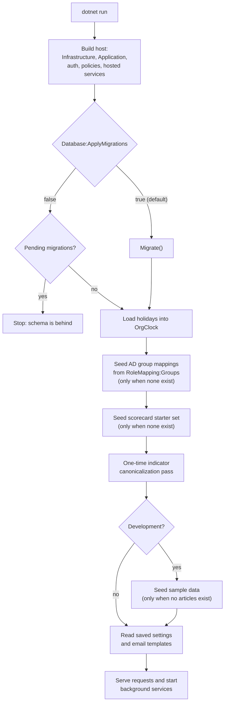
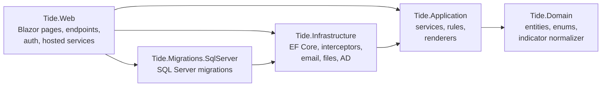

# Getting started (developers)

How to get TIDE running on your own machine, sign in as different people, find the sample data and the email it
writes, run it on SQLite or a local SQL Server, find your way around the code, and the conventions every change
follows. It's for a developer on their first day. To install TIDE on a server, read [INSTALL.md](../INSTALL.md)
instead.

**Contents**

- [Prerequisites](#prerequisites)
- [Clone and run](#clone-and-run)
- [What happens at startup](#what-happens-at-startup)
- [The development sign-in](#the-development-sign-in)
- [The sample data](#the-sample-data)
- [Email, files and the local database](#email-files-and-the-local-database)
- [SQLite or a local SQL Server](#sqlite-or-a-local-sql-server)
- [Project structure in brief](#project-structure-in-brief)
- [Run and test](#run-and-test)
- [Changing the schema](#changing-the-schema)
- [Debugging tips](#debugging-tips)
- [Conventions](#conventions)

## Prerequisites

| Tool | Why | Notes |
|---|---|---|
| .NET 10 SDK (`10.0.x`) | Builds and runs everything. | `Directory.Build.props` targets `net10.0` for every project. CI uses `10.0.x`. |
| The repository's .NET tools | `dotnet-ef` (migrations) and `dotnet-sonarscanner` (CI). | Pinned in `.config/dotnet-tools.json`. Run `dotnet tool restore` once after cloning. |
| Git | Clone; the upgrade test checks out older releases. | |
| PowerShell 7 (`pwsh`) | `tests/Tide.UnitTests/DeployScriptTests.cs` runs the deploy scripts' pure functions in PowerShell. | On Windows the same tests also run `powershell.exe` (5.1). Without either, those tests fail with "These tests need PowerShell". |
| Bash | The CI scripts in `tools/ci` and the upgrade test in `tools/upgrade-test`. | Git Bash is enough on Windows. |
| Docker (optional) | A throwaway SQL Server 2022 for the SQL Server tests and the upgrade test. | Not needed for the default run. |

Nothing else is installed: development uses SQLite (a file the app creates), signs you in without a domain
controller, and writes email to a folder. Windows is not required to develop: CI builds and tests on Ubuntu.

## Clone and run

```bash
git clone https://github.com/jashley92/Tide.git
cd Tide
dotnet tool restore
dotnet run --project src/Tide.Web --launch-profile http
```

Then open <http://localhost:5110>. The `https` profile listens on <https://localhost:7110> as well
(`src/Tide.Web/Properties/launchSettings.json`). Both set `ASPNETCORE_ENVIRONMENT=Development`.

On first run the app creates `src/Tide.Web/App_Data/tide.db`, applies every migration, and seeds the sample data.
`App_Data/` is in `.gitignore`.

## What happens at startup

`Program.cs` builds the host, then runs `DatabaseInitializer.InitializeAsync` (in
`src/Tide.Infrastructure/Persistence/DatabaseInitializer.cs`) before it serves a request. After that it reads the
settings saved in Administration (`SavedSettings.RefreshAsync`) and the saved email templates
(`EmailTemplateStore.RefreshAsync`), so from then on those win over the configuration files.



## The development sign-in

In Development, `Auth:Mode` is `Dev` and `DevAuthenticationHandler` (`src/Tide.Web/Security/DevAuthenticationHandler.cs`)
signs every request in without a password. `AuthModeGuard.UseWindows` refuses to start in Production with anything but
`Auth:Mode=Windows`, and in any other non-Development environment unless
`Auth:AllowDevSignInOutsideDevelopment=true` (meant for a demo or test server only).

| You are | User id | Name | Roles |
|---|---|---|---|
| By default | `S-1-5-21-DEV-1001` (`DevAuth:UserId`) | Dev Analyst (`DevAuth:DisplayName`) | Analyst and Admin (`DevAuth:Roles` in `appsettings.json`) |
| After `?as=Robin` | `dev:robin` | Robin | The same roles, unless `?roles=` says otherwise |

Two query parameters change who you are, in this browser only:

- **`?as=<name>`** on a page load signs this browser in as a separate throwaway person. The name keeps letters,
  digits, spaces and `- _ . '`, cut to 64 characters (`DevAuthenticationHandler.MaxAsNameLength`). The user id
  becomes `dev:<name in lower case>` and the email `<name with dots>@example.com`. The sample data's rotation has two
  colleagues, so `?as=Robin` and `?as=Sam` are people the app already knows.
- **`?roles=<role>`** (or a comma list, such as `?roles=Analyst,Viewer`) signs this browser in with those roles
  instead of `DevAuth:Roles`. Only TIDE's role names are taken: `Analyst`, `ActionOwner`, `Reader`, `Admin`,
  `Viewer`, `Visitor` (case doesn't matter). `?roles=default` (or any value with no real role) goes back to the
  configured roles.

Each is kept in an HTTP-only cookie (`dev_as`, `dev_roles`) because the Blazor circuit's WebSocket carries no query
string. To stop being someone you named with `?as=`, clear the `dev_as` cookie or use a private window. A role
change takes effect on the next page load.

A useful pair: one browser presents a meeting as the default analyst, a private window follows as
`?as=Guest&roles=Visitor`. What each role can do is the table in [INSTALL.md](../INSTALL.md#what-each-role-can-do),
and how the permissions work is in [architecture/security.md](../architecture/security.md).

## The sample data

Two kinds of data are seeded. Every install gets the first; only Development gets the second, and only into a
database with no articles (`DatabaseInitializer.SeedSamplesAsync`).

| Seeded | When | What |
|---|---|---|
| AD group mappings | Every install, when the table is empty | From `RoleMapping:Groups`. In development every list is empty, so no mappings exist; the dev sign-in doesn't need them. |
| Scorecard starter set | Every install, when there are no categories | Categories and tags from `ScorecardService.StarterSet`. |
| Articles | Development | "Edge VPN appliance zero-day…" (TLP:CLEAR, P1 threat, Ready, with one AMBER bullet, two indicators, CVE-2026-0001, two techniques); "Invoice-themed phishing wave…" (GREEN, informational, Ready); "Partner reports targeting of shared payment processor" (AMBER, P2 threat, Draft). |
| Today's brief | Development | All three articles, for `OrgClock.CurrentBriefDate`. The AMBER article shows how the company-wide edition leaves an article out. |
| Teams and actions | Development | Teams "Vulnerability Management" and "Cyber Defense". A-1 (IOC sweep, P1, Cyber Defense) and A-2 (patch, P1, in progress, Vulnerability Management), both from the VPN article, due the next business day. |
| Intake | Development | A paused source "Sample security news" (`https://example.com/feed.xml`, never polled) with four feed items, one marked as the same event as another, two naming CVEs. |
| Story and CVE data | Development | Story "Edge VPN appliance exploitation" (the VPN article is on it); made-up CVE records for CVE-2026-0001 (KEV, ransomware) and CVE-2026-0002. |
| Rotation | Development | The dev user, Robin (`dev:robin`) and Sam (`dev:sam`) as members, and eight weeks filled from this week. |

To start over, stop the app and delete `src/Tide.Web/App_Data/tide.db` (and any `tide.db-wal` and `tide.db-shm`
beside it). The next start migrates a new database and seeds it again.

## Email, files and the local database

| What | Where in development | Set by |
|---|---|---|
| The database | `src/Tide.Web/App_Data/tide.db` | `ConnectionStrings:Default` (`Data Source=App_Data/tide.db`) |
| Screenshots and files on actions | `src/Tide.Web/App_Data/files` | `Files:RootPath` |
| Every email TIDE sends | `src/Tide.Web/App_Data/mail/*.eml` | `Email:PickupDirectory` and `Email:Enabled=true` in `appsettings.Development.json` |
| Data Protection keys | ASP.NET Core's default for your user | `DataProtection:KeyPath` is blank in development |

With a pickup folder set, `SmtpClientFactory` writes each message there instead of contacting a relay. Open an
`.eml` file in Outlook to check how a brief renders in the client most readers use. Sends, test sends, corrections,
reminders, digests and rotation emails all land there. A pickup folder that can't be written is a failed send, not an
unknown outcome.

## SQLite or a local SQL Server

Production runs SQL Server. Development and most tests run SQLite, so nothing has to be installed. One model
(`AppDbContext`) serves both, with a migrations set for each provider.

| | SQLite (default) | SQL Server |
|---|---|---|
| Used by | `dotnet run`, the default `dotnet test` | Production, CI's `sql-server` job, the `[SqlServerFact]` tests and the SQL Server rows of provider theories |
| Migrations | `src/Tide.Infrastructure/Persistence/Migrations` | `src/Tide.Migrations.SqlServer/Migrations` |
| `DateTimeOffset` | Stored as UTC ticks (`AppDbContext.OnModelCreating`), so it can be ordered and compared | Native `datetimeoffset` |
| String lengths | Not enforced | Enforced; a longer value fails the save |
| Ordering of ties, case | Differs | Differs |

Most code behaves the same on both. The differences above are why some tests run on both: see
[testing.md](testing.md#sql-server-tests).

### A throwaway SQL Server in Docker

```bash
docker run -d --name tide-test-sql -e ACCEPT_EULA=Y -e MSSQL_SA_PASSWORD='<a password>' -p 127.0.0.1:21433:1433 mcr.microsoft.com/mssql/server:2022-latest
```

**Run the SQL Server tests against it.** `TIDE_TEST_SQL` holds a connection string to the server with no database
in it (`SqlServerFactAttribute.Variable`). Each test makes its own `tide_test_<guid>` database and drops it.

```bash
TIDE_TEST_SQL="Server=127.0.0.1,21433;User Id=sa;Password=<the password>;TrustServerCertificate=True;Encrypt=False" \
  dotnet test tests/Tide.IntegrationTests --filter "DisplayName~SqlServer"
```

Without `TIDE_TEST_SQL`, `[SqlServerFact]` tests are skipped with a message pointing here, and provider theories run
their SQLite row only, so the default run needs nothing installed and never passes a SQL Server row vacuously.

**Run the app itself on it.** Set the provider and a connection string with a database name. Startup applies the
SQL Server migrations and, in Development, seeds the sample data, as it does on SQLite.

```bash
Database__Provider=SqlServer \
ConnectionStrings__Default="Server=127.0.0.1,21433;Database=TideDev;User Id=sa;Password=<the password>;TrustServerCertificate=True;Encrypt=False" \
  dotnet run --project src/Tide.Web --launch-profile http
```

In PowerShell, set `$env:Database__Provider` and `$env:ConnectionStrings__Default` first instead.

## Project structure in brief



| Folder | Holds | Start reading at |
|---|---|---|
| `src/Tide.Domain` | Entities (`Entities/`), enums (`Enums/AppEnums.cs`), `Observables/IocObservable` (refang, defang, detect a type). No dependencies. | `Entities/Article.cs`, `Entities/Brief.cs` |
| `src/Tide.Application` | One folder per feature: the services pages call, the pure rules (`ActionSla`, `MetricMath`, `BriefEditions`), the renderers, the settings catalog, the permission model (`Security/`). Talks to the database through `IAppDbContext`. | `DependencyInjection.cs`, `Briefs/BriefEdition.cs`, `Security/Security.cs` |
| `src/Tide.Infrastructure` | `AppDbContext`, `AuditInterceptor`, `ChangeInterceptor`, the SQLite migrations, `DatabaseInitializer`, email, the one outbound HTTP client, the disk file store, the AD role and user directories. | `Persistence/AppDbContext.cs` |
| `src/Tide.Migrations.SqlServer` | The SQL Server migrations, in their own assembly. | |
| `src/Tide.Web` | `Program.cs` (the pipeline and every non-page endpoint), `Components/Pages` (routable pages, `Admin/` for Administration), `Components/Shared`, `Components/Layout` (`NavPages`, `AdminLayout`), `Api/` (REST API, exports), `Security/`, `Services/` (hosted services, presence, live meetings), `wwwroot/` (CSS, scripts, self-hosted Bootstrap). | `Program.cs`, `Components/Layout/NavPages.cs` |
| `tests/` | `Tide.UnitTests`, `Tide.IntegrationTests`, `Shared/` (clocks and options helpers used by both). | [testing.md](testing.md) |
| `deploy/` | The PowerShell installer, upgrader and backup scripts, and their templates. | `deploy/README.md` |
| `tools/` | `ci/` (CI gate scripts), `upgrade-test/` (the real upgrade test). | [testing.md](testing.md#continuous-integration) |

The full map, file by file, is [architecture/codebase-map.md](../architecture/codebase-map.md).

## Run and test

```bash
dotnet run --project src/Tide.Web --launch-profile http   # the app on http://localhost:5110
dotnet test                                               # both test projects, on SQLite
```

The test projects, the harness, running subsets, golden files and CI are in [testing.md](testing.md). Name tests
`Method_State_Expectation`.

## Changing the schema

Every schema change adds a migration to **both** sets: the commands are in
[recipes.md](recipes.md#add-an-entity-or-a-column-and-its-migration).

A migration that has shipped in a release tag is never edited, removed or regenerated: databases installed from
that release would stop upgrading. CI enforces this (`tools/ci/check-migrations-immutable.sh`) and fails when the
model has changes no migration covers (`dotnet ef migrations has-pending-model-changes`, for both providers). CI also
installs older releases into a real SQL Server and upgrades them to the build under test; how to run that locally is
in [testing.md](testing.md#the-upgrade-test).

## Debugging tips

- **Find an error a person reported.** An unexpected failure in a page shows "Something went wrong… (reference
  XXXXXXXX)". `UserFacingError.For` (`src/Tide.Web/Services/Services.cs`) logs the exception under the category
  `Tide.Errors` with that reference, the user and the operation. Search the console output for the reference.
- **Find a refusal.** Every 403, from a page policy, an endpoint or a service's `ForbiddenException`, is logged as
  "Access denied for {User} …" under `Tide.Access`. Each request's log lines carry `User` and `RequestId` in their
  scope (`Tide.Request`).
- **See the SQL.** `appsettings.json` sets `Microsoft.EntityFrameworkCore.Database.Command` to `Warning`. Raise it for
  one run with a command-line setting (`Program.cs` passes `args` to the builder):

  ```bash
  dotnet run --project src/Tide.Web --launch-profile http -- --Logging:LogLevel:Microsoft.EntityFrameworkCore.Database.Command=Information
  ```

  In a test, `TestDb.Commands` records every command (`Record = true`, then read `Sql` and `Count`).
- **See the background jobs.** Administration › System › Diagnostics (`/admin/system`) shows each job's last run,
  error and next run (`JobMonitor`), the database, email and storage checks, and how many connections are on
  WebSockets or long polling. Intake, CVE refresh, the metrics drop folder and the update check are off by default,
  and so is every reminder scan but the personal digest's offer (which sends nothing until someone chooses a
  digest). An administrator can still poll a source, refresh CVE data, run a reminder scan, check for updates or
  upload a metrics file by hand from the matching administration page.
- **Try a second person.** Open a private window with `?as=Robin` to see presence, live reloads (`ChangeFeed`), a
  rotation request reaching a colleague, or a meeting with a follower.
- **Try a role.** `?roles=Viewer`, `?roles=Visitor`, `?roles=ActionOwner` or `?roles=Reader` shows what that role
  sees. A page it can't open redirects to `/access-denied`.
- **Check the email.** Send the brief (or a test send) and open the newest `.eml` under `App_Data/mail`. The brief
  page's preview frame (`/briefs/{day}/email/{edition}`) renders the same HTML without sending.
- **Health.** `/health` answers `Healthy` when the database answers; `/health/live` when the process does. Neither
  needs sign-in.
- **A script change doesn't show.** Browsers cache scripts by URL: bump the script's `?v=` in
  `Components/App.razor` (see Conventions).
- **A circuit error in the browser console.** The server keeps details to itself by default. Read the server's
  console output, which has the exception. **Needs verification:** whether `DetailedErrors` is on by default in
  Development for this app; setting `DetailedErrors=true` for a run would confirm it.

## Conventions

- **Colours.** They come from the `--tide-*` tokens in `src/Tide.Web/wwwroot/app.css`, which are defined for both
  themes. Never hard-code a hex colour in a page. `StyleTokenTests` checks that every token used is defined. Email is
  the exception (mail clients can't read CSS variables): its colours are in `EmailComposer.Palette`, mirroring the
  light tokens. Change both together.
- **Scripts.** The CSP allows only `script-src 'self'`, so scripts are external files under `wwwroot/js`, wired by
  delegated listeners. Bump the `?v=` on a script's tag in `Components/App.razor` when you change it.
- **Permissions.** Services check them; pages also hide what a person can't do. A new capability gets a
  `Permission`, a policy (registered from `Policies.Required`) and grants in `RoleDefinitions`: see
  [recipes.md](recipes.md#add-a-permission-or-a-role-capability).
- **Configuration.** Every key in `appsettings.json` has a `"//"` line saying what it does.
- **Database access.** Services take `IAppDbContextFactory` and open a short-lived context per operation. A Blazor
  circuit shares one DI scope, so a held context would be used by overlapping event handlers. Never inject a context
  into a component.
- **Ids and enums.** Ids are `Guid`s made in code (`Entity.Id`), never by the database. Enums are stored as numbers:
  append a value, never renumber one.
- **Docs.** They change in the same commit as the code they describe. `CapabilitiesTests` fails when the role table in
  [INSTALL.md](../INSTALL.md) no longer matches the code (`TIDE_UPDATE_DOCS=1` rewrites it).
- **Decisions.** A choice that would surprise a new contributor gets an ADR: see
  [recipes.md](recipes.md#add-an-adr).
