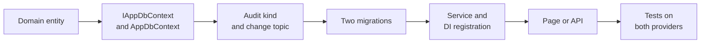

# Recipes for common changes

Step-by-step guides for the changes people make most often, naming the files to touch in the order the layers need
them, and the test or CI check that catches a missed step. They follow how recent features were built: saved hunt
queries (#76), outreach templates and the outreach follow-up reminder (#78), and triage splits with their grouping
settings (#82). It's for a developer who knows the layout in [getting-started.md](getting-started.md#project-structure-in-brief).
Before changing a rule, read [reference/business-rules.md](../reference/business-rules.md).

**Contents**

- [Add an entity or a column, and its migration](#add-an-entity-or-a-column-and-its-migration)
- [Add a permission or a role capability](#add-a-permission-or-a-role-capability)
- [Add a page or a route](#add-a-page-or-a-route)
- [Add an operational setting (changed in the app)](#add-an-operational-setting-changed-in-the-app)
- [Add a server-only configuration key](#add-a-server-only-configuration-key)
- [Add an email template](#add-an-email-template)
- [Add a background job or a reminder kind](#add-a-background-job-or-a-reminder-kind)
- [Add an API endpoint and its scope](#add-an-api-endpoint-and-its-scope)
- [Add a webhook event](#add-a-webhook-event)
- [Add a hunt query dialect](#add-a-hunt-query-dialect)
- [Add an indicator kind](#add-an-indicator-kind)
- [Make a page live (a ChangeFeed topic)](#make-a-page-live)
- [Add a user preference](#add-a-user-preference)
- [Add an ADR](#add-an-adr)

Every recipe ends the same way: run `dotnet test`, update the docs that describe the behaviour in the same commit,
and add a line to the next release's *Notes* in [UPGRADE.md](../UPGRADE.md) when an upgrade behaves visibly
differently.

## Add an entity or a column, and its migration

Example: the `TriageSplit` table (#82), or a new optional field on an article.



1. **Domain.** Add the class or property in `src/Tide.Domain/Entities/<Area>.cs`.
   - A new table derives from `Entity` (a `Guid` id made in code, never by the database) or, when it should record
     who made and last changed it, `AuditableEntity` (stamped by `AuditInterceptor`).
   - Put each length on the entity as a constant (`public const int MaxName = 256;`) so the service and the mapping
     share it.
   - A new enum value is appended with an explicit number. Enums are stored as numbers: never renumber one.
2. **The context.** Add the `DbSet` to `IAppDbContext` (`src/Tide.Application/Abstractions/Abstractions.cs`) and to
   `AppDbContext` (`src/Tide.Infrastructure/Persistence/AppDbContext.cs`), then map it in `OnModelCreating`:
   - every string gets `HasMaxLength` (SQL Server enforces it; SQLite doesn't, which is why the tests'
     `ColumnLengthCheck` exists). A length over 4000 becomes `nvarchar(max)`, so validate in the service too;
   - indexes for what the service filters and orders by;
   - foreign keys with an explicit delete behaviour. A row that belongs to an article uses the `OfArticle` helper
     (cascade delete and an index); an `AuditableEntity` calls `Audited(e)`; a person stored as id and name uses
     `Person`.
3. **Audit.** Every saved entity is audited by default. Name the new kind for people in `AuditKinds`
   (`src/Tide.Application/History/AuditLogService.cs`), so the audit log's kind filter reads "Triage split" rather
   than the type name. Only bookkeeping rows nobody edits go in `AuditInterceptor.NotAudited`.
4. **Live updates.** If an open page shows the rows, map the entity to its topic in `ChangeInterceptor.TopicsOf`
   (`src/Tide.Infrastructure/Persistence/ChangeInterceptor.cs`): see [Make a page live](#make-a-page-live).
5. **Migrations, both providers.** From the repository root, after `dotnet tool restore`, with the same `<Name>`:

   ```bash
   # SQLite (development and tests)
   dotnet ef migrations add <Name> --project src/Tide.Infrastructure --startup-project src/Tide.Web --context AppDbContext --output-dir Persistence/Migrations

   # SQL Server (production)
   TIDE_MIGRATIONS_PROVIDER=SqlServer dotnet ef migrations add <Name> --project src/Tide.Migrations.SqlServer --startup-project src/Tide.Web --context AppDbContext --output-dir Migrations
   ```

   In PowerShell, set `$env:TIDE_MIGRATIONS_PROVIDER = 'SqlServer'` for the second command and remove it after
   (`Remove-Item Env:\TIDE_MIGRATIONS_PROVIDER`). `AppDbContextFactory` (design time) reads it; no database is
   contacted. Read both generated files: they should make the same change.
6. **Existing rows.** A new NOT NULL column on a table with rows needs a default. A migration that also moves data
   (an `UPDATE` in `Up`) gets a case in `tests/Tide.IntegrationTests/MigrationFillTests.cs`.
7. **Never edit a released migration.** A migration that shipped in any `v*` tag is never edited, removed, renamed or
   regenerated: databases installed from that release would stop upgrading. To change what it made, add a migration.
   Editing `AppDbContextModelSnapshot.cs` is normal.
8. **Service.** Read and write the field in the feature's service (`src/Tide.Application/<Area>/`), check the
   caller's permission (throw `ForbiddenException`), validate lengths and ranges (throw `ArgumentException` with a
   sentence a person can act on). Open a context per operation from `IAppDbContextFactory`. Register a new service in
   `src/Tide.Application/DependencyInjection.cs` (`AddScoped`) and give `TestDb` a factory method for it
   (`tests/Tide.IntegrationTests/TestDb.cs`).
9. **Configuration bundle.** If it's setup an administrator would copy to another server (as sources, scorecard tags,
   query templates and holidays are), carry it in `ConfigBundle` and `ConfigBundleService`
   (`src/Tide.Application/Operations/`).
10. **Tests.** A round trip through the service; a provider theory (`TestDb.Providers`) if the queries order, compare
    dates, change case or update in bulk; the permission refusals.
11. **Docs.** [architecture/data-model.md](../architecture/data-model.md).

**Caught by:** CI's "No un-migrated model changes" (a model change with no migration, either provider), "Released
migrations are immutable", the `sql-server` job (migrations applied twice on real SQL Server, then the upgrade test),
and `ColumnLengthCheck` in every integration test.

## Add a permission or a role capability

Roles are fixed bundles of permissions in code; AD groups grant roles ([ADR 0002](../decisions/0002-permissions-as-code.md)).
Most new features need a new **capability** (a row in the role table) rather than a new permission: reuse the
narrowest existing permission when one fits.

**A new capability with existing permissions** (as "Save, edit, retire and restore saved hunt queries", #76):

1. Check the permission in the service: `if (!user.Has(Permission.WorkActions)) throw new ForbiddenException("…");`.
   A qualifier such as "own team's" is a further check in the service.
2. Add a row to `Capabilities.All` (`src/Tide.Application/Security/Capabilities.cs`): its group, the activity in
   words, the check that decides it (`"SavedQueryService.RequireWrite"`) and its grants (`G(...)`, or `Q("qualifier", ...)`).
3. Hold the row to the code in `tests/Tide.IntegrationTests/CapabilitiesTests.cs`: add a probe to `Probes` (the
   service call that should be refused for roles without it), or the page types to `Pages` when the row is a page's
   policy.
4. Rewrite the table in `docs/INSTALL.md`: `TIDE_UPDATE_DOCS=1 dotnet test tests/Tide.IntegrationTests --filter "FullyQualifiedName~CapabilitiesTests"`,
   then review the diff.

**A new permission** (rare):

1. Append it to `Permission` in `src/Tide.Domain/Enums/AppEnums.cs` with the next number and a summary.
2. In `src/Tide.Application/Security/Security.cs`: add a constant to `Policies`, an entry to `Policies.Required`
   (`Program.cs` registers one policy per entry, requiring the permission claim), a line to `Policies.Describe`, and
   grant it to roles in `RoleDefinitions.SystemRoles`. Administrators get every permission automatically.
3. Nothing else is needed for sign-in: `RoleClaimsTransformer` (Windows) and `DevAuthenticationHandler` (dev) add a
   claim for each permission the roles grant, and `PermissionRevalidatingAuthStateProvider` re-derives them for open
   sessions every two minutes.
4. If API tokens should carry it, add it to a scope's grants in `ApiScopes.All` (see
   [Add an API endpoint](#add-an-api-endpoint-and-its-scope)).
5. Pages and the sidebar use it: `[Authorize(Policy = Policies.X)]` on the page, `Requires` on its `NavPages` entry,
   `CurrentUser.Has(Permission.X)` to hide a button.
6. Then add the capability rows as above.
7. **Docs:** [architecture/security.md](../architecture/security.md).

**Caught by:** `CapabilitiesTests.EachRow_MatchesTheServiceCheck_ForEachRole`, `EveryRow_IsHeldToACheckHere`,
`EachPageRow_NeedsWhatItsPagesPolicyRequires`, `EveryAdminPage_IsAdministersAndSoIsEveryAdministrationRow` and
`TheInstallGuidesTable_IsTheCodesTable`.

## Add a page or a route

**A page** (as `SavedQueriesPage.razor`, #76):

1. Create `src/Tide.Web/Components/Pages/<Name>.razor`:

   ```razor
   @page "/hunts/saved"
   @attribute [Authorize(Policy = Policies.ReadActions)]
   @inject SavedQueryService SavedSvc
   @inject ToastService Toasts
   @inject ChangeFeed Feed
   @inject ChangeOrigin Origin
   @implements IDisposable

   <PageTitle>Saved queries · TIDE</PageTitle>

   <div class="tide-page-head">
       <div>
           <h1>Saved queries</h1>
           <div class="tide-sub">What the page is for, in a sentence.</div>
       </div>
   </div>
   ```

2. **Authorize every page** with the narrowest policy. The fallback policy only requires sign-in.
3. **Data** comes from an Application service. Never query the database from a component and never hold a context.
4. **States.** `LoadingBlock` while loading; `EmptyState` saying what would be there and what to do; errors through
   `Toasts.Error(UserFacingError.For(ex))`, which logs the unexpected ones with a reference.
5. **URL state.** Filters and views go in the query string (`[SupplyParameterFromQuery]`), so a view is bookmarkable.
   Read each parameter as `string?` and parse it (`FilterValues.Id`, `Number`, `Flag`, `TableView.PageFrom`): a typed
   one (`Guid?`, `int?`, `bool?`) whose value doesn't parse fails the whole page. Never put an indicator value in a URL.
6. **Live.** If colleagues change what it shows, listen with `LiveChanges` (see
   [Make a page live](#make-a-page-live)) and dispose it with the page.
7. **Navigation.** Add a `NavPage` to `NavPages.All()` (`src/Tide.Web/Components/Layout/NavPages.cs`): key, label,
   Bootstrap icon, href (relative, no leading slash), group and the permissions it needs. The sidebar and the
   command palette both read it.
8. **Tests.** Add the path to `WebAppTests.PagePaths` (rendered for the dev user on SQLite and on SQL Server), and
   update `NavMenuTests`, `PaletteTests` and `ViewerVisitorAppTests` where they list links.

**An administration page:** put it in `Components/Pages/Admin/`, add `@layout AdminLayout`, use
`[Authorize(Policy = Policies.Administer)]` (`CapabilitiesTests` refuses anything else there), title it
`<h1 class="tide-admin-title">` (`AccessibilityTests.AnAdminPage_ItsTitleIsTheOneH1`), and add it to a group in
`AdminLayout.Groups` (`src/Tide.Web/Components/Layout/AdminLayout.razor`) with a one-line `About`, which the
Overview's index shows.

**A route that isn't a page** (a download, an export, a preview) is a minimal API in `src/Tide.Web/Program.cs`:

- an export or anything that renders whole briefs: `.AsExport()` (or `.AsExport(Policies.Administer)`), which
  requires the policy, applies the exports rate limit (60 a minute per person) and sends `Cache-Control: private,
  no-store` (`src/Tide.Web/Api/ExportEndpoints.cs`);
- a file: `.RequireAuthorization().RequireRateLimiting("files")`, and let the service decide per file;
- an anonymous route (avoid): `.AllowAnonymous()` and its path in `Get-TideAnonymousPaths` in
  `deploy/lib/TideIis.ps1`, or IIS's Windows authentication refuses it. `DeployScriptTests` checks the two agree.

A page `GET` that's refused or not found redirects to `/access-denied` or `/not-found`; any other route keeps its
real status code (`UseStatusCodePages` in `Program.cs`).

**Docs:** [product/screens.md](../product/screens.md) and the workflow page the screen belongs to.

## Add an operational setting (changed in the app)

The rule: operational settings are changed in the app and audited; security-sensitive and infrastructure settings
stay on the server ([operations/configuration.md](../operations/configuration.md)). Example:
`Intake:GroupWindowHours` (#82).

1. **The options property.** Add it, with the server's default, to the options class that reads the section
   (`IntakeOptions` in `src/Tide.Application/Intake/IOutboundHttp.cs`, `ReminderOptions` in `Actions/Reminders.cs`,
   `OrgOptions`, `CveOptions`, `MetricImportOptions`, `UpdateOptions`, `DistributionOptions`, `FileStoreOptions`).
   Code reads it through `IOptionsMonitor<T>.CurrentValue`, never `IOptions<T>`, so a saved change applies at once.
2. **`appsettings.json`.** Add the key to its section at the same default, and describe it on the section's `"//"`
   line, including that an administrator sets it in the app.
3. **`OperationalSettings`** (`src/Tide.Application/Settings/OperationalSettings.cs`):
   - a constant for the key, which is the configuration key it overrides (`"Intake:GroupWindowHours"`);
   - a rule in `Rules`: `Switch`, `Number("what it is", min, max)`, `Time(...)`, or a function that normalizes the
     value and throws `ArgumentException` saying what's wrong. It runs on save, on bundle import and on read;
   - a line in the matching `Apply(SavedSettings, TOptions)` that lays the saved value over the options.
   An options class not yet overlaid needs `Overlay<T>(services, OperationalSettings.Apply)` in
   `src/Tide.Application/DependencyInjection.cs` and an `Apply` overload.
4. **`SettingsCatalog.InApp`** (`src/Tide.Application/Operations/SettingsCatalog.cs`): a `SettingInfo` with its group,
   label, key and `EditedIn` page. Setting sources, Server configuration and the configuration bundle read this list,
   so the bundle carries the setting with no further change.
5. **The page.** Show and edit it on the administration page `EditedIn` names, saving through
   `OperationalSettingsService.SaveAsync` (administrators only, all values or none, then `SavedSettings` refreshes and
   every overlaid option reloads).
6. **Tests.** Validation (`OperationalSettings.Problem`), a round trip, the bundle carrying it, and the page
   (`OperationalSettingsTests.cs`, `OperationalSettingsPagesTests.cs`).
7. **Docs:** [operations/configuration.md](../operations/configuration.md).

**Caught by:** `OperationalSettingsTests.TheCatalog_ListsEachOperationalSettingInTheApp_AndNotOnTheServer` (every
operational key is in `SettingsCatalog.InApp` once, and not in `Server`), and `DeployScriptTests` (no in-app key may
be pinned by the upgrade's server settings).

Settings with their own service (edition ceilings and recipients in `DistributionSettings`, SLA targets in
`SlaSettings`, rotation manager emails, the update check's switch in `UpdateSettings`) follow the same storage (a
`Settings` row keyed by the configuration key) but validate in that service. Model a new one on them only when it
needs more than a single value's check.

## Add a server-only configuration key

For hosting, security, network and size limits, secrets, and anything that must not change without a server
administrator. Example: `Intake:MaxResponseKB`.

1. **The options property**, with its default, on the options class bound to the section (`services.Configure<T>(...)`
   in `src/Tide.Application/DependencyInjection.cs` or `src/Tide.Infrastructure/DependencyInjection.cs`). Clamp it
   where it's used (`Math.Clamp`), so a bad value can't do harm.
2. **`src/Tide.Web/appsettings.json`.** Add the key at its default and describe it on the section's `"//"` line. A
   secret stays blank here, with a note to set it as an environment variable on the app pool (`Ai__ApiKey`).
3. **`SettingsCatalog.Server`.** Add a `SettingInfo` with its group and label. Mark a secret `SettingKind.Secret` (the
   pages show only whether it's set, and the audit log masks it), an address `SettingKind.Url` (shown without any
   credentials), a connection string `SettingKind.ConnectionString`.
4. **The upgrade.** If an older install's `appsettings.Production.json` should gain the key so administrators see it,
   add its path to `Get-TideServerSettingPaths` in `deploy/lib/TideSettings.ps1`; a secret or a development-only key
   goes in `Get-TideServerSettingExclusions` instead. If a first install should set it from the answers file, add it
   to `deploy/appsettings.Production.template.json` and `deploy/tide.config.template.psd1`.
5. **Docs:** [operations/configuration.md](../operations/configuration.md) and, for an installer answer,
   [INSTALL.md](../INSTALL.md).

**Caught by:** `DeployScriptTests.Every_server_setting_the_upgrade_adds_is_in_appsettings_json_and_set_on_the_server_only`.

## Add an email template

The notification emails an administrator can reword live in `EmailTemplateCatalog`
(`src/Tide.Application/Distribution/EmailTemplates.cs`). The brief's own email is not a template. Example: the
outreach follow-up (#78).

1. **The template.** Add a `public static readonly EmailTemplate` with an id (stable: it's part of each saved row's
   key, `EmailTemplate:{id}:{Subject|Heading|Body}`), a title, a description saying when it's sent and what turns it
   on, a default subject, heading and Markdown body, and its tokens. Reuse the shared tokens (`ActionList`,
   `RotationLink`, ...). Mark a token `Html: true` when TIDE writes markup into it (a table, a link), and
   `Required: true` when the body can't leave it out.
2. **List it** in `EmailTemplateCatalog.All`, in the order the Email templates page shows them.
3. **Send it.** Render with `EmailTemplateStore.Render(template, values)`, giving a value for every token, and wrap
   it in the shell the senders share (`EmailComposer`: `Shell`, the marking line, `ToText`), as
   `ReminderService.FollowUpAsync` does. Text values are encoded by the renderer; only `Html` tokens go in as written.
4. **Preview values.** Add sample values for any new token in `EmailTemplateService.Samples`, so the page's preview and
   test send show something real.
5. **Tests.** `tests/Tide.UnitTests/EmailTemplateTests.cs` and `tests/Tide.IntegrationTests/EmailTemplateTests.cs`
   (defaults pass their own checks, a saved wording is used, a reset removes the rows, the bundle carries it).
6. **Docs:** [workflows/administration.md](../workflows/administration.md) and the workflow that sends it.

The configuration bundle carries saved parts with no further change (`EmailTemplateCatalog.IsKey`).

## Add a background job or a reminder kind

### A reminder or digest email (a `ReminderKind`)

Reminders run inside one hosted service (`ReminderHostedService`, every five minutes), each kind off until enabled,
each sent once (a `NotificationMark` per thing sent). Example: `ReminderKind.OutreachFollowUp` (#78).

1. **The kind.** Append it to `ReminderKind` (`src/Tide.Application/Actions/Reminders.cs`).
2. **Its options.** Add a `Toggle` (or a class with its own values) to `ReminderOptions`, and a case in
   `ReminderOptions.IsEnabled`. Add the keys, off, to `Notifications` in `appsettings.json` and its `"//"` line.
3. **The scan.** In `ReminderService`: a case in the `RunAsync` switch calling your scan, and in `IsTime` if it isn't
   at the daily reminder time. The scan finds what's due, sends one email per recipient (batched), leaves out who opted
   out, and calls `MarkAsync` with a key per thing sent, as soon as it went, so nothing is sent twice. It runs as the
   system, not a person.
4. **Its email.** A template, as in [Add an email template](#add-an-email-template).
5. **People's choice.** If people may turn it off, add a constant to `UserPreferences`
   (`src/Tide.Application/Preferences/UserPreferenceService.cs`) and a `NotificationKind` to `NotificationKinds.All`
   (`Preferences/NotificationKinds.cs`) naming the scans that send it. My notifications lists it.
6. **The administrator's switch.** Make the switch and any values operational settings (see
   [Add an operational setting](#add-an-operational-setting-changed-in-the-app)), and add the kind's name and
   description to the reminders section of `Components/Pages/Admin/TeamsAdmin.razor`, which also offers "Run now".
7. **Tests.** The scan (who gets it, opt-outs, marks stop a repeat), `NotificationPreferenceTests`, the email template.
8. **Docs:** [workflows/actions-and-hunting.md](../workflows/actions-and-hunting.md) or the matching workflow, and
   [operations/configuration.md](../operations/configuration.md).

### A new background job

Model it on `ReminderHostedService` or `WebhookHostedService` (`src/Tide.Web/Services/`, `src/Tide.Web/Api/`):

1. **The work** is a method on an Application service that takes a `CancellationToken` and returns a short detail
   ("3 posted"). It runs in a fresh scope with no signed-in user, so its saves are audited as `system`.
2. **The hosted service** is a `BackgroundService` that loops: create a scope, call the service inside
   `JobMonitor.RunAsync(job, ...)`, catch and log a failure (the app must keep running), call
   `JobMonitor.Scheduled(job, enabled, nextDue)`, then wait. Read its interval and switch from `IOptionsMonitor<T>` on
   each pass. Register it with `builder.Services.AddHostedService<T>()` in `Program.cs`.
3. **Diagnostics.** Add a `JobDefinition` (key, name, schedule in words) to `JobMonitor`
   (`src/Tide.Application/Operations/JobMonitor.cs`) and to `JobMonitor.All`. Administration › System › Diagnostics
   lists it.
4. **One run at a time.** TIDE runs as one process ([ADR 0001](../decisions/0001-blazor-server-on-prem.md)), so a guard
   in memory is enough when a person can also start the work: a singleton like `SourcePollGuard` or a static
   `SemaphoreSlim`, as `ReminderService` uses.
5. **Off by default** if it reaches outside the server ([ADR 0009](../decisions/0009-intake-reaches-out-only-when-asked.md)),
   with its switch an operational setting.
6. **Docs:** [architecture/backend.md](../architecture/backend.md) and
   [operations/troubleshooting.md](../operations/troubleshooting.md).

## Add an API endpoint and its scope

The API is under `/api/v1`, signed in by a token or as a person, through the services the pages use
([ADR 0016](../decisions/0016-api-tokens-scopes-and-signed-webhooks.md), [API.md](../API.md)).

1. **The service method** in `src/Tide.Application/Api/ApiService.cs` (or the feature's own service), returning API
   records, never entities. A read that carries article content takes the caller's ceiling
   (`ApiTokenAuthenticationHandler.Ceiling(user)`) and cuts at the lower of it and the team edition's.
2. **The scope**, if no existing one fits: a constant in `ApiScopes` (`src/Tide.Application/Api/ApiTokens.cs`,
   `area:verb`), and a `Scope` in `ApiScopes.All` with what it allows in words and the permissions it grants (the
   ones the service checks). The API access page lists `ApiScopes.All` when a token is issued.
3. **The endpoint** in `MapTideApi` (`src/Tide.Web/Api/ApiEndpoints.cs`), ending in `.Scope(ApiScopes.X)`. The group
   already requires sign-in, applies the API rate limit (120 a minute per caller), turns `ForbiddenException`,
   `KeyNotFoundException`, `StaleEditException` and `ArgumentException` into problem details, and sends `no-store`.
4. **The description.** Add the path to the hand-written OpenAPI document in `src/Tide.Web/Api/OpenApi.cs`, with
   "Scope: x" at the end of its summary, and any new schema.
5. **Tests** in `tests/Tide.IntegrationTests/ApiTests.cs`: a token without the scope gets 403; with it, the answer;
   a token whose ceiling is below the content doesn't get it; a write is audited under the token's name.
6. **Docs:** [API.md](../API.md).

## Add a webhook event

Webhooks are posted by `WebhookService.DeliverDueAsync` (`src/Tide.Application/Api/Webhooks.cs`), run every minute by
`WebhookHostedService`.

1. **The name.** Add a constant (`"area.happened"`) and append it to `WebhookService.Events`. The API access page
   offers every event in that list. A hook stores its events as one space-separated string of at most 200 characters
   (`Webhook.Events`), so keep names short.
2. **Find what happened.** In `DeliverDueAsync`, when the hook subscribes to the event, add the rows stamped after the
   hook's watermark (`SentUpToUtc`) and no later than `upTo` (now less `SettleDelay`, 30 seconds, so an uncommitted
   save isn't passed) to `due`, each with a stable id (`"{event}:{row id}"`) so a receiver can drop a repeat. A daily
   event follows the overdue pattern (`OverdueSentFor`) instead.
3. **Hold it to the team edition's ceiling.** Leave out anything raised from an article above it, and mark what's
   posted with its article's TLP, as `Action(a)` does. A receiver is treated as at least as wide as the team edition.
4. **The payload** is a small record built by a static method beside `Action` and `Sent`. Don't post more than the
   receiver needs.
5. **Tests** in `ApiTests.cs` with `FakeWebhookPoster`: posted once, not before it settles, left out above the
   ceiling, retried after a failure. Make it a provider theory if it orders or compares dates.
6. **Docs:** [API.md](../API.md#webhooks).

Existing hooks don't start receiving a new event: an administrator adds it.

## Add a hunt query dialect

Hunt queries are generated text from templates; TIDE never signs in to a SIEM
([ADR 0006](../decisions/0006-query-dialects-are-templates.md)).

1. Implement `IQueryDialect` as a private class in `QueryDialects` (`src/Tide.Application/Actions/HuntQueries.cs`):
   a `Key` of at most 16 characters (stored on each hunt, saved query and template), a `Name`, how it writes a comment
   and a list of string literals (`QueryDialects.Quote` escapes a value), and a default template per
   `HuntValueKind` it covers, with `{{values}}` and optionally `{{days}}`. Kinds without a template are named in a
   comment, never dropped.
2. Append it to `QueryDialects.All`. The Query templates page, the saved queries page and the hunt panel all list it.
3. Write its golden file: the golden test is a theory over `QueryDialects.All`, so it fails until
   `tests/Tide.UnitTests/Golden/<key>.txt` exists. Run with `TIDE_UPDATE_GOLDEN=1` (see
   [testing.md](testing.md#golden-files)), then read the file as an analyst would.
4. **Docs:** [workflows/actions-and-hunting.md](../workflows/actions-and-hunting.md).

## Add an indicator kind

1. Append it to `IndicatorType` (`src/Tide.Domain/Enums/AppEnums.cs`).
2. Teach the normalizer to detect, refang and defang it: `IocObservable` (`src/Tide.Domain/Observables/IocObservable.cs`).
3. Name it: `IndicatorLabels` (`src/Tide.Application/Indicators/IndicatorLabels.cs`) and its place in the badge order
   (`src/Tide.Web/Components/Shared/Badges.cs`).
4. Export it: its STIX pattern in `Stix` (`src/Tide.Application/Exports/Stix.cs`). The CSV carries the type's name.
5. If text extraction should find it, add it to `IocExtractor` (`Kept` and its pattern). If search should match its
   family (as an email address with an account), see `SearchService` and `SearchText`.
6. **For hunts:** map it in `HuntValues.KindOf`. If SIEMs keep it in a field of its own, append a `HuntValueKind`
   (`AppEnums.cs`), give it a `HuntValues.Label`, and add a default template to each dialect that covers it.
   `HuntValueKind` is stored as a number in `QueryTemplates` and by name in the configuration bundle: never renumber
   or rename one.
7. **Tests:** `IndicatorTests` (detection, refang, defang), the golden files (add a fixture row in
   `HuntQueryTests.Fixture` and regenerate), `ExportTests`.

## Make a page live

A page that shows shared data follows colleagues' changes without a reload. `ChangeFeed`
(`src/Tide.Application/Abstractions/ChangeFeed.cs`) carries topics; `ChangeInterceptor` publishes them after every
committed save, so every save path through `SaveChangesAsync` is heard.

1. **The topic.** Reuse one if it covers the data. Otherwise add a constant for a list
   (`public const string SavedQueries = "saved-queries";`) or a function for one record
   (`public static string Action(Guid id) => $"action:{id}";`) to `ChangeFeed`, with a summary saying what it covers.
2. **Publish it from saves.** Map the entity in `ChangeInterceptor.TopicsOf`
   (`src/Tide.Infrastructure/Persistence/ChangeInterceptor.cs`). A child row maps to its parent's topic
   (`ActionComment x => [ChangeFeed.Action(x.ActionId)]`). The topics are read before the save and published only
   once it commits (or its transaction does).
3. **Publish it yourself where the interceptor can't see.** A bulk `ExecuteUpdateAsync` or `ExecuteDeleteAsync` goes
   straight to the database and passes no save interceptor, and so does an event that isn't a save (a poll brought
   items). Publish the topic after it, with who did it and the circuit it came from, as `Triage.razor`'s `Announce`
   does after triaging (`Changes.Publish(new Change(ChangeFeed.Triage, Me.UserId, Me.DisplayName, Origin.Id))`), or
   `ChangeFeed.Publish(topic)` for something no one in particular did.
4. **Listen.** Inject `ChangeFeed` and `ChangeOrigin`, create a `LiveChanges` in `OnInitialized` with a filter on the
   topic, the component's `InvokeAsync`, and what to do with the changes heard, and dispose it with the page
   (`@implements IDisposable`). It skips the page's own circuit's saves and waits for a burst to settle (600 ms)
   before one call:

   ```csharp
   _live = new LiveChanges(Feed, Origin, c => c.Topic == ChangeFeed.SavedQueries, InvokeAsync, async heard =>
   {
       if (_busy) return;   // a step of this page's own is under way, and will show theirs
       _list = await SavedSvc.ListAsync();
       Toasts.Show($"{LiveChanges.Who(heard)} updated the saved queries.");
       StateHasChanged();
   });
   ```

   The filter runs on the publisher's thread: read only what's safe there.
5. **Unsaved edits.** A page with nothing unsaved re-reads in place and names the colleague in a toast. A page with
   unsaved edits never reloads over them: it keeps them and shows `ChangedElsewhere`
   (`src/Tide.Web/Components/Shared/ChangedElsewhere.razor`) with who saved, what, what saving now would do
   (`Consequence`: refused where an edit version guards it) and a Reload button, as `ActionPage.razor`,
   `BriefPage.razor` and `OutreachTemplatesPage.razor` do. A form open in a list keeps what's typed and re-reads only
   the rest; when its row leaves the page (retired, deleted or renamed away by a colleague), the team libraries
   (`LibraryPage.EditingOffPage`) show the form above the list instead, so it can still be saved or cancelled.
6. **Lists.** To mark rows that arrived, changed or left, use `LiveMarks` and `LiveDiff` (`src/Tide.Web/Services/LiveRows.cs`).
7. **Tests:** a colleague's save reaches the page, and an open edit survives it (`LiveTests.cs`, `LivePagesTests.cs`,
   `LiveRowsTests.cs`).
8. **Docs:** [architecture/collaboration.md](../architecture/collaboration.md).

The feed is in memory, one per process ([reference/known-issues.md](../reference/known-issues.md#scale)).

## Add a user preference

A person's own choice of how a page is shown to them, kept on the server so it follows them (`UserPreference` rows,
keyed by user id and name). No migration is needed.

1. **Define it** in `UserPreferences` (`src/Tide.Application/Preferences/UserPreferenceService.cs`): a constant for the
   name (`"area.thing"`, at most 64 characters, never renamed once shipped: it's stored), constants for its values
   (at most 200 characters), and a `Definition` in `Known` with the values (the default first) and the permission
   that opens its page. A notification choice is a `NotificationKind` instead (see the reminder recipe).
2. **Read and save** through `UserPreferenceService.GetAsync` and `SetAsync`, as `ActionsBoard.razor` does for
   `actions.layout` and `Search.razor` for `hunt.dialect`. A stored value that's no longer one of the values reads
   as the default.
3. It isn't audited (`AuditInterceptor.NotAudited`) and isn't in the configuration bundle: it's one person's.
4. **Tests:** as `ActionsLayoutPreferenceTests.cs`: the default, a saved choice, a refused value, someone without the
   permission refused.

## Add an ADR

Add one when a choice would surprise a new contributor ([decisions/README.md](../decisions/README.md)).

1. Copy the shape of the latest: `docs/decisions/00NN-short-kebab-title.md`, numbered after the last, with a title
   stating the decision, then **Status** (Accepted), **Recorded** (the date), and the sections *Context*, *Decision*
   and *Consequences*.
2. Add a row to the table in `docs/decisions/README.md`.
3. Refer to it from the code it shapes (`// ADR 0019`) and from the architecture page that describes it.
4. Once accepted, don't rewrite it: write a new ADR that supersedes it, and mark the old one's status
   "Superseded by 00NN".
