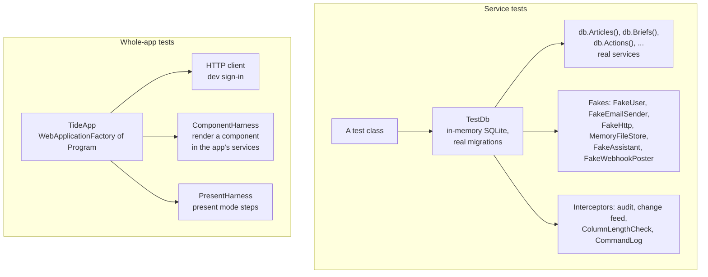
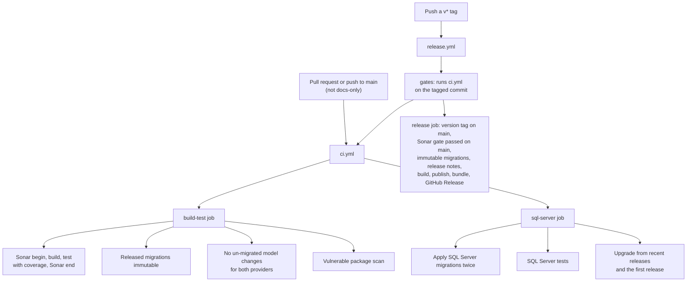

# Testing

How TIDE is tested: the two test projects and what each covers, how to run part of them, the harness the
integration tests share, the tests that need SQL Server, the golden files, the TLP leak tests, what CI runs on every
change and before a release, and what no automated test covers. It's for a developer about to change code or review a
change.

**Contents**

- [The test projects](#the-test-projects)
- [Running tests](#running-tests)
- [The integration harness](#the-integration-harness)
- [SQL Server tests](#sql-server-tests)
- [Golden files](#golden-files)
- [Tests that keep docs in step](#tests-that-keep-docs-in-step)
- [The TLP leak tests](#the-tlp-leak-tests)
- [The scale harness](#the-scale-harness)
- [Continuous integration](#continuous-integration)
- [The upgrade test](#the-upgrade-test)
- [What isn't covered](#what-isnt-covered)

## The test projects

Both projects use xUnit 2 and FluentAssertions, collect coverage with coverlet, and compile `tests/Shared` in
(`TestClock`, `ShiftedClock`, `ManualClock`, `StaticOptionsMonitor<T>`). Test doubles are hand-written; there is no
mocking library.

| Project | References | Size | Covers |
|---|---|---|---|
| `tests/Tide.UnitTests` | Domain, Application, Infrastructure | About 1,450 tests (about 20 s) | Pure logic, no database and no host. |
| `tests/Tide.IntegrationTests` | Every `src` project, `Microsoft.AspNetCore.Mvc.Testing` | About 2,350 tests (about 3 minutes on a developer machine) | Services against SQLite with the real migrations; the whole app over HTTP; components rendered in the app's services; a few on real SQL Server. |

### What the unit tests cover

| Area | Files (in `tests/Tide.UnitTests`) |
|---|---|
| Edition cutting by TLP, and its golden file | `BriefEditionTests.cs` |
| The email and SharePoint renderings (the leak tests), corrections, the team's opening note | `BriefRendererTests.cs`, `CorrectionRendererTests.cs`, `TeamNoteRenderTests.cs` |
| Hunt query dialects (golden files), recommended actions, outreach filling | `ActionTests.cs` (`HuntQueryTests`), `RecommendedActionTests.cs`, `OutreachFillTests.cs` |
| SLA and working days, the org clock, rotation rules, periods | `ActionTests.cs`, `WorkingDaysTests.cs`, `RotationTests.cs`, `PeriodTests.cs` |
| Metric rules, charts, CSV import, entry progress | `MetricMathTests.cs`, `MetricChartsTests.cs`, `MetricCsvTests.cs`, `MetricEntryProgressTests.cs` |
| Feed and CVE parsing (including a refused XXE), URL canonicalization, title matching, sponsored filter, triage grouping, starter sources | `IntakeTests.cs`, `SponsoredFilterTests.cs`, `TriageGroupsTests.cs`, `StarterSourcesTests.cs` |
| Indicator extraction and normalization | `IndicatorTests.cs` |
| Exports (STIX and CSV golden files) | `ExportTests.cs` |
| Search text, history formatting, audit log kinds, email templates | `SearchTextTests.cs`, `HistoryFormatterTests.cs`, `AuditLogTests.cs`, `EmailTemplateTests.cs` |
| AI assist and article cleanup | `AssistTests.cs`, `ArticleCleanupTests.cs` |
| Markdown safety and the toolbar's output; root-relative links under a sub-path and in email | `MarkdownToolbarOutputTests.cs`, `Audit/AdversarialTests.cs` (`MarkdownInjectionTests`), `RootRelativeLinkTests.cs` (the page side in `Tide.IntegrationTests/RootRelativeLinkPageTests.cs`) |
| Hostile input: CSV injection, extraction timing on hostile text, hostile XML | `Audit/AdversarialTests.cs`, `Audit/SecurityAuditTests.cs`, `Audit/BackendAuditTests.cs` |
| The deploy scripts, run in PowerShell; the install answers file; release versions | `DeployScriptTests.cs`, `DeployWebSocketTests.cs`, `InstallAnswersTemplateTests.cs`, `UpgradeCommandTests.cs`, `Audit/InfraAuditTests.cs` |
| Source hygiene: every `--tide-*` token used is defined; no HTML entity in a Razor attribute | `StyleTokenTests.cs`, `RazorAttributeTests.cs` |

### What the integration tests cover

Files are named after the feature they test (`DistributionTests.cs`, `RotationTests.cs`, `ApiTests.cs`,
`OutreachTests.cs` and so on). Files named `*BugRound*`, `BugPass*` or `*Round*` pin defects found in a review round,
one test per defect. The `Audit/` folder holds the regression tests from the security, backend, frontend and
infrastructure audits:

| File | Holds |
|---|---|
| `Audit/AdversarialTests.cs` | Role-by-role attacks over HTTP and through services (`AnalystApp`, `ActionOwnerApp` and others), path traversal on the file endpoints, cross-origin circuit requests, TLP leaks. |
| `Audit/SecurityAuditTests.cs` | The auth-mode guard, how a Windows sign-in's groups become roles, and re-checking an open session. |
| `Audit/BackendAuditTests.cs` | Defects found in the services and the data layer. |
| `Audit/FrontendAuditTests.cs` | Pages kept open from one record to the next, confirmations that act on what they counted, steps that can't run twice. |
| `Audit/InfraAuditTests.cs` | Outbound HTTP (redirects, private addresses), directory lookups that hang. |
| `Audit/ScaleAuditTests.cs` | The opt-in scale harness (below). |

`CapabilitiesTests.cs` holds each row of the "What each role can do" table to the service check or page policy it
names, for every role.

## Running tests

```bash
dotnet test                                    # everything, on SQLite
dotnet test tests/Tide.UnitTests               # one project
dotnet test --filter "FullyQualifiedName~Tide.UnitTests.HuntQueryTests"   # one class
dotnet test --filter "FullyQualifiedName~DistributionTests.Send_Public"   # tests whose name starts so
dotnet test --filter "DisplayName~SqlServer"   # only the SQL Server rows (needs TIDE_TEST_SQL)
dotnet test -c Release --collect "XPlat Code Coverage;Format=opencover"   # as CI runs it, with coverage
```

The filter syntax is the standard `dotnet test --filter` one: `FullyQualifiedName`, `DisplayName` and `ClassName`
with `=`, `!=` or `~` (contains), joined with `|` or `&`.

Environment variables the tests read:

| Variable | Effect |
|---|---|
| `TIDE_TEST_SQL` | A SQL Server connection string with no database. Turns on the `[SqlServerFact]` tests and the SQL Server rows of provider theories. |
| `TIDE_UPDATE_GOLDEN=1` | Golden-file tests write what the code produces into `tests/Tide.UnitTests/Golden` instead of comparing. |
| `TIDE_UPDATE_DOCS=1` | `CapabilitiesTests.TheInstallGuidesTable_IsTheCodesTable` writes the code's role table into `docs/INSTALL.md`. |
| `TIDE_SCALE` (and `TIDE_SCALE_OUT`) | Runs the scale harness and writes its timings and SQL there. |

## The integration harness



### `TestDb`: services on SQLite

`tests/Tide.IntegrationTests/TestDb.cs` builds an in-memory SQLite database with the real SQLite migrations applied,
so a test runs against the schema production's development twin has. The migrations run once per test run, into a
template database (`Database.Migrate()`), and each `TestDb` copies the template with SQLite's backup API: the same
tables, migrations history and seeded rows, without replaying 40-odd migrations for every test. It implements
`IAppDbContextFactory`, so services get a short-lived context per operation exactly as in the app. Every context
carries:

- `AuditInterceptor` and `ChangeInterceptor`, as the app wires them (`TestDb.Feed` is the change feed a test can
  listen to);
- `ColumnLengthCheck`, which fails a save that writes a string longer than its column. SQLite keeps any length, and
  SQL Server refuses it, so this catches in SQLite what would fail in production;
- `CommandLog` (`TestDb.Commands`), which counts SQL commands and records their text, and can run a hook just before
  a matching command (`Before`) to stage a race;
- a retrying execution strategy (`RetryingStrategy`), as production's SQL Server has, so a transaction a service opens
  must run inside the strategy.

`TestDb` also has factory methods for the services wired as the app wires them: `db.Articles()`, `db.Briefs()`,
`db.Actions()`, `db.Distribution()`, `db.Api()`, `db.Reminders()` and the rest. A new service gets one here. Its
`User` is a `FakeUser` whose roles a test sets; `PlainContext()` gives a context with no interceptors, for seeding
many rows quickly. `connectionPerContext: true` gives each context its own connection to a named in-memory database,
for a test that runs services at the same moment.

The fakes, all in `TestDb.cs` unless noted:

| Fake | Stands in for |
|---|---|
| `FakeUser` | `ICurrentUser`, with the given roles' permissions. |
| `FakeEmailSender`, `HeldEmailSender`, `ThrowingEmailSender` | `IEmailSender`: records each email; holds it until released; faults mid-send (unknown outcome). |
| `FakeSmtpServer` (`SmtpTests.cs`) | A minimal SMTP server on loopback, for the real `EmailSender` (no TLS or sign-in). |
| `MisbehavingSmtpServer` (`EmailOutcomeTests.cs`) | An SMTP server on loopback that fails one chosen way (never answers after the data, drops the connection after it, refuses the sender, refuses the session), for which sends are Unknown and which Failed. |
| `FakeHttp` | `IOutboundHttp`: answers GETs from canned responses by address prefix, records what was asked. |
| `FakeSecrets`, `FakeWebhookPoster` | Webhook secret protection and posting. |
| `FakeAssistant` | `IThreatIntelAssistant` (the AI provider). |
| `MemoryFileStore` | `IFileStore`. |
| `TestHostEnvironment` | A host whose content root is the temp folder. |

An email template's root-relative links ("/rotation") need the app's address, so `EmailTemplateRenderer.Render` and
`EmailTemplateStore` take it explicitly: a test passes one, or says it has none (`appUrl: null`,
`new EmailTemplateStore(null)`). `TestDb.EmailTemplates` uses `https://tide.example.org`.

### `TideApp`: the whole app over HTTP

`TideApp` (`WebAppTests.cs`) is a `WebApplicationFactory<Program>` in the Development environment: the dev sign-in,
a SQLite file in its own temp folder (`Pooling=False`), and `Files:RootPath` and `Email:PickupDirectory` in that folder
too. So it runs `DatabaseInitializer`, migrations and the sample data exactly as `dotnet run` does. Subclasses change
who is signed in by overriding `Role`: `ReaderApp` (Reader) and `ActionOwnerApp` (ActionOwner) beside it, and in
`Audit/AdversarialTests.cs` `AnalystApp` and others. Reuse one of these rather than declaring another with the same
role. `PathBase` runs it under a sub-path. Use it as a class fixture
(`IClassFixture<TideApp>`); `WebAppTests.Pages_Render_ForTheDevUser` reads every main page.

`ComponentHarness` renders one component in the real app's services, signed in as someone (`SignIn`), and hands the
component over so a test can do what a button would and read the markup after. It uses ASP.NET Core's own
`HtmlRenderer`, not a third-party component-testing library. `PresentHarness` wraps it for present mode. Its
`baseUri` argument (`http://localhost/tide/`) renders the component as if TIDE ran under a sub-path.

A page that listens for changes elsewhere (`LiveChanges`) reloads 600 ms after it hears one, on a real timer. A test
that needs a page *not* to have heard something yet mustn't race that timer. `MeetingClockApp`, the fixture of the
present-mode tests, gives the app a `ManualClock`, so present mode's reloads never fire on their own: the test hands
the page a change with `OnChangedElsewhere` when it wants it heard.

### Conventions for tests

- Name tests `Method_State_Expectation`.
- Order what you assert on: SQL Server returns rows in no particular order, and ties fall either way. Don't rely on
  case.
- A test of a rule that counts days takes a clock (`TestClock`, `ManualClock`), never `DateTime.Now`.
- Don't wait real time to put two things in order (`Task.Delay` between two saves so that one is "later"): the clock
  ticks in about 15 ms steps on Windows, and a tie falls either way. Move the service's `TestClock` on, or set the
  stamps explicitly.
- A test of something only Windows has (robocopy, Task Scheduler, Windows paths) is a `[WindowsFact]`
  (`tests/Tide.UnitTests`), which is reported as skipped elsewhere. Don't `return` early: on CI's Linux runner that
  counts as a pass.
- A rendered page hears a colleague's save by itself, through its live feed, once `LiveChanges.Pause` has passed. A
  test that says the page hasn't heard a save yet makes it from the page's own origin (its scope's
  `IAppDbContextFactory`), which the feed skips, and hands the change over with `OnChangedElsewhere` when it means to;
  otherwise a slow run delivers it between the test's steps (`PresentMidMeetingTests.Unheard`).
- A test of a time limit (a probe's timeout, the typing pause) runs the limit on a `ManualClock` and moves it on, rather than timing it with a stopwatch: a loaded CI machine's slow timers then can't fail it. A test that something is done in one pass counts its SQL commands (`TestDb.Commands`) rather than timing it.
- To wait for a rendered page to hear something, use `Rendered.Until(p => ...)`: it reads the page on the renderer's thread, so it never catches a reload halfway (one field re-read, the next not yet). To wait for another thread (a directory call's own thread, a late answer), use `Poll.Until` (`tests/Shared`) and then assert; never a fixed `Task.Delay`. `HtmlOnce` waits up to 15 seconds.
- In `TideApp`, a confirmation toast stays until something dismisses it (its `ToastService` runs on a `ManualClock`), so a test can read it after a step that took more than its four seconds on a loaded machine. `ToastServiceTests` holds the four and ten seconds themselves.

## SQL Server tests

A test of code whose queries SQL Server could run differently from SQLite (ordering and ties, `DateTimeOffset`
comparisons, case, `ExecuteUpdate`, subqueries, `Contains`) runs on both. Make it a theory over the providers and take
the provider's database first:

```csharp
[Theory]
[MemberData(nameof(TestDb.Providers), MemberType = typeof(TestDb))]
public async Task Something_Holds(string provider)
{
    _db = _db.On(provider);
    ...
}
```

On SQLite that's the class's own database. On SQL Server it's a throwaway `tide_test_<guid>` database with the schema
made from the model (`EnsureCreated`: the migrations are proven by CI applying them), dropped afterwards
(`SqlServerFactAttribute.NewDatabase`).

A test that only makes sense on SQL Server is a `[SqlServerFact]` (`SqlServerFactAttribute.cs`). One that needs the
whole app on SQL Server uses `SqlServerTideApp`, which migrates its own database at startup, as production does.
`WebAppTests.EveryPage_RendersOnSqlServer` reads every page that way: SQL Server answers a query asynchronously where
SQLite returns before the first await, so a page that reads state set after its first await renders on SQLite and
fails on SQL Server.

The SQL Server rows run only when `TIDE_TEST_SQL` holds a server's connection string with no database in it, so the
default run needs nothing installed and never passes one vacuously. CI's `sql-server` job runs them on every change.
To run them locally against a Docker container, see
[getting-started.md](getting-started.md#a-throwaway-sql-server-in-docker).

## Golden files

Some outputs are compared, character for character, with a file in `tests/Tide.UnitTests/Golden` (copied to the
test output by `Tide.UnitTests.csproj`):

| File | Test | What it pins |
|---|---|---|
| `kql.txt`, `xql.txt`, `fql.txt` | `HuntQueryTests.Build_MatchesTheGoldenFile` (`ActionTests.cs`), a theory over `QueryDialects.All` | The hunt query each dialect writes for one indicator of each kind. |
| `editions.txt` | `BriefEditionTests.Build_MatchesTheGoldenEditions` | What each edition carries at each ceiling. |
| `export.csv`, `export.stix.json` | `ExportTests` | The indicator CSV and the STIX 2.1 bundle. |

To accept a deliberate change, run the tests with `TIDE_UPDATE_GOLDEN=1` (the files are written to the source folder,
not the output folder), then review the diff before committing it:

```bash
TIDE_UPDATE_GOLDEN=1 dotnet test tests/Tide.UnitTests --filter "FullyQualifiedName~HuntQueryTests"
git diff tests/Tide.UnitTests/Golden
```

A new dialect in `QueryDialects.All` needs its own golden file: the theory has a row for it, which fails until the
file exists (see [recipes.md](recipes.md#add-a-hunt-query-dialect)).

## Tests that keep docs in step

| Test | Keeps in step |
|---|---|
| `CapabilitiesTests.TheInstallGuidesTable_IsTheCodesTable` | The "What each role can do" table in `docs/INSTALL.md`, between its `capabilities:start` and `capabilities:end` comments, with `Capabilities.Markdown()`. `TIDE_UPDATE_DOCS=1` rewrites it. |
| `DeployScriptTests` | Every setting the upgrade adds (`Get-TideServerSettingPaths` in `deploy/lib/TideSettings.ps1`) is in `appsettings.json` and set on the server only; every anonymous endpoint in `Program.cs` is opened by the installer (`Get-TideAnonymousPaths`). |
| `DeployWebSocketTests` | `docs/INSTALL.md` and `docs/UPGRADE.md` mention the WebSocket feature the scripts install. |
| `OperationalSettingsTests.TheCatalog_ListsEachOperationalSettingInTheApp_AndNotOnTheServer` | `SettingsCatalog` lists every operational setting, once, as edited in the app. |

## The TLP leak tests

TIDE's central promise is that nothing leaves the app above the ceiling of the audience it's for
([architecture/editions-and-tlp.md](../architecture/editions-and-tlp.md)). These tests hold every exit to it:

| Exit | Tests |
|---|---|
| The edition cut itself | `BriefEditionTests` (`Build_Public_LeavesOutArticlesAboveTheCeiling`, `…RestrictedBulletsAndScreenshots_IncludingCaptions`, `Build_APartCountsAtItsArticlesTlp_WhenThatsHigher`, `Build_WhyItMatters_HasItsOwnTlp_AndIsWithheldAboveTheCeiling`, the opening note, the golden file) |
| The email and SharePoint copy | `BriefRendererTests` (`Email_Public_CarriesNothingAboveTheCeiling`, `SharePoint_Public_IsPlainSemanticHtml_WithNothingRestricted`, `ARestrictedWhyItMatters_IsLeftOutOfThePublicEdition`, `Email_AnOpeningNoteAboveTheCeiling_IsNotInTheEmailTextOrSharePointCopy`), `DistributionTests.Send_Public_EmailsOnlyWhatTheCeilingAllows_AsCidImages`, `Audit/AdversarialTests.TheCompanyWideEdition_NeverCarriesAnArticleAboveTheCeiling` |
| Previews and the published archive | `BriefPreviewTests`, `ReaderPreviewTests`, `PublishedTests` (a Reader never sees an AMBER or unpublished article, not even through the filter) |
| Corrections after a send | `CorrectionTests` (a company-wide correction never repeats a part raised above the ceiling, on either side, even after the ceiling is lowered) |
| Exports | `ExportTests` (integration and unit) |
| The API and webhooks | `ApiTests.ABrief_IsCutAsTheTeamEditionIs_AtTheLowerCeiling`, `ActionsFromAnArticleAboveTheTokensCeiling_AreWithheld`, `Webhooks_LeaveOutActionsAboveTheTeamCeiling_AndMarkEachWithItsArticlesTlp` |
| Outreach emails and AI drafting | `OutreachTests.WritingTheEmail_HoldsTheArticleToTheTemplatesCeiling_…`, `AssistTests.AboveTheLimit_NothingIsSent_NorCopied` |
| Our stack | `CommentsAndStackDecisionTests.AProductsPage_NamesOnlyArticlesAtOrBelowTheTeamCeiling_AndCountsTheRest` |
| Screenshots for a Reader | `ReaderTests` in `WebAppTests.cs` (a Reader never gets the sample brief's unsent screenshots) |

A change to anything that renders or sends a brief, an export, the API or a webhook should add a case here.

## The scale harness

`Audit/ScaleAuditTests.HotCalls_AtScale` seeds about two years of a busy team into `TestDb` (10,000 articles, half
briefed; 2,000 briefs of five articles; 5,000 actions with comments, events and checklists; 50,000 feed items; 2,000
metric values; a three-person rotation), then times the hot service calls and counts the SQL each runs. It's off
unless `TIDE_SCALE` is set (it takes a minute or two), and writes a timings table and every command's text to
`TIDE_SCALE_OUT` (or the temp folder). It runs on in-memory SQLite, so its timings compare calls with each other
rather than predict SQL Server: see [reference/performance.md](../reference/performance.md).

```bash
TIDE_SCALE=1 TIDE_SCALE_OUT=./scale dotnet test tests/Tide.IntegrationTests --filter "FullyQualifiedName~ScaleAuditTests"
```

## Continuous integration

Two workflows live in `.github/workflows`. Scripts they call live in `tools/ci` and `tools/upgrade-test`.



### `ci.yml`

Runs on pull requests and pushes to `main`, and is called by the release workflow. Changes that touch only `**/*.md`,
`docs/**`, `LICENSE` or `.gitignore` don't trigger it. A newer run for the same ref cancels an older one.

**`build-test`** (Ubuntu, .NET `10.0.x`):

| Step | Fails when |
|---|---|
| SonarQube Cloud analysis begin and end (project `jashley92_Tide2`), around the build and test | The quality gate fails (`sonar.qualitygate.wait=true`). Skipped when `SONAR_TOKEN` is absent (forks) and on tags. |
| Build (`-c Release`) | The build or an analyzer error fails. `AnalysisLevel` is `latest-recommended`. |
| Test, with OpenCover coverage | Any test fails. |
| Released migrations are immutable (`tools/ci/check-migrations-immutable.sh`) | A migration in any `v*` tag reachable from HEAD was edited, renamed or deleted, in either set (the model snapshots may change). |
| No un-migrated model changes | `dotnet ef migrations has-pending-model-changes` finds a model change with no migration, for SQL Server or SQLite. |
| Vulnerable package scan | `dotnet list package --vulnerable --include-transitive` reports one. |
| Deprecated package report | Never; informational. |

Sonar's settings: PowerShell files (`**/*.ps1`, `**/*.psd1`) are left out of analysis; migrations are left out of
coverage and duplication; Razor components, JavaScript and PowerShell are left out of coverage (no coverage tooling);
`xml:S5734` is ignored for `web.config`, because `SecurityHeadersMiddleware` sends `X-Content-Type-Options` on every
response.

**`sql-server`** (Ubuntu, a SQL Server 2022 service container with a throwaway `sa` password):

1. Applies the SQL Server migrations to a fresh database, twice (the second is a no-op).
2. Runs `dotnet test tests/Tide.IntegrationTests --filter "DisplayName~SqlServer"` with `TIDE_TEST_SQL` set.
3. Runs the upgrade test from each of the three newest release tags reachable from HEAD, and the first release.

### `release.yml`

Runs on a pushed `v*` tag. Its `gates` job runs `ci.yml` on the tagged commit (a tag can sit on a commit CI never ran,
such as a docs-only one). The `release` job then requires the tag to be on `main`, asks SonarQube Cloud whether the
quality gate passed for that commit on `main` (`tools/ci/check-sonar-quality-gate.sh`, because CI skips Sonar on
tags), checks the migrations again, extracts the release notes from `docs/UPGRADE.md`
(`tools/ci/extract-release-notes.sh`), builds and publishes with the tag's version, assembles the bundle (the app, the
`deploy` folder, `migrations-sqlserver.txt`, `VERSION.txt`), zips it with a SHA-256, and creates the GitHub Release
(a pre-release for `-alpha`, `-beta` or `-rc` tags). How releases are cut is in [UPGRADE.md](../UPGRADE.md).

### Other checks

- **CodeQL** runs through GitHub's default setup (repository settings), not a workflow here.
- **Dependabot** (`.github/dependabot.yml`) proposes updates to the SHA-pinned GitHub Actions and to NuGet packages
  weekly, after a seven-day cooldown.
- **Snyk** isn't configured in this repository: no workflow or policy file names it. **Needs verification:** whether
  a Snyk check is attached to pull requests through a GitHub integration outside the repository; the checks listed on
  a recent pull request would confirm it.

## The upgrade test

`tools/upgrade-test/upgrade-path.sh <from-ref> [<to-ref>]` proves a database made by an older release upgrades in
place on real SQL Server:

1. It checks out `<from-ref>` into a temporary worktree, builds it, and starts it in Development against a fresh
   database, so it migrates and seeds the sample articles, briefs and actions (writing audit rows as it goes).
2. It stops that, then starts `<to-ref>` (default: your working tree, uncommitted changes included) against the same
   database and the same data root (files and key ring), as an IIS upgrade does.
3. It requires the new build to report Healthy, every one of its migrations to be recorded, and the old release's
   articles, briefs, actions and audit rows to be intact.

To run it locally from a release to your working tree, against the Docker container in
[getting-started.md](getting-started.md#a-throwaway-sql-server-in-docker):

```bash
TIDE_TEST_SQL="Server=127.0.0.1,21433;User Id=sa;Password=<the password>;TrustServerCertificate=True;Encrypt=False" \
SQLCMD="docker exec tide-test-sql /opt/mssql-tools18/bin/sqlcmd -C -S localhost -U sa -P <the password>" \
  bash tools/upgrade-test/upgrade-path.sh v0.1.0-alpha.1
```

| Variable | Meaning |
|---|---|
| `TIDE_TEST_SQL` | The server, with no `Database=`. |
| `SQLCMD` | How to run `sqlcmd` against it (default `sqlcmd`). |
| `UPGRADE_TEST_PORT` | The local port for the app under test (default 5198). |
| `UPGRADE_TEST_KEEP_DB=1` | Keeps the upgraded database afterwards and prints its name. |

On Windows, if the app can't listen ("access permissions" on bind), its port is in a range Windows has reserved
(`netsh interface ipv4 show excludedportrange protocol=tcp`): set `UPGRADE_TEST_PORT` to one outside them.

## What isn't covered

| Not covered automatically | Why, and what does cover it |
|---|---|
| Windows (Negotiate) sign-in against a real domain | Tests build Windows-style principals and stub the role directory (`Audit/SecurityAuditTests.cs`). After install, `deploy/Verify-Install.ps1` checks the site refuses an anonymous request (401); a real sign-in is checked by hand ([INSTALL.md](../INSTALL.md#5-check-it)). |
| IIS hosting, the installer and the upgrader end to end | `DeployScriptTests` parses every script and runs the pure functions in PowerShell; the IIS and SQL steps aren't run. |
| A real SMTP relay with TLS or sign-in | `FakeSmtpServer` speaks plain SMTP on loopback; the relay is checked from Diagnostics after install. |
| Real feeds, CVE services, GitHub releases, Azure OpenAI | `FakeHttp` and `FakeAssistant` answer from canned responses. |
| Browser behaviour: the JavaScript in `wwwroot/js`, layout, focus, keyboard, drag and drop | No browser runs in CI. Component tests check markup and semantics (`AccessibilityTests`, `MarkdownToolbarTests`), not script behaviour. Two scripts' logic runs in Node over a small stand-in for the page (`FilterMenuKeysTests` for `filters.js`, `AutogrowTests` for `autogrow.js`; Node must be on the PATH); the rest of the JavaScript has no tests, and none has coverage. |
| How the email looks in mail clients | Render tests check its structure; open the `.eml` from development in Outlook. |
| Long polling, reconnection after sleep, several server processes | Not simulated. TIDE runs as one process ([reference/known-issues.md](../reference/known-issues.md)). |
| Performance on SQL Server at volume | The scale harness runs on SQLite and is opt-in. See [reference/performance.md](../reference/performance.md). |
| A DBA-applied schema (`Database:ApplyMigrations=false`) | No test starts the app with it off, and no schema script ships ([reference/known-issues.md](../reference/known-issues.md)). |
