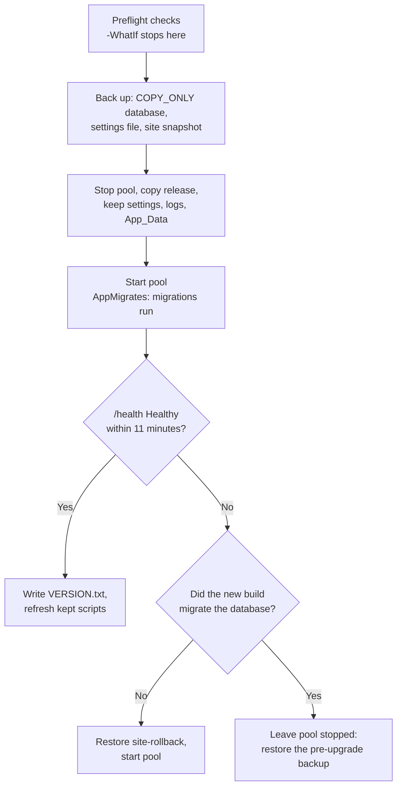

# Backup and recovery

What to back up so TIDE can be restored whole, how the scripts in `deploy/` do it, how to restore, what runs on a
schedule inside and outside the app, and how to watch that it's healthy. It's for the operator who runs TIDE in
production. The commands themselves are in [INSTALL.md](../INSTALL.md#6-back-up) and
[UPGRADE.md](../UPGRADE.md#upgrading-with-upgrade-tideps1); this page explains them and links there rather than
repeating them.

**Contents**

- [What to back up, and why together](#what-to-back-up-and-why-together)
- [The scripts](#the-scripts)
- [Restoring](#restoring)
- [What runs when](#what-runs-when)
- [Health endpoints and monitoring](#health-endpoints-and-monitoring)
- [Where it lives in code](#where-it-lives-in-code)

## What to back up, and why together

A TIDE install is four things. Back them up on the same schedule, and restore them together.

| Part | Where | What's in it | Lost without it |
|---|---|---|---|
| **The database** | SQL Server, the database the connection string names | Every article, brief, send, action, comment, the audit trail, users, role mappings, sources, and the in-app settings (the `Settings` table: ceilings, recipients, SLA, reminders, email templates; `Holidays`) | Everything. |
| **The files** | `Files:RootPath` (`<data root>\files`) | Screenshots, files on actions and their comments, hunt evidence, frozen copies of sent images, and the metrics drop folder (`metrics-inbox`) | Every image and file. The database lists each one by id, size and SHA-256 (ADR [0003](../decisions/0003-files-on-disk.md)), so a database restored without them shows broken images and downloads that 404. |
| **The key ring** | `DataProtection:KeyPath` (`<data root>\dp-keys`) | The keys that protect antiforgery tokens, circuit state, webhook signing secrets and the secrets saved in Administration › Secrets | Sign-ins and open forms reset (harmless). Webhook secrets and saved secrets can't be decrypted, so every webhook has to be added again and each saved secret saved again (Secrets marks them *Won't decrypt*). |
| **The server's settings** | The site's `appsettings.Production.json`, and the app pool's environment variables | The connection string, the data folders, email, intake limits, AI, sign-in mode; secrets (`Email__SmtpPassword`, `Cve__NvdApiKey`, `Ai__ApiKey`) | The app won't start, or starts against the wrong database or folders. |

**Why together.** The database and the files are one record: a row points at a file by id and hash, and a file is
only meaningful through its row. A database newer than its files has images that aren't there; files newer than the
database have orphans nobody can reach. The restore drill checks exactly this. The key ring belongs with the
database because the webhooks' secrets are rows encrypted with it.

**Not covered by any backup set:** the environment variables (record the secrets in your password vault, not in the
set), the IIS site and pool definitions (re-created by `Install-Tide.ps1`), and in-memory state that a restart clears
anyway (the reminder scans' last runs, the last CVE run, Diagnostics' job history).

**The configuration bundle is not a backup.** It carries setup (in-app settings, role mappings, sources, scorecard,
query templates, holidays) to copy to another server, and no content. See
[configuration.md](configuration.md#the-configuration-bundle).

**The key ring is tied to the machine.** `Program.cs` protects the key ring with machine-scope DPAPI
(`ProtectKeysWithDpapi(protectToLocalMachine: true)`). Restored to the same server, it reads. Restored to a different
server, the keys can't be decrypted: sign-ins reset and webhooks must be added again.
**Needs verification:** a restore drill onto a second server that confirms a webhook's secret can't be read there,
which would also confirm nothing else depends on the old ring.

If your organization's backup product backs up SQL Server (with log backups) and file shares, use it for the database
and the whole data root on the same schedule, and don't schedule `Backup-Tide.ps1`. Otherwise use the scripts.

## The scripts

All are Windows PowerShell 5.1 in `deploy/`; see [deploy/README.md](../../deploy/README.md). Install and upgrade keep a
copy beside the site (`<site folder>-deploy`), and scheduled tasks run that copy, so each upgrade refreshes them.

### Backup-Tide.ps1

Backs up one install as one set. A run:

1. Reads the site's `appsettings.Production.json` to find the database and the data folders.
2. Takes a full database backup `WITH CHECKSUM` (or `COPY_ONLY` with `-CopyOnly`, beside another product) and checks it
   with `RESTORE VERIFYONLY`.
3. Copies the files folder (screenshots, action files and the drop folder), the key ring, and the site's
   `appsettings.Production.json`.
4. Writes `backup-set.json`, naming the server, site and contents.
5. Keeps the newest `-Keep` (14) sets of this install. A failure removes the unfinished set and exits with code 1.

`-Log` takes a transaction-log backup instead. The database is in the FULL recovery model (`Install-Database.ps1` sets
it), so without log backups the log grows until the disk is full. `-Register` schedules both. The account it runs as,
and the grants `Install-Database.ps1 -BackupAccount` gives it, are in [INSTALL.md](../INSTALL.md#6-back-up).

A set is a folder `TIDE-<server>-<site folder>-<yyyyMMdd-HHmm>` (`lib/TideBackup.ps1`) holding `db\`, `files\files\`,
`files\dp-keys\`, `files\site\` and `backup-set.json`. Log backups go to `log\<server>-<site folder>\`. The script's
own help text still shows the older name `TIDE-<yyyyMMdd-HHmm>`. Lock the destination down as tightly as the data
root: the set holds the key ring.

### Test-TideRestore.ps1

The restore drill. It takes the newest set of this install (or `-BackupSet`) and:

- restores the database as a scratch database (`Tide_RestoreDrill_<server>_<site folder>`) on `-SqlInstance`, the
  live instance by default, or a recovery server's;
- runs `DBCC CHECKDB`;
- checks the restored database has TIDE's migration history;
- checks every screenshot the database lists is in the set at its recorded size, and that `-Sample` (200) of them, or
  all with `-HashAll`, match their SHA-256;
- checks the set holds the key ring and the site's settings file.

It writes `restore-check-<time>.json` into the set, drops the scratch database (unless `-KeepRestored`), and exits with
code 2 on a failed check. `-Register` schedules it every fourth Sunday. It refuses a scratch name that's the live
database.

### Upgrade-Tide.ps1

Every upgrade backs up and can roll back by itself ([UPGRADE.md](../UPGRADE.md#upgrading-with-upgrade-tideps1)):

- before deploying, a `COPY_ONLY` database backup (`-SkipDbBackup` when your product's is current), the site's
  `appsettings.Production.json`, and a snapshot of the site folder (`site-rollback`), under
  `<site folder's parent>\tide-upgrade-backups\<time>` (or `-BackupRoot`);
- after deploying, it polls `/health` for up to 11 minutes;
- if TIDE doesn't answer `Healthy`, it puts the previous files back and starts the pool, unless the new build had
  already migrated the database, in which case it leaves the pool stopped and says to restore the pre-upgrade backup.

## Restoring

### The whole install, on the same server

1. Stop the app pool.
2. Restore the set's `.bak` over the database `WITH NORECOVERY`, then the log backups taken after it in order, the
   last `WITH RECOVERY` (to a point in time with `STOPAT` if you're undoing a mistake).
3. Copy the set's `files\files` to the data root's `files`, and `files\dp-keys` to `dp-keys`, replacing what's there.
4. If the settings file was lost, copy `files\site\appsettings.Production.json` into the site folder, and set the
   environment variables from your vault.
5. Start the app pool, and check `/health` answers `Healthy` and **Administration › System › Diagnostics** is clean.

[INSTALL.md](../INSTALL.md#6-back-up) has the same steps in brief.

### On a new server

1. Install the prerequisites and run `Install-Database.ps1` and `Install-Tide.ps1` with the server's answers file
   ([INSTALL.md](../INSTALL.md)). Lost it? The old server's **Configuration bundle** page writes one; keep a copy.
2. Stop the pool, restore the database as above, and copy the files folder.
3. Copy `dp-keys` only if the server's machine key is the same; otherwise leave the new, empty ring. Then re-add each
   webhook on **Administration › API access** and give its new secret to the receiver.
4. Start the pool and verify (`Verify-Install.ps1`, Diagnostics).

### After a failed upgrade

The script rolls back by itself. When it couldn't, follow "Rolling back by hand" in
[UPGRADE.md](../UPGRADE.md#upgrading-with-upgrade-tideps1): restore `site-rollback` over the site folder (keeping the
settings file, `logs` and `App_Data`), restore the pre-upgrade database backup if the new build migrated, and start
the pool.

### One lost file

A single screenshot or file is a file under `Files:RootPath`, named by its id and fanned out into folders
(`DiskFileStore`). Copy it back from the newest set's `files\files` at the same relative path.

## What runs when

### Scheduled tasks (Windows Task Scheduler)

Created by `-Register`; each name ends with the site folder's name, so two sites on one server keep their own.

| Task | Runs | Default schedule | Fails as |
|---|---|---|---|
| `TIDE nightly backup (<site>)` | `Backup-Tide.ps1` | Daily at 01:30 (`-At`) | Exit code 1 |
| `TIDE log backup (<site>)` | `Backup-Tide.ps1 -Log` | Every 15 minutes (`-LogEveryMinutes`), not with `-CopyOnly` | Exit code 1 |
| `TIDE monthly restore drill (<site>)` | `Test-TideRestore.ps1` | Every fourth Sunday at 03:00 (`-At`) | Exit code 2 |

Alert on a task's last result, not only on its running.

### Hosted services (inside the app)

Each runs in the app pool's process, reports to `JobMonitor` (shown on Diagnostics), logs a failure, and tries again
at its next pass. None stops the app. An IIS pool that idles out would stop them too, so `Install-Tide.ps1` sets the
pool's `startMode` to `AlwaysRunning` and its idle timeout to zero. Don't change either.

**One process runs them.** Every process on the database asks for one lease (the `JobLeases` table) before each pass:
the holder runs the jobs, and any other (a web garden, an overlapping recycle, a standby server started by mistake)
skips its passes, so no reminder is sent twice. The lease is taken and renewed with one conditional `UPDATE` every 30
seconds (`JobUpkeepHostedService`) and lapses 3 minutes after its last renewal, so a standby takes over within a few
minutes of the holder dying, and within 30 seconds when the holder shuts down cleanly (it lets the lease go). The expiry is
compared on each server's clock, so keep the servers' clocks in sync (domain time is enough). Diagnostics names the
holder ("Job lease"), and on a standby says it's standing by. The installer and the upgrade also set the pool to one
worker process (`maxProcesses = 1`).

**Each run is kept** in the job history (the `JobRuns` table) for 30 days, pruned daily: the job, the server, when it
started and finished, whether it went well, and its summary or its error (scrubbed of credentials, at most 500
characters). At start-up each job's latest run is read back, so Diagnostics and `/health/jobs` know when it last went
well across a restart. Diagnostics shows each job's runs and failures over the 30 days, and the 10 latest failures.

**Each failure is logged** as a Warning (category `Tide.Application.Operations.JobMonitor`, "Background job … failed (N
in a row) …"), with an event id of its own per job, for an alert rule on one job:

| Event id | Job (Diagnostics name) |
|---|---|
| 7101 | Polling the sources |
| 7102 | Refreshing the CVE data |
| 7103 | Pruning old feed items |
| 7104 | Reminder and digest emails |
| 7105 | Metrics drop folder |
| 7106 | Update check |
| 7107 | Webhooks |

| Job (Diagnostics name) | Service | How often | When it does something |
|---|---|---|---|
| Polling the sources | `IntakeHostedService` | Every minute | `Intake:Enabled`; each source on its own interval, doubled per consecutive failure up to 16 times |
| Refreshing the CVE data | `IntakeHostedService` | Asked every minute | `Cve:Enabled`, every `Cve:RefreshHours` |
| Pruning old feed items | `IntakeHostedService` | Daily | Always: items past `Intake:RetentionDays`, kept texts past `Intake:ReadingDays` |
| Reminder and digest emails | `ReminderHostedService` | Every 5 minutes | Each kind when enabled and its time has come |
| Metrics drop folder | `MetricImportHostedService` | Every `Metrics:Import:PollMinutes`; every minute while off | `Metrics:Import:DropFolderEnabled` |
| Update check | `UpdateCheckHostedService` | 2 minutes after start, then every `Updates:CheckIntervalHours`; re-reads the switch every 5 minutes | `Updates:CheckEnabled` |
| Webhooks | `WebhookHostedService` | Every minute | A webhook is added |

### Timers and periodic work in the request path

| What | How often |
|---|---|
| An open page's roles re-derived (`PermissionRevalidatingAuthStateProvider`) | Every 2 minutes |
| A failed role-directory reload retried (`RoleDirectory`) | Every 30 seconds until it succeeds |
| A SID with no name, or a failed translation, asked again (`SidNames`) | After 5 minutes, or 1 minute |
| A person's AD name and email re-checked (`WindowsNames`) | Every 24 hours, when next seen |
| The user mirror written (`UserDirectory`) | At most every 30 minutes per person, unless something changed |
| Files moved out of the drop folder deleted | After 90 days |
| A send left "sending" read as outcome unknown | After 15 minutes |

## Health endpoints and monitoring

### Endpoints

All three answer without sign-in (the installer sets an anonymous carve-out for `/health` and the paths below it),
with status only and no detail. All are rate limited to 120 requests a minute per address.

| Endpoint | Checks | Answers |
|---|---|---|
| `/health/live` | Nothing: the process answers | `Healthy` |
| `/health` | Readiness: the database answers a query within 5 seconds (`DatabaseHealthCheck`) | `Healthy` or `Unhealthy`, as `text/plain` |
| `/health/jobs` | The background jobs (`JobsHealthCheck`, from memory: it asks the database nothing) | `Healthy`, `Degraded` (HTTP 200) or `Unhealthy` (HTTP 503), as `text/plain` |

Point IIS, a load balancer or an uptime monitor at `/health`. `Upgrade-Tide.ps1` and `Verify-Install.ps1` use it too.
While it's failing, one warning a minute is logged as `Tide.Health` ("Readiness is Unhealthy: database …"), not one
per probe.

Point SCOM, or an uptime monitor that reads the body, at `/health/jobs` as a second monitor: the app can answer
`/health` while its jobs have quietly stopped. A job that's turned on makes it:

- **Unhealthy** when it's **hung** (a run has gone on past the job's limit: 30 minutes for most, 2 hours for the CVE
  refresh, 10 minutes for the update check) or **overdue** (it last went well more than three of its intervals ago, at
  least 15 minutes, counted from when it was turned on or the process took the lease if that's later);
- **Degraded** when its last 3 or more runs failed.

A job that's off isn't counted, and a process standing by under the job lease answers `Healthy` (another runs the
jobs). Alert on `Unhealthy`, and on `Degraded` that lasts; Diagnostics says which job and why. A monitor that only
reads status codes sees `Degraded` as 200: match the body's word instead. While it isn't healthy, one warning a minute
is logged as `Tide.Health` ("Background jobs is Unhealthy: jobs …").

### Diagnostics

**Administration › System › Diagnostics** is the deeper check, for administrators: the build and uptime; the
database and whether its schema is current; the screenshot folder is writable (it writes and deletes one empty file);
the key ring is on disk; email is on, signs in properly, and isn't backed off; which sources are failing; each
background job's last run, result and next run, whether it's failing, overdue or hung, and its runs and failures over
30 days; which process holds the job lease (or that this one is standing by); whether the role mappings loaded; whether WebSockets are in use (this
page's connection and everyone's since start); and whether a newer release is out. It changes nothing.

### What to watch

| Watch | Where | Means |
|---|---|---|
| `/health` not `Healthy` | Your monitor | The database is down or slow, or the app isn't running. |
| `/health/jobs` `Unhealthy`, or `Degraded` for a while | Your monitor | A background job is hung, overdue, or keeps failing: Diagnostics says which. |
| Scheduled backup or drill task failed | Task Scheduler last result, or your monitoring of it | No usable set tonight, or a set that doesn't restore. |
| Critical entries | Windows Application log, source `.NET Runtime` | The role directory couldn't reload, or the server's AD domain can't be found. |
| "Background job … failed", event ids 7101 to 7107 | Application log | A background job failed (see [troubleshooting.md](troubleshooting.md)). |
| Disk on the data root and SQL log volume | Your monitor | Files grow with screenshots; the log grows without log backups. |
| Diagnostics checks not Ok | The page | Anything above, explained, with where to fix it. |

How to read the log, and how to raise its level, is in [INSTALL.md](../INSTALL.md#logs).

## Where it lives in code

| What | Where |
|---|---|
| Backup set, drill, task registration | `deploy/Backup-Tide.ps1`, `deploy/Test-TideRestore.ps1`, `deploy/lib/TideBackup.ps1` (`Register-TideTask`) |
| Upgrade backup and rollback | `deploy/Upgrade-Tide.ps1`, `deploy/lib/TideUpgrade.ps1` |
| Key ring | `src/Tide.Web/Program.cs` (data protection) |
| File store | `src/Tide.Infrastructure/Storage/DiskFileStore.cs` |
| Hosted services | `src/Tide.Web/Services/IntakeHostedService.cs`, `ReminderHostedService.cs`, `MetricImportHostedService.cs`, `UpdateCheckHostedService.cs`; `src/Tide.Web/Api/WebhookServices.cs` (`WebhookHostedService`) |
| Job reporting | `src/Tide.Application/Operations/JobMonitor.cs`, `JobHealth.cs`, `JobRunLog.cs` |
| Job lease | `src/Tide.Application/Operations/BackgroundJobLease.cs`, `src/Tide.Web/Services/JobUpkeepHostedService.cs` |
| Pool settings | `deploy/lib/TideIis.ps1` (`Set-TideSingleWorkerProcess`) |
| Health | `src/Tide.Web/Program.cs` (`MapHealthChecks`), `src/Tide.Web/Services/Services.cs` (`DatabaseHealthCheck`, `JobsHealthCheck`) |
| Diagnostics | `src/Tide.Web/Services/SystemDiagnostics.cs`, `src/Tide.Web/Components/Pages/Admin/DiagnosticsAdmin.razor` |
