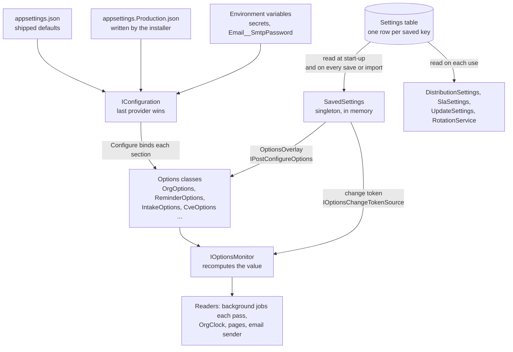
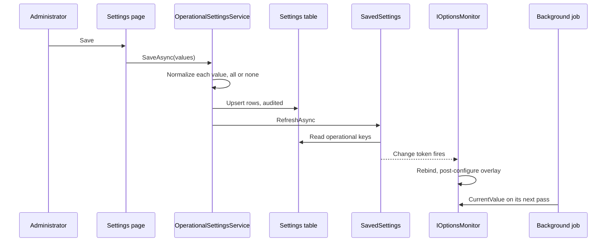

# Configuration

Every setting TIDE reads, where its value comes from, what it may be, who changes it and when a change takes effect.
It's for the operator who installs and runs TIDE and the administrator who tunes it in the app. For installing, see
[INSTALL.md](../INSTALL.md); for what each external system needs, see [integrations.md](integrations.md).

**Contents**

- [How configuration is layered](#how-configuration-is-layered)
- [When a change takes effect](#when-a-change-takes-effect)
- [Secrets and environment variables](#secrets-and-environment-variables)
- [Setting reference](#setting-reference): [hosting and sign-in](#hosting-and-sign-in), [role mapping](#role-mapping),
  [database](#database), [files](#files), [organization](#organization), [distribution](#distribution),
  [email](#email), [action SLA](#action-sla), [notifications](#notifications), [intake](#intake),
  [CVE enrichment](#cve-enrichment), [metric imports](#metric-imports), [AI drafting](#ai-drafting),
  [updates](#updates), [logging](#logging)
- [Settings kept only in the database](#settings-kept-only-in-the-database)
- [Email templates](#email-templates)
- [Holidays](#holidays)
- [The configuration bundle](#the-configuration-bundle)
- [Where it lives in code](#where-it-lives-in-code)

## How configuration is layered

TIDE follows one rule. Operational settings are changed in the app and audited. Security-sensitive and infrastructure
settings stay on the server: sign-in, hosting, the database, files, all of email, intake's proxy and network and size
limits, the CVE addresses and NVD key, AI drafting, and the update repository.

A value comes from up to four places. ASP.NET Core reads the first three into `IConfiguration`, the last one holding a
key wins. TIDE then lays the fourth over the options it binds.

1. `appsettings.json`, shipped with the app. Every key has a `"//"` comment saying what it does.
2. `appsettings.{Environment}.json`. In production that's `appsettings.Production.json`, which `Install-Tide.ps1`
   writes from `deploy/appsettings.Production.template.json` and every upgrade keeps. In development it's
   `appsettings.Development.json` (dev sign-in, `.eml` files instead of a relay, a localhost base address).
3. Environment variables, with `__` for `:` (`Email__SmtpPassword`). Set them on the IIS app pool. Secrets go here.
4. The `Settings` table. An administrator's save in Administration is a row keyed by the configuration key it
   overrides (`Notifications:DueSoon:Enabled`). The server's value is the default until a row exists.

### Two ways an in-app value is read

**Operational settings** (`OperationalSettings`) are the organization, reminders, intake, CVE enrichment, metric
imports, the update check's interval, SharePoint posting and zipped downloads. `SavedSettings` holds the saved rows in
memory. It reads them at start-up (in `Program.cs`, after `DatabaseInitializer`) and again after every save
(`OperationalSettingsService.SaveAsync`) or bundle import. `OptionsOverlay<SavedSettings, T>` is registered for
`OrgOptions`, `ReminderOptions`, `IntakeOptions`, `CveOptions`, `MetricImportOptions`, `UpdateOptions`,
`DistributionOptions` and `FileStoreOptions`. It is both an `IPostConfigureOptions<T>`, which applies the saved values
after binding, and an `IOptionsChangeTokenSource<T>`, which fires when `SavedSettings` changes. So everything that
reads through `IOptionsMonitor<T>` sees a new value at once, with no restart. `OrgClock` keeps a snapshot and replaces
it on each change.

A saved row that no longer passes its check (a hand-edited database, a rule tightened in a later release) is ignored
by `SavedSettings.RefreshAsync`, so the server's value holds. Two administrators saving at once can't undo each other:
refreshes run one at a time.

**The other in-app settings** are read from the `Settings` table each time they're used, with the server's value as
the fallback: the edition ceilings and recipient lists (`DistributionSettings`), the SLA targets (`SlaSettings`), the
update check's on/off (`UpdateSettings`) and the rotation's manager emails (`RotationService.ManagerEmailsAsync`).

### Seeing where a value comes from

- **Administration › System › Server configuration** lists every server setting in `SettingsCatalog.Server`, read-only.
  Secrets show only whether they're set.
- **Administration › System › Setting sources** shows each setting's effective value and its source: "Saved in
  Administration", `appsettings.Production.json (installer)`, an environment variable, `appsettings.json`, or
  "Default (unset)". `ConfigSource.Resolve` walks the live provider chain, so the answer is the real precedence.

`SettingsCatalog` doesn't list a few keys that are read: `Auth:AllowDevSignInOutsideDevelopment`, `DevAuth:*`,
`Intake:ReadingDays`, `Cve:MaxNvdPerRun`, `Cve:NvdDelayMs` and `Logging:*`. They work as described below but don't
appear on those two pages.

## When a change takes effect

| Kind | Takes effect | Examples |
|---|---|---|
| **In-app save** | At once, for everyone. Audited. | Everything in the "In app" column below. |
| **Server, read on each use** | At the next use after the file is saved. ASP.NET Core reloads JSON files on change, and `IOptionsMonitor<T>` follows. | `Email:*`, `Intake:TimeoutSeconds`, `Cve:NvdUrl`, `Ai:*` |
| **Server, read at start-up** | After the app pool recycles. | `Auth:Mode`, `Database:*`, `Intake:Proxy`, `App:BaseUrl`, `Files:RootPath` |
| **Environment variable** | After the app pool recycles, whatever the key: a process reads its environment when it starts. | `Email__SmtpPassword`, `Ai__ApiKey` |
| **Seed** | First start only, while the table is empty. | `RoleMapping:Groups` |

A server value that's also an in-app setting is only the default. Once an administrator has saved a value, editing
the file changes nothing until the saved row is gone. Setting sources shows which one is in force.

## Secrets and environment variables

Never put a secret in a JSON file. Save it in **Administration › Secrets**, where it's encrypted with the server's
Data Protection keys (`DataProtection:KeyPath`, themselves encrypted with DPAPI) before it's stored, so neither the
database nor any file holds it in plain text. Or set it as an environment variable on the app pool, which IIS keeps in
`applicationHost.config` unencrypted, readable by Administrators and SYSTEM. An environment variable wins over a saved
secret, so the server's administrator always has the last word. A saved secret takes effect at once; an environment
variable at the next recycle.

| Variable | Setting |
|---|---|
| `Email__SmtpPassword` | The relay account's password (with `Email:SmtpUsername`). |
| `Cve__NvdApiKey` | The NVD API key. |
| `Ai__ApiKey` | The Azure OpenAI key. |
| `ConnectionStrings__Default` | Only if the connection string needs a SQL password. The installer writes a `Trusted_Connection=True` string, which needs none. |

`SettingsCatalog.IsSecret` marks the first three as secrets, and any key named like one (`SecretMask.LooksSecret`), so
they show only as set or not. `Upgrade-Tide.ps1` never moves them into the file.

## Setting reference

Column guide. **Default** is the value TIDE uses when nothing sets the key (the `appsettings.json` value where there
is one, else the code default). **Where** is "Server" (file or environment variable only) or "In app" with the page.
**Effect** uses the kinds above.

### Hosting and sign-in

| Key | Default | Allowed values | Where | Effect |
|---|---|---|---|---|
| `Auth:Mode` | `Dev` | `Windows` (Negotiate) or `Dev`. Production refuses to start unless `Windows` (`AuthModeGuard.UseWindows`). Another non-Development environment needs `Auth:AllowDevSignInOutsideDevelopment`. | Server | Start-up |
| `Auth:AllowDevSignInOutsideDevelopment` | `false` | `true` lets a demo or QA environment (not Production) use dev sign-in. | Server | Start-up |
| `DevAuth:DisplayName`, `UserId`, `Upn`, `Email` | `Dev Analyst`, `S-1-5-21-DEV-1001`, `dev.analyst@example.com` | Dev sign-in only. | Server | Start-up |
| `DevAuth:Roles` | `["Analyst","Admin"]` in `appsettings.json` | Role names. No code default: the binder appends to an array, so a code default would stop you signing in with fewer roles. | Server | Start-up |
| `AllowedHosts` | `*` | Host names separated by `;`. The installer writes the site's name. A request for another name gets HTTP 400. | Server | Next request |
| `App:BaseUrl` | blank | The address readers reach TIDE at (`https://tide.example.org`). Used for links in email, webhooks and corrections (a Markdown link written from the root, `/actions/12`, among them), and as an allowed origin for the Blazor circuit (`CircuitOriginMiddleware`). Blank leaves links out. | Server | Start-up |
| `App:PathBase` | blank | A sub-path such as `/tide`, only behind a reverse proxy that forwards one. Letters, digits, `-`, `_`, `.` in `/`-separated parts; anything else stops start-up (`PathBaseSetting.Normalize`). Under IIS as an application within another site, IIS sets the path base and this stays blank. | Server | Start-up |
| `DataProtection:KeyPath` | blank (in-memory keys, development) | An absolute folder. A relative path stops start-up. The key ring is persisted there and protected with machine-scope DPAPI. The installer sets `<data root>\dp-keys`. Without it, every app-pool recycle signs everyone out, and webhook secrets can't be read. | Server | Start-up |

### Role mapping

| Key | Default | Allowed values | Where | Effect |
|---|---|---|---|---|
| `RoleMapping:Groups:{Role}` | empty arrays | Role names `Analyst`, `ActionOwner`, `Reader`, `Admin`, `Viewer`, `Visitor`. Groups as `DOMAIN\Group`, a bare `Group` (this server's domain) or a SID. An unknown role name is logged and skipped. | Server, then **Administration › Access & distribution** | Seed: copied into the `RoleMappings` table at first start only (`DatabaseInitializer.SeedRoleMappingsAsync`). After that, edit mappings in the app. |

The `appsettings.json` comment names only the first four roles. `AppRole` also has `Viewer` and `Visitor`, and the
seed accepts them.

### Database

| Key | Default | Allowed values | Where | Effect |
|---|---|---|---|---|
| `Database:Provider` | `Sqlite` | `Sqlite` (development) or `SqlServer` (production), in any case; blank is SQLite. Anything else stops start-up, naming the setting. | Server | Start-up |
| `Database:ApplyMigrations` | `true` | `true`: the app migrates its schema at start-up (the pool needs `db_owner`). `false`: a DBA applies the schema; start-up refuses to run with pending migrations. | Server | Start-up |
| `ConnectionStrings:Default` | `Data Source=App_Data/tide.db` | Required for SQL Server. The installer writes `Server=…;Database=…;Trusted_Connection=True;Encrypt=True;TrustServerCertificate=…;Application Name=TIDE`. | Server | Start-up |

### Files

| Key | Default | Allowed values | Where | Effect |
|---|---|---|---|---|
| `Files:RootPath` | `App_Data/files` | A folder; relative paths are under the content root. Production uses `<data root>\files`, outside the web root. The metrics drop folder is `metrics-inbox` under it. | Server | Start-up |
| `Files:MaxImageMB` | `15` | Megabytes, at least 1. Caps one screenshot. | Server | Start-up |
| `Files:MaxEvidenceMB` | `25` | Megabytes, at least 1. Caps any other file on an action or its comments. | Server | Start-up |
| `Files:ZipDownloads` | `RiskyOnly` | `RiskyOnly`, `Always`, `Never`: when an action's file downloads inside a zip with the password `infected`. When the zip comes first, a bare `/files/{id}/download` link redirects to it; only the "as is" link on the Files list (`?plain=` with a pass for that file and person, good for 10 minutes) sends the file plain, and under `Always` never; the API zips every file under `Always` too. | In app: **Teams & SLA** | At once |

### Organization

| Key | Default | Allowed values | Where | Effect |
|---|---|---|---|---|
| `Org:TimeZone` | `America/New_York` | An IANA id this server knows. The page offers the server's zones. | In app: **Organization settings** | At once |
| `Org:MeetingTime` | `10:30` | 24-hour `HH:mm`. | In app: **Organization settings** | At once |
| `Org:TeamName` | `Cyber Threat Intelligence` | 1 to 80 characters. Shown in the header, on slides and in emails. | In app: **Organization settings** | At once |
| `Org:ActionBesideSlide` | `false` | `true`: an action opened in a meeting shows beside the slide, which narrows for it, rather than over it. Turn it on after a rehearsal in the meeting room. | In app: **Organization settings** | At once |
| `Org:StaleOpenDays` | `2` | Whole number, 1 to 30. Business days an Open or In progress action may go without an update by a person before the meeting's **Actions that need review** slide lists it. | In app: **Organization settings** | At once |
| `Org:StaleBlockedDays` | `5` | Whole number, 1 to 30. The same for a Blocked action. | In app: **Organization settings** | At once |

A server `Org:TimeZone` that isn't a known zone stops start-up (HTTP 500.30). A saved one can't be invalid: the page
checks it.

### Distribution

| Key | Default | Allowed values | Where | Effect |
|---|---|---|---|---|
| `Distribution:PublicMaxTlp` | `Green` | `Clear`, `Green`, `Amber`, `AmberStrict`, `Red`. The company-wide edition carries nothing above it. Never above the team ceiling: a higher value is read as the team's. | In app: **Access & distribution** | At once (server default: start-up) |
| `Distribution:TeamMaxTlp` | `AmberStrict` | As above. The team edition and the meeting carry nothing above it. | In app: **Access & distribution** | At once (server default: start-up) |
| `Distribution:TeamRecipients` | `[]` | Email addresses, at most 200, separated by `;`, `,`, spaces or lines. Empty means the edition isn't emailed. An address outside the organization (`Email:OrganizationDomains`) that the list didn't have is asked about before it's saved. | In app: **Access & distribution** | At once (server default: start-up) |
| `Distribution:PublicRecipients` | `[]` | As above. Usually one distribution list. | In app: **Access & distribution** | At once (server default: start-up) |
| `Email:OrganizationDomains` | `[]` (the domain of `Email:From`) | Domain names, at most 20, separated by `;`, `,`, spaces or lines (a leading `@` is dropped), stored lower case. Each includes its subdomains. An address in none of them is outside the organization: every list that sends mail asks before saving one, and the emails about a team's requests to someone outside are held to the team edition's ceiling. Empty: the domain of `Email:From`. On the server, a JSON array. | In app: **Access & distribution** (server default too) | At once (server default: start-up) |
| `Distribution:RequireSharePoint` | `false` | `true`: a brief isn't finished until someone confirms its SharePoint copy was posted. | In app: **Access & distribution** | At once |

What the ceilings mean is in [editions-and-tlp.md](../architecture/editions-and-tlp.md).

### Email

All of email is server-only but `Email:OrganizationDomains`, which is listed under [Distribution](#distribution) as an
administrator sets it on Access & distribution. `EmailSender` reads its options on every send, so a corrected file applies at the next
send. See [integrations.md](integrations.md#smtp-relay) for behaviour.

| Key | Default | Allowed values | Where | Effect |
|---|---|---|---|---|
| `Email:Enabled` | `false` (`true` in development) | `false` sends nothing; send buttons say email is off. | Server | Next send |
| `Email:SmtpHost` | blank | The relay. Required unless `PickupDirectory` is set. | Server | Next send |
| `Email:SmtpPort` | `25` | A port. | Server | Next send |
| `Email:EnableSsl` | `true` | STARTTLS. Turn off only for a relay on this host or a trusted one without STARTTLS. | Server | Next send |
| `Email:SmtpUsername` | blank | An account to sign in as. Goes with `SmtpPassword`: both or neither. | Server | Next send |
| `Email:SmtpPassword` | blank | Secret. Set as `Email__SmtpPassword`. | Server (environment) | Recycle |
| `Email:SmtpUseDefaultCredentials` | `false` | `true` signs in as the app-pool account (on-premises Exchange). Can't be used with a user name or password (`EmailOptions.SignInProblem`). | Server | Next send |
| `Email:SmtpTimeoutSeconds` | `30` | Clamped to 5 to 300. A send the relay doesn't answer within it is recorded as outcome unknown (it may have gone), not failed, and isn't sent again by itself. | Server | Next send |
| `Email:From` | `tide@localhost` | The sender address. The relay must let TIDE send as it. Its domain is the organization's when `Email:OrganizationDomains` is empty. | Server | Next send |
| `Email:FromName` | `TIDE` | The display name. | Server | Next send |
| `Email:PickupDirectory` | blank (`App_Data/mail` in development) | A folder; messages are written there as `.eml` files instead of going to a relay. | Server | Next send |

### Action SLA

| Key | Default | Allowed values | Where | Effect |
|---|---|---|---|---|
| `Actions:Sla:Priority:P1` … `P4` | `1`, `3`, `10`, `20` | Business days, 0 to 260 (`ActionSla.MaxDays`). | In app: **Teams & SLA** | At once (server default: start-up) |
| `Actions:Sla:Kind:{Kind}` | none | Business days, 0 to 260; wins over the priority's. Kinds: `IocSweep`, `ThreatHunt`, `Block`, `PatchRemediate`, `ConfigChange`, `Awareness`, `Outreach`, `Other`. 0 or blank means "use the priority's". | In app: **Teams & SLA** | At once (server default: start-up) |

A key saved under a kind's earlier name (`Actions:Sla:Kind:VendorInquiry`, ADR 0019) is moved by a migration, and
`SettingsCatalog.Renamed` reads it from an older bundle.

### Notifications

All are in app on **Teams & SLA** and take effect at once. Times are in `Org:TimeZone`. Each scan is off until enabled
except the personal digest's offer. What each sends is in [INSTALL.md](../INSTALL.md#reminders-and-digests) and
[actions-and-hunting.md](../workflows/actions-and-hunting.md).

| Key | Default | Allowed values |
|---|---|---|
| `Notifications:ReminderTime` | `08:00` | `HH:mm`. Due soon, overdue, presenting, outreach follow-up, the external teams' reminders, the escalation ladder and the daily personal digest go at or after it on business days. |
| `Notifications:DueSoon:Enabled` | `false` | `true`/`false` |
| `Notifications:Overdue:Enabled` | `false` | `true`/`false` |
| `Notifications:Presenting:Enabled` | `false` | `true`/`false` |
| `Notifications:Digest:Enabled` | `false` | `true`/`false` |
| `Notifications:Digest:Day` | `Monday` | A day name. |
| `Notifications:Digest:Time` | `08:00` | `HH:mm` |
| `Notifications:BriefNotReady:Enabled` | `false` | `true`/`false` |
| `Notifications:BriefNotReady:Time` | `10:00` | `HH:mm`. The nudge goes between this time and the meeting time. |
| `Notifications:BriefNotReady:Recipients` | `[]` | Up to 50 addresses (a larger audience is a distribution list). One outside the organization, newly added, is asked about first. |
| `Notifications:PersonalDigest:Enabled` | `true` | `true`/`false`. Lets people choose a digest in My notifications. |
| `Notifications:OutreachFollowUp:Enabled` | `false` | `true`/`false` |
| `Notifications:OutreachFollowUp:Days` | `5` | 1 to 30 business days. |
| `Notifications:ActiveWithinDays` | `30` | 1 to 365 days. A person is reminded (due soon, overdue, digests, presenting, brief not ready, outreach follow-up, the ladder's remind step) only if they signed in within this many days and their roles, as last seen, still grant what the email shows. A team mailbox and fallback addresses are never held to it. The run's note counts who was skipped. |
| `Notifications:ExternalReminders:Enabled` | `false` | `true`/`false`. Emails each external team, with its own reminders on, about its actions due soon or overdue at the reminder time, at the team's own cadence (set on External teams). Goes outside TIDE's users. |
| `Notifications:ExternalReminders:NewTeamsOn` | `true` | `true`/`false`. Whether a new external team starts with its own reminders on. Off: a team added on External teams or in the split dialog isn't emailed until someone turns its reminders on. Teams already added keep theirs. |
| `Notifications:ExternalReminders:NewTeamsBeforeDays` | `2` | `0` to `10`. A new external team's reminder goes this many business days before the due date (0: the due day). Whoever adds the team can change it. |
| `Notifications:ExternalReminders:NewTeamsEveryDays` | `3` | `1` to `20`, or `0` for once. While overdue, a new external team is reminded every this many business days. Whoever adds the team can change it. |
| `Notifications:Escalation:Enabled` | `false` | `true`/`false`. Climbs the escalation ladder at the reminder time on business days: each open action runs the step it has reached, once per due date ([actions-and-hunting.md](../workflows/actions-and-hunting.md#the-escalation-ladder)). A step may email outside TIDE's users (an external team, an escalation contact). |
| `Notifications:Escalation:Scope` | `All` | `All`, `PartsOnly` (actions with a parent) or `ExternalOnly` (external teams' actions). |
| `Notifications:Escalation:Steps` | `before 2: remind; after 3: contact; after 7: raise, flag; after 14: flag` | The steps in order, apart by semicolons: a when (`before N`, `due` or `after N` business days, 0 to 60) and what it does (`remind`, `contact`, `raise`, `flag`, apart by commas). At most 8, none doing nothing, no two the same. Teams & SLA edits it as a list. A server value that doesn't read climbs nothing. |

### Intake

| Key | Default | Allowed values | Where | Effect |
|---|---|---|---|---|
| `Intake:Enabled` | `false` | Polls enabled sources on their own intervals. An administrator can still poll one by hand while off. | In app: **Sources** | At once (next pass, within a minute) |
| `Intake:Proxy` | blank | An absolute URL (`http://proxy.example.org:8080`). Used with the app pool's own credentials. Blank goes direct (a system proxy still applies). Also used by AI drafting. | Server | Start-up |
| `Intake:AllowPrivateNetworks` | `false` | `true` allows feeds and CVE mirrors on 10/8, 172.16/12, 192.168/16, 100.64/10 and IPv6 unique-local. Loopback and link-local are never fetched. | Server | Next request |
| `Intake:TimeoutSeconds` | `20` | Clamped to 5 to 120 per request. | Server | Next request |
| `Intake:MaxResponseKB` | `8192` | At least 64. A larger response is refused. | Server | Next request |
| `Intake:MinPollMinutes` | `15` | 5 to 1440. The shortest interval any source may have. | In app: **Sources** | At once |
| `Intake:PullNowMinutes` | `15` | 1 to 1440. The analyst pull-now window on Triage's Sources tab. | In app: **Sources** | At once |
| `Intake:PulledBy` | `08:00` | A 24-hour time (`HH:mm`), in `Org:TimeZone`. From then on each working day (not weekends or holidays), while `Intake:Enabled` is on, Today's Triage step tells analysts how many polled feeds haven't been pulled since, and how many of them are failing, with **Pull all**. Before it, nothing is said. An empty or impossible time is refused on the field, and nothing is saved. | In app: **Sources** | At once |
| `Intake:RetentionDays` | `90` | 7 to 3650. Feed items nobody kept are pruned after this; an item published longer ago isn't taken in. | In app: **Sources** | At once |
| `Intake:SkipSponsored` | `true` | `true`/`false` | In app: **Sources** | At once |
| `Intake:SponsoredMarkers` | `Sponsored; Sponsored by; …; Advertorial` | Phrases separated by `;`, matched as whole words ignoring case. Required when set. | In app: **Sources** | At once |
| `Intake:SponsoredExceptions` | `state-sponsored; nation-state sponsored; government-sponsored` | Phrases that contain a marker but aren't sponsorship. | In app: **Sources** | At once |
| `Intake:AgeDays` | `7` | 1 to 90. Days an untouched item waits before it folds into "Older". Not in `appsettings.json`. | In app: **Sources** | At once |
| `Intake:ReadSeconds` | `6` | 2 to 60. How long reading an article's page may take. | In app: **Sources** | At once |
| `Intake:ReadingDays` | `7` | 1 to 30. How long an article's text read in triage is kept. | Server | Next prune |
| `Intake:AdSelectors` | `ArticleCleanup.DefaultSelectors` | CSS selectors separated by `;`, removed from a page before its text is found. Not in `appsettings.json`. | In app: **Sources** | At once |
| `Intake:AdLabels` | `ArticleCleanup.DefaultLabels` | Lines that only label an advert, separated by `;` (a trailing `*` matches a prefix). Not in `appsettings.json`. | In app: **Sources** | At once |
| `Intake:GroupWindowHours` | `48` | 12 to 96. How far apart two reports can be for triage to group them. | In app: **Sources** | At once |
| `Intake:GroupIgnoredWords` | none | Words separated by `;` that grouping ignores besides the built-in ones. Mentioned in the `appsettings.json` comment, not set there. | In app: **Sources** | At once |

`appsettings.json` sets `SponsoredExceptions` without `regime-sponsored`, which the code default
(`SponsoredFilter.DefaultExceptions`) has. The file's value wins.

### CVE enrichment

| Key | Default | Allowed values | Where | Effect |
|---|---|---|---|---|
| `Cve:Enabled` | `false` | Scheduled KEV, EPSS and NVD refresh. | In app: **Sources** | At once |
| `Cve:RefreshHours` | `24` | 1 to 168. EPSS refreshes this often; NVD weekly. | In app: **Sources** | At once |
| `Cve:NvdApiKey` | blank | Secret. Set as `Cve__NvdApiKey`. Raises NVD's rate limit tenfold. | Server (environment) | Recycle |
| `Cve:NvdUrl` | `https://services.nvd.nist.gov/rest/json/cves/2.0` | An address, or an internal mirror. | Server | Next run |
| `Cve:EpssUrl` | `https://api.first.org/data/v1/epss` | As above. | Server | Next run |
| `Cve:KevUrl` | `https://www.cisa.gov/sites/default/files/feeds/known_exploited_vulnerabilities.json` | As above. | Server | Next run |
| `Cve:MaxNvdPerRun` | `40` | Clamped to 0 to 500. NVD lookups in one scheduled run. A refresh by hand makes fewer. | Server | Next run |
| `Cve:NvdDelayMs` | blank | Milliseconds between NVD requests. Blank uses 6,500 without a key, 700 with one. Not in `appsettings.json`. | Server | Next run |

### Metric imports

| Key | Default | Allowed values | Where | Effect |
|---|---|---|---|---|
| `Metrics:Import:DropFolderEnabled` | `false` | Reads CSV files left in `metrics-inbox` under `Files:RootPath`. | In app: **Metric imports** | At once (within a minute) |
| `Metrics:Import:PollMinutes` | `5` | 1 to 60. | In app: **Metric imports** | At once |

### AI drafting

All server-only, read on each draft through `IOptionsMonitor<AiOptions>`. ADR
[0004](../decisions/0004-opt-in-ai-with-tlp-ceiling.md) is the decision.

| Key | Default | Allowed values | Where | Effect |
|---|---|---|---|---|
| `Ai:Provider` | blank | `AzureOpenAI`, or blank for none. | Server | Next draft |
| `Ai:Endpoint` | blank | An `https` Azure OpenAI resource address. | Server | Next draft |
| `Ai:Deployment` | blank | The model deployment's name; must support structured outputs. | Server | Next draft |
| `Ai:ApiKey` | blank | Secret. Set as `Ai__ApiKey`. | Server (environment) | Recycle |
| `Ai:MaxTlp` | `Green` | A TLP level. Nothing above it is sent. Analysts' "We run" notes count as AMBER. | Server | Next draft |
| `Ai:WebGrounding` | `false` | `true` lets Azure's web search (Grounding with Bing) find an article TIDE couldn't fetch, for sources marked Open and TLP:CLEAR articles only. | Server | Next draft |
| `Ai:TimeoutSeconds` | `120` | Clamped to 15 to 300. | Server | Next draft |

A provider is "configured" (`AiOptions.Configured`) only with provider `AzureOpenAI`, an `https` endpoint, a
deployment and a key. Otherwise analysts can still copy a prompt to an approved tool.

### Updates

| Key | Default | Allowed values | Where | Effect |
|---|---|---|---|---|
| `Updates:CheckEnabled` | `false` | One anonymous GitHub request per interval. | In app: **System › Updates** | At once (re-read every 5 minutes; server default: start-up) |
| `Updates:CheckIntervalHours` | `24` | 6 to 168. | In app: **System › Updates** | At once |
| `Updates:Repository` | `jashley92/Tide` | `owner/name`. | Server | Next check |

### Logging

| Key | Default | Notes |
|---|---|---|
| `Logging:LogLevel:Default` | `Information` | Standard ASP.NET Core logging. |
| `Logging:LogLevel:Microsoft.AspNetCore` | `Warning` | |
| `Logging:LogLevel:Microsoft.EntityFrameworkCore.Database.Command` | `Warning` | Keep at `Warning`: below it every SQL statement is logged. |
| `Logging:EventLog:LogLevel:*` | not set | Raise the Windows event log's level alone; see [INSTALL.md](../INSTALL.md#logs). Recycle the app pool after changing. |

`Program.cs` silences `Microsoft.Extensions.Diagnostics.HealthChecks`; `/health` logs one warning a minute instead.

## Settings kept only in the database

These rows live in the `Settings` table with no server default.

| Key | What it is | Edited on | In a bundle |
|---|---|---|---|
| `Rotation:ManagerEmails` | Addresses told about rotation swaps and cover. One outside the organization, newly added, is asked about first. | **Brief rotation** | Yes |
| `EmailCopy:{id}:Cc`, `EmailCopy:{id}:Bcc`, `EmailCopy:{id}:Outside`, `EmailCopy:Archive` | A template's standing copies, the ones an administrator confirmed outside the organization, and the archive copy. | **Email templates** | No |
| `EmailTemplate:{id}:{Subject\|Heading\|Body}` | A reworded notification email part. | **Email templates** | Yes |
| `Cve:LastRun` | When CVE enrichment last ran (ISO 8601). | Written by `CveService` | No (bookkeeping) |
| `Data:IndicatorsCanonical` | Marks a one-time pass over stored indicators as done (`DatabaseInitializer.CanonicalizeIndicatorsAsync`). | Written at start-up | No |
| `Data:StarterSavedQueries`, `Data:StarterOutreachTemplates`, `Data:StarterPlaybooks` | Mark each library's starter set as offered, so it's added once, only to an empty library, and starters the team removes don't return (`DatabaseInitializer.SeedStarterLibrariesAsync`). | Written at start-up | No |

`SettingsCatalog.IsInApp` decides which rows are an administrator's (and so travel in a bundle) and which are the
app's own bookkeeping.

## Email templates

**Administration › Email templates** rewords the notification emails: due soon (`due-soon`), overdue (`overdue`), the
weekly team digest (`digest`), the personal digest (`personal-digest`), outreach follow-up (`outreach-follow-up`), a hand-off
(`handoff`), the external team reminder (`external-reminder`), the escalation contact's copy (`escalation`), brief not ready (`brief-not-ready`), presenting next (`presenting`), and the rotation's request, approved, recorded and
declined emails (`rotation-request`, `rotation-approved`, `rotation-recorded`, `rotation-declined`).
`EmailTemplateCatalog` holds each one's default subject, heading and Markdown body and the `{{Name}}` values it fills.

- A changed part is a `Settings` row `EmailTemplate:{id}:{Subject|Heading|Body}`. A part saved as its default has no
  row, so a reset deletes the row.
- `EmailTemplateCatalog.Problem` checks every part on save and on import: no unknown `{{Name}}`, no HTML value outside
  the body, the required value present (the reminders' `{{ActionList}}`), a subject or heading at most 200 characters,
  a body at most 4,000.
- `EmailTemplateStore` (a singleton) holds the saved parts in memory. It reads them at start-up and after every save,
  reset or bundle import, so a change applies at once.
- `EmailTemplateService` saves with a stamp of what was saved when the editor opened, so a stale page is refused. It
  previews the draft in a sandboxed frame and sends a test only to the administrator's own address.
- The brief's own email isn't a template: it's written from the brief.

How the renderer encodes values is in [distribution.md](../workflows/distribution.md).

## Holidays

Holidays are not `Settings` rows. They are rows of their own `Holidays` table (date and name), kept on **Organization
settings** (ADR [0018](../decisions/0018-holidays-are-days-off-like-weekends.md)). `HolidayService` adds, removes,
imports an `.ics` file and copies a year forward. A holiday on a weekend is refused. Every change, and a bundle import
that adds one, reloads `OrgClock.Days` at once, so due dates, reminders, the rota and metrics follow. `DatabaseInitializer`
loads them at start-up. The configuration bundle carries them.

## The configuration bundle

**Administration › System › Configuration bundle** (`admin/system/bundle`) copies an app's setup to another server
(test to production, or a rebuild). Administrators only.

**Export** (`GET /admin/system/config-bundle.json`, `ConfigBundleService.ExportAsync`) writes a JSON file, format
`tide-config-bundle`, version 1, with:

| Area | Carried |
|---|---|
| Settings | Every in-app setting row (`SettingsCatalog.IsInApp`) and every email-template row. Not bookkeeping rows. |
| AD groups | Every group-to-role mapping. |
| Sources | Each source's name, kind, URL, TLP, reliability, licence note, poll interval, enabled and retired state, filters and article-fetch settings. A URL that carries a secret (a key in its query) is masked and flagged hidden. |
| Scorecard | Categories and tags. |
| Query templates | Each saved template by dialect and kind. |
| Holidays | Every holiday. |

It never carries server settings, secrets, users, content or history.

**Import** reads a file up to 2 MB of the same format and version, then shows a preview (`PreviewAsync`) of every
item: added, updated, unchanged or skipped with the reason. Nothing is written until the administrator imports.

- Import is additive. Items match by key or name, are updated when they differ and added when new. Nothing is removed.
- Each item is checked as its own page checks it. A setting must be an in-app key with a value the page would accept
  (`ConfigBundleService.SettingProblem`): a TLP level for a ceiling, 0 to 260 for an SLA target, a valid
  operational value, or valid addresses (at most 200). Keys are matched ignoring case and written as the app writes
  them, and an older SLA kind name is renamed.
- An address list (an edition's recipients, the rotation's managers, who's told there's no brief) with an address
  outside the organization is flagged in the preview, naming them, as its page would ask.
- A group mapping that holds everyone who signs in (`Everyone`, `Authenticated Users`, `Domain Users`, `Users`, their
  well-known SIDs, or a domain's `…-513`), or any Admin mapping,
  is flagged for a second look.
- A source whose URL was masked keeps the URL already on this server, or is added disabled when there's none.
- Everything is saved in one transaction and audited. Then `SavedSettings`, `EmailTemplateStore`, the holidays and the
  role directory are reloaded, so it all applies at once.

The same page also writes this server's install answers file (`GET /admin/system/tide.config.psd1`) from what the
running server knows, with no credentials, for `Install-Tide.ps1` or a rebuild ([UPGRADE.md](../UPGRADE.md)).

## Where it lives in code

| What | Where |
|---|---|
| Binding sections to options | `src/Tide.Application/DependencyInjection.cs` (`AddApplication`, `Overlay<T>`), `src/Tide.Infrastructure/DependencyInjection.cs` (`AddInfrastructure`) |
| Start-up reads | `src/Tide.Web/Program.cs` (data protection, auth, path base, `SavedSettings.RefreshAsync`) |
| Dev sign-in guard | `src/Tide.Web/Security/AuthModeGuard.cs` (`UseWindows`) |
| Path base | `src/Tide.Web/Services/PathBaseSetting.cs` (`Normalize`) |
| The in-app keys and their checks | `src/Tide.Application/Settings/OperationalSettings.cs` (`Normalize`, `Apply`) |
| Saved values and the overlay | `src/Tide.Application/Settings/SavedSettings.cs` (`SavedSettings`, `OptionsOverlay<TSource, T>`, `OperationalSettingsService`); saved secrets in `StoredSecrets.cs` |
| Catalogue of server and in-app settings | `src/Tide.Application/Operations/SettingsCatalog.cs` |
| Where a value comes from | `src/Tide.Web/Services/ConfigSource.cs` (`Resolve`) |
| Edition ceilings and recipients | `src/Tide.Application/Settings/DistributionSettings.cs` |
| SLA targets | `src/Tide.Application/Actions/ActionSla.cs` (`SlaOptions`, `SlaSettings`) |
| Update check switch | `src/Tide.Application/Operations/UpdateSettings.cs` |
| Email templates | `src/Tide.Application/Distribution/EmailTemplates.cs` (`EmailTemplateCatalog`), `EmailTemplateStore`, `EmailTemplateService` |
| Holidays | `src/Tide.Application/Org/HolidayService.cs` |
| Bundle | `src/Tide.Application/Operations/ConfigBundle.cs`, `ConfigBundleService.cs`; `src/Tide.Web/Components/Pages/Admin/ConfigBundleAdmin.razor` |
| Options classes | `OrgOptions` (`Org/OrgClock.cs`), `DistributionOptions` (`Settings/DistributionSettings.cs`), `FileStoreOptions` (`Files/ScreenshotService.cs`), `AppOptions` (`Distribution/DistributionService.cs`), `SlaOptions` (`Actions/ActionSla.cs`), `ReminderOptions` (`Actions/Reminders.cs`), `IntakeOptions` (`Intake/IOutboundHttp.cs`), `MetricImportOptions` (`Metrics/MetricImportService.cs`), `CveOptions` (`Intake/CveService.cs`), `UpdateOptions` (`Operations/UpdateSettings.cs`), `AiOptions` (`Assist/IThreatIntelAssistant.cs`), all under `src/Tide.Application/`; `EmailOptions` (`src/Tide.Infrastructure/Notifications/EmailOptions.cs`), `RoleMappingOptions` (`src/Tide.Infrastructure/Security/RoleDirectory.cs`), `DevAuthOptions` (`src/Tide.Web/Security/DevAuthenticationHandler.cs`) |
