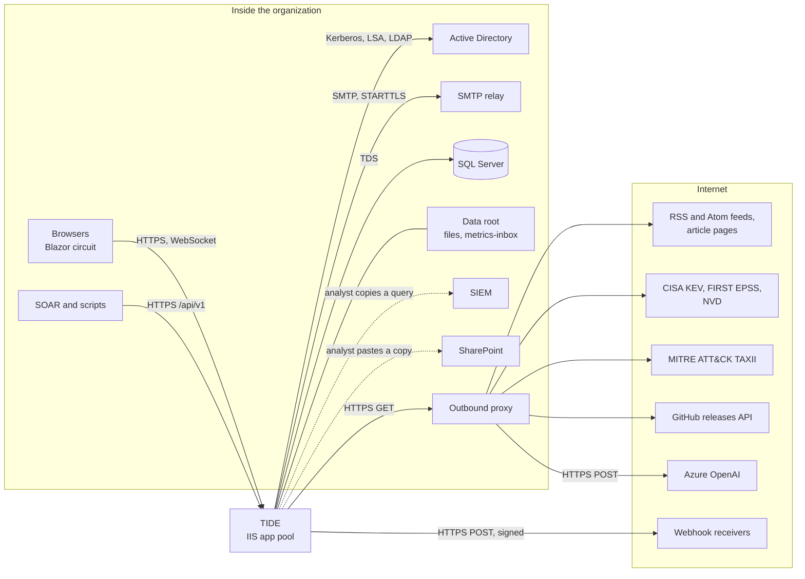
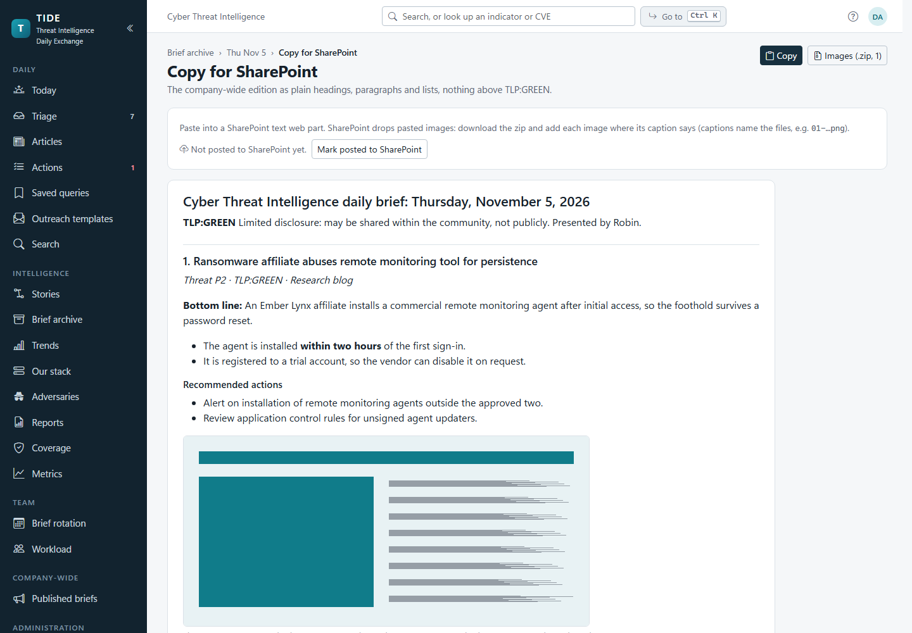

# Integrations

Every system outside TIDE that TIDE talks to, or that talks to TIDE: which way the traffic goes, over what, which
settings control it, what happens when it fails, and what data leaves the server. It's for the operator opening
firewall rules, the security reviewer approving data flows, and the developer adding a connector. Setting defaults
and bounds are in [configuration.md](configuration.md); the API's endpoints are in [API.md](../API.md).

**Contents**

- [At a glance](#at-a-glance)
- [The outbound HTTP client](#the-outbound-http-client)
- [Active Directory](#active-directory)
- [SMTP relay](#smtp-relay)
- [Feeds: RSS, Atom and the CISA KEV catalog](#feeds-rss-atom-and-the-cisa-kev-catalog)
- [Article pages](#article-pages)
- [CVE enrichment: KEV, EPSS and NVD](#cve-enrichment-kev-epss-and-nvd)
- [MITRE ATT&CK over TAXII](#mitre-attck-over-taxii)
- [Azure OpenAI and Bing grounding](#azure-openai-and-bing-grounding)
- [GitHub releases (update check)](#github-releases-update-check)
- [Webhooks](#webhooks)
- [The REST API](#the-rest-api)
- [Detection-rule imports](#detection-rule-imports)
- [SIEMs](#siems)
- [SharePoint](#sharepoint)
- [Metrics drop folder](#metrics-drop-folder)
- [Where it lives in code](#where-it-lives-in-code)

## At a glance

TIDE reaches out only when an administrator turns a connection on (ADR
[0009](../decisions/0009-intake-reaches-out-only-when-asked.md)). A fresh install talks to SQL Server, Active
Directory and nothing else.

Dotted lines are copy and paste: TIDE has no connection to the SIEM or SharePoint.

| System | Direction | Protocol | Off by default | Controlled by |
|---|---|---|---|---|
| Active Directory | Out | Negotiate, LSA SID translation, `PrincipalContext` | No (Windows sign-in) | `Auth:Mode`, role mappings |
| SMTP relay | Out | SMTP, STARTTLS | Yes | `Email:*` |
| Feeds and article pages | Out | HTTP(S) GET | Yes | `Intake:*`, Sources |
| KEV, EPSS, NVD | Out | HTTPS GET | Yes | `Cve:*` |
| MITRE TAXII | Out | HTTPS GET, TAXII 2.1 | On demand | An analyst's click |
| Azure OpenAI | Out | HTTPS POST | Yes | `Ai:*` |
| GitHub releases | Out | HTTPS GET | Yes | `Updates:*` |
| Webhook receivers | Out | HTTPS POST | Yes (none added) | Administration › API access |
| API callers | In | HTTPS | Yes (no tokens) | Administration › API access |
| Detection rules | In | File upload, API | n/a | Administration › Detection rules |
| Metrics drop folder | In | Files on disk | Yes | `Metrics:Import:*` |
| SIEM, SharePoint | None | Copy and paste | n/a | Query templates, `Distribution:RequireSharePoint` |

## The outbound HTTP client

Feeds, article pages, the CVE services, MITRE's TAXII server and the update check all go through one client,
`OutboundHttp` (`IOutboundHttp`). Azure OpenAI and webhooks have their own clients, described in their sections.

| Rule | Detail |
|---|---|
| Proxy | `Intake:Proxy`, read at start-up, signed in to with the app pool's own credentials. Blank goes direct, but a system proxy (`HTTPS_PROXY`, the machine's) still applies. |
| Addresses | `AddressPolicy` refuses loopback, link-local (cloud metadata at 169.254.169.254 among them), unspecified, multicast, broadcast and reserved addresses always, and private ranges (RFC 1918, 100.64/10, IPv6 unique-local and site-local) unless `Intake:AllowPrivateNetworks`. IPv6 addresses that carry an IPv4 one (NAT64, 6to4, SIIT, ISATAP) are judged as that address. |
| DNS rebinding | Going direct, each connection is checked again on the address it actually connects to. Through a proxy, each hop's host is checked if it resolves here within 3 seconds; a name only the proxy can resolve is left to it. |
| Redirects | Followed by TIDE, at most five, never from https to http. A caller's own headers (an API key) go only to the address it asked for. |
| Limits | `Intake:TimeoutSeconds` (5 to 120) per request, `Intake:MaxResponseKB` per response, 10-second connect timeout. |
| Back-off | `OutboundCircuit` per host: three failures (timeout, unreachable, HTTP 5xx or 429) within two minutes back the host off for 1 minute, doubling to at most 10. Meanwhile requests fail fast with "hasn't been answering; it's tried again in N minute(s)". One probe goes through when the back-off ends. A refused address isn't counted. |
| Identity | User-Agent `TIDE/1.0 (+https://github.com/jashley92/Tide)`. No cookies, no credentials except the proxy's. |
| Logging | Warnings name the host and the error kind, never the URL's query or the response. |

## Active Directory

| | |
|---|---|
| **Direction** | Outbound, from the web server to domain controllers. |
| **Protocol** | Windows authentication (Negotiate: Kerberos, falling back to NTLM) handled by IIS; SID-to-name translation through the server's LSA (`IdentityReferenceCollection.Translate`); display name and `mail` through `System.DirectoryServices.AccountManagement` (`UserPrincipal.FindByIdentity`). |
| **Config** | `Auth:Mode=Windows`. Role mappings in **Administration › Access & distribution** (seeded from `RoleMapping:Groups`). One `HTTP/<host>` SPN; see [INSTALL.md](../INSTALL.md#under-another-site-optional). |
| **What leaves** | Lookups by SID and account name. Nothing is written to AD. |

How sign-in turns groups into roles:

1. IIS authenticates the user. `RoleClaimsTransformer` reads the group SIDs in the Windows token.
2. A mapping by SID matches directly. A mapping by name needs the SID's account name: `SidNames` translates the SIDs
   not yet known in one call, waited on for **5 seconds** (`SidNames.Timeout`). Names found are kept for the process's
   life; a SID with no name is asked again after 5 minutes; a failed call after 1 minute.
3. A bare group name (`SOC-Analysts`) maps in this server's domain, found once from the machine account. If that lookup
   fails, a Critical log entry says only `DOMAIN\Group` mappings work until it's found, and it retries.
4. `WindowsNames` looks up the display name and `mail` (2-second wait, re-checked every 24 hours). Until it answers the
   bare user name shows, and the address already recorded in `AppUser` is kept.
5. `PermissionRevalidatingAuthStateProvider` re-derives an open page's roles every 2 minutes, so a removed mapping
   reaches open sessions. It doesn't act on a partial SID answer.

**Failure behaviour.** Everything fails closed and degrades gracefully. A slow DC means a request gets only its
SID-mapped roles; at most 16 translations run at once and, with 2 hung, none is started until one returns
(`BoundedDirectoryCalls`). A role-directory reload that fails is logged Critical and retried every 30 seconds; Diagnostics
shows "Role mappings: the last reload failed". See [troubleshooting.md](troubleshooting.md#signed-in-but-a-group-grants-nothing).

## SMTP relay

| | |
|---|---|
| **Direction** | Outbound. |
| **Protocol** | SMTP through `System.Net.Mail.SmtpClient`, STARTTLS when `Email:EnableSsl`; AUTH with a user name and password, or the app pool's Windows identity (`SmtpUseDefaultCredentials`), or none. `Email:PickupDirectory` writes `.eml` files instead. |
| **Config** | `Email:*` ([configuration.md](configuration.md#email)); `App:BaseUrl` for links. |
| **What leaves** | The brief's editions (HTML and plain text, screenshots as `cid:` linked resources), corrections, test copies, reminders, digests, rotation emails, hand-off notices, the external teams' reminders, and the escalation ladder's emails, and nothing else. The external teams' reminders go to addresses outside TIDE's users (a team's contact email, kept on External teams): each lists its open actions' titles, the details written on them, due dates and ticket links, with no TIDE link and nothing from an article, marked with the highest TLP of the articles they came from, and with a `Reply-To` of whoever follows the work. They're held to the team edition's ceiling (`Distribution:TeamMaxTlp`): an action whose article is marked above it isn't named, by title or details, only counted ("1 more request is marked above what we share by email: ask {team}"), and it's still marked as reminded. They're off until an administrator turns them on (`Notifications:ExternalReminders:Enabled`); review the *External team reminder* template first. A step of the escalation ladder (`Notifications:Escalation:Enabled`, off by default) may email a team's escalation contact, who may be outside TIDE's users (a name and email kept on the team): the *Escalation contact* template lists the team's requests at that step (titles, details as written, due dates, ticket links), with no TIDE link or number for an external team and a link to each for an internal one, marked with the highest TLP as the reminders are, and Reply-To whoever follows the work; for an external team, or a contact outside the organization, it's held to the team edition's ceiling as the reminders are, with no TIDE link. Review it before turning the ladder on. Standing copies (Email templates) go with them: a template's CC and BCC (BCC only on the two templates to people outside TIDE; an address outside the organization only once an administrator confirms it), and the archive copy, one address inside the organization blind-copied on every email TIDE sends. Each copy is checked again as the email goes (`CopyingEmailSender`): one now outside the organization that wasn't confirmed (the domains changed since it was saved), or an archive now outside, is left off, with a warning in the log counting them (never naming an address). The organization is `Email:OrganizationDomains` (each with its subdomains), else the domain of `Email:From`; every list that sends mail asks before saving an address outside it ([administration.md](../workflows/administration.md)). Copies aren't carried in a configuration bundle. Every message has `Auto-Submitted: auto-generated` and suppresses out-of-office replies. |

**Who uses it.** `DistributionService` and `CorrectionService` (brief sends and corrections), `ReminderService`
(reminders and digests, external teams' reminders, and the escalation ladder's emails), `HandoffNotices` (hand-off notices), `RotationService` and `EmailTemplateService` (a test to the administrator).

**Failure behaviour.** `EmailSender` never retries behind the analyst's back: a send's failure is returned and shown.

- The relay unreachable or dropping the session counts against `OutboundCircuit` (target `smtp:host:port`). Three in two
  minutes back it off 1 to 10 minutes; sends meanwhile fail fast with "The mail relay hasn't been answering".
- A refusal (an SMTP status) is reported by kind (sign-in refused, try later, refused), never with the relay's words,
  which can echo addresses. It doesn't back the relay off.
- Some recipients refused while others accepted counts as sent, with the refused count noted.
- A send the relay may have taken is `EmailSendStatus.Unknown`, never Failed: it didn't answer within
  `Email:SmtpTimeoutSeconds`, or the connection dropped once the session began (SmtpClient doesn't say how far it got).
  Nothing sends it again by itself, since that could reach everyone twice: a frozen send or correction is logged
  **Unknown**, as one is after an unexpected exception or still "sending" after 15 minutes, and someone checks with a
  recipient and marks it sent or not sent; a reminder, digest or escalation email is marked as gone, and its scan's
  note (Teams & SLA, and Diagnostics' *Reminder and digest emails* job) says to check it arrived. A connection never
  made (refused, no such host) or a TLS handshake that failed is a plain failure: nothing reached the relay. See
  [troubleshooting.md](troubleshooting.md#a-send-says-its-outcome-isnt-known).
- The log carries counts and SMTP status codes, never addresses, subjects or the relay's reply. A standing copy left
  off for being outside the organization is logged as a count, with the template, to check on Email templates.

## Feeds: RSS, Atom and the CISA KEV catalog

| | |
|---|---|
| **Direction** | Outbound. |
| **Protocol** | HTTP(S) GET through the outbound client, with `If-None-Match` and `If-Modified-Since` from the last poll. |
| **Config** | `Intake:Enabled`, `Intake:MinPollMinutes`, `Intake:RetentionDays` and the sponsored filter (in app on **Sources**); `Intake:Proxy`, `AllowPrivateNetworks`, `TimeoutSeconds`, `MaxResponseKB` (server). Each source's URL, interval, TLP, reliability and filters on **Administration › Sources**. |
| **What leaves** | A GET to the source's URL. A key in the URL's query is the source's own; it's masked in exports and bundles. |

Source kinds (`SourceKind`): `Feed` (RSS 2.0, RSS 1.0 or Atom), `CisaKev` (the KEV JSON catalog; each newly listed CVE
becomes an item) and `Api` (items proposed through `POST /api/v1/triage`, never polled).

**Failure behaviour.** `IntakeHostedService` runs a pass every minute and polls the sources that are due. A failed poll
records the error on the source (shown on Sources and Triage's Sources tab, scrubbed of secrets) and increments
`ConsecutiveFailures`. The next poll waits the source's interval doubled per failure, up to 16 times
(`IntakeService.Interval`). A success resets it. Diagnostics lists failing sources. Old feed items are pruned daily.
How triage uses items is in [intake-and-triage.md](../workflows/intake-and-triage.md).

## Article pages

| | |
|---|---|
| **Direction** | Outbound. |
| **Protocol** | HTTP(S) GET through the outbound client. |
| **Config** | Per source on **Sources**: article fetch `TideOnly` (TIDE fetches; the default), `Open` (TIDE fetches, and AI web grounding may look it up), or `Never`; an optional body CSS selector and removal selector. `Intake:ReadSeconds`, `AdSelectors`, `AdLabels` (in app); `Intake:ReadingDays` (server). |
| **What leaves** | A GET to the article's link. |

Triage's reading pane and the editor's "Draft from the sources" read an article's page and find its text
(`ArticleText`). A read kept from triage is reused for `Intake:ReadingDays`. A page that takes longer than
`ReadSeconds`, or yields too little text, is refused with a reason, and the analyst pastes the text instead.

## CVE enrichment: KEV, EPSS and NVD

| | |
|---|---|
| **Direction** | Outbound. |
| **Protocol** | HTTPS GET through the outbound client. |
| **Config** | `Cve:Enabled`, `Cve:RefreshHours` (in app on **Sources**); `Cve:KevUrl`, `EpssUrl`, `NvdUrl`, `NvdApiKey`, `MaxNvdPerRun`, `NvdDelayMs`, `NvdTimeoutSeconds` (server). The URLs can point at an internal mirror. |
| **What leaves** | KEV: a GET for the whole catalog. EPSS: CVE ids, up to 100 per request (`?cve=CVE-…,CVE-…`). NVD: one CVE id per request (`?cveId=`), with the `apiKey` header when a key is set. Nothing else. |

Which CVEs: those on articles, and those on feed items fetched in the last 14 days. KEV is read whole every run; EPSS
is refreshed every `RefreshHours`; NVD weekly, the missing first then the stalest, paced at 6.5 seconds between
requests without a key and 0.7 with one.

**Failure behaviour.** Each source fails on its own. The run keeps the first error ("KEV: …", "EPSS: …", "NVD
(CVE-…): …"), stops that source, and saves what it got. An NVD answer that can't be read is skipped once; two in a row,
or one that isn't JSON (a proxy's page, a rate limit), stop the NVD part. Sources and Diagnostics show the last run.
One run at a time (`CveRunLog.TryStart`). Pages read what's stored and never wait on these services.

## MITRE ATT&CK over TAXII

| | |
|---|---|
| **Direction** | Outbound, on demand. |
| **Protocol** | HTTPS GET, TAXII 2.1 (`Accept: application/taxii+json;version=2.1`), to `AdversaryService.MitreTaxiiUrl`: Enterprise ATT&CK's `intrusion-set` and `campaign` objects. Through the outbound client. |
| **Config** | None. An analyst clicks **Fetch from MITRE** on the Adversaries page. |
| **What leaves** | The GET. |

**Failure behaviour.** A failed fetch says "MITRE's server couldn't be reached" and why. A server with no internet
can save the same URL's answer elsewhere, or `enterprise-attack.json` from MITRE's STIX repository, and upload it (8 MB
at most). Import adds new profiles unwatched, fills names a matching profile lacks, skips revoked and deprecated objects,
and never touches analysts' notes. The ATT&CK Navigator layer export (`/adversaries/{id}/navigator.json`) is a
download; nothing is sent.

## Azure OpenAI and Bing grounding

| | |
|---|---|
| **Direction** | Outbound. |
| **Protocol** | HTTPS POST to `{Ai:Endpoint}/openai/v1/responses` (the v1 Responses API) with the `api-key` header. Its own `HttpClient`, through `Intake:Proxy` if set. Not through `AddressPolicy`. |
| **Config** | `Ai:Provider`, `Endpoint`, `Deployment`, `ApiKey`, `MaxTlp`, `WebGrounding`, `TimeoutSeconds` (server); per-source article fetch (Sources). ADR [0004](../decisions/0004-opt-in-ai-with-tlp-ceiling.md). |
| **What leaves** | For a draft: the article's sources' text, its title and fields, and (only when `MaxTlp` is Amber or higher) the team's "We run" notes, which count as AMBER. Never anything above `Ai:MaxTlp`: the input's TLP is the article's or its feed's, whichever is higher. With `store: false`. For grounding: only the article's address and title. |

Two kinds of request:

- **A draft** is one request with a strict JSON schema and no tools, so the model can't reach the web.
- **Finding an article** (only when `Ai:WebGrounding`, the source is marked `Open`, the article is TLP:CLEAR, and TIDE
  couldn't fetch the page itself) is a separate request with only the `web_search` tool, limited to the article's
  site. Its text is used only when a citation is that same address. Grounding with Bing is billed separately and
  handles data outside the Azure compliance and geographic boundary.

Every draft is stored (`AiDrafts`) with the provider, model, prompt version and a hash of what was sent; the source
text itself isn't kept.

**Failure behaviour.** The assistant never throws for a provider failure. The editor shows why: the key refused (401,
403), no such deployment (404), rate limited (429), the request refused or filtered (400), no answer in
`TimeoutSeconds`, unreachable, or an incomplete answer. Above the TLP limit nothing is sent and the editor says "This
article is TLP:… and the AI limit is TLP:…, so nothing is sent." With no provider, **Copy a prompt** produces the
prompt for an approved tool, also refused above the limit.

## GitHub releases (update check)

| | |
|---|---|
| **Direction** | Outbound. |
| **Protocol** | One anonymous HTTPS GET to `https://api.github.com/repos/{Updates:Repository}/releases?per_page=30`, through the outbound client, with a 10-second limit of its own. |
| **Config** | `Updates:CheckEnabled`, `Updates:CheckIntervalHours` (in app on **System › Updates**); `Updates:Repository` (server). |
| **What leaves** | The GET and the User-Agent. Nothing about the installation. |

`UpdateCheckHostedService` checks 2 minutes after start, then every interval while on, and re-reads the switch every 5
minutes. The response is read strictly (`ReleaseFeed`): drafts skipped, only release tags counted, notes capped, links
kept only to this repository's release pages. A failure shows "couldn't check" and why on the Updates page and
Diagnostics, logged once until it recovers. The upgrade itself is `Upgrade-Tide.ps1`
([UPGRADE.md](../UPGRADE.md#knowing-when-theres-a-new-release)).

## Webhooks

| | |
|---|---|
| **Direction** | Outbound. |
| **Protocol** | HTTPS POST of JSON, at most 15 seconds, no redirects followed (a redirect is reported as the result). A named `HttpClient` (`HttpWebhookPoster`), not the outbound client: no `Intake:Proxy` and no `AddressPolicy` check. |
| **Config** | **Administration › API access**: an `https` address and the events. ADR [0016](../decisions/0016-api-tokens-scopes-and-signed-webhooks.md). |
| **What leaves** | `action.raised`, `action.overdue` and `brief.sent` events with action details (titles included) and links built from `App:BaseUrl`. An action from an article above the team edition's ceiling is never posted; each action carries its article's marking. |

Each post carries `X-Tide-Event`, `X-Tide-Event-Id`, `X-Tide-Timestamp` and `X-Tide-Signature: sha256=<HMAC-SHA256 of
"timestamp.body" with the hook's secret>`. The secret is shown once and stored encrypted with the Data Protection key
ring, so restoring without `dp-keys` means re-adding each webhook.

**Failure behaviour.** `WebhookHostedService` runs every minute. It posts events at least 30 seconds old, oldest first,
at most 100 per hook per run, and overdue actions once a day. A hook stops at its first failure and tries again next
run; the page shows each hook's last status and error. **Ping** sends a test now.

## The REST API

| | |
|---|---|
| **Direction** | Inbound. |
| **Protocol** | HTTPS under `/api/v1` on the app's own address. A bearer token, or the caller's Windows sign-in. OpenAPI at `/api/v1/openapi.json`. |
| **Config** | Tokens on **Administration › API access**, each with scopes, a TLP ceiling and an expiry. IIS has Anonymous on at `/api/v1` with Windows left on (the installer sets it). ADR [0016](../decisions/0016-api-tokens-scopes-and-signed-webhooks.md). |
| **What leaves** | Briefs, actions, files, the stack and metrics, each held to the caller's role and the token's TLP ceiling. |

Rate limited at 120 requests a minute per caller (token or person). The full reference is [API.md](../API.md).

## Detection-rule imports

| | |
|---|---|
| **Direction** | Inbound. |
| **Protocol** | A file uploaded on **Administration › Detection rules** (administrators), or `POST /api/v1/detections` (a token that can write articles). |
| **Formats** | A Microsoft Sentinel analytics-rules export (ARM template JSON), Sigma rules (YAML, one or more documents), or a CSV. A `.zip` of them is read entry by entry. |
| **What's kept** | Each rule's id, name, ATT&CK technique ids, platform and enabled state. Queries are ignored. ADR [0017](../decisions/0017-detection-rules-are-referenced-and-tagged.md). |

Limits (`DetectionParsers`): an 8 MB upload, at most 5,000 zip entries, 32 MB unpacked in all and 1 MB per entry, and an
entry that unpacks to more than 100 times its packed size is refused. A rule with a bad technique id is kept without
it, and the import lists the problems. Nothing leaves.

## SIEMs

TIDE has no SIEM connection. It writes hunt queries for analysts to run (ADR
[0006](../decisions/0006-query-dialects-are-templates.md)) in three dialects (`QueryDialects.All`): Cortex XSIAM (XQL),
Microsoft Sentinel / Defender (KQL) and CrowdStrike Falcon / Next-Gen SIEM. Each has a default template per kind of
indicator with `{{values}}` and an optional `{{days}}`. Administrators replace them on **Administration › Query
templates** to match their own datasets and fields. Nothing leaves TIDE except what an analyst copies. See
[actions-and-hunting.md](../workflows/actions-and-hunting.md).

## SharePoint

TIDE has no SharePoint connection. On the brief's Send step, **SharePoint copy** gives the company-wide edition as clean
HTML and a zip of its images (`/briefs/{day}/sharepoint-images.zip`) named as the HTML names them. An analyst pastes
it into the site and marks it posted. With `Distribution:RequireSharePoint`, a brief isn't finished until someone does.
See [distribution.md](../workflows/distribution.md).

## Metrics drop folder

| | |
|---|---|
| **Direction** | Inbound, through the file system. |
| **Protocol** | CSV files written to `metrics-inbox` under `Files:RootPath` by another job (a scheduled export). |
| **Config** | `Metrics:Import:DropFolderEnabled`, `PollMinutes` (in app on **Metric imports**). ADR [0014](../decisions/0014-metric-values-from-csv.md). |

The exporting account needs modify access to `metrics-inbox` alone, not the data root. Behaviour and failures are in
[troubleshooting.md](troubleshooting.md#metrics-drop-folder-files-arent-imported).

## Where it lives in code

| What | Where |
|---|---|
| Outbound client, address rule, back-off | `src/Tide.Infrastructure/Notifications/OutboundHttp.cs`, `AddressPolicy.cs`, `OutboundCircuit.cs` |
| Email | `src/Tide.Infrastructure/Notifications/EmailSender.cs`, `SmtpClientFactory.cs`, `EmailOptions.cs`; `src/Tide.Application/Distribution/SendOutcome.cs` |
| AD | `src/Tide.Web/Security/RoleClaimsTransformer.cs`, `SidNames.cs`, `WindowsNames.cs`, `BoundedDirectoryCalls.cs`, `PermissionRevalidatingAuthStateProvider.cs`; `src/Tide.Infrastructure/Security/RoleDirectory.cs`, `UserDirectory.cs` |
| Feeds and polling | `src/Tide.Application/Intake/IntakeService.cs`, `FeedParsing.cs` (`FeedParser`); `src/Tide.Web/Services/IntakeHostedService.cs` |
| Article text | `src/Tide.Application/Assist/ArticleText.cs`, `ArticleCleanup.cs`; `src/Tide.Application/Intake/ReadingService.cs` |
| CVE enrichment | `src/Tide.Application/Intake/CveService.cs` (`CveService`, `CveParsers`) |
| MITRE import | `src/Tide.Application/Adversaries/AdversaryService.cs` (`ImportFromMitreAsync`, `ImportMitreAsync`) |
| AI drafting | `src/Tide.Infrastructure/Assist/AzureOpenAiAssistant.cs`; `src/Tide.Application/Assist/AssistService.cs`, `IThreatIntelAssistant.cs` |
| Update check | `src/Tide.Application/Operations/ReleaseFeed.cs`, `UpdateCheckService.cs`; `src/Tide.Web/Services/UpdateCheckHostedService.cs` |
| Webhooks | `src/Tide.Application/Api/Webhooks.cs` (`WebhookService`); `src/Tide.Web/Api/WebhookServices.cs` |
| API | `src/Tide.Web/Api/ApiEndpoints.cs`, `OpenApi.cs`; `src/Tide.Application/Api/ApiService.cs`, `ApiTokens.cs` |
| Detection rules | `src/Tide.Application/Detections/DetectionParsers.cs`, `DetectionService.cs` |
| Hunt queries | `src/Tide.Application/Actions/HuntQueries.cs` (`QueryDialects`) |
| SharePoint copy | `src/Tide.Application/Distribution/DistributionService.cs` (`SharePointAsync`, `SharePointImagesZipAsync`, `MarkSharePointPostedAsync`) |
| Drop folder | `src/Tide.Infrastructure/Storage/MetricDropFolder.cs`; `src/Tide.Web/Services/MetricImportHostedService.cs` |
