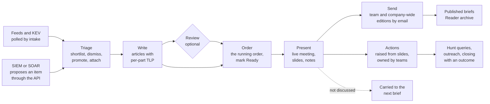

# What TIDE is

This page says what TIDE does, who uses it, how a day runs through it, and what it deliberately leaves to other
tools. It's for anyone new to TIDE: a new team member, an administrator about to install it, a developer, or a
security reviewer deciding whether it fits.

- [The problem it solves](#the-problem-it-solves)
- [Who uses it](#who-uses-it)
- [The daily cycle](#the-daily-cycle)
- [Roles](#roles)
- [What TIDE deliberately doesn't do](#what-tide-deliberately-doesnt-do)
- [The stack](#the-stack)
- [Where to go next](#where-to-go-next)

## The problem it solves

TIDE (Threat Intelligence Daily Exchange) is an on-prem web app for a threat-intelligence team's **daily brief**.

Most threat-intel teams run the same loop every working day. Someone reads the overnight security news and the
private-source intel (ISAC reports, vendor portals). They write up what matters to the organization. The team
discusses it at a morning meeting. The write-up goes by email to the security teams and, cut down, to the rest of the
company. Then somebody has to make sure the follow-up work actually happens: an IOC sweep, a hunt, a block, a patch.

Without a tool, that loop lives in a shared mailbox, a Word template, a slide deck, a spreadsheet of actions and a
lot of copy and paste. Marking content with **TLP 2.0** by hand, and remembering what must not reach the company-wide
email, is where mistakes happen.

TIDE holds the whole loop in one model:

- **Intake.** It polls RSS and Atom feeds and the CISA KEV catalog into a triage inbox, enriches CVEs with CVSS, EPSS
  and the KEV flag, and remembers what the team has already covered.
- **Articles.** Each threat is written once, with every part carrying its own TLP marking.
- **The brief.** A day's articles in a running order, presented from a full-screen slide deck that the team can join
  live.
- **Editions.** The team edition and the company-wide edition are both cut from that one brief by TLP, so nothing
  above an edition's ceiling can reach its audience ([ADR 0005](../decisions/0005-editions-from-one-model.md)).
- **Actions.** Follow-up work is owned by a team, due by an SLA date, and closed with an outcome that fits its kind.
- **Reporting.** Trends, the board scorecard, opening metrics and the reports a team lead owes are counted from the
  same records.

It runs on Windows Server under IIS, signs people in with their Windows (Active Directory) account, and keeps its
data in SQL Server, alongside other line-of-business apps on the same server and SQL instance
([ADR 0001](../decisions/0001-blazor-server-on-prem.md)).

## Who uses it

TIDE has six roles. Each person below is a typical holder of one. The roles themselves are in [Roles](#roles).

| Person | A day in TIDE | Role |
|---|---|---|
| **Priya, the presenting analyst** | It's her week on the [brief rotation](../workflows/rotation.md). She opens **Today**, triages the inbox, promotes four items, writes them up (with AI drafting help if the team turned it on), orders them, presents at 10:30, raises the follow-up actions from the slides, and sends both editions. | Analyst |
| **Sam, another analyst** | Triages alongside Priya (each sees the other's decisions live), reviews one of her articles before it goes, and works the hunt actions raised to the CTI team. | Analyst |
| **Dana, on the SOC's detection team** | Opens Today to her **team queue**: the SOC's open actions that are hers or nobody's. She takes an IOC sweep, copies its generated KQL into Sentinel, records "No hits" and closes it in one step. She reads the team edition and joins the meeting. | Action owner |
| **Lee, the CISO's chief of staff** | Reads everything the team does, every action included, and changes nothing. Joins the meeting, raises a hand, takes notes. | Viewer |
| **A guest from the fraud team** | Is invited into today's meeting for one article. Sees the live meeting while seated in it, and the published archive. Nothing else. | Visitor |
| **Everyone else in the company** | Gets the company-wide email, and can read past company-wide editions under **Published briefs**. | Reader |
| **Jo, the TIDE administrator** | Sets up sources, teams and SLA targets, the AD group-to-role mappings, the editions' TLP ceilings and recipient lists, the opening metrics, the email wording and the API tokens. Reads the audit log. | Admin |

## The daily cycle

Today's brief shows the same five steps as a strip across the top of the page: **Triage, Write, Order, Present,
Send** (`BriefSteps`, in `src/Tide.Application/Briefs/BriefProgress.cs`). Actions follow on from the meeting and run
for as long as they need.

1. **Feeds.** `IntakeHostedService` polls each due source every minute when intake is on, and `CveService` keeps CVE
   records fresh. Another tool can also propose an item through the API. See
   [intake and triage](../workflows/intake-and-triage.md).
2. **Triage.** An analyst works the inbox from the keyboard: shortlist, dismiss with a reason, mark a duplicate,
   attach to an article already written, or **promote** to a draft article.
3. **Write.** The analyst writes each article: bottom line, bullets, why it matters, recommended actions,
   screenshots, indicators, CVEs, ATT&CK techniques and tags. Readiness checks say what's missing. A colleague can
   review it. See [writing articles](../workflows/writing-articles.md).
4. **Order.** The articles go into the day's running order, and the brief is marked Ready.
5. **Present.** The presenter runs the meeting from present mode. Others join and follow. Actions are raised from
   the slides. Articles not discussed carry to the next brief. See [the brief and the meeting](../workflows/brief-and-meeting.md).
6. **Send.** Both editions go by email, each cut to its TLP ceiling and frozen as sent. The company-wide edition then
   shows under Published briefs. A mistake found later is put right with a correction. See
   [distribution](../workflows/distribution.md).
7. **Actions.** Teams work their actions to an outcome: hunts, blocks, patches, outreach. Reminders and digests chase
   what's late. See [actions and hunting](../workflows/actions-and-hunting.md).

Behind the cycle sit the [brief rotation](../workflows/rotation.md) (who presents each day), the opening
[metrics and trends](../workflows/metrics-and-trends.md), and [search, exports and adversary
profiles](../workflows/search-exports-and-adversaries.md).

## Roles

Each role is granted by AD groups (mapped under Administration › Access & distribution) and is a fixed bundle of
code-defined permissions (`RoleDefinitions.SystemRoles` in `src/Tide.Application/Security/Security.cs`,
[ADR 0002](../decisions/0002-permissions-as-code.md)). Pages check the permission, and the services check it again.

| Role | Code name | What it does | Permissions |
|---|---|---|---|
| Analyst | `Analyst` | The CTI team: triages, writes, presents and sends the brief, and works any action. | `ReadPublished`, `ReadTeamEdition`, `WriteArticles`, `PresentBriefs`, `WorkActions`, `EnterMetrics`, `ReadActions`, `MeetingNotes`, `JoinMeetings` |
| Action owner | `ActionOwner` | Another team's member: reads the team edition and works the actions given to their team. Hands them off, and keeps the external teams (those that work outside TIDE). | `ReadPublished`, `ReadTeamEdition`, `WorkActions`, `ReadActions`, `MeetingNotes`, `JoinMeetings` |
| Reader | `Reader` | Anyone else in the company: reads the published, company-wide archive. | `ReadPublished` |
| Administrator | `Admin` | Administers TIDE: sources, taxonomy, role mappings and settings. Holds every permission. | All of them, including any added later |
| Viewer | `Viewer` | Reads everything the team does, every action included, and changes nothing. Joins meetings, raises a hand and adds notes. | `ReadPublished`, `ReadTeamEdition`, `ReadActions`, `MeetingNotes`, `JoinMeetings` |
| Visitor | `Visitor` | A colleague from elsewhere: reads the published archive, and sees a live meeting only while they're in it. | `ReadPublished`, `JoinMeetings` |

Two things are worth knowing before mapping groups:

- **A ceiling governs what leaves TIDE, not what people see in it.** An Action owner sees articles at every marking,
  RED included, as an analyst does. Map only the teams that should be trusted with that. See
  [editions and TLP](../architecture/editions-and-tlp.md).
- **Write access is never by role name.** Pages branch on permissions (`WorkActions`, `WriteArticles`), never on a
  role.

The full activity-by-role table is in [What each role can do](../INSTALL.md#what-each-role-can-do), generated from
`Capabilities` and shown on the Role mappings page too. How sign-in and permission claims work is in
[security](../architecture/security.md).

## What TIDE deliberately doesn't do

These are choices, not gaps. Each has a decision record.

| TIDE doesn't | What it does instead | Decision |
|---|---|---|
| **Sign in to a SIEM** or run a query anywhere | Generates hunt query text (XQL, KQL, CrowdStrike) from the article's indicators. The analyst copies it, runs it in their own SIEM, and records hits or no hits. | [ADR 0006](../decisions/0006-query-dialects-are-templates.md) |
| **Run or store detection rules** | Keeps each SOC rule's name, id, technique tags, platform and enabled state, for Coverage. "Covered" means a current, enabled rule is tagged with the technique, not that it fires. | [ADR 0017](../decisions/0017-detection-rules-are-referenced-and-tagged.md) |
| **Send outreach emails** | Writes the email to a vendor, partner or ISAC from a template, held to the template's TLP ceiling. The analyst sends it from their own mail and marks it sent. | [ADR 0019](../decisions/0019-outreach-emails-are-written-never-sent.md) |
| **Call an AI model unless an administrator turns it on** | AI drafting help is off until a provider is configured. Nothing above `Ai:MaxTlp` (GREEN by default) is sent, every suggestion is checked, and a person accepts each one. With no provider, *Copy a prompt* works with a tool the organization already approved. | [ADR 0004](../decisions/0004-opt-in-ai-with-tlp-ceiling.md) |
| **Keep an on-call schedule** | The brief rotation says only who presents the brief each business day. Swaps and cover are approved by the colleague taking the days. | [ADR 0010](../decisions/0010-rotation-changes-approved-by-the-colleague.md) |
| **Run as more than one instance** | TIDE runs as one process. Presence, live meetings, the change feed and the pull guards are held in memory, so it isn't shared across load-balanced servers. | [ADR 0001](../decisions/0001-blazor-server-on-prem.md) |
| **Recall an email** | A mistake after a send gets a correction: a short email of its own. A TLP slip is withdrawn from the Reader archive, not recalled. | [ADR 0015](../decisions/0015-corrections-after-send.md) |
| **Reach out on its own, or render feed HTML** | Intake polls only when an administrator turns it on, never into the server or (by default) the internal network, keeps one item per address, and reduces feed text to plain text. | [ADR 0009](../decisions/0009-intake-reaches-out-only-when-asked.md) |
| **Show Readers anything not sent to them** | The Reader archive shows only frozen company-wide sends, parsed from what went. | [ADR 0007](../decisions/0007-frozen-sends-and-cid-email.md) |
| **Install a full-text index** | Search uses portable `LIKE` queries that run the same on SQLite and SQL Server. | [ADR 0011](../decisions/0011-search-with-portable-like-queries.md) |
| **Link things automatically** | Articles that name an adversary profile, and triage reports that look like one event, are suggested. Nothing is tagged or merged without a click. | Product rule; see [business rules](../reference/business-rules.md) |
| **Upgrade itself** | Administration › System › Updates says when a newer release exists. `deploy/Upgrade-Tide.ps1` does the upgrade: the app pool's account can't write its own binaries, by design. | See [UPGRADE.md](../UPGRADE.md) |

## The stack

| Layer | What it is |
|---|---|
| Runtime | .NET 10, ASP.NET Core |
| UI | Blazor Web App, interactive server rendering throughout (a SignalR circuit per tab). See [frontend](../architecture/frontend.md). |
| Styling | Bootstrap 5.3.3 and Bootstrap Icons 1.11.3, self-hosted, retinted through TIDE's own `--tide-*` design tokens for light and dark themes |
| Scripts | Small CSP-safe JavaScript files in `src/Tide.Web/wwwroot/js`, under `script-src 'self'`. No framework, no bundler. |
| Data | EF Core 10. SQLite for local development (nothing to install), SQL Server in production, each with its own migrations assembly. |
| Sign-in | Windows Integrated Authentication (Negotiate) under IIS, with AD groups mapped to roles. A dev sign-in for local use only. |
| Files | Screenshots and action files on disk under `Files:RootPath`, outside the web root ([ADR 0003](../decisions/0003-files-on-disk.md)) |
| Email | An SMTP relay through `System.Net.Mail` (`SmtpClientFactory`); images embedded as `cid:` parts |
| Libraries | Markdig (Markdown, raw HTML off), AngleSharp (reading an article's page for drafting), SharpZipLib (the password-protected zip for risky files) |
| AI (optional) | Azure OpenAI (`AzureOpenAiAssistant`), behind `IThreatIntelAssistant` |
| Tests | xUnit, FluentAssertions, `Microsoft.AspNetCore.Mvc.Testing` for the whole app over HTTP |
| Hosting | Windows Server and IIS, installed and upgraded by the PowerShell scripts in `deploy/` |

The projects and how dependencies point inward are in the [architecture overview](../architecture/overview.md) and
the [codebase map](../architecture/codebase-map.md).

## Where to go next

- [A tour of the screens](screens.md), with screenshots.
- [Workflows](../workflows/README.md): each part of the day in detail.
- [Glossary](../reference/glossary.md): every domain term and its code name.
- [INSTALL.md](../INSTALL.md): putting it on a server.
