# A tour of the screens

This is a guided tour of every screen in TIDE, in the order a day uses them, with what each one is for and what it
does. It's for new team members, administrators evaluating TIDE, and developers who want to know what a page is
meant to do before reading its code. Each section links to the workflow page that explains the rules behind it.

> The screenshots use local dev sign-in ("Dev Analyst", holding the Analyst and Admin roles) and the seeded sample
> data, so names, articles and numbers are made up.

Every route, its component and the permission it needs are in the [route table](../architecture/frontend.md#routes).

**Contents**

- [The frame around every page](#the-frame-around-every-page)
- Daily: [Today](#today) · [Triage](#triage) · [Articles](#articles) · [The article editor](#the-article-editor) ·
  [Review before send](#review-before-send) · [Actions and hunting](#actions-and-hunting) ·
  [Search and indicator lookup](#search-and-indicator-lookup)
- The meeting and distribution: [Present mode](#present-mode) · [The two editions](#the-two-editions) ·
  [Corrections after a send](#corrections-after-a-send) · [Copy for SharePoint](#copy-for-sharepoint) ·
  [Published briefs](#published-briefs) · [Brief archive](#brief-archive)
- Intelligence: [Threat stories](#threat-stories) · [Our stack](#our-stack) ·
  [Adversary profiles](#adversary-profiles) · [Detection coverage](#detection-coverage) ·
  [Indicator exports](#indicator-exports) · [Threat trends and the board scorecard](#threat-trends-and-the-board-scorecard) ·
  [Reports](#reports) · [Team commitments](#team-commitments) · [Opening metrics](#opening-metrics)
- Team: [Brief rotation](#brief-rotation) · [Workload](#workload) · [Saved queries](#saved-queries) ·
  [Outreach templates](#outreach-templates) · [External teams](#external-teams) · [My notifications](#my-notifications)
- [The API, for the SOC's other tools](#the-api-for-the-socs-other-tools)
- [Administration](#administration)
- [When something's wrong](#when-somethings-wrong)

## The frame around every page

- **The sidebar** lists every page the person may open, under small group labels: **Daily**, **Intelligence**,
  **Team**, **Company-wide** and **Administration**. A group with nothing in it for that person isn't shown. Triage
  carries a count of new items, and Actions a count of the person's overdue actions (in red). The sidebar collapses
  to icons from the button at its top, and remembers that per browser.
- **The top bar** has the team's name, the search box (for anyone on the team edition), the **Go to** button
  (`Ctrl+K`), the keyboard shortcuts button (`?`), and the account menu.
- **The account menu** (the initials in the top right) says who you are and your roles, and holds your own settings:
  light or dark theme, single-letter shortcuts on or off, **My notifications**, your brief days as a calendar file,
  and About.
- **A live meeting** shows as a banner across every page ("Brief meeting is live · Join"), with the presenter and how
  many are in it.
- **On a phone** (640px or narrower) the sidebar becomes a bar across the top with a menu button, and wide tables
  scroll inside their card.
- **Filter bars.** Every filtered list has the same bar: its search box on the left, then **pills** for the filters
  used most (one click turns one on, and it shows the accent tint while it's on), a **chip** for each other filter in
  force ("Team: Network Engineering ✕": choose the chip to change it, ✕ to remove it), and **+ Filter**, a small menu
  of the rest. Choosing one there shows its options, one or several as the filter allows, and applying it adds its
  chip. The bar ends with the count ("8 actions") and **Clear**, which removes every filter. The filters stay in the
  address, so a bookmark, a shared link, a reload and Back show the same list, and a change goes back to its first
  page. On a phone the search box takes a row of its own, the pills scroll sideways, and the menu rises from the
  bottom of the screen.

What sits behind this is in [frontend](../architecture/frontend.md#layout-and-navigation).

## Today

**Route:** `/` · **Workflow:** [the brief and the meeting](../workflows/brief-and-meeting.md)

Where the presenting analyst starts. Today's brief shows a strip of its five steps (**Triage, Write, Order,
Present, Send**), each saying where it stands, with one main button for whichever step is next. Beside it:

- **the running order**, which you drag, or move up and down, with removal you can undo;
- **today's numbers**, each box with the value it's compared with;
- **what each edition will carry**;
- **the meeting**: its time, and who the rotation names to present.

Readiness checks say what's missing on each article before the meeting. A threat whose "why it matters to us" would
reach the company-wide edition is flagged.

Anyone who works actions also gets their **team's queue**: their teams' open actions that are theirs or nobody's,
theirs first, by due date, with *Take it*. An action owner's Today leads with it.

Any day's brief, today's included, has a **preview of both editions** for proofreading (`/briefs/{day}?tab=preview`),
a tab beside the running order. A past day's brief opens at `/briefs/{day}`; today's address redirects to Today. A
Reader or Visitor who opens `/` goes to Published briefs instead.

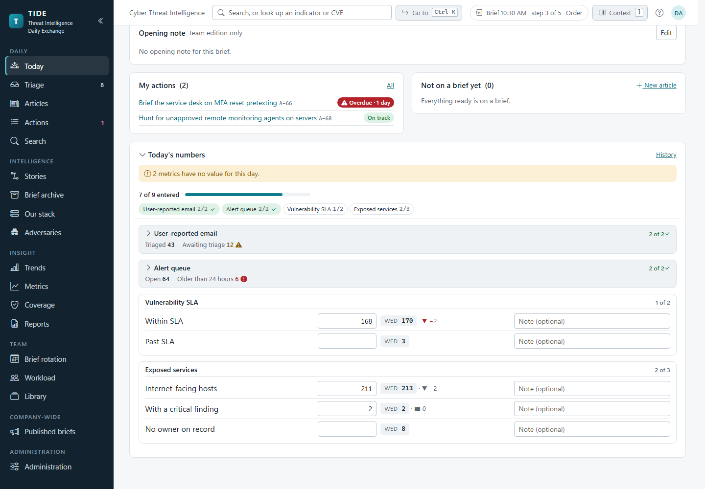

## Triage

**Route:** `/triage` · **Workflow:** [intake and triage](../workflows/intake-and-triage.md)

A keyboard-driven inbox of new items from the sources: RSS and Atom feeds and the CISA KEV catalog. Each source has a
default TLP, an Admiralty reliability grade, a polling interval and a handling note. From the inbox, an item can be
shortlisted, dismissed with a reason, marked a duplicate or promoted to a draft article.

Each tab shows 50 items a page, with numbered pages and a count ("1–50 of 213"); the page is in the address, so a
reload or a copied link opens the same one. Nothing is cut off: every matching item is on some page. The filter bar
has the search box (titles and CVEs) and four pills: **Since last brief**, **Names a CVE**, **KEV** (a CVE on CISA's
KEV list) and **We run it** (a product on Our stack). Names a CVE and KEV are one filter, so turning one on turns the
other off. The source is under **+ Filter**, and shows as a chip while one is chosen. They combine, and they're kept
in the address too. The tabs and the order (Newest, Likely used) sit apart from the filters.

A feed can be filtered by its own tags and by title words. Sponsored items are skipped too, on by default: a list of
marker phrases ("Sponsored by", "Partner content", "Advertorial") is looked for as whole words in each item's author,
source, tags, title and the start of its summary, and a list of exceptions ("state-sponsored") keeps the headlines
that only look sponsored. Both lists are edited on Sources, with a Test box that says whether a title or byline would
be skipped and by which marker. A skipped item counts toward the source's "filtered out" figure, which says which
markers matched.

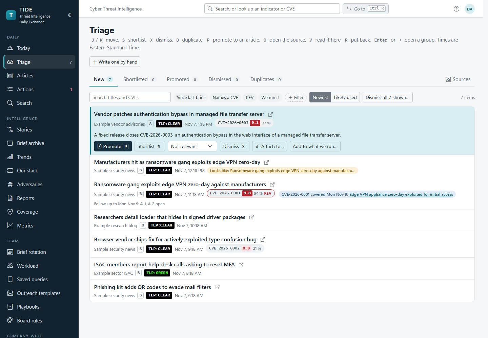

### The Sources tab

The last tab lists the sources TIDE polls: when each was last pulled ("12 min ago", the exact time on hover), when
it's next due, and how its last pull went (items added, or the error). Its count is the number of sources whose last
poll failed, shown as a warning. *Pull now* takes in a source's latest items straight away, once per analyst
pull-now window (15 minutes by default, set on Sources): a source pulled within it, on schedule or by hand, shows when
it can be pulled again instead.

### Reading the article here

- **V reads it.** The selected item's article opens in a pane beside the list, fetched once from its page (the
  source's fetch setting and body selector apply; a source set to Never isn't fetched). Inline adverts are taken out:
  blocks whose class or id names an ad slot, the advert selectors and label lines listed on Sources ("Advertisement",
  "Story continues below"), and a source's own *Also remove* selector for one site's odd markup. CVEs, indicators and
  products on Our stack are marked, with the CVE chips under it. While the pane is open it follows J and K, showing a
  report's text when it's already been read and offering to read it when it hasn't. Esc closes it.
- **Kept for a week.** The text is kept on the item for `Intake:ReadingDays` (7), so a colleague reads it without
  fetching again and *Draft from the sources* starts with it after promoting. It's for reading inside TIDE only: it's
  never sent, exported or shown to readers.

### Learning from the team's decisions

- **Likely used.** New and Shortlisted can be ordered by what the team promoted from items like each one, from the
  decisions of the last 90 days (or as long as dismissed items are kept). Each row says why in counts: "3 of the 4
  from GitLab releases naming GitLab decided in 90 days were promoted". Items naming what we run, a watched adversary
  or a KEV-listed CVE stay on top. Newest first is the default; the choice is kept in the browser. Nothing is
  trained or stored: the counts are worked out from the items still kept.
- **Missed this week?** New lists dismissed items from the last 7 days that name a KEV-listed CVE no article covers,
  or a watched adversary no recent article is tagged with, each with *Put back in New*.
- **Source health** (Administration) shows each source's items a week, how many were decided and promoted, the last
  item promoted and the median time to triage. A source that sent 10 or more items in 60 days with none promoted or
  shortlisted is suggested for pausing, and *Pause polling* switches it off; its items stay.

### Promoting

- **Inline promote form.** Clicking a title opens the promote form in place. It suggests a priority from the
  item's CVE data and says why ("Suggested P1: on KEV, CVSS 10").
- **Back to the same row.** After *Promote and write*, Back returns to the same row.

### What triage already knows

- **Stored once.** Each item is kept once, by its cleaned-up address.
- **CVE chips.** These carry CVSS from NVD, EPSS from FIRST and the KEV flag.
- **Repeats.** A reworded repeat of a recent story is flagged.
- **Past coverage.** An item whose CVE or link was already covered says on which brief, and which actions from it
  are still open ("Follow-up to Thu Oct 22: A-13, A-14 open").

### Several reports of one event

- **Attach to…** Any item can be kept as another report of a recent draft or ready article, instead of becoming a
  new one, and its CVEs go with it.
- **Looks like one event.** Reports from several feeds that share a CVE, or names and amounts in their headlines
  ("Binance", "$6.3 billion"), are suggested as one line. It opens to the reports themselves, each with its source and
  excerpt. *Promote as one article* makes one draft with every report's link. Nothing is merged without a click, and
  a group has no "dismiss all". *Not the same* splits a suggested group for everyone, with Undo.

### Two analysts at once

- **Live changes, shown.** When a colleague triages or a poll brings items, the inbox updates without a reload and
  shows what changed: new rows slide in with a soft highlight and a *New* marker until you look at them, changed rows
  are highlighted, and a row a colleague took away leaves a line for a moment ("Sam dismissed “…”") before it folds
  away. The tab counts tick, and one toast sums it up ("Sam dismissed 3 items · 2 new from the feeds").
- **Nothing moves under you.** The selected row stays selected (if a colleague took it, the next one is selected and
  you're told), and the scroll stays put. While a promote form or the attach picker is open, changes wait behind an
  *Updates waiting* pill. With reduced motion the highlight only fades; nothing slides or folds.

The triage keys are listed under [keyboard shortcuts](../architecture/frontend.md#keyboard-shortcuts).

## Articles

**Route:** `/articles` · **Workflow:** [writing articles](../workflows/writing-articles.md)

Every article, as a list that filters as you type, sorts by any heading, and pages rather than cutting off. The
filter bar has **Draft** and **Ready** as pills; **+ Filter** holds the rest: status, ATT&CK tactic, technique (with
or without its sub-techniques), assessment (threat, P1 or P2, or informational), scorecard tag or category, and the
dates counted from and to. Each filter in force is a chip that links to the list without it (the dates are one chip,
"Oct 2026"), and **Clear** keeps the words. The filters live in the address, so a filtered list can be bookmarked or
sent. Trends opens this list
pre-filtered when you click a count; opened from a tactic or technique, each row shows the techniques it was counted
for. An analyst starts an article here with **New article**: a title, a source, a link and a TLP, which is set first
because screenshots take the article's marking.

## The article editor

**Route:** `/articles/{id}` · **Workflow:** [writing articles](../workflows/writing-articles.md)

Section pills jump to each part of the article, and a sticky save bar sits along the bottom. Beside the editor is
**what readers get**: the article as the team or company-wide edition carries it, with what that edition leaves out
marked for the writer. Keys 1 and 2 switch the preview between the editions. On today's brief, a stepper ("4 of 5
‹ Previous Next ›") walks to the article before or after it, and J and K press it. Someone who can't write articles
sees the reader preview, with the article's actions, as the whole page.

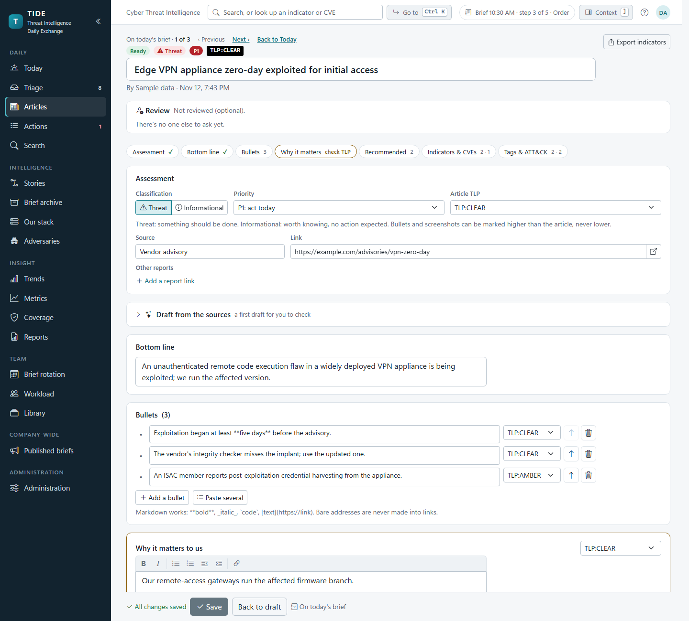

### What an article carries

- a bottom line (BLUF);
- Markdown bullets;
- "why it matters to us", with **We run** under it: the products from Our stack it's about;
- recommended actions;
- pasted screenshots (Ctrl+V anywhere, or drag and drop);
- a **Threat** (P1 to P4) or **Informational** classification;
- board-scorecard tags;
- MITRE ATT&CK techniques from the embedded Enterprise catalog;
- **threat actors**: the adversary profiles it's tagged with, picked by any name, alias or MITRE id;
- sectors;
- indicators (shown defanged, stored live) and CVEs.

The **indicator finder** pulls URLs, addresses, hashes, email addresses, domains and CVE ids out of a pasted article
or a vendor's IOC appendix, defanged or not, and you tick the ones to keep.

### Draft from the sources

Optional, and off until an administrator sets up a provider. It gives the analyst a first draft to check rather than
a blank form:

- **The text to draft from.** Paste it, or **Fetch the article** from its link. TIDE reads the page through intake's
  guarded client and finds the article body whatever the site's design: a selector the source's administrator set,
  the text the page publishes for search engines, its article markup, or reader-mode scoring.
- **Several reports at once.** An article promoted from a group lists its other reports under *Other reports*, with
  the text already read in triage where there is one. *Fetch it* (or *Fetch all*, one at a time) gets the rest, and
  *Add another report* takes any link. Every report with text is a numbered source of the draft, each cut to a fair
  share so one long report can't crowd out the others, and the draft goes at the strictest TLP among them.
- **When TIDE can't read the page.** If the source is marked Open and the article is TLP:CLEAR, the AI provider's web
  search may look it up instead (Azure: Grounding with Bing, off by default).
- **The suggestions.** The provider suggests the bottom line, bullets, recommended actions, ATT&CK techniques,
  scorecard tags, indicators and CVEs, plus "why it matters" from our notes on what we run when the TLP limit allows
  AMBER.
- **A source for every claim.** Each suggested bullet carries markers such as [1] [3] for the sources it came from,
  and a short quote from the first of them. Clicking a marker shows the quote. A bullet that cites nothing, or whose
  quote isn't in the source it cites, is flagged and offered only as *Add anyway*. Where sources disagree on a fact
  (a count, a date, who did it), the draft lists the disagreement instead of picking a side. The markers are for the
  editor only; they never reach the emails.
- **The checks.** TIDE checks every suggestion before you see it:
  - techniques must be in the catalog;
  - tags must be configured ones;
  - each indicator is marked as in the text or not;
  - Markdown links are removed.
- **Your decision.** Each suggestion goes into the form only when you accept it.
- **The limit.** Nothing above the TLP limit (`Ai:MaxTlp`, GREEN by default) is ever sent.
- **With no provider.** **Copy a prompt** gives the text to run in an AI tool your organisation has approved, and its
  pasted answer goes through the same checks.

Every draft is recorded with its provider, model, prompt version and a hash of what was sent. The rules are in
[ADR 0004](../decisions/0004-opt-in-ai-with-tlp-ceiling.md).

### Tagging products and threat actors

**We run** and **Threat actors** use the same search picker. With nothing typed it offers what the article's text
names, then what was tagged lately; typing finds a product or profile by any of its names ("APT29 (also Cozy Bear)"),
best match first and retired ones last (asked about before tagging); and "Add 'X'" makes a new one from the words
typed, with a link to fill it in. Tags are saved as they're picked. A product's **Mention** adds it to "why it
matters".

### Similar articles and history

Beside the editor, under the threat story, **Similar articles** (folded) lists other articles with the same CVE, link
or story, when each was briefed, and its open actions. Each is one click from mentioning an action or joining the
story.

**TLP everywhere.** The article, each bullet, each screenshot and "why it matters to us" carry a TLP 2.0 marking,
and a part never counts lower than its article. On a threat, "why it matters to us" starts at AMBER, since it usually
names our own systems. Analysts can see each article's and each brief's **History**: who changed which field, and
when. The rules are in [editions and TLP](../architecture/editions-and-tlp.md).

Leaving the editor with unsaved changes asks whether to save, discard or stay.

## Review before send

**Route:** `/articles/{id}/review` · **Workflow:** [writing articles](../workflows/writing-articles.md)

An analyst can ask a colleague who writes articles (an Analyst or an Admin) to review an article before it goes (this
week's presenter is suggested). The reviewer gets it on Today and opens the review page:

- the article as each edition will carry it;
- comments on a part (the title, the bottom line, a bullet, why it matters), optionally quoting the words selected;
- a short checklist: TLP right for every part, every claim sourced, nothing internal in the company-wide edition,
  the bottom line stands alone;
- *Approve* or *Ask for changes*.

The author sees the comments in the editor and resolves them. A change to what the article says after approval (a
screenshot added or removed included) puts the review out of date; marking it Ready doesn't, and an approval is
refused if the article changed while the reviewer was reading it. The Send dialog lists the brief's articles that
haven't been reviewed. Review is optional; an administrator can require it (Access & distribution) for anything AMBER
or above, for threats, or both, and then an edition holding such an article waits until it's approved.

## Actions and hunting

**Routes:** `/actions`, `/actions/{number}`, `/actions/new` · **Workflow:** [actions and hunting](../workflows/actions-and-hunting.md)

Follow-up work from the brief: IOC sweep, hunt, block, patch, config change, awareness or outreach. Each action
is owned by a team and optionally assigned. It's due by a date the SLA targets suggest, and closed with an outcome
that fits its kind.

- **Board or list.** The Actions page opens as a board until someone picks the list, and then remembers their
  choice on any computer. A link that names a layout opens that one. On the board, a card is dragged to another
  column, or moved from its Move menu by keyboard. Its columns are Open, In progress, Blocked, Tracking, Done, Cancelled
  and Not applicable.
- **Filters.** One bar serves the list and the board: the search box (title, A-number or the article's title), then
  the pills **Overdue**, **Due this week**, **P1–P2**, **Blocked** and **Tracking**. Overdue and Due this week take
  turns, as do Blocked and Tracking (each pair is one filter). **+ Filter** holds team, kind, priority (any of P1 to
  P4), due date (including no due date), status and, when an administrator shows card rules as filters, the rule, each
  with its count. A holder chosen on Workload and "Part of A-12" (from a parent action's link) show as chips. They
  combine and stay in the address. Filtered to a team with an active limit, the bar says "4 of 5 active". The view
  tabs (Mine, My teams, All open…) stay tabs.
- **Long lists.** The list shows 50 actions a page, with numbered pages and the page in the address; group headings
  count every action in the group, not only this page's. Each board column shows its first 20 cards, then *Show N
  more*. The closed columns show the last 7 days; *Show older*, under Done, takes them back 30 days.
- **Raising.** Raise one from an article, from the board, or in the meeting without leaving the slide.
- **Splitting.** A long remediation splits into parts, one per team: one at a time (*Split off a part*, prefilled from
  the parent, with no team chosen), or several at once (*Split to teams*: tick the teams, give each a due date and a
  ticket link). A parent shows its parts in its lineage, with their progress ("3 of 5 done · 1 overdue · next due
  Nov 20") and a link to them on the board; closing it with parts open asks first.
- **Lineage.** A split action shows where it came from and went, left to right: the article and its CVEs, the
  parent (with who handed it over, and its progress), and each part with its team (marked external), status and due
  date or how late it is, tinted and labelled done, on track, due soon, overdue or tracking in the same colours as the
  due-date badges. Each is a link. On the parent it takes the place of a list of parts, with the buttons to split off
  more under it. A part's page shows its parent and the other parts, with itself marked. On a phone the steps stack.
- **Remediation timeline.** Under it, on the parent: a bar per part from when it was raised to when it's due, the
  days past due in red, when each closed, and a line for today, with each part's dates written under its bar.
- **Recording an update.** *Record an update* puts what a team said by email on its action in one step: their reply
  (kept as a comment headed as theirs), the status, a new due date and why, and a note, as one line in its history.
- **Handing off.** *Hand off* gives an action to another team with a short reason, shown on it. The receiving team is
  emailed, unless it works outside TIDE.
- **Tracking.** A status, and a board column between Blocked and Done, for work handed to others and followed: still
  open and due, but not counted against the team's limit.
- **Limits.** A team may have a limit on its active actions; the list and board filtered to it say "4 of 5 active",
  and going over is counted, asked about or refused, as an administrator set it.
- **Around it.** An action can have an external ticket link, comments (from any team) and a readable history.
- **Files.** Files can be added to an action itself (picked, dropped or pasted, or while raising it) as well as to
  its comments. Its Files section, in the side column under About, lists both, newest first: a compact row each, with
  its description, SHA-256 and controls under its "More" button. A file is checked from its first bytes as well as
  its name and type, and an image whose bytes don't match isn't shown inline. A file that can run (a program,
  script, installer, shortcut, Office file with macros and the like) downloads in a zip with the password `infected`,
  with an "as is" download beside it. Removing a file (on the action or a comment) needs a reason and keeps it for an
  administrator to restore; deleting a comment keeps its files the same way. Lists, the board and the brief show a
  paperclip with the count.
- **How late.** An overdue action says how late it is.

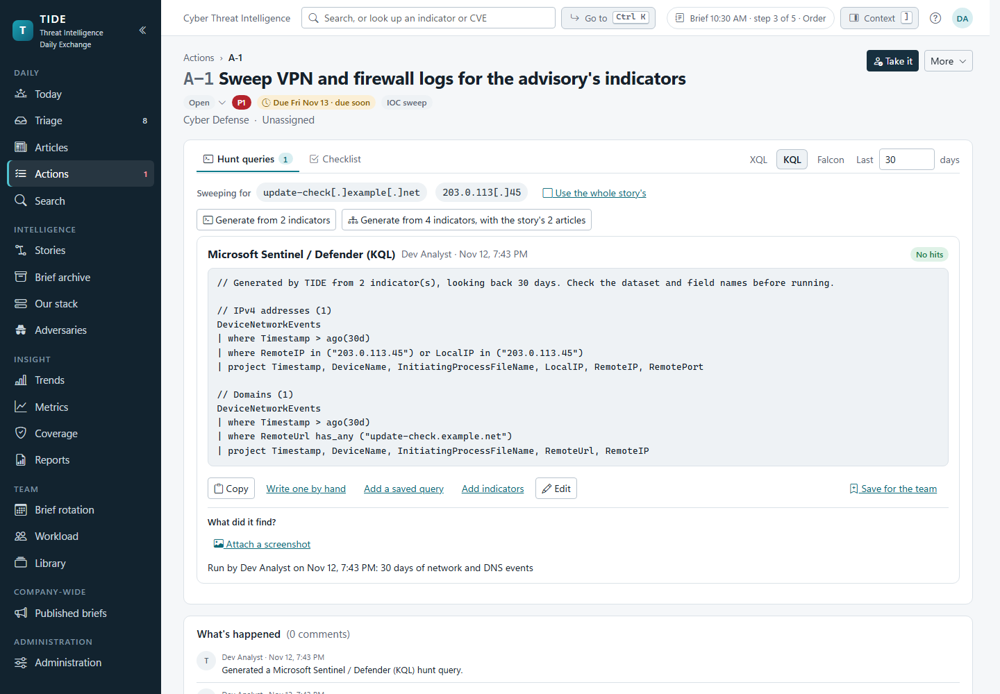

### Hunt queries

- **Where they come from.** They're generated from the article's indicators, or from every article in its story.
- **Which SIEMs.** **Cortex XSIAM (XQL)**, **Microsoft Sentinel / Defender (KQL)** and **CrowdStrike Falcon /
  Next-Gen SIEM**.
- **Templates.** Administrators edit a template per kind of indicator.
- **Saved queries.** Any hunt can be saved for the team (*Save for the team*); see [Saved queries](#saved-queries).
  *Add a saved query* puts one on an action: `{{days}}` becomes the action's window and `{{values}}` its indicators
  (`{{values:domain}}` and the like take one kind).
- **Adding indicators.** The Hunt queries card adds indicators, typed or found in pasted text. An action raised from
  an article adds them to the article (for an analyst); one with no article keeps them itself.
- **Running them.** Copy the query and run it in your SIEM; TIDE never signs in to a SIEM
  ([ADR 0006](../decisions/0006-query-dialects-are-templates.md)). Then record hits or no hits, with a screenshot.
- **Closing a clean sweep.** A sweep whose query came back clean closes in one step, *No hits, close*, once the query
  was copied. The days it searched and any values it left out go on record.

### Outreach (asking someone)

- **The kind.** An Outreach action asks a vendor, a partner, an ISAC, an internal team or a site's owner for
  information. It was "Vendor inquiry"; actions raised as one are Outreach actions now.
- **Templates.** The team's emails are kept on [Outreach templates](#outreach-templates).
- **Write the email.** On the action, pick a template: TIDE fills it, held to its TLP ceiling, says what it left out,
  marks anything it had nothing for, and writes the email's TLP line. Edit the subject and body, copy them into your
  own mail, and send it from there. TIDE never sends it ([ADR 0019](../decisions/0019-outreach-emails-are-written-never-sent.md)).
- **Who to.** The To line offers the template's address, or the vendor contact kept on the product on Our stack.
- **Waiting for the reply.** Mark it sent, and the action shows how long it has waited. An optional reminder (off
  until enabled) says to follow up after a set number of business days. *Record the reply*, with the reply itself as
  a file if wanted, closes the action with an outcome. Each send and reply is in the action's history.

### Keeping track

- **Lists.** Views by me, my teams, all open, overdue and recently closed.
- **Reminders.** Reminder emails for due soon and overdue, a weekly team digest, and an outreach follow-up. Each is
  off until enabled.
- **Personal choices.** Each person turns off the emails they don't want on [My notifications](#my-notifications).

## Search and indicator lookup

**Route:** `/search` · **Workflow:** [search, exports and adversaries](../workflows/search-exports-and-adversaries.md)

One box at the top of every page.

- **Words.** Words or "phrases" search across articles, actions and stories. That covers bullets, indicators, CVEs,
  ATT&CK techniques by name and captions, with the matches marked.
- **An indicator.** Paste an IP address, domain, URL, hash or email address, defanged or not, to see:
  - every article it's on, and when it was briefed;
  - other indicators on the same host;
  - the actions raised, and whether their hunts found anything;
  - a ready hunt query.
- **A CVE.** Paste a CVE for its CVSS, EPSS and KEV status, the articles about it, and what was done.

**Go to** (`Ctrl+K`) jumps to a page, starts an article or action, or opens one by title or number ("A-12"). `?`
lists the page's keyboard shortcuts, with the switch that turns single-letter shortcuts off.

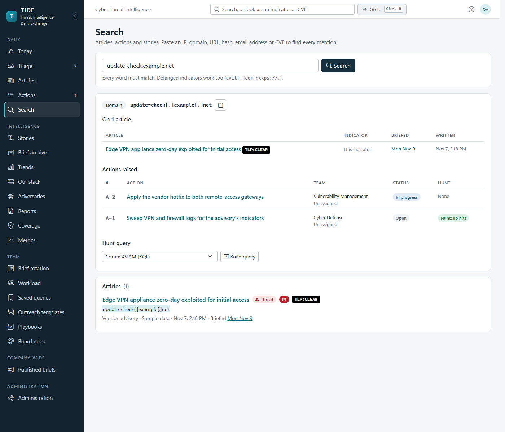

## Present mode

**Route:** `/present/{day}` · **Workflow:** [the brief and the meeting](../workflows/brief-and-meeting.md)

A full-screen, keyboard-driven slide deck, always dark because it's on a shared screen:

- a title slide with the agenda;
- the team's opening note (what's coming up, the week's phishing trends; team edition only, carried from the
  previous brief);
- the opening numbers, a slide per metric group;
- one slide per article;
- a wrap-up with every recommended action not yet raised.

Screenshots zoom, articles are ticked off as discussed, and the editions can be switched on screen. A slide too tall
for the screen shrinks a little, then scrolls inside itself.

**Start the meeting** and it's live for the team: a banner on every page, and a Join button on the brief. Invite
everyone on the team edition in (or paste the copied link). People who join follow the presenter's slide, can browse
off on their own and come back, and show in the strip with the slide they're on. They raise a hand on an article,
take notes (each person's own, against the article on screen), raise actions and take or assign them. The presenter
can bring everyone back or lock everyone to their slide, clear hands and hand presenting to another analyst; if the
presenter drops out, another analyst can take over. Attendance is recorded as people join, and the presenter can add
people who were in the room. The brief's page keeps who attended and the notes, by article.

Each of an article's recommended actions is **raised in one click** from its slide. It's raised at the article's
priority, as the kind its wording suggests and for the team that last took that kind; both can be changed first.
Articles not discussed carry to the next brief. Ending the meeting asks first.

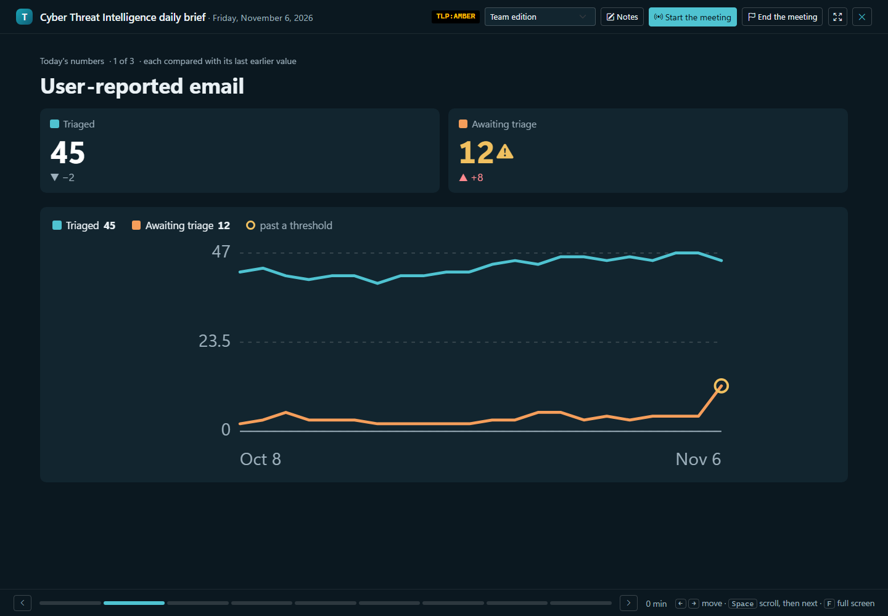

## The two editions

**Workflow:** [distribution](../workflows/distribution.md)

Both editions go through your SMTP relay to administered recipient lists, styled so Outlook shows them as intended,
with screenshots embedded rather than fetched.

- **The team edition** opens with the day's numbers, and lists each article's indicators and the actions raised.
- **The company-wide edition** leaves out anything above its TLP ceiling (articles, bullets, screenshots and
  captions) rather than hiding it. Administrators set the ceilings.

**Sending:**

- **Before it goes.** You can preview the email exactly as it will go and send a test copy to yourself. The send
  itself needs an explicit confirmation that shows the marking and every recipient.
- **A record of what went.** Each send freezes a copy of what went, HTML and images, and logs who sent it to whom.

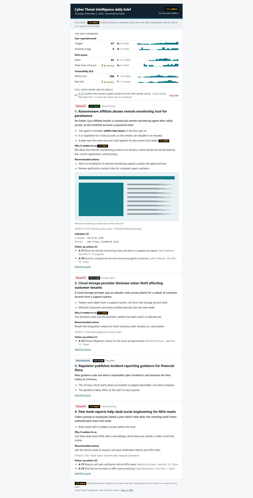

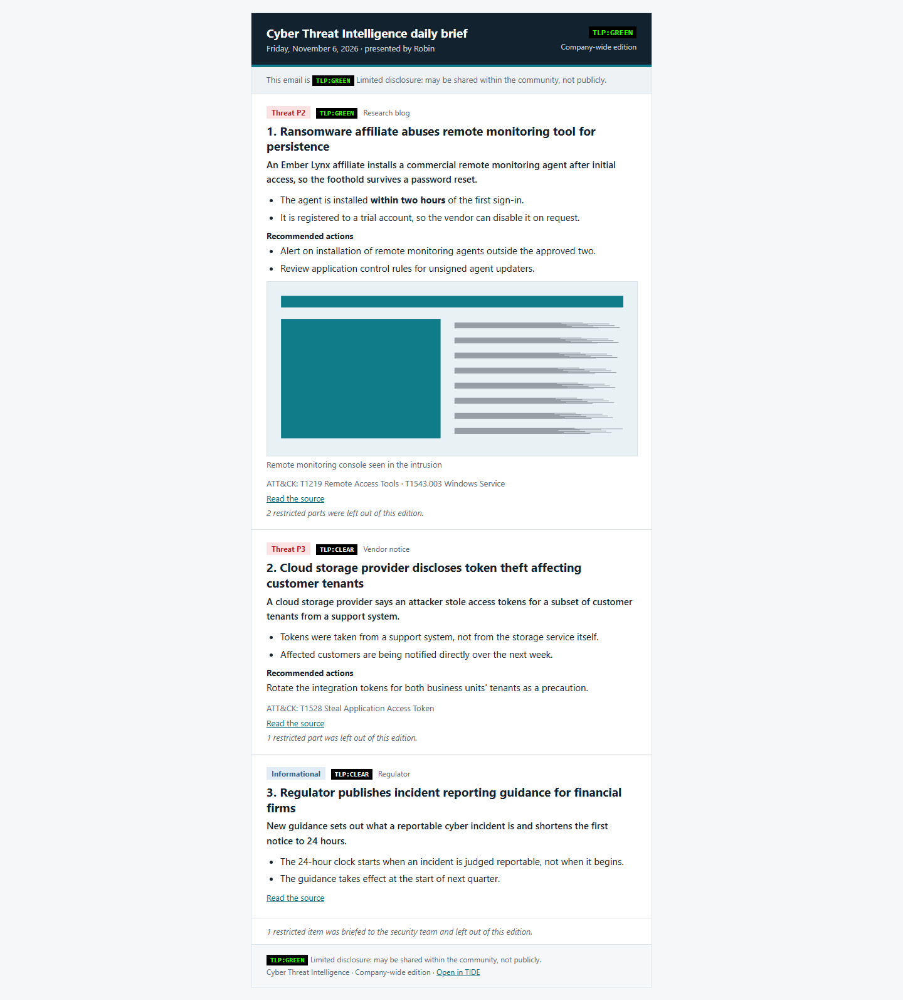

## Corrections after a send

**Workflow:** [distribution](../workflows/distribution.md)

Email can't be recalled, so a mistake found after the brief went out gets a **correction**. That's a short email of
its own to the people who had the original:

- a required note on what changed;
- for each article, a diff of the article as sent against the article now, cut to the edition's TLP ceiling.

A **TLP slip** (something went to an audience it shouldn't have) works differently:

- the correction tells recipients to delete the email, and repeats nothing that leaked;
- the send is withdrawn from the Reader archive as soon as the slip is confirmed, whatever becomes of its email;
- so is every company-wide send of that day made before the slip, a re-send that put it right included. To publish
  the corrected version, send the edition again after the slip; the send log says so under each withdrawn send.

Corrections are frozen and logged like a send, and listed under the original. See
[ADR 0015](../decisions/0015-corrections-after-send.md).

## Copy for SharePoint

**Route:** `/briefs/{day}/sharepoint` · **Workflow:** [distribution](../workflows/distribution.md)

The company-wide edition as clean HTML in one click, plus a zip of its images, for a SharePoint page. An analyst marks
it posted (who and when are kept). An administrator can require that under Access & distribution; then a brief isn't
finished until it's marked.

With email off (`Email:Enabled`), the Send step becomes **Distribute**: once the brief has gone out another way, an
analyst marks it distributed. It's finished as a send would finish it (its numbers lock), but nothing is frozen, so
it isn't listed in Published briefs.

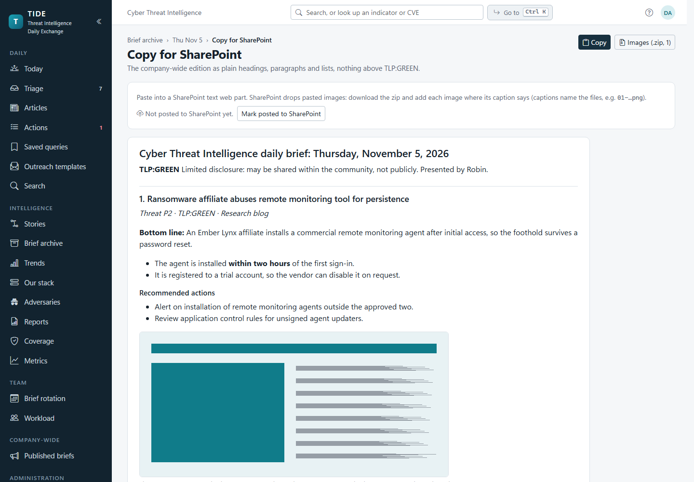

## Published briefs

**Routes:** `/published`, `/published/{day}` · **Workflow:** [distribution](../workflows/distribution.md)

What Readers see, and all they see: the sent company-wide editions, frozen as sent. Each shows its headlines, and a
filter matches the words each edition went out with. A corrected day shows its corrections above the edition. It's
the home page for a Reader or a Visitor.

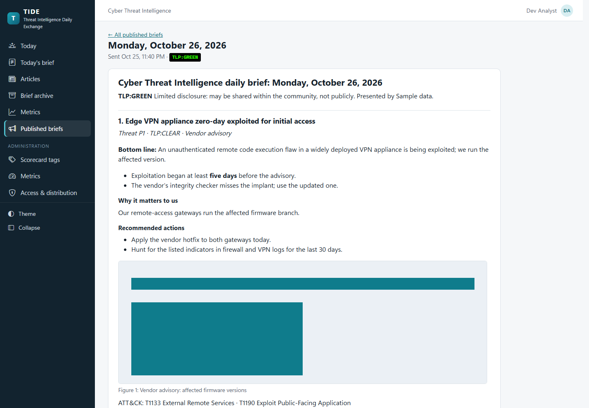

## Brief archive

**Route:** `/briefs` · **Workflow:** [the brief and the meeting](../workflows/brief-and-meeting.md)

Every day's brief, for the team: the day, who presented, how many articles and threats, and where it stands (Draft,
Ready, Presented, Sent, or finished as not sent with who, when and why). A filter takes a day, a month or a name.
Each row opens that day's brief, with its running order, its edition preview, the meeting's attendees and notes, and
its send log.

## Threat stories

**Routes:** `/stories`, `/stories/{id}` · **Workflow:** [search, exports and adversaries](../workflows/search-exports-and-adversaries.md)

Stories link articles across days into a timeline, with their CVEs, actors, techniques and actions: a campaign, a
vulnerability being exploited, or an actor followed over weeks. An article joins one from the editor, which suggests
the story of a related article.

## Our stack

**Routes:** `/stack`, `/stack/{id}` · **Workflow:** [search, exports and adversaries](../workflows/search-exports-and-adversaries.md)

The products the organization runs, kept by analysts. The list shows each product's versions, team and how much has
been written about it. A product's page has its other names, versions and notes (AMBER), a vendor contact for
outreach emails, and its history: the articles tagged with it or naming it, and their actions. Triage lifts items
that name a product, and an article is tagged with any number of them from the editor's **We run**. A product's
history is held to the team edition's TLP ceiling: articles above it, and actions raised from them, are counted but
not named. A colleague's change re-reads the page in place; the edit form keeps what's typed in it.

## Adversary profiles

**Routes:** `/adversaries`, `/adversaries/{id}` · **Workflow:** [search, exports and adversaries](../workflows/search-exports-and-adversaries.md)

**Intelligence › Adversaries** keeps one profile per threat actor or campaign, under every name it goes by, so
Scattered Spider, UNC3944 and Octo Tempest are one. A profile's page has:

- a **timeline** of the articles tagged with it or naming it (in the title, the earlier actors note or the bottom
  line), and their actions and indicators, with how many briefs it was in this quarter;
- the **ATT&CK techniques** across those articles, darker where more articles show them, downloadable as an ATT&CK
  Navigator layer scored by count;
- **our notes** (internal, AMBER), motivation and sectors.

Articles that name a profile but aren't tagged are listed for an analyst to check and tag: nothing is linked
automatically. The editor's **Threat actors** field (under Tags & ATT&CK › Context) tags an article with a profile by
any of its names, or adds one. It replaced a free-text box: what an article's box held is kept as an **earlier
note**, whose names a profile goes by are offered as one-click tags ("Tag APT29") and whose other names stay in sight
under the picker until cleared.

A **watched** profile marks triage items that name it ("Watching: Scattered Spider"). Two profiles that turn out to be
one group can be merged. MITRE ATT&CK's groups and campaigns can be imported for their ids and aliases: fetched from
MITRE's TAXII server, or uploaded from a saved copy where the server has no internet.

## Detection coverage

**Route:** `/coverage` · **Workflow:** [search, exports and adversaries](../workflows/search-exports-and-adversaries.md)

**Intelligence › Coverage** compares the ATT&CK techniques the team briefed in the last 90 days with the SOC's
detection rules. An administrator imports the rules under Administration › Detection rules, from a Sentinel
analytics-rules export, Sigma YAML (a file or a zip of a folder) or a CSV, or another tool pushes them through the
API. TIDE keeps each rule's name, id, technique tags, platform and whether it's enabled; it never reads, stores or
runs a query. A technique counts as covered when a current, enabled rule is *tagged* with it, its parent or a
sub-technique.

- **Gaps first.** Techniques with no enabled rule are listed first, those a watched adversary uses at the top, each
  with how many articles showed it. *Raise action* opens a Config change action for the chosen team (one named for
  detection is picked first), linked to the latest article, and the row shows it until it's closed.
- **Where analysts write.** The editor's technique chips and an adversary profile's techniques say "2 rules", "1
  disabled" or "no rule", and the profile's Navigator layer is coloured by it.
- **Internal.** Rule names and counts never reach an edition, an export or a webhook. See
  [ADR 0017](../decisions/0017-detection-rules-are-referenced-and-tagged.md).

## Indicator exports

**Workflow:** [search, exports and adversaries](../workflows/search-exports-and-adversaries.md)

The indicators of an article, a day's brief or a story can be exported in two formats:

- **STIX 2.1:** a bundle of reports, indicators, CVEs and ATT&CK techniques, each with its TLP 2.0 marking.
- **CSV.**

You choose the highest TLP to include, and articles above it are left out whole
([ADR 0012](../decisions/0012-exports-carry-tlp-and-stable-ids.md)).

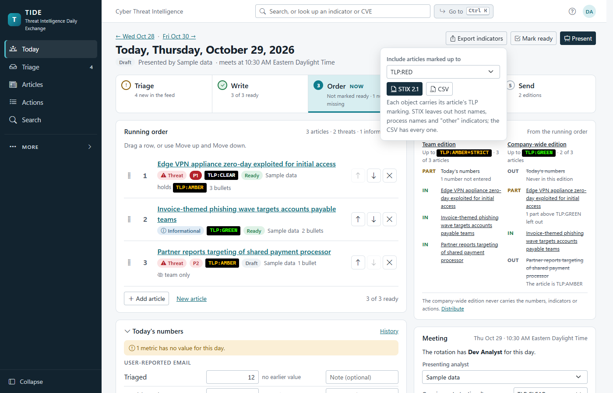

## Threat trends and the board scorecard

**Route:** `/trends` · **Workflow:** [metrics and trends](../workflows/metrics-and-trends.md)

Month on month or quarter on quarter, Trends counts:

- the scorecard tags, rolled up to their categories;
- ATT&CK tactics and techniques;
- the follow-up work: actions raised by kind and team, done on time or late, outcomes, hunts and their hits, and
  what was open or overdue when each period ended.

Chart any line, as many as you like. Click any number to see the articles or actions behind it, or open them as a
pre-filtered Articles list, ready for the monthly or quarterly threat trends report. Opened from a tactic or
technique, each article in the list shows the techniques it was counted for. The table, or a period's articles with
their tags and techniques, downloads as CSV. The page keeps its state in the address, so a view can be bookmarked.

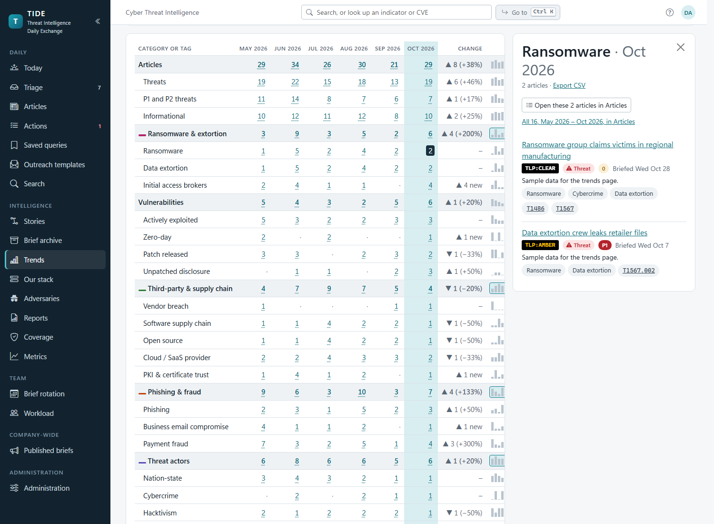

## Reports

**Route:** `/reports` · **Workflow:** [metrics and trends](../workflows/metrics-and-trends.md)

The report a team lead owes for a week, a month or a quarter (the last full month by default), from the same counts
as Trends and Metrics, marked AMBER:

1. **Headlines**, against the period before;
2. **Outcomes**, against the period before;
3. **Opening metrics**;
4. **Topics and techniques** briefed most;
5. **Actions raised by team**.

Each section has room for the lead's assessment, which prints with the report but isn't saved. *Print* prints the
report without the app's frame. A period still under way is marked "(to date)".

## Team commitments

**Route:** `/reports/teams` · **Workflow:** [metrics and trends](../workflows/metrics-and-trends.md#team-commitments)

How each team does against the due dates on the actions it owns, over the last 30, 90, 180 or 365 days (90 by
default). Linked from Reports and Workload, and open to everyone who reads actions. A row per team, external teams
marked:

- **Actions due** in the window (one with no due date made no commitment, so isn't counted);
- **On time**: the share done by the due date, of those done or past it ("50% (2 of 4)");
- **Average days late**, in calendar days, for those done late or still open past their due date;
- **Open now** and **Overdue now**, whatever the window.

*Parts of splits only* counts only the parts a split made; *External teams only* lists only the external teams. A
team's name and its open count open its actions on the Actions list; its overdue count opens the Overdue view. The
table downloads as CSV, with the window and filters chosen.

## Opening metrics

**Routes:** `/metrics` (history), Today (entry) · **Workflow:** [metrics and trends](../workflows/metrics-and-trends.md)

Many teams open the brief with a round of operational numbers. TIDE holds your own groups of them. Each metric says
whether higher is better, worse or neutral, and can have warning and critical thresholds. Nothing is built in, and a
generic example set can be imported.

**Entering them:**

- **The form.** A fast "Today's numbers" form, with the value each box is compared with shown before you type. A
  colleague's numbers appear as they save them, without a reload; a box you're typing in keeps what you typed and
  says they changed it.
- **Imports.** Values can also come from CSV, as an upload or from a drop folder.

**Where they appear:**

- **The meeting.** A slide per group: its numbers as large tiles over the chart an administrator picks for it (a
  30-day trend, share of the whole, side by side, or none). A group whose numbers are all 0 is a one-line note on the
  first metrics slide instead of a slide of its own.
- **The team email.** A block at the top: each value with its change from the previous business day, and a
  four-week sparkline.
- **History.** The Metric history page has a chart and a CSV export, retired metrics included. A pill per group
  narrows its table to those groups' columns (kept in the address); **Clear** shows every group again.

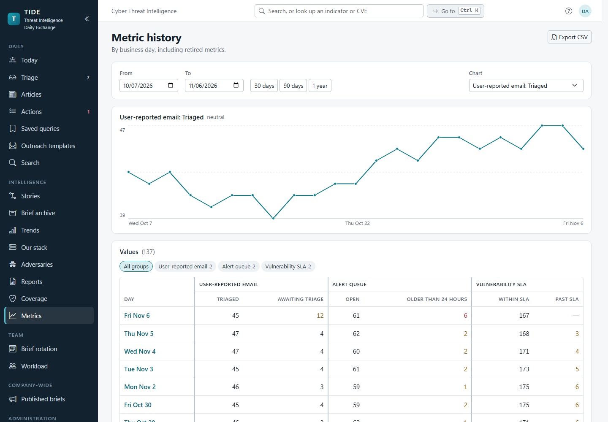

## Brief rotation

**Route:** `/rotation` · **Workflow:** [rotation](../workflows/rotation.md)

A calendar of who presents the brief each business day, built from a weekly rota. (It's the brief rotation, not an
on-call schedule.)

- **Swaps and cover.** Swap days or whole weeks with a colleague, or ask one to cover. Only the colleague taking the
  days approves, and the manager is emailed a notice of every approved change. A request shows at once for the
  colleague it's waiting on, and the answer at once for the one who asked, without a reload. Approved after some of
  its days have passed, only the days still to come change hands; a swap needs days to come on both sides.
- **Coming up for you.** Your next brief days and the requests waiting for you, an optional reminder the business
  day before you present, and your brief days as a calendar file for Outlook.

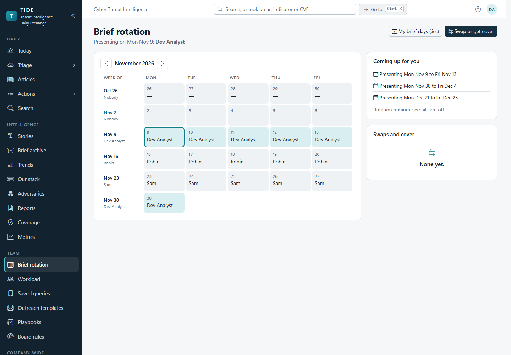

## Workload

**Route:** `/workload` · **Workflow:** [actions and hunting](../workflows/actions-and-hunting.md)

Each team's open actions, what's late, and who holds what, with per-person and P1 counts. A team with a limit shows
"4 of 5 active"; an external team has no holders. A team's name opens its
open actions on the Actions list. The numbers update live as actions change.

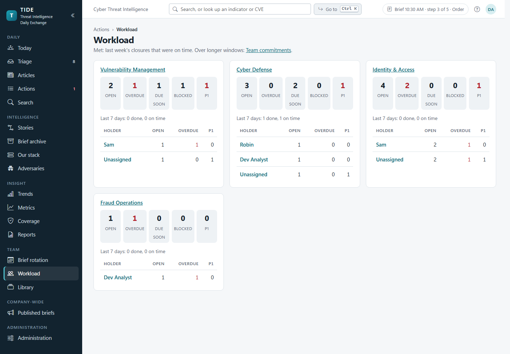

## Saved queries

**Route:** `/hunts/saved` (under Team in the sidebar) · **Workflow:** [actions and hunting](../workflows/actions-and-hunting.md)

The team's library of hunt queries: a tuned sweep or a behavioural hunt kept for a colleague to add to their own
action. The page lists them by language, with how many actions used each, 20 to a page with the page in the address.
A language that runs on to the next page is headed there too ("continued"). Whoever works actions saves, edits,
retires and restores them; whoever saved one, or an administrator, deletes it. Everyone else who reads actions reads
them. A colleague's change re-reads the list in place; an edit under way keeps what's typed, and its save is refused
if the query changed since it began. The filter bar has the search box and a pill per language (**XQL**, **KQL**,
**Falcon**), one at a time; **Show retired** stays a switch beside them, since it widens the list rather than
narrowing it.

A new install, or an upgrade whose library is still empty, starts with 13 starter sweeps saved by "TIDE": IP,
domain, file hash, URL and every-indicator sweeps in KQL and XQL, and IP, domain and file hash sweeps for Falcon.
They're added once. The team edits, retires or deletes them like any other, and deleted ones don't come back.

## Outreach templates

**Route:** `/outreach/templates` (under Team in the sidebar) · **Workflow:** [actions and hunting](../workflows/actions-and-hunting.md)

The team's outreach emails, kept beside Saved queries and in the same way, 20 to a page: a name, a subject and a body
with placeholders, an optional fixed To address, and a TLP ceiling. `{{article.title}}`, `{{article.cves}}` (with KEV
and EPSS), `{{indicators}}` (defanged; `{{indicators:domain}}` and the like take one kind), `{{product.versions}}`,
`{{action.link}}`, `{{sender.name}}` and the rest are filled from the action. Whoever works actions keeps them. Each
shows how many emails were written from it. Its filter bar is the search box with **Show retired** as a switch, as on
Saved queries.

A new install, or an upgrade whose library is still empty, starts with 5 starter templates saved by "TIDE", added
once: *Vendor: are we affected?*, *Internal: action required*, *ISAC / partner: share and ask*, *Follow-up / chase*
and *Internal inquiry: are we impacted?*.

## External teams

**Route:** `/teams/external` (linked from the Actions page and Teams & SLA) · **Workflow:** [actions and hunting](../workflows/actions-and-hunting.md#external-teams)

The teams tracked here that work outside TIDE: each one's name, what they do, its contact (a name and an email), how
to engage them, and its reminder emails (on or off, how many business days before the due date, and how often while
overdue). Whoever works actions adds, edits and retires them; everyone else who reads actions reads them; an
administrator also sets their active limits. Teams & SLA lists the internal teams.

## My notifications

**Route:** `/notifications` (from the account menu) · **Workflow:** [actions and hunting](../workflows/actions-and-hunting.md)

Each person's own choices about TIDE's emails: where they go, a switch for each kind (due soon, overdue, the weekly
team digest, the outreach follow-up, rotation reminders and requests), and a personal digest of their own actions,
daily or weekly, instead. Each switch saves as it's changed. An administrator still turns each kind on or off for
everyone, and sees how many people opted out, and who; nobody changes another's choices. A kind that's off for
everyone shows disabled. The brief itself, test copies and corrections always go.

## The API, for the SOC's other tools

**Routes:** `/api/v1/…`, described at `/api/v1/openapi.json` · **Reference:** [API.md](../API.md)

A versioned API lets a SOAR playbook close the action it finished (with a note, under its own name in the history),
Power BI read the metrics, a SIEM rule propose an item for triage, and a detection pipeline push its rules for
Coverage.

- Briefs come cut exactly as the team edition is, at the caller's TLP ceiling; a Sent one says how it was finished
  (`finishedAs`: emailed, distributed or notSent).
- One action (`/actions/{number}`) lists its live files: id, name, size, SHA-256, content type, who added it, when,
  description and source (the action or a comment). Each downloads from `/actions/{number}/files/{fileId}` (add
  `?zip=true` for the zip with the password `infected`), with the same `actions:read` scope and ceiling.
- A caller signs in with an API token issued under Administration › API access (scoped, expiring, shown once, stored
  as a hash) or as a server's gMSA with Windows.
- Webhooks post, signed with HMAC-SHA256, when an action is raised or becomes overdue and when a brief is sent
  (checked every minute; a raise or a send is posted once it's at least 30 seconds old).

See [ADR 0016](../decisions/0016-api-tokens-scopes-and-signed-webhooks.md).

## Administration

**Route:** `/admin` and the pages under it · **Workflow:** [administration](../workflows/administration.md)

One Administration entry in the sidebar opens every setting page, grouped into tabs, with a getting-started
checklist read from the live configuration. It covers:

- the teams, their members and the SLA targets;
- playbooks and card rules;
- the sources and CVE enrichment;
- the scorecard taxonomy (tags are retired, never deleted, once used);
- the query templates;
- the opening metrics and their imports;
- the AD group-to-role mappings, the edition ceilings and the recipient lists;
- the wording of the reminder and rotation emails, with a live preview and a test send;
- diagnostics, the server configuration, and a check for newer releases;
- the audit log: every change saved across TIDE (settings, role mappings, teams, sources, recipients, ceilings,
  articles and the rest), who made it, when, and each field before and after. Its filter bar has a **Deleted** pill,
  and person, kind of record, action and dates under **+ Filter**; "Only this record" and words narrow it too. It keeps
  the filters in the address, and exports to CSV. Secrets show only as
  set or changed. Administrators only, since it holds text at every TLP marking.

Every page, by tab (from `AdminLayout.Groups`):

| Tab | Page | Route | What it's for |
|---|---|---|---|
| Overview | Overview | `/admin` | What's left to set up, and where everything is set. |
| Organization | Organization settings | `/admin/organization` | The team's name, its time zone, when the brief meets, and its holidays. |
| Organization | Teams & SLA | `/admin/teams` | The teams that own actions, their members, SLA targets, and when reminder emails go. |
| Organization | Brief rotation | `/admin/rotation` | Who presents the brief, the weekly rota, and who's told about swaps and cover. |
| Actions | Playbooks | `/admin/playbooks` | Checklists for each kind of action, offered when one is created or worked. Starts with one for each kind but Other. |
| Actions | Card rules | `/admin/card-rules` | Which actions are coloured and labelled on the board and list, and which rules the Actions filter bar offers. |
| Intelligence | Sources | `/admin/sources` | The feeds and catalogs triage takes items from, and CVE enrichment. |
| Intelligence | Source health | `/admin/source-health` | How much each source sends and how much of it the team uses, with feeds worth pausing. |
| Intelligence | Scorecard tags | `/admin/scorecard` | The categories and tags articles are counted by on the board scorecard. |
| Intelligence | Detection rules | `/admin/detections` | The SOC's rules, from Sentinel, Sigma, a CSV or the API, for Coverage. |
| Intelligence | Query templates | `/admin/queries` | How hunt queries are written for each SIEM and kind of indicator. |
| Brief | Opening metrics | `/admin/metrics` | The numbers the brief opens with, their thresholds, and their history. |
| Brief | Metric imports | `/admin/metric-imports` | Metric values read from CSV: the drop folder, uploads, and what each import did. |
| People & distribution | Access & distribution | `/admin/access` | Which AD groups get which role, the editions' TLP ceilings, and who each edition goes to. |
| People & distribution | Email templates | `/admin/email-templates` | The wording of the reminder and rotation emails, with a preview and a test send. |
| People & distribution | API access | `/admin/api` | Tokens for the SOC's other tools to call TIDE's API, and webhooks TIDE posts to. |
| System | Diagnostics | `/admin/system` | Whether TIDE is healthy: the database, background jobs, email and storage. |
| System | Server configuration | `/admin/system/server` | What's set on the server, read-only. Secrets show only whether they're set. |
| System | Setting sources | `/admin/system/sources` | Where each setting's value comes from: the app, the installer's file, or the environment. |
| System | Configuration bundle | `/admin/system/bundle` | This server's install answers file, and the app's setup to copy to another server. |
| System | Audit log | `/admin/system/audit` | Every change saved across TIDE: who made it, when, and what it was before and after. |
| System | Updates | `/admin/system/updates` | Newer TIDE releases, and how to upgrade. "new" shows beside it when the update check found one. |

## When something's wrong

| Screen | Route | When it shows |
|---|---|---|
| No access | `/access-denied` | A page the person's roles don't open. It says who they're signed in as and with which roles, that roles come from AD groups, and which page it was. |
| Not found | `/not-found` | An address with no page behind it. |
| Error | `/error` | An unhandled server error outside a page. |
| Something went wrong on this page | (in place) | A component on a page threw. The page's frame stays, with *Try again*, *Reload the page* and *Go to today*. |
| Reconnecting… | (overlay) | The connection to the server dropped. It retries, then offers *Try again*, or *Reload the page* when the session was lost. |

How these work is in [frontend](../architecture/frontend.md#errors-and-reconnecting).
