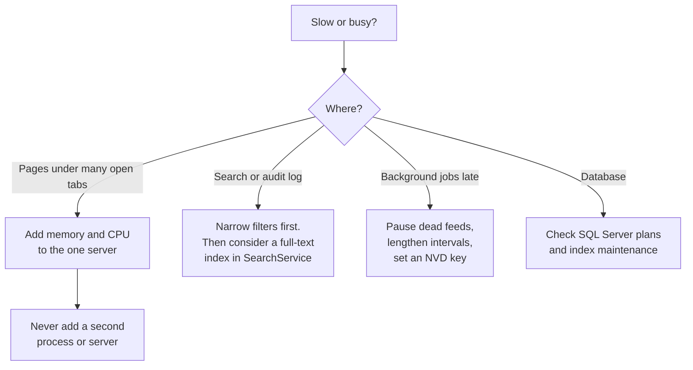

# Performance and limits

The bounds TIDE's code puts on queries, pages, uploads, outbound calls and background work, the indexes the hot
queries rely on, and how to size and scale an install. It's for an operator sizing a server and a developer changing
a hot path. Every number here is a constant or default in the code named beside it. Nothing here was measured on
production hardware: claims about speed are marked **Needs verification**.

**Contents**

- [Expected volumes](#expected-volumes)
- [Query and page bounds](#query-and-page-bounds)
- [Size limits](#size-limits)
- [Content limits](#content-limits)
- [Background work and poll intervals](#background-work-and-poll-intervals)
- [Outbound calls](#outbound-calls)
- [Rate limits](#rate-limits)
- [Indexes that matter](#indexes-that-matter)
- [Memory and connections](#memory-and-connections)
- [Scaling guidance](#scaling-guidance)
- [Cautions when changing code](#cautions-when-changing-code)

## Expected volumes

TIDE is built for one threat-intelligence team: a few articles a day, one brief a business day, tens of thousands of
rows after years ([ADR 0011](../decisions/0011-search-with-portable-like-queries.md)). The scale harness
(`tests/Tide.IntegrationTests/Audit/ScaleAuditTests.cs`) models a busy team over about two years, and is the largest
data set the code is exercised against:

| Data | Rows in the scale harness |
|---|---|
| Articles | 10,000 (half briefed) |
| Briefs | 2,000, five articles each |
| Actions | 5,000, with comments, events and checklists |
| Feed items | 50,000, in every state |
| Metric values | 2,000 |

It times each hot call and counts its SQL on in-memory SQLite (run with `TIDE_SCALE=1`, see
[development/testing.md](../development/testing.md#the-scale-harness)). **Needs verification:** timings on SQL Server
at these volumes; running the same calls against a populated SQL Server database would establish them.

## Query and page bounds

| Bound | Value | Where |
|---|---|---|
| Audit log page | 50 rows | `AuditLogService.PageSize` |
| Audit log, most rows one read returns | 1,000 | `AuditLogService.MaxPage` |
| Audit log CSV export | 10,000 rows | `AuditLogService.MaxExport` |
| Audit log window for the action and words filters without a person | 92 days | `AuditLogService.UnindexedDays` |
| History on an article or brief | 50 rows a page | `HistoryService.PageSize` |
| Article list page | 50 (page), at most 1,000 a read | `Articles.razor` `PageSize`; `ArticleService.MaxPage` |
| Articles `ListAsync` default | 200 | `ArticleService.ListAsync` |
| Triage inbox | 50 rows a page, every match counted; at most 500 a read. New, *Likely used*, *Names what we run* and the KEV filter read every matching item light and page in memory | `InboxFilter.PageSize`, `IntakeService.InboxPageAsync` |
| Search | 50 hits a kind a page, among the newest 1,000 matches; 200 sightings of an indicator; 8 terms | `SearchService.MaxHits`, `MaxTake`, `MaxSightings`; `SearchText.MaxTerms` |
| Command palette | 5 hits a kind, after 250 ms | `PaletteEntries.HitsPerKind`, `CommandPalette.Debounce` |
| Brief archive | 60 briefs | `BriefService.ListAsync` |
| Brief candidates (Add articles) | Articles from the last 14 days | `BriefService.CandidateDays` |
| Published archive | 120 a page | `Published.razor` `PageSize` |
| Actions list | 50 a page, sorted, grouped and paged in the database | `ActionService.ListPageSize`, `PageAsync` |
| Actions board | Every open card, 20 shown a column until *Show N more*; closed in the last 7 days, or 30 with *Show older* | `ActionService.BoardClosedDays`, `BoardOlderDays`; `ActionKanban.razor` |
| Saved queries, outreach templates | 20 cards a page, paged in memory | `SavedQueriesPage.razor`, `OutreachTemplatesPage.razor` `PageSize` |
| Closed actions view, API `view=closed` | Closed in the last 90 days | `ActionService` |
| Today's outstanding actions, a team's queue | 8 each | `ActionService.OutstandingSize`, `TeamQueueSize` |
| Related articles | 5 | `RelatedService.MaxArticles` |
| Pickers (stories, adversaries, products) | 8 shown, from 50 candidates | `NamedSearch.PickLimit`, `PickCandidates` |
| Trends | 6 months, 5 quarters or 8 weeks by default; up to 2 years of months or 3 of quarters | `TrendsService.Span`, `Spans` |
| Metrics history range | At most 3 × 366 days | `MetricsService.MaxRangeDays` |
| Metrics sparklines, trend charts, look-back | 20, 30 and 120 days | `MetricsService.SparkDays`, `TrendDays`, `LookBackDays` |
| Detection rules shown on the admin page | 500 | `DetectionsAdmin.razor` |
| Detection coverage window | 90 days | `DetectionService.CoverageDays` |
| A table view's largest page | 100,000 | `TableView.MaxPage` |

## Size limits

| Limit | Value | Where |
|---|---|---|
| A screenshot | 15 MB (`Files:MaxImageMB`) | `FileStoreOptions`, `ScreenshotService.MaxBytes` |
| Any other file on an action or comment | 25 MB (`Files:MaxEvidenceMB`) | `FileStoreOptions`, `ActionFileService` |
| Files per action, per upload, per comment | 100, 10, 10 | `ActionFile.MaxPerAction`, `MaxPerUpload`; `ActionCommentFile.MaxPerComment` (`src/Tide.Domain/Entities/Actions.cs`) |
| Screenshots and bullets per article | 10 and 30 | `Article.MaxScreenshots`, `MaxBullets` |
| A message from the browser over the circuit | 1 MB | `MaximumReceiveMessageSize` in `Program.cs` (SignalR's default is 32 KB): the longest text box (200,000 characters) at up to 3 bytes a character. Files stream separately. |
| A feed or page fetched | 8,192 KB (`Intake:MaxResponseKB`) | `IntakeOptions` |
| Items read from one feed | 200 | `FeedParsing.MaxItems` |
| Metric CSV | 1 MB and 10,000 rows; 50 problems listed | `MetricCsv.MaxBytes`, `MaxRows`; `MetricImportService.MaxProblems` |
| Detection rule upload | 8 MB; a zip at most 5,000 entries, 32 MB unzipped, 1 MB an entry, 100:1 ratio | `DetectionParsers` |
| Adversary upload | 8 MB | `AdversaryService.MaxUploadBytes` |
| Holiday calendar (.ics) | 1 MB, 100 holidays an import | `HolidayService.MaxCalendarBytes`, `MaxPerImport` |
| Configuration bundle | 2 MB | `ConfigBundle.MaxBytes` |
| An audit value | 1,000 characters, then cut and marked | `AuditInterceptor.MaxValueLength` |
| An email template part | 200 (subject, heading), 4,000 (body) | `EmailTemplateCatalog.MaxLine`, `MaxBody` |
| Article text read for drafting | 500 to 40,000 characters, within 6 seconds of work | `ArticleText.MinChars`, `MaxChars`, `TimeBudget` |
| An AI draft prompt | 60,000 characters | `DraftPrompt.MaxTotalChars` |

## Content limits

| Limit | Value | Where |
|---|---|---|
| Indicators on an article, and from one extraction | 500 | `IocExtractor.MaxIndicators` |
| Indicators an AI draft suggests | 100 | `DraftChecks.MaxIndicators` |
| Indicators listed per article in the team email | 15 | `BriefRenderer.MaxIndicatorsShown` |
| Values in one hunt query block | 500; more repeat the block ("Part 2 of 3") | `HuntQueryBuilder.MaxValuesPerBlock` |
| A hunt's default and longest window | 30 days by default, never more than 180 | `HuntQueryBuilder.DefaultDays`, `WindowDays` |
| Article title, BLUF, bullet, long text | 300, 600, 2,000, 8,000 characters | `ArticleService.MaxTitle`, `MaxBluf`, `MaxBullet`, `MaxLongText` |
| The team's opening note | 4,000 characters | `BriefService.TeamNoteMax` |
| Recipients of an edition list | 200 addresses | `DistributionSettings.MaxRecipients` |
| Brief-not-ready recipients | 50 | `OperationalSettings.MaxNudgeRecipients` |
| Outreach recipients | 10 | `OutreachService.MaxRecipients` |
| Triage suggested group | 8 reports, within 12 to 96 hours (48 by default) | `TriageGroups.MaxSize`, `MinWindowHours`, `MaxWindowHours` |
| An SLA target | At most 260 business days | `ActionSla.MaxDays` |
| An API token's life | At most 366 days | `ApiTokenService.MaxDays` |

## Background work and poll intervals

All of these run in the one TIDE process ([known-issues.md](known-issues.md#scale)).

| Job | Interval | Bounds | Where |
|---|---|---|---|
| Intake pass (feeds, CVE, prune) | Every minute | Each source on its own interval (`Source.PollMinutes`, 60 by default, never under `Intake:MinPollMinutes`, 15 by default, and never under 5), doubled for each failure in a row, up to 16 times. Sources are polled one after another. | `IntakeHostedService.PollInterval`, `IntakeService.Interval` |
| CVE refresh | Every `Cve:RefreshHours` (24) | At most 40 NVD lookups a run (`Cve:MaxNvdPerRun`, held to 500), 6.5 s apart without an NVD key, 0.7 s with one; a record rechecked at NVD after 7 days; each NVD request may take 60 s (`Cve:NvdTimeoutSeconds`) and is tried up to 3 times, so a run can take many minutes, beside the feed polling | `CveService` |
| Prune | Daily | Feed items after `Intake:RetentionDays` (90); kept article text after `Intake:ReadingDays` (7) | `IntakeService.PruneAsync`, `ReadingService.PruneAsync` |
| Reminders and digests | Every 5 minutes | Each kind at its time of day, once (marks) | `ReminderHostedService.PollInterval` |
| Webhooks | Every minute | At most 100 posts a hook a run; events at least 30 s old | `WebhookHostedService.PollInterval`, `WebhookService.MaxPerRun`, `SettleDelay` |
| Metrics drop folder | Every `Metrics:Import:PollMinutes` (5, held to 1 to 60); every minute when off | A file must be unchanged for 30 s; processed files kept 90 days | `MetricImportHostedService`, `MetricDropFolder.Settle`, `KeepFor` |
| Update check | Every `Updates:CheckIntervalHours` (24, held to 6 to 168), first after 2 minutes | 10 s a check; a manual check at most once a minute | `UpdateCheckHostedService`, `UpdateCheckService` |
| Session permissions re-derived | Every 2 minutes per open circuit | In-memory lookups | `PermissionRevalidatingAuthStateProvider.Interval` |
| Live meetings sweep | Every 10 seconds | An away follower is kept 30 s; a meeting with no one 15 minutes | `LiveMeetings.Grace`, `Abandoned` |
| Live page reload | After 600 ms of quiet | One reload per burst of changes | `LiveChanges.Pause` |
| A user's "last seen" | At most every 30 minutes | | `UserDirectory.TouchEvery` |

## Outbound calls

| Call | Limits | Where |
|---|---|---|
| Feeds, CVE services, article pages | `Intake:TimeoutSeconds` (20, held to 5 to 120); 10 s to connect; 5 redirects; reading an article page `Intake:ReadSeconds` (6, held to 2 to 60) | `OutboundHttp`, `IntakeOptions.ReadBudget` |
| SMTP | `Email:SmtpTimeoutSeconds` (30, held to 5 to 300). After 3 failures within 2 minutes the relay is backed off for 1 minute, doubling up to 10, and sends fail fast. | `EmailOptions.Timeout`, `OutboundCircuit` |
| A send's outcome | The email goes once; saving its outcome is tried up to 4 times. A send still "sending" after 15 minutes is treated as stuck. | `SendOutcome.RecordAsync`, `InFlight` |
| Webhook posts | 15 s each; no redirects followed | `Program.cs` (`HttpWebhookPoster` client) |
| Azure OpenAI | `Ai:TimeoutSeconds` (120, held to 15 to 300) | `AzureOpenAiAssistant` |
| AD name lookups | 5 s for SID names (16 at once), 2 s for Windows names (8 at once); a hung call written off | `SidNames`, `WindowsNames`, `BoundedDirectoryCalls` |

## Rate limits

Token buckets per signed-in person (or address), refilled each minute (`AddRateLimiter` in `Program.cs`). Over the
limit, the answer is `429`.

| Policy | Limit | Applies to |
|---|---|---|
| `files` | 300 a minute per person | `/files/{id}/inline`, `/download`, `/zip` |
| `exports` | 60 a minute per person | Every `.AsExport()` route: exports, CSVs, email previews, the SharePoint zip, the calendar |
| `api` | 120 a minute per caller (a token, or a person) | `/api/v1` |
| `health` | 120 a minute per address | `/health`, `/health/live` |

## Indexes that matter

Defined in `AppDbContext.OnModelCreating` (`src/Tide.Infrastructure/Persistence/AppDbContext.cs`). The full list is in
[architecture/data-model.md](../architecture/data-model.md).

| Table | Index | Serves |
|---|---|---|
| `AuditLog` | `AtUtc`; `(EntityType, EntityKey)`; `(UserId, AtUtc)` | The audit log's date order, kind and record filters, person filter; History on a record. Nothing indexes the action or the values: hence the 92-day window. |
| `Articles` | `CreatedAtUtc`; `Status`; `StoryId` | The article list's default order and status filter; a story's timeline. |
| `BriefItems` | `(BriefId, ArticleId)` unique; `ArticleId`; `CarriedFromBriefId` | A brief's running order; "first briefed" for trends; carry-over. |
| `Briefs` | `BriefDate` unique | Every day-based lookup. |
| `BriefSends` | `(BriefId, SentAtUtc)`; `(Edition, IsTest, Status, BriefDate)` | Send history; the published archive. |
| `Actions` | `Number` unique; `(Status, DueDate)`; `TeamId`; `AssigneeId`; `ArticleId`; `ParentId` | The board and lists, overdue and due-soon scans, Workload, "my actions". |
| `ActionComments`, `ActionEvents` | `(ActionId, AtUtc)` | An action's timeline. |
| `FeedItems` | `UrlHash` unique; `(Status, FetchedAtUtc)`; `FetchedAtUtc`; `SourceId`; `ArticleId` | One item per address; the inbox tabs; pruning; source health. |
| `MetricValues` | `(DefinitionId, BriefDate)` unique; `BriefDate` | A day's numbers; history. |
| `ArticleIndicators`, `ArticleCves`, `ArticleTechniques`, `ArticleTags` | `ArticleId`; `CveId`; `TechniqueId`; `TagId` | An article's parts; CVE and trend lookups. Indicator values are not indexed: an indicator search scans. |
| `NotificationMarks` | `SentAtUtc` | Reminder marks by age. |
| `ApiTokens` | `Hash` unique | Token sign-in. |

**Needs verification:** whether SQL Server's plans use these as intended at volume (an execution plan of the
scale harness's calls on SQL Server would show it).

## Memory and connections

- **Blazor circuits.** Each open tab holds a server-side circuit: its component tree, its DI scope and the page's
  state. A dropped connection's circuit is kept for 20 minutes (`DisconnectedCircuitRetentionPeriod` in `Program.cs`,
  the default is 3) so a laptop that slept comes back to its unsaved edits. **Needs verification:** memory per
  circuit, per page (present mode and the article editor are the largest); measure a process's working set with a
  known number of open tabs.
- **Uploads** are read whole into memory in the circuit (`BrowserFiles.ReadAsync`): up to 25 MB a file by default,
  ten files an upload.
- **Database connections.** Each operation opens and disposes its own context (`IAppDbContextFactory`), so connections
  return to ADO.NET's pool between operations. SQL Server has `EnableRetryOnFailure`.
- **In-memory stores** are bounded: `PrerenderStore` keeps at most 1,000 states for 30 seconds each; presence and
  meetings hold one entry per open tab.

## Scaling guidance

- **Scale up, never out.** One server, one app pool, one process (ADR 0001; the reasons are in
  [known-issues.md](known-issues.md#scale)).
- **Size for open tabs, not requests.** Each analyst, action owner and meeting follower with TIDE open holds a
  circuit. A meeting with many followers holds one each. **Needs verification:** a sizing figure (memory per hundred
  open tabs).
- **Keep WebSockets on.** Long polling costs more per connection (Diagnostics shows the transport mix).
- **Keep background work modest.** Prefer fewer, healthier feeds (Source health suggests ones to pause); set an NVD
  API key (`Cve__NvdApiKey`) so lookups aren't spaced 6.5 s apart.
- **Maintain the database.** Ordinary SQL Server index and statistics maintenance; the audit log and notification
  marks only grow ([known-issues.md](known-issues.md#data)).

## Cautions when changing code

- Bound every list a page reads (`Take`), and every export.
- Don't add a leading-wildcard filter over a large table without a date or person bound, as the audit log does.
- Count queries for a hot call with `TestDb.Commands` and run the scale harness before and after.
- Order in SQL, not in memory, unless SQLite can't (it can't order by `DateTimeOffset` in some shapes; the model
  stores ticks there for that reason).
- Keep anything a person waits on off the outbound network; background jobs reach out, pages read the database.
