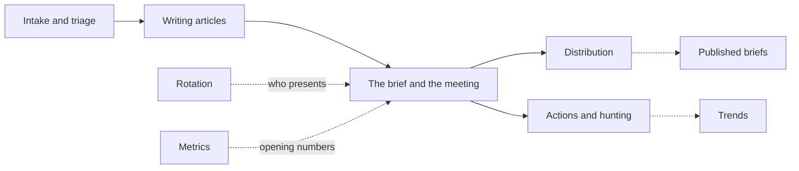

# Workflows

End-to-end descriptions of what people do in TIDE and what happens behind each action: the steps a user takes, the
services and entities involved, the state changes, who may do it, the edge cases and the guards that handle them, and
where it all lives in code. Read these when you need to know how a feature behaves, not just where its code is.

| Page | Covers |
|---|---|
| [intake-and-triage.md](intake-and-triage.md) | Sources, polling and Pull now, feed and sponsored filters, canonical URLs and repeats, CVE enrichment (KEV, EPSS, NVD) and suggested priority, the triage inbox and its keys, decisions and the item lifecycle, promoting, attaching, "Looks like one event" and Promote as one, the reading pane, learning from decisions, items proposed through the API, pruning |
| [writing-articles.md](writing-articles.md) | Starting an article, what it holds, the editor and the reader preview, saving with `EditVersion` and concurrent edits, article status, readiness checks, screenshots, the indicator finder, Draft from the sources (AI), the We run and Threat actors pickers, reports, stories and similar articles, review before send, History, deleting |
| [brief-and-meeting.md](brief-and-meeting.md) | Today and the step strip, starting a brief, the running order, the title slide line and the team's opening note, brief status, marking ready, present mode and its slides, the live meeting (joining, following, hands, notes, attendance, handing over, Visitors), ending the meeting and carrying articles, Back to ready, a past day's brief |
| [distribution.md](distribution.md) | The two editions, preview and test sends, plan, confirm, freeze and send, send outcomes and settling, brief status after the meeting, Distribute and Not sent, review holds, the SharePoint copy, the send log, corrections, TLP slips and what they withdraw, the published archive, the `brief.sent` webhook |
| [actions-and-hunting.md](actions-and-hunting.md) | Raising actions (from an article, in the meeting), who may do what, status and outcomes, SLAs and due dates, assignee, checklist, comments and files, hunt queries and saved queries, outreach emails, reminders and digests, personal notification choices, the lists, the board, Today's queue and Workload |
| [rotation.md](rotation.md) | The roster, the weekly rota and overrides, covers and swaps approved by the colleague, managers' emails, undoing a change, the iCalendar feed, how a brief's presenter is chosen |
| [metrics-and-trends.md](metrics-and-trends.md) | Opening metrics (groups, definitions, entering the day's numbers, CSV imports and the drop folder, locking after a send, the slides, history), threat trends and the board scorecard, reports |
| [search-exports-and-adversaries.md](search-exports-and-adversaries.md) | Search and indicator lookup, similar articles, STIX and CSV indicator exports, threat stories, adversary profiles, detection coverage, Our stack, the We run and Threat actors tag pickers |
| [administration.md](administration.md) | Sources, role mappings, distribution settings, review rule, organization settings and holidays, email templates, API tokens and webhooks, the configuration bundle, diagnostics, the audit log, updates |

Related reading:

- What each audience sees, and why: [architecture/editions-and-tlp.md](../architecture/editions-and-tlp.md).
- How live updates, presence and the live meeting's in-memory state work: [architecture/collaboration.md](../architecture/collaboration.md).
- Permissions and roles: [architecture/security.md](../architecture/security.md).
- The tables behind these workflows: [architecture/data-model.md](../architecture/data-model.md).
- The rules collected in one place: [reference/business-rules.md](../reference/business-rules.md).
- Terms used here (TLP, edition, ceiling, carry, slip): [reference/glossary.md](../reference/glossary.md).
