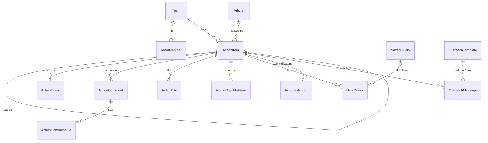
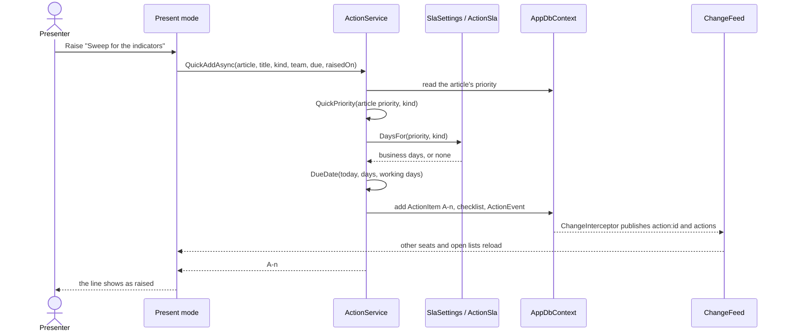
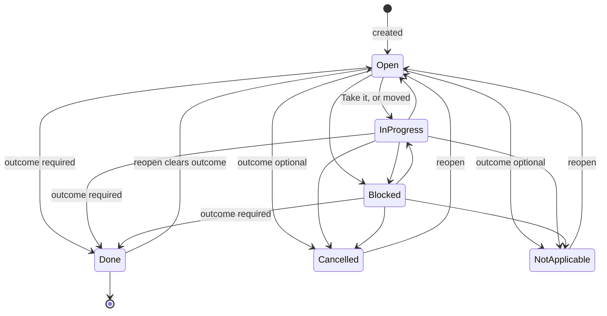
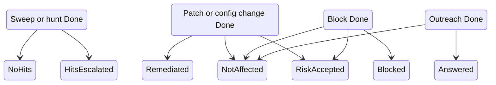
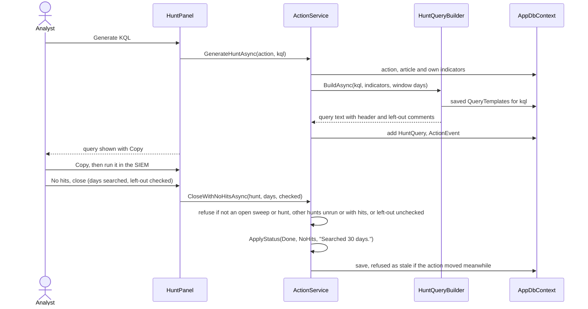
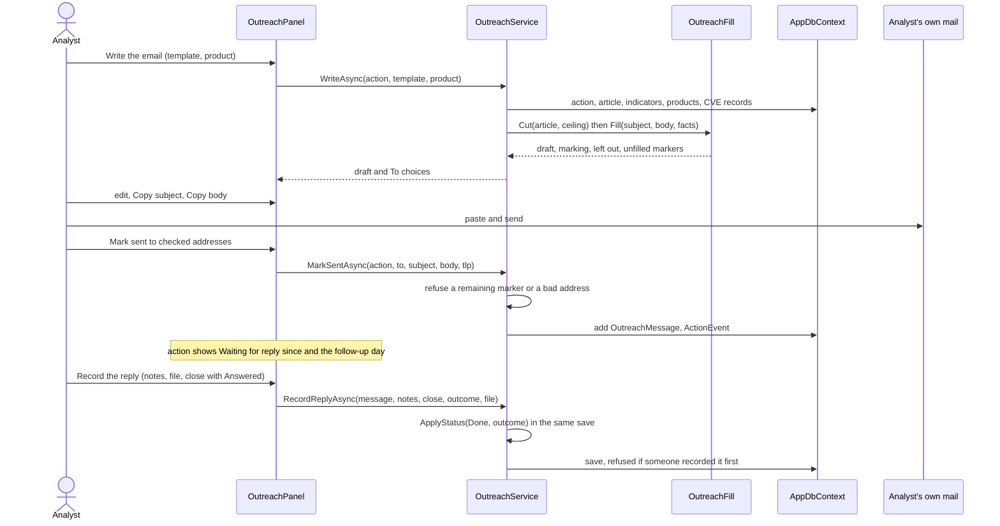
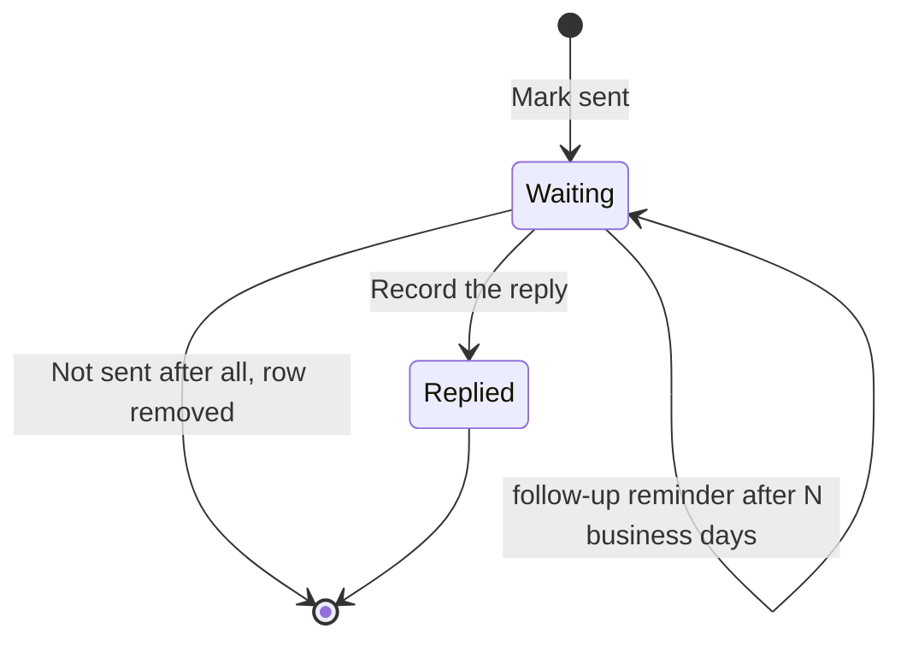

# Actions and hunting

How follow-up work leaves the brief and is tracked to the end: raising an action, who works it, its SLA, its files,
hunt queries and their dialects, the team's saved queries, outreach emails, reminders, people's own notification
choices and the personal digest. It's for developers changing this code, and for anyone who needs to know exactly
what a button does underneath.

**Contents**
- [The model in one picture](#the-model-in-one-picture)
- [Who may do what](#who-may-do-what)
- [Raising an action](#raising-an-action)
- [Status and outcomes](#status-and-outcomes)
- [SLA and due dates](#sla-and-due-dates)
- [Working an action: assignee, checklist, comments, files](#working-an-action-assignee-checklist-comments-files)
- [Hunt queries](#hunt-queries)
- [Saved queries](#saved-queries)
- [Outreach](#outreach)
- [Reminders and digests](#reminders-and-digests)
- [My notifications and the personal digest](#my-notifications-and-the-personal-digest)
- [Lists, board, Today's queue and Workload](#lists-board-todays-queue-and-workload)
- [Edge cases](#edge-cases)
- [Where it lives in code](#where-it-lives-in-code)

Related: [ADR 0006](../decisions/0006-query-dialects-are-templates.md) (hunt queries are generated text),
[ADR 0008](../decisions/0008-teams-own-actions.md) (teams own actions),
[ADR 0019](../decisions/0019-outreach-emails-are-written-never-sent.md) (outreach emails are written, never sent).
The tables behind all of this are in [data-model.md](../architecture/data-model.md); the API's action endpoints are in
[API.md](../API.md).

## The model in one picture

An `ActionItem` (`src/Tide.Domain/Entities/Actions.cs`) has a number shown as `A-12`, a title, a kind
(`ActionKind`), a priority (P1 to P4), an owning `Team`, an optional assignee, a due date, a status and an outcome. It
may link to the article it came from and, for a remediation split across teams, to a parent (one level deep). Every
change writes an `ActionEvent`, the readable history on the action's page, as well as the audit row the interceptor
writes for every save.

The kinds are IOC sweep, Threat hunt, Block, Patch / remediate, Config change, Awareness, Outreach and Other. Outreach
is stored as the number "Vendor inquiry" had, so old actions are Outreach actions now.

## Who may do what

Permissions are atoms held through roles (see [security.md](../architecture/security.md)). Pages check them with a
policy, and the services check again, so a page that forgets can't write.

| Activity | Needs | Checked in |
|---|---|---|
| Read actions, the board, Workload, Saved queries, Outreach templates, My notifications | `ReadActions` (pages); `ReadTeamEdition` or `WorkActions` in `ActionService.RequireRead` | page policy, service |
| Create an action (form, article, meeting, Coverage) | `WriteArticles` | `ActionService.CreateAsync` |
| Edit, take, assign, move, close, hunt, write outreach, add files | `WriteArticles`, or `WorkActions` and membership of the owning team | `ActionService.CanWork` / `RequireWork` |
| Change an action's article link or parent | `WriteArticles` (a team member's save keeps them as they were) | `ActionService.SaveAsync` |
| Comment with text on any action | `ReadTeamEdition` and (`WorkActions` or `WriteArticles`); a Viewer can't | `ActionService.CanComment` |
| Files on a comment | whoever can work the action | `ActionService.AddCommentAsync` |
| Add indicators on an action raised from an article | working it **and** `WriteArticles` (they go on the article) | `ActionService.AddIndicatorsAsync` |
| Save, edit, retire, restore saved queries and outreach templates | `WorkActions` | `SavedQueryService.CanWrite`, `OutreachTemplateService` |
| Delete a saved query or outreach template | whoever saved it, or `Administer` | `CanDelete` |
| Remove a file | who added it, an analyst, or an administrator; restore: administrator | `ActionFileService.RemoveAsync`, `RestoreAsync` |
| Teams, members, SLA targets, reminder settings, playbooks, card rules, query templates | `Administer` | `TeamService`, `SlaSettings`, `PlaybookService`, `CardRuleService`, `HuntQueryBuilder` |
| Run a reminder scan now | `Administer` | `ReminderService.RunNowAsync` |

An analyst (and an administrator, who holds every permission) works any action. An Action owner works only their
teams' actions. Membership is by user id in `TeamMember`, administered on Teams & SLA.

## Raising an action

There are four ways in, and all of them end in `ActionService.CreateAsync`:

| From | User steps | Service |
|---|---|---|
| The Actions page or `/actions/new` | *New action*: title, kind, priority, team, assignee, due date (blank takes the SLA's), ticket, article, parent, optional playbook | `CreateAsync` |
| An article | *Raise action* on the article's actions card, which fills in the article | `CreateAsync` |
| Present mode | One click on a recommended action line, or the quick form on the slide | `QuickAddAsync` |
| Coverage | *Raise action* on a gap row (a Config change linked to the latest article) | `DetectionService.RaiseAsync` → `CreateAsync` |

`CreateAsync` checks the form (`Apply`: a title, a live team, a due date in range, a parent one level deep), fills a
blank due date from the SLA targets, takes the next number (`max + 1`, retried up to three times if two actions take
the same number at once), adds the playbook's steps to the checklist when one was chosen, and writes the history line
"Created for {team}, due {date}". Before saving, the editor shows open actions the new one likely repeats (same kind,
same team, the article or its story: `LikelyDuplicatesAsync`); it warns and never refuses.

**In the meeting.** Present mode splits the article's recommended actions into lines (`RecommendedActions.Lines`),
guesses each line's kind from its wording (`RecommendedActions.GuessKind`, the first cue in the line wins), proposes
the team that last had an action of that kind (`ActionService.TeamsByKindAsync`), and counts a line as raised once an
action on the article has its title (`RecommendedActions.Raised`). The priority is the article's, except that
Awareness, Outreach and Other are never above P2; an article with no priority gives a sweep or a block P2 and the rest P3
(`ActionService.QuickPriority`). An action raised for a past day's brief records that day in `RaisedOn`, which reports
count it on; its SLA still runs from when it was recorded.

## Status and outcomes

An action is open while it's Open, In progress or Blocked, and closed when it's Done, Cancelled or Not applicable
(`ActionItem.IsOpen`, `IsClosedStatus`). Any status can move to any other through the status control or the board
(`SetStatusAsync`, `MoveAsync`); both go through `ApplyStatus`, which enforces the rules:

- **Done needs an outcome** that fits the kind (`ActionService.KindOutcomes`). Cancelled and Not applicable may have
  one, or none.
- **Closing** stamps `ClosedAtUtc` and `ClosedDate` (organization day) the first time it closes. Moving between closed
  statuses keeps them.
- **Reopening** clears the outcome, its note and the closing times.
- **An outcome the action already has stays a choice** even if its kind's list no longer includes it
  (`OutcomesFor`), so an action closed before a kind's list narrowed keeps what it was closed with.
- **Take it** assigns the action to the person and moves Open to In progress (`TakeAsync`).

The diagram leaves out moves between the three closed statuses and from a closed status straight to In progress or
Blocked; all are allowed and follow the same rules.

**Outcomes by kind** (`ActionService.KindOutcomes`; Other is always last):

| Kind | Done may close with |
|---|---|
| IOC sweep, Threat hunt | No hits, Hits escalated, Other |
| Patch / remediate, Config change | Remediated, Not affected, Risk accepted, Other |
| Block | Blocked, Not affected, Risk accepted, Other |
| Awareness | Remediated (the notice went out), Not affected, Other |
| Outreach | Answered, Not affected, Other |
| Other | any outcome |

**Concurrency.** `ActionItem.EditVersion` is a concurrency token and moves on every change. A form save from an older
copy is refused (`StaleEditException`, "Someone else changed this action since you opened it"). A board move names
the column the card was in, and is refused if the action has moved since ("Someone else moved A-12 to Done in the
meantime"). `ChangeOutcomeAsync` changes a closed action's outcome without moving it, and is refused the same way if
someone reopened it meanwhile.

## SLA and due dates

A new action's due date is a number of business days from today: the kind's target when one is set, else the
priority's (`SlaTargets.DaysFor`). The defaults are in `Actions:Sla` (P1 1, P2 3, P3 10, P4 20 business days; no kind
overrides) and an administrator overrides them on Teams & SLA (`SlaSettings`, a `Settings` row per value, 260 business
days at most). Business days are the organization's working days: Monday to Friday less the holidays
(`OrgClock.Days`, [ADR 0018](../decisions/0018-holidays-are-days-off-like-weekends.md)).

| State (`SlaState`) | Rule (`ActionSla.StateOf`) |
|---|---|
| No due | no due date, or closed Cancelled or Not applicable |
| On track | open, due after the next business day |
| Due soon | open, due today or the next business day |
| Overdue | open, due date before today |
| Met / Missed | closed Done on or before / after its due date |

"3 days late" counts calendar days (`ActionSla.LateText`). The "Mine" list groups by urgency (`ActionSla.UrgencyOf`):
Overdue, Due today, This week (to the end of the business week), Later, and Blocked whatever the date.

Changing a saved action's priority offers the new SLA date; it never moves the date by itself. A due date already on
an action is never re-checked, so an action overdue for over a year can still be edited.

## Working an action: assignee, checklist, comments, files

- **Assignee.** A new assignee must be a member of the action's team; one it already has keeps it (an analyst who took
  it). The meeting's assignee and due boxes change only what they say (`AssignAsync`, `SetDueAsync`), so a due date set
  in the meeting doesn't take the action back from someone a colleague just gave it to.
- **Checklist.** Up to 50 items (`ActionChecklistItem`). A playbook (`Playbook`, administered) adds its steps that the
  checklist doesn't already have, at the end (`ApplyPlaybookAsync`).
- **Comments.** Text up to 8,000 characters, with screenshots or evidence files. Each comment has its own
  `EditVersion`: an edit from an older version is refused and names who changed it, and the page shows their text over
  the box while keeping what was typed. Deleting a comment keeps its files on the action as removed, with the reason
  "Its comment was deleted".
- **Files.** Files go on the action itself (`ActionFile`, up to 100, 10 per upload) by pick, drop or paste on its page
  or on the raise form, and on comments (`ActionCommentFile`, 10 per comment). Each is hashed (SHA-256) on arrival and
  judged by `Files/FileRisk` from its name, declared type and first bytes. An image shows inline only when all three
  agree. A file that can run downloads first as a zip with the password `infected` (`Files:ZipDownloads`: `RiskyOnly`
  by default, `Always`, `Never`, set on Teams & SLA). Removing needs a reason and keeps the bytes, hash and row; an
  administrator can restore. The download endpoints and their headers are described in
  [security.md](../architecture/security.md).

## Hunt queries

A hunt query is text TIDE writes for the analyst to run in their own SIEM. TIDE never signs in to a SIEM
([ADR 0006](../decisions/0006-query-dialects-are-templates.md)). The Hunt queries card on an action offers four ways
to add one:

| Button | What it does | Service |
|---|---|---|
| *Generate from N indicators* (in the language picked) | Builds one from the action's indicators | `GenerateHuntAsync` |
| *Generate from N indicators, with the story's N articles* | The same, from every article in the article's story | `GenerateHuntAsync(fromStory: true)` |
| *Add a saved query* | One of the team's saved queries, filled from the action | `AddSavedHuntAsync` |
| *Write one by hand* | A query the analyst writes (a behavioural hunt) | `AddHandWrittenHuntAsync` |

**What a hunt searches for** (`ActionService.HuntInputsAsync`): the indicators on the action's article (or on every
article in its story), plus any the action keeps itself, each once. **How far back** (`HuntQueryBuilder.WindowDays`):
a week before the earliest of those articles was published, at least 30 days and at most 180.

**How the query is written** (`HuntQueryBuilder.Build`):

1. The indicators are split into kinds (`HuntValues.KindOf`, `HuntValueKind`): each indicator type is a kind, except
   that IPv4 and IPv6, and MD5, SHA-1, SHA-256 and SHA-512 (told apart by length), are kinds of their own, because a
   SIEM keeps them in different fields.
2. Each kind gets one block from the dialect's template: the administrator's `QueryTemplate` if saved, else the
   dialect's default. A saved empty template turns the kind off.
3. A kind with no template, or turned off, isn't dropped silently: a comment names it and how many values it left out.
4. Values are quoted and escaped as the dialect writes a list (`QueryDialects.Quote`). Past 500 values
   (`MaxValuesPerBlock`) a kind's block repeats.
5. The first line says how many values it was built from and the window. A dialect whose templates don't all carry
   `{{days}}` (Falcon's default runs over the range picked in the console) says to set the range when it's run instead
   of claiming a window.

| Dialect key | Name | Notes |
|---|---|---|
| `xql` | Cortex XSIAM (XQL) | |
| `kql` | Microsoft Sentinel / Defender (KQL) | |
| `fql` | CrowdStrike Falcon / Next-Gen SIEM | no time range in the query |

Golden files in the unit tests pin each dialect's output. Adding a dialect is one more `IQueryDialect` in
`QueryDialects.All`; see [recipes.md](../development/recipes.md).

**Adding indicators from the card.** On an action raised from an article, indicators typed or found in pasted text go
on the article (`ArticleService.AddIndicators`, the editor's rules, at most 500), which needs `WriteArticles` as well as
working the action, and moves the article's `EditVersion` so an editor open on an older copy can't save over them.
Someone who can't is told so (`ActionService.OnTheArticle`). An action with no article keeps them as
`ActionIndicator` rows. CVEs aren't offered: a hunt doesn't search for them.

**Running and recording.** The analyst copies the query, runs it, and records hits (with a count) or no hits, notes and
optionally an evidence screenshot (`RecordHuntResultAsync`). A result, once recorded, stands: a second recording is
refused, and recording moves the action's `EditVersion` so two at once can't both land. Editing a query after its
result marks it "edited after the result" in its row and the history. A query with a result can't be removed.

### Closing a clean sweep in one step

*No hits, close* (`ActionService.CloseWithNoHitsAsync`) records the query as run with no hits and closes the action
Done (No hits) in one save and one history line that names the days searched. The panel offers it only once the
query was copied from the card (or is hand-written). It's refused when:

- the action isn't an open IOC sweep or Threat hunt;
- another query on the action found hits, or hasn't been run;
- the query left values out (`HuntQueryBuilder.LeftOut`) and the analyst hasn't ticked that they checked them another
  way.

## Saved queries

The team's library of hunt queries (`SavedQuery`, `SavedQueryService`, the Saved queries page at `/hunts/saved`): a
name, a language, the text, an optional description, who saved it and last changed it, and whether it's retired. The
list shows how many actions used each.

- **Saving.** On the page, or *Save for the team* on any hunt. For a hunt added from a saved query that still exists,
  that offers the saved query's own text with its placeholders (`DraftTextAsync`); for any other, the hunt's text
  without the first line TIDE wrote (`HuntQueryBuilder.WithoutHeader`).
- **Placeholders.** `{{days}}` becomes the window a generated query would use. `{{values}}` becomes every indicator on
  the article and the action, as the dialect writes a list. `{{values:domain}}`, `{{values:sha256}}` and so on (a
  `HuntValueKind` by name) take that kind only; the action's other kinds are then named in a "not included" comment,
  which `LeftOut` counts, so *No hits, close* asks about them. A kind TIDE doesn't know is refused when the query is
  saved.
- **Adding to an action** (`AddSavedHuntAsync`, `HuntQueryBuilder.FromSaved`). Refused for a retired query, and when a
  placeholder would get no values (an empty list is a syntax error in every dialect). Past 500 values for a
  placeholder, the query is repeated a block each ("Part 2 of 3"). The first line names the query and, with `{{days}}`,
  the window, so `WindowOf` reads it back. The hunt keeps the saved query's name (`HuntQuery.SavedQueryName`) even after
  it's deleted.
- **Editing** carries the query's `EditVersion` and is refused once someone else has saved it since. Writes are audited
  and published on the `saved-queries` topic, so an open Saved queries page follows.
- **Not in the configuration bundle.** Saved queries are the team's working content, not installation settings.

## Outreach

An Outreach action asks someone (a vendor, a partner, an ISAC, an internal team, a site's owner) for information by
email. TIDE writes the email; the analyst sends it from their own mail
([ADR 0019](../decisions/0019-outreach-emails-are-written-never-sent.md)).

**Templates** (`OutreachTemplate`, `OutreachTemplateService`, the Outreach templates page at `/outreach/templates`)
are kept exactly as saved queries are: `WorkActions` adds, edits, retires and restores; whoever saved one, or an
administrator, deletes it; `ReadActions` reads; edits carry an `EditVersion`; writes are audited and published on
`outreach-templates`. A template has a name, description, subject (300), body (8,000) with `{{placeholders}}`, an
optional fixed To address and a TLP ceiling (CLEAR by default). `OutreachFill.Check` refuses an unknown placeholder or
kind on save.

| Placeholder group | Placeholders (`OutreachFill.All`) |
|---|---|
| Article | `article.title`, `article.bottom-line`, `article.why-it-matters`, `article.key-points`, `article.link`, `article.cves` (with KEV and EPSS), `article.tlp` |
| Indicators | `indicators` (every indicator on the article and action, defanged), `indicators:domain` and the like (one `HuntValueKind`) |
| Product | `product.name`, `product.versions`, `product.team`, `product.contact` |
| Action and sender | `action.number`, `action.link` (needs `App:BaseUrl`), `action.due`, `sender.name`, `sender.team`, `today`, `tlp` |

**Writing the email** (`OutreachService.WriteAsync`, saves nothing):

1. The article is cut to the template's ceiling (`OutreachFill.Cut`, through `BriefEditions.BuildArticle`): an article
   above it is left out whole with its indicators; a key point or "why it matters" above it is left out alone. The
   action's own indicators, which carry no marking, count as AMBER (`OutreachFill.UnmarkedTlp`).
2. The indicators are the ones a hunt on the action would search, of those the cut kept, defanged.
3. The product is the first Our stack product the action is about: tagged on its article, else named in its title or
   description or its article's title or bottom line (`StackService.MatchAll`). The analyst can pick another.
4. `OutreachFill.Fill` returns the subject and body, the marking (the highest TLP of what it filled in, written as the
   body's first line unless the template places `{{tlp}}`), what the ceiling left out, and the placeholders with
   nothing to fill, which stay as `[[name: nothing to fill]]` markers.

The analyst edits the subject and body, copies each (`clipboard.js`), sends from their own mail, and marks it sent to
one or more checked addresses (at most 10). The To line offers the template's fixed address, then each product's
contact (`StackProduct.ContactName`, `ContactEmail`).

**States of an email** (`OutreachMessage`):

- **Waiting.** The action shows "Waiting for reply since" from the oldest unanswered email
  (`OutreachState.Oldest`) and the day the follow-up reminder goes (`OutreachDates.FollowUpOn`).
- **Replied.** *Record the reply* keeps the notes and optionally a file already on the action's files, and either
  closes the action Done with an outcome in the same save (`ActionService.ApplyStatus`) or leaves it open (another email
  still waits). A reply already recorded is refused, naming who recorded it. The reply's file is referenced by
  `OutreachMessage.ReplyFileId` without a foreign key (SQL Server refuses a second cascade path to `StoredFile`), so the
  service checks it's a live file on the same action.
- **Not sent after all** (`WithdrawAsync`) removes an email marked by mistake while it still waits; the history keeps
  that it was.

Only an Outreach action keeps emails; on another kind the service refuses ("Change its kind first").

## Reminders and digests

`ReminderService` (`src/Tide.Application/Actions/Reminders.cs`) holds the scans. `ReminderHostedService` calls
`RunDueAsync` every five minutes; each enabled scan whose time of day has come runs, one at a time in the process
(a static semaphore). A scan that fails is logged and recorded in `ReminderLog` (memory only) without stopping the
others. An administrator can run any scan now from Teams & SLA.

| Scan (`ReminderKind`) | When | To | Mark key |
|---|---|---|---|
| Due soon | reminder time on business days | assignee; unassigned: the team mailbox, else its members | `due-soon` per action per due date and recipient |
| Overdue | reminder time | as due soon | `overdue` |
| Weekly team digest | the digest's day and time | team mailbox, else members | `digest` |
| Personal digest | daily at reminder time, or weekly at the digest's day and time | each person who chose one | `personal-digest`, `digest-seen` |
| Brief not ready | its time on business days, before the meeting | the presenting analyst, else the fallback recipients | per day |
| Presenting next | reminder time, the business day before a stretch | the analyst presenting next | per stretch |
| Outreach follow-up | reminder time, N business days after an email was marked sent (1 to 30, default 5) | whoever marked it sent | `outreach-follow-up` per email |

Each scan is off until an administrator enables it (`Notifications` section, set on Teams & SLA), except the
personal digest's offer, which is on and sends nothing until someone chooses a digest. Each batches one email per
recipient, marks the email with the highest TLP of the articles its actions came from (subject and first line), and
writes a `NotificationMark` as each email goes, so a scan stopped partway resumes with only those not reached. A
reminder's key includes the due date, so moving the date earns a new reminder. The wording of each is an email
template (see [administration.md](administration.md#email-templates)).

## My notifications and the personal digest

An administrator turns each kind on or off for everyone. Each person then chooses for themselves on **My
notifications** (`/notifications`, from the account menu). The choices are `UserPreference` rows
(`UserPreferences`), not audited, and "since when" is the row's `UpdatedAtUtc`:

| Preference | Values | Needs |
|---|---|---|
| `notify.dueSoon`, `notify.overdue`, `notify.teamDigest` | `on` (default), `off` | `ReadActions` |
| `notify.outreachFollowUp` | `on`, `off` | `WorkActions` |
| `notify.rotationReminders`, `notify.rotationRequests` | `on`, `off` | `WriteArticles` |
| `notify.digest` | `off` (default), `daily`, `weekly` | `ReadActions` |

`NotificationPreferenceService` reads and saves only the signed-in person's choices and refuses a change to a kind
an administrator has off. The senders apply them through `RecipientResolver` and `OptedOutAsync`:

- An assignee who opted out isn't emailed, and the action isn't handed to the team instead.
- A team mailbox, the brief-not-ready fallback recipients and the rotation's manager addresses are addresses, not
  people, and never opt out.
- The outreach follow-up leaves out a sender who opted out without marking their emails, so turning it back on brings
  them.
- The brief's distribution, test copies and corrections are never affected.
- When everyone was left out, nothing is sent and the run's note says "all recipients opted out" (or "2 opted out").

The **personal digest** lists a person's open actions (assigned to them, or unassigned on a team of theirs without a
mailbox) that are overdue or due soon, then the others not in an earlier digest of theirs (`digest-seen` marks). It
isn't sent to someone the user mirror says no longer reads actions. Administrators see on Teams & SLA how many opted
out of each kind and who (`CountsAsync`, `PeopleAsync`, `Administer` only).

## Lists, board, Today's queue and Workload

- **Actions page** (`/actions`, `ActionsBoard.razor`). A board (a column per status, open actions and those closed in
  the last 14 days, `BoardAsync`) or a list (`ListAsync`). Views: Mine, My teams, Open, Overdue, Closed (last 90 days).
  Overdue and Closed are list-only. The layout is the `actions.layout` preference; a link's own `layout` wins for that
  visit. Card rules (administered) colour and label cards and add filter chips.
- **Today's team queue** (`TeamQueueAsync`): the person's teams' open actions that are theirs or nobody's, theirs
  first, up to 8, with *Take it*. Without `WriteArticles` it leads Today in place of the producers' step strip.
- **Workload** (`/workload`, `WorkloadAsync`): each team's open, overdue, due soon and blocked counts, closed and met
  last week, and who holds what with per-person and P1 counts.

Every one of these follows colleagues' saves live through the `actions` and `action:{id}` topics (see
[collaboration.md](../architecture/collaboration.md)).

## Edge cases

| Case | What happens |
|---|---|
| Two actions created at the same moment | Both took the same number; the second save fails on the unique index and retries with the next number (three attempts). |
| A saved action edited by two people | The second save is refused as stale; the page offers a reload. |
| A colleague moves a card while you drag it | The move is refused, naming where it went. |
| Assigning someone not on the team | Refused: "That person isn't on the action's team." |
| Retired team | Can't be chosen for a new action or a move; an action already on it stays. |
| Generate with no indicators | Refused, saying to add them on the article, on the card, or build from the story. |
| A saved query placeholder with no values | Refused when it's added. |
| A hunt's result recorded twice at once | The second is refused as stale (the action's version moved). |
| Recording a reply on a closed action with "close" ticked | Refused: record it without closing. |
| An outreach body still holding `[[…]]` | Mark sent is refused until it's filled or removed. |
| An action's article deleted | Its hunts and outreach use the action's own indicators only. |
| Reminder relay down | Recipients not reached aren't marked, so the next scan tries them; an action anyone got is marked whole. |

## Where it lives in code

| Concern | Code |
|---|---|
| Entities | `src/Tide.Domain/Entities/Actions.cs` (`ActionItem`, `Team`, `ActionFile`, `HuntQuery`, `SavedQuery`, `OutreachTemplate`, `OutreachMessage`, `QueryTemplate`, `NotificationMark`) |
| Kinds, statuses, outcomes | `src/Tide.Domain/Enums/AppEnums.cs` (`ActionKind`, `ActionStatus`, `ActionOutcome`, `HuntResult`, `HuntValueKind`) |
| Create, edit, status, comments, hunts | `src/Tide.Application/Actions/ActionService.cs` (`CreateAsync`, `QuickAddAsync`, `ApplyStatus`, `KindOutcomes`, `CloseWithNoHitsAsync`, `HuntInputsAsync`) |
| SLA | `src/Tide.Application/Actions/ActionSla.cs` (`ActionSla`, `SlaSettings`, `SlaOptions`) |
| Hunt dialects and builder | `src/Tide.Application/Actions/HuntQueries.cs` (`IQueryDialect`, `QueryDialects`, `HuntValues`, `HuntQueryBuilder`) |
| Saved queries | `src/Tide.Application/Actions/SavedQueries.cs` (`SavedQueryService`) |
| Outreach | `src/Tide.Application/Actions/Outreach.cs` (`OutreachService`, `OutreachDates`), `OutreachFill.cs`, `OutreachTemplates.cs` |
| Files | `src/Tide.Application/Actions/ActionFiles.cs` (`ActionFileService`), `src/Tide.Application/Files/FileRisk.cs` |
| Meeting lines | `src/Tide.Application/Actions/RecommendedActions.cs` |
| Playbooks, card rules | `src/Tide.Application/Actions/Playbooks.cs` |
| Teams | `src/Tide.Application/Actions/TeamService.cs` |
| Reminders | `src/Tide.Application/Actions/Reminders.cs` (`ReminderService`, `ReminderOptions`), `src/Tide.Web/Services/ReminderHostedService.cs` |
| Notification choices | `src/Tide.Application/Preferences/` (`NotificationKinds`, `NotificationPreferenceService`, `RecipientResolver`, `UserPreferenceService`) |
| Pages | `src/Tide.Web/Components/Pages/ActionPage.razor`, `ActionsBoard.razor`, `Workload.razor`, `SavedQueriesPage.razor`, `OutreachTemplatesPage.razor`, `MyNotifications.razor` |
| Panels | `src/Tide.Web/Components/Shared/HuntPanel.razor`, `OutreachPanel.razor`, `ActionFilesPanel.razor`, `ActionStatusControl.razor`, `ActionKanban.razor` |
