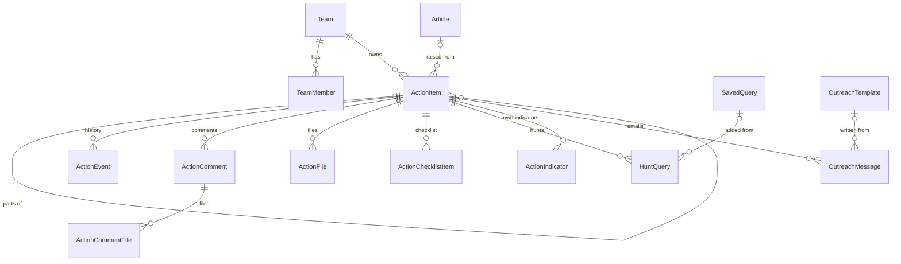
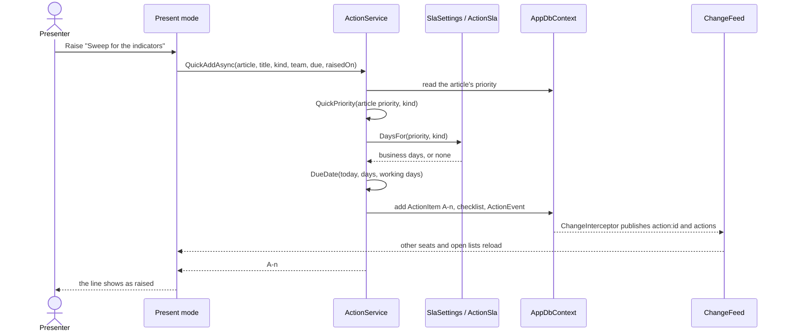
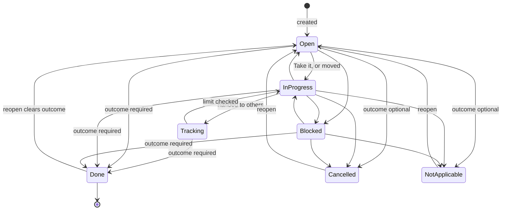
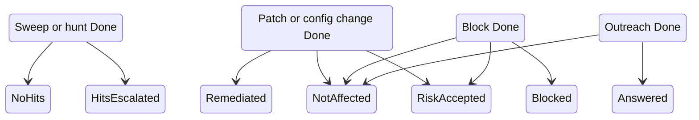
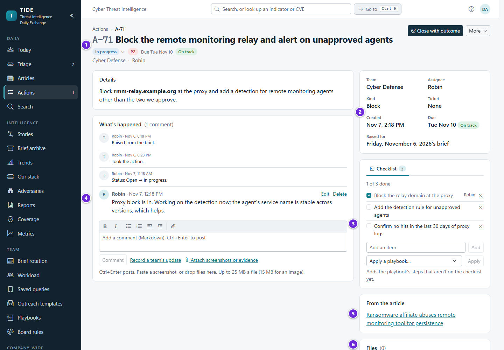
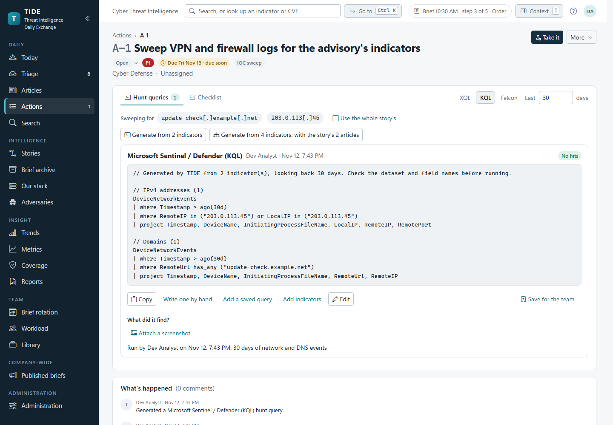
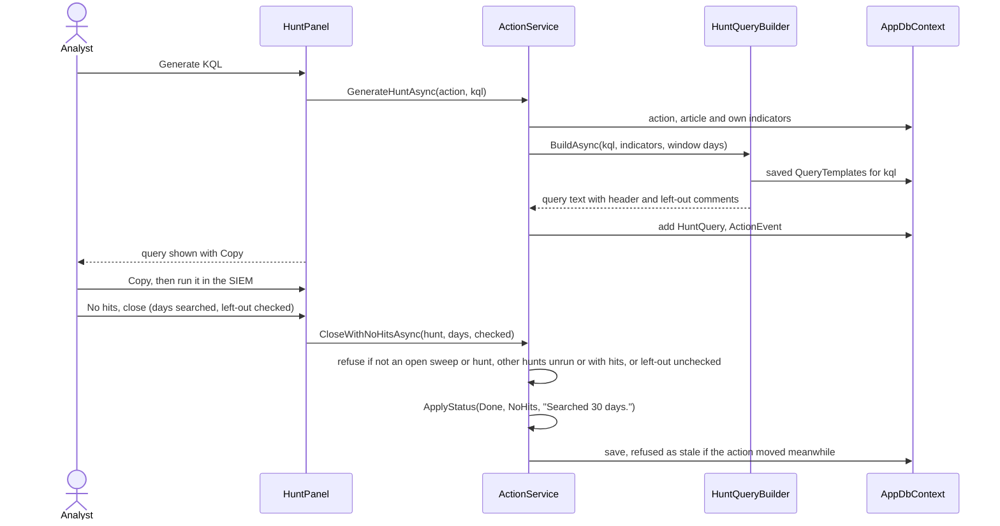
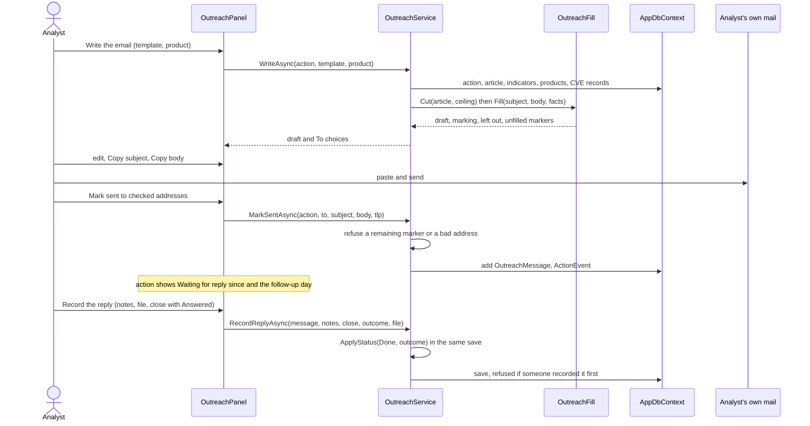
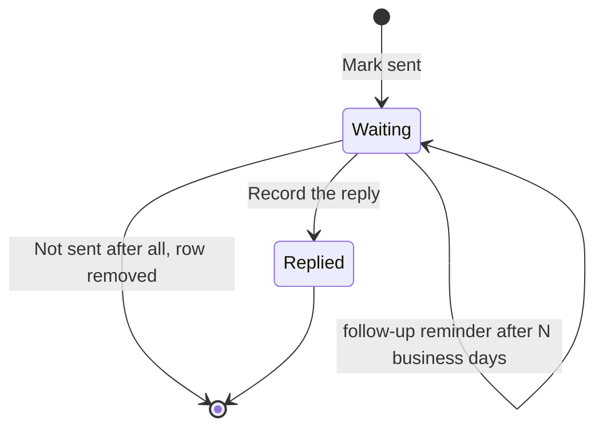
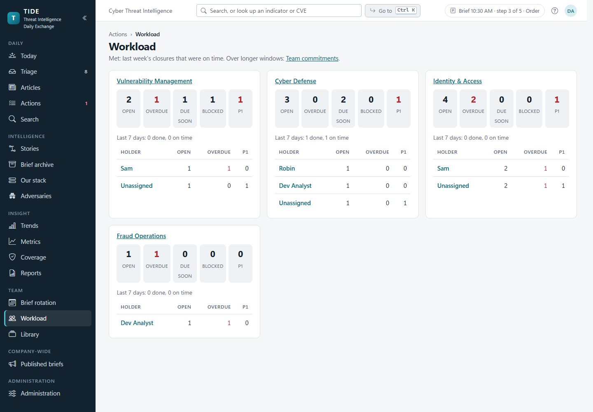

# Actions and hunting

How follow-up work leaves the brief and is tracked to the end: raising an action, who works it, its SLA, its files,
hunt queries and their dialects, the team's saved queries, outreach emails, reminders, people's own notification
choices and the personal digest. Also hand-offs, splits and parts, Tracking, active limits, the teams that work outside TIDE, and the escalation ladder. It's for developers changing this code, and for anyone who needs to know exactly
what a button does underneath.

**Contents**
- [The model in one picture](#the-model-in-one-picture)
- [Who may do what](#who-may-do-what)
- [Raising an action](#raising-an-action)
- [Status and outcomes](#status-and-outcomes)
- [SLA and due dates](#sla-and-due-dates)
- [Working an action: assignee, checklist, comments, files](#working-an-action-assignee-checklist-comments-files)
- [Hunt queries](#hunt-queries)
- [Saved queries](#saved-queries)
- [Outreach](#outreach)
- [Hand-offs, splits, parts and tracking](#hand-offs-splits-parts-and-tracking)
- [External teams](#external-teams)
- [The escalation ladder](#the-escalation-ladder)
- [Reminders and digests](#reminders-and-digests)
- [My notifications and the personal digest](#my-notifications-and-the-personal-digest)
- [Lists, board, Today's queue and Workload](#lists-board-todays-queue-and-workload)
- [Edge cases](#edge-cases)
- [Where it lives in code](#where-it-lives-in-code)

Related: [ADR 0006](../decisions/0006-query-dialects-are-templates.md) (hunt queries are generated text),
[ADR 0008](../decisions/0008-teams-own-actions.md) (teams own actions),
[ADR 0019](../decisions/0019-outreach-emails-are-written-never-sent.md) (outreach emails are written, never sent),
[ADR 0020](../decisions/0020-external-teams-are-emailed-without-tide.md) (external teams, Tracking and active limits),
[ADR 0021](../decisions/0021-escalation-is-an-administered-ladder.md) (the escalation ladder).
The tables behind all of this are in [data-model.md](../architecture/data-model.md); the API's action endpoints are in
[API.md](../API.md).

## The model in one picture

An `ActionItem` (`src/Tide.Domain/Entities/Actions.cs`) has a number shown as `A-12`, a title, a kind
(`ActionKind`), a priority (P1 to P4), an owning `Team`, an optional assignee, a due date, a status and an outcome. It
may link to the article it came from and, for a remediation split across teams, to a parent (one level deep). Every
change writes an `ActionEvent`, the readable history on the action's page, as well as the audit row the interceptor
writes for every save.

The kinds are IOC sweep, Threat hunt, Block, Patch / remediate, Config change, Awareness, Outreach and Other. Outreach
is stored as the number "Vendor inquiry" had, so old actions are Outreach actions now.

## Who may do what

Permissions are atoms held through roles (see [security.md](../architecture/security.md)). Pages check them with a
policy, and the services check again, so a page that forgets can't write.

| Activity | Needs | Checked in |
|---|---|---|
| Read actions, the board, Workload, Saved queries, Outreach templates, Playbooks, Board rules, My notifications | `ReadActions` (pages); `ReadTeamEdition` or `WorkActions` in `ActionService.RequireRead` | page policy, service |
| Create an action (form, article, meeting, Coverage) | `WriteArticles` | `ActionService.CreateAsync` |
| Edit, take, assign, move, close, hunt, write outreach, add files | `WriteArticles`, or `WorkActions` and membership of the owning team | `ActionService.CanWork` / `RequireWork` |
| Change an action's article link or parent | `WriteArticles` (a team member's save keeps them as they were) | `ActionService.SaveAsync` |
| Comment with text on any action | `ReadTeamEdition` and (`WorkActions` or `WriteArticles`); a Viewer can't | `ActionService.CanComment` |
| Files on a comment | whoever can work the action | `ActionService.AddCommentAsync` |
| Add indicators on an action raised from an article | working it **and** `WriteArticles` (they go on the article) | `ActionService.AddIndicatorsAsync` |
| Save, edit, retire, restore saved queries and outreach templates | `WorkActions` | `SavedQueryService.CanWrite`, `OutreachTemplateService` |
| Delete a saved query or outreach template | whoever saved it, or `Administer` | `CanDelete` |
| Remove a file | who added it, an analyst, or an administrator; restore: administrator | `ActionFileService.RemoveAsync`, `RestoreAsync` |
| Hand an action off (the button, or another team in the editor) | whoever can work it | `HandoffService.HandOffAsync`, `ActionService.SaveAsync` |
| Split an action to teams | `WriteArticles` | `HandoffService.SplitAsync` |
| Add, edit, retire external teams, and set an external team's escalation contact | `WorkActions` | `TeamService.AddExternalAsync`, `UpdateExternalAsync`, `SetRetiredAsync`, `SetEscalationContactAsync` |
| Set an internal team's escalation contact | `Administer` | `TeamService.SetEscalationContactAsync` |
| Turn an action's external reminders off | whoever can work it | `ActionService.SetNoRemindersAsync` |
| Add, edit, reorder, retire and restore playbooks; delete one you made (an administrator, any) | `WorkActions` | `PlaybookService` |
| Teams, members, SLA targets, reminder and escalation settings, card rules, query templates | `Administer` | `TeamService`, `SlaSettings`, `CardRuleService`, `HuntQueryBuilder` |
| A team's active limit | `Administer` | `TeamService.SetLimitAsync` |
| Run a reminder scan now | `Administer` | `ReminderService.RunNowAsync` |

An analyst (and an administrator, who holds every permission) works any action. An Action owner works only their
teams' actions. Membership is by user id in `TeamMember`, administered on Teams & SLA.

## Raising an action

There are four ways in, and all of them end in `ActionService.CreateAsync`:

| From | User steps | Service |
|---|---|---|
| The Actions page or `/actions/new` | *New action*: title, kind, priority, team, assignee, due date (blank takes the SLA's), ticket, article, parent, optional playbook | `CreateAsync` |
| An article | *Raise action* on the article's actions card, which fills in the article | `CreateAsync` |
| Present mode | One click on a recommended action line, or the quick form on the slide | `QuickAddAsync` |
| Coverage | *Raise action* on a gap row (a Config change linked to the latest article) | `DetectionService.RaiseAsync` → `CreateAsync` |

`CreateAsync` checks the form (`Apply`: a title, a live team, a due date in range, a parent one level deep), fills a
blank due date from the SLA targets, takes the next number (`max + 1`, retried up to three times if two actions take
the same number at once), adds the playbook's steps to the checklist when one was chosen, and writes the history line
"Created for {team}, due {date}". Before saving, the editor shows open actions the new one likely repeats (same kind,
same team, the article or its story: `LikelyDuplicatesAsync`); it warns and never refuses.

**In the meeting.** Present mode splits the article's recommended actions into lines (`RecommendedActions.Lines`),
guesses each line's kind from its wording (`RecommendedActions.GuessKind`, the first cue in the line wins), proposes
the team that last had an action of that kind (`ActionService.TeamsByKindAsync`), and counts a line as raised once an
action on the article has its title (`RecommendedActions.Raised`). The priority is the article's, except that
Awareness, Outreach and Other are never above P2; an article with no priority gives a sweep or a block P2 and the rest P3
(`ActionService.QuickPriority`). An action raised for a past day's brief records that day in `RaisedOn`, which reports
count it on; its SLA still runs from when it was recorded.

## Status and outcomes

An action is open while it's Open, In progress, Blocked or Tracking, and closed when it's Done, Cancelled or Not applicable
(`ActionItem.IsOpen`, `IsClosedStatus`). Any status can move to any other through the status control or the board
(`SetStatusAsync`, `MoveAsync`); both go through `ApplyStatus`, which enforces the rules:

- **Done needs an outcome** that fits the kind (`ActionService.KindOutcomes`). Cancelled and Not applicable may have
  one, or none.
- **Closing** stamps `ClosedAtUtc` and `ClosedDate` (organization day) the first time it closes. Moving between closed
  statuses keeps them.
- **Reopening** clears the outcome, its note and the closing times.
- **An outcome the action already has stays a choice** even if its kind's list no longer includes it
  (`OutcomesFor`), so an action closed before a kind's list narrowed keeps what it was closed with.
- **Take it** assigns the action to the person and moves Open to In progress (`TakeAsync`).

The diagram leaves out moves between the three closed statuses and from a closed status straight to In progress or
Blocked; all are allowed and follow the same rules.

**Outcomes by kind** (`ActionService.KindOutcomes`; Other is always last):

| Kind | Done may close with |
|---|---|
| IOC sweep, Threat hunt | No hits, Hits escalated, Other |
| Patch / remediate, Config change | Remediated, Not affected, Risk accepted, Other |
| Block | Blocked, Not affected, Risk accepted, Other |
| Awareness | Remediated (the notice went out), Not affected, Other |
| Outreach | Answered, Not affected, Other |
| Other | any outcome |

**Concurrency.** `ActionItem.EditVersion` is a concurrency token and moves on every change. A form save from an older
copy is refused (`StaleEditException`, "Someone else changed this action since you opened it"). A board move names
the column the card was in, and is refused if the action has moved since ("Someone else moved A-12 to Done in the
meantime"). `ChangeOutcomeAsync` changes a closed action's outcome without moving it, and is refused the same way if
someone reopened it meanwhile.

## SLA and due dates

A new action's due date is a number of business days from today: the kind's target when one is set, else the
priority's (`SlaTargets.DaysFor`). The defaults are in `Actions:Sla` (P1 1, P2 3, P3 10, P4 20 business days; no kind
overrides) and an administrator overrides them on Teams & SLA (`SlaSettings`, a `Settings` row per value, 260 business
days at most). Business days are the organization's working days: Monday to Friday less the holidays
(`OrgClock.Days`, [ADR 0018](../decisions/0018-holidays-are-days-off-like-weekends.md)).

| State (`SlaState`) | Rule (`ActionSla.StateOf`) |
|---|---|
| No due | no due date, or closed Cancelled or Not applicable |
| On track | open, due after the next business day |
| Due soon | open, due today or the next business day |
| Overdue | open, due date before today |
| Met / Missed | closed Done on or before / after its due date |

"3 days late" counts calendar days (`ActionSla.LateText`). The "Mine" list groups by urgency (`ActionSla.UrgencyOf`):
Overdue, Due today, This week (to the end of the business week), Later, and Blocked whatever the date.

Changing a saved action's priority offers the new SLA date; it never moves the date by itself. A due date already on
an action is never re-checked, so an action overdue for over a year can still be edited.

## Working an action: assignee, checklist, comments, files

1. The header: its badges (status, priority, due date and SLA, Escalated), who has it, the one primary button and
   *More*. The status badge opens the status row (outcomes are asked for when it's closed).
2. The facts: team, assignee, kind, external ticket, when it was created, and its due date with how close it is.
3. The tool drawer: the checklist, each item ticked by name, and beside it the parts' timeline, hunt queries or
   outreach, where the action has them.
4. *What's happened*: its comments, in Markdown with screenshots or evidence, and its history, in one feed.
5. *From the article*: the article it came from, with its CVEs.
6. Files on the action: picked, dropped or pasted, each with its SHA-256.

**The page.** One column of work and one of reference (`ActionPage`):

- **Header.** The title and number; one line of badges: the status (for whoever may work it, a button that opens the
  status row and its prompt under the line, `ActionStatusControl` with `AsBadge`), the priority, the due date with its
  SLA badge, and *Escalated* while it is; then a muted line: team · assignee · "handed from {team} by {name}: {reason}"
  after a hand-off. On the right, **one primary button** chosen by the action's state and kind
  (`ActionGuide.Primary`, [business rule A27](../reference/business-rules.md#actions-and-sla)), and **More**
  (`MenuButton`, a menu with the arrow keys) for everything else whoever is looking may do: *Take it*, *Record an
  update* (when neither is the primary), *Hand off…*, *Split to teams…* and *Split off a part* (an analyst, on a
  top-level action), *Edit* and *Change status…*. A read-only viewer sees neither.
- **Next.** A line under the header when something needs doing, with links that do it (`ActionGuide.Next`,
  [business rule A28](../reference/business-rules.md#actions-and-sla)): a part overdue ("Branch IT is 3 days late on
  A-15", with *Chase them*, the part's page, and *Record their reply*, the part's page with Record an update open:
  `actions/15?do=recordupdate`), an email past its follow-up day with no reply, escalated, blocked, or past its own due
  date. Only the most important shows, and only to whoever may work it.
- **Main column.** *Details*, with *Outcome* under it once it's closed; the *Lineage* when it has parts or is one; and
  *What's happened*, one feed of its comments and history lines (a recorded reply is a comment, and hand-offs,
  splits and escalations are history lines), oldest first, so the newest sits by the comment box at its foot
  (`ActionFeed`). The latest 10 show, with *Show N earlier* for the rest; a comment being edited is never folded away,
  and a file's *On a comment* link unfolds the feed. A comment carries its author's initials, a history line TIDE's
  mark. The comment box keeps its Markdown toolbar, its attachments and *Record a team's update*; Ctrl+Enter posts.
- **Side column.** The facts card; the **tool drawer** (`ActionToolDrawer`), a card of tabs over the existing panels:
  *Checklist* always, *Timeline* on a parent whose parts have a due date, *Hunt queries* for an IOC sweep or threat
  hunt (or one with hunts) and *Outreach* for an Outreach action (or one with emails). It opens on the kind's own tool
  (Outreach, else Hunt queries for a sweep or hunt, else Checklist), or the one the address asks for:
  `actions/12?tool=hunt`; choosing a tab puts it in the address, which shows it. A tool's panel is drawn the first
  time its tab shows and kept after, so a half-written query or email survives a look at another tab. Then *From the
  article*, the external team's contact card when its team is external, and *Files*.
- **On a phone** the two columns become one, in this order: header, Next, details, the tool drawer, lineage, what's
  happened, facts, the article, files.

- **Assignee.** A new assignee must be a member of the action's team; one it already has keeps it (an analyst who took
  it). The meeting's assignee and due boxes change only what they say (`AssignAsync`, `SetDueAsync`), so a due date set
  in the meeting doesn't take the action back from someone a colleague just gave it to.
- **Checklist.** Up to 50 items (`ActionChecklistItem`). A playbook (`Playbook`, the team's: see
  [Playbooks](#playbooks)) adds its steps that the checklist doesn't already have, at the end (`ApplyPlaybookAsync`).
- **Comments.** Text up to 8,000 characters, with screenshots or evidence files. Each comment has its own
  `EditVersion`: an edit from an older version is refused and names who changed it, and the page shows their text over
  the box while keeping what was typed. Deleting a comment keeps its files on the action as removed, with the reason
  "Its comment was deleted".
- **Files.** Files go on the action itself (`ActionFile`, up to 100, 10 per upload) by pick, drop or paste on its page
  or on the raise form, and on comments (`ActionCommentFile`, 10 per comment). Each is hashed (SHA-256) on arrival and
  judged by `Files/FileRisk` from its name, declared type and first bytes. An image shows inline only when all three
  agree. A file that can run downloads first as a zip with the password `infected` (`Files:ZipDownloads`: `RiskyOnly`
  by default, `Always`, `Never`, set on Teams & SLA). Removing needs a reason and keeps the bytes, hash and row; an
  administrator can restore. The download endpoints and their headers are described in
  [security.md](../architecture/security.md).

## Hunt queries

A hunt query is text TIDE writes for the analyst to run in their own SIEM. TIDE never signs in to a SIEM
([ADR 0006](../decisions/0006-query-dialects-are-templates.md)). The Hunt queries card on an action offers four ways
to add one:

| Button | What it does | Service |
|---|---|---|
| *Generate from N indicators* (in the language picked) | Builds one from the action's indicators | `GenerateHuntAsync` |
| *Generate from N indicators, with the story's N articles* | The same, from every article in the article's story | `GenerateHuntAsync(fromStory: true)` |
| *Add a saved query* | One of the team's saved queries, filled from the action | `AddSavedHuntAsync` |
| *Write one by hand* | A query the analyst writes (a behavioural hunt) | `AddHandWrittenHuntAsync` |

**What a hunt searches for** (`ActionService.HuntInputsAsync`): the indicators on the action's article (or on every
article in its story), plus any the action keeps itself, each once. **How far back** (`HuntQueryBuilder.WindowDays`):
a week before the earliest of those articles was published, at least 30 days and at most 180.

**How the query is written** (`HuntQueryBuilder.Build`):

1. The indicators are split into kinds (`HuntValues.KindOf`, `HuntValueKind`): each indicator type is a kind, except
   that IPv4 and IPv6, and MD5, SHA-1, SHA-256 and SHA-512 (told apart by length), are kinds of their own, because a
   SIEM keeps them in different fields.
2. Each kind gets one block from the dialect's template: the administrator's `QueryTemplate` if saved, else the
   dialect's default. A saved empty template turns the kind off.
3. A kind with no template, or turned off, isn't dropped silently: a comment names it and how many values it left out.
4. Values are quoted and escaped as the dialect writes a list (`QueryDialects.Quote`). Past 500 values
   (`MaxValuesPerBlock`) a kind's block repeats.
5. The first line says how many values it was built from and the window. A dialect whose templates don't all carry
   `{{days}}` (Falcon's default runs over the range picked in the console) says to set the range when it's run instead
   of claiming a window.

| Dialect key | Name | Notes |
|---|---|---|
| `xql` | Cortex XSIAM (XQL) | |
| `kql` | Microsoft Sentinel / Defender (KQL) | |
| `fql` | CrowdStrike Falcon / Next-Gen SIEM | no time range in the query |

Golden files in the unit tests pin each dialect's output. Adding a dialect is one more `IQueryDialect` in
`QueryDialects.All`; see [recipes.md](../development/recipes.md).

**Adding indicators from the card.** On an action raised from an article, indicators typed or found in pasted text go
on the article (`ArticleService.AddIndicators`, the editor's rules, at most 500), which needs `WriteArticles` as well as
working the action, and moves the article's `EditVersion` so an editor open on an older copy can't save over them.
Someone who can't is told so (`ActionService.OnTheArticle`). An action with no article keeps them as
`ActionIndicator` rows. CVEs aren't offered: a hunt doesn't search for them.

**Running and recording.** The analyst copies the query, runs it, and records hits (with a count) or no hits, notes and
optionally an evidence screenshot (`RecordHuntResultAsync`). A result, once recorded, stands: a second recording is
refused, and recording moves the action's `EditVersion` so two at once can't both land. Editing a query after its
result marks it "edited after the result" in its row and the history. A query with a result can't be removed.

### Closing a clean sweep in one step

*No hits, close* (`ActionService.CloseWithNoHitsAsync`) records the query as run with no hits and closes the action
Done (No hits) in one save and one history line that names the days searched. The panel offers it only once the
query was copied from the card (or is hand-written). It's refused when:

- the action isn't an open IOC sweep or Threat hunt;
- another query on the action found hits, or hasn't been run;
- the query left values out (`HuntQueryBuilder.LeftOut`) and the analyst hasn't ticked that they checked them another
  way.

## Saved queries

The team's library of hunt queries (`SavedQuery`, `SavedQueryService`, the Saved queries page at `/hunts/saved`): a
name, a language, the text, an optional description, who saved it and last changed it, and whether it's retired. The
page sits under Team in the sidebar, after Brief rotation and Workload. It lists the queries by language, with how
many actions used each, 20 cards a page with the page in the address (`?page=`). A language that runs on to the next
page is headed there too, its heading counting every match; a page that a delete or retire took away shows the last.

- **Starters.** A new install, or an upgrade whose library is still empty, gets 13 starter queries saved by "TIDE"
  (`StarterSavedQueries`): IP, domain, file hash, URL and every-indicator sweeps in KQL and in XQL, and IP, domain and
  file hash sweeps for Falcon. Each is built on its dialect's own generation template and passes the same save
  checks as any other. `DatabaseInitializer` adds the set once, only to an empty library, and writes the setting
  `Data:StarterSavedQueries` with it; a library that already holds queries is only marked. So starters the team
  deletes or retires don't come back.

- **Saving.** On the page, or *Save for the team* on any hunt. For a hunt added from a saved query that still exists,
  that offers the saved query's own text with its placeholders (`DraftTextAsync`); for any other, the hunt's text
  without the first line TIDE wrote (`HuntQueryBuilder.WithoutHeader`).
- **Placeholders.** `{{days}}` becomes the window a generated query would use. `{{values}}` becomes every indicator on
  the article and the action, as the dialect writes a list. `{{values:domain}}`, `{{values:sha256}}` and so on (a
  `HuntValueKind` by name) take that kind only; the action's other kinds are then named in a "not included" comment,
  which `LeftOut` counts, so *No hits, close* asks about them. A kind TIDE doesn't know is refused when the query is
  saved.
- **Adding to an action** (`AddSavedHuntAsync`, `HuntQueryBuilder.FromSaved`). Refused for a retired query, and when a
  placeholder would get no values (an empty list is a syntax error in every dialect). Past 500 values for a
  placeholder, the query is repeated a block each ("Part 2 of 3"). The first line names the query and, with `{{days}}`,
  the window, so `WindowOf` reads it back. The hunt keeps the saved query's name (`HuntQuery.SavedQueryName`) even after
  it's deleted.
- **Editing** carries the query's `EditVersion` and is refused once someone else has saved it since. Writes are audited
  and published on the `saved-queries` topic, so an open Saved queries page follows.
- **Not in the configuration bundle.** Saved queries are the team's working content, not installation settings.

## Playbooks

The team's checklists (`Playbook`, `PlaybookService`, the Playbooks page at `/playbooks`, under Team in the sidebar),
kept as saved queries are (EP-89, business rule A26). A playbook has a name, an optional description, the kind of
action it's for (or any kind), up to 40 steps, who made it and last changed it, and whether it's retired. A new action
can start its checklist from one for its kind or for any kind; an action already open applies one from its checklist.
The steps are copied, so a later edit doesn't change actions already started.

- **Who keeps them.** `WorkActions` adds, edits, reorders (the pickers' order) and retires or restores; whoever made
  one, or an administrator, deletes it. The 7 starters (`StarterPlaybooks`), one for each kind of action but Other,
  are made by "TIDE", so only an administrator deletes them; anyone who works actions can retire them. They're added
  once, only to an empty library, and marked by the setting `Data:StarterPlaybooks`.
- **Kept for history.** One an action was started from (`ActionItem.PlaybookId`, a restrict key) is never deleted:
  Delete is refused and the page offers Retire. A retired one isn't offered on actions; the actions keep its name.
- **Editing** carries the playbook's `EditVersion` and is refused once someone else has saved it since. The steps are
  written again only when they change. Writes are audited and published on the `playbooks` topic.
- **The page.** 20 cards a page (`?page=`), each with its kind, steps, how many actions were started from it and
  "Saved by …, changed by …". The filter bar has the search box (name, description, kind or a step), a pill per kind
  of action (one at a time: those offered on that kind, its own and those for any) and **Show retired**. Moving up and
  down is offered on the whole list, with no filter set: a playbook swaps places with the next one offered that way (a
  retired one between them stays put), and a move is a change like any other, so it moves the version and names who
  made it. The old address, `/admin/playbooks`, redirects here.
- **Not in the configuration bundle**, as the other libraries aren't.

## Board rules

The administrators' card rules, read-only, for everyone with `ReadActions` (`BoardRulesPage` at `/board-rules`, under
Team in the sidebar and linked from the Actions page): each rule turned on, in order, with its label in its colour,
what it matches (`ActionRules.Describe`), the colour's name and whether it's offered as a filter. Administrators keep
them on Administration › Card rules.

## Outreach

An Outreach action asks someone (a vendor, a partner, an ISAC, an internal team, a site's owner) for information by
email. TIDE writes the email; the analyst sends it from their own mail
([ADR 0019](../decisions/0019-outreach-emails-are-written-never-sent.md)).

**Templates** (`OutreachTemplate`, `OutreachTemplateService`, the Outreach templates page at `/outreach/templates`)
are kept exactly as saved queries are: `WorkActions` adds, edits, retires and restores; whoever saved one, or an
administrator, deletes it; `ReadActions` reads; edits carry an `EditVersion`; writes are audited and published on
`outreach-templates`. A template has a name, description, subject (300), body (8,000) with `{{placeholders}}`, an
optional fixed To address and a TLP ceiling (CLEAR by default). `OutreachFill.Check` refuses an unknown placeholder or
kind on save, and double braces that don't parse as a placeholder at all (`{{today: +2}}`, `{{article_title}}`), which
would otherwise go out in every email as typed. The page sits under Team in the sidebar and shows 20 templates a page, as Saved queries does.

A new install, or an upgrade whose library is still empty, gets 5 starter templates saved by "TIDE"
(`StarterOutreachTemplates`), none with a fixed To address: *Vendor: are we affected?*, *Internal: action required*,
*ISAC / partner: share and ask*, *Follow-up / chase* and *Internal inquiry: are we impacted?*. They're added once and
marked by the setting `Data:StarterOutreachTemplates`, as the starter saved queries are.

| Placeholder group | Placeholders (`OutreachFill.All`) |
|---|---|
| Article | `article.title`, `article.bottom-line`, `article.why-it-matters`, `article.key-points`, `article.link`, `article.cves` (with KEV and EPSS), `article.tlp` |
| Indicators | `indicators` (every indicator on the article and action, defanged), `indicators:domain` and the like (one `HuntValueKind`) |
| Product | `product.name`, `product.versions`, `product.team`, `product.contact` |
| Action and sender | `action.number`, `action.link` (needs `App:BaseUrl`), `action.due`, `sender.name`, `sender.team`, `today`, `today:+N` and `today:-N` (N business days after or before today, 1 to 60, skipping weekends and holidays: "reply by {{today:+2}}", "since {{today:-2}}"), `tlp` |

**Writing the email** (`OutreachService.WriteAsync`, saves nothing):

1. The article is cut to the template's ceiling (`OutreachFill.Cut`, through `BriefEditions.BuildArticle`): an article
   above it is left out whole with its indicators; a key point or "why it matters" above it is left out alone. The
   action's own indicators, which carry no marking, count as AMBER (`OutreachFill.UnmarkedTlp`).
2. The indicators are the ones a hunt on the action would search, of those the cut kept, defanged.
3. The product is the first Our stack product the action is about: tagged on its article, else named in its title or
   description or its article's title or bottom line (`StackService.MatchAll`). The analyst can pick another.
4. `OutreachFill.Fill` returns the subject and body, the marking (the highest TLP of what it filled in, written as the
   body's first line unless the template places `{{tlp}}`), what the ceiling left out, and the placeholders with
   nothing to fill, which stay as `[[name: nothing to fill]]` markers.

The analyst edits the subject and body, copies each (`clipboard.js`), sends from their own mail, and marks it sent to
one or more checked addresses (at most 10). Opening the writer again (a follow-up email) fills the template chosen last
time, if it's still offered. The To line offers the template's fixed address, then each product's
contact (`StackProduct.ContactName`, `ContactEmail`).

**States of an email** (`OutreachMessage`):

- **Waiting.** The action shows "Waiting for reply since" from the oldest unanswered email
  (`OutreachState.Oldest`) and the day the follow-up reminder goes (`OutreachDates.FollowUpOn`).
- **Replied.** *Record the reply* keeps the notes and optionally a file already on the action's files, and either
  closes the action Done with an outcome in the same save (`ActionService.ApplyStatus`) or leaves it open (another email
  still waits). A file goes on the action's files before the reply is recorded; if recording is then refused (the
  action was closed meanwhile), trying again names that same file rather than adding it twice or dropping it. A reply already recorded is refused, naming who recorded it. The reply's file is referenced by
  `OutreachMessage.ReplyFileId` without a foreign key (SQL Server refuses a second cascade path to `StoredFile`), so the
  service checks it's a live file on the same action.
- **Not sent after all** (`WithdrawAsync`) removes an email marked by mistake while it still waits; the history keeps
  that it was.

Only an Outreach action keeps emails; on another kind the service refuses ("Change its kind first").

## Hand-offs, splits, parts and tracking

A team takes over work from another, splits it among the responsible teams, each with its own due date, and follows
it until it's done. Some of those teams work outside TIDE ([external teams](#external-teams)). ADR
[0020](../decisions/0020-external-teams-are-emailed-without-tide.md).

**Hand off.** *Hand off* on an action's page (anyone who may work it): choose the team and say why.
`HandoffService.HandOffAsync` changes the owning team, records who handed it, when and why (`HandedFromTeamId`,
`HandedByName`, `HandedAtUtc`, `HandoffReason`), writes "Handed from {team} to {team}: {reason}" in its history, and
shows "handed from {team} by {name}: {reason}" on the line under the action's badges. Its assignee stays only if they're on the
receiving team. The receiving team is emailed (the *Action handed to a team* template): its mailbox, or its members who
haven't turned *Hand-offs to your team* off in My notifications. An external team isn't emailed; its reminders tell it.

Choosing another team in an action's editor is the same hand-off (`HandoffService.HandOverAsync`, from
`ActionService.SaveAsync`): the editor then offers *Why hand it to {team}?*, optional, and records "Changed the team
in the editor" when it's left blank. Either way the lineage, the history line, the receiving team's limit and its email
are the same, so an external team's Reply-To doesn't depend on which was used.

**Split to teams.** On an open top-level action, an analyst's *Split to teams* (under *More*, and under a parent's lineage) opens a dialog: tick the teams, give each
a due date (the parent's to start with; a later one is warned about) and an optional ticket link, and *Split* raises a
part for each, together (`HandoffService.SplitAsync`). Each is titled "{parent} – {team}" and takes the parent's
details, kind, priority and article, and the parent's own indicators when it has no article. None has an assignee or a
checklist. Someone who works actions can add an external team in the dialog with just a name and a contact email.

**A part one at a time.** *Split off a part* (under *More*) opens the new-action form prefilled from the parent: its title (to edit),
details, due date, article, kind and priority. The team is never chosen for you (the form says *Choose a team*), and
the assignee, ticket and checklist start blank. A due date after the parent's is warned about.

**Rollup.** A parent's lineage (below), its list row and its board card read "3 of 5 done · 1 overdue · next due Nov 20"
(`ActionRollup.Text`; a part closed in any way counts as done). Lists and the board count it in one grouped query; the
action's page counts the parts it has read already (`ActionRollup.Of`), by the same rule. Under the parent's lineage
is *Open its N actions on the board*: `actions?view=open&layout=board&parent=12`. The list and board take `parent=` as a filter ("Part of A-12"),
with the others. Closing a parent while parts are still open asks first, with *Close anyway (2 open)*; the parts stay
open.

**Lineage.** An action that has parts, or is one, shows a *Lineage* card (`ActionLineageFlow`, read by
`ActionService.GetAsync` into `ActionDetail.Lineage`, from the action and its parts as the page reads them, with one
more read for a part's siblings): left to right, the article it came from (its title and CVEs),
the parent (number, title, team, status, "From {team} → {team}" when it was handed over, and the rollup), and each
part (number, team, marked *external* when it is, status, and its due date, how late it is ("3 days late",
`ActionSla.LateText`), or when it closed). Every step links to its page. Each part's state is worked out once, as the
lineage is read (`LineageRules.StateOf`): done or closed, overdue, tracking, due soon (today or the next business day,
by the organization's calendar), on track, in that order, so an overdue part being tracked shows as overdue. It's
tinted in the SLA badge's tones (`LineageTones`: on track green, due soon amber, overdue red, closed blue, tracking
purple and dashed), and says its state on a badge; a legend shows the same badges. On the parent's page the lineage is
its Parts card: the parts aren't listed again, and *Split off a part for a team* and *Split to teams* sit under it. A
part's page shows its parent and every part, itself marked "(this action)". An action raised without an article
starts at the parent.

**Remediation timeline.** In the tool drawer's *Timeline* tab, on the parent only, *Remediation timeline* (`RemediationTimelineCard`,
`RemediationTimeline.Build`) puts the parts on one date scale, from the first part's creation (a split part's is the
split) to the latest due date, close or today. Each part has a bar from its creation to the end of its due day; an
open part past due runs on to today, and one closed late runs on to its close, hatched in the danger colour; the day
each closed is marked, so a part done early shows its close inside its bar; bars take the part's tone, and Tracking
bars are striped. Today, from the organization's clock (`OrgClock`), is a dashed line across each bar's track (not
the words under it), and the summary under the timeline says the date. Under each bar its dates are written out ("Started Nov 2 ·
due Nov 20 · closed Nov 18, 2 days early"). It isn't shown when no part has a due date.

**Record an update.** Whoever may work an action has *Record an update* (the primary button for Tracking, an external
team's action or a parent with open parts; otherwise under *More*, and beside the comment box), for what its team said
outside TIDE, most often an external team's emailed reply (`RecordUpdateDialog`, `ActionService.RecordUpdateAsync`).
In one dialog: paste their reply (optional), choose the status (any of them; a closing one asks for the
outcome and its note, as the status buttons do), set a new due date (optional, with why it moves) and add a short
note. It saves once, as one history line: "Update from Network Engineering: patched the edge routers. Due: Fri Nov 20
→ Fri Dec 4 (their change window moved). Their reply is kept as a comment. Status: Open → Tracking." The reply is kept
as a comment by the person who recorded it, headed "**Reply from Network Engineering**, recorded by email" and quoting
it line by line; no table was added for it. The move follows a move's rules: the team's active limit (asked why, or
refused, in the dialog), Done's outcome, and closing a parent with parts open asks first. A move made by someone else
since the dialog opened is refused, as a board move is. The save publishes on the action's `ChangeFeed` topic like any
other change to it.

**Tracking.** A status for work handed to others and followed: open, so its due date, SLA and the overdue counts still
apply, but not active, so it doesn't count toward its team's limit. It has a board column between Blocked and Done.

**Active limits.** An administrator may give a team a limit on its active actions (Open, In progress and Blocked,
top-level or part) and choose what happens at it: *Show* the count only, *Warn* (going over asks why, and the reason
goes in the history: "Over Network Engineering's limit (6 of 5 active): …") or *Refuse*. A team goes over when one of
its actions is created (on its page, in the meeting, or by a split), moved into an active status (from Tracking, or
reopened), or handed or moved to it. The count
("4 of 5 active") shows on the Actions page when it's filtered to the team, and on the team's Workload card. A team with
no limit sees no change.

## External teams

A team marked external (`Team.IsExternal`) is tracked in TIDE and works elsewhere. It has no members, so no assignee,
and it's left out wherever TIDE users are assumed: My teams, Workload's holders, the member digests, the meeting's "no
one to own". It's kept wherever a team is chosen or counted: the team pickers and filters, hand-offs, splits, trends
and the overdue counts.

Anyone with `WorkActions` keeps them on **External teams** (`/teams/external`, linked from the Actions page and Teams &
SLA): a name, what they do, a contact name and email, how to engage them (their ticket queue, say), and their
reminders: on or off, how many business days before the due date (0 to 10, default 2; 0 is the due day), and while
overdue every so many business days (1 to 20, default 3) or once. They can be retired like any team. Every change is
audited. An action owned by an external team shows the team's contact and *Don't remind {team} about this one*.

**External reminders** (`ReminderKind.ExternalReminder`, `ReminderService.ExternalAsync`). At the reminder time on
business days, when an administrator has *External team reminders* on, each external team with its reminders on and a
contact email gets one email listing its open actions whose reminder is due by its cadence (`ExternalCadence.Step`,
counted in the organization's working days, holidays included). Each is listed with its title, its details as written
on the action, its due date and how many business days late, and its ticket link. The email has no TIDE link or
number, nothing from an article that wasn't written into the action, and closes asking for a reply. Its Reply-To is
whoever follows the work: a part's parent's assignee, else the parent's team mailbox; a top-level action's own
assignee, else the mailbox of the team that handed it over, else its creator (`ExternalCadence.ReplyTo`). Each step
(`before`, `late-0`, `late-1`…) is marked, so it goes once; moving the due date starts over. An action handed from
another team is marked for the team it's with now, so an external team it's handed to gets the step its last team
was already sent (it hears only through its reminders), and each team still gets each step once. The internal
reminders are unchanged.

## The escalation ladder

An administrator lists a few steps on Teams & SLA (*Escalation*) that run by themselves on an open action as it slips.
It's off until it's turned on there (`Notifications:Escalation:Enabled`), and it runs in the reminder sweep
(`ReminderKind.Escalation`, `ReminderService.EscalateAsync` in `EscalationScan.cs`) at the reminder time on business
days. ADR [0021](../decisions/0021-escalation-is-an-administered-ladder.md).

**A step** is a *when* and what it does (`EscalationStep`). When: so many business days before the due date, on the
due day, or so many business days after it, in the organization's working days with its holidays
(`EscalationLadder.DayOf`; a due date on a day off counts back from the working day before it, as an external
reminder does). What it does, from a fixed menu (`EscalationDoes`), any of:

| Does | What happens |
|---|---|
| Remind | The owning team is emailed as its reminders go. An external team gets its own reminder email (the *External team reminder* template), unless its reminders or the action's are off or it has no contact email. An internal one: the assignee, else the team mailbox, else its members, with the *Actions due soon* template before the due date and *Overdue actions* after it, leaving out whoever turned that kind off in My notifications. |
| Copy the escalation contact | The team's escalation contact (a name and email on the team, internal or external: Teams & SLA, External teams) gets the *Escalation contact* template listing the team's actions at the step, one email per team. For an external team it has no TIDE link or number; for an internal one each request links to its page. Reply-To is whoever follows the work (`ExternalCadence.ReplyTo`). A team with no escalation contact copies no one, said in the history. |
| Raise priority | Up one (P3 → P2), never above P1. |
| Flag | `ActionItem.EscalatedForDue` is set to its due date (and `EscalatedAtUtc` to now): an *Escalated* badge on its row, card and page, the *Escalated* card on Today for its team, its assignee and (for a part) its parent's assignee, and the meeting's overdue list. Flagging one already escalated changes nothing. |

The defaults, ready when it's turned on (`EscalationLadder.Defaults`): two business days before, remind; three after,
copy the escalation contact; seven after, raise priority and flag; fourteen after, flag (a no-op when it already is:
it puts the action in the meeting if an earlier step didn't). **Which actions** is one choice for the whole ladder:
all actions, only parts of a split, or only external teams' actions (`EscalationScope`).

**Rules.**

- Only open actions with a due date climb, Tracking included; a closed one gets no step.
- Each step runs once per action and due date: a `NotificationMark` (`escalation`, `{action}:{due}:{step}`), and a
  history line by *TIDE*, such as "Escalated, 7 business days late: priority P3 → P2; flagged escalated." The history
  names who was reminded by address, as the email went. A new due date starts the ladder again for that date.
- On a day, only the steps whose day is the latest to have come run (several, when they share it;
  `EscalationLadder.Plan`). Earlier ones it passed over (the ladder turned on, or the date moved, after their day)
  never run, and need no mark: for that due date they can't be the latest again. So turning it on doesn't send a
  backlog of emails at once.
- The sweep reads only the candidates' ids and due dates, plans them, leaves out what's marked, then reads in full just
  the actions with a step to run (no article but its marking). Where replies go is read once for all its emails.
- The emails go first, batched by recipient. If every email for an action failed, its step waits for the next poll,
  as a reminder does; with email turned off, the step still runs and the history says so.
- The actions' own changes (priority, flag), their history lines and their marks are saved in one save, on one fresh
  read of them all, so a colleague's edit isn't undone. If a colleague saved one at that moment, the whole save is
  lost, so each is read again and saved on its own (tried once more if it clashes again). An action that closed or
  moved its date meanwhile isn't changed.
- **Escalated is read, never cleared.** An action is escalated while it's open and still due on the date it was flagged
  for (`ActionItem.IsEscalated`, `EscalatedFor`; in the database `ActionQueries.WhereEscalated`, on a filtered index of
  `EscalatedForDue`). Closing it, or moving its due date either way, ends it with nothing to write, as the marks are
  kept per due date; a new date's own ladder flags it again if it slips that far.
- Steps that don't read (a hand-edited server value) climb nothing; the run's note on Teams & SLA says why, and it's
  logged.
- *Run now* (beside the section) runs it whatever the switch, as the other scans' do.

## Reminders and digests

`ReminderService` (`src/Tide.Application/Actions/Reminders.cs`) holds the scans. `ReminderHostedService` calls
`RunDueAsync` every five minutes; each enabled scan whose time of day has come runs, one at a time in the process
(a static semaphore). A scan that fails is logged and recorded in `ReminderLog` (memory only) without stopping the
others. An administrator can run any scan now from Teams & SLA.

| Scan (`ReminderKind`) | When | To | Mark key |
|---|---|---|---|
| Due soon | reminder time on business days | assignee; unassigned: the team mailbox, else its members | `due-soon` per action per due date and recipient |
| Overdue | reminder time | as due soon | `overdue` |
| Weekly team digest | the digest's day and time | team mailbox, else members | `digest` |
| Personal digest | daily at reminder time, or weekly at the digest's day and time | each person who chose one | `personal-digest`, `digest-seen` |
| Brief not ready | its time on business days, before the meeting | the presenting analyst, else the fallback recipients | per day |
| Presenting next | reminder time, the business day before a stretch | the analyst presenting next | per stretch |
| Outreach follow-up | reminder time, N business days after an email was marked sent (1 to 30, default 5) | whoever marked it sent | `outreach-follow-up` per email |
| External team reminders | reminder time, by each external team's cadence | the team's contact email, Reply-To whoever follows the work | `external-reminder` per action, due date and step (and, once handed over, the team it's with) |
| Escalation ladder | reminder time on business days, by its steps ([above](#the-escalation-ladder)) | the owning team, its escalation contact | `escalation` per action, due date and step |

Each scan is off until an administrator enables it (`Notifications` section, set on Teams & SLA), except the
personal digest's offer, which is on and sends nothing until someone chooses a digest. Each batches one email per
recipient, marks the email with the highest TLP of the articles its actions came from (subject and first line), and
writes a `NotificationMark` as each email goes, so a scan stopped partway resumes with only those not reached. A
reminder's key includes the due date, so moving the date earns a new reminder. The wording of each is an email
template (see [administration.md](administration.md#email-templates)).

## My notifications and the personal digest

An administrator turns each kind on or off for everyone. Each person then chooses for themselves on **My
notifications** (`/notifications`, from the account menu). The choices are `UserPreference` rows
(`UserPreferences`), not audited, and "since when" is the row's `UpdatedAtUtc`:

| Preference | Values | Needs |
|---|---|---|
| `notify.dueSoon`, `notify.overdue`, `notify.teamDigest` | `on` (default), `off` | `ReadActions` |
| `notify.outreachFollowUp` | `on`, `off` | `WorkActions` |
| `notify.rotationReminders`, `notify.rotationRequests` | `on`, `off` | `WriteArticles` |
| `notify.digest` | `off` (default), `daily`, `weekly` | `ReadActions` |

`NotificationPreferenceService` reads and saves only the signed-in person's choices and refuses a change to a kind
an administrator has off. The senders apply them through `RecipientResolver` and `OptedOutAsync`:

- An assignee who opted out isn't emailed, and the action isn't handed to the team instead.
- A team mailbox, the brief-not-ready fallback recipients and the rotation's manager addresses are addresses, not
  people, and never opt out.
- The outreach follow-up leaves out a sender who opted out without marking their emails, so turning it back on brings
  them.
- The brief's distribution, test copies and corrections are never affected.
- When everyone was left out, nothing is sent and the run's note says "all recipients opted out" (or "2 opted out").

The **personal digest** lists a person's open actions (assigned to them, or unassigned on a team of theirs without a
mailbox) that are overdue or due soon, then the others not in an earlier digest of theirs (`digest-seen` marks). It
isn't sent to someone the user mirror says no longer reads actions. Administrators see on Teams & SLA how many opted
out of each kind and who (`CountsAsync`, `PeopleAsync`, `Administer` only).

## Lists, board, Today's queue and Workload

- **Actions page** (`/actions`, `ActionsBoard.razor`). A board (a column per status in `ActionItem.StatusOrder`:
  Open, In progress, Blocked, Tracking, Done, Cancelled, Not applicable; `BoardAsync`) or a list (`PageAsync`). Views:
  Mine, My teams, Open, Overdue, Closed (last 90 days). Overdue and Closed are list-only. The layout is the
  `actions.layout` preference; a link's own `layout` wins for that visit. Card rules (administered) colour and label
  cards, and those shown as filters are offered in the filter bar.
- **Filters.** One bar for the list and the board (`FilterBar`; the filter is `ActionFilter`): the search box (title,
  A-number or the article's title), then five pills:

  | Pill | Address | Notes |
  |---|---|---|
  | Overdue | `due=overdue` | Takes turns with Due this week: `due` holds one value. |
  | Due this week | `due=week` | From today to the end of the business week, with its holidays (`ActionDue.ThisWeek`). |
  | P1–P2 | `priority=p1,p2` | On while the priority filter is exactly P1 and P2. |
  | Blocked | `status=blocked` | Takes turns with Tracking: `status` holds one value. |
  | Tracking | `status=tracking` | |

  **+ Filter** holds team (`team`), kind (`kind`), priority (`priority`, any of P1 to P4: `priority=p1,p3`;
  `ActionFilter.Priorities`), due (`due`, with `none` for no due date), status (`status`, the open ones) and, when an
  administrator shows card rules as filters, the rule (`rule`, each with its count). Each is a chip while set, unless a
  pill says it. A holder from Workload (`assignee`) and parent (`parent=12`, "Part of A-12": the parts of one action,
  from its page's link) are chips only. They combine, and every filter, the view and the page are in the address.
  A filter change goes back to the first page; **Clear** removes every filter and the words, and keeps the view and
  layout. Filtered to a team with an active limit, the bar shows "4 of 5 active" (`TeamActiveAsync`).
- **The list** is sorted, grouped and paged in the database, 50 a page (`ActionService.ListPageSize`). Group headings
  count every matching action in the group, and each rule offered as a filter is counted there too (`RuleCountsAsync`); the board counts them from its cards, once each time it's read.
- **The board** loads every open card and caps each column on screen: its first 20 cards, then *Show N more*, 20 at a
  time. A card moved into a column (by you or a colleague) stays in view. The closed columns reach back 7 days
  (`BoardClosedDays`); *Show older*, under Done, takes them to 30 days (`BoardOlderDays`) for that visit.
- **Today's team queue** (`TeamQueueAsync`): the person's teams' open actions that are theirs or nobody's, theirs
  first, up to 8, with *Take it*. Without `WriteArticles` it leads Today in place of the producers' step strip.
- **Today's Escalated card** (`TeamQueue.Escalated`, read with the queue on its context; `EscalatedAsync` alone): the
  escalated actions that are the person's to chase (assigned to them, on a team of theirs, or a part of an action
  assigned to them), soonest due first, up to 8. Read while the ladder is on, or while anything is still escalated.
  Shown only when there are any: first on an action owner's Today, above the actions card on an analyst's.
- **Workload** (`/workload`, `WorkloadAsync`): each team's open, overdue, due soon and blocked counts, closed and met
  last week, and who holds what with per-person and P1 counts (not for an external team, which has no holders), and
  "4 of 5 active" for a team with a limit. Over longer windows, each team against its due dates is on
  [Team commitments](metrics-and-trends.md#team-commitments).

Every one of these follows colleagues' saves live through the `actions` and `action:{id}` topics (see
[collaboration.md](../architecture/collaboration.md)).

## Edge cases

| Case | What happens |
|---|---|
| Two actions created at the same moment | Both took the same number; the second save fails on the unique index and retries with the next number (three attempts). |
| A saved action edited by two people | The second save is refused as stale; the page offers a reload. |
| A colleague moves a card while you drag it | The move is refused, naming where it went. |
| Assigning someone not on the team | Refused: "That person isn't on the action's team." |
| Retired team | Can't be chosen for a new action or a move; an action already on it stays. |
| Generate with no indicators | Refused, saying to add them on the article, on the card, or build from the story. |
| A saved query placeholder with no values | Refused when it's added. |
| A hunt's result recorded twice at once | The second is refused as stale (the action's version moved). |
| Recording a reply on a closed action with "close" ticked | Refused: record it without closing. |
| Record an update with nothing in it | Refused: "Paste their reply, write a note, or change its status or due date first." A new due date without a reason is refused too. |
| A part due before it was raised | Its timeline bar starts at its due date and runs past due from there. |
| An outreach body still holding `[[…]]` | Mark sent is refused until it's filled or removed. |
| An action's article deleted | Its hunts and outreach use the action's own indicators only. |
| Reminder relay down | Recipients not reached aren't marked, so the next scan tries them; an action anyone got is marked whole. |
| A team at its limit set to Warn | Creating (the meeting's quick add and recommended lines too), reopening, moving into an active status, or handing to it asks why; cancelled, nothing changes. |
| The ladder's run stopped partway (a shutdown, a send that threw) | The steps whose email went are kept (their marks, history and changes), so the next run doesn't email them again; the rest wait for it. |
| Handing off to an external team | Its assignee is cleared (nobody is on the team); no email: its reminders tell it. |
| An external team with no contact email | Its reminders have nowhere to go: none is sent until one is given. |
| A split to a team twice, or from a part | Refused: each team once; parts split one level deep. |
| The escalation ladder turned on with actions already weeks late | Each runs only its latest step that has come (flag, by the defaults); the earlier ones never run. |
| An escalated action's date moved, even to one still before today | It's no longer escalated; its ladder starts again for the new date at that date's latest step, which may flag it again. |
| A ladder step's emails all fail | Nothing is changed or marked; the next poll tries the step again. |
| Raise priority on a P1 | It stays P1; the history says "priority already P1". |

## Where it lives in code

| Concern | Code |
|---|---|
| Entities | `src/Tide.Domain/Entities/Actions.cs` (`ActionItem`, `Team`, `ActionFile`, `HuntQuery`, `SavedQuery`, `OutreachTemplate`, `OutreachMessage`, `QueryTemplate`, `NotificationMark`) |
| Kinds, statuses, outcomes | `src/Tide.Domain/Enums/AppEnums.cs` (`ActionKind`, `ActionStatus`, `ActionOutcome`, `HuntResult`, `HuntValueKind`) |
| Create, edit, status, comments, hunts | `src/Tide.Application/Actions/ActionService.cs` (`CreateAsync`, `QuickAddAsync`, `ApplyStatus`, `KindOutcomes`, `CloseWithNoHitsAsync`, `HuntInputsAsync`) |
| SLA | `src/Tide.Application/Actions/ActionSla.cs` (`ActionSla`, `SlaSettings`, `SlaOptions`) |
| Hunt dialects and builder | `src/Tide.Application/Actions/HuntQueries.cs` (`IQueryDialect`, `QueryDialects`, `HuntValues`, `HuntQueryBuilder`) |
| Saved queries | `src/Tide.Application/Actions/SavedQueries.cs` (`SavedQueryService`) |
| Outreach | `src/Tide.Application/Actions/Outreach.cs` (`OutreachService`, `OutreachDates`), `OutreachFill.cs`, `OutreachTemplates.cs` |
| Files | `src/Tide.Application/Actions/ActionFiles.cs` (`ActionFileService`), `src/Tide.Application/Files/FileRisk.cs` |
| Meeting lines | `src/Tide.Application/Actions/RecommendedActions.cs` |
| Playbooks, card rules | `src/Tide.Application/Actions/Playbooks.cs`; the rules the team libraries share, `TeamLibrary.cs` |
| Starter saved queries, templates and playbooks | `src/Tide.Application/Actions/StarterSavedQueries.cs`, `StarterOutreachTemplates.cs`, `StarterPlaybooks.cs`; added by `src/Tide.Infrastructure/Persistence/DatabaseInitializer.cs` (`SeedStarterLibrariesAsync`) |
| Teams | `src/Tide.Application/Actions/TeamService.cs` (`ExternalTeamForm`) |
| Hand-offs, splits, limits, rollup | `src/Tide.Application/Actions/Handoffs.cs` (`HandoffService`), `ActiveLimits.cs`, `ActionRollup.cs` |
| Lineage, remediation timeline, recorded updates | `src/Tide.Application/Actions/ActionLineage.cs` (`ActionLineage`, `LineageRules`, `RemediationTimeline`), `TeamUpdates.cs` (`TeamUpdate`, `TeamUpdates`), `ActionService.RecordUpdateAsync` |
| External reminders | `src/Tide.Application/Actions/ExternalReminders.cs` (`ExternalCadence`, `ReminderService.ExternalAsync`) |
| Escalation ladder | `src/Tide.Application/Actions/Escalation.cs` (`EscalationLadder`, `EscalationStep`, `EscalationOptions`), `EscalationScan.cs` (`ReminderService.EscalateAsync`); the page's form `src/Tide.Web/Components/Pages/Admin/EscalationForm.cs` |
| Reminders | `src/Tide.Application/Actions/Reminders.cs` (`ReminderService`, `ReminderOptions`), `src/Tide.Web/Services/ReminderHostedService.cs` |
| Notification choices | `src/Tide.Application/Preferences/` (`NotificationKinds`, `NotificationPreferenceService`, `RecipientResolver`, `UserPreferenceService`) |
| The page's primary button, Next line, tools and feed | `src/Tide.Application/Actions/ActionGuide.cs` (`ActionFlow`, `ActionGuide.Primary`, `More`, `Next`, `Tools`, `Opening`), `ActionFeed.cs` (`ActionFeed.Of`, `Window`) |
| Pages | `src/Tide.Web/Components/Pages/ActionPage.razor`, `ActionsBoard.razor`, `Workload.razor`, `ExternalTeams.razor`, `SavedQueriesPage.razor`, `OutreachTemplatesPage.razor`, `MyNotifications.razor` |
| Panels | `src/Tide.Web/Components/Shared/HuntPanel.razor`, `OutreachPanel.razor`, `ActionFilesPanel.razor`, `ActionStatusControl.razor`, `ActionKanban.razor`, `SplitDialog.razor`, `OverLimitDialog.razor`, `ActionLineageFlow.razor`, `RemediationTimelineCard.razor`, `RecordUpdateDialog.razor`, `ActionToolDrawer.razor`, `ActionNextStrip.razor`, `MenuButton.razor` |
