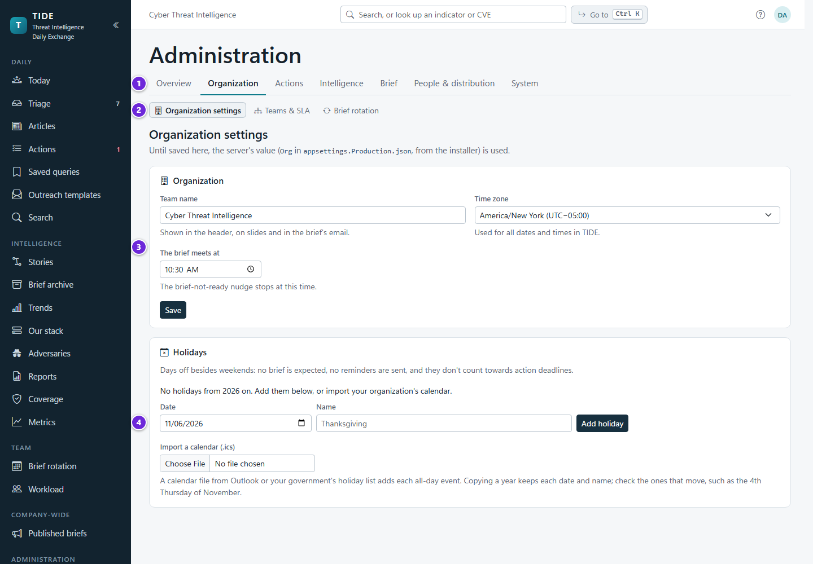
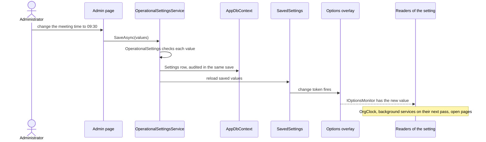
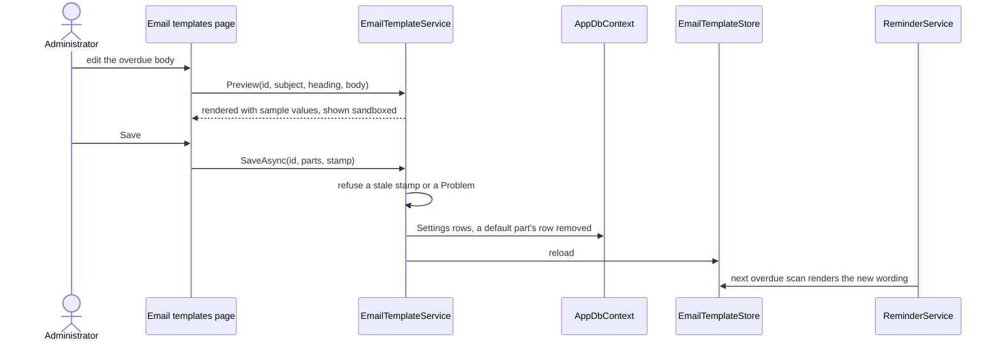

# Administration

Every page under Administration and what it changes, for the administrator who runs TIDE and the developer who adds a
setting. It covers the getting-started checklist, the email templates, holidays, the configuration bundle, the audit
log page, source health and the update check. What each configuration key means, and which settings stay on the
server, is in [configuration.md](../operations/configuration.md); this page is the workflow side.

**Contents**
- [The frame and who may use it](#the-frame-and-who-may-use-it)
- [Every page, and what it changes](#every-page-and-what-it-changes)
- [The getting-started checklist](#the-getting-started-checklist)
- [How an in-app setting is saved](#how-an-in-app-setting-is-saved)
- [Email templates](#email-templates)
- [Holidays](#holidays)
- [The configuration bundle](#the-configuration-bundle)
- [The audit log page](#the-audit-log-page)
- [Source health](#source-health)
- [Update checks](#update-checks)
- [Edge cases](#edge-cases)
- [Where it lives in code](#where-it-lives-in-code)

## The frame and who may use it

1. The setting groups, as tabs.
2. The pages in the selected group, as sub-tabs.
3. Operational settings. Until one is saved here, the server's value is used, and each save is audited.
4. Holidays, added one at a time or imported from an .ics calendar. They count as weekends do.

One "Administration" entry in the sidebar opens every setting page. The pages share one frame (`AdminLayout`): the
heading, the groups as tabs, a group's pages as sub-tabs (`TabBar`), and the page. `/admin` is the Overview: the
getting-started checklist and an index of every page with a line on what it's for. Both read
`AdminLayout.Groups`, so a new page is added in one place.

Every page needs `Administer` (the page's policy), and every service it calls checks `Administer` again. Only the Admin
role holds it; an administrator also holds every other permission
([ADR 0002](../decisions/0002-permissions-as-code.md), [security.md](../architecture/security.md)).

## Every page, and what it changes

| Group › page | Route | What it changes | Service | Kept in |
|---|---|---|---|---|
| Overview | `/admin` | nothing: the checklist and the index | (reads several) | |
| Organization › Organization settings | `/admin/organization` | team name, time zone, meeting time; holidays | `OperationalSettingsService`, `HolidayService` | `Settings`, `Holidays` |
| Organization › Teams & SLA | `/admin/teams` | internal teams, members, team mailbox, escalation contact, each team's active limit and what happens at it (show, warn, refuse), retire; a link to External teams; SLA targets by priority and kind; reminder and digest switches and times (external team reminders among them, and whether new external teams start with their reminders on), brief-not-ready recipients, outreach follow-up days, run a scan now, last run, opt-out counts; the escalation ladder (on or off, which actions, its steps, run it now); which action files download zipped | `TeamService`, `SlaSettings`, `OperationalSettingsService`, `ReminderService`, `NotificationPreferenceService` | `Teams`, `TeamMembers`, `Settings` |
| Organization › Brief rotation | `/admin/rotation` | roster, weekly rota, managers to notify | `RotationService` | rotation tables, `Settings` |
| Actions › Card rules | `/admin/card-rules` | colours and labels on the board and list, and the rules offered as filters (everyone who reads actions reads them on Team › Board rules) | `CardRuleService` | `ActionCardRules` |
| Intelligence › Sources | `/admin/sources` | feeds and catalogs, polling on or off, sponsored-item markers, advert selectors, retention, triage grouping, CVE enrichment, Poll now | `IntakeService`, `CveService`, `OperationalSettingsService` | `Sources`, `Settings` |
| Intelligence › Source health | `/admin/source-health` | nothing but *Pause polling* | `IntakeService.SourceHealthAsync` | |
| Intelligence › Scorecard tags | `/admin/scorecard` | the board scorecard's categories and tags | `ScorecardService` | scorecard tables |
| Intelligence › Detection rules | `/admin/detections` | rule imports, API callers' sets | `DetectionService` | detection tables |
| Intelligence › Query templates | `/admin/queries` | each dialect's template per kind of value | `HuntQueryBuilder.SaveTemplateAsync`, `ResetTemplateAsync` | `QueryTemplates` |
| Brief › Opening metrics | `/admin/metrics` | groups, metrics, thresholds, charts, the example set | `MetricsService` | metric tables |
| Brief › Metric imports | `/admin/metric-imports` | upload a CSV; drop folder on or off and its interval; recent imports | `MetricImportService`, `OperationalSettingsService` | `MetricImports`, `Settings` |
| People & distribution › Access & distribution | `/admin/access` | AD group to role mappings; edition TLP ceilings; review before send; SharePoint required; each edition's recipients; the capabilities table (read-only) | `RoleMappingService`, `DistributionSettings`, `ReviewService`, `OperationalSettingsService` | `RoleMappings`, `Settings` |
| People & distribution › Email templates | `/admin/email-templates` | the wording of the notification emails | `EmailTemplateService` | `Settings` (`EmailTemplate:*`) |
| People & distribution › API access | `/admin/api` | API tokens and webhooks | `ApiTokenService`, `WebhookService` | see [API.md](../API.md) |
| System › Diagnostics | `/admin/system` | nothing: health checks, this server, database, email delivery, storage, connections, background jobs | `SystemDiagnostics` | |
| System › Server configuration | `/admin/system/server` | nothing: what's set on the server, secrets shown only as set or not | `SystemSettings` | |
| System › Setting sources | `/admin/system/sources` | nothing: where each setting's value comes from now | `SystemSettings` | |
| System › Configuration bundle | `/admin/system/bundle` | imports another TIDE's setup; downloads this one's and the install answers file | `ConfigBundleService` | many |
| System › Audit log | `/admin/system/audit` | nothing: every change saved, with a CSV export | `AuditLogService` | `AuditLog` |
| System › Updates | `/admin/system/updates` | the update check's switch and interval | `UpdateCheckService`, `UpdateSettings` | `Settings` |

**External teams** (`/teams/external`) isn't under Administration: anyone with `WorkActions` keeps the teams that work
outside TIDE there (contact, how to engage them, their reminders' cadence, their escalation contact), and an
administrator also sets their active limits there. Internal teams stay on Teams & SLA, the administrators'. See
[actions-and-hunting.md](actions-and-hunting.md#external-teams).

A team's edit form, on either page, carries the team's edit version. When another person changed that team since it
opened (saved it, set its limit or escalation contact, retired it or brought it back), its save is refused ("Someone
else changed Network since you opened it…"), and the form stays open with the *changed elsewhere* banner and Reload,
which shows theirs. Adding or taking off members and moving a team up or down don't count as a change to it.

**Escalation** (on Teams & SLA) is the escalation ladder: a switch (off until turned on), which actions it climbs (all,
only parts of a split, or only external teams'), and its steps in order, each a number of business days before, on or
after the due date and what it does (remind the team, copy its escalation contact, raise priority, flag). Steps are
added, removed and moved up or down here; *Use the defaults* puts back the four it starts with. *Save escalation*
checks them all (at most 8 steps, 0 to 60 business days, each doing something, no two the same) and saves the three
settings together, or none, saying why. A last run whose steps didn't read (a hand-edited server value) says so. Each internal team's escalation contact (a name and email) is set in its
editor here; an external team's on External teams. See
[actions-and-hunting.md](actions-and-hunting.md#the-escalation-ladder).

The workflows behind several pages are on their own pages: teams, SLA and reminders in
[actions-and-hunting.md](actions-and-hunting.md); the rotation in [rotation.md](rotation.md); metrics and imports in
[metrics-and-trends.md](metrics-and-trends.md); sources and triage settings in
[intake-and-triage.md](intake-and-triage.md); ceilings, recipients and review in [distribution.md](distribution.md);
detection rules in [search-exports-and-adversaries.md](search-exports-and-adversaries.md#detection-coverage).

**Role mappings.** A mapping names an AD group (`DOMAIN\Group`, a name or a SID) and a role. Each change reloads the role
directory so it takes effect at once, and open sessions re-derive their roles within two minutes. The last mapping
granting Admin can't be removed, checked in a serializable transaction (`RoleMappingService`), so TIDE can't lock
itself out.

## The getting-started checklist

The Overview shows a checklist while any step is undone, read from the live configuration each time
(`AdminOverview.razor`). Each undone step has a *Go* link.

| Step | Done when | Go to |
|---|---|---|
| Give the CTI team the Analyst role | a mapping grants Analyst | Access & distribution |
| Say who gets each edition | both editions have recipients | Access & distribution |
| Add the teams that own actions | at least one team | Teams & SLA |
| Fill the brief rotation | at least one rotation member | Brief rotation |
| Add intelligence sources | at least one source (the step says polling is off when `Intake:Enabled` is) | Sources |
| Define the opening metrics | at least one metric group (optional) | Opening metrics |

In December, once any holidays are kept, the Overview also warns when next year has none
(`HolidayService.NextYearMissingAsync`), since its holidays would count as working days.

## How an in-app setting is saved

Operational settings are changed in the app and audited; security-sensitive and infrastructure settings (sign-in,
hosting, the database, files, email, network limits) stay on the server. An in-app setting is a row in the `Settings`
table keyed by the configuration key it overrides, so the server's value is the default until an administrator saves
one. The audit interceptor records each save like any change (a secret only as set).

`OperationalSettings` checks every value on save and on bundle import: HH:mm times, numbers within the bounds the
services apply, an IANA time zone, email addresses. Nothing needs a restart. The mechanism (`SavedSettings`,
`OperationalSettingsOverlay<T>`) and the list of keys are in [configuration.md](../operations/configuration.md).

## Email templates

People & distribution › Email templates sets the wording of TIDE's notification emails. The brief's own email isn't a
template: it's written from the brief ([distribution.md](distribution.md)).

| Template id | Title | Sent by |
|---|---|---|
| `due-soon` | Actions due soon | `ReminderService` |
| `overdue` | Overdue actions | `ReminderService` |
| `digest` | Weekly team digest | `ReminderService` |
| `personal-digest` | Personal digest | `ReminderService` |
| `outreach-follow-up` | Outreach follow-up | `ReminderService` |
| `handoff` | Action handed to a team | `HandoffService` |
| `external-reminder` | External team reminder (to people without TIDE: no links) | `ReminderService` |
| `escalation` | Escalation contact (a ladder step's copy to the team's escalation contact: no TIDE links for an external team, a link to each request for an internal one) | `ReminderService` |
| `brief-not-ready` | Brief not ready | `ReminderService` |
| `presenting` | Presenting next | `ReminderService` |
| `rotation-request` | Swap or cover request | `RotationService` |
| `rotation-approved` | Swap or cover approved | `RotationService` |
| `rotation-recorded` | Past cover recorded | `RotationService` |
| `rotation-declined` | Swap or cover declined | `RotationService` |

**Editing.** Pick a template; the editor shows its subject, heading and Markdown body, the `{{Name}}` values it fills in
(`EmailTemplateCatalog`), and a live preview with sample values in a sandboxed frame (`EmailTemplateService.Preview`).
*Send a test* sends the draft with sample values to the administrator's own address only (`SendTestAsync`). Neither
saves anything.

**Saving** (`EmailTemplateService.SaveAsync`) writes the whole template. Each part is a `Settings` row
`EmailTemplate:{id}:{Subject|Heading|Body}`; a part equal to its default has no row, so *Reset* removes the rows. The
save carries a stamp of what was saved when the editor opened, so a page opened before a colleague's save is refused
rather than undoing it. `EmailTemplateCatalog.Problem` refuses a part that names a value the email doesn't have, puts
an HTML value outside the body, leaves out the value the email is for (the reminders' `{{ActionList}}`), or is too long.

**Rendering** (`EmailTemplateRenderer`): the body's raw HTML is escaped, then the values are filled in. Text values are
encoded, so an action's title can't add markup; TIDE's own markup (the actions table, links) goes in as it is. TIDE
keeps the rest: the shell, the line under the heading, the TLP marking in a reminder's subject and at its top, the
managers' copy heading, and the plain-text part. `EmailTemplateStore` (a singleton) holds the saved parts, loaded at
start-up and after every save, reset or bundle import; the senders render from it.

## Holidays

Organization settings › Holidays keeps the days off besides weekends
([ADR 0018](../decisions/0018-holidays-are-days-off-like-weekends.md)). A `Holiday` is a date and a name (100
characters).

| Action | Service | Rules |
|---|---|---|
| Add | `HolidayService.AddAsync` | a weekend is refused (it's a day off already), as is a date already kept |
| Remove | `RemoveAsync` | |
| Import a calendar (.ics) | `ImportAsync` | each all-day event is added, a multi-day event as each of its days; one already kept, on a weekend, or repeating (an RRULE) is skipped and said so; at most 1 MB and 100 days |
| Copy a year | `CopyYearAsync` | copies that year's holidays to the same dates next year, for the administrator to check (a holiday that moves needs its date changed) |

After every change, and at start-up and after a bundle import, `HolidayService` loads the holidays into the
organization clock (`OrgClock.UseHolidays`), so every rule that counts days follows at once: SLA due dates and "due
soon", reminders, brief days and carry-over, the rota's days and runs, and the metrics' sparklines and missed days. A
value entered on a holiday is kept; only a weekend's is refused. Changes are audited.

## The configuration bundle

System › Configuration bundle has two parts:

- **Install answers file** (`/admin/system/tide.config.psd1`): the answers `Install-Database.ps1` and `Install-Tide.ps1`
  read, filled from what this server knows (the SQL instance and database without credentials, the app pool and its
  account, the folders, the AD groups per role, the organization). Blanks are marked. See
  [INSTALL.md](../INSTALL.md) and [UPGRADE.md](../UPGRADE.md).
- **The app's setup** (`/admin/system/config-bundle.json`, `ConfigBundleService.ExportAsync`), to import into another
  TIDE.

| The bundle carries | It doesn't carry |
|---|---|
| in-app settings (`SettingsCatalog.InApp`: edition ceilings and recipients, SLA targets, the rotation's manager addresses, the update check, and the operational settings) and saved email template parts | secrets of any kind (a source address with a key is masked) |
| AD group to role mappings | teams and members, the rotation's roster and rota |
| sources (with their filters and fetch settings) | playbooks, card rules, saved queries, outreach templates |
| scorecard categories and tags | metric definitions and values |
| query templates | articles, briefs, actions or any working content |
| holidays | API tokens and webhooks |

**Import** is additive: an item is matched by name or key, updated when it differs and added when it's new; nothing is
removed. Every item is checked as the app's own editor checks it, and one that isn't valid is skipped with the reason.
The page shows a preview of everything first (`PreviewAsync`, nothing written); *Import* then saves the changes together,
all or nothing, audited like any change (`ImportAsync`), and reloads the saved settings, email templates and holidays.

## The audit log page

System › Audit log (`/admin/system/audit`, `AuditLogService`) reads every change saved across TIDE: who, when, the
kind of record, the record, the action (created, changed, deleted) and each field before and after
(`HistoryFormatter.AuditChanges`, which leaves out stamps and noise).

- **Filters**, all kept in the address: person, kind of record, one record ("Only this record"), dates (organization
  time zone), action, and words over the changed values. In the filter bar (`FilterBar`), *Deleted* is a pill
  (`action=deleted`); person (`who`), kind (`kind`), action (`action`) and dates (`from`, `to`) are under *+ Filter*;
  each filter in force is a chip that links to the log without it. Newest first, 50 a page (`?page=`).
- **Records named.** `AuditRecords` names each row's record (its title, or what it's part of) in one query per kind on
  the page, and links articles, briefs, actions, stories, sources, teams and other admin records.
- **Indexes and bounds.** `AuditLog` is indexed on `AtUtc`, `(EntityType, EntityKey)` and `(UserId, AtUtc)`. Filtering by
  action or words with no person is held to at most 92 days, and the page says so.
- **Secrets.** A secret setting's value is written only as set, and the page masks again whatever a row holds: "(set)"
  or "(changed)", URLs through `SecretMask.Url`, a source's error through `SecretMask.Scrub`. The words filter matches a
  secret setting's row by its key only, so a search can't confirm a value.
- **Export.** `/admin/system/audit.csv` with the same query names, at most 10,000 rows, one line per field.

Administrators only, by the page's policy and in the service, since the log holds text at every TLP marking. The
per-record History on an article or brief is a different, narrower view for analysts
([data-model.md](../architecture/data-model.md)).

## Source health

Intelligence › Source health (`IntakeService.SourceHealthAsync`) shows, for each live source over the learning window,
its items a week, how many were decided and promoted, the share promoted, the last item promoted, and the median time
from fetch to decision. Nothing is trained or stored: the counts are worked out from the items still kept.

A source that has been on for 60 days and sent at least 10 items in that time, none promoted or shortlisted, is
suggested for pausing. *Pause polling* turns the source off; its items stay. The triage side of this learning is in
[intake-and-triage.md](intake-and-triage.md).

## Update checks

System › Updates (`UpdateCheckService`) says whether a newer TIDE release is published, and how to upgrade.

- **Off by default** (`Updates:CheckEnabled`): many SOC servers have no outbound internet. An administrator turns it on
  and sets the interval (6 to 168 hours, 24 by default) on the page; both are in-app settings. The repository
  (`Updates:Repository`) stays on the server.
- **What it sends.** One anonymous GET to GitHub's public Releases API through the app's outbound client (its proxy and
  size limit), with a 10-second limit. Nothing about the installation is sent.
- **What it says.** Disabled, a development build (nothing to compare), not checked yet (the first check runs a few
  minutes after start), up to date, available (every newer release, newest first), or failed with why. A server on a
  pre-release follows pre-releases. A manual check within a minute of the last returns that answer.
- **Where it shows.** The page, and a "new" mark on the System tab and the Updates sub-tab. The answer is kept in memory.

`UpdateCheckHostedService` runs the check on its interval. It never blocks start-up or a page, and never throws.

## Edge cases

| Case | What happens |
|---|---|
| Removing the only Admin mapping | Refused: add another first. |
| Two administrators edit one email template | The second save is refused (stale stamp). |
| A template body without `{{ActionList}}` for a reminder | Refused on save and skipped on import. |
| A holiday on a Saturday | Refused. |
| A bundle from a newer TIDE with an unknown setting | That item is skipped with the reason; the rest import. |
| A bundle import that fails partway | Nothing is saved (all or nothing). |
| The update check with no internet | "Couldn't check" and why; nothing else is affected. |
| A setting saved in the app and also set on the server | The app's value wins; Setting sources shows which. |
| Escalation steps with two the same, or more than 8 | Refused on save, naming the steps; skipped on import. |
| An escalation steps value on the server that doesn't read | The ladder climbs nothing until one that reads is saved. |

## Where it lives in code

| Concern | Code |
|---|---|
| Frame and index | `src/Tide.Web/Components/Layout/AdminLayout.razor` (`Groups`), `src/Tide.Web/Components/Pages/Admin/AdminOverview.razor` |
| Pages | `src/Tide.Web/Components/Pages/Admin/*.razor` |
| Role mappings | `src/Tide.Application/Admin/RoleMappingService.cs` |
| In-app settings | `src/Tide.Application/Settings/OperationalSettings.cs`, `SavedSettings.cs`, `DistributionSettings.cs` |
| Email templates | `src/Tide.Application/Distribution/EmailTemplates.cs` (`EmailTemplateCatalog`, `EmailTemplateRenderer`, `EmailTemplateStore`), `EmailTemplateService.cs` |
| Holidays | `src/Tide.Application/Org/HolidayService.cs`, `OrgClock.cs`, `WorkingDays.cs` |
| Configuration bundle | `src/Tide.Application/Operations/ConfigBundle.cs`, `ConfigBundleService.cs`; endpoints in `src/Tide.Web/Program.cs` |
| Audit log | `src/Tide.Application/History/AuditLogService.cs`, `HistoryService.cs` (`HistoryFormatter`) |
| Source health | `src/Tide.Application/Intake/IntakeService.cs` (`SourceHealthAsync`), `TriageLearning.cs` (`SourceRecord`) |
| Update check | `src/Tide.Application/Operations/UpdateCheckService.cs`, `UpdateSettings.cs`; `src/Tide.Web/Services/UpdateCheckHostedService.cs` |
| Diagnostics | `src/Tide.Web/Services/SystemDiagnostics.cs` |
