# The brief and the meeting

How a day's brief is built, made ready, presented at the morning meeting and reopened when a meeting was ended by
mistake. It covers Today, the brief page, the team's opening note, present mode, the live meeting (joining, following,
hands, notes, attendance, handing over) and what ending the meeting changes. Sending the brief afterwards is on
[distribution.md](distribution.md); who presents on which day is on [rotation.md](rotation.md); the opening numbers
are on [metrics-and-trends.md](metrics-and-trends.md).

**Contents**

1. [The day at a glance](#the-day-at-a-glance)
2. [Today](#today)
3. [Starting a brief](#starting-a-brief)
4. [Building the running order](#building-the-running-order)
5. [The title slide line and the team's opening note](#the-title-slide-line-and-the-teams-opening-note)
6. [Brief status](#brief-status)
7. [Marking the brief ready](#marking-the-brief-ready)
8. [Present mode](#present-mode)
9. [The live meeting](#the-live-meeting)
10. [Ending the meeting](#ending-the-meeting)
11. [Back to ready: reopening a meeting](#back-to-ready-reopening-a-meeting)
12. [A past day's brief](#a-past-days-brief)
13. [Permissions](#permissions)
14. [Edge cases and the guards that handle them](#edge-cases-and-the-guards-that-handle-them)
15. [Where it lives in code](#where-it-lives-in-code)

## The day at a glance

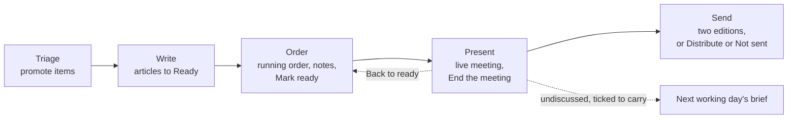

These are the five steps of `BriefSteps` (`Briefs/BriefProgress.cs`), shown as a strip at the top of Today and the brief
page. Each says where it stands ("2 of 5 need work"); the first still to do is Current, and one passed with something
left behind is Attention. Triage is never "done": the feed is never finished.

## Today

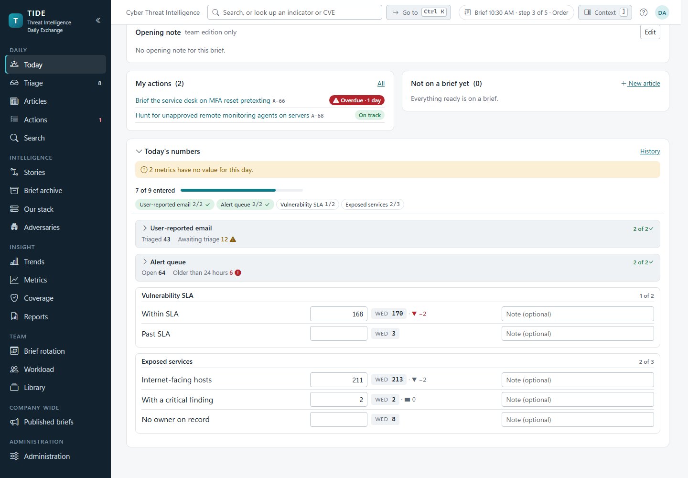

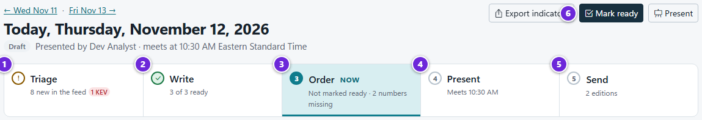

1. **Triage**: new items waiting in the feed.
2. **Write**: how many of the brief's articles are ready.
3. **Order**: the running order, marked *Now* when it's the next step, with what's still missing (not marked ready, a number not entered).
4. **Present**: the meeting time.
5. **Send**: the editions to send.
6. The one main button for whichever step is next (here *Mark ready*).

Today (`/`, `Components/Pages/Home.razor`) is where the presenting analyst starts. It's the brief page drawn for the
current brief date (`BriefPage` with `AsToday`, the date from `OrgClock.CurrentBriefDate` in the organization's time
zone). Someone without the team edition (a Reader, a Visitor) is sent to `/published` instead. It shows:

- the step strip, with one main button for whichever step is next (`BriefSteps.Next`: Mark ready, Present, Send, Post
  to SharePoint, or read it as sent). The step it's on also shows in the top bar of every page, as a link back to
  Today ("Brief 10:30 AM · step 3 of 5 · Order"; see [the brief chip](../architecture/frontend.md#layout-and-navigation));
- a brief is Sent from its first real send, but while one of the two editions (security team and company-wide) has
  gone and the other is still to go, Today's header status, the note under it, the strip's Send step and the brief chip
  all say **1 of 2 sent**, and the next step is still Send (`BriefSteps.PartlySent`). They say **Sent** only once both
  have gone, or once the one that went is the only edition with anything in it;
- under the strip, from `Intake:PulledBy` on a working day, how many polled feeds haven't been pulled since, with
  **Pull all** (see [intake-and-triage.md](intake-and-triage.md#feeds-not-pulled-since-the-morning));

  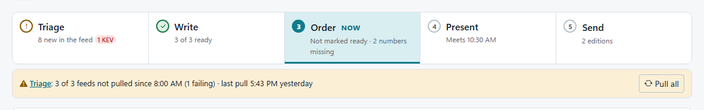

  *Under the step strip: the feeds not pulled since 8:00, one of them failing, with Pull all.*
- the running order, then the team's opening note (read-only until **Edit**), then **My actions**, **Not on a brief
  yet** (for whoever writes the brief: Ready articles never on a brief, then their own drafts, each with *Add*; on a
  day with no brief, *Add* starts it) or **Recently presented** for everyone else, and today's numbers.

The cards that sit beside the brief are in the context rail, "Beside the brief" (`Components/Today/`): the **edition
check**, **your teams' queue** (their teams' open actions that are theirs or nobody's, up to 8, with *Take it* on those
nobody holds; a colleague's take in the
meantime is refused and names who took it), **Escalated**, **reviews asked of you**, the **meeting** (when, the
presenter, and the title slide line, changed in place with *Change presenter* and *Title slide line*), **coming up**
and the brief's **history**. From 1500px wide the rail is docked beside the brief and `]` hides it; below that it's
shut, and **Context** in the top bar, or `]`, opens it over the page. A past day's brief (`/briefs/{day}`) has the same
rail. A colleague's save never replaces what you're typing in the meeting form or the opening note: a "changed
elsewhere" notice shows beside the form instead.

## Starting a brief

There's at most one brief per `BriefDate` (a unique index). `BriefService.GetOrStartAsync(date)` returns it, or starts
it when an analyst first opens it:

| Field | Set to |
|---|---|
| `BriefDate` | The day. Refused on a weekend or holiday (`OrgClock.Days.DayOffReason`, ADR [0018](../decisions/0018-holidays-are-days-off-like-weekends.md)). |
| `AnalystId`, `AnalystName` | Who the rotation names for that day (`IPresenterLookup`), else the analyst starting it. A past day's brief is presented by whoever starts it. |
| `TeamNote` | The latest earlier brief's note, so standing items roll forward. A note cleared on that brief stays cleared. |
| `Status` | Draft. |

Two analysts opening today's brief at once both try to insert; the unique date makes the second save fail, and it
reads the first one's brief.

## Building the running order

The brief page (`/briefs/{day}`, `Components/Pages/BriefPage.razor`) holds the running order: drag, or move up and down,
with removal you can undo.

| Action | Code | Rule |
|---|---|---|
| Add article (N available) | `BriefService.CandidatesAsync`, `AddArticleAsync` | Offers articles not on this brief: created in the last 14 days (`CandidateDays`), any Ready article, and a Draft that has been on a brief before. Ready first, then newest. An article that went out on a brief sent without a meeting shows as presented. Adding one already there does nothing. |
| Remove | `RemoveItemAsync` | Undo re-adds it at its old position (`AddArticleAsync(…, at)`), on the brief it came off even if the page has since moved to another day. |
| Move, reorder | `MoveItemAsync`, `ReorderAsync` | Positions are renumbered from 0. |
| Add to today's brief from the editor | `ArticleEditorPanel.AddToTodaysBrief` | Saves the article first if it has unsaved edits, then `GetOrStartAsync` and `AddArticleAsync`. |

Every change to the brief or its items moves `Brief.EditVersion` (`BriefService.Touch`), which is how a send confirmed
before the change is refused. Once the brief is Sent, its running order, presenter and title slide line are fixed
(`BriefService.Editable`, `SetDetailsAsync`). Its articles stay editable; a mistake after a send is put right by a
[correction](distribution.md#corrections-after-a-send).

The running order shows each article's readiness gaps (`BriefService.Readiness`, which runs `ArticleChecks.For` with
the company-wide ceiling). A gap with a one-click fix has its button beside it: **Set to AMBER**, for a threat whose
"why it matters" would reach the company-wide edition, calls `ArticleService.MarkWhyItMattersAmberAsync` with the
article's edit version as the page showed it. Beside it, **Keep it** records that the paragraph is meant to reach the
company-wide edition at the marking it has (`ArticleService.KeepWhyItMattersAsync`): it changes no marking and no
edition, and stores the marking kept, a hash of that marking and the text, who and when (migration
`WhyItMattersKept`). The warning then stops showing, and returns by itself when the text or the marking changes. The
history reads "Kept “Why it matters” at TLP:CLEAR". Both are for people with `WriteArticles`, on a brief that isn't
Sent, refuse a stale edit version or an article not on that brief, and are audited and heard like any save of the
article.

The **edition check**, in the context rail, counts the articles each edition will carry and lists only the
exceptions (`EditionChecks.Exceptions`): what is partly included, left out, or goes out with a warning. How the
editions are cut is on [architecture/editions-and-tlp.md](../architecture/editions-and-tlp.md).

Colleagues see changes live: the brief's topic on `ChangeFeed` re-reads the page, the "Add article (N available)" count
and an open Add articles picker (which keeps what's ticked).

## The title slide line and the team's opening note

Two different notes, often confused:

| | Title slide line | Team's opening note |
|---|---|---|
| Field | `Brief.Intro`, `Brief.IntroTlp` | `Brief.TeamNote` |
| What | One optional line on the title slide | What's coming up and the week's phishing trends, in Markdown |
| Marking | Its own TLP; an edition whose ceiling is below it leaves it out, and one that carries it is marked at least that high | None: it belongs to the security team edition alone |
| Set by | `BriefService.SetDetailsAsync` (with the presenter) | `BriefService.SetTeamNoteAsync`, at most 4,000 characters (`TeamNoteMax`) |
| Rolls forward | No | Yes: a new brief starts with the latest earlier brief's note |
| Where it shows | Title slide, both editions within their ceilings | Its own slide straight after the title (key `note`), and a short section before the numbers in the team email |
| Never in | An edition below its TLP | The company-wide edition, its email, the SharePoint copy, the archive, the API |

Both are refused once the brief is Sent: the note went out in the team email as it was then. Every rendering asks the
edition whether to show the note (`BriefEdition.ShowTeamNote`), so there's one place that decides.

## Brief status

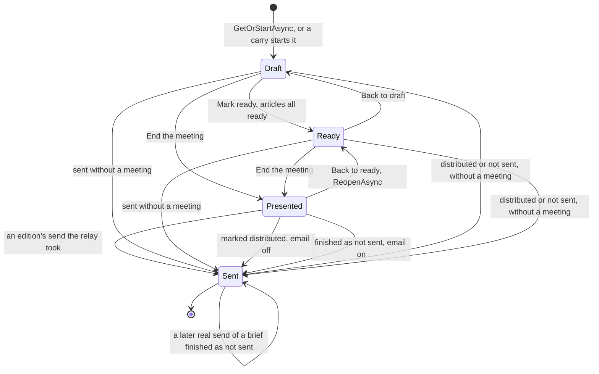

`BriefStatus` has four values: Draft, Ready, Presented, Sent. "Distributed" and "Not sent" are not statuses; they're a
Sent brief with `DistributedAtUtc` or `NotSentAtUtc` set. `BriefSteps.StatusLabel` reads them for people ("Distributed",
"Not sent", "SharePoint to post"). The transitions into Sent are on [distribution.md](distribution.md#brief-status-after-the-meeting).

## Marking the brief ready

`BriefService.MarkReadyAsync(briefId, true)` moves a Draft brief to Ready. It's refused with no articles ("Add an
article first.") or while any article on it has a blocking readiness gap ("Not ready yet: …", naming up to three).
`MarkReadyAsync(briefId, false)` puts it back to Draft. Either does nothing on a Presented or Sent brief. Ready is a
signal to the team, not a lock: the running order stays editable.

## Present mode

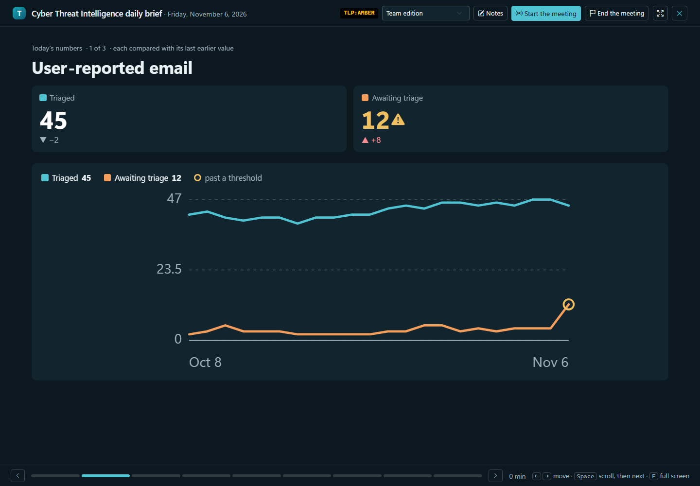

Present mode (`/present/{day}`, `Components/Pages/Present.razor`) is a full-screen, keyboard-driven deck
(`wwwroot/js/present.js` handles the keys and full screen). The slides, in order, each with a stable key so a follower
lands on the same one however many slides their page has loaded:

| Slide | Key | Shows |
|---|---|---|
| Title | `title` | The date, the presenter, the title slide line if the edition carries it, the articles in order (number, kind, priority, KEV where an article names a KEV-listed CVE), and what comes first ("First: the opening note, the numbers and 4 actions that need review.") |
| Opening note | `note` | The team's opening note. Team edition only, and only when it isn't blank. |
| Metrics | `metrics:{group key}` | One slide per metric group: tiles and the group's chart. Team edition only. |
| Actions that need review | `open` | The open actions the room should look at, from any brief (below). Team edition only, and only when there are any. |
| One per article | `article:{id}` | The article as the edition carries it. Screenshots zoom. Its indicators as defanged chips (the first 10, then "+N more"; a chip opens the larger card), on the team edition only, and its CVEs. Each recommended line shows the action it became ("✓ A-2 · In progress · holder"); the article's other actions are listed below. |
| Wrap-up | `wrap` | Three lists, side by side from 1400px: the recommended lines no action has been raised from yet; who has what, the brief's actions by team and holder, with each team's unheld ones ("nobody yet") last; and the articles not marked discussed. Built from the edition, so nothing above its ceiling is named. |

**Actions that need review** (`ActionService.MeetingActionsAsync`) lists every open action the edition may show that is
overdue, escalated, or has gone too long without an update, each once, at most 8:

- **Too long without an update:** Open or In progress with no update for 2 business days, or Blocked for 5. An
  administrator sets both in Organization settings (**An open action needs review after**, `Org:StaleOpenDays`; **A
  blocked action needs review after**, `Org:StaleBlockedDays`; whole numbers from 1 to 30), and a change counts at once.
  Business days are the organization's: its time zone, weekends off, and its holidays, as due dates count them.
- **An update** is anything a person did: a comment, a status change, a checklist tick, a new holder or due date, any
  other edit. TIDE's own lines (the escalation ladder's, a skipped reminder's) and the emails it sends aren't. The action
  table's "no update for" counts from the same update.
- **Order, most pressing first:** escalated; then P1 and P2 overdue; then Blocked and quiet too long; then the other
  overdue, latest first; then the others quiet too long, quietest first.
- **Each row** names the action (the presenter opens it from there, over the slide or beside it as set), who has it and
  its status; under Waited, every reason it's there ("escalated", "3 days late", "quiet 6 business days (Blocked)") and
  its last update ("last: comment by Sam"); and the one thing the room can do (a quiet one is asked for an update, unless
  reassigning it, finding it a holder or asking what it's waiting on comes first). Closing the action puts focus back on
  its row.
- The title slide counts every action that needs review, not only the 8 shown. The rows are read again when the limits
  change, when the slide is come back to, and after the presenter changes an action from it, for the presenter and
  everyone following alike.
- **Under the table** how many are shown of how many in all, and what's counted; "N more under Actions" when there are
  more than 8 (a link, except for a Visitor).
- An action raised from an article above the meeting's ceiling is neither named nor counted. Everyone following sees
  the same slide; the company-wide edition has none.

The team email's "Still open from earlier briefs" keeps to the overdue and escalated actions.

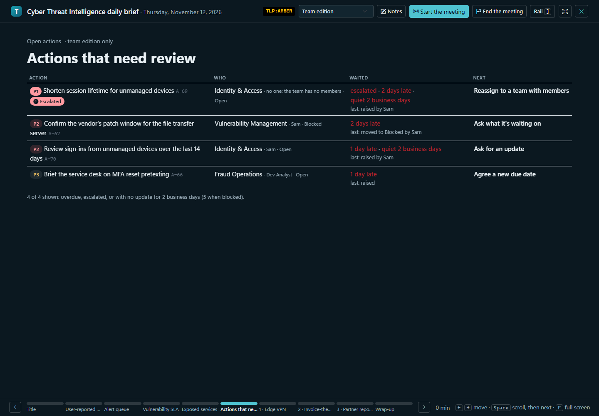

*Actions that need review: each row's reasons under Waited, its last update, and the one thing the room can do.*

The footer names each slide under its bar (Title, Opening note, each group of numbers, Actions that need review,
"1 · Edge VPN", Wrap-up), shortened to fit; the whole title is in its tooltip and what a screen reader hears. Who is
here and whose hands are up are in the top bar, for everyone: the presence dots, a count ("3 here · all on the same
slide") and the raised hands in the order they went up. A follower raises and lowers their own hand there.

A page without a slide another has (the company-wide edition has no note) shows the title instead. The edition can be
switched on screen; joining a live meeting switches to the team edition. Articles are ticked off as discussed
(`BriefService.SetDiscussedAsync`, `PresentBriefs`).

From an article's slide the presenter can open an action, an Our stack product's card or the article's indicators over
the slide for the room (`LiveMeetings.Open`, `Show`). Anyone who may write articles, presenting or following, can edit
an article's scorecard tags and techniques from **Edit tags** on its slide in the team edition (`PresentTagEditor`,
through `ArticleService.SaveTagsAsync`, so the same stale-edit rule applies); the editor opens on their own screen
only. Viewers and Visitors never see the button. Raising actions is on
[actions-and-hunting.md](actions-and-hunting.md).

The slides are the room's: they show what's being discussed and none of the presenter's controls. The presenter's
controls are in **the presenter's rail** beside the slide (docked from 1500px wide, over the slide below that; `]` or
**Rail** opens and shuts it). Over the slide it's a modal dialog, as the context rail's overlay is: the page under it is
inert behind a scrim, Tab stays in it, the slide's keys wait, and Escape, `]` or a click on the scrim shuts it and puts
focus back on **Rail**. It holds, for the slide on screen:

| Slide | The rail |
|---|---|
| Title | Ready to present? (the articles, an opening note not updated with Still current, a number missing with Enter, which goes to its box), and what comes first. |
| Opening note | The note's Edit, and Still current while it's carried over from the last brief. |
| Numbers | A box for each number not entered yet (nothing, once none is missing). |
| An article | Its actions (Take it, holder, due date; the holder offered as on the action page: the team's members, then, for an analyst, everyone else), its recommended lines to raise (kind, team, Raise), the quick add, a meeting note on it, and Mark discussed. |
| Wrap-up | What's not raised yet, the articles not discussed (tick to carry each to the next brief), attendance, and End the meeting. |
| Any slide, in a meeting | The hands (lower one, or clear them all) and everyone's view (bring everyone here, lock everyone to my slide, hand off: choose who, then **Hand off**). |

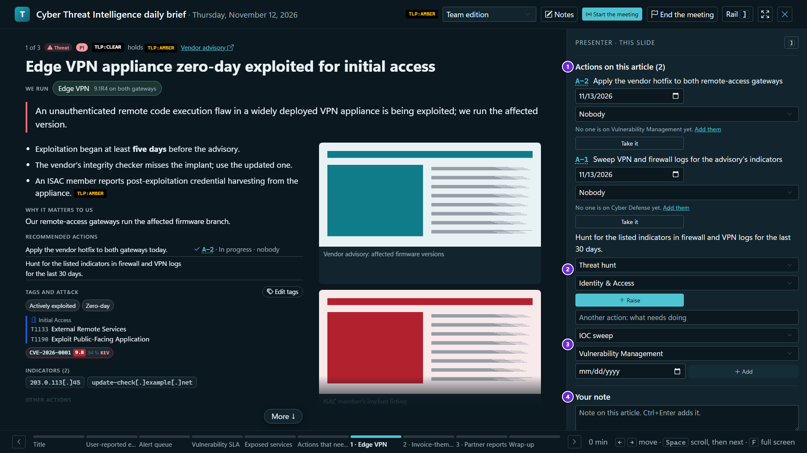

1. The article's actions, each with its due date, holder and *Take it*.
2. A recommended line no action has been raised from yet: its kind and team, and *Raise*.
3. The quick add, for an action the article doesn't recommend.
4. Your note on the article (Ctrl+Enter adds it). *Mark discussed* (D) is under it.

The rail is drawn only on the presenting page (or, with no meeting, for someone who could present). It is never in a
follower's page, whatever the follower may do elsewhere: **raising and working actions during the meeting is the
presenter's, from the rail. Someone following, an analyst included, raises or works an action on the action pages.**
Each of the presenter's steps checks it where it's handled, not only by what's drawn: the page must be presenting the
meeting (or, with no meeting, be someone who could present). A follower's `D`, or any of the rail's steps sent by hand,
changes nothing.

**An action beside the slide.** An action opened in the meeting (its title or number on a slide) opens over the slide.
With **In a meeting, an action opens beside the slide** ticked in Organization settings (`Org:ActionBesideSlide`, off
by default, to be turned on after a rehearsal in the meeting room), it opens beside the slide instead, and the slide
narrows for it, so the room reads the two together:

- From 1200px wide the action is a column of the page between the slide and the presenter's rail,
  `clamp(22em, 30vw, 30em)` wide. That's the same width for the presenter and everyone following at the same window
  width, so their slides narrow alike, fit alike (present.js's fit) and the shared scroll lands in the same place.
- With the presenter's rail docked (1500px and wider) the three share the width: the rail keeps its own, the action
  takes its column, and the slide fits in what's left (at least 560px at 1600px wide). The presenter's own slide is
  narrower than the room's by the rail, as it is without an action open. The rail open over the slide covers the action
  too, as a modal.
- Narrower than 1200px it opens over the slide, as without the setting.
- Turned on or off while an action is open, it moves there at once for everyone in the meeting.
- Only the action does: a product's card, the indicators, the CVEs and the tag panel open over the slide as ever.
- Whoever follows sees it where the presenter has it, as they see the card over the slide. It shows no more than that
  card: their own read of the action (a Visitor's only the one open for the room, without its page link or files), and,
  for an action raised from an article above the meeting's ceiling, only its number and title.

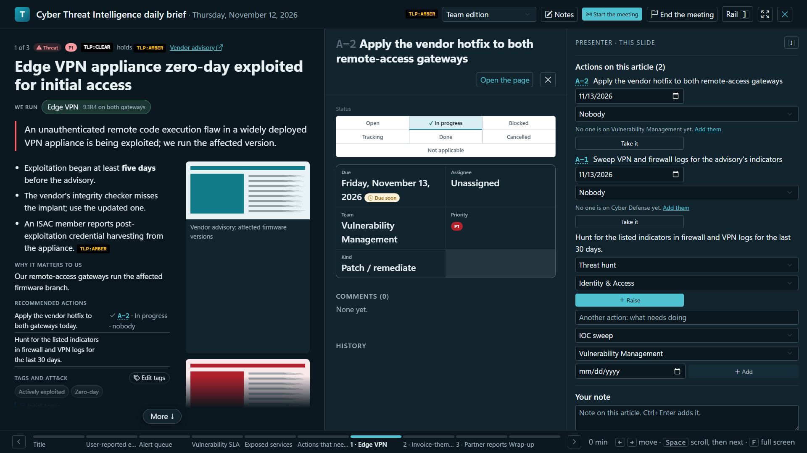

*With the setting on, at 1920px: the slide, the action and the presenter's rail side by side.*

## The live meeting

**Start the meeting** makes it live for the team: a banner on every page and a Join button on the brief invite anyone
on the team edition in, or they paste the copied link.

`LiveMeetings` (a singleton in `Tide.Web`, implementing `IMeetingsInProgress`) holds one live meeting per brief day, in
memory (ADR [0001](../decisions/0001-blazor-server-on-prem.md)): who presents, their slide and its key, how far they've
scrolled, who's on which slide, raised hands, the lock, and the action or card open for the room. **It isn't shared
across a pair of load-balanced servers, and a restart drops it.** What's kept is the database's: `MeetingAttendee` and
`MeetingNote` rows through `MeetingService`.

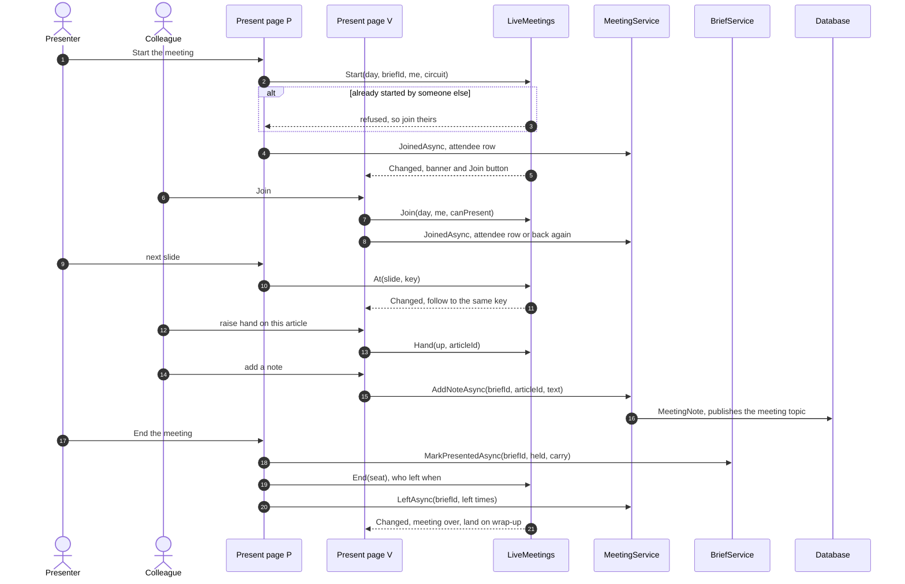

What people in the meeting can do:

| Who | Can |
|---|---|
| Everyone in it | Follow the presenter's slide, browse off and come back (unless locked), show in the top bar with the slide they're on, raise a hand on an article or the meeting (`Hand`). |
| With `MeetingNotes` and the team edition (Analyst, Action owner, Viewer, Admin) | Take notes, each their own, against the article on screen as they began writing or the meeting as a whole (`MeetingService.AddNoteAsync`, at most 2,000 characters). A note begun on one article stays on it if the slide moves on before it's added, and the box says which article it's on. Edit or delete only their own. |
| The presenter, with `WorkActions` | Raise actions from the rail, from the quick add or a recommended line, each assigned to whoever raises it (they can hand it on) and for one of the security team's own teams: an external team's work is split off an action afterwards, so it has a parent to follow it up. Take or assign them (a team that warns at its limit asks why first, `OverLimitDialog`). The quick add's title is kept per article as it's typed, so a slide moved by the presenter doesn't lose it. An assignee the service turns away (they left the team a moment ago) is said in a toast and that row's list is drawn afresh (`Present.AssignResets`), as the due box is. |
| The presenter | Bring everyone here (`Summon`), lock everyone to their slide (`Lock`), clear hands, open an action or card for the room, hand presenting to another analyst who's there (`HandTo`; one who left a moment ago is refused in a toast and the list goes back to "Hand off to…"), add someone who was in the room by name (`MeetingService.AddAttendeeAsync`), mark articles discussed, end the meeting. |
| An analyst, once the presenter has been gone 30 seconds | Take over (`TakeOver`, `LiveMeetings.Grace`). A lock doesn't outlast a presenter who dropped out. |

**Connections.** A circuit whose connection drops is "away": not shown and not presenting, so a presenter's drop starts
the grace period at once (`SetConnected`). A tab that closes without saying so is cleared with its circuit
(`RemoveCircuit`). A meeting with nobody in it for 15 minutes is dropped (`LiveMeetings.Abandoned`, swept every 10
seconds).

**Attendance.** `MeetingService.JoinedAsync` records a `MeetingAttendee` the first time someone joins (who and when);
joining again keeps the first join and clears the leaving time. Someone the presenter added by name before they joined
in TIDE becomes them, not a second entry. As the meeting ends, `LeftAsync` writes each person's last leaving time.

**Notes and attendance publish `ChangeFeed.Meeting(briefId)`**, not the brief's own topic, so a note doesn't show as an
edit to the brief.

**A Visitor** (`JoinMeetings` without `ReadTeamEdition`) sees team-edition content only from a seat in that brief's live
meeting. Present mode takes their seat (`LiveMeetings.Join`) before it reads anything, and the services ask
`MeetingAccess` (`IMeetingsInProgress.SeatedIn`) on every read. They get the attendees but none of the notes. The moment
the meeting ends or they leave, their reads are refused. See [architecture/security.md](../architecture/security.md).

## Ending the meeting

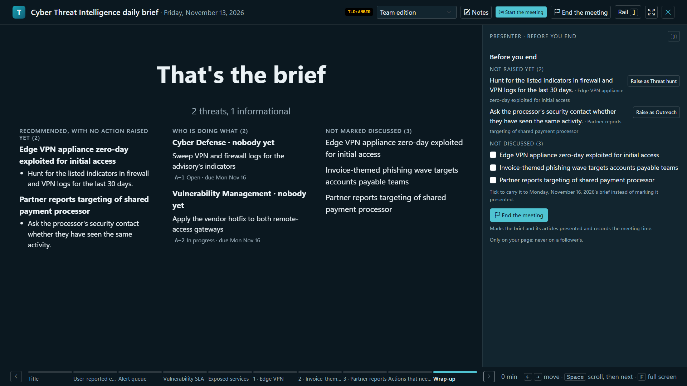

*The wrap-up: not raised, who is doing what, and not discussed; in the presenter's rail, Before you end.*

**End the meeting** (`Present.EndMeeting`, after an "End the meeting now?" confirmation in a `ConfirmDialog`) calls `BriefService.MarkPresentedAsync(briefId, heldAtUtc, carry)`. The brief page's Send step also has an End
the meeting for a meeting held outside present mode (`DistributePanel.EndMeeting`, with the time it was held).

What `MarkPresentedAsync` does, in one save:

1. Does nothing for a Sent brief.
2. Works out the carry: the articles not ticked discussed whose carry tick is on.
3. Refuses if the next working day's brief is already Sent: "nothing can be carried to it".
4. Sets `Status = Presented`. Keeps two times, each only if not already set: `MeetingHeldAtUtc` (now, or for a past
   day's brief that day's meeting time unless the presenter picks another; a meeting opened on its own day and run
   past midnight is still now, as present mode passes it) and `PresentedAtUtc` (the clock). The meeting
   can't be held before the brief's day ("can't be held before the brief's day") or more than 5 minutes in the future.
5. Marks each article Presented, except carried ones and, when the meeting had already been ended, one also on a later
   unsent brief. It records the status before on the item (`BriefItem.StatusBeforeMeeting`), once.
6. Puts the carried articles at the end of the next working day's brief, starting that brief if there's none (with the
   rota's presenter and the opening note, as `GetOrStartAsync` would). Each carried item records `CarriedFromBriefId`.

A `DbUpdateException` (a colleague editing, starting or sending the next brief at that moment) fails the save whole; it's
read again and redone, up to three attempts, so the meeting never ends with its carry lost.

Then present mode ends the live meeting (`LiveMeetings.End`), everyone in it lands on the wrap-up, and `LeftAsync`
records when each person left. The brief page keeps who attended and the notes, by article.

Before it marks anything, present mode reads the saved brief again. If it was put back to ready, or marked presented,
a moment ago from the brief page, it shows the wrap-up as it is now and asks to end again, rather than leave a reopened
brief unmarked or carry articles from one already presented. If the presenter came back from a drop, it isn't this page's
to end: "… is presenting again".

## Back to ready: reopening a meeting

A meeting ended by mistake or too soon can be reopened from the brief page: **Back to ready**
(`BriefService.ReopeningAsync` for the confirmation, `ReopenAsync` to do it).

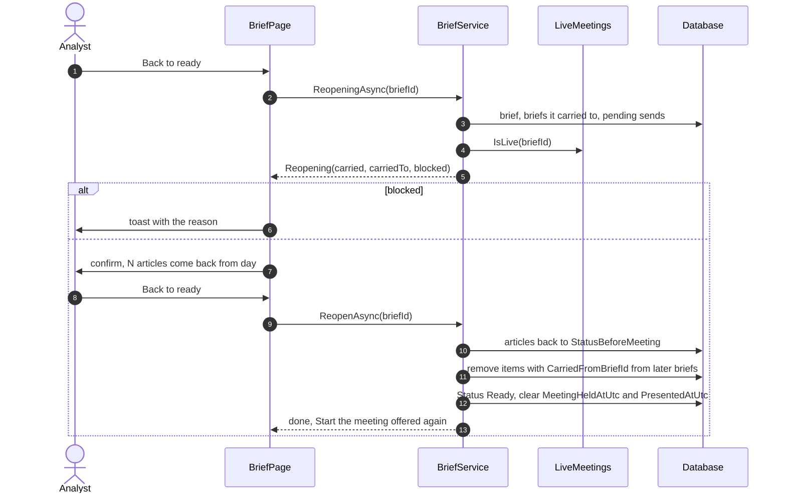

It's refused (`BriefService.Plan`) when:

| Situation | Message |
|---|---|
| The brief is Sent | "This brief has been sent, so its meeting can't be reopened." |
| The brief was finished as not sent | "This brief was finished as not sent, so its meeting can't be reopened." |
| The brief isn't Presented | "The meeting hasn't been ended, so there's nothing to reopen." |
| Its meeting runs in present mode (`IMeetingsInProgress.IsLive`) | "This brief's meeting is running in present mode. End the meeting first." The button is held with the reason, and redrawn as the meeting starts and ends. |
| A real send is with the relay or its outcome is unknown (`BriefService.SendPendingAsync`) | "An edition of this brief is being sent, or whether it went isn't known yet…" That send would finish the brief when it lands. |
| A brief it carried articles to has been presented or sent | Names that day. |

What it does:

- Each article the meeting marked presented goes back to `StatusBeforeMeeting`, unless it has since been presented on a
  later brief (put there by hand).
- The items it carried come off the later brief(s), which are renumbered. What a colleague put on that brief by hand
  stays, as do that brief and its opening note.
- The brief goes back to Ready; both meeting times are cleared (the audit trail keeps them).
- The attendees, notes and discussed ticks are kept for when the meeting resumes.

A `DbUpdateConcurrencyException` is retried, up to three attempts. A send freezing after the read moves the brief's
edit version, so the reopen's save fails and is redone, then refused. Present mode and the brief page hear the change
and offer "Start the meeting" again.

## A past day's brief

A brief can be written after the fact for a past working day. It's started by and presented by the analyst starting
it, not the rota's choice; when the rota named someone else, `RotationService.RecordPastCoverAsync` records an
already-approved cover (see [rotation.md](rotation.md)). Ending its meeting defaults `MeetingHeldAtUtc` to that day's
meeting time (`OrgClock.MeetingStart`), and the presenter can pick another time on that day.

## Permissions

| Activity | Needs | Checked in |
|---|---|---|
| Read briefs, the brief page, Today | `ReadTeamEdition`, or a seat in that brief's live meeting | `BriefPage.razor` policy; `BriefService.RequireRead` |
| Start a brief, change the running order, presenter, title slide line, opening note, mark ready | `WriteArticles` | `BriefService.RequireWrite` |
| Open present mode, join and follow, raise a hand | `JoinMeetings` | `Present.razor` policy; `MeetingService.JoinedAsync` |
| Take meeting notes | `ReadTeamEdition` and `MeetingNotes` | `MeetingService.CanNote` |
| Start, run and end the meeting, mark discussed, add attendees by name, Back to ready | `PresentBriefs` (Analyst, Admin) | `BriefService.RequirePresent`; `MeetingService.RequirePresent`; `Present.razor` `_canPresent` |
| Carry articles on ending, or bring them back on reopening | `PresentBriefs` and `WriteArticles` | `MarkPresentedAsync`, `ReopenAsync` |

## Edge cases and the guards that handle them

| Situation | Guard |
|---|---|
| Two analysts start today's brief at once | Unique `BriefDate`; the second reads the first. |
| A brief for a weekend or holiday | `GetOrStartAsync` refuses it. |
| Two presenters press Start the meeting | `LiveMeetings.Start` refuses the second, which joins. |
| The presenter's laptop drops | Away at once; after 30 seconds another analyst can take over. |
| Everyone leaves without ending | The meeting is dropped after 15 minutes; the brief stays as it was. |
| The server restarts mid-meeting | The live meeting is lost; attendees and notes are in the database; start it again. |
| Ending while a colleague edits the next brief | One save; retried up to three times. |
| Carrying to a next brief that's already sent | Refused before anything changes. |
| Ending from present mode just after Back to ready on the brief page | Present mode re-reads the brief and asks again. |
| Reopening while a send is with the relay | Refused; the send would finish the brief. |
| Reopening after the next brief was presented | Refused, naming the day. |
| An article carried and also put on the next brief by hand | `CarryAsync` adds it once; reopening takes off only the carried item. |
| An article presented again on a later brief | Reopening leaves it Presented. |
| A meeting time before the brief's day, or in the future | Refused. |
| A Visitor keeps a page open after the meeting | Their reads are refused; the page forgets what it showed. |
| A note against an article not on the brief | Refused. |

## Where it lives in code

| Concern | Code |
|---|---|
| Entities | `src/Tide.Domain/Entities/Brief.cs` (`Brief`, `BriefItem`, `MeetingAttendee`, `MeetingNote`) |
| Status | `src/Tide.Domain/Enums/AppEnums.cs` (`BriefStatus`) |
| Starting, running order, notes, ready, ending, carrying, reopening | `src/Tide.Application/Briefs/BriefService.cs` |
| The step strip and status labels | `src/Tide.Application/Briefs/BriefProgress.cs` (`BriefSteps`) |
| The editions | `src/Tide.Application/Briefs/BriefEdition.cs` (`BriefEditions.Build`, `BriefEdition.ShowTeamNote`) |
| Attendance and notes | `src/Tide.Application/Briefs/MeetingService.cs` |
| Live meetings seen from the services, the Visitor window | `src/Tide.Application/Briefs/MeetingsInProgress.cs` (`IMeetingsInProgress`, `MeetingAccess`) |
| The live meeting | `src/Tide.Web/Services/LiveMeetings.cs` |
| Metric slides | `src/Tide.Application/Metrics/MetricSlides.cs` |
| Who presents | `src/Tide.Application/Rotation/` (`IPresenterLookup`, `RotationService`) |
| Pages | `src/Tide.Web/Components/Pages/Home.razor`, `BriefPage.razor`, `Present.razor`, `BriefsArchive.razor` |
| Components | `src/Tide.Web/Components/Shared/StepStrip.razor`, `AddArticlesDialog.razor`, `EditionCheck.razor`, `ReviewsForYou.razor`, `LiveMeetingJoin.razor`, `PresentTagEditor.razor`, `PresentAction.razor`, `DistributePanel.razor` |
| Keys and full screen | `src/Tide.Web/wwwroot/js/present.js` |
