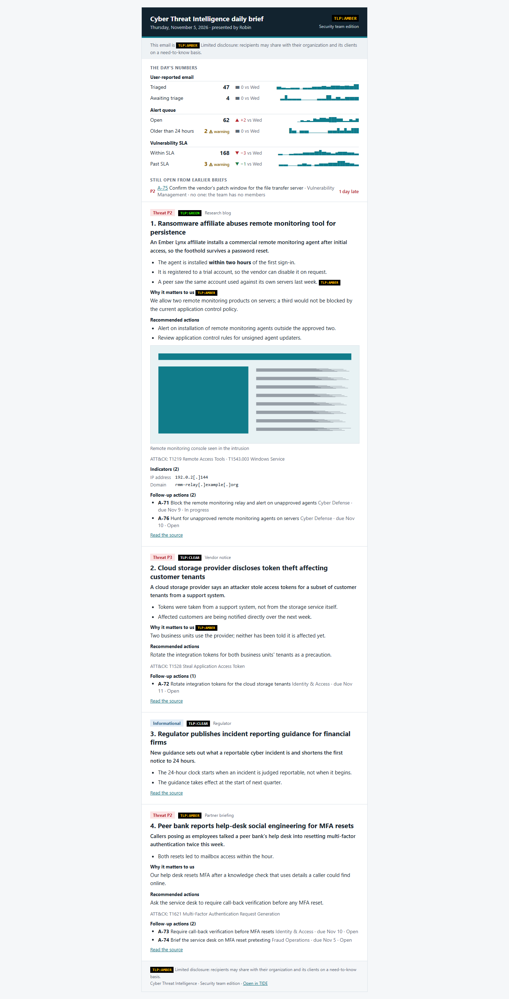
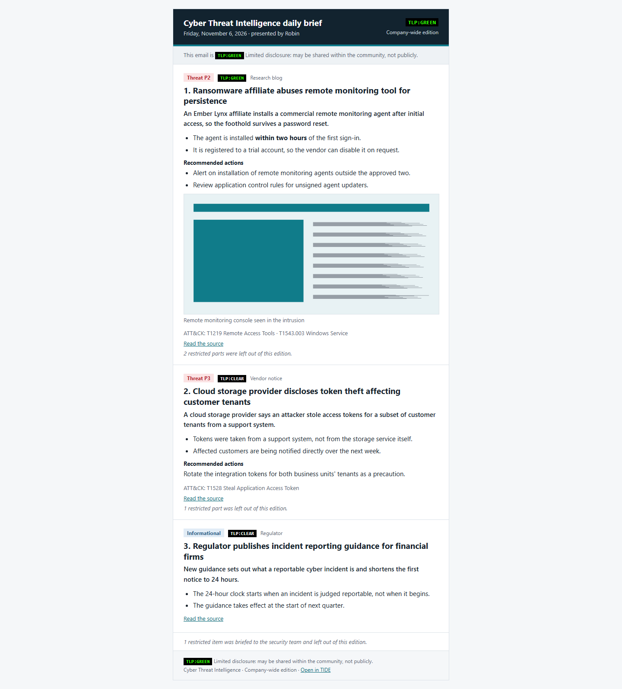
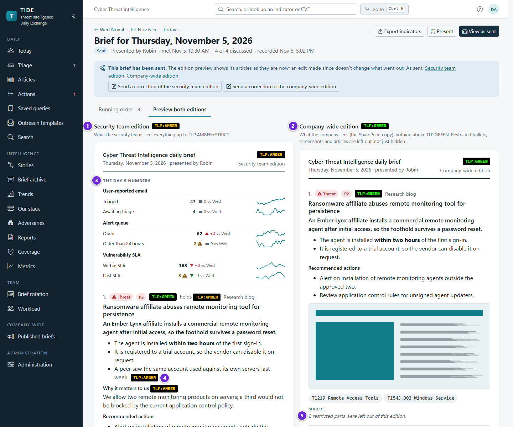
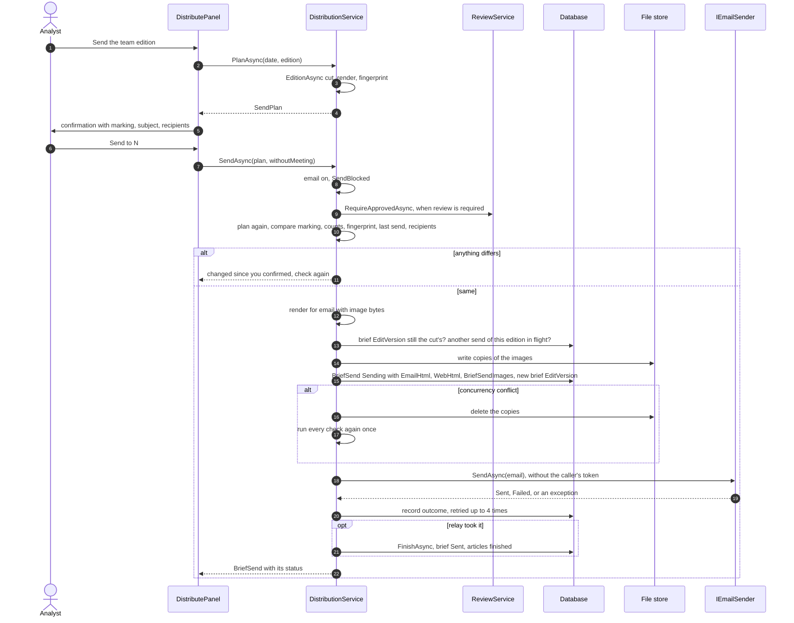
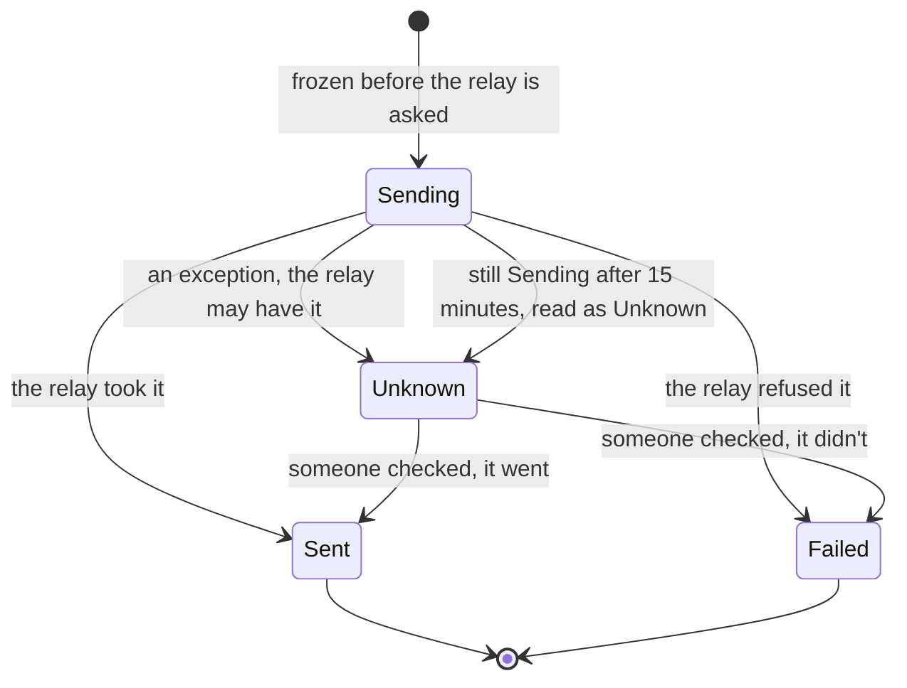
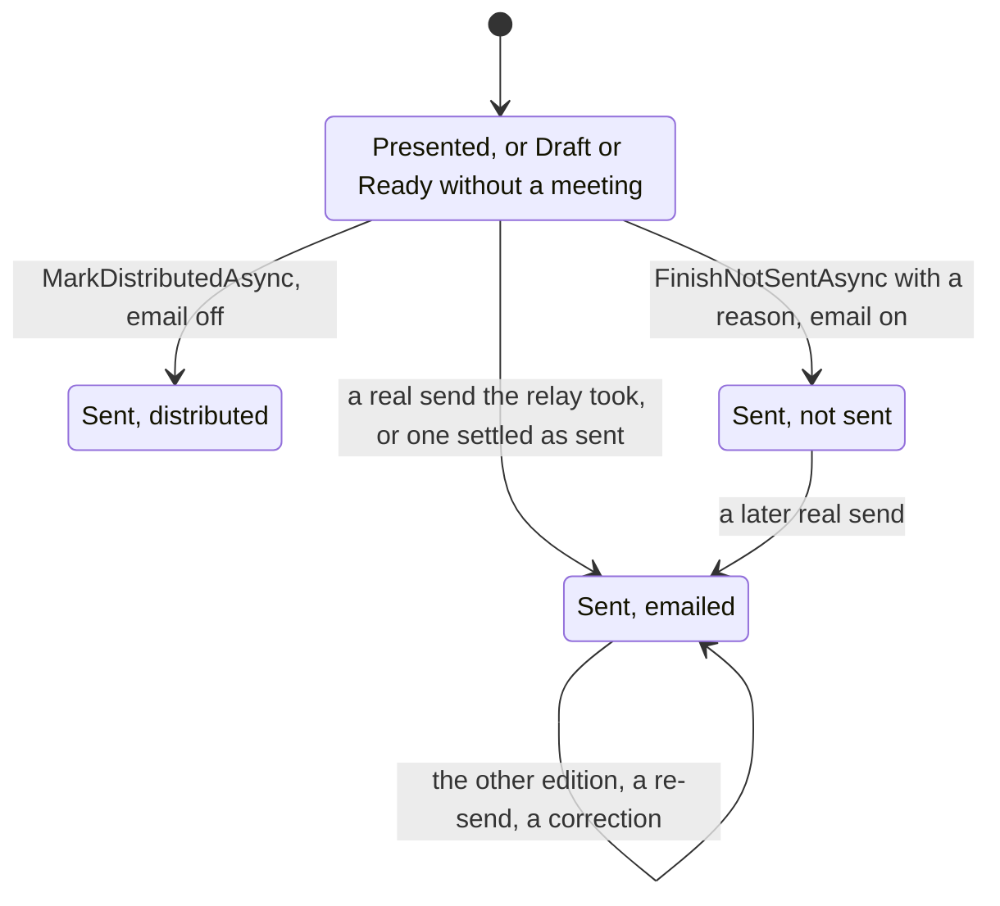
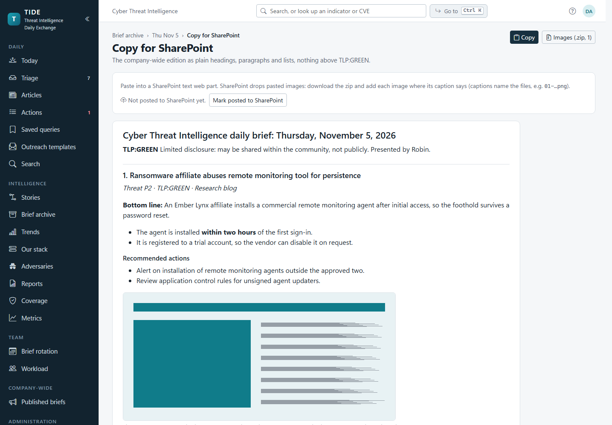
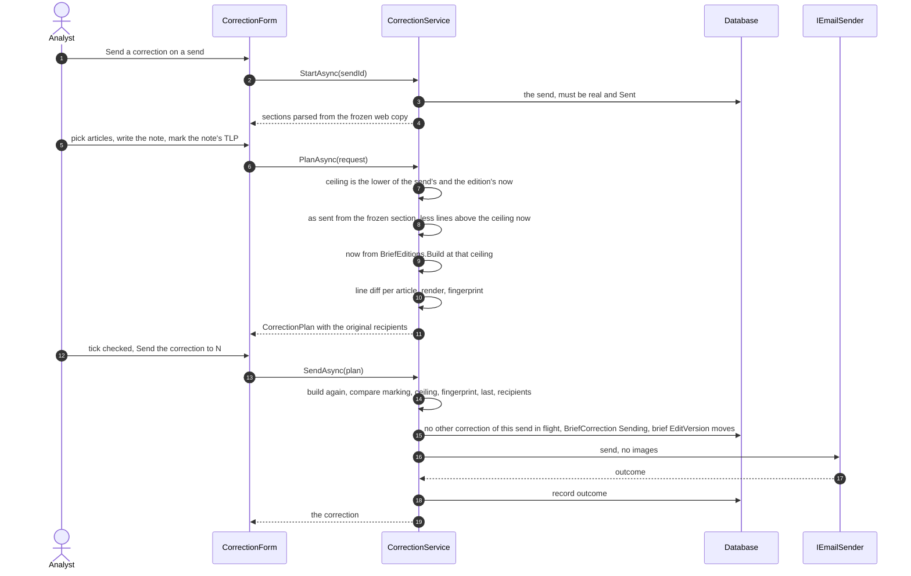
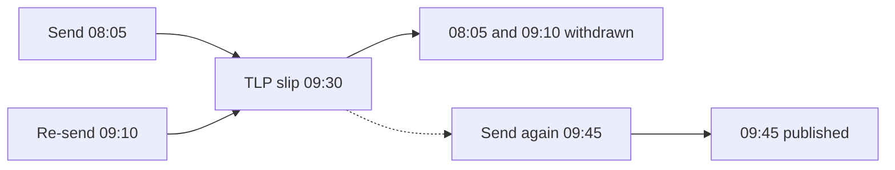
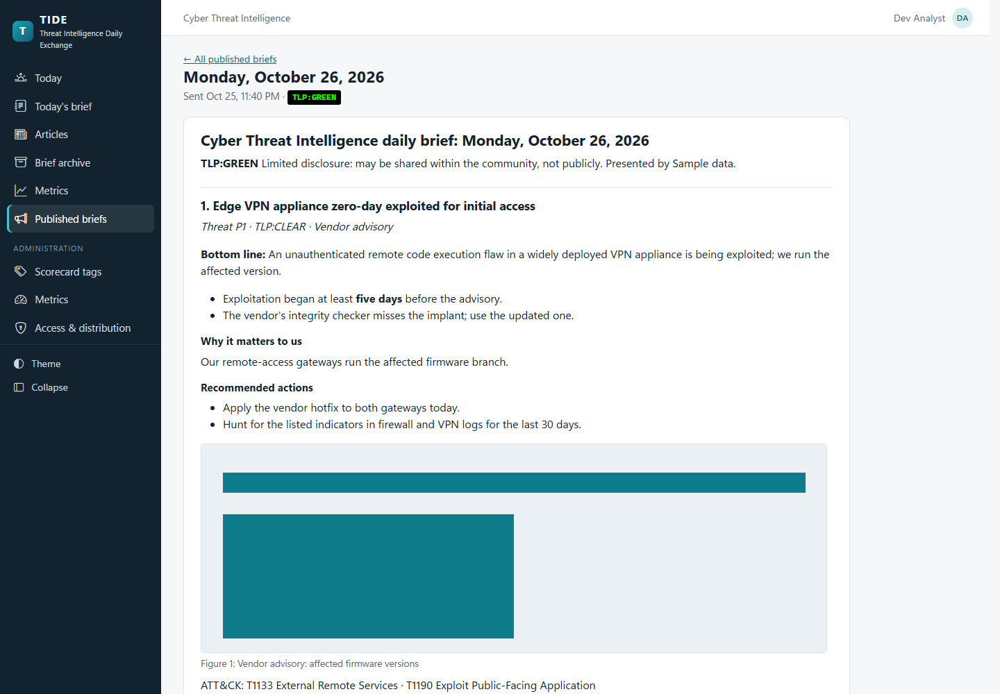

# Distribution

How a presented brief leaves TIDE: the two email editions, test sends, the confirmation and the send itself, the
frozen copy, what happens when the relay's answer is lost, finishing a brief without email, the SharePoint copy,
corrections and TLP slips after a send, and the published archive Readers see. It's for developers changing any of
these, for operators diagnosing a send, and for security reviewers checking what reaches whom. How each edition is cut by
TLP is on [architecture/editions-and-tlp.md](../architecture/editions-and-tlp.md); the relay and its settings are on
[operations/integrations.md](../operations/integrations.md).

**Contents**

1. [The two editions](#the-two-editions)
2. [Before it goes: preview and test send](#before-it-goes-preview-and-test-send)
3. [When a send may go](#when-a-send-may-go)
4. [Plan, confirm, freeze, send](#plan-confirm-freeze-send)
5. [Send outcomes](#send-outcomes)
6. [Brief status after the meeting](#brief-status-after-the-meeting)
7. [Finishing without email: distributed and not sent](#finishing-without-email-distributed-and-not-sent)
8. [Review holds](#review-holds)
9. [Copy for SharePoint](#copy-for-sharepoint)
10. [The send log](#the-send-log)
11. [Corrections after a send](#corrections-after-a-send)
12. [TLP slips](#tlp-slips)
13. [Published briefs](#published-briefs)
14. [The brief.sent webhook](#the-briefsent-webhook)
15. [Permissions](#permissions)
16. [Edge cases and the guards that handle them](#edge-cases-and-the-guards-that-handle-them)
17. [Where it lives in code](#where-it-lives-in-code)

## The two editions

| | Team edition (`Edition.Team`) | Company-wide edition (`Edition.Public`) |
|---|---|---|
| For | The security teams | The whole company, and the SharePoint copy |
| Ceiling | `Distribution:TeamMaxTlp`, AMBER+STRICT by default | `Distribution:PublicMaxTlp`, GREEN by default |
| Recipients | `Distribution:TeamRecipients` | `Distribution:PublicRecipients` |
| Carries | The opening note, the day's numbers, overdue actions, each article's indicators and the actions raised from it | Only what's at or under its ceiling |
| Published | Never | Each real send the relay took, unless withdrawn by a TLP slip |

The ceilings and recipient lists are server defaults an administrator overrides in the app, at Access & distribution
(`DistributionSettings`). Both editions are cut by `BriefEditions.Build(brief, edition, ceiling, actions)`; anything
above the ceiling (an article, a bullet, a screenshot, a caption) is left out, not hidden. See ADR
[0005](../decisions/0005-editions-from-one-model.md).

`BriefRenderer` renders each edition twice:

- **email HTML**: tables and inline styles (colours from `EmailComposer.Palette`, which mirrors the light theme's
  tokens), screenshots as `cid:` linked resources at their real width, so Outlook shows it as intended without
  fetching anything; plus a plain-text part;
- **semantic web HTML**: plain headings and paragraphs, each article's heading carrying a `data-article` attribute.
  It's what the archive, the SharePoint copy and corrections read.

The subject is `BriefRenderer.Subject(cut, teamName)`.

## Before it goes: preview and test send

1. The security team edition, at its marking (here TLP:AMBER), carrying everything up to its ceiling.
2. The company-wide edition, held to its ceiling (here TLP:GREEN).
3. The day's numbers, which only the team edition carries.
4. A part marked above the company-wide ceiling. It's in the team edition only.
5. The company-wide edition says how many restricted parts it left out. They aren't hidden; they're never in it.

- **Preview** (`DistributionService.PreviewEmailAsync`): the email exactly as it would go now, served at
  `/briefs/{day}/email/{edition}` with its images from the inline endpoint. Like the frozen-email endpoints, it has its
  own CSP: `default-src 'none'`, no script, `sandbox`, framable by the app only (`frame-ancestors 'self'`).
- **What readers get**: the Send dialog shows the edition as `EditionToSendAsync` cuts it, read with the plan.
- **Test send** (`SendTestAsync`): to the sender's own address only (`OwnAddress`: the directory's mail attribute this
  session, or the one saved from an earlier visit), subject prefixed `[TEST]`. Logged as a `BriefSend` with
  `IsTest = true` and no frozen copy. It isn't archived, doesn't mark the brief and can't be corrected.

## When a send may go

`DistributionService.SendBlocked(day, brief, withoutMeeting)` is shared by a send, Distribute and Not sent:

| Rule | Message |
|---|---|
| Not before the brief's own day | "The brief for … can be sent from that day. Prepare it now and send it after the meeting." |
| The meeting has been ended (`MeetingHeldAtUtc` or `PresentedAtUtc` set), or the brief is Sent already, or "Sent without a meeting" is ticked | "End the meeting first, or tick "Sent without a meeting" if there wasn't one." |

Once one edition has gone, the brief is Sent, so the other follows on the same terms.

## Plan, confirm, freeze, send

Sending is a plan the analyst confirms (ADR [0007](../decisions/0007-frozen-sends-and-cid-email.md)). `PlanAsync`
returns a `SendPlan`: the marking, subject, every recipient, the article, withheld-article and image counts, whether
email is on, a **fingerprint** (SHA-256 of the subject, the email HTML, the text part and the image file ids, rendered
the same way at plan and at send), and the edition's latest real send if any. The confirmation (`SendConfirmation`)
shows the marking and what it means, the subject, every recipient, a short "checked version" of the fingerprint, and,
when the edition already went, "Already sent … Everyone on the list gets it again" (or "may have gone" when that send's
outcome is unknown). Its button is named for the send: "Send to 12".

The steps that matter:

1. **Re-checked at send.** `SendAsync` plans again and refuses if the marking, the article or image count, the
   fingerprint, the latest send, or the recipients (any order and case, `SendOutcome.SameRecipients`) changed: "The
   edition or its recipients changed since you confirmed. Check it again and confirm." An edit to any bullet, caption,
   action or number that goes in the email changes the fingerprint. It's also refused with no recipients or nothing in
   the edition.
2. **Freeze first.** The `BriefSend` row (status `Sending`, the email HTML, the web HTML, and a `BriefSendImage` per
   image pointing at a fresh copy of its bytes in the file store) is saved before the relay is asked. Removing the
   screenshot from the article later leaves the archive whole.
3. **One real send of an edition at a time.** In the same save, the freeze checks that the brief's `EditVersion` is
   still the one the cut was made from, and that no other real send of this edition has been `Sending` for less than
   15 minutes (`SendOutcome.InFlight`): "… is sending this edition now". It then moves the brief's `EditVersion`. Of two
   analysts confirming at once, only the first freezes. A concurrency conflict on that save (another edition's send, or
   an edit) deletes the image copies and runs every check again once; a second conflict is refused.
4. **Then send.** `SendOutcome.DeliverAsync` hands the email to the relay without the request's cancellation token: once
   handed over, its outcome is recorded whatever happens.
5. **Record the outcome.** `SendOutcome.RecordAsync` saves it, retrying up to four times with a growing pause, since the
   relay already has the email. Only an outcome of Sent finishes the brief (`FinishAsync`).

## Send outcomes

| Status | Means | Brief finished? | Published? | Correctable? |
|---|---|---|---|---|
| `Sending` | Frozen and with the relay. | No | No | No |
| `Sent` | The relay took it (some addresses may have been refused; `Error` says how many). | Yes | Company-wide, unless slipped | Yes |
| `Failed` | The relay didn't take it; `Error` says why, without addresses or message text. | No | No | No |
| `Unknown` | It failed in a way that doesn't say whether the relay took it. The next confirmation warns it may have gone. | No | No | No |

A send left `Sending` past 15 minutes (the server stopped, or its outcome couldn't be saved) is read as `Unknown`
(`SendOutcome.Seen`) with `SendOutcome.StaleError`. **Settling.** Once someone has checked with a recipient,
`DistributionService.SettleAsync(sendId, went)` marks it Sent (archived, published if company-wide, correctable, and the
brief finished) or Failed, records who settled it in `Error`, sets `OutcomeAtUtc`, and moves the brief's `EditVersion`
so a confirmation made before is refused. Only an `Unknown` real send can be settled.

Test sends are created already `Sent` or `Failed`, never `Sending`.

## Brief status after the meeting

`DistributionService.FinishAsync` is what makes a brief Sent, from a real send, a settle, Distribute or Not sent:

- sets `Status = Sent`;
- finishes the brief's Draft and Ready articles as Presented. After a meeting, that's an article added since it ended;
  without one, it's every article, so they aren't offered on every later brief. An article the meeting carried to a
  later unsent brief keeps its status, as that brief's to present;
- sets `SharePointRequired` from `Distribution:RequireSharePoint` the first time (or when a brief finished as not sent
  is emailed after all).

Once Sent, a day's numbers lock for everyone but administrators (`MetricsService.IsLockedAsync`), and the running order,
presenter, title slide line and opening note are fixed.

## Finishing without email: distributed and not sent

| | Distribute (`MarkDistributedAsync`) | Not sent (`FinishNotSentAsync`) |
|---|---|---|
| When | `Email:Enabled` is off: the Send step becomes Distribute | Email is on, but the brief won't go (a holiday, an outage) |
| Needs | Articles on the brief, `SendBlocked` passed, review holds passed | The same, plus a reason (required, at most 500 characters), and no real send with the relay or of unknown outcome |
| Keeps | `DistributedAtUtc`, `DistributedById`, `DistributedByName` | `NotSentAtUtc`, `NotSentById`, `NotSentByName`, `NotSentReason` |
| Frozen or published | No | No |
| SharePoint required | As `RequireSharePoint` says | No: nothing went |
| Afterwards | — | A real send later makes it an ordinary sent brief; the not-sent fields stay as history. The meeting can't be reopened. |

Both make the brief Sent through `FinishAsync`, and move `EditVersion`; a concurrent change refuses them ("Someone else
changed the brief just now"). Not sent re-checks for a pending send after a conflict and says so. The Send dialog holds
its button with the reason while a send is pending.

## Review holds

When an administrator requires review (`Review:Required`, see
[writing-articles.md](writing-articles.md#review-before-send)), `ReviewService.RequireApprovedAsync` refuses each way
an article can leave until every article it covers has a current approval:

| Action | Articles checked | Message ends |
|---|---|---|
| An edition's send | The edition's articles | "before this edition goes" |
| The SharePoint copy and its image zip | The company-wide edition's articles | "before this edition is copied for SharePoint" |
| Distribute | Every article on the brief | "before the brief is marked distributed" |
| Not sent | Every article on the brief | "before the brief is finished as not sent" |
| A correction | Only articles whose "now" lines add words | "before this correction goes" |

A TLP slip is never held: it's how what slipped is withdrawn. The Send dialog lists the brief's articles without a
current approval whether or not review is required.

## Copy for SharePoint

`/briefs/{day}/sharepoint` (`SharePointPage.razor`) shows the company-wide edition as clean semantic HTML
(`DistributionService.SharePointAsync`), with figure captions naming each image file, and **Copy** puts it on the
clipboard as rich HTML (`wwwroot/js/clipboard.js`). `/briefs/{day}/sharepoint-images.zip`
(`SharePointImagesZipAsync`) is a zip of the images named the same way; held for review, it answers 409 with the reason
as text.

An analyst marks it posted (`MarkSharePointPostedAsync`; who and when are kept, and it can be taken back). It isn't
content, so it doesn't move the brief's `EditVersion`. With `Distribution:RequireSharePoint` on, a sent brief isn't
finished until it's marked: the step strip says "Sent · SharePoint to post" and the next step is Post to SharePoint.
Only briefs sent while it was required wait for it (`Brief.SharePointRequired`), so turning it on doesn't make every
earlier brief look unfinished.

## The send log

The brief page's Send step lists every send of the day, test sends included (`DistributionService.SendsAsync`), and
every correction under the send it corrects (`CorrectionService.CorrectionsAsync`), with who, when, to how many, the
marking and the outcome. Each opens its frozen email (`/sends/{id}/email`, `/corrections/{id}/email`). An `Unknown`
row offers "It went: mark sent" and "It didn't: mark not sent" (`SettleAsync`). A send withdrawn by a TLP slip is marked and says to send the
edition again (`WithdrawnSendsAsync`).

## Corrections after a send

Email can't be recalled, so a mistake found after a send gets a **correction**: a short email of its own to the people
who had the original (ADR [0015](../decisions/0015-corrections-after-send.md)). It's a `BriefCorrection` row; `BriefSend`
gains no column, so every query over sends is unchanged.

The writer fixes the article first (a Presented article stays editable), then opens **Send a correction** on the send.

**What it carries** (`CorrectionRenderer`, the brief's tables, inline styles and palette, no images):

- the writer's note, required, at most 4,000 characters, with its own TLP, which may not exceed the correction's ceiling;
- for each article picked, a line diff of the article as sent against the article now (`SentSections.Diff`).

**The two sides of the diff:**

| Side | Taken from | Cut |
|---|---|---|
| As sent | The article's section of the send's frozen web copy, found by its `data-article` heading attribute (by headline, or by the writer's match, for an older send without it) | Less any line that's above the ceiling now, found by rendering the article uncut and taking away what the cut keeps. Counted, not shown. |
| Now | The article rendered by `BriefEditions.Build` | At the lower of the send's ceiling and the edition's current one |

An article that has left the edition (off the brief, or above the ceiling now) is named by number only, not even its
headline. When an administrator has lowered the ceiling below what the send carried, nothing of the "as sent" side is
quoted, headline included: each article is given as it is now.

**Rules:**

- Only a real send the relay took (`Sent`, not a test) can be corrected: nobody is known to have a failed or unknown
  one.
- One correction of a send at a time: refused while another has been `Sending` for less than 15 minutes.
- Its recipients are the original send's. Nobody is added; the plan counts how the list differs now (`NewOnList`,
  `OffList`).
- Refused if anything confirmed changed, as a send is.
- The subject is `CorrectionRenderer.Subject(original, originalMarking, marking)`.
- Its outcomes and settling are a send's (`CorrectionService.SettleAsync`).
- A send a TLP slip withdrew can't be corrected, only slipped again: a correction's "as sent" side would repeat what
  slipped.

## TLP slips

A **TLP slip** is a correction for content that went to an audience it shouldn't have (`BriefCorrection.IsTlpSlip`).

| | Correction | TLP slip |
|---|---|---|
| Wording | The writer's note and a diff | Fixed wording telling recipients to delete the email |
| Diff | Yes | None: it repeats nothing that leaked |
| Note | Required | Optional, held to the ceiling |
| Headlines | As sent | By number only, unless the writer says the headline isn't what slipped (`NameHeadline`), and never when the ceiling was lowered |
| Confirmation | One tick | A second tick that the email can't be recalled (`acknowledgedNoRecall`) |
| Held for review | Only when "now" lines add words | Never |
| Effect on the archive | None; it shows above the edition | Withdraws company-wide sends as soon as it's frozen, whatever becomes of its email |

**What a slip withdraws.** A slip of a company-wide send withdraws every company-wide send of that day made **before the
slip**: the send it names, earlier ones, and later ones made before the slip, including a re-send that put it right. A
slip doesn't say which line slipped, so "put right" can't be told for certain. A send made **after** the slip is never
withdrawn by it, and that's how the corrected edition is published: send the edition again after the slip. The send
log marks each withdrawn send and says so. `PublishedContentCache` drops the send's parsed words as soon as the slip is
frozen, so they stop matching the archive's filter.

## Published briefs

`/published` and `/published/{day}` (`Published.razor`) are what Readers see, and all they see: the sent company-wide
editions, frozen as sent.

- **What's published** (`DistributionService.Published`): company-wide, not a test, status Sent, and not withdrawn by a
  slip. A day shows its latest such send.
- **Headlines and the filter** come from the send's frozen semantic HTML (`PublishedContent`, parsed once per send and
  cached in `PublishedContentCache`), never from the articles or the search index, so nothing the company wasn't sent
  can show or match. A filter looks through every published brief.
- **Corrections** show above the edition they correct, newest first, their words joining the day's for the filter
  (`PublishedCorrections`). A withdrawn send's own corrections don't show, because they quote its words. A slip shows
  whatever became of its email, since it says why the send is gone; a slip that failed and was sent again shows once.
- **A day whose every send was withdrawn** still shows, with the slip's notice and nothing of the send.
- **Images** are the frozen copies, through `/files/{id}/inline`. A Reader gets only an image in a published send
  (ADR [0007](../decisions/0007-frozen-sends-and-cid-email.md)); see [architecture/security.md](../architecture/security.md).

A brief marked distributed or finished as not sent has nothing frozen, so it isn't listed.

## The brief.sent webhook

An administrator's webhook subscribed to `brief.sent` is posted each real send the relay took, including one settled as
sent later (posted as of when it was marked). The webhook job stops its watermark short of a send still `Sending`, so it
posts it once it's Sent. See [operations/integrations.md](../operations/integrations.md) and [API.md](../API.md).

## Permissions

| Activity | Needs | Checked in |
|---|---|---|
| Preview an edition, read the send log, open a frozen email, read the SharePoint copy | `ReadTeamEdition` | `DistributionService.RequireRead`; `CorrectionService.RequireRead` |
| Send, test send, settle, Distribute, Not sent, mark SharePoint posted, send or settle a correction | `PresentBriefs` (Analyst, Admin) | `DistributionService.RequireSend`; `CorrectionService.RequireSend` |
| Read the published archive | `ReadPublished` (everyone) | `Published.razor` policy; `DistributionService.RequireReadPublished` |
| Change ceilings, recipients, Require SharePoint, Require review | `Administer` | `DistributionSettings`; `ReviewService.SaveRuleAsync` |

## Edge cases and the guards that handle them

| Situation | Guard |
|---|---|
| A bullet edited after the confirmation | The fingerprint differs; the send is refused and shown again. |
| A recipient added after the confirmation | The recipient lists are compared; refused. |
| Two analysts send the same edition at once | The freeze's `EditVersion` check and the in-flight rule; the second is refused. |
| Team and company-wide sent at the same moment | The second freeze conflicts on `EditVersion` and is re-checked once; it goes if nothing it showed changed. |
| The browser closes mid-send | The relay call runs without the request's token; the outcome is still recorded. |
| The database is busy as the outcome is saved | Retried up to four times. |
| The server stops after freezing | Read as `Unknown` after 15 minutes; settle it from the log. |
| Sending before the meeting | Refused unless "Sent without a meeting" is ticked. |
| Sending a future day's brief | Refused until that day. |
| Not sent while a send is with the relay | Refused; the send would finish the brief. |
| An image file gone from disk | It's left out of the email rather than shown broken. |
| A screenshot removed after a send | The send has its own copy. |
| A correction would quote a line raised above the ceiling since | Left out of the "as sent" side and counted. |
| The ceiling lowered since the send | Nothing of what went is quoted. |
| A correction of a withdrawn send | Refused; slip it again or fix it in the next edition. |
| Readers guessing an image id | The inline endpoint serves Readers only frozen images in published sends. |
| A Reader filtering for words that were never sent | The filter reads only frozen web copies. |

## Where it lives in code

| Concern | Code |
|---|---|
| Entities | `src/Tide.Domain/Entities/Distribution.cs` (`BriefSend`, `BriefSendImage`, `BriefCorrection`); `Brief.cs` (distributed, not sent, SharePoint fields) |
| Enums | `src/Tide.Domain/Enums/AppEnums.cs` (`Edition`, `SendStatus`) |
| Plan, send, test, distribute, not sent, SharePoint, settle, published | `src/Tide.Application/Distribution/DistributionService.cs` (`SendPlan`, `SharePointCopy`) |
| Freeze-then-send, outcomes, fingerprint | `src/Tide.Application/Distribution/SendOutcome.cs` |
| Rendering | `src/Tide.Application/Distribution/BriefRenderer.cs`, `EmailComposer.cs` |
| Corrections and slips | `src/Tide.Application/Distribution/CorrectionService.cs`, `CorrectionRenderer.cs`, `SentSections.cs` |
| Published archive | `src/Tide.Application/Distribution/PublishedContent.cs` (`PublishedContent`, `PublishedContentCache`) |
| The sender's own address | `src/Tide.Application/Distribution/OwnAddress.cs` |
| Ceilings and recipients | `src/Tide.Application/Settings/DistributionSettings.cs` |
| Review holds | `src/Tide.Application/Reviews/ReviewService.cs` (`RequireApprovedAsync`, `GapsAsync`) |
| The email sender | `src/Tide.Application/Distribution/IEmailSender.cs`; `src/Tide.Infrastructure/Notifications/EmailSender.cs` |
| Webhook | `src/Tide.Application/Api/Webhooks.cs` |
| Endpoints | `src/Tide.Web/Program.cs` (`/briefs/{day}/email/{edition}`, `/sends/{id}/email`, `/corrections/{id}/email`, `/briefs/{day}/sharepoint-images.zip`, `EmailPage`) |
| Pages and components | `src/Tide.Web/Components/Pages/BriefPage.razor`, `SharePointPage.razor`, `Published.razor`; `src/Tide.Web/Components/Shared/DistributePanel.razor`, `SendConfirmation.razor`, `CorrectionForm.razor`, `SharePointPosted.razor` |
