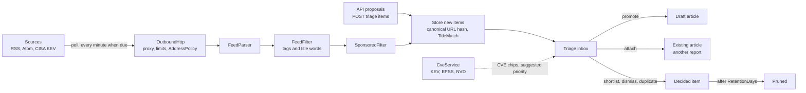
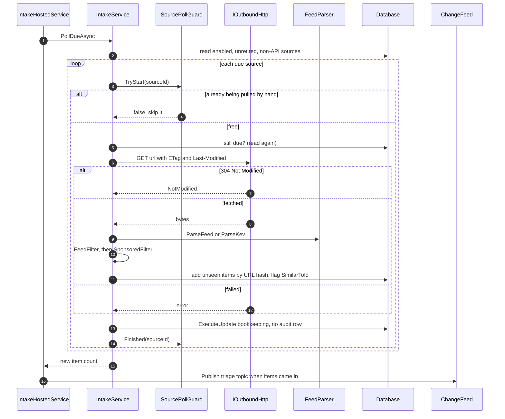
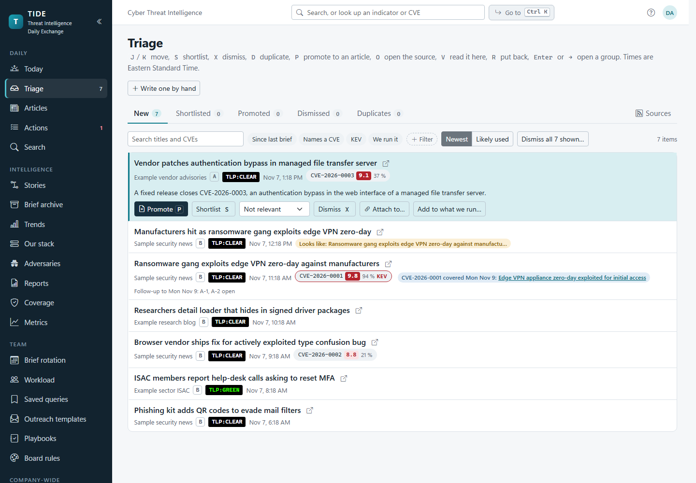
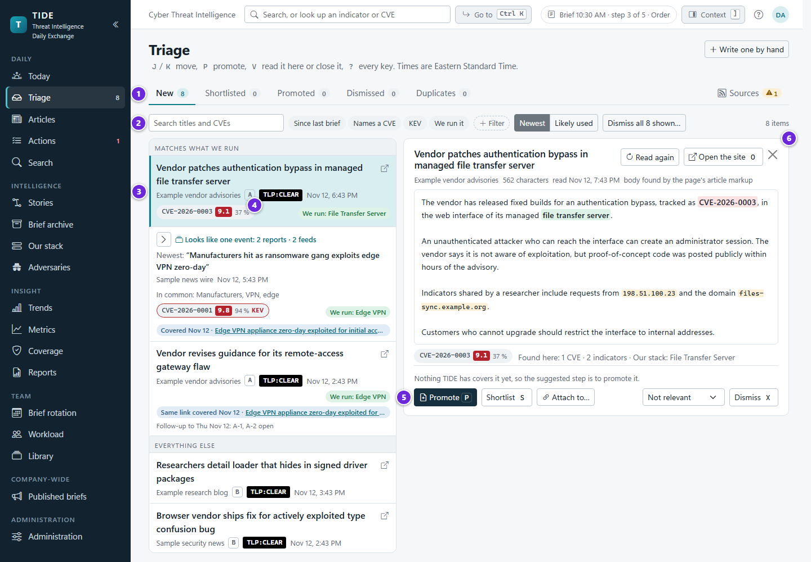
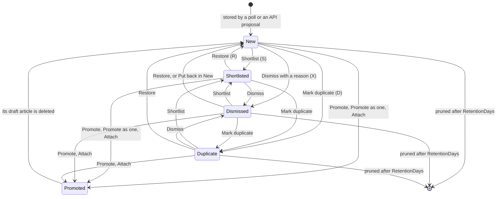
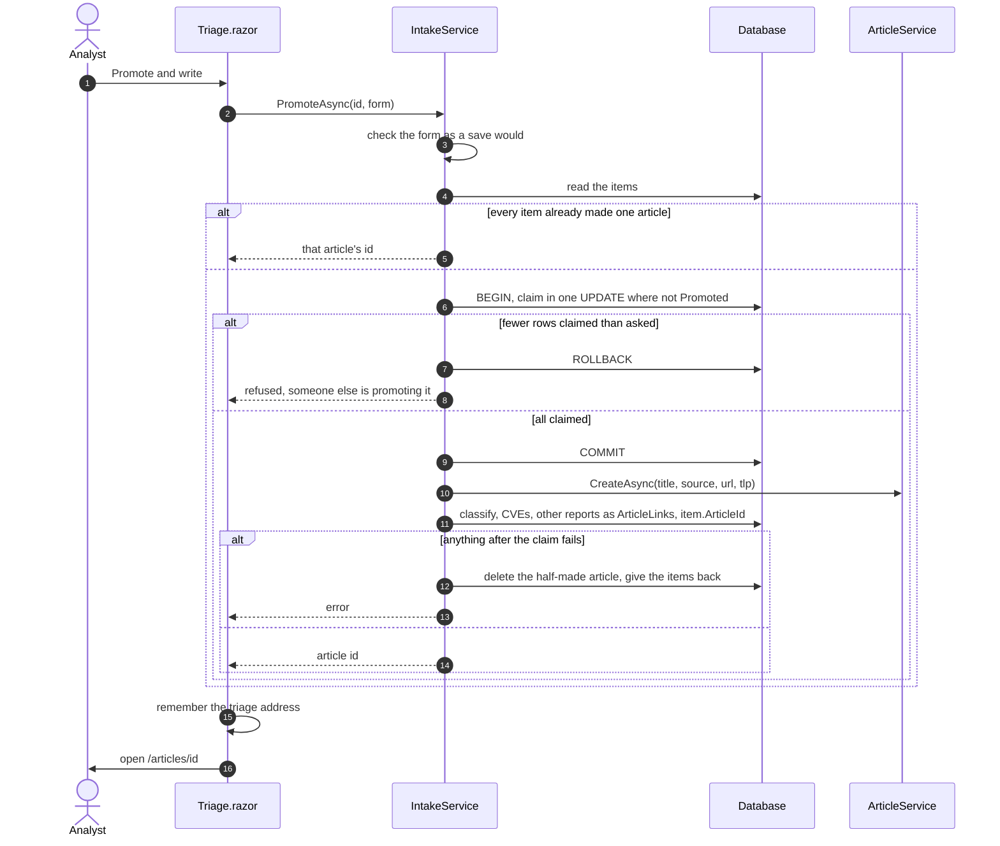
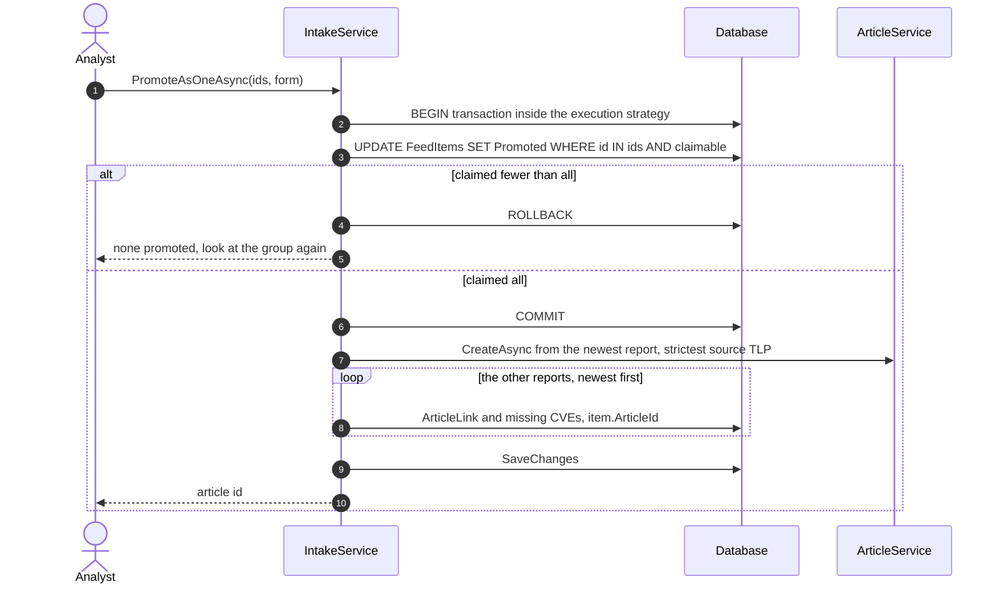

# Intake and triage

How items reach TIDE from the sources, and how the analysts decide what to do with them. It's for developers and
operators who need to know what the poller does, and for analysts who want to know why the inbox behaves as it does.
Setting up sources is on [administration.md](administration.md); the settings themselves are listed in
[operations/configuration.md](../operations/configuration.md).

**Contents**

1. [The pipeline at a glance](#the-pipeline-at-a-glance)
2. [Sources](#sources)
3. [Polling a source](#polling-a-source)
4. [What happens to each item as it comes in](#what-happens-to-each-item-as-it-comes-in)
5. [CVE enrichment](#cve-enrichment)
6. [The triage inbox](#the-triage-inbox)
7. [Triage decisions and the item lifecycle](#triage-decisions-and-the-item-lifecycle)
8. [Promoting an item](#promoting-an-item)
9. [Several reports of one event](#several-reports-of-one-event)
10. [Reading the article in triage](#reading-the-article-in-triage)
11. [Learning from the team's decisions](#learning-from-the-teams-decisions)
12. [Retention and pruning](#retention-and-pruning)
13. [Permissions](#permissions)
14. [Edge cases and the guards that handle them](#edge-cases-and-the-guards-that-handle-them)
15. [Where it lives in code](#where-it-lives-in-code)

## The pipeline at a glance

Intake is off until an administrator turns it on (`Intake:Enabled`, ADR
[0009](../decisions/0009-intake-reaches-out-only-when-asked.md)). TIDE never reaches out to the internet unless asked.

## Sources

A `Source` is one of three kinds (`SourceKind`):

| Kind | What it is | Polled? |
|---|---|---|
| `Feed` | An RSS 2.0, RSS 1.0 or Atom feed. | Yes, on its own interval. |
| `CisaKev` | The CISA Known Exploited Vulnerabilities catalog (JSON). Each newly listed CVE is an item. | Yes. |
| `Api` | Items another system proposes through the API. Made the first time a caller proposes, named "{caller} (API)". | Never. |

Each source carries what triage and drafting need from it:

| Field | Used for |
|---|---|
| `DefaultTlp` | The marking an article promoted from it starts with. |
| `Reliability` | The Admiralty grade (A to F), shown in triage. |
| `LicenseNote` | What its terms allow, shown to the analyst. |
| `PollMinutes` | Its interval (never under `Intake:MinPollMinutes`, itself never under 5). |
| `Enabled`, `IsRetired` | Paused sources aren't polled. A retired source's New items leave the inbox; a source with items is retired, never deleted. |
| `OnlyCategories`, `SkipCategories`, `OnlyTitleWords`, `SkipTitleWords` | The feed filter (`FeedFilter`). |
| `ArticleFetch`, `ArticleBodySelector`, `ArticleRemoveSelector` | Whether and how its article pages may be fetched, by the reading pane and by drafting. |
| `LastPolledAtUtc`, `LastSuccessAtUtc`, `LastError`, `ConsecutiveFailures`, `LastNewItems`, `LastFilteredOut`, `ETag`, `LastModified`, `SeenCategories` | Poll bookkeeping. Written without the audit trail. |

Administrators manage sources at Administration › Sources (`/admin/sources`), including starter sources
(`StarterSources`), and see their record at Source health (`/admin/source-health`). See [administration.md](administration.md).

## Polling a source

`IntakeHostedService` runs a pass every minute. Each pass reads its settings afresh, so turning intake or CVE
enrichment on or off takes effect at the next pass without a restart. A pass does three things in order, each reported
to `JobMonitor` for Diagnostics, and each failing on its own without stopping the others:

1. `IntakeService.PollDueAsync`: polls the sources that are due, when `Intake:Enabled`.
2. `CveService.EnrichDueAsync`: refreshes CVE data when `Cve:Enabled` and `Cve:RefreshHours` have passed.
3. Once a day, `IntakeService.PruneAsync` and `ReadingService.PruneAsync`.

A source is due when it has never been polled or when `now - LastPolledAtUtc >= Interval(source)`. The interval is
`max(MinPollMinutes, PollMinutes)` doubled for each failure in a row, up to 16 times (`IntakeService.Interval`), so a
dead feed is asked less often.

### The outbound client

Every fetch goes through `IOutboundHttp` (`Infrastructure/Notifications/OutboundHttp`): the configured proxy, a time
limit (`Intake:TimeoutSeconds`, 20), a size limit (`Intake:MaxResponseKB`, 8192), conditional GETs, a per-host back-off,
and `AddressPolicy`, which refuses loopback and link-local addresses, and private ranges unless
`Intake:AllowPrivateNetworks`. The policy is checked on each redirect hop and each connection. See
[architecture/security.md](../architecture/security.md).

### Pull now and Poll now

| | Who | Window | Where |
|---|---|---|---|
| **Pull now** (`IntakeService.PullNowAsync`) | Analysts (`WriteArticles`) | Refused within `Intake:PullNowMinutes` (15) of the source's last poll, scheduled or forced, for everyone, administrators too. The refusal (`PullTooSoonException`) says when it can be pulled again. | Triage › Sources tab |
| **Poll now** (`IntakeService.PollNowAsync`) | Administrators | No window. Works on a paused source and with intake off. | Administration › Sources |

Both are refused for an `Api` source ("there's no feed to poll") and while the same source is being polled. Pull now
is also refused for a paused or retired source. A pull is bookkeeping, like a poll, and leaves no audit row.

The Sources tab (`IntakeService.PolledSourcesAsync`) lists the polled sources: last pull ("12 min ago"), when the next is
due, how the last went (items added, or the error), and when Pull now opens again. Its tab count is the number of
sources whose last poll failed.

### One poll at a time per source

`SourcePollGuard` is a singleton holding the ids of the sources being polled (ADR
[0001](../decisions/0001-blazor-server-on-prem.md): one process). The scheduled pass skips a source being pulled by
hand. A second Pull now or Poll now on the same source is refused with "This source is being pulled now". So two
pulls never add the same items. Because it's in memory, it holds only within one server process.

### When a poll fails

Any failure is the source's own: a fetch error, a feed the parser can't read (`FormatException`), or an unexpected
exception. It's recorded in `LastError` (scrubbed by `SecretMask.Scrub`, since an exception can quote the URL and its
key), `ConsecutiveFailures` goes up by one, and the interval doubles. The other sources still run. A database that
can't be reached to record the failure leaves it unrecorded; the source is tried again next pass.

## What happens to each item as it comes in

| Step | Code | Rule |
|---|---|---|
| Parse | `FeedParser.ParseFeed`, `ParseKev`, `KevItems` | At most 200 items a fetch (`FeedParser.MaxItems`). DOCTYPE skipped unread, so a declared entity stays undeclared. A control character XML forbids becomes a space. Summaries are reduced to plain text: feed HTML is never rendered anywhere. The WordPress "The post … appeared first on …" footer is stripped. Each item keeps its own tags. A date whose day name isn't its weekday ("Mon, 07 Nov 2026") is read without the day name; a date before 1995 (the epoch a feed writes for an undated item) is no date. |
| Feed filter | `FeedFilter.For(source).Keeps` | Feeds only. With an "only" list, an item passes with an only-tag or an only-word in its title. A skip-tag or skip-word leaves it out. Tags match ignoring case; title words match as whole words. The tags the last read carried are kept in `SeenCategories` to choose from. |
| Sponsored filter | `SponsoredFilter.For(options).Match` | While `Intake:SkipSponsored` is on (the default). See below. |
| Retention cut | `IntakeService.StoreAsync` | An item published before the retention cutoff isn't taken in, so a feed that still lists a pruned item (the KEV catalog lists a year or more) doesn't bring it back as new. An item dated after the fetch is dated when it was fetched, so a wrong year can't hold it at the top of New. |
| Canonical address | `UrlCanonicalizer.Canonicalize`, `Hash` | Tracking parameters (`utm_*`, `fbclid`, `gclid` and others) removed, the remaining query sorted, a trailing slash dropped. The SHA-256 of that is `FeedItem.UrlHash`, unique. The same story from two feeds, or polled twice, is one item. |
| Repeat check | `TitleMatch.Key`, `Similarity` | The title reduced to its significant words (`TitleKey`), compared with items fetched in the last 7 days (`IntakeService.SimilarWindow`). A Jaccard similarity of 0.75 or more sets `SimilarToId` to the first match. Set once, at intake. |
| CVEs | `FeedParser.CvesIn` | CVE ids in the title and summary, comma-separated in `FeedItem.Cves` (at most 40 when the list is long). |

Items the filters leave out count toward the source's `LastFilteredOut`.

### The sponsored filter

`SponsoredFilter` leaves out an item that reads as sponsored. Its markers (`Intake:SponsoredMarkers`, default
"Sponsored; Sponsored by; Sponsored content; Sponsored post; Partner content; Paid post; Paid content; Advertorial")
and exceptions (`Intake:SponsoredExceptions`, default "state-sponsored; nation-state sponsored; government-sponsored;
regime-sponsored") are in-app settings, edited on Sources, at most 50 phrases each.

- A phrase matches as whole words, ignoring case, with hyphens, dashes and spaces treated alike.
- It's looked for in the author (RSS `<author>` or `dc:creator`, Atom `author/name`), the RSS `<source>`, any tag, the
  title, and the first 120 characters of the summary (`SponsoredFilter.SummaryStart`).
- A marker inside an exception doesn't count.
- Whatever the exceptions say, a marker starting "sponsored" doesn't count where the news names a state as the sponsor:
  joined with a hyphen or dash ("Iran-sponsored"), a state word just before ("Chinese sponsored"), or one in the next few
  words ("sponsored by Beijing's MSS").

`SponsoredLog` (a singleton) keeps, per source, how many items the last poll left out as sponsored and the first five,
with the marker and field. The Sources list shows them. A restart clears it. The Sources page has a Test box that says
whether a title or byline would be skipped and by which marker.

### Items proposed through the API

Another system (a SIEM rule, a SOAR playbook) can propose an item with an API token holding the `triage:propose` scope
(`IntakeService.ProposeAsync`). It lands in New under a source named after the caller, made the first time and never
polled. The same address twice is one item. A proposal is refused when an administrator has retired the caller's
source, or when a non-API source already has that name. See [API.md](../API.md).

## CVE enrichment

`CveService` keeps one `CveRecord` per CVE: CVSS from NVD, EPSS from FIRST, and the KEV flag, dates and ransomware
use from CISA. It runs when `Cve:Enabled`, every `Cve:RefreshHours` (24). The time of the last run is a `Settings` row,
so the schedule survives a restart. An administrator can refresh now (`CveService.EnrichNowAsync`), which makes at most
5 NVD lookups so the page isn't held. One run goes at a time (`CveRunLog.TryStart`).

Which CVEs it looks at: every CVE on an article, and every CVE on a feed item from the last 14 days.

| Step | Source | How |
|---|---|---|
| 1. KEV | `Cve:KevUrl` | The whole catalog, every run. A CVE on it is `IsKev`; one no longer on it is cleared. |
| 2. EPSS | `Cve:EpssUrl` | 100 CVEs a request, for those not checked within `RefreshHours`. |
| 3. NVD | `Cve:NvdUrl` | One CVE a request, missing ones first and then the stalest (older than 7 days), at most `Cve:MaxNvdPerRun` (40). Paced at 6.5 s without an API key, 0.7 s with one (`Cve:NvdApiKey`). |

An NVD answer for one CVE that can't be read is set aside and marked checked once the next reads fine, so it can't
block the queue. Two unreadable answers in a row, or one that isn't JSON at all (a proxy's error page), stop the run.
Pages only read `CveRecord`; nothing else writes it.

What triage does with it:

- **CVE chips** show CVSS, EPSS and KEV.
- **Suggested priority** (`CveService.SuggestedPriority`), preselected in the promote form with its reason:

  | Suggestion | When |
  |---|---|
  | P1 | Any CVE is on KEV ("on KEV", or "on KEV since Mar 2024" when listed over 30 days ago), or CVSS ≥ 9 with "exploit" in the title (not "not exploited", "no known exploit" and the like). |
  | P2 | EPSS ≥ 10%, or CVSS ≥ 9. |
  | none | Otherwise; the form's own default stands. |

- **Threat hints** (`CveService.ThreatHints`) in the editor: on KEV, or EPSS ≥ 10% when not on KEV.
- **Ageing exemption**: a New item naming a KEV-listed CVE, or one with EPSS ≥ 10% (`IntakeService.AgeExemptEpss`), never
  folds into Older.

## The triage inbox

1. The tabs (New, Shortlisted, Promoted, Dismissed, Duplicates), each with its count.
2. The filter bar (`FilterBar`): words in titles and CVEs, the pills *Since last brief* (`since=true`), *Names a CVE*
   (`cve=any`), *KEV* (`cve=kev`) and *We run it* (`named=true`), the source under *+ Filter* (`source=`, a chip
   while chosen), the *Newest* / *Likely used* order, and the count. *Names a CVE* and *KEV* are one filter, so they
   take turns.
3. The selected item: its source with its Admiralty grade, its TLP and its excerpt.
4. CVE chips: the CVSS score, the EPSS percentage and, where it applies, KEV.
5. The row's decisions: *Promote* (P), *Shortlist* (S), *Dismiss* (X) with a reason, *Attach to…* and *Add to what we run…*.
6. The reading pane (V): the article's text, read once and kept for a week, with its CVEs and indicators marked.

Triage (`/triage`, `Components/Pages/Triage.razor`) is a keyboard-driven inbox. Its tabs are the item states (New,
Shortlisted, Dismissed, Duplicate, Promoted) and, set apart at the end, Sources. The tab, filters, page and selected
row are kept in the address (`triage?tab=…&cve=kev&named=true&page=2&at=…`), so a reload or a copied link opens the
same view. The page stays open when a link changes only the query, and shows what the new address says: a pager link
its page, the sidebar's Triage the New tab, Back the tab and filters it returns to.

**Pages.** Each tab shows 50 items a page (`InboxFilter.PageSize`), with numbered pages (`Pager`) and a count ("1–50
of 213"). There's no hidden cap: every matching item is on some page. `IntakeService.InboxPageAsync` counts the matches
and cuts the page in the database wherever it can. New, *Likely used*, *Names what we run* and the KEV filter depend on
what only the app knows (ageing into Older, the Our stack matcher, the CVE records' KEV flag, the learned counts), so
for those it reads every matching item light and pages that in memory. A page past the end shows the last page, and
the address is rewritten to say so. Tab counts stay totals, and Older pages too.

`IntakeService.InboxAsync(InboxFilter)` builds each row (`InboxRow`):

| Part | What it says | How |
|---|---|---|
| Source | Name, TLP, reliability, licence note | The item's `Source`. |
| Similar | "Looks like" a recent item | `SimilarToId`. |
| Past coverage | Articles with the same CVE or link, the brief each was first on, and their open actions ("Follow-up to Thu Oct 22: A-13, A-14 open") | `CoverageAsync`: `ArticleCves`, and the canonical `SourceUrl` or `ArticleLink` of articles from the last 120 days. At most 5. `Coverage.Attachable` says whether a report can still be added. |
| Same CVE | Other New items sharing a CVE: one story from several outlets | New tab only, read over every New item, not just the page shown. |
| Group | "Looks like one event" | `TriageGroups.Find`, New and Shortlisted, over the page shown. See below. |
| We run | A product on Our stack the item names | `StackService.Matcher`. Items naming one sort first in New and never age. |
| Watching | A watched adversary profile the item names | `AdversaryService.WatchedAsync`. |
| Likely | How often the team promoted items like it | Only when sorted that way. See [learning](#learning-from-the-teams-decisions). |

Filters: source, words (matched with `LIKE` over title and CVEs, ADR
[0011](../decisions/0011-search-with-portable-like-queries.md)), "since the last brief" (`LastBriefAtAsync`: the latest
meeting held), CVEs (`InboxCves`: `Any` keeps items naming a CVE, `Kev` those naming one that TIDE's CVE records mark
KEV-listed), and *Names what we run* (`Named`: items naming a product on Our stack). They combine.

**Older.** A New item untouched for `Intake:AgeDays` (7) folds into Older: kept and searchable, out of the way. Items
naming a KEV-listed CVE, a CVE with EPSS ≥ 10%, or a product on Our stack never age. Older is a button under New, not a
state: the items are still `New`.

### Keyboard

Keys are handled by `wwwroot/js/triage.js`, which calls `Triage.OnTriageKey`. Letters work in either case and pause
while a confirmation is open or letter shortcuts are turned off (WCAG 2.1.4).

| Key | Does |
|---|---|
| J / ↓, K / ↑ | Next, previous row. J on a page's last row goes on to the next page's first; K on a page's first row goes back to the previous page's last. |
| S | Shortlist |
| X | Dismiss |
| D | Mark duplicate (of the item it looks like) |
| P | Promote (opens the promote form) |
| R | Restore to New |
| O | Open the item's link in a new tab |
| V | Read it in the side pane |
| Enter, → , ← | Open or expand a group, collapse it |
| Esc | Cancel the promote form, or close the reading pane |

### Two analysts at once

Every triage decision publishes the `triage` topic on `ChangeFeed` with who made it; a poll that brought items
publishes it too. An open inbox re-reads and shows the difference through `LiveMarks`: arrivals slide in with a "New"
marker, changed rows are highlighted, and a row a colleague took leaves a ghost line ("Sam dismissed …") before it
folds away. The tab counts tick, and one toast (`TriageNews`) sums it up. The selected row stays selected (or the next
one is, with a note). While a promote form or the attach picker is open, changes wait behind an "Updates waiting" pill.
See [architecture/collaboration.md](../architecture/collaboration.md).

## Triage decisions and the item lifecycle

Notes on the diagram:

- Any decision except promotion can be made from any state but Promoted (`IntakeService.SetAsync` excludes Promoted).
  A decision on a promoted item is refused: "That item is already an article."
- **Promoted is final** except in one case: deleting the draft article it made (`ArticleService.DeleteAsync`) puts
  each item back in New with no article.
- **Shortlisted and Promoted items are never pruned.**
- A promotion that failed after the claim gives every item back as it was (see below). A claim that never finished
  (the server stopped part way) can be taken over after 5 minutes (`IntakeService.ClaimTimeout`).

| Decision | Method | What's written |
|---|---|---|
| Shortlist | `ShortlistAsync`, `ShortlistManyAsync` (a group's "Shortlist the N", only items still New) | `Status`, `StatusByName`, `StatusAtUtc` |
| Dismiss | `DismissAsync`, `DismissManyAsync` ("dismiss the rest", only items still New) | The reason (any short text; offered: Not relevant, Already covered, Out of scope, Low quality, Paywalled) in `DismissReason` |
| Duplicate | `MarkDuplicateAsync(id, ofId)` | `DuplicateOfId`: the item named, or by default its `SimilarToId`. An item can't repeat itself. |
| Restore | `RestoreAsync` | Back to New, the stamps cleared |
| Dismiss the same story | `DismissSameCveAsync(id, shown)` | Dismisses as "Already covered" the rows shown as sharing a CVE, only those still New |

Every decision is one `ExecuteUpdate` statement whose `WHERE` clause re-checks the state as it writes. A dismissal that
lands a moment after a colleague's promotion therefore changes nothing, rather than marking the promoted item
dismissed with its article still pointing at it. **Feed items aren't audited**: who decided and when is kept on the
item itself.

## Promoting an item

Clicking a title, or pressing P, opens the inline promote form (`PromoteForm`): title, classification, priority (the
suggested one preselected, with its reason) and TLP. **Promote and write** promotes and opens the draft. Before it
navigates, `triage.js` (`remember`) rewrites the current history entry with the tab, filters and row, so Back returns to
the same place.

What the draft gets (`IntakeService.PromoteManyAsync`, then `ArticleService.CreateAsync`):

- the chosen title, or the item's (cut to the article's maximum);
- the source's name and the item's link as `SourceName` and `SourceUrl`, and its published date;
- the chosen TLP, or the source's `DefaultTlp` (for a group, the most restrictive of the sources');
- the chosen classification and priority (`Article.Classify`, so a threat's empty "why it matters" starts at AMBER);
- the item's CVEs (up to 50).

The feed summary is **not** copied into the bottom line: it's the publisher's words, easy to leave in a brief by
accident. The editor shows it beside the bottom line to rewrite from, with a button to start from it on purpose.

### Claiming the item

Two analysts promoting the same item at once make one article: the second is told who is promoting it, or, once
that's done, is sent to the same article.

## Several reports of one event

### Same CVE

New items sharing a CVE are shown as one story (`InboxRow.SameCve`, `SharedCve`). Once one is promoted or attached, the
rest can be dismissed as already covered in one click (`DismissSameCveAsync`).

### Attach to…

Any item still to decide can be kept as another report of an existing article instead of becoming a new one
(`IntakeService.AttachAsync`). The picker (`AttachTargetsAsync`) offers drafts from the last 14 days
(`BriefService.CandidateDays`), ready articles of any age, and articles on today's brief, never one already presented or
on a brief that was presented or sent.

Attaching:

- adds an `ArticleLink` (its link, title, outlet, date, who added it), unless the article already has that canonical
  address;
- copies the item's CVEs the article doesn't have, up to 50 in all, and then bumps the article's `EditVersion`, so an
  editor open on it is told rather than saving over them;
- marks the item Promoted with `ArticleId` set to that article, in one transaction with the link.

An article already presented, or on a brief that was presented or sent, is refused ("Promote this item as a follow-up
instead") unless the caller passes `evenIfPresented`. Coverage on the row says which it is (`Coverage.Attachable`).

### Looks like one event

`TriageGroups.Find` suggests groups each time the inbox loads, in New and Shortlisted, over the items shown. **It stores
no group.**

- Two items join when they were published within `Intake:GroupWindowHours` (48, 12 to 96) of each other and share a
  CVE, or at least two distinctive headline tokens of which one is a name. Distinctive means capitalised or product-like
  words and amounts (money counts by its scale, since outlets round it differently). Common words, the words every
  security headline uses (hack, breach, flaw, critical, patch…), the administrator's extra words
  (`Intake:GroupIgnoredWords`) and the publisher's own name don't count.
- Groups are connected runs of such pairs, joined tightest pair first, held to 8 items (`TriageGroups.MaxSize`).
- A group is offered only with two or more items from two or more feeds.

Triage shows a group as one line that opens to its reports' own rows. There's no "dismiss all" for a group.

**Not the same** (`IntakeService.SplitAsync`) splits a group for everyone: a `TriageSplit` row per report under one
`Batch`. Two reports sharing a batch never pair again; each can still group with others. The newest report notes who
split it, with **Undo** (`UndoSplitAsync`, deletes the batch; anyone who triages can). Both are audited and heard on
the triage topic. A report's split rows go with it when it's pruned (cascade).

**Promote as one article** (`IntakeService.PromoteAsOneAsync`, 2 to 8 reports):

Every report is claimed whole or not at all. A failure after the claim removes the article and gives every report back.

## Reading the article in triage

V opens the selected item's article in a pane beside the list (`ReadingService.ReadAsync`). It's fetched once through
`IOutboundHttp`, the body found by `Assist/ArticleText` with the source's selector, and adverts taken out
(`ArticleCleanup`: ad-slot classes and ids, `Intake:AdSelectors`, `Intake:AdLabels`, and the source's
`ArticleRemoveSelector`). CVEs, indicators and products on Our stack are marked. A source set to `ArticleFetch.Never`
isn't fetched. The AI provider is never asked: this is TIDE's own fetch.

The text is kept as a `FeedItemText` for `Intake:ReadingDays` (7), so a colleague reads it without fetching again and
the editor's "Draft from the sources" starts with it. It's for reading inside TIDE only: never sent, exported or shown
to readers. It goes with its item.

## Learning from the team's decisions

- **Likely used.** New and Shortlisted can be sorted by what the team promoted from items like each one, over the last
  90 days (`TriageLearning.WindowDays`) or as long as dismissed items are kept, with at least 3 decisions of history
  (`MinHistory`). Each row says why in counts. Items naming what we run, a watched adversary or a KEV-listed CVE stay on
  top. Nothing is trained or stored: the counts are worked out from the items still kept. The sort choice is kept in the
  browser (`triage.js` `pref`).
- **Missed this week?** (`IntakeService.MissedAsync`) Dismissed items from the last 7 days that name a KEV-listed CVE no
  article covers, or a watched adversary no recent article is tagged with, each with "Put back in New".
- **Source health** (`IntakeService.SourceHealthAsync`, administrators) shows items a week, how many were decided and
  promoted, the last promoted, and the median time to triage. A source with 10 or more items in 60 days and none
  promoted or shortlisted is suggested for pausing.

## Retention and pruning

Once a day, `IntakeService.PruneAsync` deletes items fetched more than `Intake:RetentionDays` (90, at least 7) ago that
are still New, Dismissed or Duplicate. Items that pointed at a pruned one (`SimilarToId`, `DuplicateOfId`) keep standing
with the link dropped. The delete re-checks the state as it runs, so an item a colleague promoted, attached or
shortlisted since it was read stays. Its `FeedItemText` and `TriageSplit` rows go with it (cascade).
`ReadingService.PruneAsync` drops kept texts older than `ReadingDays`.

## Permissions

| Activity | Needs | Checked in |
|---|---|---|
| Open Triage, read the inbox, decide, promote, attach, split, read in the pane, Pull now | `WriteArticles` (Analyst, Admin) | `Triage.razor` policy; `IntakeService.RequireTriage`; `ReadingService` |
| Read CVE records | `ReadTeamEdition`, or a seat in a live meeting | `CveService.GetAsync` |
| Poll now, change sources, refresh CVE data now, source health | `Administer` | `IntakeService.RequireAdmin`; `CveService.EnrichNowAsync` |
| Propose an item through the API | An API token with `triage:propose` | `Api/` and `IntakeService.ProposeAsync` |

## Edge cases and the guards that handle them

| Situation | Guard |
|---|---|
| Two analysts promote the same item at once | One-statement claim inside a transaction; the second is sent to the article or told who's promoting it. |
| A colleague dismisses an item just as you promote it | Decisions are conditional `ExecuteUpdate`s that skip Promoted items. |
| A promotion fails after the claim | The catch deletes the half-made article and restores each item's status, stamps and reason. |
| The server stops mid-promotion | The claim is stale after 5 minutes and can be taken over. |
| Attaching while a colleague promotes the same item | The attach claim checks the item isn't someone else's article, in one transaction with the link. |
| Attaching to an article open in an editor | The article's `EditVersion` moves when a CVE is added; the editor's save is refused as stale. |
| Two pulls of one source | `SourcePollGuard`; the scheduled pass skips it, a second manual pull is refused. |
| A feed with a hostile DOCTYPE or bad characters | Parsed without the DTD; bad control characters become spaces. |
| A redirect to an internal address | `AddressPolicy` is checked on every hop and connection. |
| A long-dead feed | Interval doubles per failure, up to 16 times. |
| A feed that still lists pruned items | Items published before the retention cutoff aren't taken in. |
| A feed with impossible dates | A wrong day name is ignored, a date before 1995 is no date (so the item isn't dropped as old), and a date after the fetch becomes the fetch time. |
| Two first proposals from one API caller at once | The unique source name; the loser reads the winner's source. |
| The same address proposed twice at once | The unique `UrlHash`; the second returns null. |
| An ETag longer than its column | Dropped rather than cut, so the next poll is a plain one. |
| An NVD answer that isn't JSON | The run stops with nothing marked, and the error says so. |
| An invalid setting hand-edited into the server's file | The pass logs it and tries again in a minute; the app keeps running. |
| Pruning races a promotion | The delete re-checks the state as it runs. |

## Where it lives in code

| Concern | Code |
|---|---|
| Entities | `src/Tide.Domain/Entities/Intake.cs` (`Source`, `FeedItem`, `FeedItemText`, `TriageSplit`, `Story`, `CveRecord`) |
| States and kinds | `src/Tide.Domain/Enums/AppEnums.cs` (`FeedItemStatus`, `SourceKind`, `SourceReliability`, `ArticleFetch`) |
| The pipeline, inbox, decisions, promotion, attach, splits, API proposals, pruning | `src/Tide.Application/Intake/IntakeService.cs` |
| Settings | `src/Tide.Application/Intake/IOutboundHttp.cs` (`IntakeOptions`); `src/Tide.Application/Intake/CveService.cs` (`CveOptions`) |
| Parsing, canonical URLs, title matching | `src/Tide.Application/Intake/FeedParsing.cs` (`FeedParser`, `UrlCanonicalizer`, `TitleMatch`) |
| Feed filter | `src/Tide.Application/Intake/FeedFilter.cs` |
| Sponsored filter and its log | `src/Tide.Application/Intake/SponsoredFilter.cs` (`SponsoredFilter`, `SponsoredLog`) |
| Grouping | `src/Tide.Application/Intake/TriageGroups.cs` |
| Likely used, source health, missed | `src/Tide.Application/Intake/TriageLearning.cs`; `IntakeService.SourceHealthAsync`, `MissedAsync` |
| Pull now, one poll at a time | `src/Tide.Application/Intake/SourcePulls.cs` (`SourcePollGuard`, `PolledSource`, `PullTooSoonException`) |
| Reading pane | `src/Tide.Application/Intake/ReadingService.cs`; `src/Tide.Application/Assist/ArticleText.cs`, `ArticleCleanup.cs` |
| CVE enrichment and suggestions | `src/Tide.Application/Intake/CveService.cs` |
| Promote form | `src/Tide.Application/Intake/PromoteForm.cs` |
| Background poller | `src/Tide.Web/Services/IntakeHostedService.cs` |
| Outbound client | `src/Tide.Infrastructure/Notifications/OutboundHttp.cs` |
| Triage page and keys | `src/Tide.Web/Components/Pages/Triage.razor`; `src/Tide.Web/wwwroot/js/triage.js` |
| Sources administration | `src/Tide.Web/Components/Pages/Admin/SourcesAdmin.razor`, `SourceHealthAdmin.razor` |
