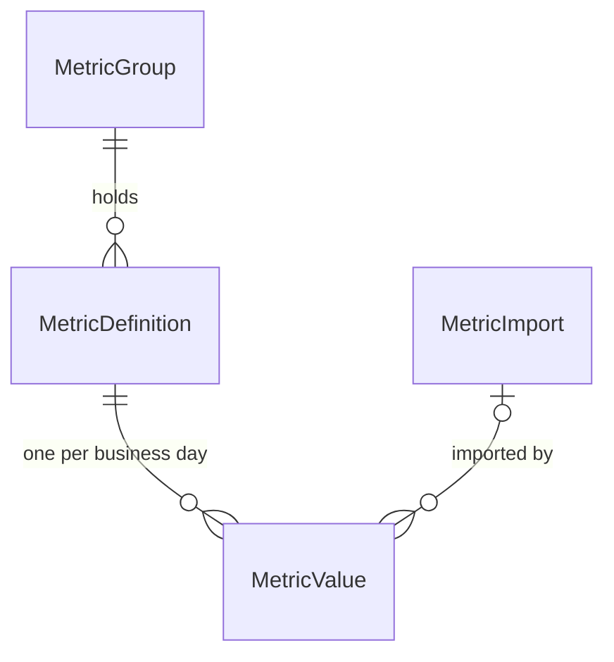
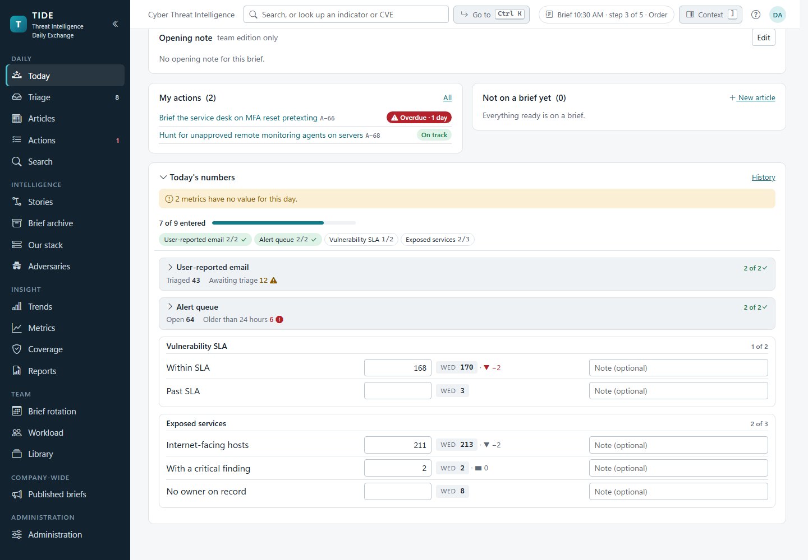
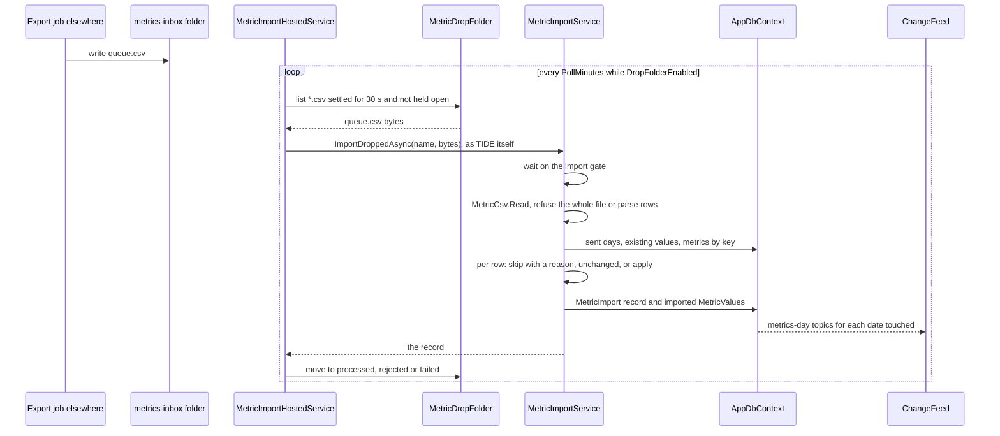
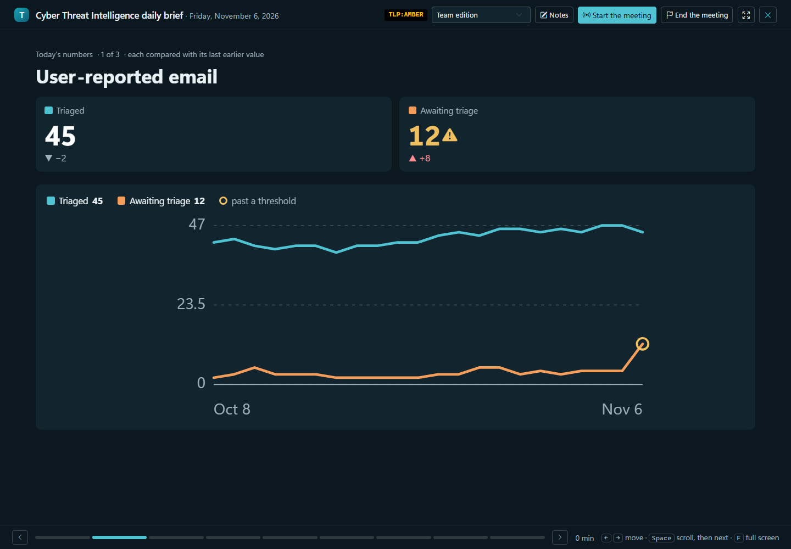
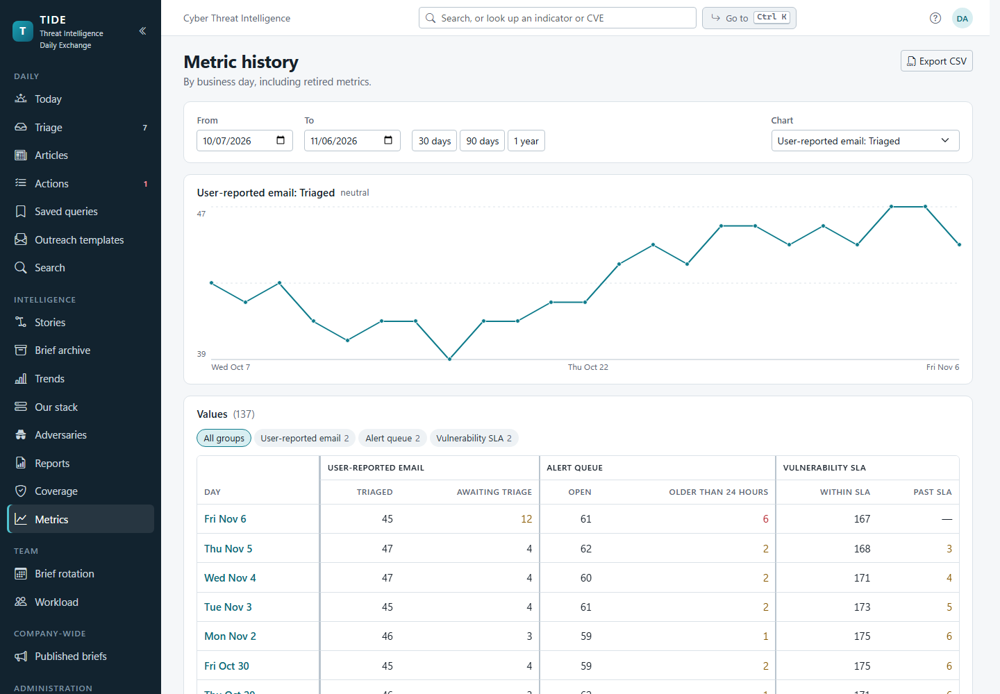
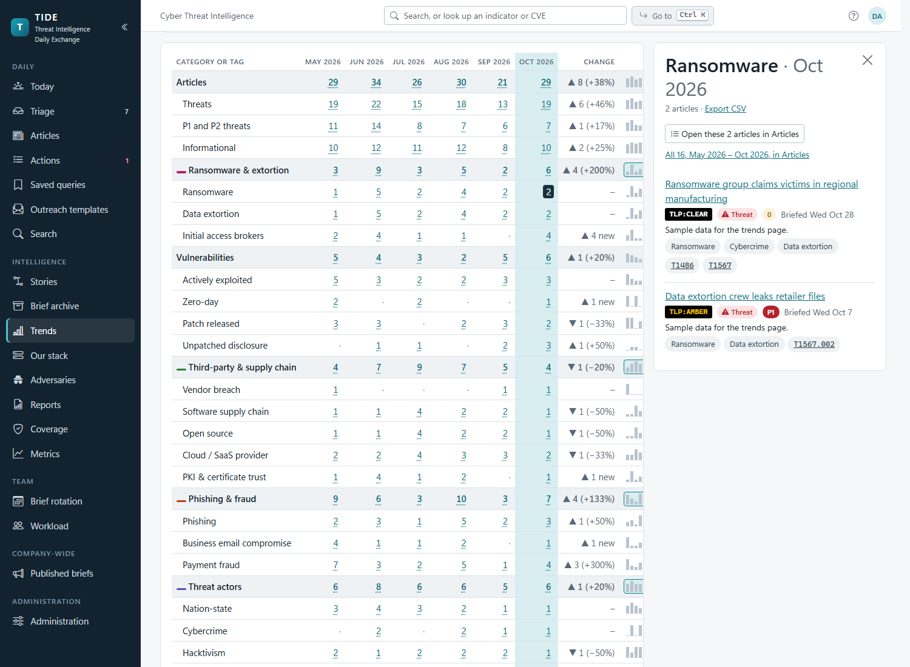

# Metrics and trends

The numbers the brief opens with, and the counts the team reports month on month: defining and entering opening
metrics, importing them from CSV (by upload or from a drop folder), locking a sent day, how they're charted in the
meeting and the email, the metrics history, threat trends, the board scorecard and the period report. It's for
developers and for the administrator who sets them up.

**Contents**
- [Opening metrics](#opening-metrics)
  - [Defining them](#defining-them)
  - [Entering the day's numbers](#entering-the-days-numbers)
  - [The comparison, thresholds and formats](#the-comparison-thresholds-and-formats)
  - [Locking a sent day](#locking-a-sent-day)
  - [Importing from CSV](#importing-from-csv)
  - [Where the numbers appear](#where-the-numbers-appear)
- [Threat trends and the board scorecard](#threat-trends-and-the-board-scorecard)
- [Reports](#reports)
- [Permissions](#permissions)
- [Edge cases](#edge-cases)
- [Where it lives in code](#where-it-lives-in-code)

Decisions: [ADR 0013](../decisions/0013-trends-count-articles-by-first-brief.md) (trends count an article once, by its
first brief), [ADR 0014](../decisions/0014-metric-values-from-csv.md) (metric values from CSV),
[ADR 0018](../decisions/0018-holidays-are-days-off-like-weekends.md) (holidays).

## Opening metrics

Many teams open the brief with a round of operational numbers. TIDE holds the team's own groups of them; nothing is
built in.

| Entity | Key fields |
|---|---|
| `MetricGroup` | `Key` (stable), `Name`, `SortOrder`, `IsRetired`, `Chart` (the slide's chart) |
| `MetricDefinition` | `Key` (stable, what a CSV names), `Name`, `Format`, `Direction`, `WarnThreshold`, `CriticalThreshold`, `FlagMissing`, `IsRetired` |
| `MetricValue` | `DefinitionId`, `BriefDate` (unique together), `Value` (decimal 18,4), `Note` (300), `EnteredById`/`Name`, `Source` (Manual or Imported), `ImportId`, `IsOverride` |
| `MetricImport` | `FileName`, `Origin` (DropFolder or Upload), `ReadAtUtc`, `Rows`, `Applied`, `Unchanged`, `Skipped`, `Rejected`, `Problems` |

### Defining them

Administration › Brief › Opening metrics (`/admin/metrics`, `MetricsService`):

- **Groups.** Add, rename (the key stays), move, retire, and pick the slide's chart (`MetricChart`: Trend, the default,
  a line per metric over 30 days; SmallMultiples; Stacked; Share, a donut; Bars; Bullet, today's value over its normal,
  warning and critical bands; None). Retiring a group none of whose metrics has a value deletes it instead.
- **Metrics.** Name, key, format (`Count` "42", `Percent` "97.5%", `Hours` "3.5 h", `Number`), direction
  (`HigherIsBetter`, `LowerIsBetter`, `Neutral`), optional warning and critical thresholds, and whether a missing value
  is flagged. A rename keeps the key and the history. Retiring keeps the values; a metric that never had a value is
  deleted instead.
- **Example set.** "Start from an example?" adds a generic set of groups (a status breakdown, a queue with an ageing
  count, an SLA split) that aren't there yet, by key, naming no product (`ImportExampleSetAsync`).

Every change publishes the `metrics` topic, so every open numbers form re-reads.

### Entering the day's numbers

On the brief's page (Today's numbers, `MetricEntry.razor`), an analyst types each value. Each box saves when it
changes (`MetricsService.SaveValueAsync`); a blank box clears the value; a box holding something that isn't a number is
marked, with why, and not saved. Before a value is typed the box shows the one it will be compared with.

- Values are kept for business days only: a weekend is refused. A holiday's value is kept if someone enters it, just not
  expected.
- Two people saving the day's first value at the same moment both find no row; the second insert hits the unique
  `(metric, day)` index, and `SaveValueAsync` reads again and saves once more as an update.
- Typing over an imported value makes it the analyst's: `Source` becomes Manual and `IsOverride` is set, so later imports
  leave it alone.
- A colleague's save re-reads the form in place (the `metrics-day:{date}` topic), keeping a box being typed in and
  saying on its row who changed it ([collaboration.md](../architecture/collaboration.md)).
- Finished groups fold to a summary line once focus leaves them (`MetricEntryProgress`), and the progress counts feed the
  brief's step strip and the Mark ready confirmation (`MetricDay.Missing`).

### The comparison, thresholds and formats

`MetricMath` holds the rules, pure and unit-tested:

| Rule | Code |
|---|---|
| A value is compared with the most recent earlier business day that has one, looking back up to 120 days. Monday compares with Friday; a holiday with no value is skipped. | `MetricMath.PreviousWithValue`, `MetricsService.LookBackDays` |
| The day compared with is named by weekday when it's the business day before, else by date ("Oct 23"). | `MetricMath.ReferenceLabel` |
| No change is grey whatever the direction; a change on a Neutral metric is grey too. | `MetricMath.TrendOf` |
| Thresholds apply in the metric's direction: Higher is better trips at or below; Lower is better and Neutral trip at or above. Critical wins over warning, and must be past warning in the metric's direction. | `MetricMath.LevelOf`, `ThresholdProblem` |
| "1,204", "97.5%", "3.5h" and "-2" all read; the decimal point is a full stop. Values beyond 10^14 are refused. | `MetricMath.TryParseValue`, `Fits` |

### Locking a sent day

Once a day's brief is Sent (by email, marked distributed, or finished as Not sent), its numbers are fixed for everyone
but administrators (`MetricsService.IsLockedAsync`), so the page agrees with what went out. A save to a locked day is
refused ("An administrator can correct them"). A box whose typing hadn't saved when the form locked is named in a
toast with what was typed. Imports never touch a sent day either. A day finished as Not sent says its fixed numbers
never went out (`FinishedNotSentAsync`).

### Importing from CSV

Values can come from CSV ([ADR 0014](../decisions/0014-metric-values-from-csv.md)): an administrator's upload on
Administration › Brief › Metric imports, or files a job elsewhere leaves in the drop folder.

**The file** (`MetricCsv.Read`): RFC 4180, UTF-8 (with or without a byte-order mark, else read as Latin-1), at most 1 MB
and 10,000 rows. The first row names the columns: `date`, `metric_key` and `value` are required, `note` is optional and
any other column is ignored, so the metrics page's own export reads back in. Each row sets one metric on one day by key
and date, so reading a file twice changes nothing.

**Per row** (`MetricImportService.ApplyAsync`), a row is skipped, with its reason recorded, when:

- the date isn't `yyyy-MM-dd`, is a weekend, or hasn't happened yet;
- no metric has the key, or it's retired;
- the value is blank or isn't a number TIDE can keep, or the note is longer than 300 characters;
- the day's brief has been sent;
- an earlier row already set that metric on that day;
- the value there was typed by a person (Manual), and differs.

A row equal to what's stored counts as unchanged. Otherwise the value is written with `Source = Imported`, the import's
id, and "Import: {file}" as who entered it. The import's record keeps the counts and the first 50 problems.

**The drop folder** (`MetricDropFolder`): `metrics-inbox` under `Files:RootPath`. When
`Metrics:Import:DropFolderEnabled` is on (an in-app setting on Metric imports), `MetricImportHostedService` reads it every
`Metrics:Import:PollMinutes` (1 to 60, default 5; both read on each pass, so a change needs no restart). Only `*.csv`
files directly in the folder are read; links, hidden and temporary files are skipped, and a file is left until it has
been unchanged for 30 seconds and no other process holds it open. Each file is imported once and moved to `processed`,
`rejected` (the whole file was refused) or `failed` (importing threw for a reason that wouldn't pass), named with the
time it was read. A file the database couldn't take (a connection fault) waits for the next pass. Moved files are
deleted after 90 days.

An upload goes the same way through `UploadAsync`, which is administrators only. `ImportDroppedAsync` refuses a
signed-in caller: only the background service reads the drop folder. Imports run one at a time in the process (a static
semaphore), and one that loses a race with a typed value on the unique index retries once.

### Where the numbers appear

| Where | What | Code |
|---|---|---|
| Present mode | A slide per group, keyed `metrics:{group key}` so a follower lands on the same group: its numbers as tiles, the day's note, over the group's chart. A group whose every metric has a value of 0 gets no slide; the first metrics slide lists it in a line. | `MetricSlides`, `MetricCharts` |
| The team email | A block at the top: each value, its change from the previous business day, and a sparkline of the last 20 business days. Never in the company-wide edition. | `MetricsService.GetDayAsync` (`SparkDays`) |
| Metrics history (`/metrics`) | A table and chart over a range (up to three years), retired metrics included; the group filter (a pill per group in the filter bar, Clear for every group) is kept in the address (`?groups=`) and hides the days only hidden groups have. CSV at `/metrics/export.csv?from=&to=`, formulas neutralised. | `MetricsService.HistoryAsync`, `ToCsv`, `MetricHistoryColumns` |
| The API | `GET /api/v1/metrics` | [API.md](../API.md) |

Missing days are gaps, never zeros. A group's trend chart plots its working days in the 30 days to the brief date, the
brief's own date, and any holiday on which one of its numbers was entered (`MetricMath.TrendDaysWithin`).

## Threat trends and the board scorecard

Trends (`/trends`, `TrendsService.ReportAsync`) counts, over consecutive weeks, months or quarters ending with a
chosen one, what the team briefed and what it did about it. Each `TrendRow` holds, for each period, the ids of the
articles or actions it counted, so every count opens to exactly what it counted, and a line that sums others counts an
article once.

**When an article counts** ([ADR 0013](../decisions/0013-trends-count-articles-by-first-brief.md)): in the period of its
first brief; one never briefed counts in the period it was written, unless it's still a draft.

| Lines | Keys |
|---|---|
| Articles | `articles:all`, `articles:threat`, `articles:p1-p2`, `articles:informational` |
| The board scorecard | `category:{key}` (a roll-up) over `tag:{key}` for each scorecard tag (retired ones only when used), and `tag:none` |
| ATT&CK | `tactic:{TA id}`, `technique:{T id}` (sub-techniques rolled up to their parent unless `subs=true`), `technique:none` |
| Actions raised | `actions:raised`, by kind (`raised-kind:`), by team (`raised-team:`) |
| Actions closed | `closed`, `done`, `on-time`, `late`, `no-due`, `cancelled` (Cancelled or Not applicable), `outcome:{outcome}` |
| Hunts | `hunted` (a result recorded), `hits`, `no-hits` |
| Backlog | `open-at-end`, `overdue-at-end` (as of today for the period still under way) |

The report also gives the share done on time and the median days to close P1 and P2 actions (`TrendOutcome`).

| Period kind | Key | Default span | Spans offered |
|---|---|---|---|
| Week (ISO, Monday to Sunday) | `2026-W44` | 8 | 8, 13, 26 |
| Month | `2026-09` | 6 | 6, 12, 24 |
| Quarter | `2026-Q3` | 5 (so the same quarter a year back is in it) | 5, 8, 12 |

The default end is the last complete period. A period still under way is marked "to date". The scorecard's
categories and tags are administered on Scorecard tags (`ScorecardService`): a tag or category in use is retired, never
deleted, so past articles keep their tags and the history holds.

**Using the page.** The page keeps its state in the address (`/trends?p=&view=&line=&at=&subs=&n=&chart=&tactic=`), so a
view can be bookmarked or sent. Chart any lines. Click a number to see what's behind it, or open the articles as a
pre-filtered Articles list (`ArticleFilter` via `TrendReport.ArticlesFilter`); opened from a tactic or technique, each row
shows the techniques it was counted for.

| Download | Endpoint |
|---|---|
| The table, every line, a column per period | `GET /trends/export.csv?p=&subs=&n=` |
| The articles one line counted in a period, with their tags, techniques and tactics | `GET /trends/articles.csv?p=&line=&subs=` |

## Reports

Reports (`/reports`, `ReportService.BuildAsync`) is the report a team lead owes for a week, a month or a quarter,
assembled from what TIDE already counts: headline numbers against the period before, the outcomes, each opening
metric over the period (last value, average, lowest, highest, days with no value, days past a threshold), the topics
and techniques briefed most, and the actions raised by team. Every number comes from `TrendsService` or `MetricsService`,
so it can't disagree with Trends or Metrics. `GET /reports/export.csv?p=` downloads it as one CSV, a row per number.

## Permissions

| Activity | Needs |
|---|---|
| Enter or clear the day's numbers | `EnterMetrics` (Analyst, Admin); on a sent day, `Administer` |
| See the numbers, the history and its export, Trends, Reports and their exports | `ReadTeamEdition` (the sidebar lists Metrics and Reports only for those who also write articles; the pages stay open) |
| Define groups and metrics, the example set | `Administer` |
| Upload a CSV, see the imports, change the drop folder settings | `Administer` |
| Read the drop folder | the background service only (a signed-in caller is refused) |
| Scorecard categories and tags | `Administer` |

## Edge cases

| Case | What happens |
|---|---|
| A number typed as the brief is sent | The save is refused; the toast names the box and what was typed. |
| A file dropped while still being written | Left until unchanged for 30 seconds and not held open. |
| The same file dropped twice | Every row is unchanged or already set; nothing changes. |
| A CSV row for a metric renamed since | Matched by key, which a rename keeps. |
| A group all zeros but one value missing | Keeps its slide: the gap is something the room should see. |
| An article first briefed in one month and again in the next | Counts once, in the first. |
| A trend line's article later deleted | It drops out of the counts; Trends reads live data. |

## Where it lives in code

| Concern | Code |
|---|---|
| Entities | `src/Tide.Domain/Entities/Metrics.cs`; enums in `src/Tide.Domain/Enums/AppEnums.cs` (`MetricDirection`, `MetricFormat`, `MetricChart`, `MetricSource`, `MetricImportOrigin`) |
| Defining and entering | `src/Tide.Application/Metrics/MetricsService.cs` (`SaveValueAsync`, `IsLockedAsync`, `GetDayAsync`, `HistoryAsync`, `ToCsv`) |
| Rules | `src/Tide.Application/Metrics/MetricMath.cs` |
| Slides and charts | `src/Tide.Application/Metrics/MetricSlides.cs`, `MetricCharts.cs` |
| Entry form progress, history columns | `src/Tide.Application/Metrics/MetricEntryProgress.cs`, `MetricHistoryColumns.cs` |
| CSV and import | `src/Tide.Application/Metrics/MetricCsv.cs`, `MetricImportService.cs` (`MetricImportOptions`) |
| Drop folder | `src/Tide.Infrastructure/Storage/MetricDropFolder.cs`, `src/Tide.Web/Services/MetricImportHostedService.cs` |
| Trends | `src/Tide.Application/Trends/TrendsService.cs`, `Period.cs`, `TrendChart.cs` |
| Reports | `src/Tide.Application/Trends/ReportService.cs` |
| Scorecard | `src/Tide.Application/Scorecard/ScorecardService.cs`, `ScorecardTagSearch.cs` |
| Pages | `src/Tide.Web/Components/Shared/MetricEntry.razor`, `Pages/MetricsHistory.razor`, `Pages/Trends.razor`, `Pages/Reports.razor`, `Pages/Admin/MetricsAdmin.razor`, `Pages/Admin/MetricImportsAdmin.razor`, `Pages/Admin/ScorecardAdmin.razor` |
| Export endpoints | `src/Tide.Web/Program.cs` (`/metrics/export.csv`, `/trends/export.csv`, `/trends/articles.csv`, `/reports/export.csv`) |
