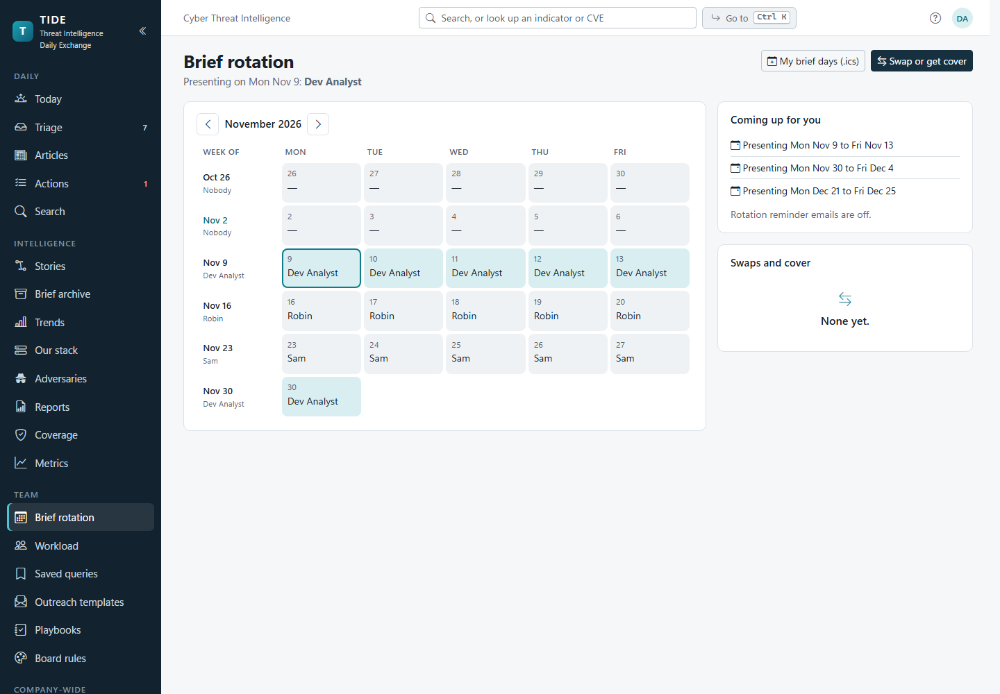
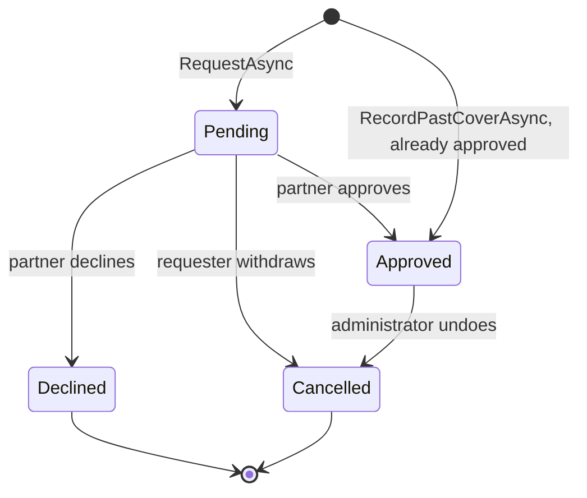
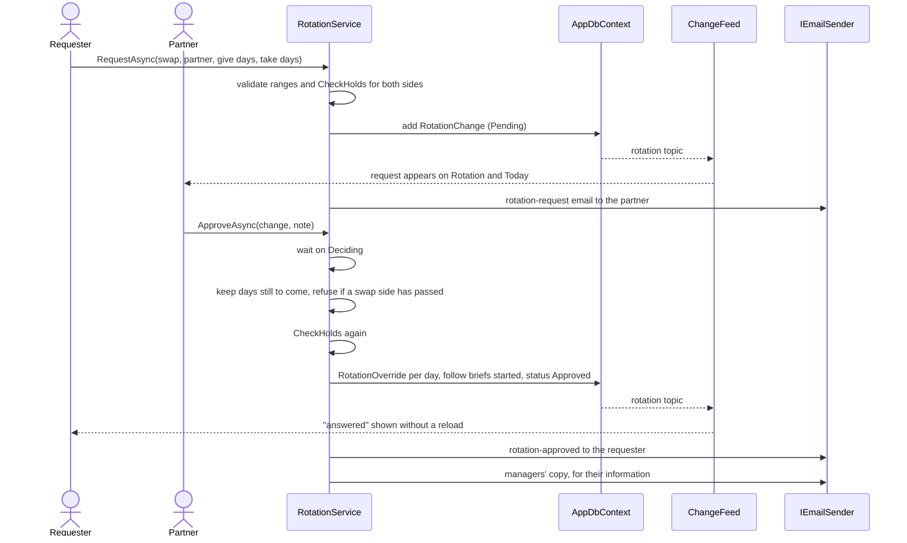

# Brief rotation

Who presents the daily brief, and how analysts swap or cover days. This page covers the weekly rota, day-level
changes, the approval rule, what happens to a brief already started when its day changes hands, the emails, and the
administrator's side. It's for developers and administrators. It's the brief rotation, not an on-call schedule.

**Contents**
- [The model](#the-model)
- [Who presents a day](#who-presents-a-day)
- [Asking for a swap or cover](#asking-for-a-swap-or-cover)
- [Deciding: approve, decline, withdraw, undo](#deciding-approve-decline-withdraw-undo)
- [A brief already started for a day that moves](#a-brief-already-started-for-a-day-that-moves)
- [Recording a past day's cover](#recording-a-past-days-cover)
- [Coming up for you, the calendar file and reminders](#coming-up-for-you-the-calendar-file-and-reminders)
- [Administering the rotation](#administering-the-rotation)
- [Permissions](#permissions)
- [Edge cases](#edge-cases)
- [Where it lives in code](#where-it-lives-in-code)

Decision: [ADR 0010](../decisions/0010-rotation-changes-approved-by-the-colleague.md) (changes are approved by the
colleague, and the manager is told). Holidays: [ADR 0018](../decisions/0018-holidays-are-days-off-like-weekends.md).

## The model

| Entity | Holds |
|---|---|
| `RotationMember` | An analyst in the rotation, their place in the roster (`SortOrder`) and whether they're active. |
| `RotationWeek` | Who presents a week (Monday to Friday), keyed by its Monday. |
| `RotationChange` | A request: a cover (the requester's days `GiveFrom`–`GiveTo` go to the partner) or a swap (also the partner's days `TakeFrom`–`TakeTo` go to the requester), a note, a status, who asked and who decided. |
| `RotationOverride` | One business day whose presenter differs from the week's, written when a change is approved, pointing at that change (`ChangeId`); or, with no `ChangeId`, a day kept for whoever presented it when its week was given to someone else afterwards (below). |

All four are in `src/Tide.Domain/Entities/Rotation.cs`. A request moves at most 20 business days
(`RotationService.MaxRequestDays`).

## Who presents a day

A day's presenter is its override, else its week's analyst (`RotationService.DaysAsync`). Only working days count:
weekends and holidays have no presenter (`RotationService.BusinessDays` over `OrgClock.Days`). Consecutive working days
with one analyst are a run (`Runs`); a weekend or holiday doesn't break a run.

`IPresenterLookup.PresenterAsync` answers "who presents this day" for:

- `BriefService`, which names the presenter of a new brief;
- `ReminderService`'s brief-not-ready nudge (when there's no brief yet) and its "presenting next" reminder.

## Asking for a swap or cover

On the Brief rotation page (`/rotation`) an analyst fills in the request form: cover or swap, the colleague, the days
given, for a swap the days taken in return, and an optional note (500 characters). *Send the request* calls
`RotationService.RequestAsync`, which checks:

- the requester and the partner are both in the rotation, the partner is active, and they're different people;
- each range is in the future, has at least one business day and at most 20;
- for a swap, the days given and taken don't overlap;
- the requester presents every day they give, and for a swap the partner presents every day they give back
  (`CheckHolds`, against the current calendar, overrides included).

The change is saved as Pending and the partner is emailed the "Swap or cover request" template. The request shows at
once for the colleague (the page and Today's "Coming up for you" follow the `rotation` topic). When the colleague
answers, the requester's open rotation page or Today says so in a toast: "… approved your request" or "… declined your
request".

An administrator can name another analyst as the requester ("arrange cover"); the colleague still approves.

## Deciding: approve, decline, withdraw, undo

`Cancelled` is the stored status for both a withdrawn request and an undone change. The history (the change's row and
the audit log) says which.

| Step | Who | Service | What it changes | Email |
|---|---|---|---|---|
| Approve | the partner only | `ApproveAsync` | narrows the request to days still to come, rechecks who holds them, writes or rewrites one `RotationOverride` per day, moves briefs already started (below), status Approved | "approved" to the requester (and whoever made the request), and a copy to the managers |
| Decline | the partner only | `DeclineAsync` | status Declined, with the optional note | "declined" to the requester and whoever made it |
| Withdraw | the requester, whoever made it, or an administrator | `CancelAsync` on a Pending change | status Cancelled | none |
| Undo | an administrator | `CancelAsync` on an Approved change | days still to come go back (below), status Cancelled | none |

**Approved late.** If some days have passed when the partner approves, only the days still to come change hands; a past
day stays with whoever the rota showed. Today counts as passed once its meeting has been held (its brief presented, sent,
or held and put back to ready): the brief already says who presented it. A swap needs days to come on both sides, or it's refused ("One side of this
swap has passed"). A request whose days have all become holidays is refused too. Either way the partner is asked to
decline and ask again.

**Undo.** Each day the change still holds goes back to the latest other approved change that covers it (this one may
have been layered on another), else the override is removed and the week's analyst presents. Past days stay, and so
does today once its meeting has been held. An approved change whose days have all passed can't be undone, and the
rotation page offers Undo only for a change the service would still undo (`RotationService.UndoableAsync`).

**One decision at a time.** Approve, decline, withdraw, undo and record-past-cover hold a static semaphore
(`RotationService.Deciding`) so two decisions can't both read the calendar and both write it. That lock is per process
(see [collaboration.md](../architecture/collaboration.md#the-single-process-constraint)).

## A brief already started for a day that moves

Carry-over can start the next day's brief early, so a brief may exist for a day whose presenter changes.
`RotationService.FollowAsync` runs inside the approve, undo and record steps: a Draft or Ready brief for a day still to
come whose presenter is still whoever held the day takes the new presenter, and its `EditVersion` moves. It's left alone
when:

- its presenter was set by hand to someone else;
- the day has passed;
- its meeting was held. Back to ready clears the meeting's times, so "held" is read from what a reopen keeps: an
  attendee, a meeting note, or `PresentedAtUtc` in the brief's audit trail (`HeldAsync`).

## Recording a past day's cover

A past day's brief is presented by whoever starts it. When the rota named someone else, the brief page offers to record
it (`RotationService.RecordPastCoverAsync`, called from `BriefPage.RecordCover`). It writes an already-approved cover
from the rota's analyst to the brief's presenter for that one day, with the note "Recorded after the fact from the
day's brief", and an override. The brief is the evidence, so there's nothing to approve. The brief's presenter, the
rota's analyst or an administrator may record it; the other analyst and the managers get the "Past cover recorded"
email. Nothing is written when the two already match.

## Coming up for you, the calendar file and reminders

- **Coming up for you** (Today and the rotation page, `UpcomingAsync`): the person's runs over the next 70 days, the
  requests waiting for them to decide, and their own requests still pending.
- **Calendar file.** `/rotation/my.ics` (`MyCalendarAsync`) is the signed-in person's brief days over the next six
  months as an iCalendar file, one all-day event per run, written by the minimal `Ics` writer.
- **Presenting next.** The reminder scan emails whoever presents the next business day and doesn't today, once per run,
  at the reminder time ([actions-and-hunting.md](actions-and-hunting.md#reminders-and-digests)).
- **Brief not ready.** At its time on a business day, before the meeting, the brief's analyst (or the rota's presenter
  when there's no brief) is nudged; the fallback recipients get it when there's nobody to nudge.

People turn the rotation's emails off on My notifications: `notify.rotationRequests` (requests and the approved,
recorded and declined notices) and `notify.rotationReminders` (presenting next and brief not ready). The managers'
copy goes to configured addresses, not people, so no one's opt-out removes it.

## Administering the rotation

Administration › Organization › Brief rotation (`/admin/rotation`, `RotationAdmin.razor`):

| Section | What it does | Service |
|---|---|---|
| Roster | Add an analyst (from the user directory), take one out (`IsActive` false: past and assigned weeks stay), move up or down | `AddMemberAsync`, `SetMemberActiveAsync`, `MoveMemberAsync` |
| Managers to notify | Addresses told of every approved and recorded change (`Rotation:ManagerEmails`, a `Settings` row, 4,000 characters) | `SaveManagerEmailsAsync` |
| Weekly rota | Set or clear a week's analyst; *fill* the next 1 to 52 empty weeks in roster order, carrying on after whoever had the last assigned week; *Correct past days* to change days already presented too | `SetWeekAsync`, `GenerateAsync` |

**Days already presented keep their presenter.** Giving a week to someone else (or clearing it) changes only the days
whose meeting hasn't been held. A day whose brief was presented or sent, or held and put back to ready (the same test
as an approval or an undo uses, `RotationService.HeldAsync`), keeps whoever presented it: `SetWeekAsync` writes a
`RotationOverride` with no `ChangeId` for it, and the calendar shows that analyst on the day, not as cover. The page
then says which days were kept, for whom and why ("Kept Sam on Mon Nov 2, Tue Nov 3: those days' briefs were already
presented"). Giving the week back to that analyst drops the kept days, since the week says so again. A day an approved
change moved stays with the change either way.

To change a presented day as well, an administrator ticks **Correct past days** and sets the week again. That's one
deliberate step: the box clears after the change. The kept days follow the week, the page names the days corrected,
and besides the week's own audit row an entry on `RotationWeek` records "Presented days corrected: …" with the old and
new analyst. Only the rota changes; each brief still names who presented it.

Every write publishes the `rotation` topic and is audited. The wording of the four rotation emails is set on Email
templates ([administration.md](administration.md#email-templates)).

## Permissions

| Activity | Needs |
|---|---|
| See the rotation, the calendar, Coming up for you, the `.ics` file | `ReadTeamEdition` |
| Ask for a swap or cover for yourself | `WriteArticles`, and being in the rotation |
| Ask on someone else's behalf | `Administer` |
| Approve or decline | being the partner named on the request (nobody else, administrators included) |
| Withdraw a pending request | the requester, whoever made it, or `Administer` |
| Undo an approved change | `Administer` |
| Record a past day's cover | `WriteArticles`, and being the brief's presenter, the rota's analyst, or an administrator |
| Roster, rota, manager addresses | `Administer` |

## Edge cases

| Case | What happens |
|---|---|
| Two changes approved at once over the same days | `Deciding` serializes them; the second rechecks who holds the days and is refused if the first moved them. |
| A holiday added inside a pending request | The day drops out (holidays have no presenter); a request left with no days is refused on approval. |
| The partner leaves the rotation before deciding | They can still decide; a new request can't name an inactive partner. |
| A swap partly in the past | Approval refuses it; decline and ask again. |
| The requester's days moved by another change meanwhile | Approval's `CheckHolds` refuses it, naming the days. |
| An email fails to send | The change stands; sending is after the save. |
| Two load-balanced servers | The semaphore doesn't span them, and the `rotation` topic reaches only the server's own pages. TIDE runs as one process ([ADR 0001](../decisions/0001-blazor-server-on-prem.md)). |

## Where it lives in code

| Concern | Code |
|---|---|
| Entities | `src/Tide.Domain/Entities/Rotation.cs` (`RotationMember`, `RotationWeek`, `RotationChange`, `RotationOverride`) |
| Kinds and statuses | `src/Tide.Domain/Enums/AppEnums.cs` (`RotationChangeKind`, `RotationChangeStatus`) |
| Service | `src/Tide.Application/Rotation/RotationService.cs` (`RequestAsync`, `ApproveAsync`, `DeclineAsync`, `CancelAsync`, `RecordPastCoverAsync`, `FollowAsync`, `HeldAsync`, `GenerateAsync`, `MyCalendarAsync`, `Ics`) |
| Presenter lookup | `IPresenterLookup` in the same file; used by `BriefService` and `ReminderService` |
| Email wording | `src/Tide.Application/Distribution/EmailTemplates.cs` (`RotationRequest`, `RotationApproved`, `RotationRecorded`, `RotationDeclined`, `Presenting`, `BriefNotReady`) |
| Pages | `src/Tide.Web/Components/Pages/RotationPage.razor`, `Admin/RotationAdmin.razor`; the calendar endpoint in `src/Tide.Web/Program.cs` (`/rotation/my.ics`) |
| Past cover from a brief | `src/Tide.Web/Components/Pages/BriefPage.razor` (`RecordCover`) |
