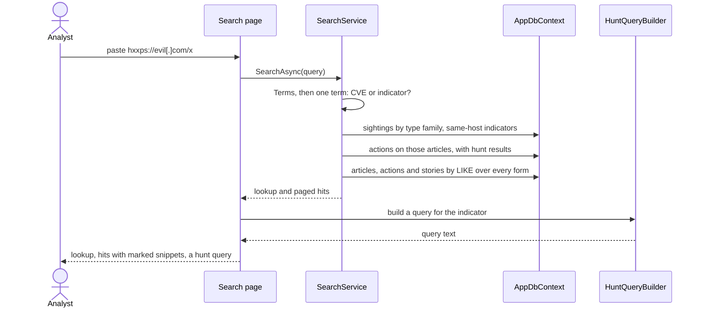
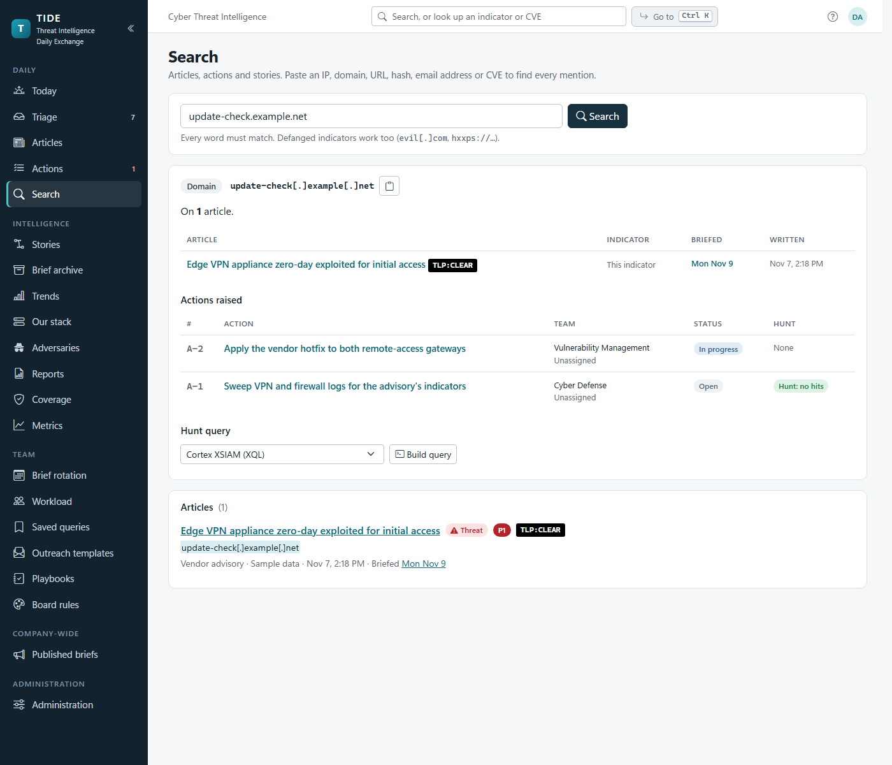
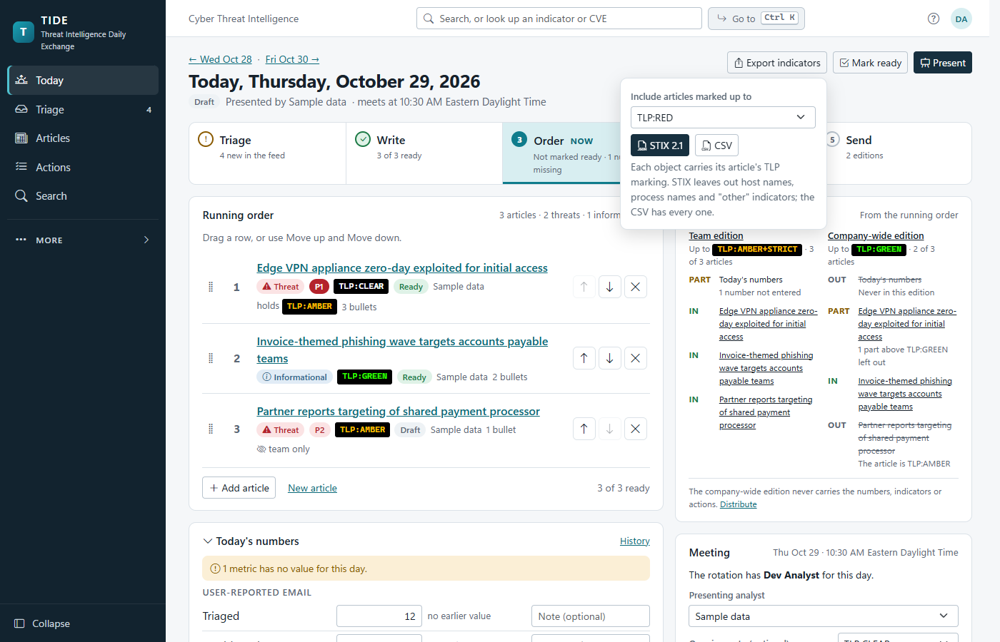

# Search, exports, stories, adversaries, coverage and Our stack

The team's intelligence memory: finding anything already written (search and indicator lookup, the editor's Similar
articles), getting indicators out (STIX 2.1 and CSV), threading articles into stories, adversary profiles and the
ATT&CK import, detection coverage against the SOC's rules, and Our stack, the products the organization runs. It's for
developers and for analysts who want to know exactly what matches and what leaves.

**Contents**
- [Search and indicator lookup](#search-and-indicator-lookup)
- [Similar articles](#similar-articles)
- [Indicator exports](#indicator-exports)
- [Threat stories](#threat-stories)
- [Adversary profiles](#adversary-profiles)
- [Detection coverage](#detection-coverage)
- [Our stack](#our-stack)
- [The tag pickers](#the-tag-pickers)
- [Permissions](#permissions)
- [Edge cases](#edge-cases)
- [Where it lives in code](#where-it-lives-in-code)

Decisions: [ADR 0011](../decisions/0011-search-with-portable-like-queries.md) (search uses portable LIKE queries),
[ADR 0012](../decisions/0012-exports-carry-tlp-and-stable-ids.md) (exports carry TLP and stable ids),
[ADR 0017](../decisions/0017-detection-rules-are-referenced-and-tagged.md) (detection rules are referenced and tagged).
How editions cut by TLP is in [editions-and-tlp.md](../architecture/editions-and-tlp.md).

## Search and indicator lookup

One box at the top of every page (`TopSearch.razor`) opens `/search?q=`. Search is open to the team edition and shows
every TLP, as the article pages do; Readers have the published archive's own filter instead.

**How a query matches** (`SearchService.SearchAsync`, `SearchText`):

1. The query is split into terms (`SearchText.Terms`): words or "quoted phrases", at least two characters each, without
   repeats. A lone digit is kept as the number of one of the first nine actions, and then only actions are searched.
2. Every term must match one of an entity's fields. Matching is `LIKE '%term%'` with `%`, `_`, `[` and `\` escaped, so
   it runs the same on SQLite and SQL Server with no full-text index to install
   ([ADR 0011](../decisions/0011-search-with-portable-like-queries.md)).
3. A network indicator is looked for both live and defanged (`SearchText.Forms`): `evil[.]com` finds `evil.com` and the
   other way round.
4. A term of four characters or more that names ATT&CK techniques ("phishing", "T1566") also finds articles tagged with
   them (`AttackCatalog.Search`), and one that names an adversary profile or alias finds articles tagged with it.

| Hits | Fields searched | Order |
|---|---|---|
| Articles | title, bottom line, why it matters, recommended actions, the earlier actors note, sectors, source name, bullets, indicators and their notes, CVEs, technique ids, screenshot captions | title matches first, among the newest 1,000 matches |
| Actions | title, description, outcome note, ticket, assignee, comments; `A-12` or `12` by number | open first, then newest |
| Stories | name, summary | by status, then newest |

Each kind is paged 50 at a time (`SearchPages`), up to 1,000 deep. Each hit has a snippet with the matches marked
(`SearchText.Snippet`, `Mark`); an indicator in a snippet is shown defanged, so a snippet never carries a live link.

**Lookup.** When the whole query is one indicator (`IocObservable.DetectType`) or one CVE, the page also shows a
lookup above the hits:

| Query | The lookup shows |
|---|---|
| An IP, domain, URL, hash or email address (defanged or not) | every article carrying it (exact, case-insensitive, on the stored live value in its type family) and when it was briefed; indicators on the same host (`SearchText.HostOf`: subdomains, URLs and email addresses on the domain, a URL's domain); the actions raised from those articles with how their hunts went; a ready hunt query from `HuntQueryBuilder` |
| A CVE | its `CveRecord` (CVSS, EPSS, KEV), how many articles are about it, and the actions raised from them |

**Go to** (`Ctrl+K`, `CommandPalette.razor`) is separate: it jumps to a page, starts an article or action, or opens one
by title or number. It lists an action it found only for someone who may read actions (`ReadActions`), as the search
page links them (`PaletteEntries.FromSearch`). `?` lists the page's keyboard shortcuts.

## Similar articles

The article editor's Similar articles (folded under the threat story, `RelatedPanel.razor`) asks
`RelatedService.ForArticleAsync`. It lists other articles that share a CVE, a link (the source or another report,
compared as stored and canonical) or the story, newest first and at most five, with a search for the rest. Each shows
why it's related, the briefs it was on, its story, and its open actions with how late they are. It reuses Search's
queries (`Search/Lookups`). "Mention" puts an action's number and "(open)" into "why it matters", and only when that
part is TLP:AMBER or higher, since action status is internal. Open to the team edition, like Search.

## Indicator exports

The indicators of an article, a day's brief (in running order) or a story download as STIX 2.1 or CSV
(`ExportIndicators.razor` on the article editor, the brief page and a story's page). The user picks the highest TLP to
include.

`GET /exports/{article|brief|story}/{key}?format=stix|csv&tlp=` (the key is the article's or story's id, or the
brief's `yyyy-MM-dd`; `tlp` defaults to RED, every level):

1. `ExportService.GatherAsync` loads the articles with their indicators, CVEs and techniques and leaves out every article
   whose TLP is above the ceiling, whole, as the editions do.
2. **STIX** (`Stix.Write`): a bundle with an `identity` for the team, a `report` per article (`report--{article id}`),
   and the `indicator`, `vulnerability` and `attack-pattern` objects the reports point at. Those ids are UUIDv5s of what
   the object is (`Stix.Uuid5`), so the same indicator has the same id in every export and a platform merges
   re-imports. Each object carries the OASIS TLP 2.0 marking-definition id of its article; an object on several
   articles takes the highest. An indicator kind STIX has no clean observable for (a host name, a process, a hash of no
   known length, "other") goes in the CSV only.
3. **CSV** (`IndicatorCsv.Write`): a row per indicator per article: `type, value, defanged, note, tlp, article,
   article_url, source_url, written_utc, briefed, cves, techniques`, cells that a spreadsheet would read as a formula
   neutralised (`Csv.Cell`).

The file is named `tide-{article-slug|brief-date|story-slug}-{tlp}.stix.json` or `.csv`. Like every export endpoint it
needs `ReadTeamEdition`, is rate-limited and is sent `private, no-store` (`ExportEndpoints.AsExport`). Detection rule
names and counts never appear in an export.

## Threat stories

A `Story` threads articles across days: a campaign, a vulnerability being exploited, an actor followed over weeks.
Articles point at it (`Article.StoryId`). `StoryService`:

- **Stories list** (`/stories`): each story's status (Active, Monitoring, Closed), article count and last article.
- **A story's page** (`/stories/{id}`): the timeline of its articles oldest first, the CVEs, actors and techniques they
  add up to, when each was briefed, the actions, and the export.
- **Joining.** The editor's story picker offers at most eight: with nothing typed, the open stories that had an
  article most recently; with words, every story whose name holds them, open ones first (`StoryService` pick list).
  Similar articles suggests the story of a related article.
- **Deleting** a story is allowed only with no articles (one with articles is closed instead). Linking and deleting
  run in a serializable transaction, so an article linked as its story is deleted is refused rather than silently
  unlinked.
- A hunt can be generated from every article in the story
  ([actions-and-hunting.md](actions-and-hunting.md#hunt-queries)).

## Adversary profiles

Intelligence › Adversaries (`/adversaries`) keeps one profile per threat actor or campaign under every name it goes
by (`Adversary`: name, kind, aliases separated by semicolons, MITRE id `G1234` or `C1234`, motivation, sectors, notes in
Markdown kept internal, watched, retired, merged into).

**A profile's page** (`AdversaryService.GetAsync`):

- a timeline of the articles tagged with it **or naming it** (in the title, the earlier actors note or the start of the
  bottom line, as whole words), with their actions and indicators, and how many briefs it was in this quarter;
- the ATT&CK techniques across those articles, darker where more articles show them, downloadable as an ATT&CK Navigator
  layer scored by count (`GET /adversaries/{id}/navigator.json`, `NavigatorLayerAsync`). With detection rules imported,
  each technique is also coloured by whether a current, enabled rule is tagged with it;
- the articles that name it but aren't tagged, for an analyst to check and tag (`LinkAsync`). Nothing is linked
  automatically.

**Changing profiles** (analysts, `WriteArticles`): save (a name no other live profile uses), add by name from the
picker (`AddByNameAsync`), watch (triage marks items naming a watched profile), retire or bring back, and merge one into
another (`MergeAsync`: its tags move, its name and aliases become the other's aliases, and it's retired pointing at
it). A merge, a tag and a link each run in one serializable transaction, so a colleague tagging an article with the old
profile while it merges waits, and the tag lands on the profile it was merged into; a tag or link from a page still
showing a merged profile goes there too. A profile's form opened before a colleague's save, a merge into it, watching it
or a MITRE import that added its names is refused on save ("Someone else changed … since you opened it"), so the merged
names aren't saved away.

**Live.** The list and a profile's page follow the `adversaries` topic (a profile changed, or an article tagged with
one or untagged), and re-read in place. A profile's form keeps what's typed in it, and one not touched takes a
colleague's change; when a colleague changes the profile someone has typed into, the form says who
(`ChangedElsewhere`, with Reload), and saving it is refused by the profile's `EditVersion`.

**The earlier actors note.** `Article.Actors` was a free-text box before the picker. It's kept and no longer written.
`AdversaryService.ForArticleAsync` splits it on commas and semicolons: a name a live profile goes by is offered as a
one-click tag (`FromNote`); a name of a profile the article is already tagged with is covered by that tag; the rest
(`Leftover`) shows as "Earlier note" until `ClearEarlierNoteAsync` drops it.

**Importing MITRE ATT&CK's groups and campaigns.** On the Adversaries page, *Fetch from MITRE* fetches Enterprise
ATT&CK's groups and campaigns from MITRE's TAXII 2.1 server through intake's guarded outbound client
(`ImportFromMitreAsync`). A server with no internet uploads a saved copy instead (the TAXII server's answer, or
`enterprise-attack.json` from the attack-stix-data repository; `ImportMitreAsync`). A profile
with the same MITRE id, name or alias gains the names it lacks; any other is added, not watched. Revoked and deprecated
objects are skipped; notes, motivation and sectors are never touched.

The technique catalogue itself (ATT&CK Enterprise v19.1) is embedded data in `src/Tide.Application/Mitre/`; refreshing
it is described in that folder's `README.md`.

## Detection coverage

Intelligence › Coverage (`/coverage`, `DetectionService.CoverageAsync`, analysts only) compares the ATT&CK techniques
on articles first briefed in the last 90 days with the SOC's detection rules. "Covered" means a current, enabled rule
is **tagged** with the technique, its parent or one of its sub-techniques (`DetectionService.Covers`). TIDE keeps each
rule's name, id, technique tags, platform and enabled flag; it never reads, stores or runs a query
([ADR 0017](../decisions/0017-detection-rules-are-referenced-and-tagged.md)).

**Rules get in** two ways:

| Way | Who | Code |
|---|---|---|
| Upload on Administration › Intelligence › Detection rules: a Sentinel analytics-rules export (ARM JSON), Sigma YAML (a file or a zip of a folder), or a CSV of name, techniques, platform and enabled | `Administer` | `DetectionService.ImportAsync`, `DetectionParsers` |
| Pushed by another tool through the API (`detections:write`): the caller's full set, replacing its last push | an API token | `DetectionService.PushAsync`, [API.md](../API.md) |

An upload adds new rules and refreshes known ones by their id in the source; the source's rules missing from the file
are kept but no longer count. Each API caller's rules are a set of their own; a set unpushed for 30 days is marked
quiet but still counts until its token can't push again. An administrator can remove a caller's set
(`RemoveCallerAsync`).

**The page.** Gaps first: techniques with no enabled rule, those a watched adversary uses at the top, each with how many
articles showed it. *Raise action* (`DetectionService.RaiseAsync`) opens a Config change action titled "Detection gap:
{technique}" for the chosen team, P2 when a watched adversary uses it and P3 otherwise, linked to the latest article that
shows it, and remembers it on the row (`DetectionGap`) until it's closed. A second one is refused while the first is
open. A team at its active limit that warns asks why first (`OverLimitDialog`, the reason going in the action's
history), as raising any action does; one that refuses refuses. The editor's technique chips and a profile's techniques say "2 rules", "1 disabled" or "no rule". Rule names and
counts never reach an edition, an export or a webhook.

## Our stack

Intelligence › Our stack (`/stack`, `StackService`) lists the products the organization runs (`StackProduct`: name,
other names it's reported under, versions, notes, owning team, vendor contact name and email, when last checked,
retired). Analysts keep it; the team edition reads it.

- **Matching.** Triage and the editor mark products named in an item or article (`StackService.MatchAll` over each
  product's names, `StackEntry`). An article is tagged with products through the We run picker (`ArticleProduct`).
- **A product's page** (`GetAsync`) lists the articles tagged with it and the actions raised from them, but names only
  articles at or below the team edition's ceiling and counts the rest ("2 articles above TLP:AMBER"). Present mode's
  product card (`CardAsync`) follows the same rule. The list's counts name no titles, so they count every article.
- **Outreach.** A product's contact is offered on an Outreach action's To line
  ([actions-and-hunting.md](actions-and-hunting.md#outreach)).
- **Live.** The list and a product's page follow the `stack` topic; a product's edit form keeps what's typed in it and
  one not touched takes a colleague's change. When a colleague saves the product someone has typed into, the form says
  who (`ChangedElsewhere`, with Reload), and saving it is refused by the product's `EditVersion` rather than putting
  back what they changed.

## The tag pickers

An article's products (We run, under why it matters) and threat actors (Tags & ATT&CK › Context) use the same picker,
`SearchCombobox`, an ARIA combobox. `StackService` and `AdversaryService` answer it the same way:

| Call | With | Returns |
|---|---|---|
| `OfferedAsync` | nothing typed | what the article's text names, then watched profiles, then what the audit trail says was tagged lately |
| `FindForArticleAsync` | words typed | a bounded `LIKE` query over name and other names (`NameRank.Patterns`), ranked in memory by `NameRank.Best`: exact, starts with, holds; retired last |
| `Matching` (internal) | one entry and the words | its rank, and the other name that matched ("APT29 (also Cozy Bear)") |

The picker waits 200 ms after a keystroke (`TypingPause.SearchMs`) and drops a slower answer to an earlier search. "Add
'X'" makes a new product or profile from the words typed. A tag is its own row, saved when picked and heard on the
`article-tags:{id}` topic, so it never makes an open editor's save stale.

## Permissions

| Activity | Needs |
|---|---|
| Search, lookup, Similar articles, stories (read), adversary profiles (read), Our stack (read), exports | `ReadTeamEdition` |
| Create, link and delete stories; change profiles, tag articles, import from MITRE; change Our stack | `WriteArticles` |
| Coverage page, raising a gap action | `WriteArticles` |
| Upload detection rules, see and remove API callers' sets | `Administer` |
| Push detection rules | an API token with `detections:write` |

## Edge cases

| Case | What happens |
|---|---|
| A one-letter word | Dropped from the terms; a single digit searches actions by number only. |
| A term with `%` or `_` | Matched literally. |
| An export above every article's TLP | An empty bundle or a CSV with only the header row. |
| The same indicator on two articles of different TLP | One STIX object carrying the higher marking. |
| MITRE's server unreachable | The import says so and offers the upload instead. |
| Two profiles turn out to be one | Merge; the merged one is retired and points at the other. |
| A coverage gap closed and the technique still uncovered | It can be raised again. |
| An article tagged with a retired product | Shown muted; the picker asks before tagging a retired one. |

## Where it lives in code

| Concern | Code |
|---|---|
| Search | `src/Tide.Application/Search/SearchService.cs`, `SearchText.cs`, `Lookups.cs`; page `src/Tide.Web/Components/Pages/Search.razor`, box `Components/Layout/TopSearch.razor` |
| Similar articles | `src/Tide.Application/Search/RelatedService.cs`; `Components/Shared/RelatedPanel.razor` |
| Name ranking and pickers | `src/Tide.Application/Search/NameRank.cs`, `NamedSearch.cs`; `Components/Shared/SearchCombobox.razor` |
| Exports | `src/Tide.Application/Exports/ExportService.cs` (`ExportService`, `IndicatorCsv`), `Stix.cs`; endpoint in `src/Tide.Web/Program.cs` (`/exports/{scope}/{key}`); `Components/Shared/ExportIndicators.razor` |
| Stories | `src/Tide.Application/Intake/StoryService.cs`; `Components/Pages/Stories.razor` |
| Adversaries | `src/Tide.Domain/Entities/Adversary.cs`; `src/Tide.Application/Adversaries/AdversaryService.cs`; `Components/Pages/AdversariesPage.razor`, `Components/Shared/ArticleAdversaryCard.razor` |
| ATT&CK catalogue | `src/Tide.Application/Mitre/AttackCatalog.cs`, `AttackMatrix.cs` |
| Detection coverage | `src/Tide.Domain/Entities/Detection.cs`; `src/Tide.Application/Detections/DetectionService.cs`, `DetectionParsers.cs`; `Components/Pages/CoveragePage.razor`, `Pages/Admin/DetectionsAdmin.razor` |
| Our stack | `src/Tide.Domain/Entities/Stack.cs`; `src/Tide.Application/Stack/StackService.cs`; `Components/Pages/StackPage.razor`, `Components/Shared/ArticleStackCard.razor` |
