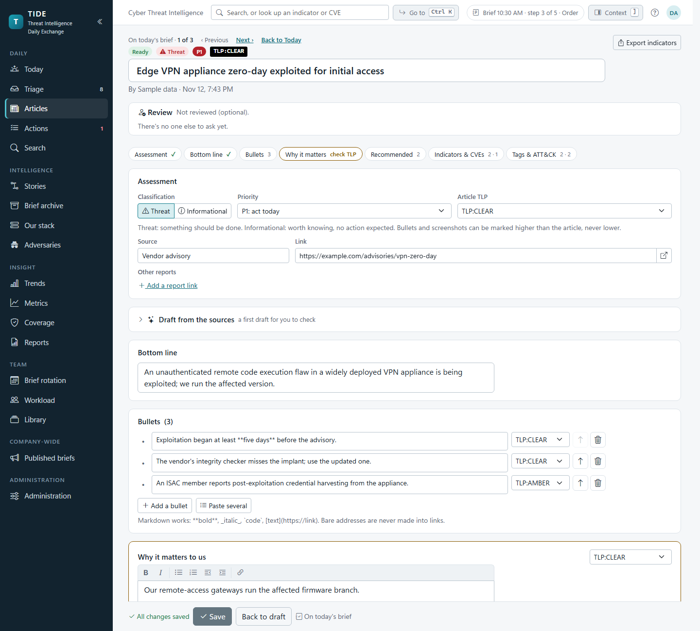
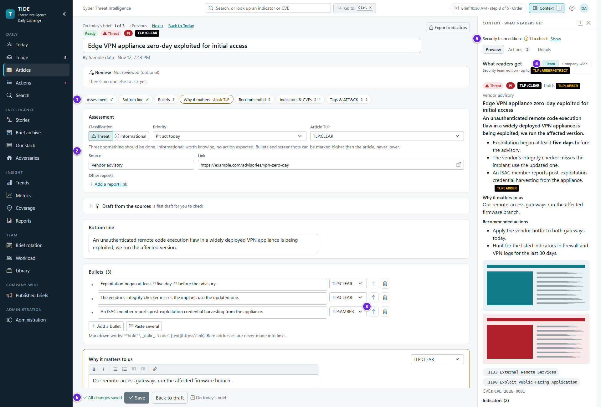
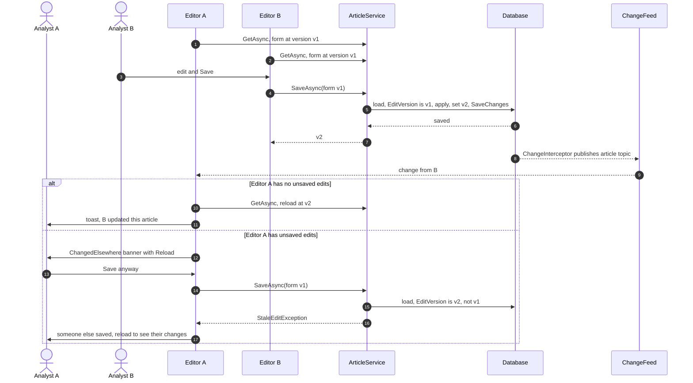
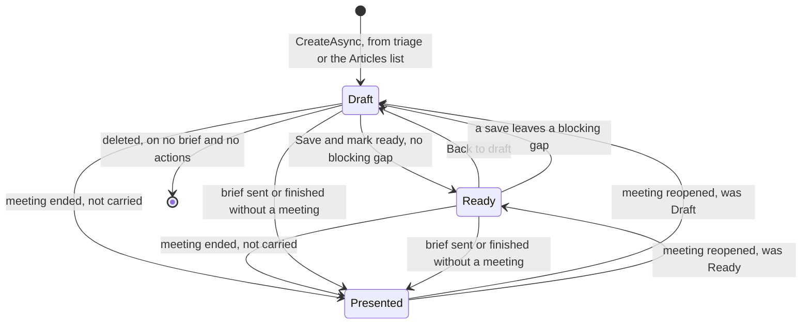
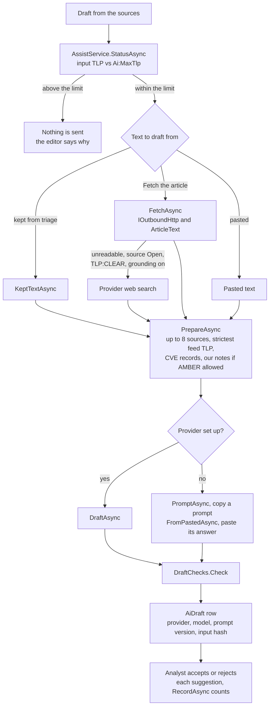
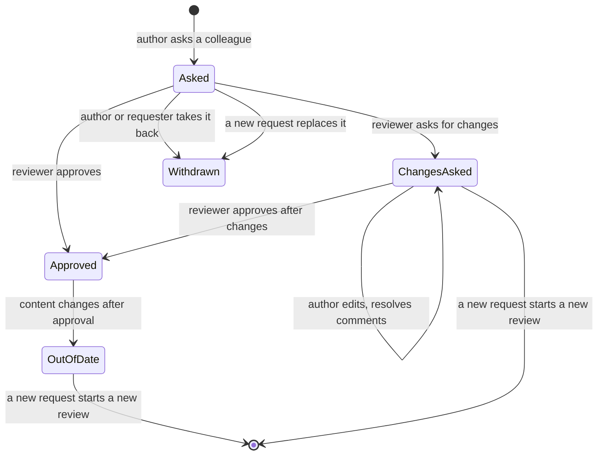

# Writing articles

How an analyst turns a triage item (or a blank form) into an article ready for the brief: the editor, saving and
concurrent edits, screenshots, the indicator finder, AI drafting, the We run and Threat actors pickers, and review
before send. It's for developers changing the editor and for anyone who needs to know what an article holds and when
it's "ready". How an article is cut by TLP for each audience is on
[architecture/editions-and-tlp.md](../architecture/editions-and-tlp.md); the tables are on
[architecture/data-model.md](../architecture/data-model.md).

**Contents**

1. [Starting an article](#starting-an-article)
2. [What an article holds](#what-an-article-holds)
3. [The editor](#the-editor)
4. [Saving, and two people editing at once](#saving-and-two-people-editing-at-once)
5. [Article status](#article-status)
6. [Readiness checks](#readiness-checks)
7. [Screenshots](#screenshots)
8. [Indicators, CVEs and the indicator finder](#indicators-cves-and-the-indicator-finder)
9. [Draft from the sources (AI)](#draft-from-the-sources-ai)
10. [We run and Threat actors](#we-run-and-threat-actors)
11. [Reports, stories and similar articles](#reports-stories-and-similar-articles)
12. [Review before send](#review-before-send)
13. [History](#history)
14. [Deleting an article](#deleting-an-article)
15. [Permissions](#permissions)
16. [Edge cases and the guards that handle them](#edge-cases-and-the-guards-that-handle-them)
17. [Where it lives in code](#where-it-lives-in-code)

## Starting an article

An article starts in one of two ways:

| From | How | What it gets |
|---|---|---|
| Triage | Promote, Promote as one, or the brief's Add article picker linking a shortlisted item | Title, source, link, date, CVEs, TLP from the source, the chosen classification and priority. See [intake-and-triage.md](intake-and-triage.md#promoting-an-item). |
| The Articles list (`/articles`) | New article: title, source name, link, TLP | `ArticleService.CreateAsync`. The link must be http or https. |

Either way it's a **Draft** authored by the person who made it (`AuthorId`, `AuthorName`).

## What an article holds

| Part | Field | Limits and rules |
|---|---|---|
| Title | `Title` | Required, 300 characters (`ArticleService.MaxTitle`). |
| Source | `SourceName`, `SourceUrl`, `PublishedAtUtc` | Name 200. The link is a citation, kept live; an indicator is never put here. http or https only. |
| Marking | `Tlp` | TLP 2.0. Every part counts at its own marking or the article's, whichever is higher (`Article.Effective`). |
| Assessment | `Classification`, `Priority` | Threat (P1 to P4) or Informational. Priority is cleared on an informational article. |
| Bottom line | `Bluf` | 600 characters. One sentence on what happened and why it matters. |
| Bullets | `ArticleBullet` (`Text`, `Tlp`, `SortOrder`) | Markdown, at most 30 (`Article.MaxBullets`), each 2,000. Blank bullets are dropped. |
| Why it matters to us | `WhyItMatters`, `WhyItMattersTlp` | Markdown, 8,000. Its own TLP. On a threat it starts at AMBER (see below). |
| We run | `ArticleProduct` | Products from Our stack. Saved as picked. |
| Recommended actions | `RecommendedActions` | Markdown, 8,000. Each line can be raised as an action in present mode. |
| Screenshots | `ArticleScreenshot` (`FileId`, `Caption`, `Tlp`) | At most 10, PNG, JPEG, GIF or WebP, up to `Files:MaxImageMB` (15) each. |
| Scorecard tags | `ArticleTag` | Configured tags only; a retired tag can't be added. |
| ATT&CK techniques | `ArticleTechnique` | From the embedded Enterprise catalog; a retired id is refused with its replacement named. |
| Threat actors | `ArticleAdversary` | Adversary profiles. Saved as picked. |
| Sectors | `Sectors` | Free text, comma-separated, 500. |
| Indicators | `ArticleIndicator` (`Type`, `Value`, `Note`) | Stored live (refanged, canonical), shown defanged. At most 500 (`IocExtractor.MaxIndicators`), each 2,000. |
| CVEs | `ArticleCve` | `CVE-YYYY-NNNN`, normalised. |
| Other reports | `ArticleLink` | Added from triage, or by hand in the editor. |
| Story | `StoryId` | The threat story it's part of. |

**Linking to something in TIDE from Markdown.** Write the address from the root, `[the action](/actions/12)`, in a
bullet, "why it matters", a comment, an action's details or a note. It works under a sub-path: on a page TIDE puts its
base path in front (`/tide/actions/12`; a link that already has it is left alone), and in the email and the SharePoint
copy it becomes the full address from `App:BaseUrl`. When `App:BaseUrl` isn't set, the email keeps the link's text
without the link. See [frontend.md](../architecture/frontend.md#markdown-rendering).

**"Why it matters" starts at AMBER on a threat.** It usually names our own systems and gaps.
`Article.DefaultWhyItMattersTlp` is AMBER for a threat (or the article's TLP when higher) and CLEAR for an
informational article. It's applied when an article is promoted as a threat, and when an informational article turns
into a threat while "why it matters" is still empty (`Article.Classify`, `ArticleForm.SetClassification`). It only ever
raises, never touches one already written, and isn't a column default, so saved articles keep what they have.

`Article.Actors` is the free-text "Threat actors" box from before the picker. The editor no longer writes it; see
[We run and Threat actors](#we-run-and-threat-actors).

## The editor

1. Section pills, which jump to each part of the article.
2. Assessment: Threat or Informational, priority, the article's TLP, the source and its link, and other reports.
3. Each bullet's own TLP. A part can be marked higher than its article, never lower.
4. *What readers get*, in the context rail: switch between the team and company-wide editions to see the article as
   each carries it.
5. Readiness checks: what's missing before the article can be marked ready.
6. The sticky save bar: save state ("Saving…", "Saved at 10:12", or why it didn't save), *Save*, *Back to draft*,
   and whether the article is on today's brief.

The article page (`/articles/{id}`, `Components/Pages/ArticleEdit.razor`) has two halves:

- **`ArticleEditorPanel`**: the form, one column in the order the sent brief reads: Assessment, Bottom line (with
  *Draft from the sources* above it), Bullets, Why it matters, Recommended actions, Screenshots, Indicators & CVEs, and
  last Tags & ATT&CK. Its text boxes keep a readable width on a wide screen. Section pills jump to each of these but
  Screenshots. A sticky save bar along the bottom holds Save, Discard, Save and mark
  ready (on a draft) or Back to draft (on a ready article), and Add to today's brief.
- **`ReaderPreview`**: in the context rail ("Context · what readers get", docked from 1500px wide; below that
  **Context** or `]` opens it over the page, and on a phone an Edit / Preview switch shows it), whether it's ready ("Ready to brief", or how many things are missing in the
  edition previewed and in the other, with Show, which goes to the first gap in the preview, focused), then three tabs (`?side=actions` or `?side=details`
  opens on one):
  - **Preview**, first: what readers get. The article as the team or company-wide edition carries it (`?edition=company`
    opens on the company-wide one), with what that edition leaves out marked, the readiness gaps, the story and similar
    articles. A gap's link focuses its field; a gap with a fix (`ArticleFix`) applies it to the form.
  - **Actions**, its count on the tab: the article's follow-up actions, title first (`ActionRef`), New action, and how many
    recommended lines aren't raised yet (`RecommendedActions.Raised`, as the meeting slide matches them).
  - **Details**: both editions' verdicts, the briefs it's on, and CVE context.

The section pills mark each part with ✓, a count, "Needed" or "check TLP".

**"Why it matters" carries its TLP fix.** When the paragraph would reach the company-wide edition, its card offers
**Set to AMBER** and **Keep it** beside the warning. On today's open brief with nothing unsaved in the form, they call
the same audited methods Today does (`ArticleService.MarkWhyItMattersAmberAsync` and `KeepWhyItMattersAsync`; see
[brief-and-meeting.md](brief-and-meeting.md#building-the-running-order)). Otherwise Set to AMBER changes the form, and
Save saves it.

On today's brief, `BriefStepper` walks to the article before or after this one in the running order.

Leaving with unsaved changes asks first (`NavigationLock`, `LeaveDialog`). This is one of two prompts that stay the
browser's own, because it has to be answered during navigation.

## Saving, and two people editing at once

Articles carry an `EditVersion` (a GUID) that EF Core treats as a concurrency token. Every save writes a new one. The
form remembers the version it was loaded from.

The check happens twice: `ArticleService.SaveAsync` compares the form's version with the stored one before applying,
and EF Core's concurrency token refuses the `UPDATE` if a save landed between the read and the write
(`DbUpdateConcurrencyException`, turned into the same `StaleEditException`). The refusal reads "Someone else saved this
article while you were editing. Reload it to see their changes." **Reload** on the banner drops the unsaved edits.

What else moves `EditVersion`:

| Change | Moves it? | Why |
|---|---|---|
| A save of the form, Save and mark ready, Back to draft | Yes | |
| Present mode's tag panel (`ArticleService.SaveTagsAsync`) | Yes | It goes through `SaveAsync` with only tags and techniques swapped in. |
| Triage attaching a report that adds a CVE (`IntakeService.AttachAsync`) | Yes | CVEs are part of the form. |
| Adding or removing a screenshot (`ScreenshotService`) | No | It sets `ScreenshotsChangedAtUtc` instead. |
| Tagging a product or adversary | No | Tags are their own rows, heard on `ChangeFeed.ArticleTags`, so a tag never makes an open editor stale. |
| Clearing the earlier actors note (`AdversaryService.ClearEarlierNoteAsync`) | No | Only that column changes. |

**Autosave.** After a two-second pause in typing the editor saves the form, and the save bar says "Saving…", then
"Saved at 3:17 PM", or why it didn't. An analyst who closes the tab or loses the connection loses at most a few
seconds. It keeps the same safety properties as an explicit save:

- **Concurrency.** Every autosave goes through `ArticleService.SaveAsync`, with its permission, edit-version and audit
  checks. When a colleague has saved meanwhile, autosave stops and says who; it never overwrites or merges, and the
  typing stays in the form. A repeated save from the same copy is refused as stale.
- **Markings.** Nothing is autosaved while a change to any TLP marking is pending, or an edit that would put a part
  into the company-wide edition (a new bullet or screenshot, or a part written for the first time at or under its
  ceiling). It waits for **Save**, and the bar says so, so a slip of the hand can't widen an audience.
- **Audit and history.** The audit log keeps every save, each autosave marked `Autosaved`; the article's history shows
  one editing session as one entry.
- **When it's off.** An article on a sent brief is never autosaved (corrections stay deliberate), and it's off for
  anyone who can't edit the article. `UnsavedGuard` stays honest: with nothing unsaved, leaving doesn't ask.

**Marking ready while a colleague saved.** `ArticleService.SetStatusAsync` returns the version before and after. If the
version before is the form's, only the status changed and the form carries on at the new version. If not, a colleague
saved in between: with nothing unsaved, the editor reloads; with unsaved edits, it keeps the old version so the next
save is refused as stale rather than overwriting theirs.

## Article status

| Transition | Code | Rule |
|---|---|---|
| Draft → Ready | `ArticleService.SetStatusAsync(Ready)` | Refused while a blocking check fails: "It isn't ready yet: …". |
| Ready → Draft | `SetStatusAsync(Draft)`, or `SaveAsync` | A save that leaves a blocking gap moves a Ready article back to Draft by itself. |
| → Presented | `BriefService.MarkPresentedAsync` | Every article on the brief except the ones carried to the next brief, and except one also on a later unsent brief when the meeting had already been ended. The status before is kept on the `BriefItem` (`StatusBeforeMeeting`). See [brief-and-meeting.md](brief-and-meeting.md#ending-the-meeting). |
| → Presented | `DistributionService.FinishAsync` | A brief that went out without a meeting finishes its Draft and Ready articles, so they aren't offered on every later brief. |
| Presented → before | `BriefService.ReopenAsync` | Back to `StatusBeforeMeeting`, unless it has since been presented on a later brief. |

The editor offers only Draft ↔ Ready. `SetStatusAsync` itself accepts any defined status for an analyst; the pages are
what keep Presented to the meeting. A Presented article stays editable: that's how a mistake is fixed before a
[correction](distribution.md#corrections-after-a-send).

## Readiness checks

`ArticleChecks.For(article, companyCeiling)` is pure, and the same list shows in the editor's preview, the brief's
running order and the edition check. A blocking check stops Mark ready on the article and Mark ready on a brief that
holds it (`BriefService.MarkReadyAsync`).

| Check | Blocking |
|---|---|
| Add the bottom line (BLUF). | Yes |
| Add at least one bullet. | Yes |
| A threat needs a priority. | Yes |
| A threat should say what to do (recommended actions). | No |
| Add a scorecard tag. | No |
| Say where it came from (source or link). | No |
| N screenshots have no caption. | No |
| Why it matters is TLP:X and will reach the company-wide edition (`WhyReachesCompany`, threats only). Fix: mark it AMBER, offered when AMBER is above the company-wide ceiling. | No |

## Screenshots

Paste anywhere on the page (Ctrl+V) or drop files (`wwwroot/js/paste-drop.js` hands them to a hidden `InputFile`).
`ScreenshotService.AddAsync`:

1. refuses more than 10 on the article, and anything that isn't a PNG, JPEG, GIF or WebP by its bytes
   (`ImageSniffer.RasterContentType`), or over `Files:MaxImageMB`;
2. writes each file to the on-disk store (`DiskFileStore`, under `Files:RootPath`, outside the web root) with its SHA-256
   in `StoredFile`;
3. adds an `ArticleScreenshot` at the end of the order, marked AMBER or the article's TLP when that's higher
   (`ArticleScreenshot.NewFloor`; owner decision 2026-11-11). Lowering it is a marking change, held for an explicit
   Save;
4. stamps `Article.ScreenshotsChangedAtUtc`, before the save, so a failed save leaves an approval out of date rather
   than one standing that shouldn't.

A failure deletes the files already written. Captions and per-screenshot TLP are saved with the form. Removing a
screenshot deletes its row, its `StoredFile` and the file. A frozen send keeps its own copy, so the archive is
unaffected (ADR [0007](../decisions/0007-frozen-sends-and-cid-email.md)). The inline image endpoint
(`/files/{id}/inline`) sniffs the bytes again before serving; who may fetch what is on
[architecture/security.md](../architecture/security.md).

## Indicators, CVEs and the indicator finder

Indicators are typed (`IndicatorType`: IP address, domain, URL, file hash, email address and others), stored live and
canonical (`IocObservable.Normalize`), and shown defanged. The **indicator finder** (`IndicatorAdd` component,
`ArticleService.Suggest`, `Indicators/IocExtractor`) takes pasted text (an article, a vendor's IOC appendix) and lists
candidate URLs, IP addresses, hashes, email addresses, domains and CVE ids, defanged or not, that the article doesn't
already carry. The analyst ticks the ones to keep. It leans towards finding things: a domain is kept when it was defanged
in the text, or when it ends in a common top-level domain and has a lower-case letter, so "ASP.NET" and "U.S." stay
prose. One extraction returns at most 500.

The team edition lists each article's indicators. They can be exported as STIX or CSV; see
[search-exports-and-adversaries.md](search-exports-and-adversaries.md).

## Draft from the sources (AI)

Optional, and off until an administrator sets up a provider (`Ai:Provider`, Azure OpenAI today). ADR
[0004](../decisions/0004-opt-in-ai-with-tlp-ceiling.md) is the decision; the settings are on
[operations/configuration.md](../operations/configuration.md) and the provider on
[operations/integrations.md](../operations/integrations.md).

**The text.** `AssistService.KeptTextAsync` offers the text read in triage for the article's own link. **Fetch the
article** (`FetchAsync`) reads the page through intake's guarded client, and `ArticleText.ExtractAsync` finds the body:
the source's selector, the text the page publishes for search engines, its article markup, or reader-mode scoring. A
source set to Never isn't fetched. When that fails, and the source is marked Open, the article is TLP:CLEAR and
`Ai:WebGrounding` is on, the provider's web search may look it up.

**Several reports.** An article promoted from a group lists its other reports (`OtherSourcesAsync`), with text read in
triage where it's kept. Fetch it, Fetch all (one at a time) or Add another report fill the rest. Every report with text
is a numbered source, each cut to a fair share, at most 8 (`AssistService.MaxSources`).

**The TLP limit.** Nothing above `Ai:MaxTlp` (GREEN by default) is sent. The input's marking is the highest of the
article's TLP, the source's default TLP, and the default TLP of every feed a source text came from; one AMBER report
keeps the whole draft at AMBER. Our notes on what we run (Our stack) are AMBER, so they go only when the limit allows
AMBER; the "based on" line says when they stayed behind.

**The checks** (`DraftChecks.Check`, before the analyst sees anything):

- text trimmed and cut to the editor's limits, Markdown links reduced to their text;
- techniques must be in the ATT&CK catalog (a retired one becomes its replacement);
- tags must be configured ones;
- indicators normalised and marked by whether they're in the source text;
- "why it matters" kept only when our notes went;
- each bullet keeps only the source numbers that exist; its quote is looked for in the sources it cites; one that cites
  nothing or misquotes is flagged and offered only as Add anyway;
- facts the sources disagree on are listed instead of settled;
- what the article already has isn't offered again;
- an answer that isn't the JSON asked for is refused.

The `[1] [3]` citation markers are for the editor only; they never reach the emails. Each suggestion goes into the form
only when accepted. Every draft is an `AiDraft` row: provider (or "Pasted"), model, `DraftPrompt.Version`, a SHA-256 of
what was sent, the input TLP, what it was based on, the suggestions, and counts offered, accepted and rejected. The
source text itself isn't kept.

## We run and Threat actors

Products ("We run", under why it matters) and threat actors (Tags & ATT&CK › Context) use one search picker,
`SearchCombobox`, answered the same way by `StackService` and `AdversaryService`. With nothing typed it offers what the
article's text names, then watched profiles, then what was tagged lately; typing finds a product or profile by any of its
names, best match first and retired ones last; "Add 'X'" makes a new one. How it ranks and paces its searches is on
[search-exports-and-adversaries.md](search-exports-and-adversaries.md#the-tag-pickers).

What matters to the editor: a tag is saved the moment it's picked (`TagArticleAsync`, `UntagArticleAsync`), as its own
row (`ArticleProduct`, `ArticleAdversary`), heard on `ChangeFeed.ArticleTags`, so it **never makes an open editor's save
stale**. A product's **Mention** writes it into the form's why it matters, which the analyst then saves.

**The earlier actors note.** `AdversaryService.ForArticleAsync` splits the old `Article.Actors` text on commas and
semicolons. A name a live profile goes by is offered as a one-click tag; a name already covered by a tag disappears; the
rest shows as "Earlier note" until **Clear** (`ClearEarlierNoteAsync`). No edition, email, slide, export or API field
ever carried that text.

## Reports, stories and similar articles

- **Other reports.** `ArticleLink` rows come from triage (attach, Promote as one) or by hand (`ArticleService.AddLinkAsync`,
  http or https only, refused when the canonical address is already the article's). They count as the article's links
  for triage's past coverage.
- **Story.** `StoryService.LinkAsync` sets `Article.StoryId`. A story's page (`/stories/{id}`) is the timeline of its
  articles. Analysts change stories.
- **Similar articles** (folded under the story picker): `RelatedService.ForArticleAsync` lists up to five other articles
  sharing a CVE, a link or the story, with their briefs and open actions, each one click from mentioning an action or
  joining the story. See [search-exports-and-adversaries.md](search-exports-and-adversaries.md#similar-articles).

## Review before send

Review is a second pair of eyes before an article goes out. It's optional unless an administrator requires it
(`Review:Required`, Access & distribution).

Each request is its own `ArticleReview` row; the article's current review is its latest one that wasn't withdrawn
(`ForArticleAsync`). A new request withdraws only a request still `Asked`; a decided review stays as it was, for the
record. `OutOfDate` isn't stored: `ReviewState.OutOfDate` is worked out by comparing the review's `ReviewedVersion` with
`ReviewService.ContentVersion(article)`, a fingerprint of the article's words, markings, bullets, screenshots and
captions, indicators, CVEs and techniques. It's deliberately not `EditVersion`, which moves when the article is merely
marked Ready and doesn't move when a screenshot is added. A review decided before `ReviewedVersion` existed is out of
date once `ScreenshotsChangedAtUtc` is after its decision.

| Step | Who | Code | Rule |
|---|---|---|---|
| Ask | The author, or any analyst | `ReviewService.AskAsync` | Reviewers are everyone who can write articles but the author and you, this week's presenter first (`ReviewersAsync`). An earlier open request is withdrawn. Someone else's open request can only be replaced by the author. |
| See it | The reviewer | Today (`AskedOfMeAsync`), `/articles/{id}/review` | The article as each edition will carry it. |
| Comment | The reviewer and the author | `CommentAsync` | On a part: title, bottom line, a bullet, why it matters, recommended actions, or general, optionally quoting the words selected. |
| Resolve | The reviewer and the author | `ResolveAsync` | The author sees comments in the editor and resolves them. |
| Decide | The reviewer only | `DecideAsync` | With the checklist: TLP right for every part, every claim sourced, nothing internal in the company-wide edition, the bottom line stands alone. **Approving is refused when the article changed since the reviewer opened it.** |
| Withdraw | The author, or whoever asked | `WithdrawAsync` | Only an open request. |

**The rule** (`ReviewRule`): Off (default), AMBER and above, Threats, or AMBER or threats. "AMBER and above" looks at the
article's highest marking (`ReviewService.Marking`). While it's on, `ReviewService.RequireApprovedAsync` holds every
way an article can leave: an edition's send, the SharePoint copy, marking the brief distributed, finishing it as not
sent, and a correction whose "now" lines add words. The Send dialog lists the brief's articles without a current
approval (`GapsAsync`) whether or not the rule is on. See [distribution.md](distribution.md#review-holds).

## History

Analysts can open **History** on an article (`HistoryService`, `WriteArticles` only, since the log holds every field at
every marking): who changed which field, and when, read from the audit log by the article's key and its tag, technique
and CVE link rows, 50 rows at a time. Edit versions, stamps and user ids are left out as noise. See
[architecture/backend.md](../architecture/backend.md).

## Deleting an article

`ArticleService.DeleteAsync` deletes only a Draft that's on no brief and from which no action was raised. A triage item
promoted into it goes back to New. If a brief took it or an action was raised from it between the check and the delete,
the foreign keys refuse the delete and the same message is shown. Its screenshot files are deleted after the save.

## Permissions

| Activity | Needs | Checked in |
|---|---|---|
| Open an article, read it, see related work and reviews | `ReadTeamEdition` | `ArticleEdit.razor` policy; `ArticleService.RequireRead`; `RelatedService` |
| Create, save, mark ready, delete, add screenshots, indicators, tags, reports, stories | `WriteArticles` | `ArticleService.RequireWrite`; `ScreenshotService`; `StackService`; `AdversaryService`; `StoryService` |
| Draft with AI, fetch the article, copy a prompt | `WriteArticles` | `AssistService.RequireWrite` |
| Ask for, comment on, decide a review; open the review page | `WriteArticles`, and for comments and decisions being the reviewer or author | `ReviewService`; `ReviewPage.razor` policy |
| Set the review rule | `Administer` | `ReviewService.SaveRuleAsync` |
| See History | `WriteArticles` | `HistoryService` |

A Viewer and an Action owner read articles at every marking inside TIDE, as analysts do; see
[architecture/security.md](../architecture/security.md).

## Edge cases and the guards that handle them

| Situation | Guard |
|---|---|
| Two analysts save the same article | `EditVersion` check in `SaveAsync` plus the EF concurrency token; the second gets `StaleEditException`. |
| A colleague saves while you have unsaved edits | `ChangedElsewhere` banner; your edits are kept; your save is refused until you reload. |
| Marking ready just after a colleague's save | `SetStatusAsync` returns before and after versions; the editor keeps the old one when it has unsaved edits. |
| Typing during a save | Edits that didn't reach the save stay marked unsaved. |
| A Ready article loses its bottom line | The save moves it back to Draft. |
| A triage attach adds a CVE under an open editor | The attach bumps `EditVersion`; the editor is told. |
| A screenshot added after approval | `ContentVersion` includes screenshots; the approval is out of date. |
| A reviewer approves words they haven't seen | `DecideAsync` compares the version read with the current one and refuses. |
| A retired scorecard tag or ATT&CK technique | Refused on save, naming the replacement for a technique. |
| AI input above the limit | `AssistService.Status` blocks; nothing is sent. |
| A draft citing a source that doesn't say it | `DraftChecks` flags the bullet; Add anyway only. |
| A web page planting a link in the brief | Every Markdown link in a suggestion (inline, by reference, `<https://…>`, an image) is reduced to its text (`MarkdownService.WithoutLinks`); Markdig renders with raw HTML off and no autolinks. |
| Deleting a draft that a brief just took | The foreign key refuses; the message says it's on a brief. |

## Where it lives in code

| Concern | Code |
|---|---|
| Entities | `src/Tide.Domain/Entities/Article.cs`, `Review.cs`, `Assist.cs` (`AiDraft`) |
| Status and enums | `src/Tide.Domain/Enums/AppEnums.cs` (`ArticleStatus`, `Classification`, `Priority`, `IndicatorType`) |
| Create, save, status, delete, links | `src/Tide.Application/Articles/ArticleService.cs` |
| The form and readiness checks | `src/Tide.Application/Articles/ArticleForm.cs` (`ArticleForm`, `ArticleChecks`, `ArticleFix`) |
| Screenshots and the inline image endpoint | `src/Tide.Application/Files/ScreenshotService.cs`; `src/Tide.Web/Program.cs` (`/files/{id}/inline`) |
| Indicator finder | `src/Tide.Application/Indicators/IocExtractor.cs`; `src/Tide.Domain/Observables/IocObservable.cs` |
| AI drafting | `src/Tide.Application/Assist/AssistService.cs`, `DraftPrompt.cs`, `DraftChecks.cs`, `ArticleText.cs`, `IThreatIntelAssistant.cs` (`AiOptions`) |
| We run, Threat actors | `src/Tide.Application/Stack/StackService.cs`; `src/Tide.Application/Adversaries/AdversaryService.cs` |
| Similar articles | `src/Tide.Application/Search/RelatedService.cs` |
| Stories | `src/Tide.Application/Intake/StoryService.cs` |
| Review | `src/Tide.Application/Reviews/ReviewService.cs` |
| History | `src/Tide.Application/History/HistoryService.cs` |
| Pages and components | `src/Tide.Web/Components/Pages/ArticleEdit.razor`, `Articles.razor`, `ReviewPage.razor`; `src/Tide.Web/Components/Shared/ArticleEditorPanel.razor`, `ReaderPreview.razor`, `DraftAssist.razor`, `IndicatorAdd.razor`, `ReviewCard.razor` |
